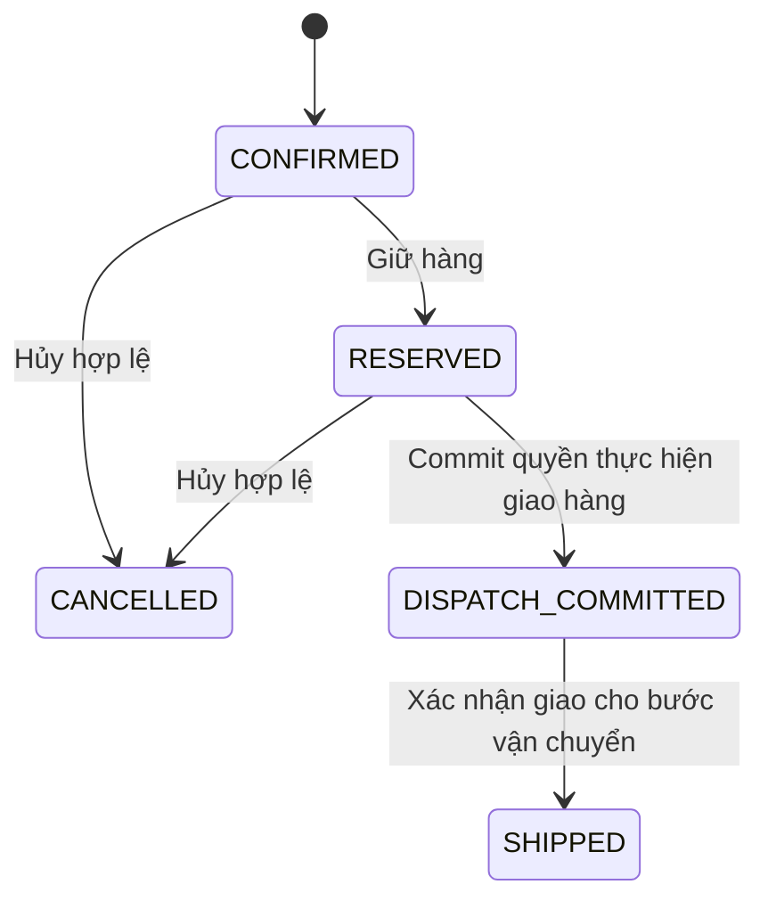
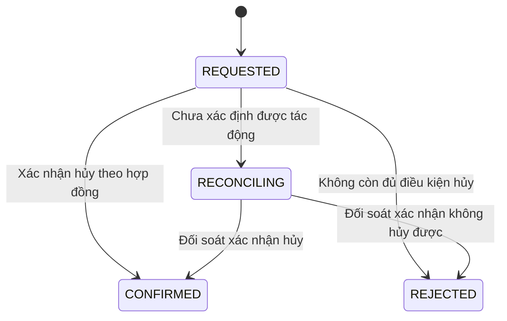

# Cancellation affordance: Khả năng nhận biết và thực hiện hành động hủy

Trong chương **User Experience**, cancellation affordance là cách sản phẩm giúp người dùng nhận biết rằng có thể hủy một thao tác, hiểu điều gì sẽ bị hủy và thực hiện hành động đó với phản hồi rõ ràng. Nó bao gồm nhãn nút, vị trí, trạng thái khả dụng, thông tin hậu quả và cách theo dõi kết quả; không chỉ là việc đặt một nút “Hủy” trên màn hình.

Trong bảo mật logic nghiệp vụ, hủy là một chuyển tiếp có quyền và điều kiện riêng. Nếu giao diện nói đã hủy trong khi máy chủ vẫn xử lý, người dùng có thể gửi thêm lệnh hoặc hiểu sai việc hoàn tiền. Nếu API cho hủy tùy ý, kẻ tấn công có thể lấy lại tồn kho, tiền, điểm thưởng hoặc hạn mức nhiều lần.

Bài học tập trung vào cách kết nối trải nghiệm hủy với invariant, state machine, quyền theo đối tượng, transaction, idempotency và kiểm thử cạnh tranh. Ví dụ xuyên suốt là hủy đơn hàng; các quy tắc trạng thái trong bài là giả định thiết kế để học, không phải chính sách áp dụng cho mọi sản phẩm.

## 1. “Hủy” có thể mang nhiều ý nghĩa khác nhau

Trước khi thiết kế nút, cần xác định người dùng đang muốn dừng điều gì.

| Hành động | Ý nghĩa thực tế | Điều không được tự suy ra |
| --- | --- | --- |
| Đóng hộp thoại | Rời một vùng giao diện | Operation ở máy chủ đã bị hủy |
| Bỏ thay đổi chưa gửi | Xóa bản nháp cục bộ | Một lệnh đã gửi trước đó cũng bị thu hồi |
| Quay lại màn hình trước | Đổi vị trí điều hướng | Đơn hàng hoặc thanh toán không còn tồn tại |
| Dừng chờ response | Client không tiếp tục chờ tại chỗ | Server đã rollback hoặc dừng tác động |
| Yêu cầu hủy | Gửi một lệnh nghiệp vụ tới máy chủ | Việc hủy đã thành công ngay lập tức |
| Hủy đã xác nhận | Máy chủ xác nhận chuyển tiếp hủy theo hợp đồng | Mọi tác động ngoài hệ thống đều đã được đảo ngược |
| Hoàn tiền hoặc bù trừ | Thực hiện một quy trình khắc phục tác động đã có | Tác động ban đầu chưa từng xảy ra |

Ví dụ người dùng đóng cửa sổ khi một thanh toán đang chạy. Việc đóng cửa sổ không hủy khoản thanh toán. Giao diện cần có đường xem lại trạng thái thay vì hiển thị “Đã hủy” chỉ vì người dùng không còn chờ.

Một bản nháp đã lưu trên máy chủ cũng khác với bản nháp chỉ nằm trong form. Xóa bản nháp đã lưu vẫn cần quyền theo đối tượng và quy tắc riêng, không thể xem như việc dọn biến trong trình duyệt.

## 2. Định nghĩa khả năng hủy trước khi thiết kế giao diện

Giả sử sản phẩm có các trạng thái đơn hàng:

```text
CONFIRMED
RESERVED
DISPATCH_COMMITTED
SHIPPED
CANCELLED
```

Trong mô hình minh họa:

- Có thể hủy trực tiếp ở `CONFIRMED` hoặc `RESERVED` nếu đủ quyền và điều kiện.
- `DISPATCH_COMMITTED` là mốc hệ thống đã commit quyền thực hiện bước giao hàng theo quy trình này.
- Sau mốc đó, chức năng hủy trực tiếp không còn được bảo đảm; sản phẩm có thể cung cấp quy trình hỗ trợ, thu hồi hoặc trả hàng riêng nếu có.
- `CANCELLED` là trạng thái hủy đã được xác nhận cho đơn, không tự đồng nghĩa tiền đã về tài khoản người dùng.



Mốc không còn hủy trực tiếp cần có nghĩa bền vững trong hệ thống. Không lấy việc worker “có vẻ sắp chạy” hoặc spinner đã quay đủ lâu làm căn cứ.

Điều kiện hủy có thể được mô tả:

```text
canCancel(actor, order, now) =
    actor có quyền hủy đúng order
    AND order thuộc tenant được phép
    AND order.state nằm trong tập được hủy
    AND điều kiện thời hạn còn hợp lệ
    AND không có cam kết xử lý xung đột đã được áp dụng
    AND các điều kiện nghiệp vụ bổ sung được đáp ứng
```

`now`, quyền, trạng thái và chính sách phải đến từ nguồn được máy chủ kiểm soát. Nút còn sáng trên một trang mở từ lâu không chứng minh điều kiện này vẫn đúng khi người dùng bấm.

## 3. Các bất biến cần bảo vệ

| Bất biến | Kiểu lạm dụng hoặc hiểu sai cần ngăn |
| --- | --- |
| Chỉ người đủ quyền được hủy đúng đối tượng | Đổi order ID để hủy đơn của người khác |
| Hủy giữ đúng ranh giới tenant | Gửi tenant khác trong body hoặc header |
| Một lần hủy hợp lệ không bị thực hiện nhiều lần | Retry làm giải phóng tồn kho hoặc tạo hoàn tiền lặp |
| Hủy và commit giao hàng không cùng thắng từ một điều kiện cạnh tranh | Hai worker đưa ra hai kết luận mâu thuẫn |
| Hủy không tự bỏ qua kiểm soát hoàn tiền | Dùng nút hủy để nhận tiền vượt số được phép |
| Giải phóng tài nguyên chỉ áp dụng cho phần đã giữ tương ứng | Hủy nhiều lần làm tăng tồn kho hoặc hạn mức giả |
| Trạng thái trên giao diện phản ánh mức xác nhận thực tế | Vừa gửi yêu cầu đã hiện “Đã hủy” |
| Kết quả hủy đơn và kết quả hoàn tiền được phân biệt | Đơn đã hủy bị trình bày như tiền đã hoàn xong |
| Sự kiện và thông báo cuối chỉ công bố từ trạng thái đã commit | Email báo hủy thành công nhưng transaction rollback |
| Đổi key không vượt qua invariant nghiệp vụ | Tạo nhiều cancellation request để lấy lại ưu đãi nhiều lần |

Hủy cũng không được trở thành đường vòng để thay đổi giá, xóa quyết định phê duyệt hoặc che dấu vết đã thực hiện. Nếu cần hiệu chỉnh hay bù trừ, phải có loại hành động, quyền và lịch sử phù hợp.

## 4. Thiết kế affordance theo trạng thái và hậu quả

### 4.1. Nhãn hành động phải nói đúng điều sẽ xảy ra

Nên dùng nhãn cụ thể theo ngữ cảnh:

- “Bỏ thay đổi” cho bản nháp chưa gửi.
- “Đóng” cho việc đóng một hộp thoại.
- “Yêu cầu hủy đơn” khi phải chờ máy chủ xử lý yêu cầu hủy.
- “Hủy đơn hàng” khi người dùng đang bắt đầu luồng hủy đơn được hỗ trợ.
- “Kiểm tra trạng thái hủy” khi đã có một operation cần theo dõi.

Tránh dùng một chữ “Hủy” cho cả đóng màn hình xác nhận và gửi lệnh hủy nghiệp vụ. Trong hộp thoại xác nhận hủy đơn, hai lựa chọn có thể là “Xác nhận hủy đơn” và “Giữ đơn hàng”. Nút đóng hộp thoại chỉ đóng bước xem lại, không gửi lệnh hủy.

Liên kết trong email hoặc thông báo nên mở trang phù hợp để người dùng xem lại và thực hiện hành động. Không để việc xem trước hoặc mở một liên kết tự thay đổi trạng thái đơn. Lệnh hủy cần một đường ghi có xác thực và các cơ chế bảo vệ request phù hợp.

### 4.2. Vị trí và trạng thái khả dụng phải dễ nhận biết

Đặt hành động hủy trong ngữ cảnh của đúng đơn hoặc operation. Người dùng cần biết mình đang hủy đối tượng nào, thay vì bấm một nút chung không có dấu hiệu liên kết.

Nếu chưa được hủy hoặc đã qua mốc hỗ trợ, có thể ẩn hành động hoặc hiển thị trạng thái không khả dụng kèm giải thích trong phạm vi được phép. Cần chọn cách nhất quán với sản phẩm và tránh một nút bị vô hiệu hóa không có lý do nào để người dùng hiểu.

Không trình bày `DISPATCH_COMMITTED` thành “đã giao hàng” nếu đó mới là mốc cam kết xử lý. Có thể giải thích đúng mức: “Đơn đã chuyển sang bước xử lý không hỗ trợ hủy trực tiếp.” Chỉ giới thiệu phương án hỗ trợ hoặc trả hàng khi sản phẩm thực sự có luồng đó.

### 4.3. Xem lại hậu quả trước một hành động quan trọng

Với hủy có ảnh hưởng đáng kể, màn hình xem lại nên thể hiện các thông tin cần thiết và được phép:

| Thông tin | Mục đích |
| --- | --- |
| Đơn hoặc phạm vi bị hủy | Tránh chọn nhầm đối tượng |
| Những hạng mục bị ảnh hưởng | Phân biệt hủy toàn bộ và hủy một phần |
| Phí hoặc điều chỉnh theo chính sách nếu có | Giúp xác nhận hậu quả thực tế |
| Khoản hoàn dự kiến và cách theo dõi | Không nhầm dự kiến với tiền đã hoàn tất |
| Ảnh hưởng đến ưu đãi, điểm hoặc tài nguyên liên quan | Tránh hiểu sai điều sẽ được khôi phục |
| Khả năng khôi phục đơn sau khi hủy | Không hứa “hoàn tác” nếu không có cơ chế |

Các giá trị cần lấy từ máy chủ, không do client tự tính rồi coi là cam kết. Nếu chính sách hoặc số tiền thay đổi trước lúc xác nhận, cần yêu cầu xem lại phần thay đổi theo quy tắc sản phẩm, thay vì áp dụng một hậu quả khác một cách âm thầm.

Không cần thêm hộp xác nhận cho mọi lần đóng một bản nháp trống. Mức xác nhận nên tương ứng hậu quả, trong khi bảo vệ quyền và invariant vẫn luôn nằm ở máy chủ.

## 5. API cung cấp khả năng hiển thị nhưng vẫn kiểm tra khi thực thi

Một snapshot minh họa cho người được phép xem đơn:

```json
{
  "orderId": "order-85",
  "state": "RESERVED",
  "version": 12,
  "cancellation": {
    "availability": "AVAILABLE",
    "policyVersion": "cancel-policy-3",
    "requiresReview": true
  },
  "availableActions": [
    "REQUEST_CANCELLATION"
  ]
}
```

`availableActions` giúp giao diện hiển thị đúng vào thời điểm snapshot được tạo. Nó không phải một giấy phép dùng mãi. Người dùng có thể mất quyền, đơn chuyển trạng thái hoặc thời hạn kết thúc trước khi lệnh đến.

Lệnh hủy có thể chứa:

```text
Target: order-85
Idempotency key: cancel-intent-62
Expected version: 12
Reason code: USER_CHANGED_MIND
Policy acknowledgement: cancel-policy-3 nếu hợp đồng yêu cầu
```

Máy chủ phân giải tenant và tác nhân từ ngữ cảnh tin cậy, xác minh order, reason code và mọi thông tin được gửi. Reason mô tả lý do không tự cấp quyền hủy. Một trường `force = true` do client thêm không được mở đường bỏ qua chính sách.

Nếu có quyền quản trị đặc biệt, cần một hành động và chính sách riêng. Quyền quản trị cũng không khiến một tác động bên ngoài tự biến mất; response vẫn phải mô tả đúng mức thực thi và quy trình bù trừ nếu có.

Nếu giao diện hiển thị thời hạn hủy, đồng hồ đếm ngược chỉ là thông tin hỗ trợ. Máy chủ quyết định điều kiện thời gian tại ranh giới áp dụng. Client không được kéo dài khả năng hủy bằng cách đổi đồng hồ hoặc sửa thời điểm trong request.

## 6. Hủy và xử lý tiếp phải có chung ranh giới quyết định

### 6.1. Cạnh tranh giữa hủy và giao hàng

Giả sử hai request cùng đọc trạng thái `RESERVED`:

```text
Request A: người dùng hủy đơn.
Request B: worker commit quyền thực hiện giao hàng.
```

Nếu cả hai kiểm tra trước rồi ghi sau mà không có điều phối, A có thể trả đã hủy trong khi B vẫn tạo lệnh giao hàng.

Trong mô hình minh họa, cả hai đường ghi phải khóa cùng bản ghi hoặc dùng cơ chế version có hiệu lực tương đương:

```text
Cancellation transaction:
    lock order
    require order.state in {CONFIRMED, RESERVED}
    require quyền và các điều kiện hủy còn hợp lệ
    order.state = CANCELLED
    ghi sự kiện, receipt và outbox cần thiết
    commit

Dispatch transaction:
    lock order
    require order.state == RESERVED
    require không có yêu cầu hủy đang chặn xử lý
    order.state = DISPATCH_COMMITTED
    tạo dispatch intent duy nhất và outbox
    commit
```

Nếu hủy thắng trước, đường dispatch không còn đủ điều kiện tạo cam kết giao hàng mới. Nếu dispatch thắng trước, hủy trực tiếp theo mô hình này phải bị từ chối hoặc chuyển sang một luồng khác được định nghĩa rõ.

Mốc `DISPATCH_COMMITTED` là một quy tắc được chọn để có ranh giới bền vững. Nó không chứng minh hàng đã thực sự rời kho. Giao diện phải giải thích theo ý nghĩa thật của mốc đó.

Tính đúng phụ thuộc mọi đường ghi cùng tuân thủ ranh giới: worker, công cụ hỗ trợ, job sửa dữ liệu và API nội bộ. Chỉ khóa ở endpoint hủy còn worker ghi trực tiếp không bảo vệ được invariant.

### 6.2. Kiểm tra rồi gọi hệ thống ngoài vẫn có cửa sổ cạnh tranh

Một worker đọc “chưa hủy” rồi gọi bên ngoài không tự được bảo vệ khỏi một lần hủy xảy ra giữa hai bước. Cần giao thức cam kết xử lý phù hợp: chẳng hạn dispatch intent đã được cấp quyền bền vững dưới cùng ranh giới khóa, sau đó hủy không còn được công bố là đã dừng bước đó.

Nếu dùng token phiên bản hoặc fencing, thành phần tạo tác động phải thực sự thực thi kiểm tra tương ứng. Chỉ gắn version vào message không tự ngăn worker cũ hoặc bên ngoài xử lý lệnh đã phát.

Với tác động đã được bên ngoài chấp nhận, phải xác định còn dừng được hay cần bù trừ. Không trả “đã hủy hoàn toàn” chỉ vì database nội bộ đổi trạng thái.

## 7. Transaction hủy và chống tác động lặp

Một thuật toán hủy cục bộ có thể được thiết kế như sau:

```text
cancelOrder(command, trustedContext):
    resolve và kiểm tra phạm vi truy cập tin cậy
    normalize command và tính fingerprint phía máy chủ

    begin transaction
        claim idempotency key bằng ràng buộc duy nhất

        nếu đã có receipt tương ứng:
            kiểm tra fingerprint và quyền đọc kết quả hiện tại
            trả kết quả cũ mà không hủy lại

        order = lock order trong đúng tenant
        kiểm tra quyền hủy hiện tại trên order
        kiểm tra expected version
        kiểm tra trạng thái, thời hạn và chính sách
        bảo vệ định danh hủy nghiệp vụ không bị áp dụng lặp

        order.state = CANCELLED
        tăng version
        giải phóng reservation cục bộ đúng một lần
        tạo refund intent duy nhất nếu cần hoàn tiền
        ghi sự kiện hủy
        lưu receipt kết quả
        ghi outbox cho các bước ngoài transaction
    commit transaction

    trả kết quả sau khi commit đã được xác nhận
```

Đây là mã giả, không phải mã Java hoàn chỉnh. Việc giải phóng reservation chỉ nằm trong cùng transaction nếu tài nguyên đó thực sự ở cùng phạm vi transaction. Với kho hàng hoặc dịch vụ khác, cần trạng thái và giao thức phối hợp riêng, không giả định rollback database sẽ đảo ngược tất cả.

Receipt của cùng key phải được nhận diện trước khi áp lại các điều kiện chỉ dành cho một lần thực thi mới. Sau khi hủy thành công, expected version cũ đương nhiên không còn là version hiện tại; điều đó không nên làm mất khả năng trả lại kết quả của chính lệnh cũ.

Quyền hiện tại vẫn phải được kiểm tra khi replay. Biết key hoặc operation ID không cho phép xem thông tin đơn của người khác.

### 7.1. Đổi key không được tạo thêm lợi ích

Idempotency key chặn phát lại cùng định danh. Kẻ tấn công có thể đổi key, nên còn cần ràng buộc ở cấp nghiệp vụ:

- Một đơn đã hủy không bị giải phóng cùng reservation lần nữa.
- Một cancellation intent không tạo nhiều refund intent tương đương.
- Tổng tiền đã hoàn không vượt số được phép sau khi tính những lần hoàn trước.
- Điểm, ưu đãi và hạn mức được khôi phục theo đúng phần đã sử dụng và chính sách, không tăng vô hạn qua vòng hủy.

Nếu đơn đã hủy và người gọi có quyền xem, hệ thống có thể trả trạng thái đã hủy hoặc kết quả liên quan, không thực hiện lại cleanup. Nếu cùng key nhưng nội dung có ý nghĩa khác, trả xung đột theo hợp đồng thay vì áp dụng payload mới.

### 7.2. Không gửi thông báo cuối trước commit

Email, push hoặc UI success phải dựa trên trạng thái đã commit theo thiết kế. Ghi sự kiện và outbox cùng transaction giúp không mất ý định thông báo sau khi database thành công.

Publisher có thể phát lặp, nên phía nhận cần xử lý phù hợp. Việc nhận một message hủy trùng không được tạo hoàn tiền hoặc cập nhật tồn kho thêm lần nữa.

## 8. Yêu cầu hủy bất đồng bộ có vòng đời riêng

Một số thao tác cần hỏi bên xử lý hoặc chờ dừng tại checkpoint. Trong trường hợp đó, nên tách trạng thái yêu cầu hủy khỏi trạng thái đơn.



Mô hình này không nói rằng mọi tác động ngoài đã được hoàn lại khi request được tiếp nhận. Nếu đã có tác động và cần bù trừ, phải biểu diễn phần bù trừ riêng.

Nếu sản phẩm cam kết ngừng cấp quyền xử lý mới ngay khi tiếp nhận yêu cầu hủy, trạng thái chặn đó phải được lưu dưới cùng cơ chế điều phối mà worker kiểm tra. Chỉ ghi một message “người dùng muốn hủy” vào hàng đợi không tự bảo đảm worker chưa tạo tác động mới.

Đối với batch hoặc tác vụ có nhiều phần, hủy có thể chỉ dừng phần chưa bắt đầu. Giao diện cần phân biệt phần đã hoàn thành, phần đã dừng và phần chưa rõ kết quả. Không mô tả cả batch là chưa từng thực hiện.

### Response tiếp nhận khác response hoàn tất

Một response tiếp nhận có thể gồm:

```json
{
  "operationId": "cancel-op-62",
  "orderId": "order-85",
  "cancellationState": "REQUESTED",
  "orderState": "RESERVED",
  "recovery": {
    "action": "CHECK_CANCELLATION_STATUS"
  }
}
```

Giao diện phù hợp là “Đã nhận yêu cầu hủy. Đang kiểm tra khả năng dừng xử lý.” Không đổi thành “Đơn đã hủy” chỉ vì response có mã tiếp nhận thành công.

Nếu mất response, cần tra cứu hoặc gửi lại cùng key theo hợp đồng idempotency. Timeout không chứng minh lệnh hủy thất bại; tạo key mới rồi chạy cleanup lần nữa không phải cách phục hồi an toàn.

## 9. Hủy đơn không đồng nghĩa hoàn tiền xong

Một kết quả cục bộ đã commit có thể là:

```json
{
  "operationId": "cancel-op-62",
  "orderId": "order-85",
  "orderState": "CANCELLED",
  "cancellationState": "CONFIRMED",
  "refundState": "PENDING",
  "statusVersion": 4,
  "delivery": "CREATED"
}
```

Trạng thái này cho phép thông báo: “Đơn đã hủy. Hoàn tiền đang được xử lý.” Không được dùng thông báo “Đã hoàn tiền” khi mới tạo refund intent.

Cần xác định riêng:

| Chiều trạng thái | Câu hỏi |
| --- | --- |
| Đơn hàng | Đơn còn được thực hiện tiếp không? |
| Yêu cầu hủy | Yêu cầu đã được tiếp nhận, xác nhận hay từ chối? |
| Giữ hàng hoặc tài nguyên | Reservation đã được giải phóng ở phạm vi nào? |
| Thanh toán hoặc hoàn tiền | Tiền đang chờ xử lý, đã hoàn hay cần đối soát? |

Không bắt một cột trạng thái chung gánh mọi ý nghĩa rồi khiến thông báo mâu thuẫn. Đồng thời cũng không cần hiển thị mọi trạng thái kỹ thuật cho người dùng; giao diện có thể tổng hợp bằng câu chữ, miễn không khẳng định vượt quá điều đã biết.

Nếu hoàn tiền lỗi sau khi đơn đã hủy, không tự chuyển đơn về đang xử lý chỉ để làm các cột giống nhau. Cần xử lý và theo dõi phần hoàn tiền theo state machine riêng. Điều tra phải giữ được mối liên kết giữa order, cancellation operation và refund intent.

## 10. Cạnh tranh, nhiều tab và phản hồi đến muộn

Một màn hình có thể hiển thị nút hủy trong khi tab khác vừa xác nhận một bước xử lý. Khi người dùng bấm, API cần trả xung đột hoặc trạng thái mới trong phạm vi được phép. Giao diện nên tải lại và giải thích, không tự gửi `forceCancel` để biến nút cũ thành quyền hiện tại.

Nếu người dùng bấm nhiều lần, giao diện có thể khóa gửi cùng lệnh đang chờ và giữ một đường xem trạng thái. Cơ chế đó giảm nhầm lẫn nhưng không thay thế ràng buộc máy chủ khi nhiều thiết bị cùng gửi.

Response cần được gắn với đúng order, cancellation operation và ngữ cảnh tài khoản. Không để response của tài khoản trước ghi dữ liệu vào màn hình sau khi đổi tài khoản hoặc tenant.

Với response đến lệch thứ tự:

- Không hạ một kết quả hủy đã xác nhận thành chưa rõ chỉ vì một timeout cũ đến muộn.
- Nếu server cung cấp version trạng thái, áp dụng theo bảo đảm thứ tự đã công bố.
- Phân biệt kết quả cancellation operation với snapshot hiện tại của đơn và trạng thái hoàn tiền.
- Không áp dụng một callback giao hàng cũ để âm thầm ghi đè `CANCELLED` ngoài state machine.

Nếu dữ liệu bên ngoài mâu thuẫn với trạng thái đã công bố, cần đưa vào đường đối soát và xử lý sự cố thích hợp. Không che mâu thuẫn bằng cách chỉ đổi câu chữ trên giao diện.

## 11. Thông báo, khả năng tiếp cận và đường hỗ trợ

| Tình huống | Thông báo minh họa | Hành động phù hợp |
| --- | --- | --- |
| Bản nháp chưa gửi | “Bỏ các thay đổi chưa lưu?” | Bỏ thay đổi hoặc tiếp tục chỉnh sửa |
| Đã nhận yêu cầu hủy | “Yêu cầu hủy đã được tiếp nhận.” | Xem trạng thái hủy |
| Chưa biết kết quả hủy | “Chưa xác định được kết quả. Hãy kiểm tra trạng thái trước khi gửi yêu cầu khác.” | Kiểm tra trạng thái |
| Hủy đơn thành công, hoàn tiền còn chờ | “Đơn đã hủy. Hoàn tiền đang được xử lý.” | Xem tiến độ hoàn tiền |
| Qua mốc hủy trực tiếp | “Đơn đã chuyển sang bước không hỗ trợ hủy trực tiếp.” | Xem phương án thực sự được sản phẩm hỗ trợ |
| Mất quyền truy cập | “Bạn hiện không thể tiếp tục thao tác này.” | Hướng hỗ trợ trong phạm vi phù hợp |

Không nêu tên người duyệt, số tiền hoặc trạng thái nội bộ của tài nguyên mà người gọi không có quyền biết. Lý do chi tiết có thể nằm trong log được phân quyền, còn thông báo công khai giữ mức phù hợp.

Nhãn nút, trạng thái và kết quả cần hiểu được bằng văn bản, không chỉ màu sắc. Hỗ trợ thao tác bằng bàn phím, focus hợp lý và thông báo thay đổi trạng thái có ý nghĩa. Khi đang poll, tránh liên tục giật focus hoặc đọc lại cùng một thông báo không đổi.

Không làm người dùng phải đóng nhiều hộp thoại không liên quan để tìm hành động hủy được hỗ trợ. Đồng thời tránh đặt nút hủy nghiệp vụ ở vị trí dễ nhầm với nút điều hướng thường dùng.

Nếu không thể tự đối soát, cung cấp tham chiếu hỗ trợ phù hợp. Không yêu cầu người dùng gửi token, cookie hoặc mật khẩu. Mã operation là tham chiếu để người được cấp quyền điều tra, không phải giấy phép xem dữ liệu.

Người dùng rời trang khi còn pending không có nghĩa đã hủy hoặc thất bại. Hệ thống quan sát cần giữ sự khác biệt này. Có thể đo hành trình bắt đầu hủy, hủy đã xác nhận, từ chối do trạng thái và thời gian đối soát, với label hữu hạn; thông tin định danh nằm ở dấu vết có kiểm soát quyền.

## 12. Kiểm thử trải nghiệm cùng kịch bản lạm dụng

| Kịch bản | Kỳ vọng giao diện | Điều phải chứng minh ở hệ thống |
| --- | --- | --- |
| Đóng hộp thoại trước khi gửi | Chỉ đóng bước xem lại | Không tạo lệnh hủy |
| Đóng trang khi lệnh đang chạy | Không khẳng định đã hủy nghiệp vụ | Operation có thể tiếp tục và còn đường tra cứu |
| Xem trước liên kết thông báo | Không tự hủy đơn | Lượt đọc không tạo thay đổi trạng thái |
| Đổi order ID sang đơn người khác | Thông báo không lộ dữ liệu ngoài quyền | Kiểm tra quyền theo đối tượng và tenant |
| Thêm cờ force hoặc actor giả | Không mở thêm hành động ngoài quyền | Máy chủ không tin trường nâng quyền của client |
| Trang cũ vẫn còn nút hủy | Tải trạng thái mới và giải thích xung đột | Không dùng snapshot cũ làm quyền thực thi |
| Client đổi đồng hồ hoặc thời hạn | Không kéo dài khả năng hủy thật | Máy chủ đánh giá điều kiện thời gian |
| Hủy và dispatch chạy đồng thời | Một kết luận hợp lệ theo mốc đã định nghĩa | Không vừa công bố đã chặn giao vừa cấp cam kết giao mới |
| Double-click hoặc nhiều tab hủy | Theo dõi cùng ý định thích hợp | Không giải phóng tồn kho hoặc tạo hoàn tiền lặp |
| Cùng key nhưng đổi payload | Hiển thị xung đột, không đổi key tự động | Không thực hiện nội dung mới dưới key đã ràng buộc |
| Đổi key để hủy lại | Hiển thị trạng thái đã có theo quyền | Invariant ngăn khôi phục lợi ích nhiều lần |
| Có lần hoàn tiền trước đó | Thể hiện khoản còn được xử lý theo chính sách | Tổng hoàn không vượt số được phép |
| Chính sách hoặc phí đổi trước xác nhận | Cho xem lại thay đổi cần xác nhận | Không áp dụng hậu quả khác âm thầm |
| Commit hủy xong nhưng response mất | Chưa rõ rồi replay hoặc đối soát | Không tạo tác động hủy lần hai |
| Ngoài hệ thống chưa xác nhận dừng | Chỉ hiện yêu cầu đang xử lý hoặc đối soát | Không tuyên bố hủy hoàn toàn thiếu căn cứ |
| Đơn đã hủy nhưng hoàn tiền chưa xong | Hiển thị hai trạng thái đúng nghĩa | Không đánh dấu hoàn tiền thành công giả |
| Notification được tạo lúc transaction rollback | Không có thông báo hủy cuối sai | Sự kiện cuối và outbox khớp commit |
| Callback cũ đến sau hủy | Không ghi đè trạng thái tùy ý | Chuyển tiếp được kiểm soát và có đối soát khi mâu thuẫn |
| Đổi tài khoản lúc đang poll | Không lộ kết quả vào ngữ cảnh mới | Endpoint tra cứu kiểm tra quyền hiện tại |
| Dùng bàn phím hoặc công cụ hỗ trợ | Nhận biết đúng nút và trạng thái | Không có hành động hủy ngoài ý muốn do focus hoặc nhãn mơ hồ |

Kiểm thử race cần cho hai đường thực thi thật sự tranh cùng điều kiện ban đầu, rồi đối chiếu order, version, reservation, refund intent, receipt và outbox. Chỉ kiểm tra một message “Đã hủy” không chứng minh invariant được giữ.

Với fault injection, kiểm tra trước commit, lúc kết quả commit chưa rõ, sau commit trước response và sau khi bên ngoài tiếp nhận. Những ranh giới này cần thông báo và hành vi phục hồi khác nhau.

Đối với quy trình bất đồng bộ, kiểm thử nhận message trùng, worker cũ tiếp tục sau lease và sự kiện lệch thứ tự. Mọi cơ chế chống lặp hoặc fencing cần được kiểm chứng tại đúng nơi tạo tác động, không chỉ ở lớp hiển thị.

## 13. Tiêu chí hoàn thành thiết kế

Một cancellation affordance an toàn cần trả lời rõ:

- Người dùng đang đóng giao diện, bỏ bản nháp, yêu cầu hủy hay theo dõi hủy đã xác nhận?
- Hành động áp dụng cho đối tượng nào, còn khả dụng ở trạng thái nào và qua mốc nào thì không còn bảo đảm?
- Những hậu quả về hàng, tiền, ưu đãi và dữ liệu đã được giải thích đúng mức chưa?
- Quyền và trạng thái có được kiểm tra lại khi lệnh thực sự áp dụng không?
- Hủy, xử lý tiếp và retry có giữ cùng invariant dưới concurrency không?
- Kết quả đơn hàng, cancellation operation và hoàn tiền có được phân biệt khi cần không?
- Thông báo cuối, receipt và sự kiện có khớp với ranh giới commit và tác động ngoài thực tế không?

Một nút hủy đáng tin giúp người dùng hiểu khả năng kiểm soát của mình, thực hiện đúng ý định và theo dõi kết quả không mơ hồ. Cam kết trên giao diện cần được bảo đảm bằng chính state machine, quyền theo đối tượng và transaction đang điều khiển nghiệp vụ.
