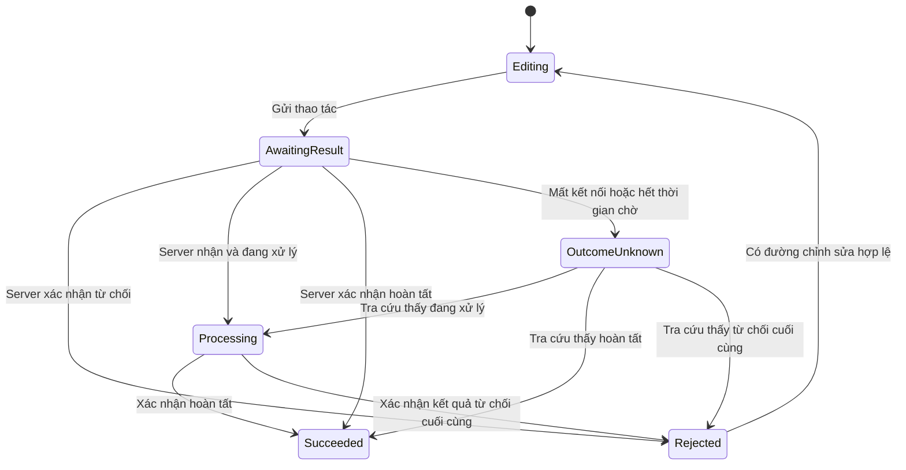
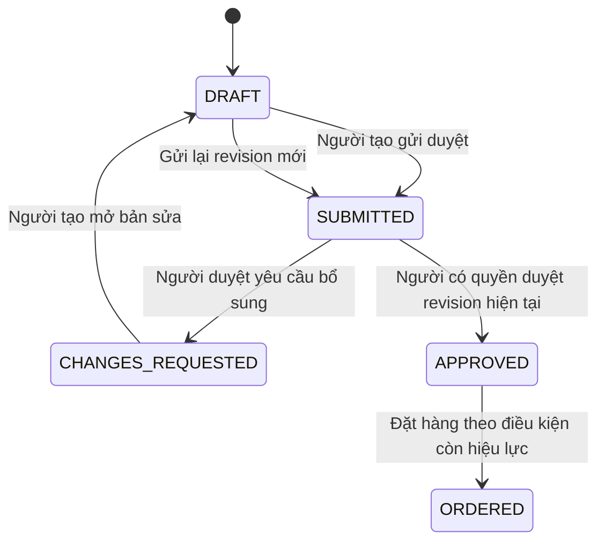

# Recovery from rejection — Khôi phục luồng sử dụng sau khi bị từ chối

## 1. Mục tiêu của bài học

Trong bảo mật logic nghiệp vụ, từ chối một yêu cầu chỉ là bước đầu. Người dùng còn cần biết điều gì đã xảy ra, phần công việc nào đã được lưu và hành động hợp lệ tiếp theo là gì. Nếu giao diện chỉ hiện “Thất bại, vui lòng thử lại”, người dùng có thể gửi nhiều yêu cầu, tạo giao dịch trùng, mất dữ liệu hoặc tìm cách đi vòng qua quy trình.

**Recovery from rejection** là thiết kế con đường để người dùng tiếp tục công việc sau khi một thao tác bị từ chối, trong khi hệ thống vẫn giữ các quy tắc nghiệp vụ và kiểm tra bảo mật. Khôi phục có thể là sửa dữ liệu rồi gửi lại, tải trạng thái mới, xác thực lại, xin cấp quyền qua quy trình chính thức hoặc dừng thao tác nếu không có đường tiếp tục hợp lệ.

Bài học thuộc module `SECURITY_APPLICATION_SECURITY_BUSINESS_LOGIC_SECURITY`, tập trung vào bảo vệ quy tắc nghiệp vụ trước việc bỏ qua phê duyệt, sửa giá, thao tác sai quyền và gửi yêu cầu trùng. Các quyết định UX được nối trực tiếp với business invariants, state machine, quyền theo đối tượng, transaction, idempotency và kiểm thử tình huống tấn công logic.

Sau bài học, bạn có thể:

- Phân biệt yêu cầu bị từ chối chắc chắn với yêu cầu đang xử lý hoặc chưa biết kết quả.
- Thiết kế thông báo và hành động tiếp theo mà không làm lộ dữ liệu nhạy cảm.
- Giữ dữ liệu có thể khôi phục mà không tin lại dữ liệu giá, quyền hoặc phê duyệt từ phía client.
- Xây dựng retry an toàn với idempotency và kiểm tra lại trạng thái trên server.
- Kiểm thử việc khôi phục trước các tình huống gửi trùng, thay đổi quyền và cạnh tranh đồng thời.

## 2. Ba ý nghĩa khác nhau của “bị từ chối”

Không nên gom tất cả trường hợp vào một trạng thái `ERROR`.

| Tình huống | Ý nghĩa | Hướng khôi phục |
| --- | --- | --- |
| Dữ liệu không thỏa điều kiện | Server xác định yêu cầu này không được thực hiện, chẳng hạn số lượng vượt giới hạn | Chỉ rõ trường có thể sửa và điều kiện được phép công bố |
| Không đủ quyền hoặc phiên hết hạn | Chủ thể hiện tại chưa được phép thực hiện hành động | Xác thực lại hoặc đi theo quy trình xin quyền; server vẫn kiểm tra lại đối tượng |
| Trạng thái nghiệp vụ đã thay đổi | Yêu cầu dựa trên phiên bản hoặc bước quy trình cũ | Tải trạng thái hiện tại và cho người dùng chọn hành động còn hợp lệ |
| Hồ sơ bị người duyệt trả lại | Đây là một quyết định nghiệp vụ hợp lệ, có thể chuyển hồ sơ sang trạng thái cần chỉnh sửa | Hiển thị lý do được phép xem, tạo hoặc sửa bản nháp theo chính sách rồi gửi duyệt lại |
| Mất kết nối sau khi gửi | Client không biết server đã thực hiện hay chưa | Tra cứu kết quả của thao tác trước; chưa kết luận bị từ chối |

Một phản hồi từ chối thao tác không nhất thiết làm thay đổi trạng thái của đối tượng. Ngược lại, thao tác “trả hồ sơ để bổ sung” của người có quyền có thể là một chuyển trạng thái nghiệp vụ đã được chấp nhận.

Ví dụ: yêu cầu tự phê duyệt bị từ chối và hồ sơ vẫn ở `SUBMITTED`; yêu cầu của người duyệt trả hồ sơ được chấp nhận và hồ sơ chuyển sang `CHANGES_REQUESTED`. Cả hai có thể xuất hiện dưới tên “từ chối” trên giao diện, nhưng quy tắc khôi phục khác nhau hoàn toàn.

## 3. Các bất biến phải còn đúng trong quá trình khôi phục

Business invariant là điều kiện phải luôn đúng với trạng thái nghiệp vụ đã được ghi nhận. Luồng recovery không được trở thành một ngoại lệ ngầm.

Ví dụ với hệ thống đề nghị mua hàng:

1. Người tạo không được tự phê duyệt hồ sơ của mình.
2. Chỉ người có quyền trên đúng đơn vị và đúng hồ sơ mới được duyệt.
3. Phê duyệt gắn với phiên bản nội dung cụ thể; sửa trường trọng yếu phải làm mất hiệu lực phê duyệt cũ theo chính sách.
4. Giá, mức giảm và tổng tiền phải được xác định hoặc xác minh bằng dữ liệu đáng tin cậy trên server.
5. Một thao tác thanh toán logic chỉ được tạo tối đa một hiệu lực tài chính tương ứng.
6. Trạng thái hoàn tất không được hiển thị trước khi có bằng chứng đủ tin cậy từ hệ thống xử lý.

Các bất biến này áp dụng cho nút “Thử lại”, API khôi phục, đường dẫn trong email, ứng dụng di động và công cụ hỗ trợ nội bộ. Một nút ít nổi bật hơn vẫn có cùng trách nhiệm bảo mật với nút chính.

### Phản ví dụ: khôi phục bằng cách bỏ qua kiểm tra

```text
Lần đầu:   submit(orderId) -> server từ chối vì chưa được duyệt
Khôi phục: forceSubmit(orderId, skipApproval=true) -> server chấp nhận
```

Đây là một đường bỏ qua quy tắc nghiệp vụ. Tên gọi “khôi phục” hoặc “hỗ trợ người dùng” không làm cho đường đi này an toàn hơn.

Đường đi hợp lệ là đưa người dùng về bước cần duyệt, giữ dữ liệu được phép giữ và chỉ cho phép gửi tiếp khi trạng thái cùng quyền hạn đáp ứng điều kiện.

## 4. Mô hình kết quả: tách trạng thái thao tác và trạng thái đối tượng

Một hồ sơ có thể vẫn ở `DRAFT` trong khi lần gửi mới nhất đã bị từ chối. Một đơn hàng có thể ở `PAYMENT_PENDING` trong khi trình duyệt bị timeout. Vì vậy cần theo dõi hai lớp:

- **Trạng thái đối tượng**: nháp, chờ duyệt, yêu cầu bổ sung, đã duyệt, đã hủy.
- **Trạng thái thao tác**: chưa gửi, đang chờ phản hồi, bị từ chối chắc chắn, đã chấp nhận để xử lý, hoàn tất hoặc chưa xác định được kết quả.

Mô hình phía giao diện có thể biểu diễn như sau:



`OutcomeUnknown` là nhận thức của client, không phải bằng chứng giao dịch thất bại. Tra cứu chưa thấy bản ghi cũng chưa luôn chứng minh yêu cầu chưa tới server: có thể tồn tại độ trễ hoặc tiến trình tiếp nhận chưa kết thúc. Hợp đồng xử lý phải xác định lúc nào có thể kết luận cuối cùng và lúc nào cần tiếp tục đối soát.

Nếu thao tác có thể thành công một phần, chẳng hạn đã tạo giữ chỗ nhưng chưa thu tiền, cần trạng thái riêng cùng hành động giải quyết tương ứng. Không báo “không có thay đổi nào” khi vẫn còn hiệu lực phụ đang tồn tại.

## 5. Thiết kế thông báo có thể hành động và không lộ dữ liệu

Một thông báo tốt trả lời được bốn câu hỏi, trong phạm vi thông tin người nhận được phép biết:

1. Thao tác nào chưa thể hoàn thành?
2. Trạng thái nào đã được xác nhận?
3. Dữ liệu nào đã được lưu hoặc chưa được lưu?
4. Người dùng có thể làm gì tiếp theo?

### 5.1. Ví dụ thông báo

| Trường hợp | Thông báo minh họa | Hành động chính |
| --- | --- | --- |
| Hồ sơ chưa được duyệt | “Chưa thể đặt hàng vì hồ sơ đang chờ duyệt. Bản nháp đã được lưu.” | Xem tiến trình duyệt |
| Báo giá thay đổi | “Báo giá đã thay đổi. Hãy xem lại tổng tiền mới trước khi xác nhận.” | Xem báo giá mới |
| Dữ liệu cũ | “Hồ sơ đã được cập nhật. Tải phiên bản mới để tiếp tục.” | Tải phiên bản mới |
| Hết phiên đăng nhập | “Phiên làm việc đã hết hạn. Đăng nhập lại để tiếp tục từ bản nháp đã lưu.” | Đăng nhập lại |
| Không được phép truy cập | “Không thể thực hiện thao tác với tài nguyên này.” | Về danh sách được phép xem |
| Chưa biết kết quả thanh toán | “Chưa xác định được kết quả thanh toán. Hệ thống đang kiểm tra giao dịch đã gửi.” | Xem trạng thái giao dịch |

Chỉ dùng câu “Bản nháp đã được lưu” nếu đã nhận xác nhận lưu thành công. Nếu bản nháp chỉ còn trong bộ nhớ của trang, thông báo phải nói rõ mức độ lưu giữ đó; không khiến người dùng tin rằng đổi thiết bị vẫn lấy lại được dữ liệu.

### 5.2. Không công bố quá mức

Thông báo “Hồ sơ 815 thuộc công ty B và cần giám đốc Nguyễn X phê duyệt” có thể tiết lộ sự tồn tại của hồ sơ, tổ chức và người duyệt cho người không có quyền xem. Với tài nguyên ngoài phạm vi truy cập, dùng thông báo công khai phù hợp chính sách che giấu tài nguyên; ghi nguyên nhân chi tiết vào hệ thống nội bộ có kiểm soát quyền.

Mã lỗi chi tiết cũng có thể làm lộ thông tin. Nếu UI dùng câu chung nhưng API trả `RESOURCE_EXISTS_IN_OTHER_TENANT`, hệ thống vẫn tiết lộ điều cần che giấu. Chính sách công bố phải áp dụng cho mã lỗi, trường dữ liệu, đường tra cứu trạng thái và kênh hỗ trợ.

Không trả stack trace, biểu thức phân quyền nội bộ, token, tên bảng hay quy tắc chấm điểm chống gian lận. Có thể đưa mã tra cứu hỗ trợ để đội vận hành tìm dấu vết; mã đó không thay thế kiểm tra quyền.

### 5.3. Không hướng dẫn sửa những trường người dùng không được sửa

Khi server phát hiện `unitPrice` bị thay đổi, giao diện không nên hướng dẫn “Nhập lại đơn giá hợp lệ” nếu vai trò hiện tại vốn không có quyền đặt giá. Cách khôi phục là tải giá từ server và yêu cầu xác nhận lại nội dung được phép thay đổi, chẳng hạn số lượng.

Tương tự, nếu thiếu quyền duyệt, hành động tiếp theo có thể là xem quy trình xin quyền. Không hiển thị tùy chọn tự gán vai trò hoặc chọn người duyệt ngoài phạm vi chính sách.

## 6. Chọn đường khôi phục theo nguyên nhân

### 6.1. Dữ liệu vi phạm điều kiện có thể sửa

Giữ các giá trị người dùng đã nhập hợp lệ; đánh dấu trường cần điều chỉnh; giải thích giới hạn có thể công bố. Khi gửi lại, server phải đánh giá toàn bộ bất biến liên quan, không chỉ trường từng báo lỗi.

Ví dụ số lượng mua vượt hạn mức còn lại. Sau khi người dùng sửa số lượng, hạn mức có thể đã bị một giao dịch khác tiêu thụ. Giới hạn hiển thị là thông tin hỗ trợ tại một thời điểm, không phải cam kết sẽ chấp nhận lần gửi tiếp theo.

### 6.2. Phiên hết hạn hoặc cần xác thực bổ sung

Lưu bản nháp theo cơ chế phù hợp trước khi chuyển sang màn hình xác thực, nếu điều kiện lưu còn được đáp ứng. Sau khi đăng nhập lại:

1. Xác định lại người dùng và phạm vi tổ chức hiện tại.
2. Kiểm tra lại quyền đọc bản nháp và quyền thực hiện thao tác.
3. Tải trạng thái, giá và điều kiện đang có hiệu lực.
4. Cho người dùng xác nhận lại hành động nhạy cảm khi cần.

Nếu người dùng đăng nhập bằng tài khoản khác, không tự mở bản nháp riêng tư của tài khoản trước. Xác thực bổ sung cũng không tự cấp quyền trên một đối tượng; nó chỉ đáp ứng một điều kiện xác thực trong chính sách.

### 6.3. Không đủ quyền trên đối tượng

Ẩn hoặc vô hiệu hóa nút có thể giảm thao tác nhầm, nhưng server vẫn phải từ chối yêu cầu không hợp lệ. Nếu có cơ chế xin quyền, tách rõ việc **gửi yêu cầu cấp quyền** khỏi việc **đã được cấp quyền**.

Sau khi quyền được cấp, thao tác ban đầu phải được đánh giá lại bằng trạng thái hiện tại. Không phát lại mù quáng một lệnh cũ với giá, người nhận hoặc nội dung đã lỗi thời.

### 6.4. Trạng thái hoặc phiên bản đã thay đổi

Hiển thị thay đổi mà người dùng được phép xem, tải phiên bản mới và xác định phần nhập liệu nào có thể áp dụng lại. Không tự ghi đè toàn bộ đối tượng bằng bản cũ chỉ để tránh mất nội dung.

Ví dụ hồ sơ đã bị hủy trong lúc người dùng mở trang duyệt. Nút “Tải lại” đưa họ tới trạng thái đã hủy; không phục hồi nút duyệt bằng cách dùng lại phiên bản cũ.

### 6.5. Quyết định từ chối nghiệp vụ cần bổ sung

Cho người nộp xem lý do được phép công bố và các trường cần sửa. Nếu sửa nội dung làm thay đổi cơ sở phê duyệt, tạo revision mới hoặc đưa hồ sơ về bước duyệt cần thiết theo quy tắc.

Không phải quyết định từ chối nào cũng cho phép gửi lại. Hồ sơ đã đóng vĩnh viễn có thể chỉ được xem hoặc mở yêu cầu mới theo chính sách. Giao diện phải phản ánh đúng đường đi được hỗ trợ.

### 6.6. Chưa biết kết quả hoặc đang xử lý

Ưu tiên tra cứu thao tác đã gửi. Cho người dùng thấy mã theo dõi thuộc quyền truy cập của họ và trạng thái có ý nghĩa. Nếu cần kiểm tra định kỳ, áp dụng khoảng chờ và giới hạn phù hợp để tránh tạo tải lớn.

Không đặt nút “Thanh toán mới” làm hành động mặc định ngay sau timeout. Chỉ mở thao tác mới khi kết quả cũ đã được giải quyết theo hợp đồng xử lý hoặc có quy trình xử lý trùng được kiểm soát rõ ràng.

## 7. Ví dụ xuyên suốt: hồ sơ mua hàng bị trả lại

Giả sử hệ thống có các trạng thái sau:



Sơ đồ chỉ minh họa các đường liên quan đến khôi phục. Hệ thống thực tế có thể bổ sung hủy, hết hạn hoặc từ chối cuối cùng, nhưng mọi đường phải có điều kiện rõ ràng.

Một lần khôi phục hợp lệ:

1. Lan gửi hồ sơ revision 3 gồm mặt hàng, số lượng và báo giá tham chiếu.
2. Người duyệt yêu cầu bổ sung lý do mua; server ghi nhận quyết định cùng revision được xem xét.
3. Lan mở chức năng chỉnh sửa được phép; nội dung revision 3 được giữ để đối chiếu.
4. Lan bổ sung lý do, thay số lượng và gửi revision 4.
5. Server tính hoặc xác minh lại giá, tổng tiền và tuyến duyệt theo nội dung mới.
6. Người có quyền duyệt revision 4; kết quả duyệt của revision trước không được dùng thay thế.
7. Khi đặt hàng, server kiểm tra lại trạng thái, revision được duyệt và các điều kiện còn hiệu lực.

Các thử nghiệm tấn công cần bị chặn:

- Gọi trực tiếp API đặt hàng khi hồ sơ đang ở `CHANGES_REQUESTED`.
- Đổi `status` trong payload thành `APPROVED`.
- Gửi `approvedRevision=4` do client tự tạo để tái sử dụng phê duyệt cũ.
- Đổi `requestId` sang hồ sơ của người khác hoặc tổ chức khác.
- Đặt giá cũ vào bản nháp rồi gửi lại sau khi báo giá đã thay đổi.

UX có thể cho phép “Dùng lại nội dung”, nhưng API phải nhận các trường người dùng được phép chỉnh sửa. Các trường về trạng thái, phê duyệt, giá xác thực và chủ sở hữu phải được kiểm soát trên server.

## 8. Hợp đồng lỗi và hành động khôi phục giữa server với client

Client cần thông tin có cấu trúc để chọn đúng màn hình và hành động. Không nên suy luận từ chuỗi thông báo vì nội dung có thể được dịch hoặc thay đổi.

Ví dụ phản hồi cho người có quyền xem hồ sơ nhưng đang thao tác trên phiên bản cũ:

```json
{
  "code": "REVISION_CONFLICT",
  "operationOutcome": "REJECTED",
  "message": "Hồ sơ đã được cập nhật. Hãy tải phiên bản mới để tiếp tục.",
  "supportReference": "sup_7b5c1e",
  "recovery": {
    "action": "REFRESH_RESOURCE",
    "preserveEditableDraft": true
  }
}
```

Ý nghĩa của các trường:

- `code`: mã ổn định trong hợp đồng ứng dụng, được công bố theo quyền của người nhận.
- `operationOutcome`: kết quả đã xác định cho thao tác; không dùng `REJECTED` chỉ vì client mất kết nối.
- `message`: nội dung an toàn để hiển thị, không đưa vào HTML mà không xử lý phù hợp.
- `supportReference`: mã hỗ trợ chẩn đoán; không phải bí mật để cấp quyền truy cập.
- `recovery.action`: gợi ý cho giao diện chọn hành động từ danh sách cho phép.
- `preserveEditableDraft`: gợi ý giữ trường có thể chỉnh sửa, không cho phép giữ mọi dữ liệu nhạy cảm.

Các giá trị trên là hợp đồng minh họa của ứng dụng, không phải bộ mã chuẩn có sẵn. Mã HTTP và mã nghiệp vụ cần phối hợp theo thiết kế API; chỉ nhìn mã HTTP không đủ xác định việc có nên gửi lại một giao dịch hay không.

Không để server trả một URL tùy ý rồi client tự chuyển hướng hoặc gọi lại với token hiện có. Nên ánh xạ `recovery.action` sang route hoặc hàm đã được kiểm soát. Nếu dùng đường dẫn hoặc token khôi phục, cần giới hạn mục đích, thời hạn và chủ thể; endpoint đích vẫn kiểm tra quyền, trạng thái và điều kiện nghiệp vụ.

Một gợi ý recovery không phải giấy phép thực hiện hành động. Từ lúc server trả gợi ý tới lúc người dùng bấm nút, quyền và trạng thái có thể đã thay đổi.

## 9. Retry và idempotency: cùng thao tác hay thao tác mới?

Nút “Thử lại” cần trả lời một câu hỏi nghiệp vụ: người dùng đang hỏi lại kết quả của thao tác cũ hay đang đề nghị thực hiện một thao tác mới?

| Tình huống | Cách xử lý khóa idempotency |
| --- | --- |
| Gửi lại cùng ý định và cùng nội dung vì chưa nhận kết quả | Dùng lại khóa của thao tác cũ theo hợp đồng API |
| Server đã ghi nhận thao tác đang xử lý | Tra cứu hoặc tiếp tục dùng định danh thao tác đó; không tạo giao dịch mới |
| Server đã ghi nhận kết quả cuối cùng và hỗ trợ phát lại | Trả kết quả của thao tác cũ, sau khi kiểm tra quyền truy cập kết quả |
| Người dùng sửa nội dung rồi xác nhận một đề nghị mới | Dùng khóa mới theo hợp đồng; vẫn kiểm tra bất biến trên cùng đối tượng |
| Cùng khóa nhưng payload có ý nghĩa khác | Từ chối xung đột; không thay nội dung của thao tác đã đăng ký |

### 9.1. Các thuộc tính cần có

- Khóa được tạo và giữ trước khi gửi, để mất phản hồi vẫn có thể tìm lại thao tác.
- Khóa được ràng buộc với phạm vi phù hợp, chẳng hạn tổ chức, chủ thể và loại hành động; không dùng một không gian khóa toàn cục thiếu kiểm soát truy cập.
- Server lưu dấu vân tay của các tham số có ý nghĩa theo một cách chuẩn hóa được định nghĩa rõ, không chỉ so chuỗi JSON một cách tùy tiện.
- Việc giành quyền xử lý khóa phải chịu được hai yêu cầu đồng thời, thường dựa trên ràng buộc duy nhất hoặc cơ chế nguyên tử tương đương.
- Chính sách lưu khóa, kết quả và thời hạn phải phù hợp với cửa sổ retry. Hết thời gian lưu khóa không tự chứng minh hiệu lực cũ đã biến mất.
- API tra cứu và phát lại kết quả phải kiểm tra quyền hiện tại; biết khóa không đủ để đọc giao dịch.

Nếu ứng dụng lưu cả kết quả từ chối cuối cùng cho một khóa, phát lại khóa đó có thể tiếp tục trả cùng kết quả. Sau khi người dùng sửa dữ liệu hoặc được cấp quyền và muốn bắt đầu một lần đánh giá mới, cần thao tác mới theo hợp đồng. Vì vậy UI phải phân biệt “Kiểm tra kết quả đã gửi” với “Gửi lại sau chỉnh sửa”.

### 9.2. Idempotency không thay thế transaction hoặc quyền

Hai khóa khác nhau vẫn có thể cùng nhắm vào một hồ sơ. Server cần chặn việc đặt hàng lần hai bằng trạng thái, ràng buộc dữ liệu hoặc định danh nghiệp vụ thích hợp. Khóa mới không được phép vô hiệu hóa bất biến “hồ sơ này chỉ tạo một đơn hàng theo chính sách”.

Idempotency ở API nội bộ cũng không tự bảo đảm dịch vụ thanh toán ngoài hệ thống chỉ thu tiền một lần. Cần truyền định danh phù hợp tới dịch vụ ngoài nếu được hỗ trợ, theo dõi kết quả và đối soát tình huống timeout. Không coi rollback database nội bộ là đã hoàn tác một lần thu tiền ở hệ thống khác.

## 10. Server phải kiểm tra lại trong lần khôi phục

Đoạn giả mã dưới đây minh họa một lệnh thuần database để gửi hồ sơ mua hàng. Nó tập trung vào lần gửi mới, không bao gồm cơ chế idempotency hoặc tích hợp dịch vụ ngoài.

```java
SubmitResult submitPurchase(Actor actor, SubmitCommand command) {
    return transaction.execute(() -> {
        // Truy vấn trong phạm vi tổ chức đã xác định từ ngữ cảnh xác thực.
        Purchase purchase = repository.loadForUpdate(
            actor.tenantId(), command.purchaseId()
        );

        // Thiếu đối tượng và thiếu quyền được ánh xạ theo chính sách công bố.
        access.requireCanSubmit(actor, purchase);

        // Chỉ công bố chi tiết phiên bản sau khi đã xác nhận quyền đọc phù hợp.
        purchase.requireRevision(command.expectedRevision());
        purchase.requireState(DRAFT);

        // Chỉ áp dụng các trường người dùng được phép chỉnh sửa.
        EditablePurchase edit = allowlistedEdit(command);
        VerifiedQuote quote = pricing.verifyCurrentQuote(
            purchase, edit.quoteReference(), edit.items()
        );

        businessRules.requireWithinLimits(actor, purchase, edit, quote);
        ApprovalRoute route = approvalPolicy.resolve(actor, edit, quote);

        // Chỉ chuyển trạng thái sau khi toàn bộ điều kiện được đáp ứng.
        purchase.submit(edit, quote, route);
        repository.save(purchase);
        outbox.append(PurchaseSubmitted.from(purchase));

        return SubmitResult.accepted(purchase.id(), purchase.revision());
    });
}
```

Các điểm cần giữ khi triển khai thực tế:

1. `tenantId` và chủ thể đến từ ngữ cảnh xác thực đáng tin cậy; không tin trực tiếp giá trị client tự khai.
2. Kiểm tra rồi cập nhật đối tượng phải được bảo vệ khỏi cạnh tranh bằng chiến lược nhất quán, chẳng hạn khóa phù hợp hoặc cập nhật có điều kiện theo phiên bản.
3. Nếu một bất biến phụ thuộc hạn mức dùng chung ở bản ghi khác, chỉ khóa hồ sơ mua hàng là chưa đủ. Cần bảo vệ cả phép cập nhật hạn mức bằng cơ chế phù hợp.
4. Giả mã giả định báo giá được xác minh từ dữ liệu có thể dùng an toàn trong ranh giới xử lý này. Gọi dịch vụ ngoài trong lúc giữ khóa cần một thiết kế khác để xử lý độ trễ và kết quả không xác định.
5. Lỗi trước khi commit phải không để lại thay đổi nghiệp vụ dở dang. Sự kiện trong outbox được ghi cùng transaction để việc gửi thông báo sau đó có thể được xử lý tin cậy; bên nhận vẫn cần chịu được gửi lặp.
6. Chỉ báo thành công sau khi transaction đã commit. Một giá trị `accepted` được tạo bên trong callback chưa đủ nếu commit sau đó thất bại.

Với lệnh có idempotency, quy trình còn phải có bước xác thực, kiểm soát quyền đọc kết quả cũ, đăng ký hoặc tra cứu thao tác một cách nguyên tử và lưu kết quả theo hợp đồng. Đường phát lại một thao tác đã hoàn tất chỉ trả kết quả được phép xem; nó không thực hiện lại chuyển trạng thái. Đường bắt đầu một thao tác mới phải kiểm tra đầy đủ các điều kiện hiện tại.

## 11. Giữ dữ liệu nhập mà không giữ lại quyền hoặc niềm tin cũ

Mục tiêu là giảm công sức nhập lại, đồng thời phân biệt dữ liệu người dùng đề xuất với dữ liệu server đã xác nhận.

| Loại dữ liệu | Cách khôi phục |
| --- | --- |
| Mô tả, ghi chú, lựa chọn mặt hàng được phép | Có thể giữ trong bản nháp theo chính sách lưu dữ liệu |
| Giá, phí, hạn mức còn lại | Tải hoặc xác minh lại trước khi xác nhận |
| Trạng thái phê duyệt, vai trò, tổ chức sở hữu | Đọc lại từ nguồn đáng tin cậy; không phục hồi bằng payload cũ |
| Mật khẩu, mã xác thực một lần, dữ liệu thanh toán nhạy cảm | Không lưu trong bản nháp chung; dùng cơ chế chuyên biệt khi cần |
| Tệp đính kèm | Chỉ tái sử dụng nếu còn quyền truy cập, còn hiệu lực và vẫn đáp ứng kiểm tra cần thiết |

Không mặc định lưu mọi biểu mẫu vào `localStorage`. Cơ chế lưu phải phù hợp độ nhạy cảm, thời hạn và nguy cơ trên thiết bị dùng chung. Bản nháp phía server cũng cần phân quyền theo đối tượng và tổ chức, giới hạn thời gian lưu và hành vi rõ ràng khi người dùng mất quyền.

Khi đăng xuất hoặc đổi tài khoản, dọn dữ liệu riêng tư khỏi giao diện và bộ nhớ đệm theo chính sách. Nếu người dùng mất quyền, không để thông báo “Khôi phục bản nháp” trở thành đường đọc lại dữ liệu đã bị thu hồi.

Khi áp dụng bản nháp lên phiên bản mới, chỉ ghép các trường được phép. Nếu xuất hiện xung đột ở trường quan trọng, cho người dùng xem và quyết định trong phạm vi quyền của họ; không âm thầm ghi đè quyết định duyệt hoặc giá mới.

## 12. Khả năng tiếp cận và điều khiển hành vi trên giao diện

Recovery tốt cần dùng được khi người dùng sử dụng bàn phím hoặc công nghệ hỗ trợ:

- Hiển thị tóm tắt lỗi ở vị trí dễ tìm và liên kết tới trường cần sửa.
- Giữ nhãn trường và nội dung đã nhập; không chỉ đổi màu để báo lỗi.
- Thông báo thay đổi trạng thái theo cách công nghệ hỗ trợ nhận biết, tránh lặp thông báo liên tục khi kiểm tra trạng thái.
- Quản lý focus hợp lý sau lỗi; không khiến người dùng bị kẹt ở nút đã vô hiệu hóa.
- Với lỗi toàn biểu mẫu, giữ lỗi ở vùng phù hợp thay vì gắn nhầm cho một trường không liên quan.
- Khi vô hiệu hóa nút gửi trong lúc chờ, hiển thị trạng thái và đường xem kết quả để người dùng hiểu hệ thống đang làm gì.

Vô hiệu hóa nút sau lần bấm đầu giúp giảm gửi nhầm, nhưng không chống được hai tab, hai thiết bị hoặc gọi API trực tiếp. Lớp bảo vệ chống yêu cầu trùng phải nằm ở server.

Không tự động thử lại lỗi quyền, lỗi quy tắc nghiệp vụ hoặc quyết định từ chối cuối cùng bằng vòng lặp. Với lỗi tạm thời được phép retry, cần giới hạn số lần, thời gian chờ và cách dừng; nếu kết quả thao tác chưa rõ, đi qua cơ chế theo dõi hoặc idempotency đã thiết kế.

## 13. Kiểm thử cả đường khôi phục và cách lạm dụng nó

Kiểm thử recovery cần quan sát trạng thái cuối cùng, số lần phát sinh hiệu lực và thông tin được công bố. Chỉ kiểm tra thông báo lỗi trên UI là chưa đủ.

| Kịch bản | Kỳ vọng về UX | Kỳ vọng về bảo mật và dữ liệu |
| --- | --- | --- |
| Sửa số lượng sau khi bị từ chối vì hạn mức | Giữ ghi chú, chỉ rõ số lượng cần sửa | Đánh giá lại hạn mức tại lúc gửi, không tin giới hạn cũ |
| Gửi hồ sơ đang chờ duyệt qua endpoint khôi phục | Đưa về trạng thái chờ duyệt | Không tạo đơn, không chuyển thẳng sang đã duyệt |
| Mở hai tab và cùng đặt hàng với hai khóa khác nhau | Hiển thị kết quả hoặc xung đột rõ ràng | Bất biến trên hồ sơ chặn đơn thứ hai |
| Timeout sau khi server đã commit | Hiển thị chưa rõ kết quả rồi tra cứu | Không tạo thêm hiệu lực khi phát lại cùng thao tác |
| Hai yêu cầu đồng thời dùng cùng khóa và nội dung | Cùng theo dõi một thao tác | Tối đa một lần thực hiện nghiệp vụ theo hợp đồng |
| Cùng khóa nhưng thay người nhận hoặc số tiền | Báo xung đột theo hợp đồng | Không thay nội dung giao dịch cũ |
| Mất quyền trước khi bấm thử lại | Thông báo an toàn và đường quay lại | Không thực thi lệnh mới; không lộ kết quả cũ ngoài quyền hiện tại |
| Đổi ID đối tượng hoặc tổ chức trong payload | Thông báo phù hợp chính sách | Không đọc hay sửa tài nguyên ngoài phạm vi |
| Đăng nhập bằng tài khoản khác để tiếp tục | Không tự mở bản nháp của tài khoản trước | Cô lập dữ liệu theo chủ thể và phạm vi truy cập |
| Sửa nội dung sau khi đã được duyệt | Hiển thị cần duyệt lại khi chính sách yêu cầu | Phê duyệt cũ không áp dụng cho revision mới |
| Lỗi trong transaction trước commit | Giữ dữ liệu nhập có thể khôi phục | Không để trạng thái hồ sơ, hạn mức và sự kiện bị lệch |
| Dịch vụ thanh toán ngoài trả chậm | Hiển thị trạng thái đang xử lý hoặc chưa rõ | Đối soát hiệu lực ngoài hệ thống, không kết luận chỉ từ rollback nội bộ |
| Phát lại sau khi hết hạn lưu khóa | Hướng dẫn kiểm tra giao dịch cũ | Không mặc định cho phép tạo hiệu lực trùng |
| Đoán mã theo dõi của người khác | Không tiết lộ chi tiết | API tra cứu vẫn kiểm tra quyền theo đối tượng |

Nên viết kiểm thử ở các lớp có ý nghĩa: kiểm tra quy tắc và chuyển trạng thái, kiểm tra tích hợp với transaction và ràng buộc dữ liệu, rồi kiểm tra một số luồng UI quan trọng. Bổ sung yêu cầu API trực tiếp để xác nhận rằng việc bỏ qua giao diện không vượt qua được chính sách.

Để kiểm tra timeout sau commit, có thể tạo tình huống server lưu thành công nhưng phản hồi không tới client trong môi trường kiểm thử. Kỳ vọng là client khôi phục kết quả cũ và số hiệu lực nghiệp vụ vẫn bằng một. Đây là bằng chứng mạnh hơn việc chỉ nhấn nút gửi hai lần trên một trang.

## 14. Quan sát vận hành và hỗ trợ người dùng

Theo dõi quá trình recovery giúp phát hiện cả trải nghiệm kém và hành vi thăm dò. Có thể ghi nhận loại hành động, mã từ chối nội bộ, trạng thái trước và sau, revision, chủ thể, phạm vi tổ chức, định danh thao tác và kết quả khôi phục, theo chính sách bảo vệ dữ liệu.

Không ghi mật khẩu, token, mã xác thực hoặc toàn bộ payload nhạy cảm. Thông tin hiển thị công khai có thể ít hơn thông tin chẩn đoán nội bộ; bản ghi nội bộ vẫn cần kiểm soát truy cập và thời hạn lưu.

Một số chỉ số hữu ích:

- Tỷ lệ người dùng hoàn thành công việc sau lỗi có thể sửa.
- Số lần retry trên mỗi thao tác và tỷ lệ xung đột idempotency.
- Thời gian một thao tác nằm ở trạng thái chưa xác định kết quả.
- Tỷ lệ mất bản nháp hoặc bắt đầu lại từ đầu sau khi xác thực lại.
- Số lần thử đi sai thứ tự trạng thái hoặc truy cập đối tượng ngoài quyền.
- Số hiệu lực trùng thực tế, thay vì chỉ số lần gửi request trùng.

Không tối ưu bằng cách giảm tỷ lệ từ chối với mọi giá. Hệ thống có thể từ chối nhiều hơn vì đang chặn đúng hành vi lạm dụng. Cần phân tích riêng lỗi nhập liệu, xung đột thông thường và vi phạm chính sách để cải thiện đúng chỗ.

Nhân viên hỗ trợ có thể giúp xác minh kết quả, giải thích lý do được phép công bố hoặc hướng dẫn gửi lại. Nếu có thao tác ngoại lệ, nó phải có quyền riêng, phạm vi rõ ràng và dấu vết kiểm toán; không dùng tài khoản hỗ trợ làm đường bỏ qua bất biến.

## 15. Bài tập áp dụng

Thiết kế luồng cho tình huống: người dùng xác nhận thanh toán một đơn hàng đã được duyệt; kết nối mất ngay sau khi gửi. Trong lúc họ tải lại trang, báo giá hết hạn và quyền truy cập đơn hàng bị thu hồi.

Hãy xác định:

1. Client có đủ bằng chứng để thông báo “Thanh toán thất bại” hay chưa?
2. Định danh nào cho phép tìm thao tác đã gửi mà không tạo giao dịch mới?
3. Ai được phép đọc kết quả sau khi quyền trên đơn hàng đã thay đổi?
4. Nếu thao tác cũ chưa từng được chấp nhận, thao tác mới phải kiểm tra những điều kiện gì?
5. Thông báo nào vừa giúp người dùng biết bước tiếp theo vừa không lộ thông tin ngoài quyền?

Hướng giải: giữ trạng thái chưa xác định cho tới khi có kết quả đủ tin cậy; dùng định danh thao tác cũ theo hợp đồng; kiểm tra quyền khi tra cứu; không dùng khóa hoặc mã hỗ trợ để thay thế quyền. Nếu cần thao tác mới, đánh giá lại quyền, trạng thái, báo giá và hiệu lực phê duyệt theo chính sách. Khi người dùng không còn quyền đọc, giao diện cung cấp thông báo an toàn và kênh hỗ trợ phù hợp; quá trình đối soát nội bộ vẫn phải giải quyết giao dịch còn treo.

## 16. Các điểm cần nhớ

- Một yêu cầu bị từ chối, một quyết định nghiệp vụ trả hồ sơ và một kết quả chưa xác định cần các đường khôi phục khác nhau.
- Thông báo phải cho biết điều đã được xác nhận và hành động tiếp theo trong phạm vi thông tin được phép công bố.
- Giữ dữ liệu nhập không đồng nghĩa giữ nguyên giá, quyền, trạng thái hoặc phê duyệt cũ.
- Mỗi thao tác mới đều được server kiểm tra lại theo đối tượng, phiên bản và bất biến hiện tại.
- Retry an toàn cần phân biệt thao tác cũ với ý định mới, kết hợp idempotency, transaction và ràng buộc nghiệp vụ.
- Chất lượng recovery được thể hiện ở việc người dùng tiếp tục hợp lệ, dữ liệu nhất quán và không phát sinh hiệu lực trùng.
