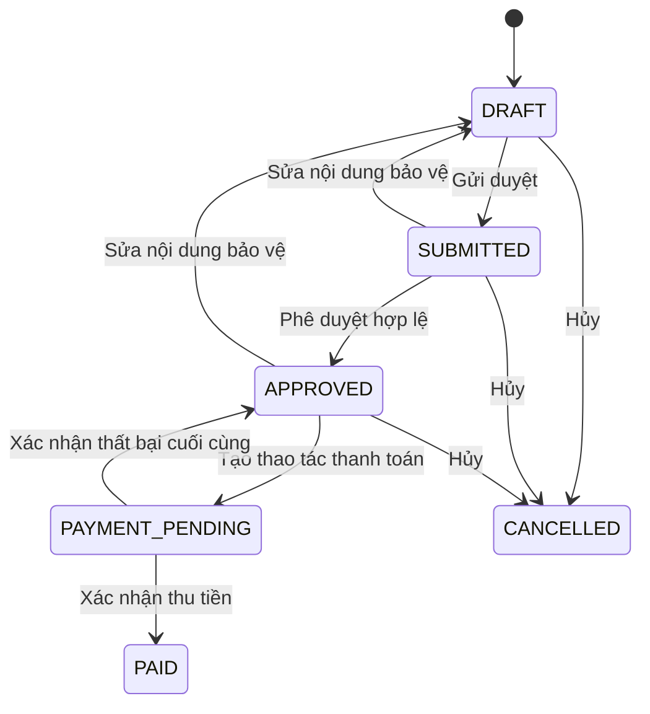

# Workflow integration tests

## 1. Mục tiêu của bài học

Trong chương **Testing Strategy** của module bảo mật logic nghiệp vụ, workflow integration tests là kiểm thử tích hợp thực thi một chuỗi thao tác nghiệp vụ qua nhiều thành phần để xác minh rằng hệ thống chỉ tạo kết quả hợp lệ. Trọng tâm là quan hệ giữa các bước: ai được thực hiện, trên đối tượng nào, khi nào, với dữ liệu đã được phê duyệt nào và bao nhiêu lần.

Ví dụ, kiểm thử riêng endpoint thanh toán có thể chứng minh rằng JSON đúng định dạng và người gọi đã đăng nhập. Kiểm thử workflow cần chứng minh thêm rằng đơn đã được người có quyền phê duyệt, giá chưa bị thay đổi sau phê duyệt và một lần thử lại không tạo thêm khoản thu.

OWASP mô tả kiểm thử vượt luồng nghiệp vụ bằng cách thử bỏ bước, đổi thứ tự hoặc lặp thao tác nhằm đạt kết quả ngoài quy trình dự kiến. Bài học này dùng cách tiếp cận đó để thiết kế các ca tích hợp có bằng chứng ở dữ liệu và tác dụng phụ. Xem [OWASP WSTG — Circumvention of Work Flows](https://wstg.owasp.org/latest/4-Web_Application_Security_Testing/10-Business_Logic/06-Circumvention_of_Work_Flows/).

Sau bài học, bạn có thể:

- Chuyển quy tắc nghiệp vụ thành các bất biến có thể kiểm tra.
- Thiết kế ca kiểm thử cho luồng hợp lệ, luồng bị lạm dụng và các điểm giao giữa chúng.
- Kiểm tra quyền theo đối tượng, tính nguyên tử của transaction và hiệu lực của phê duyệt.
- Kiểm thử yêu cầu trùng, thực thi đồng thời và lỗi giữa các bước.
- Chọn bằng chứng đủ mạnh để phát hiện trường hợp API báo lỗi nhưng hệ thống vẫn ghi tiền hoặc phát lệnh.

## 2. Phân biệt phạm vi kiểm thử

| Loại kiểm thử | Câu hỏi chính | Ví dụ |
| --- | --- | --- |
| Unit test | Một quy tắc hoặc hàm chuyển trạng thái có đúng không? | Người tạo đơn không được tự phê duyệt |
| Kiểm thử tích hợp một thao tác | Endpoint, security, service và database phối hợp đúng không? | Lệnh phê duyệt lưu đúng người duyệt và phiên bản nội dung |
| Workflow integration test | Một chuỗi thao tác có duy trì bất biến qua các ranh giới không? | Duyệt đơn, sửa giá, rồi thử thanh toán bằng phê duyệt cũ |
| End-to-end test | Hành trình qua toàn bộ hệ thống triển khai có hoạt động không? | Người dùng thao tác trình duyệt, thanh toán qua sandbox và nhận thông báo |

Tên gọi có thể khác giữa các đội. Trong bài này, workflow integration test đi qua API thật của ứng dụng, cơ chế xác thực và phân quyền, service nghiệp vụ, transaction và database thật của môi trường kiểm thử. Dịch vụ bên ngoài có thể được thay bằng một bộ mô phỏng có trạng thái.

Không cần đưa trình duyệt vào mọi ca. Một yêu cầu HTTP gọi thẳng bước cuối thường giúp kiểm tra khả năng bỏ qua giao diện rõ hơn. Một số ca end-to-end vẫn hữu ích để xác minh rằng cấu hình triển khai và tích hợp thật phù hợp với hợp đồng đã kiểm thử.

## 3. Chốt một hợp đồng nghiệp vụ cụ thể trước khi viết test

Xét hệ thống mua hàng nội bộ của nhiều tổ chức. Mỗi đơn thuộc một tenant, do một requester tạo và được một approver phù hợp phê duyệt. Người tạo không được tự phê duyệt. Approver phải cùng tenant và có hạn mức đủ cho tổng tiền của đơn.

Đây là **hợp đồng ví dụ của bài học**, không phải quy tắc mặc định cho mọi hệ thống:

1. Requester được tạo, gửi duyệt và thanh toán đơn của mình trong tenant hiện tại.
2. Server tính tổng tiền từ dữ liệu giá và chính sách được phép áp dụng; tổng tiền do client gửi không phải nguồn có thẩm quyền.
3. Phê duyệt gắn với nội dung đơn và số tiền tại thời điểm duyệt.
4. Sửa dữ liệu ảnh hưởng số tiền hoặc đối tượng thụ hưởng sau khi gửi duyệt phải đưa đơn về trạng thái nháp và vô hiệu phê duyệt trước đó.
5. Chỉ đơn được duyệt hợp lệ mới được bắt đầu thanh toán.
6. Mỗi đơn chỉ có tối đa một khoản thu thành công. Retry cùng thao tác được phép, nhưng không được thu thêm.
7. Đơn đang thanh toán không được sửa nội dung hoặc hủy ngay như một đơn chưa gửi sang cổng thanh toán.
8. Tổng tiền hoàn thành công cộng các khoản hoàn đang giữ chỗ không được vượt số đã thu.

### 3.1. Mô hình trạng thái tối thiểu



Mũi tên là khả năng chuyển trạng thái, chưa phải toàn bộ điều kiện cho phép. Mỗi chuyển đổi còn phải thỏa quyền, tenant, phiên bản nội dung và các ràng buộc tiền tệ.

Timeout không chứng minh thanh toán thất bại. Nếu chưa biết cổng thanh toán đã thu tiền hay chưa, đơn tiếp tục ở trạng thái chờ xử lý hoặc trạng thái đối soát theo thiết kế. Chỉ nhánh có kết quả thất bại cuối cùng mới được trở lại `APPROVED`.

Mô hình trên chưa vẽ đầy đủ trạng thái hết hạn, từ chối duyệt hoặc hoàn tiền. Khi sản phẩm có những trạng thái đó, đưa chúng vào mô hình và kiểm thử các nhánh liên quan thay vì suy diễn từ sơ đồ rút gọn.

### 3.2. Tách phiên bản nội dung và phiên bản ghi

Nên phân biệt hai khái niệm khi diễn đạt hợp đồng kiểm thử:

- `contentVersion`: tăng khi dữ liệu cần phê duyệt thay đổi, chẳng hạn số lượng, giá áp dụng, loại tiền hoặc người thụ hưởng.
- `rowVersion`: phục vụ phát hiện cập nhật cạnh tranh; có thể tăng khi trạng thái chuyển từ đã duyệt sang đang thanh toán.

Ví dụ phê duyệt lưu `approvedContentVersion = 7` và `approvedAmount = 1_000_000 VND`. Thanh toán phải dùng nội dung phiên bản 7 với cùng số tiền và loại tiền. Không nên vô tình làm phê duyệt hết hiệu lực chỉ vì một thay đổi kỹ thuật tăng `rowVersion`.

Ngược lại, nếu số lượng thay đổi làm `contentVersion` thành 8, một chữ ký hoặc mã phê duyệt của phiên bản 7 không được dùng tiếp.

## 4. Viết bất biến trước khi viết kịch bản

Bất biến là thuộc tính phải đúng ở mọi trạng thái quan sát được theo hợp đồng, đặc biệt sau khi transaction commit và sau khi xử lý bất đồng bộ hội tụ.

| Mã | Bất biến cần bảo vệ | Bằng chứng quan sát |
| --- | --- | --- |
| I1 | Chỉ chủ thể được phép mới tác động lên đơn thuộc tenant phù hợp | Đơn, tenant, người thao tác và quyết định phân quyền |
| I2 | Không tạo thao tác thanh toán khi thiếu phê duyệt hợp lệ | Trạng thái, bản ghi phê duyệt, bảng thao tác và outbox |
| I3 | Nội dung và số tiền thanh toán khớp nội dung được duyệt | `contentVersion`, số tiền, loại tiền và dữ liệu tính giá |
| I4 | Một đơn có tối đa một khoản thu thành công | Sổ giao dịch và sổ khoản thu của bộ mô phỏng cổng thanh toán |
| I5 | Retry không tạo thêm tác dụng nghiệp vụ cho cùng thao tác | Bản ghi idempotency, operation ID và số khoản thu |
| I6 | Một thay đổi nghiệp vụ và ý định phát sự kiện tương ứng cùng commit hoặc cùng rollback | Đơn, bản ghi thao tác và outbox trong database |
| I7 | Tổng đã hoàn cộng tổng hoàn đang giữ chỗ không vượt số đã thu | Refund ledger và các yêu cầu hoàn ở trạng thái đang xử lý |
| I8 | Quyết định cho phép dựa trên dữ liệu còn hiệu lực tại điểm quyết định đã xác định | Phiên bản đơn, chính sách quyền và lịch sử thay đổi |

Một yêu cầu bị từ chối có thể tạo security audit hoặc tăng bộ đếm giám sát. Vì vậy, câu “không có thay đổi” cần được hiểu là **không có thay đổi nghiệp vụ bị cấm**, không phải database tuyệt đối không được ghi bất cứ thứ gì.

Với xử lý bất đồng bộ, có thể tồn tại khoảng thời gian cổng thanh toán đã thu nhưng đơn vẫn là `PAYMENT_PENDING`. Trạng thái trung gian này phải có thao tác và dữ liệu đối soát tương ứng; không yêu cầu hai hệ thống độc lập cập nhật tức thời như một transaction duy nhất.

## 5. Chọn ranh giới tích hợp có thể phát hiện lỗi thật

Một bố trí kiểm thử phù hợp gồm:

```text
HTTP test client
    -> bộ lọc xác thực và phân quyền thật
    -> controller và application service thật
    -> domain policy và transaction thật
    -> database dùng migration thật
    -> outbox worker thật
    -> payment simulator có sổ khoản thu
```

Database kiểm thử nên cùng loại hệ quản trị với môi trường triển khai, nhất là khi test liên quan khóa, unique constraint, mức cô lập hoặc truy vấn đặc thù. Database trong bộ nhớ có thể khác hành vi ở những điểm này.

Giữ thật các thành phần đang bảo vệ bất biến: policy phân quyền, truy vấn tenant, cơ chế idempotency, transaction, ràng buộc dữ liệu và bộ xử lý sự kiện trong phạm vi ca kiểm thử. Nếu mock service nghiệp vụ trả sẵn “đã duyệt”, test không còn chứng minh rằng phê duyệt được kiểm tra.

Bộ mô phỏng thanh toán nên hỗ trợ:

- Ghi riêng số lần nhận yêu cầu và số khoản thu thành công.
- Gắn khoản thu với merchant, operation ID, số tiền và loại tiền.
- Mô phỏng việc đã nhận và thu tiền nhưng làm mất phản hồi.
- Trả kết quả xác định thất bại hoặc kết quả chưa xác định.
- Gửi lại webhook, gửi sai thứ tự và dùng cùng event ID.
- Tuân thủ hợp đồng idempotency của dịch vụ được mô phỏng.

Bộ mô phỏng cần có hành vi bám sát hợp đồng tích hợp. Một mock luôn trả `200 OK` không đủ để kiểm tra khôi phục sau timeout. Các ca hợp đồng hoặc sandbox riêng giúp phát hiện khác biệt giữa mô phỏng và nhà cung cấp thật.

## 6. Lập ma trận thay vì chỉ liệt kê endpoint

Mỗi ca kiểm thử nên xác định ít nhất: trạng thái ban đầu, actor, đối tượng, chuỗi hành động, biến thể lạm dụng và bất biến cần kiểm tra.

| Ca | Chuỗi hoặc biến thể | Kết quả nghiệp vụ mong đợi |
| --- | --- | --- |
| Luồng chuẩn | Tạo → gửi duyệt → người khác duyệt → thanh toán | Một khoản thu đúng số tiền được duyệt |
| Bỏ bước | Tạo → gọi thanh toán trực tiếp | Bị từ chối; không có payment operation hoặc lệnh thu |
| Đảo thứ tự | Duyệt khi đơn còn nháp | Không ghi phê duyệt có hiệu lực |
| Tự duyệt | Requester có thêm vai trò approver rồi duyệt đơn của mình | Vẫn bị từ chối theo quy tắc tách nhiệm vụ |
| Sai đối tượng | Người cùng tenant đổi ID sang đơn của người khác | Không được thanh toán đơn ngoài quyền |
| Sai tenant | Approver của tenant A duyệt đơn tenant B | Không thay đổi đơn hoặc tiết lộ dữ liệu bị cấm |
| Phê duyệt cũ | Duyệt → sửa số lượng → thanh toán | Phê duyệt cũ không còn dùng được |
| Sửa giá qua payload | Chèn `total`, `approvedAmount` hoặc `status` vào request | Không dùng giá hoặc trạng thái do client tự quyết |
| Replay | Gửi lại cùng key và cùng nội dung | Không tạo thêm khoản thu |
| Key xung đột | Dùng lại key với nội dung khác | Xử lý theo hợp đồng xung đột; không dùng nhầm kết quả cũ |
| Hai key | Gửi hai yêu cầu thanh toán cùng đơn bằng hai key khác nhau | Vẫn tối đa một khoản thu |
| Thu hồi quyền | Gửi duyệt → thu hồi quyền approver → thử duyệt | Quyết định theo chính sách hiệu lực quyền đã công bố |
| Hết hạn | Thanh toán đúng trước, tại và sau hạn phê duyệt | Thỏa quy ước biên thời gian đã xác định |
| Hủy và thanh toán | Hai thao tác cạnh tranh trên đơn đã duyệt | Chỉ kết quả tương thích với một thứ tự hợp lệ được chấp nhận |
| Hoàn tiền cạnh tranh | Hai yêu cầu hoàn riêng lẻ hợp lệ nhưng tổng vượt số đã thu | Tổng hoàn và giữ chỗ không vượt giới hạn |
| Callback giả | Callback cho sai đơn, sai số tiền hoặc không xác thực | Không đánh dấu đơn đã trả tiền |
| Callback trùng | Xử lý lại cùng xác nhận thanh toán | Không nhân đôi ledger hoặc lệnh giao hàng |

Không cần thực thi toàn bộ tích Descartes của mọi biến. Ưu tiên những tổ hợp có khả năng phá bất biến, đặc biệt điểm đổi actor, đổi trạng thái, thay nội dung và giao tiếp với hệ thống ngoài.

Quyền theo đối tượng phải được kiểm tra tại thao tác sử dụng đối tượng; quyền gọi một chức năng chưa đủ để chứng minh quyền trên mọi ID. Đây là trọng tâm của [OWASP API1:2023 — Broken Object Level Authorization](https://api-security.owasp.org/editions/2023/en/0xa1-broken-object-level-authorization/).

## 7. Tạo fixture đúng ranh giới bảo mật

Một bộ dữ liệu tối thiểu có thể gồm:

| Chủ thể | Tenant | Quyền và quan hệ |
| --- | --- | --- |
| Alice | A | Requester, sở hữu đơn A1 |
| Bob | A | Approver có hạn mức đủ, không phải người tạo A1 |
| Carol | A | Requester khác, không có quyền thanh toán A1 |
| Dave | B | Requester, sở hữu đơn B1 |
| Erin | B | Approver có hạn mức đủ cho B1 |

Khởi tạo tài khoản, tenant và danh mục sản phẩm bằng fixture hạ tầng là hợp lý. Với các ca chứng minh một luồng bình thường, nên tạo đơn và đưa đơn đến trạng thái cần thiết bằng các lệnh ứng dụng thật.

Nếu chèn trực tiếp một hàng `status = APPROVED`, test có thể bỏ qua việc hệ thống không hề lưu người duyệt hoặc phiên bản được duyệt. Fixture trực tiếp vẫn hữu ích để tái tạo dữ liệu cũ, dữ liệu hỏng hoặc tình huống migration, nhưng phải ghi rõ mục tiêu khác biệt đó.

Khi gọi API, sử dụng cơ chế xác thực được ứng dụng kiểm tra thật: tài khoản của môi trường test hoặc token được ký bởi bộ phát hành test mà cấu hình test tin cậy. Không giả định thêm header `X-Role: ADMIN` là tương đương với một principal đã được xác thực.

Mỗi test cần ID riêng cho tenant, đơn, idempotency key và correlation ID. Cô lập cả dữ liệu database lẫn hàng đợi, trạng thái của payment simulator và các tác vụ nền. Chỉ rollback transaction của luồng test không dọn được dữ liệu đã commit bởi HTTP server hoặc worker chạy ở luồng khác.

## 8. Ví dụ Java: kiểm tra chuỗi hành động và hậu điều kiện

Các đoạn dưới đây là **mã minh họa theo phong cách JUnit**, dùng DSL kiểm thử do dự án tự cung cấp. Chúng không phải một lớp có thể sao chép rồi chạy ngay.

Quy ước của DSL:

- `flow.draftOwnedBy` và `flow.approvedOwnedBy` gọi các API thật theo thứ tự hợp lệ.
- `api` là HTTP client đến server test; danh tính truyền vào được chuyển thành thông tin xác thực hợp lệ.
- `probe` đọc dữ liệu đã commit qua kết nối riêng; không dùng đối tượng ORM còn nằm trong persistence context cũ.
- `gateway` truy vấn sổ khoản thu của payment simulator.
- `businessSnapshot` chỉ lấy các trường và bản ghi nghiệp vụ cần bảo vệ, loại trừ security audit được phép ghi khi từ chối.
- `awaitPaid` chờ có giới hạn thời gian và trả về khi trạng thái cùng các bằng chứng liên quan đã hội tụ.

Trong hợp đồng API minh họa, sai trạng thái trả `409 STATE_CONFLICT`, truy cập đối tượng bị ẩn trả `404` và yêu cầu thanh toán mới được tiếp nhận trả `202`. Sản phẩm có thể chọn mã khác; test cần theo hợp đồng sản phẩm và luôn kiểm tra hậu điều kiện.

### 8.1. Không thanh toán được khi bỏ bước duyệt

```java
@Test
void paymentCannotSkipApproval() {
    var order = flow.draftOwnedBy(alice, "SKU-A", 1);
    var before = probe.businessSnapshot(order.id());

    var response = api.pay(
        alice, order.id(), "pay-skip-approval",
        new PayRequest("test-payment-method")
    );

    assertEquals(409, response.status());
    assertEquals("STATE_CONFLICT", response.errorCode());
    assertEquals(before, probe.businessSnapshot(order.id()));
    assertEquals(0, probe.paymentOperationCount(order.id()));
    assertEquals(0, probe.paymentOutboxCount(order.id()));
    assertEquals(0, gateway.successfulChargeCount(order.id()));
}
```

Kiểm tra không có payment operation hoặc payment outbox giúp chứng minh lệnh thu chưa được lập lịch. Nếu hệ thống còn đường gọi trực tiếp cổng thanh toán hoặc cơ chế hàng đợi khác, bổ sung quan sát tương ứng; không suy ra “không thu tiền” chỉ từ một bảng trống.

### 8.2. Sửa dữ liệu làm mất hiệu lực phê duyệt cũ

```java
@Test
void changedContentRequiresFreshApproval() {
    var order = flow.approvedOwnedBy(alice, bob, "SKU-A", 1);
    long approvedVersion = probe.order(order.id()).contentVersion();

    api.changeQuantity(alice, order.id(), "SKU-A", 2)
        .expectStatus(200);

    var changed = probe.order(order.id());
    assertEquals("DRAFT", changed.state());
    assertTrue(changed.contentVersion() > approvedVersion);
    assertFalse(probe.hasEffectiveApproval(order.id()));

    api.pay(
        alice, order.id(), "pay-with-old-approval",
        new PayRequest("test-payment-method")
    ).expectError(409, "STATE_CONFLICT");

    assertEquals(0, probe.paymentOperationCount(order.id()));
    assertEquals(0, gateway.successfulChargeCount(order.id()));

    api.submit(alice, order.id()).expectStatus(200);
    api.approve(bob, order.id()).expectStatus(200);

    var approval = probe.effectiveApproval(order.id());
    assertEquals(changed.contentVersion(), approval.contentVersion());
    assertEquals(changed.totalVnd(), approval.approvedAmountVnd());

    api.pay(
        alice, order.id(), "pay-after-new-approval",
        new PayRequest("test-payment-method")
    ).expectStatus(202);

    flow.awaitPaid(order.id(), Duration.ofSeconds(5));

    assertEquals(1, gateway.successfulChargeCount(order.id()));
    assertEquals(
        changed.totalVnd(),
        gateway.onlySuccessfulCharge(order.id()).amountVnd()
    );
    assertEquals("VND", gateway.onlySuccessfulCharge(order.id()).currency());
}
```

Ca này vừa chứng minh đường tấn công bị chặn, vừa xác minh người dùng có thể tiếp tục luồng hợp lệ sau khi duyệt lại. Nó cũng kiểm tra rằng số tiền thật được thu khớp nội dung mới.

Nếu sản phẩm chọn cấm sửa đơn sau khi duyệt, kết quả mong đợi phải đổi thành “yêu cầu sửa bị từ chối và phiên bản cũ giữ nguyên”. Không áp đặt chính sách quay về nháp khi hợp đồng thực tế không cho phép.

### 8.3. Vai trò đúng nhưng tenant sai vẫn phải bị chặn

```java
@Test
void approverCannotApproveAnotherTenantsOrder() {
    var foreignOrder = flow.submittedOwnedBy(dave, "SKU-B", 1);
    var before = probe.businessSnapshot(foreignOrder.id());

    api.approve(bob, foreignOrder.id()).expectStatus(404);

    assertEquals(before, probe.businessSnapshot(foreignOrder.id()));
    assertFalse(probe.hasEffectiveApproval(foreignOrder.id()));
    assertEquals(0, probe.paymentOutboxCount(foreignOrder.id()));

    // Đối chứng: người có quyền thật vẫn duyệt được.
    api.approve(erin, foreignOrder.id()).expectStatus(200);
}
```

Đối chứng hợp lệ giúp phân biệt “hệ thống bảo vệ đúng” với “mọi lời gọi đều hỏng vì fixture hoặc xác thực sai”. Cũng cần ca trong cùng tenant, vì một truy vấn có điều kiện tenant chưa chứng minh đã kiểm tra quyền sở hữu hoặc quyền theo đối tượng.

## 9. Kiểm thử idempotency theo tác dụng nghiệp vụ

Idempotency là khả năng xử lý retry mà không lặp tác dụng cần được bảo vệ. Cần phân biệt:

- Cùng một yêu cầu được gửi lại do client không nhận phản hồi.
- Hai yêu cầu có key khác nhau nhưng đều cố thu tiền cho cùng một đơn.
- Cùng key nhưng nội dung đã thay đổi.
- Một người khác cố dùng key đã biết để đọc lại kết quả không thuộc quyền mình.

| Tình huống | Điều cần kiểm chứng |
| --- | --- |
| Cùng key, cùng nội dung, thực thi tuần tự | Trả cùng operation ID theo hợp đồng; chỉ một khoản thu |
| Cùng key, cùng nội dung, gửi đồng thời | Có thể báo đang xử lý hoặc trả kết quả đã có; không tạo hai thao tác độc lập |
| Cùng key, khác nội dung có ý nghĩa | Không trả nhầm kết quả cũ như thể nội dung mới đã được xử lý |
| Khác key, cùng đơn đã trả tiền | Ràng buộc nghiệp vụ vẫn ngăn thu lần hai |
| Client timeout sau khi server đã commit | Retry truy ra thao tác cũ và không tạo khoản thu mới |
| Nhà cung cấp đã thu nhưng phản hồi bị mất | Đối soát hoặc retry với định danh thao tác ổn định; không tạo giao dịch mới tùy tiện |
| Actor không có quyền gửi lại key hợp lệ của người khác | Không nhận kết quả nhạy cảm và không gây tác dụng nghiệp vụ |
| Key hết thời gian lưu | Đơn đã thanh toán vẫn được bảo vệ bởi trạng thái và ràng buộc nghiệp vụ |

Phạm vi key phải được công bố, chẳng hạn theo tenant, principal và loại thao tác. Nếu hợp đồng cho phép nhiều actor cùng retry một thao tác được ủy quyền, phạm vi cần phản ánh chính sách đó. Kiểm thử cả trường hợp hai tenant dùng chuỗi key giống nhau.

Request fingerprint phải phản ánh các dữ liệu có ý nghĩa theo hợp đồng, chẳng hạn đối tượng đích, payment method hoặc loại tiền khi được phép truyền. Tránh coi việc đổi thứ tự thuộc tính JSON là thay đổi nghiệp vụ nếu API coi hai nội dung đó tương đương.

Việc tìm thấy kết quả trong kho idempotency không được tự động bỏ qua kiểm tra quyền truy cập hiện tại. Cần thử retry sau khi actor bị thu hồi quyền hoặc mất quyền trên đối tượng, với kỳ vọng dựa trên chính sách hiệu lực đã định.

Với cổng thanh toán, số lần gọi HTTP có thể lớn hơn một trong khi số khoản thu vẫn bằng một. Đếm số lần gọi mock rồi yêu cầu luôn bằng một có thể làm test sai khi cơ chế retry hoạt động đúng.

## 10. Kiểm thử cạnh tranh bằng các request độc lập

Một lỗi điển hình:

```text
Request A đọc đơn APPROVED
Request B đọc đơn APPROVED
Request A tạo payment operation
Request B tạo payment operation
Hai operation cùng được gửi sang cổng thanh toán
```

Test tuần tự khó làm lộ lỗi này. Cần cho hai request chạy qua hai transaction độc lập và xác minh trạng thái cuối cùng cùng toàn bộ tác dụng phụ.

Đoạn mã sau đồng bộ thời điểm bắt đầu ở phía client:

```java
@Test
void differentKeysCannotChargeOneOrderTwice() throws Exception {
    var order = flow.approvedOwnedBy(alice, bob, "SKU-A", 1);
    var ready = new CountDownLatch(2);
    var start = new CountDownLatch(1);
    var pool = Executors.newFixedThreadPool(2);

    try {
        Callable<ApiResponse> first = () -> {
            ready.countDown();
            if (!start.await(5, TimeUnit.SECONDS)) {
                throw new AssertionError("Start gate timed out");
            }
            return api.pay(
                alice, order.id(), "parallel-key-1",
                new PayRequest("test-payment-method")
            );
        };

        Callable<ApiResponse> second = () -> {
            ready.countDown();
            if (!start.await(5, TimeUnit.SECONDS)) {
                throw new AssertionError("Start gate timed out");
            }
            return api.pay(
                alice, order.id(), "parallel-key-2",
                new PayRequest("test-payment-method")
            );
        };

        var resultA = pool.submit(first);
        var resultB = pool.submit(second);
        assertTrue(ready.await(5, TimeUnit.SECONDS));
        start.countDown();

        var responseA = resultA.get(10, TimeUnit.SECONDS);
        var responseB = resultB.get(10, TimeUnit.SECONDS);
        assertions.assertAllowedConcurrentPaymentResponses(
            responseA, responseB
        );

        flow.awaitPaid(order.id(), Duration.ofSeconds(5));

        assertEquals(1, probe.successfulCaptureCount(order.id()));
        assertEquals(1, gateway.successfulChargeCount(order.id()));
        assertEquals(
            probe.effectiveApproval(order.id()).approvedAmountVnd(),
            gateway.onlySuccessfulCharge(order.id()).amountVnd()
        );
    } finally {
        start.countDown();
        pool.shutdownNow();
        assertTrue(pool.awaitTermination(5, TimeUnit.SECONDS));
    }
}
```

HTTP client trong ví dụ phải dùng an toàn giữa các luồng hoặc tạo session riêng cho mỗi request. Cấu hình connection pool và server cũng phải cho phép hai yêu cầu thực sự cùng tiến triển.

Helper `assertAllowedConcurrentPaymentResponses` cần đối chiếu hợp đồng cụ thể. Ví dụ, một request nhận `202`, request còn lại nhận `409 ALREADY_PROCESSING`; hệ thống khác có thể trả cùng operation ID cho cả hai. Không chấp nhận tùy tiện mọi mã lỗi chỉ để làm test xanh.

### 10.1. Start gate chưa chứng minh đã chạm đúng cửa sổ lỗi

Hai request bắt đầu gần nhau vẫn có thể được xử lý tuần tự. Để tái hiện một race quan trọng ổn định hơn, có thể đặt test hook kiểm soát được tại ranh giới phù hợp trong server:

- Với thiết kế optimistic concurrency, cho hai transaction cùng đọc phiên bản ban đầu rồi mới cho tiếp tục ghi.
- Với thiết kế khóa bi quan, quan sát transaction thứ hai đang chờ khóa và kiểm tra nó đọc lại điều kiện sau khi transaction đầu commit.
- Không đặt một barrier yêu cầu cả hai request cùng vào sau đoạn đã giữ khóa độc quyền; request thứ hai có thể không bao giờ tới được barrier.

Hook chỉ phối hợp lịch thực thi, không thay policy hoặc bỏ qua transaction. Nếu cần fault injection, cấu hình đó chỉ được bật trong môi trường kiểm thử.

Ngoài hai lần thanh toán, nên kiểm tra những cặp thao tác có xung đột nghiệp vụ: thanh toán với hủy, duyệt với sửa nội dung, hai lần áp mã ưu đãi và hai yêu cầu hoàn tiền. Kết quả phải tương ứng với một thứ tự thực thi hợp lệ đã được hợp đồng cho phép.

## 11. Kiểm thử transaction và lỗi giữa các bước

Chỉ kiểm tra trường hợp mọi thành phần thành công sẽ bỏ sót nhiều lỗi logic. Hãy đặt điểm lỗi tại những ranh giới mà dữ liệu hoặc tác dụng phụ bắt đầu thay đổi.

| Điểm lỗi được chủ động tạo | Điều cần kiểm tra sau lỗi hoặc sau khôi phục |
| --- | --- |
| Lỗi trước commit khi đã sửa đơn nhưng chưa ghi xong outbox | Thay đổi đơn, payment operation và outbox cùng rollback |
| Database đã commit nhưng server chưa trả HTTP response | Retry nhận diện thao tác đã có; không tạo thao tác thanh toán mới |
| Outbox đã commit nhưng worker chưa nhận | Sau khi worker hoạt động lại, lệnh được xử lý và vẫn gắn với operation cũ |
| Worker gửi thành công rồi chết trước khi đánh dấu đã gửi | Gửi lại không tạo khoản thu hoặc tác dụng nghiệp vụ trùng |
| Cổng thanh toán đã thu nhưng trả timeout | Đơn giữ trạng thái chưa xác định phù hợp; đối soát tìm được khoản thu |
| Callback được xử lý rồi mất ACK | Lần giao lại không thêm capture ledger hoặc lệnh giao hàng |
| Callback báo thu tiền cho sai số tiền hoặc sai loại tiền | Không chuyển đơn thành đã thanh toán hợp lệ; ghi nhận để đối soát |
| Bước hậu xử lý thất bại sau khi đã thu tiền | Không tuyên bố rollback được khoản thu; thực hiện retry hoặc quy trình bù theo thiết kế |

Giả sử hệ thống cần lưu đồng thời chuyển trạng thái đơn và một ý định thanh toán trong outbox. Kiểm thử rollback phải đọc cả hai sau khi transaction thất bại. Chỉ xác minh rằng service ném exception không chứng minh rollback đã xảy ra.

Transaction của database không tự rollback được một khoản thu đã thực hiện ở nhà cung cấp. Vì vậy, không thiết kế oracle theo giả định “bất kỳ exception nào cũng làm mọi hệ thống trở về như cũ”. Hãy kiểm tra trạng thái chờ đối soát, định danh thao tác ổn định và hành vi bù đã được quy định.

Khi dùng outbox, thông điệp có thể được gửi lại. Mục tiêu cần chứng minh là việc giao lại không làm nhân đôi tác dụng nghiệp vụ. Không suy ra bảo đảm “exactly once” toàn hệ thống chỉ từ một test có một thông điệp.

### 11.1. Một kịch bản khôi phục đầy đủ

```text
Given: đơn đã duyệt, chưa có khoản thu
And: simulator sẽ thu tiền rồi làm mất phản hồi
When: requester gửi lệnh thanh toán
Then: simulator ghi đúng một khoản thu
And: ứng dụng chưa tùy tiện coi timeout là thất bại cuối cùng

When: client retry và worker thực hiện đối soát
Then: ứng dụng tìm lại cùng thao tác thanh toán
And: đơn cuối cùng chuyển PAID
And: capture ledger có đúng một bản ghi thành công
And: simulator vẫn chỉ có một khoản thu đúng số tiền được duyệt
And: mọi lệnh còn chờ của đơn đã được xử lý hoặc kết thúc hợp lệ
```

Nếu ứng dụng không có worker đối soát mà dùng truy vấn trạng thái khi retry, thay bước thực thi cho đúng kiến trúc. Bất biến về số khoản thu và số tiền vẫn giữ nguyên.

## 12. Xử lý bất đồng bộ: chọn thời điểm assert đúng

Trong hệ thống có hàng đợi, `202 Accepted` thường chỉ cho biết đã tiếp nhận công việc. Không dùng nó làm bằng chứng đã thu tiền thành công.

Một điều kiện chờ tốt gồm thời hạn tối đa và điều kiện nghiệp vụ có thể quan sát được. Chẳng hạn, với một đơn:

1. Đơn đạt trạng thái cuối mong đợi.
2. Các payment operation liên quan đã kết thúc hoặc có trạng thái chờ được hợp đồng cho phép.
3. Outbox và consumer trong phạm vi ca kiểm thử đã xử lý hết công việc liên quan.
4. Sổ khoản thu bên ngoài và ledger nội bộ đối chiếu đúng số tiền, loại tiền và operation ID.

Trong các ví dụ Java, `awaitPaid` cần thực hiện điều kiện hội tụ tương ứng trong môi trường test đã kiểm soát. Nếu helper chỉ chờ thấy cột `state = PAID`, cần thêm bước chờ các lệnh còn lại trước khi khẳng định không có khoản thu trùng.

Không dùng `Thread.sleep(3000)` làm điều kiện hoàn tất. Nó có thể quá ngắn khi máy bận và quá dài khi mọi thứ đã xong. Dùng polling có timeout hoặc tín hiệu hoàn tất, đồng thời xuất chẩn đoán về operation và thông điệp đang chờ khi hết hạn.

Đối với mệnh đề phủ định như “không phát lệnh thu”, việc thấy số lượng bằng 0 ngay sau response chưa đủ nếu một worker vẫn có thể tạo lệnh sau đó. Tùy kiến trúc, cần chứng minh không hề tạo ý định thanh toán trong transaction, hoặc cho công việc liên quan được xử lý hết rồi kiểm tra lại.

Một khoảng chờ hữu hạn không thể chứng minh sự kiện sẽ không bao giờ xảy ra trong tương lai. Độ tin cậy đến từ mô hình công việc đã được kiểm soát, các ràng buộc bảo vệ bất biến và quan sát tại những ranh giới thực thi phù hợp.

## 13. Kiểm thử thời gian, phiên và thay đổi quyền

Một workflow có thể kéo dài qua nhiều phút hoặc nhiều ngày. Không giữ nguyên mọi giả định của bước đầu cho các bước sau.

### 13.1. Hạn phê duyệt

Nếu hợp đồng yêu cầu `now < approval.expiresAt`, cần kiểm thử:

- Ngay trước hạn: được tiếp tục khi các điều kiện khác hợp lệ.
- Đúng tại hạn: bị từ chối.
- Sau hạn: bị từ chối và không tạo payment operation.
- Phê duyệt đã hết hạn nhưng client gửi lại timestamp hoặc approval token cũ: không làm thời gian phía server thay đổi.

Dùng đồng hồ có thể điều khiển trong môi trường test thay cho chờ thời gian thực. Nếu thời gian được lấy từ database hoặc một dịch vụ khác, phải kiểm soát hoặc chuẩn bị dữ liệu theo nguồn thời gian đó; thay một `Clock` trong service chưa chắc đã tác động đến toàn bộ hệ thống.

Cũng cần chốt thời điểm kiểm tra hiệu lực: lúc tiếp nhận lệnh, lúc tạo operation hay lúc thực hiện tác vụ nền. Khi một yêu cầu bắt đầu trước hạn nhưng xử lý sau hạn, test phải dựa trên quy tắc đã công bố.

### 13.2. Quyền thay đổi giữa các bước

Ví dụ: Bob xem được đơn, sau đó bị hạ hạn mức hoặc mất vai trò approver trước khi gửi lệnh duyệt. Kiểm thử phải xác minh điểm ra quyết định đọc đúng nguồn quyền còn hiệu lực theo thiết kế.

Token tự chứa có thể mang claims còn hợp lệ đến khi hết hạn nếu hệ thống không có cơ chế thu hồi sớm. Không viết test giả định thay đổi quyền trong database lập tức vô hiệu mọi token cũ khi sản phẩm chưa có bảo đảm đó. Thay vào đó, mô tả rõ chính sách hiệu lực, rủi ro được chấp nhận và kiểm tra cơ chế tái xác thực hoặc tra cứu quyền mà thiết kế thực sự cung cấp.

Với thao tác nhạy cảm, cần phân biệt quyền của người khởi tạo lệnh và quyền của tài khoản dịch vụ chạy worker. Worker có quyền kỹ thuật để gọi nhà cung cấp không có nghĩa một lệnh do người dùng không được phép tạo trở thành hợp lệ.

## 14. Kiểm thử hoàn tiền như một workflow có ngân sách

Hoàn tiền minh họa rõ việc một request hợp lệ riêng lẻ vẫn có thể phá bất biến tổng hợp.

Giả sử đã thu `100_000 VND`. Hai yêu cầu hoàn cùng lúc, mỗi yêu cầu `60_000 VND`, đều nhỏ hơn số đã thu nếu kiểm tra độc lập. Tuy nhiên, chấp nhận cả hai sẽ vượt ngân sách hoàn.

Một ca tích hợp cần:

1. Tạo khoản thu thành công qua luồng hợp lệ.
2. Gửi đồng thời hai yêu cầu hoàn với hai key khác nhau.
3. Kiểm tra việc giữ chỗ ngân sách hoàn diễn ra an toàn trong transaction.
4. Cho worker xử lý các yêu cầu đã được chấp nhận.
5. Đối chiếu số tiền hoàn tại simulator với refund ledger.

Oracle chính là:

```text
successfulRefundAmount + reservedPendingRefundAmount
    <= capturedAmount
```

Khi một khoản hoàn chuyển từ đang giữ chỗ sang thành công, không được tính nó hai lần. Khi kết quả còn chưa xác định do timeout, không giải phóng giữ chỗ như thể đã thất bại chắc chắn.

Sau khi xác nhận thất bại cuối cùng và giải phóng giữ chỗ, một yêu cầu mới hợp lệ phải có thể tiếp tục. Kiểm thử cả khả năng khôi phục này để phát hiện lỗi giữ chỗ vĩnh viễn khiến hệ thống ngăn cả hành vi hợp pháp.

## 15. Mở rộng bằng kiểm thử dựa trên mô hình

Một số lỗi chỉ xuất hiện sau chuỗi thao tác dài:

```text
tạo -> gửi duyệt -> duyệt -> sửa -> gửi lại
-> duyệt lại -> thanh toán -> retry -> callback trùng
```

Có thể xây dựng một mô hình tham chiếu nhỏ chứa trạng thái, chủ sở hữu, tenant, phiên bản nội dung, phê duyệt có hiệu lực và ngân sách tiền. Bộ sinh lệnh tạo cả thao tác hợp lệ lẫn thao tác đáng lẽ bị từ chối.

Sau mỗi bước đã commit hoặc sau điểm hội tụ được xác định, so sánh kết quả hệ thống với mô hình và kiểm tra các bất biến. Nếu thất bại, lưu seed, chuỗi lệnh, actor, thời gian giả lập và các điểm gây lỗi để chạy lại.

Mô hình nên độc lập với implementation. Nếu dùng lại chính hàm policy trong production để tính đáp án mong đợi, cùng một lỗi có thể xuất hiện ở cả hệ thống lẫn oracle.

Tách hai nhóm:

- Chuỗi tuần tự để kiểm tra thứ tự, phiên bản và hiệu lực quyền.
- Lịch thực thi đồng thời có kiểm soát để kiểm tra tương tác giữa transaction.

Thu nhỏ chuỗi lỗi giúp biến một kết quả ngẫu nhiên thành ca hồi quy ngắn. Giới hạn độ dài chuỗi và số lượng biến thể theo chi phí thực thi, sau đó tăng phạm vi có chủ đích cho các bất biến rủi ro cao.

## 16. Tổ chức bộ test và bằng chứng thất bại

Trong CI, có thể chia theo tốc độ và mức rủi ro:

| Nhóm | Nội dung điển hình | Cách sử dụng |
| --- | --- | --- |
| Bộ cốt lõi ổn định | Luồng chuẩn, bỏ bước, tự duyệt, chéo tenant, sửa sau duyệt, replay | Chạy cho thay đổi ảnh hưởng workflow |
| Bộ tích hợp sâu | Tranh chấp transaction, timeout sau khi thu, crash và giao lại thông điệp | Chạy khi thay đổi cơ chế liên quan và trong kiểm tra định kỳ của dự án |
| Bộ mở rộng | Chuỗi sinh từ mô hình, nhiều lịch thực thi và nhiều điểm lỗi | Tìm kiếm tình huống mới; lưu ca tối giản làm hồi quy |

Khi một ca thất bại, nên thu thập bằng chứng có cấu trúc:

- Test case ID, seed, correlation ID và operation ID.
- Actor và tenant theo định danh kiểm thử.
- Trình tự request, mã phản hồi và lỗi nghiệp vụ.
- Trạng thái đơn, phiên bản nội dung và phiên bản được duyệt.
- Số tiền, loại tiền, capture ledger, refund ledger và giữ chỗ.
- Thông điệp outbox, trạng thái consumer và sổ thao tác tại simulator.
- Điểm lỗi được kích hoạt và tiến trình chờ nào hết hạn.

Không ghi token xác thực, dữ liệu thanh toán thật hoặc bí mật của nhà cung cấp vào log test. Dùng dữ liệu tổng hợp và token của môi trường kiểm thử.

Đối với lỗi race, giữ bằng chứng về lịch thực thi hoặc test hook đã chạm tới. Chạy lại nhiều lần để làm lỗi biến mất không thay thế việc hiểu điều kiện phá bất biến.

## 17. Những sai lầm làm test xanh nhưng không bảo vệ workflow

| Sai lầm | Vì sao bỏ sót lỗi | Cách thiết kế tốt hơn |
| --- | --- | --- |
| Chỉ kiểm tra mã HTTP | Response lỗi có thể xuất hiện sau một phần ghi dữ liệu | Kiểm tra trạng thái và tác dụng phụ đã commit |
| Chỉ dùng actor có quyền cao nhất | Không chạm vào tách nhiệm vụ hoặc quyền theo đối tượng | Tạo actor khác vai trò, khác chủ sở hữu và khác tenant |
| Mock toàn bộ nghiệp vụ | Quy tắc cần kiểm tra đã bị thay bằng giá trị dựng sẵn | Giữ thật các thành phần bảo vệ bất biến |
| Seed mọi đơn ở trạng thái đã duyệt | Không kiểm tra quan hệ giữa phê duyệt và nội dung | Dựng trạng thái qua API thật cho luồng thông thường |
| Chỉ retry cùng một key | Không kiểm tra ràng buộc “một đơn chỉ thu một lần” | Thử thêm nhiều key cho cùng hành động nghiệp vụ |
| Đếm HTTP call thay số khoản thu | Retry hợp lệ có thể gọi nhiều lần | Phân biệt số lần thử với tác dụng thành công |
| Dùng một transaction cho toàn bộ test | Che khuất commit, tranh chấp và hành vi worker | Dùng request và kết nối độc lập |
| Chờ một khoảng thời gian cố định | Không chứng minh công việc hoàn tất | Chờ điều kiện nghiệp vụ có timeout và chẩn đoán |
| Chỉ kiểm tra giao diện chính | API phụ, bulk action hoặc callback có thể đi đường khác | Ánh xạ mọi đường ghi vào cùng bất biến |
| Chỉ kiểm tra tấn công bị chặn | Có thể chặn luôn cả luồng hợp lệ sau đó | Thêm đối chứng và kiểm tra khả năng tiếp tục hợp pháp |

Đặc biệt, cần kiểm tra các đường sửa dữ liệu như `PUT`, `PATCH`, thao tác hàng loạt, chức năng quản trị hoặc lệnh nội bộ mà hệ thống thực sự cung cấp. Một đường cập nhật số lượng bỏ qua việc vô hiệu phê duyệt có thể phá toàn bộ bảo đảm của đường cập nhật chính.

Các endpoint callback cũng là đầu vào của workflow. Kiểm tra xác thực callback, quan hệ giữa merchant, payment operation và order, số tiền, loại tiền, event ID và tính hợp lệ của chuyển trạng thái. Không tin trường `status = SUCCESS` chỉ vì payload có hình thức đúng.

## 18. Checklist hoàn tất thiết kế kiểm thử

Một bộ workflow integration tests có cơ sở khi trả lời được các câu hỏi sau:

- Những bất biến nào đang được bảo vệ, và mỗi bất biến có ca kiểm thử nào?
- Có đường hợp lệ chứng minh fixture, xác thực và luồng nghiệp vụ hoạt động không?
- Có thử bỏ bước, đảo thứ tự, sửa sau duyệt và gọi thẳng bước cuối không?
- Có kiểm tra người cùng tenant nhưng sai đối tượng, người sai tenant và người tự duyệt không?
- Có phân biệt phiên bản nội dung được duyệt với phiên bản ghi phục vụ concurrency không?
- Có kiểm tra cả key trùng, key xung đột và nhiều key cho một hành động không?
- Có request cạnh tranh qua transaction độc lập và bằng chứng đã chạm cửa sổ lỗi cần kiểm tra không?
- Có thử lỗi trước commit, sau commit và sau tác dụng bên ngoài không?
- Có đối chiếu ledger, outbox, trạng thái và sổ tác dụng phụ sau khi hội tụ không?
- Có kiểm tra hoàn tiền hoặc giới hạn tổng hợp tương đương khi nghiệp vụ có những chức năng đó không?
- Có thể tái hiện một thất bại bằng dữ liệu, seed và lịch thực thi đã lưu không?

Mục tiêu là biến câu “người dùng phải làm đúng quy trình” thành các thuộc tính có thể đo được tại ranh giới thật của hệ thống. Khi một chuỗi yêu cầu hợp lệ về cú pháp vẫn cố vượt quyền, dùng phê duyệt cũ hoặc nhân đôi tác dụng, bộ test phải chỉ ra bất biến nào bị đe dọa và bằng chứng nào cho thấy nó vẫn được giữ.
