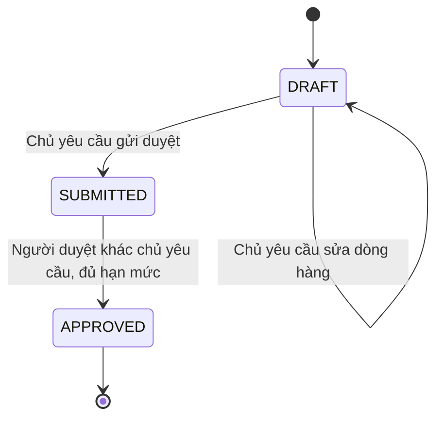

# Authorization matrix tests — Kiểm thử ma trận phân quyền

## 1. Mục tiêu của bài học

Trong chương **Testing Strategy** của nội dung bảo mật logic nghiệp vụ, authorization matrix tests là các kiểm thử đối chiếu hành vi thực tế với một ma trận quyền đã được xác định trước. Mỗi dòng trả lời một câu hỏi cụ thể: **chủ thể này có được thực hiện hành động này trên đối tượng này, trong ngữ cảnh này hay không?**

Một API duyệt yêu cầu mua hàng có thể kiểm tra đúng vai trò `APPROVER` nhưng vẫn cho phép người dùng duyệt yêu cầu của chính mình, duyệt yêu cầu thuộc công ty khác hoặc duyệt vượt hạn mức. Đây là những lỗi logic nghiệp vụ mà kiểm thử chỉ với hai tài khoản “admin” và “user” khó phát hiện.

Sau bài học, bạn có thể:

- Chuyển quy tắc nghiệp vụ thành ma trận quyền có kết quả mong đợi rõ ràng.
- Thiết kế dữ liệu phân biệt vai trò, chủ sở hữu, tenant, trạng thái và hạn mức.
- Viết kiểm thử tham số hóa bằng Java/JUnit cho cả trường hợp được phép và bị từ chối.
- Kiểm tra dữ liệu và tác dụng phụ sau yêu cầu, thay vì chỉ nhìn mã HTTP.
- Mở rộng ma trận cho thay đổi quyền, gửi lại yêu cầu và thao tác đồng thời.

Các quy tắc mua hàng dưới đây là **chính sách giả định của bài học**, không phải chính sách bắt buộc cho mọi hệ thống. Khi áp dụng, nhóm phát triển cần thống nhất chính sách với người phụ trách nghiệp vụ trước khi chọn kết quả mong đợi.

## 2. Ma trận quyền cần nhiều chiều hơn vai trò

Có thể biểu diễn quyết định dưới dạng:

```text
decision = authorize(subject, action, resource, context)

subject  = định danh, trạng thái tài khoản, tư cách thành viên, tập vai trò
action   = xem, sửa dòng hàng, gửi duyệt, phê duyệt
resource = tenant, chủ sở hữu, trạng thái, giá trị, phiên bản đối tượng
context  = tenant đang hoạt động đã được xác minh, thời điểm, kênh gọi
```

Không phải hệ thống nào cũng sử dụng mọi thuộc tính. Điều quan trọng là mỗi điều kiện có ý nghĩa trong chính sách phải xuất hiện trong các ca kiểm thử tương ứng.

| Chiều kiểm thử | Câu hỏi cần trả lời | Lỗi có thể bị bỏ sót nếu chỉ kiểm tra vai trò |
| --- | --- | --- |
| Xác thực | Người gọi có danh tính hợp lệ không? | Endpoint chấp nhận yêu cầu không có thông tin xác thực |
| Vai trò | Người gọi có năng lực thực hiện hành động không? | Người chỉ xem gọi được API duyệt |
| Quan hệ với đối tượng | Đây có phải yêu cầu do người gọi tạo không? | Sửa yêu cầu của đồng nghiệp; tự duyệt yêu cầu của mình |
| Tenant | Chủ thể và đối tượng có thuộc cùng phạm vi được cấp quyền không? | Duyệt yêu cầu của tổ chức khác |
| Trạng thái | Hành động có hợp lệ tại bước hiện tại không? | Duyệt trực tiếp từ bản nháp |
| Thuộc tính nghiệp vụ | Hạn mức có đủ cho giá trị hiện tại không? | Người có hạn mức thấp duyệt giao dịch lớn |
| Trường dữ liệu | Người gọi được thay đổi thuộc tính nào? | Chèn `approvedBy` hoặc sửa giá đã được chốt |
| Thời điểm | Quyền và dữ liệu còn hiệu lực khi thực thi không? | Sử dụng quyền đã bị thu hồi hoặc dữ liệu cũ |
| Kênh thực thi | Cùng hành động qua REST, batch, job có được bảo vệ nhất quán không? | REST bị chặn nhưng import vẫn vượt quyền |

OWASP mô tả cách dùng ma trận quyền làm dữ liệu đầu vào cho kiểm thử tự động, thay vì duy trì các kiểm thử truy cập rời rạc. Bài học mở rộng cách tổ chức đó bằng một ví dụ nghiệp vụ có chủ sở hữu, tenant và trạng thái. [OWASP Authorization Testing Automation](https://cheatsheetseries.owasp.org/cheatsheets/Authorization_Testing_Automation_Cheat_Sheet.html).

### 2.1. Phân biệt ba nguyên nhân yêu cầu không được thực hiện

**Xác thực thất bại** nghĩa là chưa xác định được chủ thể hợp lệ. **Phân quyền thất bại** nghĩa là đã biết chủ thể nhưng chủ thể không được thực hiện hành động trên đối tượng. **Điều kiện nghiệp vụ không thỏa** nghĩa là chủ thể có năng lực phù hợp nhưng đối tượng hoặc lệnh không ở tình trạng cho phép thực hiện.

Ví dụ, người phê duyệt không được duyệt yêu cầu của tenant khác là lỗi phân quyền. Người phê duyệt hợp lệ duyệt lại một yêu cầu đã được duyệt có thể gặp xung đột trạng thái. Chúng đều tạo kết quả `DENY` trong ma trận “được thực thi hay không”, nhưng tầng API có thể trả mã lỗi khác nhau.

Vì vậy, nếu hàm policy chỉ trả `boolean`, không dùng riêng giá trị `false` để suy ra mọi mã HTTP. Hợp đồng API cần quy định cách ánh xạ nguyên nhân từ chối, đồng thời tránh tiết lộ đối tượng mà người gọi không được biết.

## 3. Xây dựng chính sách mẫu cho luồng mua hàng

### 3.1. Đối tượng và vòng đời

Một `PurchaseRequest` có các trường:

```text
id, tenantId, requesterId, state, totalVnd,
approvedBy, approvedAt, version
```

Trong ví dụ, tiền được lưu bằng số nguyên đơn vị VND. `totalVnd` do máy chủ tính từ dữ liệu dòng hàng và giá hợp lệ; không lấy một giá trị tổng tùy ý từ người gọi để làm căn cứ duyệt.

Luồng chính:



Trong phạm vi bài học, sau khi gửi duyệt, các dòng hàng và tổng tiền không được sửa. Nếu sản phẩm có chức năng trả về để sửa, cần bổ sung trạng thái và quy tắc riêng, không ngầm cho phép sửa `SUBMITTED`.

### 3.2. Các vai trò được cấp theo tenant

| Vai trò | Quyền trong ví dụ |
| --- | --- |
| `REQUESTER` | Xem yêu cầu của mình; sửa dòng hàng và gửi duyệt khi còn `DRAFT` |
| `APPROVER` | Xem yêu cầu trong cùng tenant; duyệt yêu cầu hợp lệ do người khác tạo, trong hạn mức |
| `AUDITOR` | Xem yêu cầu trong cùng tenant; không thực hiện các lệnh thay đổi nghiệp vụ |
| `TENANT_ADMIN` | Xem yêu cầu trong cùng tenant; việc quản trị thành viên nằm ngoài ví dụ và không tự cấp quyền duyệt |

Vai trò là một tập hợp. Một người có thể vừa là `REQUESTER` vừa là `APPROVER`. Quyền của vai trò không được làm mất ràng buộc cấm tự duyệt.

`tenantId` trong ngữ cảnh chủ thể phải đến từ danh tính và tư cách thành viên đã được máy chủ xác minh. Người dùng có thể chọn tenant để làm việc, nhưng lựa chọn đó chỉ hợp lệ nếu máy chủ xác minh quyền thành viên; một header hoặc trường JSON tự khai không phải bằng chứng được cấp quyền.

### 3.3. Những điều kiện phải giữ

Gọi `s` là chủ thể, `r` là yêu cầu mua hàng. Điều kiện thực hiện `APPROVE` trong ví dụ là:

```text
authenticated(s)
AND enabled(s)
AND activeMembership(s, r.tenantId)
AND hasRole(s, r.tenantId, APPROVER)
AND s.userId != r.requesterId
AND r.state == SUBMITTED
AND 0 < r.totalVnd <= s.approvalLimitVnd
```

Sau khi duyệt thành công, các bất biến cần giữ gồm:

- Người duyệt được ghi nhận khác người tạo yêu cầu.
- Quyết định dùng tổng tiền và phiên bản mà giao dịch thực sự duyệt.
- Có một lần chuyển trạng thái hợp lệ cho lần duyệt này.
- Sự kiện nghiệp vụ tương ứng chỉ được tạo cho lần chuyển trạng thái đã commit.

Đối với một lệnh bị từ chối, trạng thái, tổng tiền, người duyệt, phiên bản và các tác dụng phụ nghiệp vụ phải giữ nguyên. Hệ thống vẫn có thể tạo bản ghi audit cho lần bị từ chối; bản ghi bảo mật đó khác với sự kiện `PurchaseApproved`.

Nguyên tắc mặc định từ chối và kiểm tra quyền trên mỗi yêu cầu giúp định hướng thiết kế các ca kiểm thử, bao gồm cả trường hợp không có vai trò phù hợp. [OWASP Authorization Cheat Sheet](https://cheatsheetseries.owasp.org/cheatsheets/Authorization_Cheat_Sheet.html).

## 4. Từ chính sách đến ma trận kiểm thử

### 4.1. Chuẩn bị fixture có chủ ý

Sử dụng ít nhất hai tenant và hai người có cùng vai trò trong một tenant. Nếu chỉ có một người dùng cho mỗi vai trò, kiểm thử sẽ khó phát hiện truy cập ngang giữa những người cùng quyền.

| Ký hiệu | Dữ liệu |
| --- | --- |
| `alice` | `REQUESTER` tại `tenant-a`; chủ của các yêu cầu mẫu |
| `bob` | `REQUESTER` tại `tenant-a`; không phải chủ của các yêu cầu mẫu |
| `carol` | `APPROVER` tại `tenant-a`; hạn mức 50.000.000 VND |
| `dora` | `AUDITOR` tại `tenant-a` |
| `erin` | `TENANT_ADMIN` tại `tenant-a` |
| `frank` | `APPROVER` tại `tenant-b`; hạn mức 50.000.000 VND |
| `draft-a` | Chủ `alice`, `tenant-a`, `DRAFT`, tổng tiền 50.000.000 VND |
| `submitted-a` | Chủ `alice`, `tenant-a`, `SUBMITTED`, tổng tiền 50.000.000 VND |

Với `tenant-b`, tạo thêm yêu cầu thực sự thuộc tenant đó khi kiểm thử tích hợp. Không chỉ đổi một ID không tồn tại, vì khi đó test có thể bị từ chối do không tìm thấy bản ghi và không hề đi qua điều kiện cách ly tenant.

### 4.2. Ma trận nền

`ALLOW` nghĩa là các điều kiện cho hành động đã thỏa trong phạm vi chính sách mẫu. `DENY` nghĩa là hành động không được thực thi; chưa quyết định mã HTTP cụ thể.

| ID | Chủ thể | Đối tượng/ngữ cảnh | Hành động | Kỳ vọng | Điều kiện được kiểm tra |
| --- | --- | --- | --- | --- | --- |
| M01 | Chưa xác thực | `draft-a` | `READ` | DENY | Phải có danh tính |
| M02 | `alice`, REQUESTER | `draft-a` của mình | `READ` | ALLOW | Chủ sở hữu được xem |
| M03 | `bob`, REQUESTER | `draft-a` của Alice | `READ` | DENY | Chặn đọc ngang |
| M04 | `alice`, REQUESTER | `draft-a` | `EDIT_ITEMS` | ALLOW | Sửa đúng đối tượng và bước |
| M05 | `alice`, REQUESTER | `submitted-a` | `EDIT_ITEMS` | DENY | Không sửa sau khi gửi |
| M06 | `alice`, REQUESTER | `draft-a` | `SUBMIT` | ALLOW | Gửi từ bản nháp |
| M07 | `bob`, REQUESTER | `draft-a` của Alice | `SUBMIT` | DENY | Không gửi thay người khác |
| M08 | `carol`, APPROVER | `submitted-a`, bằng hạn mức | `APPROVE` | ALLOW | Điều kiện hợp lệ tại biên |
| M09 | `carol`, APPROVER | Cùng yêu cầu nhưng tổng 50.000.001 VND | `APPROVE` | DENY | Vượt hạn mức một đơn vị |
| M10 | `alice`, chỉ APPROVER | `submitted-a` của mình | `APPROVE` | DENY | Cấm tự duyệt |
| M11 | `alice`, REQUESTER + APPROVER | `submitted-a` của mình | `APPROVE` | DENY | Nhiều vai trò không vượt ràng buộc |
| M12 | `frank`, APPROVER tenant-b | `submitted-a` thuộc tenant-a | `APPROVE` | DENY | Cách ly tenant |
| M13 | `dora`, AUDITOR | `submitted-a` cùng tenant | `READ` | ALLOW | Quyền xem độc lập với duyệt |
| M14 | `dora`, AUDITOR | `submitted-a` | `APPROVE` | DENY | Không nâng quyền từ xem lên duyệt |
| M15 | `erin`, TENANT_ADMIN | `submitted-a` | `APPROVE` | DENY | Quản trị tenant không mặc nhiên duyệt |
| M16 | `erin`, TENANT_ADMIN | `submitted-a` | `READ` | ALLOW | Quản trị được xem theo chính sách |
| M17 | `carol`, tài khoản bị khóa | `submitted-a` | `APPROVE` | DENY | Vai trò không vượt trạng thái tài khoản |
| M18 | `carol`, tư cách thành viên không còn hiệu lực | `submitted-a` | `APPROVE` | DENY | Quyền phải thuộc tenant hiện hành |
| M19 | `carol`, APPROVER | Yêu cầu đã `APPROVED` | `APPROVE` | DENY | Không chuyển trạng thái lần nữa |
| M20 | `alice`, không có vai trò | `draft-a` của mình | `READ` | DENY | Sở hữu không tự cấp mọi quyền |

M10 và M11 đều cần thiết: M10 kiểm tra cấm tự duyệt với vai trò duyệt; M11 phát hiện cách kết hợp nhiều vai trò làm mất điều kiện cấm đó. M20 phản ánh lựa chọn cụ thể của ví dụ: muốn xem yêu cầu của mình vẫn cần vai trò `REQUESTER` hoặc một vai trò được phép xem toàn tenant.

### 4.3. Thiết kế ca phủ định chỉ vi phạm một điều kiện

Bắt đầu từ M08 là ca duyệt hợp lệ, rồi lần lượt thay đúng một yếu tố:

```text
M08: cùng tenant, khác chủ, SUBMITTED, đủ hạn mức -> ALLOW
M09: giữ nguyên, chỉ tăng tổng tiền lên trên hạn mức -> DENY
M12: giữ nguyên năng lực duyệt, chỉ chuyển chủ thể sang tenant khác -> DENY
M17: giữ nguyên vai trò và đối tượng, chỉ khóa tài khoản -> DENY
M18: giữ nguyên vai trò và đối tượng, chỉ vô hiệu hóa thành viên -> DENY
M19: giữ nguyên chủ thể, chỉ đổi trạng thái thành APPROVED -> DENY
```

Nếu một ca vừa khác tenant, vừa thiếu vai trò, vừa dùng sai trạng thái, test vẫn có thể pass khi một trong các hàng rào bị xóa. Ca đó hữu ích để kiểm tra tổ hợp, nhưng không thay thế các ca cô lập từng điều kiện.

Các kiểm thử biên bổ sung cho hạn mức gồm `limit - 1`, `limit`, `limit + 1`. Tổng tiền bằng không hoặc âm còn cần kiểm thử validation/bất biến dữ liệu; không coi các giá trị không hợp lệ là những ca duyệt hợp lệ bình thường.

## 5. Lưu kỳ vọng độc lập với mã policy

Ma trận là đặc tả có thể thực thi. Có thể lưu nó trong dữ liệu của kiểm thử, CSV, JSON hoặc YAML tùy quy mô. Ví dụ minh họa một dòng dữ liệu:

```yaml
id: M12
subjectFixture: frank_tenant_b_approver
resourceFixture: submitted_a_owned_by_alice
action: APPROVE
expectedDecision: DENY
expectedHttpStatus: 404
expectedBusinessMutation: false
expectedApprovalEventDelta: 0
rule: tenant_isolation
```

Đây là **dữ liệu minh họa trong bài học**, không phải metadata của bài. `404` là lựa chọn hợp đồng API của hệ thống mẫu nhằm không xác nhận đối tượng ngoài phạm vi.

Những nguyên tắc khi triển khai bộ nạp ma trận:

- Mỗi dòng có ID duy nhất và điều kiện mong đợi rõ ràng.
- Dòng thiếu kỳ vọng, action lạ, fixture không tồn tại hoặc ID trùng phải làm bộ kiểm thử thất bại.
- Không mặc định bỏ qua dòng mà bộ nạp chưa hiểu.
- Phân biệt action không được policy nhận biết với endpoint mới chưa được đưa vào ma trận; cả hai cần được phát hiện.
- Kỳ vọng do người thiết kế chính sách xác định, không gọi chính hàm production để sinh `expectedDecision`.

Ví dụ sau là kiểm thử vòng tròn và gần như không có giá trị phát hiện sai chính sách:

```java
boolean expected = policy.may(actor, action, purchase);
assertEquals(expected, policy.may(actor, action, purchase));
```

Cũng cần thận trọng khi production và test cùng đọc một cấu hình quyền: kiểm thử có thể xác nhận cấu hình đã được thực thi, nhưng không chứng minh cấu hình thể hiện đúng nghiệp vụ. Vẫn cần các ví dụ kỳ vọng độc lập như “Alice không được tự duyệt”, được người có trách nhiệm xác nhận.

## 6. Ví dụ Java: policy và kiểm thử tham số hóa

Ví dụ dùng Java 17+ để biểu diễn dữ liệu bằng `record`, và JUnit Jupiter với `junit-jupiter-params`. `@MethodSource` cấp từng dòng dữ liệu cho `@ParameterizedTest`, giúp báo lỗi theo ID ma trận. Cú pháp này được mô tả trong [JUnit 5 User Guide — Parameterized Tests](https://docs.junit.org/5.10.4/user-guide/index.html#writing-tests-parameterized-tests).

Đây là ví dụ policy thuần để học cách viết kiểm thử, không bao gồm xác thực token, truy vấn thành viên, transaction hay ánh xạ lỗi HTTP. Các thuộc tính trong `Actor` và `Purchase` phải được tầng ứng dụng nạp từ nguồn đáng tin cậy trước khi dùng policy.

### 6.1. Policy minh họa

Mã nguồn minh họa cho `PurchaseAuthorization.java`:

```java
package example.authz;

import java.util.Set;

public final class PurchaseAuthorization {
    private PurchaseAuthorization() {}

    public enum Role {
        REQUESTER, APPROVER, AUDITOR, TENANT_ADMIN
    }

    public enum Action {
        READ, EDIT_ITEMS, SUBMIT, APPROVE
    }

    public enum State {
        DRAFT, SUBMITTED, APPROVED
    }

    public record Actor(
            String userId,
            String tenantId,
            boolean enabled,
            boolean membershipActive,
            Set<Role> roles,
            long approvalLimitVnd) {
        public Actor {
            roles = Set.copyOf(roles);
        }
    }

    public record Purchase(
            String id,
            String tenantId,
            String requesterId,
            State state,
            long totalVnd) {}

    public static boolean may(Actor actor, Action action, Purchase purchase) {
        if (actor == null || action == null || purchase == null) {
            return false;
        }
        if (!actor.enabled() || !actor.membershipActive()) {
            return false;
        }
        if (!purchase.tenantId().equals(actor.tenantId())) {
            return false;
        }

        boolean owner = purchase.requesterId().equals(actor.userId());
        Set<Role> roles = actor.roles();

        return switch (action) {
            case READ ->
                roles.contains(Role.APPROVER)
                || roles.contains(Role.AUDITOR)
                || roles.contains(Role.TENANT_ADMIN)
                || (roles.contains(Role.REQUESTER) && owner);
            case EDIT_ITEMS, SUBMIT ->
                roles.contains(Role.REQUESTER)
                && owner
                && purchase.state() == State.DRAFT;
            case APPROVE ->
                roles.contains(Role.APPROVER)
                && !owner
                && purchase.state() == State.SUBMITTED
                && purchase.totalVnd() > 0
                && purchase.totalVnd() <= actor.approvalLimitVnd();
        };
    }
}
```

Ví dụ giả định các định danh và trạng thái trong model không null; việc tạo model hợp lệ là trách nhiệm của tầng nạp dữ liệu. Khi policy cho phép, tầng thực thi vẫn phải bảo vệ việc kiểm tra và cập nhật trước thay đổi đồng thời.

Không có nhánh “admin thì luôn cho phép”. Khi thêm một giá trị vào enum `Action`, biểu thức `switch` cần được cập nhật; đồng thời phải bổ sung kỳ vọng độc lập trong ma trận. Việc enum được xử lý đầy đủ không tự chứng minh endpoint mới đã được bảo vệ.

### 6.2. Bộ dữ liệu kiểm thử tương ứng ma trận

Mã nguồn minh họa cho `PurchaseAuthorizationTest.java`, cùng package với lớp trên:

```java
package example.authz;

import static example.authz.PurchaseAuthorization.*;
import static org.junit.jupiter.api.Assertions.assertEquals;

import java.util.Set;
import java.util.stream.Stream;

import org.junit.jupiter.params.ParameterizedTest;
import org.junit.jupiter.params.provider.MethodSource;

class PurchaseAuthorizationTest {
    record MatrixCase(
            String id,
            Actor actor,
            Action action,
            Purchase purchase,
            boolean expected) {
        @Override
        public String toString() {
            return id;
        }
    }

    static Actor actor(String userId, String tenantId, Role... roles) {
        return new Actor(
            userId, tenantId, true, true, Set.of(roles), 50_000_000L
        );
    }

    static Purchase purchase(State state, long totalVnd) {
        return new Purchase("purchase-a", "tenant-a", "alice", state, totalVnd);
    }

    static Stream<MatrixCase> authorizationMatrix() {
        Actor alice = actor("alice", "tenant-a", Role.REQUESTER);
        Actor bob = actor("bob", "tenant-a", Role.REQUESTER);
        Actor carol = actor("carol", "tenant-a", Role.APPROVER);
        Actor dora = actor("dora", "tenant-a", Role.AUDITOR);
        Actor erin = actor("erin", "tenant-a", Role.TENANT_ADMIN);
        Actor frank = actor("frank", "tenant-b", Role.APPROVER);

        Purchase draft = purchase(State.DRAFT, 50_000_000L);
        Purchase submitted = purchase(State.SUBMITTED, 50_000_000L);

        return Stream.of(
            new MatrixCase("M01", null, Action.READ, draft, false),
            new MatrixCase("M02", alice, Action.READ, draft, true),
            new MatrixCase("M03", bob, Action.READ, draft, false),
            new MatrixCase("M04", alice, Action.EDIT_ITEMS, draft, true),
            new MatrixCase("M05", alice, Action.EDIT_ITEMS, submitted, false),
            new MatrixCase("M06", alice, Action.SUBMIT, draft, true),
            new MatrixCase("M07", bob, Action.SUBMIT, draft, false),
            new MatrixCase("M08", carol, Action.APPROVE, submitted, true),
            new MatrixCase("M09", carol, Action.APPROVE,
                purchase(State.SUBMITTED, 50_000_001L), false),
            new MatrixCase("M10",
                actor("alice", "tenant-a", Role.APPROVER),
                Action.APPROVE, submitted, false),
            new MatrixCase("M11",
                actor("alice", "tenant-a", Role.REQUESTER, Role.APPROVER),
                Action.APPROVE, submitted, false),
            new MatrixCase("M12", frank, Action.APPROVE, submitted, false),
            new MatrixCase("M13", dora, Action.READ, submitted, true),
            new MatrixCase("M14", dora, Action.APPROVE, submitted, false),
            new MatrixCase("M15", erin, Action.APPROVE, submitted, false),
            new MatrixCase("M16", erin, Action.READ, submitted, true),
            new MatrixCase("M17",
                new Actor("carol", "tenant-a", false, true,
                    Set.of(Role.APPROVER), 50_000_000L),
                Action.APPROVE, submitted, false),
            new MatrixCase("M18",
                new Actor("carol", "tenant-a", true, false,
                    Set.of(Role.APPROVER), 50_000_000L),
                Action.APPROVE, submitted, false),
            new MatrixCase("M19", carol, Action.APPROVE,
                purchase(State.APPROVED, 50_000_000L), false),
            new MatrixCase("M20", actor("alice", "tenant-a"),
                Action.READ, draft, false),
            new MatrixCase("B01-below-limit", carol, Action.APPROVE,
                purchase(State.SUBMITTED, 49_999_999L), true),
            new MatrixCase("B02-zero-total", carol, Action.APPROVE,
                purchase(State.SUBMITTED, 0L), false),
            new MatrixCase("B03-negative-total", carol, Action.APPROVE,
                purchase(State.SUBMITTED, -1L), false),
            new MatrixCase("G01-no-action", carol, null, submitted, false),
            new MatrixCase("G02-no-resource", carol, Action.READ, null, false)
        );
    }

    @ParameterizedTest(name = "{index}: {0}")
    @MethodSource("authorizationMatrix")
    void matchesAuthorizationMatrix(MatrixCase testCase) {
        boolean actual = PurchaseAuthorization.may(
            testCase.actor(), testCase.action(), testCase.purchase()
        );

        assertEquals(testCase.expected(), actual, testCase.id());
    }
}
```

Các kết quả `true` và `false` được khai báo trực tiếp, không được tính từ policy. Những fixture ở đây là đối tượng bất biến nên có thể dùng chung trong policy test. Khi chuyển sang test có cập nhật cơ sở dữ liệu, mỗi lần chạy phải có dữ liệu độc lập hoặc được phục hồi đầy đủ.

B02 và B03 kiểm tra thêm hàng rào phòng thủ trong policy; cần có test riêng chứng minh tầng domain không cho tạo yêu cầu mua hàng có tổng tiền không hợp lệ.

## 7. Kiểm thử tích hợp: chứng minh hàng rào được nối đúng

Policy test xác nhận một hàm thuần ra quyết định đúng với dữ liệu được cấp. Nó không chứng minh controller có gọi policy, membership được nạp đúng, query có lọc tenant hay transaction được commit đúng.

### 7.1. Phân chia theo tầng

| Tầng | Điều cần chứng minh | Ví dụ |
| --- | --- | --- |
| Policy unit test | Quyết định đúng với tổ hợp thuộc tính | M11 bị từ chối dù có hai vai trò |
| Service + database | Đối tượng hiện tại được nạp đúng; lệnh và tác dụng phụ tuân thủ quyết định | Vượt hạn mức không thay `approvedBy`, không thêm outbox |
| API integration | Xác thực, mapping, đường dẫn, payload và service được nối đúng | Tenant trong JSON không thay thế tenant đã xác minh |
| Luồng đầu cuối chọn lọc | Cùng quy tắc được bảo vệ xuyên các bước và kênh quan trọng | Tạo, gửi duyệt, thu hồi quyền, thử duyệt qua API/batch |

Ở API test, có thể thay cơ chế cấp credential bằng fixture phù hợp môi trường test, nhưng cần giữ đường xử lý xác thực và phân quyền mà test muốn kiểm tra. Nếu tắt toàn bộ security filter, kiểm thử không còn chứng minh được hàng rào ở tầng HTTP.

### 7.2. Hợp đồng HTTP mẫu

Trong ví dụ tích hợp, nhóm thống nhất:

| Tình huống | Kỳ vọng HTTP |
| --- | --- |
| Không có credential hoặc credential không còn được chấp nhận | `401` |
| Đối tượng không tồn tại hoặc nằm ngoài phạm vi được phép nhận biết | `404` với phản hồi không tiết lộ nội dung đối tượng |
| Có quyền xem đối tượng nhưng không đủ năng lực duyệt, tự duyệt hoặc vượt hạn mức | `403` |
| Có quyền phù hợp nhưng trạng thái hiện tại không nhận lệnh | `409` |
| Payload chứa trường cấm hoặc vi phạm schema được quy định | `400` |
| Duyệt hợp lệ và đã commit | `200` |

Các mã này là hợp đồng được chọn cho ví dụ. Nếu sản phẩm dùng hợp đồng khác, cập nhật kỳ vọng một cách nhất quán. Đặc biệt, không trả `409` kèm trạng thái của một đối tượng khác tenant trước khi xác minh người gọi có quyền biết đối tượng đó.

Không viết `status >= 400` hoặc chấp nhận mọi giá trị trong `{401, 403, 404, 500}` cho một ca từ chối. `500` là lỗi xử lý; `401` ở ca dùng credential hợp lệ có thể cho thấy fixture hỏng, khiến test không hề kiểm tra phân quyền.

### 7.3. Đọc trạng thái sau commit bằng kênh kiểm tra độc lập

Ví dụ sau là **mã giả theo kiểu Java** cho test harness của một ứng dụng; `fixtures`, `identities`, `api` và `inspect` là các thành phần cần hiện thực theo dự án:

```java
@Test
void M12_crossTenantApprovalDoesNotChangeBusinessData() {
    var fixture = fixtures.committedSubmittedPurchase(
        "tenant-a", "alice", 20_000_000L
    );
    var credential = identities.validApprover("frank", "tenant-b");
    var before = inspect.committedBusinessSnapshot(fixture.id());

    var response = api.approve(
        fixture.id(), credential, "m12-request-key", fixture.version()
    );

    assertEquals(404, response.status());
    assertFalse(response.bodyContainsBusinessFields());

    var after = inspect.committedBusinessSnapshot(fixture.id());
    assertEquals(before.purchase(), after.purchase());
    assertEquals(before.approvalRecords(), after.approvalRecords());
    assertEquals(before.approvalOutboxRows(), after.approvalOutboxRows());
    assertEquals(before.paymentCommands(), after.paymentCommands());
    assertEquals(before.successfulIdempotencyRecords(),
                 after.successfulIdempotencyRecords());
}
```

Snapshot chỉ bao gồm dữ liệu nghiệp vụ và các tác dụng phụ liên quan đến lần duyệt. Không đưa audit của lần bị từ chối vào phép so sánh “phải giữ nguyên”. Test harness nên dùng truy vấn kiểm tra có kiểm soát trong môi trường test; không dùng chính API đang bị hạn chế để kết luận rằng dữ liệu không thay đổi.

Với ORM, cần đọc lại sau khi request đã hoàn tất giao dịch, trong transaction/persistence context mới hoặc sau khi làm sạch cache thích hợp. Nếu chỉ nhìn entity đang được cache trong test, bạn có thể bỏ sót dữ liệu thực đã commit. Test được bọc trong transaction rollback cũng có thể che lỗi phát sinh lúc commit hoặc khác biệt giữa kết nối test và kết nối xử lý HTTP.

Ca đối chứng được phép cũng phải kiểm tra tác dụng thật: HTTP `200`, trạng thái thành `APPROVED`, `approvedBy` đúng người gọi, phiên bản tăng theo hợp đồng và có thêm đúng một bản ghi sự kiện duyệt logic. Điều này giúp phát hiện hệ thống trả thành công nhưng không thực hiện lệnh hoặc bộ test vô tình chặn mọi người.

### 7.4. Ngăn ca từ chối pass vì nguyên nhân không liên quan

Trước mỗi ca kiểm tra quyền, bảo đảm credential hợp lệ, payload hợp lệ, đối tượng tồn tại, HTTP method đúng và các cơ chế bảo vệ khác đã được thỏa. Ví dụ, nếu ứng dụng dùng CSRF protection, ca kiểm tra “Auditor không được duyệt” phải có dữ liệu CSRF hợp lệ; một `403` vì thiếu CSRF chưa chứng minh quyền duyệt bị chặn.

Nên có một ca hợp lệ dùng cùng endpoint và cùng cách dựng request, chỉ thay điều kiện quyền cần kiểm tra. Ở service test, có thể xác nhận mã lỗi nội bộ hoặc kết quả quyết định để biết đúng hàng rào đã chặn. Thông tin chẩn đoán nội bộ này không được làm rò dữ liệu nhạy cảm trong phản hồi HTTP.

## 8. Các biến thể tấn công logic cần đưa vào ma trận

### 8.1. Đổi đối tượng hoặc vị trí chứa định danh

Không chỉ đổi ID trong URL. Kiểm tra các vị trí thực sự được endpoint sử dụng:

- ID đường dẫn: `/purchases/{id}/approve`.
- ID trong body hoặc danh sách ID của lệnh batch.
- Quan hệ cha–con: `/purchases/{purchaseId}/items/{itemId}`.
- ID báo cáo, export hoặc tác vụ bất đồng bộ được tạo từ đối tượng gốc.

Ở endpoint cha–con, cần xác minh cả quyền trên đối tượng và quan hệ giữa cha, con. Một `itemId` hợp lệ thuộc yêu cầu khác không được trở thành hợp lệ chỉ vì `purchaseId` trong URL thuộc người gọi.

Với API tìm kiếm và liệt kê, chuẩn bị dữ liệu trộn giữa người dùng/tenant. Kiểm tra cả nội dung, phân trang, tổng số và các phép tổng hợp. Kết quả không chứa dòng dữ liệu cấm nhưng `totalCount` vẫn tính cả tenant khác có thể làm lộ thông tin.

### 8.2. Chèn các trường vượt quyền

Các trường như `tenantId`, `requesterId`, `state`, `totalVnd`, `approvedBy` không được trở thành nguồn cấp quyền chỉ vì chúng có mặt trong JSON.

Trong ví dụ, endpoint sửa dòng hàng chỉ chấp nhận những trường được định nghĩa cho lệnh sửa. Payload cố chèn trường cấm nhận `400`; dữ liệu giữ nguyên. Máy chủ tự tính lại tổng tiền theo quy tắc giá và ghi người duyệt từ danh tính đã xác minh.

| Ca | Người gọi và payload | Điều cần kiểm tra |
| --- | --- | --- |
| F01 | Alice sửa dòng hàng của bản nháp, chèn `state: APPROVED` | Không bỏ qua bước gửi duyệt và duyệt |
| F02 | Alice chèn `approvedBy: carol` | Không giả mạo người phê duyệt |
| F03 | Alice chèn `totalVnd: 1` | Không hạ tổng tiền để vượt hạn mức |
| F04 | Bob chèn `requesterId: bob` khi gọi lệnh lên yêu cầu của Alice | Không chiếm quyền sở hữu trước khi kiểm tra |
| F05 | Frank chèn `tenantId: tenant-a` | Không đổi phạm vi quyền bằng dữ liệu tự khai |

Chỉ khẳng định số tiền đúng sau lệnh chưa đủ cho F03: cần xác nhận quyết định duyệt cũng dùng số tiền đáng tin cậy, không dùng tổng tiền giả rồi mới sửa lại dữ liệu sau đó.

### 8.3. Batch, export và tác vụ bất đồng bộ

Chọn rõ hợp đồng cho batch. Nếu lệnh duyệt nhiều yêu cầu là **toàn bộ thành công hoặc toàn bộ thất bại**, một batch gồm hai yêu cầu hợp lệ và một yêu cầu ngoài phạm vi phải bị từ chối mà không duyệt bất kỳ yêu cầu nào.

Nếu sản phẩm cho phép xử lý một phần, ma trận phải chỉ rõ kết quả từng phần tử, tác dụng phụ tương ứng và thông tin nào được phép hiển thị. Không trả lý do quá chi tiết cho phần tử mà người gọi không có quyền biết.

Với job bất đồng bộ, “API nhận job” và “worker thực hiện lệnh” là hai thời điểm khác nhau. Ma trận cần mô tả worker dùng danh tính nào, có kiểm tra lại quyền khi chạy hay không và xử lý việc thu hồi quyền ra sao. Job không được mặc nhiên có toàn quyền chỉ vì đã đi vào hàng đợi.

Đường export và tải file cũng cần quyền trên nội dung và artifact được tạo. Không chỉ kiểm tra việc khởi tạo export; người khác không được tải kết quả bằng cách đoán ID job hoặc dùng lại URL ngoài thời hạn/chủ thể mà hợp đồng cho phép.

## 9. Quyền thay đổi, yêu cầu trùng và cạnh tranh đồng thời

Các ca sau mở rộng chiều thời gian của ma trận. Chúng không thay thế ma trận nền, vì chỉ có thể đánh giá đúng khi đã biết chủ thể nào được phép thực hiện hành động nào.

### 9.1. Thu hồi quyền và cache

Trong hệ thống mẫu, sau khi việc thu hồi vai trò đã commit, **lệnh mới bắt đầu sau đó** phải dùng quyền mới. Có thể kiểm thử theo chuỗi:

1. Carol có `APPROVER`; một yêu cầu hợp lệ đầu tiên được duyệt thành công.
2. Thu hồi vai trò hoặc tư cách thành viên của Carol và chờ giao dịch thu hồi commit.
3. Dùng cùng credential còn hợp lệ về mặt xác thực để duyệt một yêu cầu `SUBMITTED` khác.
4. Lệnh thứ hai bị từ chối; dữ liệu và sự kiện của yêu cầu thứ hai giữ nguyên.

Token còn chữ ký hợp lệ không tự chứng minh quyền nghiệp vụ vẫn còn hiệu lực. Nếu vai trò được nhúng trong token hoặc cache, hệ thống phải có cơ chế và hợp đồng về độ mới của quyền để đạt yêu cầu trên. Nếu sản phẩm chấp nhận một cửa sổ trễ, cần ghi rõ giới hạn đó và kiểm thử theo giới hạn đã thống nhất; không viết test giả định thu hồi tức thời khi kiến trúc không bảo đảm.

Nếu lệnh duyệt và thu hồi quyền đang diễn ra đồng thời, phải xác định điểm sắp thứ tự và mức bảo đảm mong muốn. Không thể suy ra một lệnh đã bắt đầu trước thời điểm thu hồi phải bị hủy chỉ từ ca kiểm tra quyền của lệnh bắt đầu sau thu hồi.

### 9.2. Idempotency không được trở thành đường vượt quyền

Kết quả đã lưu của một yêu cầu thành công có thể chứa dữ liệu nhạy cảm. Do đó, nhánh lấy lại kết quả từ idempotency store vẫn phải xác thực và phân quyền cho người đang gọi.

| Ca | Chuỗi thao tác | Kỳ vọng |
| --- | --- | --- |
| I01 | Carol duyệt thành công, gửi lại cùng khóa và cùng lệnh | Trả kết quả theo hợp đồng gửi lại; không có lần duyệt logic thứ hai |
| I02 | Frank dùng khóa Carol đã sử dụng để gọi lên yêu cầu tenant-a | Không lộ kết quả đã lưu; không thay đổi dữ liệu |
| I03 | Carol bị thu hồi quyền rồi gửi lại khóa cũ | Theo chính sách mẫu, bị từ chối trước khi trả kết quả nghiệp vụ đã lưu |
| I04 | Cùng chủ thể, cùng khóa nhưng payload nghiệp vụ khác | Bị xử lý như xung đột khóa theo hợp đồng; không thực hiện lệnh khác |
| I05 | Yêu cầu ngoài quyền dùng khóa mới, sau đó chủ thể hợp lệ thực hiện lệnh | Lần bị từ chối không tạo bản ghi thành công giả để cản hoặc làm sai lần hợp lệ |

I01 là phát lại kết quả của cùng lệnh, khác với M19 là một **lệnh mới** cố duyệt đối tượng đã được duyệt. Việc trả lại kết quả cũ không có nghĩa cho phép chuyển trạng thái lần nữa.

Thiết kế khóa cần xác định phạm vi tenant, chủ thể, operation và cách so khớp nội dung lệnh. Không chỉ kiểm tra “bảng có unique key”; cần kiểm tra nhánh đọc lại kết quả và các trường hợp đổi danh tính. Các bản ghi ghi nhận yêu cầu thất bại có thể tồn tại theo thiết kế, nhưng không được bị hiểu thành kết quả thành công của người khác.

### 9.3. Đồng thời: kiểm tra đúng quyết định trên dữ liệu được commit

Hai lệnh đều được phép ở thời điểm đọc vẫn có thể tạo kết quả sai khi cùng cập nhật. Với hai người duyệt hợp lệ cùng duyệt một yêu cầu `SUBMITTED`, chuẩn bị hai giao dịch và dùng cơ chế đồng bộ có kiểm soát, chẳng hạn latch/barrier hoặc test hook, để tạo điểm tranh chấp.

Kỳ vọng trong ví dụ:

- Chỉ một giao dịch chuyển `SUBMITTED` sang `APPROVED` thành công.
- Lệnh còn lại nhận xung đột theo hợp đồng, hoặc lấy lại kết quả nếu thực sự là cùng lệnh idempotent.
- `approvedBy` là người của giao dịch thắng và khác chủ yêu cầu.
- Có đúng một bản ghi sự kiện logic cho lần chuyển trạng thái; không tạo hai lệnh thanh toán.

Một sự kiện outbox logic duy nhất không có nghĩa hạ tầng chỉ chuyển thông điệp vật lý đúng một lần. Nếu cơ chế giao nhận có thể phát lại, bên nhận vẫn cần xử lý trùng theo thiết kế.

Thêm ca một giao dịch kiểm tra hạn mức trong khi giao dịch khác cố thay đổi dữ liệu ảnh hưởng tổng tiền. Trong luồng mẫu, sửa sau `SUBMITTED` phải bị chặn. Nếu hệ thống thực tế cho phép sửa, quyết định duyệt phải gắn với phiên bản và tổng tiền cuối cùng được chấp nhận, thông qua cơ chế transaction/locking/version thích hợp.

Không dùng một khoảng `sleep` cố định để hy vọng tạo được race. Không tự kết luận test đã kiểm tra cạnh tranh chỉ vì khởi tạo hai thread; cần chứng minh chúng thực sự đi qua điểm tranh chấp mà kịch bản cần kiểm tra.

## 10. Kiểm soát độ phủ và duy trì ma trận

### 10.1. Độ phủ dòng mã không thay thế độ phủ chính sách

Một câu lệnh `if` có thể được chạy hàng trăm lần mà chưa bao giờ nhận trường hợp cùng vai trò, khác chủ sở hữu. Theo dõi các nhóm sau sẽ hữu ích hơn việc chỉ nhìn line coverage:

| Nhóm | Bằng chứng cần có |
| --- | --- |
| Hành động nhạy cảm | Mỗi hành động có ca được phép và ca bị từ chối theo quy tắc áp dụng |
| Vai trò | Có vai trò hợp lệ, không phù hợp, không có vai trò và tổ hợp nhiều vai trò |
| Đối tượng | Của mình, của người khác cùng tenant, của tenant khác và không tồn tại |
| Trạng thái | Nguồn hợp lệ và các nguồn không hợp lệ, gồm trạng thái kết thúc |
| Biên thuộc tính | Ngay dưới, đúng và ngay trên hạn mức |
| Tác dụng phụ | Dữ liệu, phiên bản, approval record, outbox và lệnh bên ngoài được đối chiếu |
| Kênh | API chính và các đường batch/job/export thực sự tồn tại |
| Thời gian | Thay đổi quyền, phát lại và cạnh tranh tại các điểm có rủi ro |

Không cần nhân mọi chiều thành một tích Descartes khổng lồ. Trước hết bảo đảm mỗi quy tắc quan trọng có ca hợp lệ và các ca phủ định cô lập; sau đó chọn tổ hợp bổ sung theo rủi ro. Cách chọn cặp thuộc tính có thể giảm số ca nhưng không đủ thay thế một quy tắc cần đồng thời xét vai trò, chủ sở hữu, tenant và trạng thái.

### 10.2. Kiểm tra khả năng phát hiện lỗi bằng thay đổi có chủ ý

Trong môi trường phát triển hoặc bằng công cụ mutation testing phù hợp, có thể tạm thay đổi một điều kiện rồi kiểm tra ca tương ứng có thất bại không:

| Thay đổi sai | Ca cần phát hiện |
| --- | --- |
| Bỏ kiểm tra tenant | M12 |
| Bỏ điều kiện khác người tạo | M10, M11 |
| Đổi `<= limit` thành `< limit` | M08 |
| Bỏ kiểm tra hạn mức | M09 |
| Cho TENANT_ADMIN duyệt vô điều kiện | M15 |
| Bỏ kiểm tra tư cách thành viên | M18 |
| Cho duyệt lại trạng thái APPROVED | M19 |

Mục tiêu là biết bộ test có phân biệt được hành vi đúng và hành vi sai đã dự kiến. Một thay đổi không bị phát hiện có thể do thiếu test, dữ liệu không cô lập được điều kiện hoặc vì thay đổi đó không làm khác hành vi trong ngữ cảnh được chọn; cần phân tích trước khi kết luận.

### 10.3. Tích hợp vào quy trình thay đổi

Khi thêm endpoint, vai trò, trường có thể sửa hoặc bước trạng thái, cập nhật chính sách và ma trận trong cùng thay đổi với mã nguồn. Có thể đối chiếu danh sách operation nhạy cảm với ma trận để phát hiện operation chưa có kỳ vọng; một endpoint xuất hiện trong tài liệu API không tự động tạo đủ dữ liệu quyền để kiểm thử.

Policy test thường phù hợp chạy trong mỗi thay đổi. Kiểm thử tích hợp với database cần chạy ở cổng kiểm tra phù hợp của dự án. Các ca đồng thời phải có cách đồng bộ xác định, giới hạn thời gian và thông báo lỗi đủ để tìm nguyên nhân; chạy lại đến khi xanh không giải quyết được race chưa được kiểm soát.

Báo cáo thất bại nên chứa ID ma trận, action, quan hệ chủ thể–đối tượng, tenant dạng định danh test, trạng thái trước lệnh và phần bất biến bị thay đổi. Không ghi token, cookie hoặc dữ liệu thật vào log CI.

## 11. Những cách viết test dễ tạo cảm giác an toàn sai

| Cách viết | Vì sao thiếu giá trị | Cách cải thiện |
| --- | --- | --- |
| Chỉ gọi API bằng tài khoản quản trị | Không kiểm tra quyền tối thiểu và truy cập ngang | Có nhiều người cùng vai trò và nhiều tenant |
| Chỉ ẩn nút duyệt trên giao diện | Có thể gọi endpoint trực tiếp | Gửi request trực tiếp bằng danh tính không có quyền |
| Dùng ID không tồn tại cho mọi ca cấm | Test pass do không tìm thấy đối tượng | Seed đối tượng có thật ngoài phạm vi |
| Mock policy luôn trả false | Chỉ kiểm tra phản ứng với mock | Kiểm tra policy thật bằng ma trận và luồng tích hợp thật |
| Chỉ kiểm tra HTTP 403 | Có thể đã sửa dữ liệu rồi mới trả lỗi, hoặc lỗi do CSRF | Kiểm tra nguyên nhân và snapshot sau commit |
| Chấp nhận mọi mã lỗi | Lỗi xác thực, validation hoặc crash cũng làm test pass | Chọn kỳ vọng cụ thể cho từng ca |
| Mỗi ca deny vi phạm nhiều điều kiện | Một hàng rào còn lại có thể che hàng rào đã hỏng | Có ca chỉ làm sai từng điều kiện |
| Tạo expected bằng cùng policy | Mã sai tự làm chuẩn cho chính nó | Khai báo kỳ vọng độc lập từ chính sách |
| Dùng chung bản ghi bị thay đổi giữa các ca | Kết quả phụ thuộc thứ tự chạy | Tạo fixture riêng hoặc reset đầy đủ |
| Kiểm tra ở controller rồi bỏ qua service/job | Đường gọi khác có thể vượt hàng rào | Kiểm tra các điểm thực thi nghiệp vụ có thật |
| Trả kết quả idempotency trước khi kiểm tra người gọi | Làm lộ dữ liệu hoặc dùng lại quyền cũ | Kiểm tra nhánh phát lại với danh tính khác và quyền bị thu hồi |

## 12. Bài tập áp dụng

Giả sử hệ thống bổ sung chức năng “trả yêu cầu về để sửa” với trạng thái `CHANGES_REQUESTED` và action `REQUEST_CHANGES`.

1. Viết chính sách bằng câu nghiệp vụ: ai được trả về, trên yêu cầu của ai, ở trạng thái nào, có phụ thuộc hạn mức không?
2. Xác định chủ yêu cầu được sửa trường nào sau khi bị trả về và có phải gửi duyệt lại không.
3. Bổ sung ma trận cho người duyệt đúng tenant, người duyệt khác tenant, người tự xử lý yêu cầu của mình, Auditor và Tenant Admin.
4. Thêm ca nhiều vai trò, thành viên bị thu hồi và hai lệnh `APPROVE`/`REQUEST_CHANGES` tranh chấp cùng phiên bản.
5. Chỉ rõ trạng thái, người xử lý, phiên bản và sự kiện nào được phép tồn tại sau mỗi kết quả.

Một bộ kiểm thử đạt yêu cầu cho bài tập phải phát hiện được việc bỏ kiểm tra tenant, bỏ giới hạn trạng thái và cho phép hai nhánh xử lý mâu thuẫn cùng commit. Kết quả mong đợi cần được xác định trước khi hiện thực mã, để ma trận tiếp tục đóng vai trò đặc tả độc lập của quyền và các bất biến nghiệp vụ.
