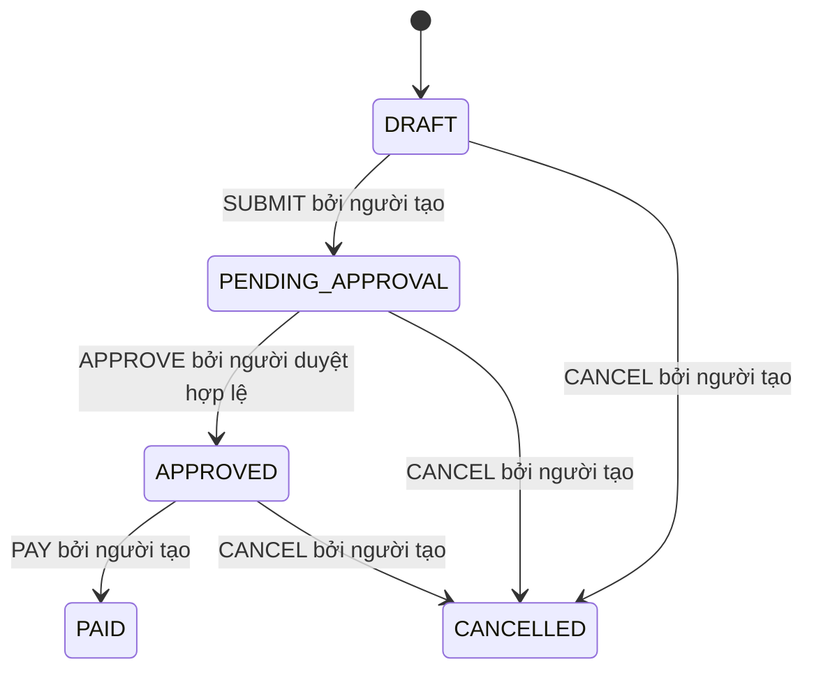

# Transition property tests — Kiểm thử thuộc tính cho chuyển trạng thái

Bài học thuộc chương **Property Testing** của module bảo mật logic nghiệp vụ (`SECURITY_APPLICATION_SECURITY_BUSINESS_LOGIC_SECURITY`). Nội dung tập trung vào kiểm thử các bước chuyển trạng thái để phát hiện đường bỏ qua phê duyệt, thao tác sai quyền, dùng lại quyết định cũ hoặc thực hiện tác động nghiệp vụ nhiều lần.

Một đơn hàng đi qua các trạng thái đúng chưa chắc đã an toàn: người duyệt có thể thuộc tenant khác, giá đã đổi sau khi được duyệt, hoặc một lệnh thanh toán được thực hiện hai lần. Vì vậy, transition property test phải kiểm tra **điều kiện chuyển, dữ liệu được bảo vệ và tác động của thao tác**, thay vì chỉ so sánh tên trạng thái cuối cùng.

Sau bài học, bạn cần có thể:

- Mô hình hóa chuyển trạng thái bằng trạng thái hiện hành, lệnh, chủ thể và ngữ cảnh tin cậy.
- Viết property cho chuyển hợp lệ, chuyển bị cấm và các bất biến sau mỗi bước.
- Sinh chuỗi lệnh chứa cả hành vi hợp lệ lẫn tình huống lạm dụng.
- Đối chiếu hệ thống với mô hình tham chiếu độc lập bằng Java/jqwik.
- Thu nhỏ chuỗi gây lỗi và biến nó thành regression test có thể tái hiện.
- Xác định phần cần kiểm thử thêm bằng transaction thật, cạnh tranh đồng thời hoặc tích hợp hệ thống ngoài.

## 1. Từ ví dụ cố định đến thuộc tính của mọi chuyển trạng thái

### 1.1. Ví dụ cố định và property bổ sung cho nhau

Một example-based test thường kiểm tra tình huống cụ thể:

```text
Đơn đang PENDING_APPROVAL.
Approver hợp lệ phê duyệt đơn.
Kết quả là APPROVED.
```

Một transition property diễn đạt quy luật tổng quát hơn:

```text
Với mọi đơn đang chờ phê duyệt và ngữ cảnh hợp lệ,
nếu phê duyệt được chấp nhận:
  người duyệt phải có quyền đối với đúng đơn;
  trạng thái mới phải là APPROVED;
  dữ liệu thuộc tính được bảo vệ phải giữ nguyên;
  version phải thay đổi theo hợp đồng.

Với mọi trạng thái hoặc chủ thể không đáp ứng điều kiện:
  phê duyệt phải bị từ chối;
  dữ liệu nghiệp vụ và tác động thành công không được phát sinh.
```

Property-based testing tạo nhiều đầu vào từ bộ sinh rồi tìm phản ví dụ. Một lần chạy hữu hạn không phải chứng minh toán học cho toàn bộ không gian trạng thái. Sức mạnh của bộ kiểm thử phụ thuộc vào thuộc tính, mô hình kỳ vọng, phân phối đầu vào và khả năng quan sát tác động.

### 1.2. Lỗi thường nằm trong lịch sử thao tác

Xét ba chuỗi sau:

```text
SUBMIT → APPROVE → PAY
SUBMIT → CANCEL → APPROVE → PAY
SUBMIT → APPROVE → PAY → PAY
```

Nếu chỉ kiểm tra trạng thái cuối là `PAID`, cả ba có thể trông như thành công. Nhưng chuỗi thứ hai cố thanh toán đơn đã hủy; chuỗi thứ ba thử thực hiện thanh toán lại.

OWASP khuyến nghị xây dựng misuse case để kiểm tra việc hoàn thành quy trình khi bỏ qua hoặc thực hiện sai thứ tự các bước. Transition property test đưa hướng kiểm tra này vào các chuỗi lệnh có thể sinh và chạy tự động. [OWASP WSTG: Circumvention of Work Flows](https://wstg.owasp.org/v4.2/4-Web_Application_Security_Testing/10-Business_Logic_Testing/06-Testing_for_the_Circumvention_of_Work_Flows/).

## 2. Mô hình hóa đầy đủ một bước chuyển

Có thể mô tả một bước bằng:

```text
transition(state, command, actor, trustedContext)
    → Accepted(newState, effects)
    | Rejected(reason)
    | Replayed(previousResult)
```

Trong đó:

- `state` là bản chụp hiện hành của đối tượng nghiệp vụ.
- `command` là ý định thực hiện, chẳng hạn submit, approve hoặc pay.
- `actor` là danh tính và thuộc tính quyền từ nguồn đã xác thực.
- `trustedContext` gồm thời gian máy chủ, báo giá, chính sách hoặc dữ liệu khác đã được tải/xác minh.
- `effects` là tác động dự định tạo ra, chẳng hạn ghi đơn, tạo payment intent hoặc ghi sự kiện nghiệp vụ.
- `Replayed` chỉ tồn tại nếu hợp đồng hỗ trợ trả lại kết quả yêu cầu trước đó.

### 2.1. Trạng thái nghiệp vụ lớn hơn một enum

Trạng thái cần quan sát có thể là:

```text
OrderSnapshot = (
  orderId,
  tenantId,
  ownerId,
  status,
  totalMinor,
  currency,
  version,
  approvedVersion,
  paymentIntentCount
)
```

Hai bản chụp cùng có `status = APPROVED` nhưng khác tổng tiền hoặc tenant không phải cùng một trạng thái nghiệp vụ.

Ví dụ, nếu đơn được duyệt ở version 7 rồi đổi giá ở version 8, kiểm tra `status == APPROVED` có thể chưa đủ. Hợp đồng có thể yêu cầu `approvedVersion == currentVersion`, hoặc đưa đơn về trạng thái chờ khi dữ liệu nhạy cảm thay đổi. Chính sách phải được xác định trước khi viết property.

### 2.2. Tách cạnh chuyển trạng thái và guard

Một cạnh thể hiện chuyển nào có thể tồn tại:

```text
PENDING_APPROVAL --APPROVE--> APPROVED
```

Guard quyết định khi nào cạnh đó được sử dụng:

```text
actor cùng tenant với đơn
AND actor có vai trò approver
AND actor không phải người tạo đơn
AND dữ liệu được duyệt còn hiệu lực
```

Kiểm tra đồ thị mà bỏ guard sẽ bỏ sót lỗi phân quyền. Kiểm tra guard mà bỏ trạng thái hiện hành sẽ bỏ sót lỗi bỏ bước hoặc mở lại trạng thái đã kết thúc.

## 3. Hợp đồng minh họa: đơn hàng cần phê duyệt

Các quy tắc dưới đây là giả định cụ thể của bài học, không phải quy tắc bắt buộc cho mọi hệ thống.

- Người tạo được submit đơn nháp, thanh toán đơn đã duyệt và hủy đơn trước khi thanh toán.
- Approver cùng tenant, khác người tạo, được phê duyệt đơn đang chờ.
- Người tạo có thêm vai trò approver vẫn không được tự duyệt.
- Chỉ đơn `APPROVED` mới được thanh toán.
- `PAID` và `CANCELLED` không có chuyển đi trong phạm vi ví dụ.
- Lệnh bị từ chối không đổi trạng thái, version hoặc tác động thành công.
- Lệnh hợp lệ tăng version đúng một đơn vị.
- Một đơn chỉ tạo tối đa một payment intent trong mô hình này.
- Ví dụ lõi chưa hỗ trợ replay bằng idempotency key; lệnh lặp sau thành công bị xét lại theo trạng thái hiện hành.



Bảng hợp đồng:

| Trạng thái trước | Lệnh | Chủ thể được phép | Trạng thái sau |
|---|---|---|---|
| DRAFT | SUBMIT | Người tạo | PENDING_APPROVAL |
| PENDING_APPROVAL | APPROVE | Approver cùng tenant, khác người tạo | APPROVED |
| APPROVED | PAY | Người tạo | PAID |
| DRAFT | CANCEL | Người tạo | CANCELLED |
| PENDING_APPROVAL | CANCEL | Người tạo | CANCELLED |
| APPROVED | CANCEL | Người tạo | CANCELLED |
| Mọi trường hợp còn lại | Bất kỳ lệnh trong ví dụ | Không có | Từ chối, giữ nguyên dữ liệu nghiệp vụ |

“Trạng thái kết thúc” luôn phụ thuộc phạm vi. Hệ thống có hoàn tiền có thể cho `PAID → REFUND_PENDING`; điều đó cần mô hình và property riêng. Không áp quy tắc “PAID không bao giờ đổi” sang một miền khác khi hợp đồng có thêm chuyển hợp lệ.

## 4. Những property cần kiểm tra

### P1. Chỉ chấp nhận cạnh và guard được phép

Với mỗi bước:

```text
accepted
  ⇔ cạnh (stateBefore.status, command.action) tồn tại
     AND actor thỏa guard của cạnh
     AND các điều kiện dữ liệu/ngữ cảnh đều đúng
```

Dấu hai chiều có ý nghĩa: hệ thống phải từ chối thao tác bị cấm và vẫn phải chấp nhận thao tác được phép. Nếu chỉ viết “khi thành công thì trạng thái đúng”, implementation luôn từ chối có thể vượt qua property.

### P2. Lệnh bị từ chối không tạo thay đổi nghiệp vụ

```text
Rejected ⇒ businessSnapshotAfter = businessSnapshotBefore
```

Bản chụp nên bao gồm status, version, số tiền, tenant, quan hệ sở hữu và các tác động thành công cần bảo vệ.

Audit về lần bị từ chối có thể được ghi nếu đó là thiết kế có chủ đích. Vì vậy, không nhất thiết so sánh toàn bộ log hoặc metric bằng nhau. Phải phân biệt audit bảo mật với event “đã phê duyệt”, lệnh thu tiền hoặc bản ghi thành công.

### P3. Thành công có đúng hậu điều kiện

```text
Accepted ⇒
  statusAfter = trạng thái đích trong hợp đồng
  versionAfter = versionBefore + 1
  các thuộc tính không được sửa vẫn giữ nguyên
```

Tùy miền, có thể kiểm tra thêm người duyệt, thời điểm duyệt và version dữ liệu được duyệt. Đừng chỉ assert rằng status “đã thay đổi”.

### P4. Tiền điều kiện phải đúng tại bước đang xét

Trong mô hình minh họa:

```text
PAY được chấp nhận ⇒ trạng thái ngay trước PAY là APPROVED
APPROVE được chấp nhận ⇒ trạng thái ngay trước APPROVE là PENDING_APPROVAL
```

Trong mô hình có sửa giá hoặc thu hồi quyền, điều kiện phải được kiểm tra trên dữ liệu hiện hành. Việc một actor từng có quyền hoặc đơn từng được duyệt không đủ để cho phép bước tiếp theo.

### P5. Tác động không bị lặp ngoài hợp đồng

```text
0 ≤ paymentIntentCount ≤ 1
```

Lệnh `PAY` đầu tiên hợp lệ tạo một payment intent; các lần `PAY` sau không được tạo thêm. Đây là thuộc tính an toàn về số lần tác động trong mô hình, chưa phải bảo đảm “thu tiền đúng một lần” qua hệ thống thanh toán thực tế.

### P6. Bất biến phải đúng sau mọi tiền tố của chuỗi

Với chuỗi `c1, c2, ..., cn`, kiểm tra sau từng bước:

```text
S0 --c1--> S1 --c2--> S2 ... --cn--> Sn
I(S0), I(S1), I(S2), ..., I(Sn)
```

Nếu hệ thống tạm ghi nhận tác động sai ở bước 2 rồi sửa lại ở bước 3, chỉ kiểm tra `Sn` sẽ bỏ qua lỗi. Với miền thuần, kiểm tra sau mỗi lệnh đã đủ quan sát các ranh giới thao tác; để thấy ghi dở dang bên trong một lệnh cần các kiểm thử khác.

## 5. Oracle: mô hình kỳ vọng phải độc lập

**Oracle** là cơ sở để xác định kết quả đúng. Trong transition property test, oracle thường là một mô hình tham chiếu nhỏ.

Một mô hình tốt:

- Diễn đạt hợp đồng bằng bảng cạnh hoặc quy tắc đơn giản.
- Không gọi hàm phân quyền, chuyển trạng thái hoặc tính tiền của production để tính expected.
- Duy trì trạng thái kỳ vọng của chính nó.
- So sánh kết quả cho phép/từ chối, dữ liệu và tác động quan sát được sau từng lệnh.
- Được kiểm tra lại với ví dụ nghiệp vụ đã được thống nhất.

Một mô hình yếu:

```text
expectedAllowed = production.canTransition(command)
actual = production.execute(command)
assert actual.allowed == expectedAllowed
```

Nếu cả hai hàm dùng chung guard sai, property có thể đồng thuận với lỗi.

Dùng chung kiểu enum hoặc cấu trúc dữ liệu đơn giản thường không phải vấn đề. Dùng chung quyết định nghiệp vụ để tính cả actual và expected mới là nguy cơ chính. Ngay cả mô hình viết độc lập vẫn có thể sai vì hiểu sai yêu cầu; cần các ví dụ cố định và trao đổi với người sở hữu nghiệp vụ để kiểm tra hợp đồng.

## 6. Thiết kế bộ sinh chuỗi lệnh

### 6.1. Sinh cả thao tác được phép và thao tác bị cấm

Bộ sinh cần chứa:

| Nhóm | Ví dụ | Mục tiêu |
|---|---|---|
| Đi đúng luồng | SUBMIT → APPROVE → PAY | Hệ thống cho phép nghiệp vụ hợp lệ |
| Bỏ bước | PAY ngay từ DRAFT | Không thanh toán khi chưa duyệt |
| Đảo thứ tự | APPROVE → SUBMIT | Không duyệt đơn chưa gửi |
| Lặp bước | APPROVE → APPROVE | Không tạo lại quyết định thành công |
| Sau hủy | CANCEL → APPROVE → PAY | Không mở lại đơn đã hủy ngoài hợp đồng |
| Sai quyền | Người tạo tự duyệt; người khác thanh toán | Guard theo đối tượng được thực thi |
| Khác tenant | Approver tenant B duyệt đơn tenant A | Không dùng vai trò để vượt phạm vi tenant |
| Dữ liệu đã cũ | Sửa giá sau duyệt rồi PAY | Không dùng quyết định hết hiệu lực |

Không lọc bỏ mọi lệnh không hợp lệ bằng precondition của bộ sinh. Làm như vậy chỉ kiểm tra đường hợp lệ và xóa mất chính hành vi tấn công cần thử.

Nếu dùng công cụ stateful testing chỉ chạy action khi precondition đúng, hãy có action chuyên biểu diễn yêu cầu bị cấm và assert từ chối, hoặc duy trì một property riêng cho chuỗi tùy ý.

### 6.2. Chuỗi ngẫu nhiên hoàn toàn dễ bỏ lỡ đường sâu

Giả sử mỗi bước chọn đều giữa nhiều actor và nhiều action. Chuỗi có thể bị từ chối liên tục ở `DRAFT`, hoặc hủy sớm rồi dành phần lớn thời gian thử trên `CANCELLED`.

Nên kết hợp:

1. Chuỗi tự do để thử nhiều thứ tự và thao tác không hợp lệ.
2. Tiền tố hợp lệ để chắc chắn đi đến `PENDING_APPROVAL` hoặc `APPROVED`, sau đó gắn phần đuôi tùy ý.
3. Tiền tố đến trạng thái kết thúc để kiểm tra không tạo tác động thêm.
4. Chuỗi hợp lệ bị sửa đúng một yếu tố: actor, tenant, version, số tiền hoặc thời gian.

Không chỉ tăng số lần chạy khi phân phối đầu vào chưa đi vào khu vực cần kiểm tra.

### 6.3. Tạo mới hệ thống cho mỗi lần thử

Mỗi mẫu chuỗi phải bắt đầu từ trạng thái đã biết, chẳng hạn một đơn nháp hoàn toàn mới. Không dùng cùng repository giả, event buffer hoặc đối tượng mutable qua nhiều lần thử.

Nếu dữ liệu cũ còn tồn tại, kết quả sẽ phụ thuộc thứ tự chạy và quá trình shrinking khó tái hiện. Với adapter có I/O, cần chiến lược cô lập dữ liệu, reset hoặc transaction phù hợp.

## 7. Ví dụ Java/jqwik: đối chiếu từng bước với mô hình

Ví dụ sau sử dụng Java 17 trở lên. Bộ test cần jqwik chạy trên JUnit Platform và JUnit Jupiter API cho các assertion. `@Property`, `@ForAll`, bộ sinh `Arbitrary` và combinator là các thành phần của jqwik; hướng dẫn chính thức mô tả cách kết hợp bộ sinh và chạy property. [jqwik User Guide](https://jqwik.net/docs/current/user-guide.html#combining-arbitraries).

Để ví dụ tự chứa, đoạn mã có một SUT trong bộ nhớ và một mô hình tham chiếu dùng bảng. Khi áp dụng vào dự án, thay `OrderMachine` bằng adapter gọi logic miền thật; giữ phần expected độc lập.

Mã lõi chỉ kiểm tra trạng thái, nhóm actor, version và số payment intent. Số tiền, báo giá, thời gian, transaction và idempotency được mở rộng ở các phần sau.

```java
import java.util.ArrayList;
import java.util.List;
import java.util.Map;
import java.util.Set;

import net.jqwik.api.Arbitraries;
import net.jqwik.api.Arbitrary;
import net.jqwik.api.Combinators;
import net.jqwik.api.ForAll;
import net.jqwik.api.Property;
import net.jqwik.api.Provide;

import static org.junit.jupiter.api.Assertions.assertEquals;
import static org.junit.jupiter.api.Assertions.assertTrue;

class TransitionProperties {
    enum Status {
        DRAFT, PENDING_APPROVAL, APPROVED, PAID, CANCELLED
    }

    enum Action {
        SUBMIT, APPROVE, PAY, CANCEL
    }

    enum Actor {
        OWNER("u-1", "tenant-a", false),
        APPROVER("u-2", "tenant-a", true),
        OWNER_WITH_APPROVER_ROLE("u-1", "tenant-a", true),
        OTHER_CUSTOMER("u-3", "tenant-a", false),
        FOREIGN_APPROVER("u-4", "tenant-b", true);

        final String userId;
        final String tenantId;
        final boolean canApprove;

        Actor(String userId, String tenantId, boolean canApprove) {
            this.userId = userId;
            this.tenantId = tenantId;
            this.canApprove = canApprove;
        }
    }

    record Command(Action action, Actor actor) {}

    record Snapshot(
            Status status,
            long version,
            int paymentIntents,
            List<Action> successfulActions) {}

    record Edge(Status from, Action action) {}

    // SUT minh họa: quyết định bằng guard và switch.
    static final class OrderMachine {
        private final String tenantId = "tenant-a";
        private final String ownerId = "u-1";
        private Status status = Status.DRAFT;
        private long version;
        private int paymentIntents;
        private final List<Action> successfulActions = new ArrayList<>();

        boolean execute(Command command) {
            Actor actor = command.actor();

            if (!tenantId.equals(actor.tenantId)) {
                return false;
            }

            boolean authorized = switch (command.action()) {
                case APPROVE ->
                        actor.canApprove && !ownerId.equals(actor.userId);
                case SUBMIT, PAY, CANCEL -> ownerId.equals(actor.userId);
            };
            if (!authorized) {
                return false;
            }

            Status next = switch (command.action()) {
                case SUBMIT -> status == Status.DRAFT
                        ? Status.PENDING_APPROVAL : null;
                case APPROVE -> status == Status.PENDING_APPROVAL
                        ? Status.APPROVED : null;
                case PAY -> status == Status.APPROVED
                        ? Status.PAID : null;
                case CANCEL -> switch (status) {
                    case DRAFT, PENDING_APPROVAL, APPROVED ->
                            Status.CANCELLED;
                    default -> null;
                };
            };

            if (next == null) {
                return false;
            }

            status = next;
            version++;
            successfulActions.add(command.action());
            if (command.action() == Action.PAY) {
                paymentIntents++;
            }
            return true;
        }

        Snapshot snapshot() {
            return new Snapshot(
                    status, version, paymentIntents,
                    List.copyOf(successfulActions));
        }
    }

    // Oracle: bảng cạnh và tập actor lấy từ hợp đồng,
    // không gọi guard hoặc execute của SUT.
    static final class ReferenceModel {
        private static final Map<Edge, Status> EDGES = Map.of(
                new Edge(Status.DRAFT, Action.SUBMIT),
                Status.PENDING_APPROVAL,
                new Edge(Status.PENDING_APPROVAL, Action.APPROVE),
                Status.APPROVED,
                new Edge(Status.APPROVED, Action.PAY),
                Status.PAID,
                new Edge(Status.DRAFT, Action.CANCEL),
                Status.CANCELLED,
                new Edge(Status.PENDING_APPROVAL, Action.CANCEL),
                Status.CANCELLED,
                new Edge(Status.APPROVED, Action.CANCEL),
                Status.CANCELLED);

        private static final Set<Actor> OWNERS = Set.of(
                Actor.OWNER, Actor.OWNER_WITH_APPROVER_ROLE);

        private static final Map<Action, Set<Actor>> ALLOWED_ACTORS = Map.of(
                Action.SUBMIT, OWNERS,
                Action.APPROVE, Set.of(Actor.APPROVER),
                Action.PAY, OWNERS,
                Action.CANCEL, OWNERS);

        private Status status = Status.DRAFT;
        private long version;
        private int paymentIntents;
        private final List<Action> successfulActions = new ArrayList<>();

        boolean execute(Command command) {
            Status next = EDGES.get(new Edge(status, command.action()));
            if (next == null
                    || !ALLOWED_ACTORS.get(command.action())
                            .contains(command.actor())) {
                return false;
            }

            status = next;
            version++;
            successfulActions.add(command.action());
            if (command.action() == Action.PAY) {
                paymentIntents++;
            }
            return true;
        }

        Snapshot snapshot() {
            return new Snapshot(
                    status, version, paymentIntents,
                    List.copyOf(successfulActions));
        }
    }

    @Provide
    Arbitrary<List<Command>> traces() {
        Arbitrary<Action> actions = Arbitraries.of(Action.values());
        Arbitrary<Actor> actors = Arbitraries.of(Actor.values());

        return Combinators.combine(actions, actors)
                .as(Command::new)
                .list()
                .ofMinSize(0)
                .ofMaxSize(40);
    }

    private void checkTrace(List<Command> trace) {
        OrderMachine sut = new OrderMachine();
        ReferenceModel model = new ReferenceModel();

        assertEquals(model.snapshot(), sut.snapshot());

        for (int index = 0; index < trace.size(); index++) {
            Command command = trace.get(index);
            Snapshot before = sut.snapshot();
            String context = "step=" + index
                    + ", command=" + command + ", trace=" + trace;

            boolean expectedAccepted = model.execute(command);
            boolean actualAccepted = sut.execute(command);
            Snapshot after = sut.snapshot();

            assertEquals(expectedAccepted, actualAccepted, context);
            assertEquals(model.snapshot(), after, context);

            if (!expectedAccepted) {
                assertEquals(before, after, context);
            }
            assertTrue(
                    after.paymentIntents() >= 0
                            && after.paymentIntents() <= 1,
                    context);
            assertEquals(
                    (long) after.successfulActions().size(),
                    after.version(),
                    context);
        }
    }

    @Property(tries = 600)
    void arbitraryTransitionsMatchContract(
            @ForAll("traces") List<Command> trace) {
        checkTrace(trace);
    }

    @Property(tries = 300)
    void arbitrarySuffixAfterApprovalPreservesContract(
            @ForAll("traces") List<Command> suffix) {
        List<Command> trace = new ArrayList<>(List.of(
                new Command(Action.SUBMIT, Actor.OWNER),
                new Command(Action.APPROVE, Actor.APPROVER)));
        trace.addAll(suffix);
        checkTrace(trace);
    }

    @Property(tries = 300)
    void arbitrarySuffixAfterPaymentCreatesNoSecondIntent(
            @ForAll("traces") List<Command> suffix) {
        List<Command> trace = new ArrayList<>(List.of(
                new Command(Action.SUBMIT, Actor.OWNER),
                new Command(Action.APPROVE, Actor.APPROVER),
                new Command(Action.PAY, Actor.OWNER)));
        trace.addAll(suffix);
        checkTrace(trace);
    }
}
```

### 7.1. Bộ test đang kiểm tra điều gì?

- Chuỗi tùy ý có cả lệnh hợp lệ và không hợp lệ, bao gồm actor khác tenant và người tạo có vai trò approver.
- SUT và mô hình khởi tạo mới cho từng mẫu.
- Sau từng lệnh, so sánh cả quyết định chấp nhận và toàn bộ snapshot quan sát được.
- Lệnh bị từ chối phải giữ nguyên snapshot.
- Version bằng số chuyển được chấp nhận trong hợp đồng minh họa.
- Số payment intent không vượt một.
- Tiền tố hợp lệ buộc bộ test đi đến trạng thái đã duyệt hoặc đã thanh toán, giảm lệ thuộc vào xác suất tình cờ sinh đúng luồng.

Số lần thử và độ dài 40 là ngân sách minh họa, không phải ngưỡng bảo mật chung. Cần điều chỉnh dựa trên thời gian chạy, độ sâu quy trình và thống kê phân phối.

### 7.2. Vì sao snapshot phải sao chép collection?

Nếu snapshot giữ cùng tham chiếu đến danh sách mutable của SUT, biến `before` cũng có thể bị thay đổi sau khi thực thi lệnh. Khi đó, so sánh trước/sau có thể che giấu lỗi.

`List.copyOf` tạo bản chụp không thay đổi của danh sách action enum. Với phần tử là đối tượng mutable, cần thiết kế snapshot bất biến sâu phù hợp; chỉ sao chép lớp vỏ collection chưa đủ.

### 7.3. Vì sao không chỉ kiểm tra invariant?

Invariant `paymentIntents <= 1` không phát hiện hệ thống luôn từ chối. So sánh `expectedAccepted` với `actualAccepted` buộc hệ thống thực hiện những chuyển hợp lệ.

Ngược lại, chỉ so sánh quyết định mà không quan sát snapshot sẽ bỏ sót trường hợp trả `false` nhưng đã tăng version hoặc tạo tác động trước đó.

### 7.4. Giới hạn của fixture actor hữu hạn

Tập actor trong mã là các lớp tương đương phục vụ hợp đồng cụ thể, không phải sinh mọi danh tính có thể có. Khi chuyển sang hệ thống thật, bổ sung actor cùng user ID nhưng khác tenant, actor bị thu hồi quyền, chủ thể dịch vụ hoặc quan hệ ủy quyền nếu miền có hỗ trợ.

Không mở rộng mô hình bằng cách suy rằng một tên role đại diện cho mọi quan hệ quyền. Chủ thể cần được xây dựng từ principal tin cậy, không từ các trường role/tenant do client tự khai.

## 8. Đọc phản ví dụ và shrinking

Giả sử implementation bị sửa để cho `PAY` từ `PENDING_APPROVAL`. Bộ test có thể báo một chuỗi dài; sau thu nhỏ, phản ví dụ có thể còn:

```text
SUBMIT(OWNER)
PAY(OWNER)

Mô hình: từ chối PAY, vẫn PENDING_APPROVAL, paymentIntents = 0.
SUT lỗi: chấp nhận PAY, thành PAID, paymentIntents = 1.
```

Nếu bỏ kiểm tra trạng thái khi phê duyệt, phản ví dụ khác có thể là:

```text
APPROVE(APPROVER)

Mô hình: từ chối vì đơn vẫn DRAFT.
SUT lỗi: chấp nhận và chuyển APPROVED.
```

Shrinking tìm đầu vào nhỏ hơn vẫn làm property thất bại; kết quả phụ thuộc bộ sinh và cách thu nhỏ, không nhất thiết là phản ví dụ nhỏ nhất toàn cục. Báo cáo jqwik cung cấp thông tin mẫu thất bại và seed phục vụ tái hiện. [jqwik User Guide: Result Shrinking](https://jqwik.net/docs/current/user-guide.html#result-shrinking).

Quy trình xử lý:

1. Đọc bước đầu tiên mà actual khác model, không chỉ trạng thái cuối.
2. Xác định lỗi thuộc implementation, model, generator hay hợp đồng chưa rõ.
3. Lưu seed, phiên bản công cụ và dữ liệu cấu hình liên quan khi tái hiện.
4. Chuyển chuỗi đã thu nhỏ thành regression test tường minh.
5. Sửa đúng lớp chịu trách nhiệm, rồi giữ cả regression test và property.

Không chỉ lưu seed làm đặc tả lâu dài: thay đổi bộ sinh hoặc phiên bản công cụ có thể làm cùng seed tạo mẫu khác. Chuỗi lệnh cụ thể là chứng cứ dễ đọc và bền hơn cho lỗi đã biết.

Khi bộ sinh tạo quan hệ phụ thuộc như “duyệt version đang có”, shrinking phải giữ hoặc tính lại quan hệ đó theo mô hình. Nếu biến mẫu thành dữ liệu không hợp lệ từ bước đầu, lỗi sâu cần tìm có thể bị che mất.

## 9. Mở rộng chuyển trạng thái với số tiền và quyết định phê duyệt

Lỗi quan trọng là dữ liệu thay đổi nhưng quyền đi tiếp vẫn giữ nguyên.

Giả sử bổ sung lệnh `CHANGE_TOTAL`. Hai hợp đồng có thể chọn là:

| Chính sách | Khi sửa tổng tiền sau duyệt | Property cần có |
|---|---|---|
| Khóa dữ liệu sau duyệt | Từ chối sửa | Tổng tiền, status và version giữ nguyên khi bị từ chối |
| Cho sửa nhưng yêu cầu duyệt lại | Tăng version, vô hiệu hóa phê duyệt, quay về trạng thái chờ | Không PAY trước khi duyệt version mới |

Không trộn hai chính sách trong cùng expected khi chưa xác định hợp đồng.

Với chính sách duyệt lại, sinh những chuỗi như:

```text
SUBMIT → APPROVE(version 2)
→ CHANGE_TOTAL(giá mới, version 3)
→ PAY
```

Property:

```text
PAY được chấp nhận
  ⇒ phê duyệt hiện tại bao phủ đúng version dữ liệu cần thanh toán
  AND tổng tiền thanh toán khớp tổng tiền chuẩn phía máy chủ
  AND tiền tệ phù hợp
```

Ngoài đổi giá, thử đổi số lượng, địa chỉ có ảnh hưởng chi phí, người thụ hưởng hoặc loại dịch vụ theo miền thực tế. Phải xác định trường nào làm mất hiệu lực phê duyệt; không coi mọi chỉnh sửa, như ghi chú nội bộ, đều có cùng ảnh hưởng.

Khi kiểm thử số tiền nguyên, sinh dữ liệu quanh biên: 0, 1, đúng hạn mức và vượt hạn mức một đơn vị. Nếu có hoàn tiền từng phần, theo dõi số đã thu và đã hoàn qua cả chuỗi:

```text
0 ≤ tổng tiền đã hoàn ≤ tổng tiền đã thu
```

Thuộc tính này cần kiểm tra sau mỗi lần hoàn. Cộng/trừ phải xử lý giới hạn biểu diễn của kiểu số; tránh dùng phép cộng có thể tràn để tự tạo expected sai.

## 10. Thời gian, version cũ và quyền thay đổi giữa các bước

### 10.1. Thời gian là đầu vào điều khiển được

Thêm vào mô hình một thời gian hiện hành và lệnh `ADVANCE_TIME`, hoặc truyền thời điểm rõ ràng cho mỗi command. Không dùng sleep để chờ báo giá hay quyết định hết hạn.

Nếu hợp đồng định nghĩa hiệu lực là `now < expiresAt`, sinh ít nhất ba điểm:

```text
expiresAt - một đơn vị độ chính xác → còn hiệu lực
expiresAt                         → hết hiệu lực
expiresAt + một đơn vị độ chính xác → hết hiệu lực
```

Độ chính xác phải phù hợp lớp đang test. Policy dùng `Instant` có thể kiểm tra nano giây; adapter lưu timestamp ở độ chính xác thấp hơn cần kiểm thử riêng khi dữ liệu đi qua cơ sở dữ liệu.

### 10.2. Kiểm tra lại dữ liệu đang áp dụng

Các chuỗi có ý nghĩa:

```text
Tải bản chụp version 7
→ đối tượng được sửa thành version 8
→ gửi lệnh dựa trên version 7
```

```text
Actor có quyền
→ quyền bị thu hồi
→ actor gửi lệnh phê duyệt
```

Expected phụ thuộc chính sách: dùng quyền hiện hành hay quyền tại thời điểm cấp một ủy quyền cụ thể; có chấp nhận command version cũ hay yêu cầu xung đột. Quyết định phải được viết rõ và áp dụng cho đúng bước.

Trong property thuần, version và quyền hiện hành là dữ liệu mô hình kiểm soát. Để xác nhận hệ thống thật tải lại quyền, xử lý cache hoặc chống ghi trên bản chụp cũ, phải kiểm thử các adapter tương ứng.

## 11. Idempotency là một loại kết quả, không chỉ là self-loop

Trong ví dụ lõi, `PAY` lần hai bị từ chối vì `PAID` là trạng thái kết thúc. API thực tế có thể nhận retry cùng idempotency key và trả kết quả đã lưu.

Khi đó, phân biệt:

- `Accepted`: một thao tác mới được ghi nhận.
- `Replayed`: trả lại kết quả của cùng thao tác đã hoàn tất.
- `Rejected`: vi phạm quyền, nội dung, trạng thái hoặc điều kiện khác.

Property minh họa:

```text
Replayed ⇒ không tăng version nghiệp vụ
           không tạo payment intent mới
           kết quả thuộc đúng phạm vi truy cập

Cùng key nhưng payload nghiệp vụ khác
  ⇒ xung đột, không tạo tác động mới

Key mới trên đơn đã thanh toán
  ⇒ vẫn phải tuân theo quy tắc trạng thái của đơn
```

Bộ sinh nên chứa key giống/khác, payload giống/khác và actor/tenant giống/khác. Phạm vi của key, fingerprint và thời hạn lưu phải theo hợp đồng thực tế; biết một chuỗi key không tự tạo quyền đọc kết quả nhạy cảm.

Không viết property rằng mọi trạng thái phải đổi sau một lệnh thành công nếu thành công có thể là replay. Cũng không coi một self-loop là an toàn chỉ vì status không đổi: tác động thu tiền vẫn có thể bị thực hiện lần nữa.

Nếu dùng fake lưu idempotency trong một `Map`, property mới kiểm tra quyết định và hành vi tuần tự của fake. Nó chưa chứng minh việc nhận key là nguyên tử hoặc khôi phục sau crash là đúng.

## 12. Quan sát tác động, transaction và cạnh tranh đồng thời

### 12.1. Quan sát ý định và tác động thật ở đúng lớp

`paymentIntents` trong mã minh họa là bộ đếm ý định nghiệp vụ trong bộ nhớ. Trong hệ thống thật, có thể quan sát:

- Bản ghi đơn và version đã lưu.
- Bản ghi payment intent hoặc outbox.
- Các lệnh gửi qua cổng tích hợp giả trong unit test.
- Ledger hoặc số dư sau thao tác.
- Event thành công được tạo theo hợp đồng.

Bộ test nên phân biệt “đã tạo ý định thanh toán”, “đã gửi yêu cầu tới nhà cung cấp” và “nhà cung cấp đã thu tiền”. Một con số trong fake không đại diện cho tất cả các giai đoạn đó.

### 12.2. Thêm lỗi tại các ranh giới xử lý

Ở lớp tích hợp, mở rộng trace bằng các tình huống:

```text
Kiểm tra hợp lệ → ghi đơn thất bại
Ghi đơn → ghi outbox thất bại trong cùng transaction
Gửi yêu cầu thanh toán → timeout khi chưa biết kết quả
Nhận callback thanh toán → nhận lại cùng callback
```

Hậu điều kiện phải phù hợp thiết kế:

- Những ghi thuộc cùng transaction cùng commit hoặc cùng rollback.
- Không báo thành công dựa trên bản chụp không được lưu.
- Callback trùng không ghi nhận tiền hai lần.
- Trạng thái chưa rõ kết quả thanh toán được xử lý theo cơ chế đối soát/retry đã định nghĩa.

Không giả định rollback cơ sở dữ liệu có thể hoàn tác một lệnh thu tiền đã được hệ thống ngoài thực hiện. Kiểm thử phải theo cơ chế idempotency, đối soát hoặc bù trừ mà hệ thống thực sự dùng.

### 12.3. Chuỗi tuần tự không chứng minh an toàn khi đồng thời

Hai transaction có thể cùng đọc `APPROVED, version 7`, cùng vượt qua policy, rồi tranh thực hiện `PAY`. Property tuần tự không tự tái hiện được tình huống này.

Cần kiểm thử với cơ chế lưu thật hoặc bộ điều phối lịch thực thi có kiểm soát:

```text
A đọc version 7
B đọc version 7
A thử ghi PAID với điều kiện version 7
B thử ghi PAID với điều kiện version 7
```

Hợp đồng có thể yêu cầu chỉ một cập nhật thành công; yêu cầu còn lại bị xung đột hoặc trả kết quả replay phù hợp. Với tác động bên ngoài, vẫn cần xác nhận tác động không bị tạo trùng qua ranh giới tích hợp.

Một so sánh version trong hàm thuần chỉ xác nhận dữ liệu bản chụp. Cơ chế compare-and-set, khóa hoặc ràng buộc lưu trữ phải được kiểm tra tại nơi thực thi nó.

## 13. Đo phân phối và độ bao phủ của trace

Số lần chạy property không nói rõ bộ sinh đã thử những gì. Theo dõi các nhóm sau:

| Chiều quan sát | Ví dụ cần thấy |
|---|---|
| Cạnh hợp lệ | DRAFT/SUBMIT, PENDING_APPROVAL/APPROVE, APPROVED/PAY |
| Cặp bị cấm | DRAFT/PAY, CANCELLED/APPROVE, PAID/PAY |
| Guard actor | Đúng chủ thể, tự duyệt, khác chủ sở hữu, khác tenant |
| Quyết định | Accepted, Rejected và Replayed nếu hỗ trợ |
| Độ sâu | Trước submit, sau approve, sau pay/cancel |
| Biên dữ liệu | Đúng hạn, quá hạn, đúng version, version cũ |
| Tác động | 0, 1 và nỗ lực tạo tác động thứ hai |

Nếu nhiều mẫu chỉ dừng ở `DRAFT`, tăng tỷ lệ tiền tố hợp lệ. Nếu hầu hết trace hủy sớm, tách property kiểm tra sau hủy khỏi property khám phá đường thanh toán.

Với số trạng thái và action hữu hạn, có thể liệt kê toàn bộ cặp trạng thái/action để kiểm tra quyết định cơ bản. Property sinh trace bổ sung khả năng kiểm tra lịch sử, dữ liệu và tương tác giữa các bước; không cần thay thế các bảng kiểm tra hữu hạn dễ hiểu bằng ngẫu nhiên.

Một chiến lược CI thực dụng:

1. Chạy các regression test cố định và property có ngân sách vừa phải ở mỗi thay đổi.
2. Lưu mẫu thất bại cùng ngữ cảnh để người phát triển tái hiện.
3. Chạy ngân sách trace lớn hơn hoặc thêm tổ hợp dữ liệu khi quy trình yêu cầu.
4. Giữ các bài kiểm tra transaction, concurrency và tích hợp theo mức rủi ro của từng chuyển.

Không hạ chất lượng bằng cách bỏ qua failure khó tái hiện. Trước tiên xác định dữ liệu không được reset, thời gian không điều khiển, model sai hay lỗi thực tế.

## 14. Lỗi thường gặp và cách sửa

| Lỗi | Vì sao bỏ sót vấn đề | Cách cải thiện |
|---|---|---|
| Chỉ assert trạng thái cuối | Tác động sai có thể xảy ra ở bước giữa | Kiểm tra sau từng command |
| Chỉ sinh action hợp lệ | Không thử bỏ bước, sai quyền hoặc lặp bước | Giữ cả action cố ý không hợp lệ |
| Chỉ kiểm tra invariant | Hệ thống luôn từ chối vẫn có thể vượt qua | So sánh cả quyết định với model |
| Expected gọi lại production | Cùng một lỗi ảnh hưởng cả hai phía | Dùng bảng/mô hình độc lập |
| Snapshot giữ tham chiếu mutable | Bản chụp trước bị sửa theo SUT | Dùng snapshot bất biến phù hợp |
| Chỉ theo dõi enum status | Bỏ sót sửa tiền, tenant, version hoặc tác động | Mở rộng trạng thái quan sát |
| Dùng seed như chứng cứ duy nhất | Generator đổi làm mất chuỗi cũ | Lưu regression trace tường minh |
| Tăng tries nhưng không đo phân phối | Không đi đến vùng trạng thái cần kiểm tra | Dùng tiền tố và nhóm trace có mục tiêu |
| Coi fake tuần tự là bằng chứng concurrency | Không có tranh chấp transaction thật | Bổ sung kiểm thử với cơ chế lưu thật |
| Áp property đơn điệu cho mọi miền | Hoàn tiền hoặc mở lại có thể là hợp lệ | Viết property theo đồ thị và hợp đồng cụ thể |

## 15. Bài tập thực hành

### Bài tập 1: Phát hiện bỏ qua phê duyệt

Trong SUT minh họa, cho phép `PAY` từ `PENDING_APPROVAL`. Dự đoán chuỗi phản ví dụ ngắn, rồi dùng property để kiểm tra. Sau khi sửa, giữ regression test cho đường bỏ bước đó.

### Bài tập 2: Kiểm tra quyền tách biệt người tạo/người duyệt

Bỏ điều kiện người duyệt phải khác người tạo. Xác định actor nào trong fixture sẽ làm lộ lỗi và tiền tố nào cần có trước khi gọi `APPROVE`.

Bổ sung một property có tiền tố `SUBMIT` rồi thử các nhóm actor, để việc tìm lỗi không phụ thuộc hoàn toàn vào chuỗi tự do.

### Bài tập 3: Dữ liệu thay đổi làm mất hiệu lực phê duyệt

Thêm `CHANGE_TOTAL` theo chính sách yêu cầu duyệt lại. Mở rộng snapshot bằng tổng tiền và version được duyệt, rồi kiểm tra rằng không thể thanh toán dữ liệu mới dựa trên phê duyệt cũ.

Sinh tổng tiền đúng biên và vượt biên; đảm bảo bộ sinh báo giá hoặc dữ liệu chuẩn vẫn có quan hệ đúng để test đến được guard cần khảo sát.

### Bài tập 4: Retry và idempotency

Bổ sung kết quả `Replayed`, key và fingerprint vào mô hình. Kiểm tra cùng key/cùng nội dung không tạo tác động mới; cùng key/khác nội dung bị từ chối; key khác không bỏ qua trạng thái đã thanh toán.

Nêu rõ phần nào đang được fake mô phỏng và phần nào cần kiểm thử lưu trữ nguyên tử.

### Bài tập 5: Tách an toàn tuần tự và đồng thời

Mô tả lịch hai yêu cầu cùng thanh toán version 7. Viết kết quả mong muốn cho cả hai yêu cầu và cho tổng số tác động. Xác định test nào chạy được trong bộ nhớ, test nào cần transaction hoặc tích hợp nhà cung cấp thanh toán.

## 16. Tiêu chí hoàn thành một bộ transition property test

- Hợp đồng có bảng cạnh, guard, dữ liệu được bảo vệ và tác động rõ ràng.
- Model độc lập với quyết định nghiệp vụ của SUT.
- Bộ sinh có cả đường hợp lệ, đường bỏ bước, lặp bước, sau hủy và sai quyền.
- Những trạng thái sâu được đi đến có chủ đích.
- Mỗi mẫu bắt đầu từ dữ liệu mới và thời gian có thể kiểm soát.
- So sánh kết quả lẫn snapshot sau từng bước, không chỉ cuối trace.
- Bị từ chối không đổi dữ liệu nghiệp vụ hoặc tạo tác động thành công.
- Replay được phân biệt với chuyển mới và từ chối nếu hợp đồng hỗ trợ.
- Phản ví dụ có thể tái hiện và được giữ thành regression test khi sửa lỗi.
- Phạm vi bảo đảm được ghi rõ cho miền thuần, transaction, concurrency và hệ thống ngoài.

Transition property tests biến quy trình nghiệp vụ thành một tập quy luật có thể thử trên nhiều lịch sử thao tác. Chất lượng của bộ test thể hiện ở khả năng phát hiện một chuyển sai cùng dữ liệu và tác động liên quan, đồng thời vẫn cho phép các chuyển hợp lệ theo đúng hợp đồng.
