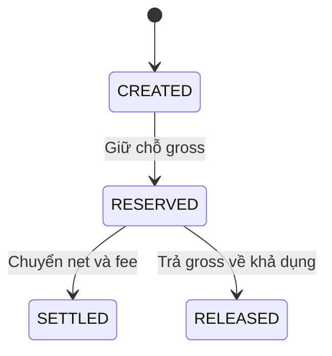

# Amount conservation property

## 1. Bảo toàn số tiền là thuộc tính gì?

Trong bảo mật logic nghiệp vụ, **amount conservation property** là thuộc tính kiểm tra rằng các thao tác chỉ dịch chuyển số tiền theo quy tắc được phép, không tự tạo thêm hoặc làm mất tiền do lỗi tính toán, thiếu bút toán, retry hoặc chuyển trạng thái sai.

Ví dụ, một ví bị trừ 10.000 đồng nhưng ví nhận chỉ được cộng 9.000 đồng. Nếu không có khoản phí, thuế hay đích nhận hợp lệ cho 1.000 đồng còn lại, thao tác đã vi phạm bảo toàn số tiền. Ngược lại, cộng tiền cho ví nhận mà không trừ nguồn có thể tạo ra giá trị ngoài ý muốn.

Property-based testing diễn đạt quy tắc tổng quát rồi sinh nhiều dữ liệu và chuỗi thao tác để tìm phản ví dụ. Thay vì chỉ kiểm tra một lần chuyển 10.000 đồng, ta kiểm tra các số tiền nhỏ, số dư sát giới hạn, phí làm tròn, yêu cầu trùng và các lịch thực thi cạnh tranh.

Trong chương **Property Testing** của module bảo mật logic nghiệp vụ, bài học tập trung vào:

- Xác định đúng phạm vi, đơn vị và phương trình bảo toàn.
- Sinh dữ liệu để tìm lỗi số học và lỗi chuyển trạng thái.
- Kiểm tra tác dụng đã commit, không chỉ giá trị trả về.
- Kết hợp bảo toàn với quyền theo đối tượng, hạn mức, transaction và idempotency.
- Thu nhỏ một phản ví dụ thành tình huống có thể tái hiện.

Bảo toàn là một điều kiện quan trọng, nhưng chưa chứng minh mọi dòng tiền đều hợp lệ. Một lệnh chuyển tiền trái quyền vẫn có thể trừ nguồn và cộng đích hoàn toàn cân bằng.

## 2. Xác định ranh giới trước khi viết phương trình

### 2.1. Phạm vi đóng

Giả sử một hệ thống ví nội bộ quản lý hai ví và một tài khoản phí. Cả ba cùng dùng một loại tiền, không có nạp hoặc rút tiền ra ngoài trong thao tác đang kiểm tra.

Gọi:

- `A_i`: số tiền khả dụng của ví i.
- `H_i`: số tiền đang giữ chỗ của ví i.
- `F`: số tiền ở tài khoản phí trong phạm vi mô hình.
- `T`: tổng giá trị trong phạm vi đó.

Nếu khả dụng và giữ chỗ là hai phần tách biệt, ta có:

```text
T = sum(A_i + H_i) + F

Với một chuyển dịch nội bộ hợp lệ:
T_after = T_before
```

Phải cộng các ngăn tiền **không trùng nhau**. Nếu một trường `balance` đã bao gồm tiền giữ chỗ, không được tính `balance + reserved` vì sẽ đếm tiền hai lần.

Mô hình này là mô hình ví đơn giản của bài học. Nó không yêu cầu cộng tùy tiện mọi tài khoản kế toán trong một hệ thống thực tế.

### 2.2. Phạm vi có tiền đi vào hoặc đi ra

Nếu phạm vi chỉ bao gồm các ví khách hàng, một khoản phí chuyển sang tài khoản nền tảng nằm ngoài phạm vi sẽ làm tổng ví giảm hợp lệ. Khi đó cần ghi nhận dòng tiền qua ranh giới:

```text
T_after - T_before
    = authorizedExternalIn - authorizedExternalOut
```

Ví dụ:

| Sự kiện | Ảnh hưởng lên tổng trong phạm vi |
| --- | --- |
| Chuyển giữa hai ví đều nằm trong phạm vi | Không đổi |
| Nạp tiền đã được xác nhận từ bên ngoài | Tăng đúng số tiền nạp được công nhận |
| Rút tiền thành công ra ngoài | Giảm đúng số tiền rút theo hợp đồng |
| Thu phí vào tài khoản phí nằm ngoài phạm vi | Giảm đúng khoản phí đó |
| Chuyển từ khả dụng sang giữ chỗ trong cùng ví | Không đổi nếu cả hai ngăn đều được tính |

Nguồn xác định dòng tiền ngoài phải độc lập với lỗi đang tìm. Nếu lấy chính các bút toán vừa được hệ thống ghi sai để suy ra “tiền đi vào hợp lệ”, phương trình có thể tự khớp dù hệ thống tạo tiền trái phép.

### 2.3. Phân tách theo loại tiền và phạm vi sở hữu

Không cộng 100 đơn vị của loại tiền này với 100 đơn vị của loại tiền khác rồi coi tổng 200 là một bất biến có ý nghĩa.

Kiểm tra theo từng `currency` và phạm vi sổ đã xác định. Nếu hệ thống yêu cầu cách ly tenant, còn phải kiểm tra không có chuyển dịch qua tenant trái quyền. Một giao dịch chuyển sai từ tenant A sang tenant B có thể giữ nguyên tổng toàn nền tảng nhưng vẫn là lỗi bảo mật nghiêm trọng.

Nếu tài khoản phí dùng chung ngoài tenant, hoặc có thanh toán liên tenant được cho phép, biểu diễn rõ các dòng qua ranh giới thay vì ép mọi tổng của tenant phải luôn bằng nhau.

## 3. Ví dụ xuyên suốt: chuyển tiền có phí và giữ chỗ

Hợp đồng minh họa:

1. Alice và Bob thuộc cùng tenant; Alice có quyền chuyển từ ví của mình.
2. Số tiền yêu cầu `gross` phải lớn hơn 0.
3. Phí được khấu trừ từ `gross`, không thu thêm ngoài `gross`.
4. Bob nhận `net = gross - fee`.
5. Server quyết định chính sách phí; client không được tự đặt `fee` hoặc `net`.
6. Một lệnh chỉ được quyết toán hoặc giải phóng giữ chỗ một lần.
7. Không cho phép âm số dư khả dụng, giữ chỗ hoặc số dư ví nhận.
8. Các dữ liệu ảnh hưởng phê duyệt, nếu quy trình có phê duyệt, phải khớp nội dung đã được phép thực hiện.

Giả sử Alice có 100.000 đồng, Bob có 50.000 đồng, phí bằng 2% số tiền chuyển. Alice yêu cầu chuyển `gross = 10.000`.

| Thời điểm | Alice khả dụng | Alice giữ chỗ | Bob khả dụng | Tài khoản phí | Tổng |
| --- | ---: | ---: | ---: | ---: | ---: |
| Ban đầu | 100.000 | 0 | 50.000 | 0 | 150.000 |
| Đã giữ chỗ | 90.000 | 10.000 | 50.000 | 0 | 150.000 |
| Đã quyết toán | 90.000 | 0 | 59.800 | 200 | 150.000 |

Nếu hủy trước quyết toán, 10.000 đồng được chuyển từ ngăn giữ chỗ về khả dụng của Alice. Không cộng tiền vào Bob hoặc tài khoản phí.

Nếu yêu cầu quyết toán được gửi lại sau khi đã thành công, cả bốn ngăn phải giữ nguyên. Tuy nhiên, chỉ kiểm tra tổng chưa đủ: quyết toán trùng có thể đồng thời trừ Alice và cộng Bob, khiến tổng vẫn bằng 150.000 nhưng Alice bị mất tiền hai lần.

## 4. Từ bảo toàn tổng đến bộ bất biến đủ mạnh

Một bộ property nên kết hợp các điều kiện sau:

| Mã | Thuộc tính | Lỗi có thể phát hiện |
| --- | --- | --- |
| P1 | Tổng trong phạm vi thay đổi đúng dòng tiền qua ranh giới | Tạo hoặc mất tiền |
| P2 | Mỗi thao tác ghi đúng biến động trên từng tài khoản | Trừ đúng tổng nhưng cộng sai người hoặc sai phí |
| P3 | Các ngăn bị cấm âm luôn không âm | Chi tiêu vượt số dư dù tổng vẫn cân bằng |
| P4 | Retry của cùng thao tác không tạo thêm tác dụng tiền tệ | Trừ và cộng lặp nhưng vẫn bảo toàn tổng |
| P5 | Thao tác bị từ chối nghiệp vụ không đổi số dư hoặc bút toán tiền | Từ chối sau khi đã trừ nguồn |
| P6 | Trạng thái và bút toán khớp nhau | Đã báo hoàn tất nhưng còn tiền giữ chỗ |
| P7 | Mỗi quyết toán hoặc hoàn tiền hợp lệ có đúng định danh nghiệp vụ | Dùng key mới để xử lý lại cùng nghĩa vụ thanh toán |
| P8 | Actor, đối tượng và nội dung đều được phép | Chuyển tiền trái quyền nhưng cân bằng số học |
| P9 | Ledger và projection số dư đối chiếu được | Ledger đúng nhưng ví hiển thị hoặc cho phép chi sai |

Đối với sổ kép, một nguyên tắc là tổng nợ bằng tổng có trong mỗi nhóm bút toán đã ghi sổ, theo loại tiền. Nợ và có tăng hay giảm số dư tùy loại tài khoản; không nên suy ra rằng cộng mọi số dư hiển thị luôn phải bằng 0. Tham khảo [TigerBeetle — Financial Accounting](https://docs.tigerbeetle.com/coding/financial-accounting/).

Trong mô hình ví ở bài này, có thể dùng các biến động có dấu:

```text
deltaAlice = -gross
deltaBob   = gross - fee
deltaFee   = fee

deltaAlice + deltaBob + deltaFee = 0
```

Ngoài kiểm tra từng thao tác, kiểm tra lại tổng và đối chiếu projection sau một chuỗi thao tác. Hai lớp quan sát giúp phân biệt sai bút toán với sai cập nhật số dư.

## 5. Chọn biểu diễn tiền để property không bị số học đánh lừa

### 5.1. Số nguyên theo đơn vị nhỏ nhất

Một lựa chọn là lưu `Money(currency, minorUnits)`, trong đó `minorUnits` là số nguyên theo đơn vị nhỏ nhất mà hệ thống hỗ trợ cho loại tiền đó.

Trong các ví dụ chuyển tiền của bài, mọi số tiền là số nguyên đồng và cùng dùng VND. Khi áp dụng cho sản phẩm khác, số chữ số thập phân phải theo cấu hình tiền tệ do server quản lý.

Không dùng `float` hoặc `double` làm oracle cho tiền cần chính xác theo đơn vị nhỏ nhất. Cũng không dùng phép cộng `long` không kiểm soát tràn số để kiểm tra chính một hệ thống dùng `long`: lỗi tràn tương tự có thể xuất hiện ở cả hai phía.

Có thể dùng:

- `Math.addExact`, `subtractExact`, `multiplyExact` để phát hiện tràn trong những phép tính phù hợp.
- `BigInteger` trong mô hình tham chiếu và phép tổng hợp của test.
- Giới hạn nghiệp vụ rõ ràng để không vượt khả năng biểu diễn của storage.

Phát hiện tràn số chưa đủ. Nếu phép tính thất bại, không được để lại một phần cập nhật đã commit.

### 5.2. Khi đầu vào là số thập phân

Nếu API nhận chuỗi số thập phân, hãy chuyển đổi theo chính sách cụ thể. Ví dụ sau chọn **từ chối phần lẻ không biểu diễn chính xác**, không tự làm tròn:

```java
static long toMinorUnits(String text, int currencyScale) {
    BigDecimal amount = new BigDecimal(text);
    if (amount.signum() < 0) {
        throw new IllegalArgumentException("Negative amount");
    }

    return amount
        .setScale(currencyScale, RoundingMode.UNNECESSARY)
        .movePointRight(currencyScale)
        .longValueExact();
}
```

`currencyScale` trong ví dụ phải đến từ cấu hình tin cậy. Việc chấp nhận số 0, độ dài chuỗi, ký pháp số và giới hạn số tiền là các quy tắc đầu vào bổ sung của sản phẩm.

`BigDecimal` cho phép điều khiển scale và cách làm tròn; `longValueExact()` phát hiện giá trị không chuyển chính xác được sang `long`. Khi so sánh giá trị số, cần hiểu rằng `equals` của `BigDecimal` còn xét scale, còn `compareTo` so sánh theo giá trị số. Xem [Java — BigDecimal](https://docs.oracle.com/en/java/javase/17/docs/api/java.base/java/math/BigDecimal.html).

Không xây `BigDecimal` từ một giá trị `double` đã mất độ chính xác rồi kỳ vọng lấy lại giá trị thập phân ban đầu.

### 5.3. Phí và số dư làm tròn phải có chính sách

Giả sử chính sách phí minh họa là:

```text
fee = floor(gross * feeBps / 10_000)
net = gross - fee
```

Công thức này chỉ dùng cho các giá trị không âm trong hợp đồng ví dụ. Basis point là một phần mười nghìn; mức 200 tương ứng 2%.

Oracle nên tính phép nhân bằng `BigInteger` rồi chia theo chính sách. Không dùng trực tiếp hàm tính phí production để tính kết quả mong đợi.

Nếu chia 100 đơn vị nhỏ nhất cho ba người, làm tròn riêng thành 33, 33, 33 sẽ thiếu một đơn vị. Có thể phân bổ thành 34, 33, 33 theo thứ tự ưu tiên ổn định đã công bố. Property cần kiểm tra tổng phần chia bằng 100 và đúng quy tắc nhận phần dư.

Một tài khoản hoặc trường “chênh lệch làm tròn” chỉ hợp lệ khi có chính sách xác định cách phát sinh và giới hạn của nó. Không dùng nó như chỗ tự động nhét mọi sai lệch để làm phương trình cân bằng.

Đối với số tiền đã quy về đơn vị nguyên, kiểm tra bằng nhau chính xác. Điều kiện kiểu `abs(after - before) <= 1` trên mỗi giao dịch có thể bỏ qua một đơn vị thất thoát lặp lại hàng nghìn lần.

## 6. Cấu trúc của một property có khả năng bắt lỗi

Một property tốt có bốn phần rõ ràng:

```text
For all: trạng thái ban đầu và đầu vào được sinh
Given: hợp đồng, quyền và chính sách đã xác định
When: gọi hệ thống cần kiểm tra
Then: so sánh trạng thái đã commit với mô hình độc lập
      và kiểm tra toàn bộ bất biến liên quan
```

Đối với thao tác hợp lệ, không chỉ yêu cầu “tổng không đổi”. Cần chứng minh thao tác được chấp nhận và tạo đúng biến động. Một implementation luôn từ chối mọi yêu cầu cũng giữ nguyên tổng, nhưng không đáp ứng nghiệp vụ.

Đối với thao tác bị cấm, yêu cầu kết quả từ chối cụ thể và không có biến động tiền tệ. Không coi timeout hoặc lỗi kết nối là một lời từ chối chắc chắn: thao tác có thể đã commit trước khi mất phản hồi.

Oracle nên có ít nhất hai góc nhìn:

- **Mô hình kỳ vọng:** tính biến động từ trạng thái ban đầu, dữ liệu được phép và chính sách tham chiếu.
- **Quan sát hệ thống:** đọc số dư, bút toán, trạng thái và tác dụng bên ngoài thực tế.

Không đọc số dư trước ở một thời điểm và từng tài khoản sau ở những thời điểm không nhất quán khi hệ thống đang có giao dịch khác. Trong test tích hợp, dùng snapshot nhất quán hoặc cô lập toàn bộ phạm vi dữ liệu của ca. Một tổng ghép từ nhiều ảnh chụp khác nhau có thể báo sai rằng tiền bị mất.

## 7. Thiết kế generator theo rủi ro nghiệp vụ

### 7.1. Sinh dữ liệu hợp lệ theo quan hệ

Với hợp đồng phí khấu trừ từ `gross`, ví nguồn chỉ cần đủ `gross`, không phải `gross + fee`. Generator phải phản ánh đúng hợp đồng này.

Một chiến lược:

1. Sinh `gross > 0`.
2. Sinh phần dư khả dụng `extra >= 0`.
3. Đặt số dư Alice ban đầu bằng `gross + extra`.
4. Sinh số dư Bob và mức phí trong giới hạn server cho phép.
5. Tạo hai ví cùng tenant, cùng loại tiền, actor sở hữu ví nguồn.

Quan hệ giữa các giá trị được tạo ngay từ đầu giúp giảm việc loại mẫu. Không sinh độc lập số dư và số tiền rồi loại hầu hết dữ liệu vì không đủ tiền.

### 7.2. Sinh nhóm dữ liệu không hợp lệ riêng

| Nhóm | Mẫu cần có | Điều mong đợi |
| --- | --- | --- |
| Số tiền không hợp lệ | Âm, bằng 0 nếu bị cấm, vượt giới hạn sản phẩm | Từ chối và không đổi dữ liệu tiền |
| Không đủ tiền | `gross = available + 1` | Không trừ nguồn hoặc tạo giữ chỗ |
| Nguy cơ tràn | Cộng tiền đích vượt miền storage | Từ chối an toàn, không cập nhật một phần |
| Khác loại tiền | Nguồn và đích không tương thích | Không tự coi hai đơn vị là một |
| Sai quyền | Đổi source wallet ID hoặc tenant | Không có bút toán trái quyền |
| Sửa tham số do server quyết định | Chèn `fee`, `net`, `approvedAmount` | Không áp dụng giá trị giả mạo |
| Sai trạng thái | Quyết toán sau khi đã giải phóng giữ chỗ | Không tạo tác dụng tiền lần hai |
| Xung đột idempotency | Cùng key nhưng khác nội dung có ý nghĩa | Không thực hiện nhầm hoặc trả nhầm kết quả |

Giới hạn storage có thể hẹp hơn `long`, chẳng hạn một cột số với precision cố định. Property cần kiểm tra giới hạn thực tế của hợp đồng và database.

### 7.3. Chủ động đưa giá trị biên vào miền sinh

Các giá trị hữu ích gồm:

- Một đơn vị nhỏ nhất.
- Số tiền bằng đúng số dư khả dụng.
- Số tiền lớn hơn số dư một đơn vị.
- Giá trị ngay trước, tại và sau ngưỡng phí hoặc hạn mức.
- Trường hợp phép chia phí có phần dư và không có phần dư.
- Số tiền rất nhỏ khiến phí bằng 0.
- Giá trị sát mức tối đa của số tiền, số dư và phép tính trung gian.
- Chuỗi giữ chỗ rồi giải phóng nhiều lần.

Theo dõi phân bố để biết thực sự có ca không đủ tiền, retry, có phần dư làm tròn và chạm giới hạn. Chạy nhiều mẫu trong một miền dễ không bù được việc thiếu một nhóm rủi ro.

## 8. Ví dụ Java với jqwik và oracle số nguyên lớn

Đoạn dưới minh họa generator và property. Các API `WalletFixture`, snapshot và client là adapter kiểm thử của dự án, **không phải API có sẵn trong jqwik**. Cần triển khai chúng để gọi hệ thống thật và đọc trạng thái đã commit.

Ví dụ giả định fixture tạo phạm vi riêng gồm hai ví và một tài khoản phí, cùng VND, với tiền giữ chỗ và tài khoản phí ban đầu bằng 0. Chính sách phí được fixture cấu hình ở phía server. Tài khoản ban đầu được tạo bằng cơ chế fixture hợp lệ, không đưa khoản nạp khởi tạo vào dòng tiền của thao tác đang kiểm tra.

```java
import net.jqwik.api.*;
import java.math.BigInteger;
import java.time.Duration;
import static org.junit.jupiter.api.Assertions.*;

record TransferCase(
    long aliceMinor,
    long bobMinor,
    long grossMinor,
    int feeBps
) {}

@Provide
Arbitrary<TransferCase> validTransfers() {
    var gross = Arbitraries.longs().between(1, 1_000_000_000L);
    var extra = Arbitraries.longs().between(0, 1_000_000_000L);
    var bob = Arbitraries.longs().between(0, 1_000_000_000L);
    var bps = Arbitraries.integers().between(0, 2_000);

    return Combinators.combine(gross, extra, bob, bps)
        .as((g, e, b, r) -> new TransferCase(
            Math.addExact(g, e), b, g, r
        ));
}

@Property(tries = 300)
void settledTransferConservesAmount(
    @ForAll("validTransfers") TransferCase c
) {
    try (var fx = WalletFixture.create(
        c.aliceMinor(), c.bobMinor(), c.feeBps()
    )) {
        var before = fx.readConsistentSnapshot();

        var transfer = fx.api().createTransfer(
            fx.alice(),
            fx.aliceWalletId(),
            fx.bobWalletId(),
            c.grossMinor(),
            "VND"
        );
        var reply = fx.api().executeTransfer(
            fx.alice(), transfer.id(), "execute-1"
        );

        assertTrue(reply.accepted());
        fx.awaitSettledAndDrained(
            transfer.id(), Duration.ofSeconds(5)
        );

        var after = fx.readConsistentSnapshot();
        BigInteger gross = BigInteger.valueOf(c.grossMinor());
        BigInteger fee = gross
            .multiply(BigInteger.valueOf(c.feeBps()))
            .divide(BigInteger.valueOf(10_000));
        BigInteger net = gross.subtract(fee);

        assertEquals(
            BigInteger.valueOf(c.aliceMinor()).subtract(gross),
            after.aliceAvailable()
        );
        assertEquals(BigInteger.ZERO, after.aliceReserved());
        assertEquals(
            BigInteger.valueOf(c.bobMinor()).add(net),
            after.bobAvailable()
        );
        assertEquals(BigInteger.ZERO, after.bobReserved());
        assertEquals(fee, after.feeAvailable());

        assertEquals(before.totalMinor(), after.totalMinor());
        fx.assertAllWalletBucketsNonNegative();
        fx.assertPostedGroupBalanced(transfer.id(), "VND");
        assertEquals(1, fx.settlementGroupCount(transfer.id()));
    }
}
```

Trong ví dụ, các accessor số tiền của snapshot trả `BigInteger`; `totalMinor()` cộng mỗi ngăn đúng một lần. Helper đọc ledger phải kiểm tra dữ liệu thật, không chỉ trả lại một đối tượng kỳ vọng được dựng từ request.

Generator giới hạn giá trị để tập trung vào chuyển tiền hợp lệ, không chạm tràn `long`. Bổ sung property riêng cho giá trị sát giới hạn và yêu cầu từ chối an toàn khi không thể biểu diễn kết quả.

Với adapter tích hợp, mỗi lần thử phải cô lập dữ liệu, key, worker và trạng thái nhà cung cấp mô phỏng. Không nhất thiết khởi động lại database cho mỗi mẫu; có thể dùng cùng hạ tầng nhưng chia phạm vi dữ liệu riêng và dọn đúng sau mỗi lần thử.

jqwik hỗ trợ sinh mẫu, báo seed và thu nhỏ phản ví dụ. Cú pháp generator và cơ chế thu nhỏ được mô tả trong [jqwik User Guide](https://jqwik.net/docs/current/user-guide).

## 9. Kiểm tra chuỗi trạng thái thay vì một phép chuyển độc lập

Nhiều lỗi bảo toàn xảy ra ở chuỗi `reserve → settle` hoặc `reserve → release`. Có thể mô hình hóa mỗi transfer như sau:



Quy tắc biến động:

| Lệnh được chấp nhận | Alice khả dụng | Alice giữ chỗ | Bob khả dụng | Phí |
| --- | ---: | ---: | ---: | ---: |
| Reserve | `-gross` | `+gross` | 0 | 0 |
| Settle | 0 | `-gross` | `+(gross-fee)` | `+fee` |
| Release | `+gross` | `-gross` | 0 | 0 |
| Retry một bước đã hoàn tất | 0 | 0 | 0 | 0 |
| Lệnh bị từ chối vì sai trạng thái | 0 | 0 | 0 | 0 |

Từ `SETTLED` không được chạy `RELEASE` như thể tiền còn đang giữ chỗ. Nếu cần hoàn tiền sau quyết toán, đó là thao tác đảo hoặc hoàn riêng có định danh và ngân sách riêng.

Mô hình tham chiếu có thể giữ:

```text
wallets: available, reserved, currency, tenant, owner
transfers: gross, feePolicy, source, target, state
acceptedOperations: transferId, step, result
```

Bộ sinh chuỗi tạo cả lệnh có thể được chấp nhận lẫn lệnh cố tình sai: settle trước reserve, release hai lần, retry sau settle hoặc thay ví nhận giữa các bước.

Sau từng bước có điểm quan sát hợp lệ:

1. Mô hình xác định được chấp nhận hay từ chối theo hợp đồng.
2. Hệ thống thực thi lệnh qua ranh giới đang kiểm tra.
3. Test so sánh kết quả nghiệp vụ, trạng thái và biến động từng tài khoản.
4. Test kiểm tra tổng, tính không âm và sự khớp giữa ledger với projection.

Không chỉ kiểm tra tổng ở cuối chuỗi. Một lần tạo tiền rồi một lần mất tiền có thể triệt tiêu về tổng, che giấu cả hai lỗi nếu bỏ qua các bước trung gian đã commit.

## 10. Idempotency: cùng số tiền chưa chắc là cùng thao tác

Trong mô hình ví này, `transferId` đại diện cho một ý định chuyển tiền được tạo rõ ràng. `Idempotency-Key` hỗ trợ retry một request trong phạm vi đã công bố. Đây là hai tầng định danh liên quan nhưng không đồng nhất.

Hai lần Alice chủ ý chuyển 10.000 đồng cho Bob có thể là hai giao dịch hợp lệ nếu có hai transfer riêng. Không được gộp chúng chỉ vì cùng người nhận và số tiền.

Ngược lại, một transfer đã quyết toán không được quyết toán lần nữa chỉ vì request mới dùng key khác.

Các property cần có:

| Trường hợp | Thuộc tính mong đợi |
| --- | --- |
| Cùng transfer, cùng key, cùng nội dung | Không thêm biến động tiền |
| Cùng transfer, key khác, cố quyết toán lại | Không tạo quyết toán thứ hai |
| Cùng key, khác transfer hoặc payload | Xử lý xung đột theo hợp đồng; không chạy nhầm lệnh |
| Hai transfer hợp lệ có cùng số tiền và người nhận | Cả hai được xử lý nếu đủ tiền và đủ quyền |
| Retry sau timeout khi thao tác đã commit | Trả hoặc tìm lại kết quả cũ, không cộng hoặc trừ thêm |
| Actor khác dùng lại key đã biết | Không vượt kiểm tra quyền hoặc đọc kết quả nhạy cảm |

Một property retry có thể lấy snapshot sau lần quyết toán đầu, gửi lại lệnh, chờ công việc liên quan hoàn tất rồi yêu cầu snapshot tiền tệ không đổi và số nhóm quyết toán của transfer vẫn bằng một.

Không yêu cầu mọi dữ liệu kỹ thuật đều bất biến: hệ thống có thể ghi thêm audit, số lần thử hoặc lần truy cập cuối. So sánh đúng những trường phản ánh tác dụng tiền tệ.

Điều kiện cân bằng tổng không phát hiện được mọi lỗi replay. Nếu mỗi lần replay đều trừ 10.000 ở nguồn và cộng 10.000 ở đích, tổng vẫn đúng. Số lần tác động trên cùng transfer và biến động kỳ vọng theo từng tài khoản mới làm lỗi lộ ra.

## 11. Cạnh tranh: tổng đúng vẫn có thể chi vượt số dư

Giả sử Alice có 100.000 đồng và hai transfer khác nhau cùng muốn chuyển 60.000 đồng. Nếu cả hai transaction cùng đọc số dư cũ rồi đều ghi một cặp trừ và cộng cân bằng, tổng toàn phạm vi có thể vẫn không đổi nhưng ví Alice bị âm.

Một ca cạnh tranh cần phối hợp:

1. Tạo hai transfer có quyền hợp lệ trên cùng ví nguồn.
2. Cho hai request chạy qua transaction và kết nối độc lập.
3. Điều khiển hoặc quan sát cửa sổ cạnh tranh tại kiểm tra số dư và ghi giữ chỗ.
4. Cho những tác vụ được tạo hoàn tất theo một kịch bản không hủy hoặc nạp thêm tiền.
5. Kiểm tra số dư không âm, tổng bảo toàn và tối đa một transfer được quyết toán thành công.

Hai HTTP response đều có thể là `202` nếu ứng dụng tiếp nhận trước rồi xử lý sau. Vì vậy, “một thành công, một bị từ chối” ở đây là kết quả nghiệp vụ cuối, không nhất thiết là cặp mã HTTP ngay lúc tiếp nhận.

Một start gate ở client chưa bảo đảm hai transaction đã cùng chạm điều kiện gây lỗi. Nếu cần test hook phía server, đặt nó theo cơ chế concurrency thực tế. Đừng đặt barrier đòi cả hai luồng cùng đi qua một đoạn mà luồng đầu đang giữ khóa độc quyền.

Với một transfer đã giữ chỗ, cho `SETTLE` và `RELEASE` cạnh tranh cũng rất hữu ích:

```text
Kết quả hợp lệ A:
    SETTLED
    giữ chỗ về 0
    Bob nhận net
    tài khoản phí nhận fee

Kết quả hợp lệ B:
    RELEASED
    giữ chỗ về 0
    Alice nhận lại gross
    Bob và tài khoản phí không đổi
```

Không chấp nhận trạng thái lai: Alice được trả lại gross nhưng Bob vẫn nhận net và tài khoản phí vẫn nhận fee. Đó là trường hợp tạo thêm tiền nếu không có nguồn bù hợp lệ.

Oracle cho thao tác cạnh tranh nên kiểm tra kết quả tương ứng với một thứ tự hợp lệ của các lệnh, cùng các bất biến tại điểm commit. Đọc một tổng trong lúc các cập nhật chưa tạo thành snapshot nhất quán không thay thế được kiểm tra này.

## 12. Transaction, lỗi giữa chừng và dòng tiền bên ngoài

### 12.1. Tính nguyên tử của cập nhật nội bộ

Đặt lỗi có chủ đích tại các ranh giới:

| Điểm lỗi | Thuộc tính cần kiểm tra |
| --- | --- |
| Sau khi chuẩn bị trừ nguồn, trước khi ghi đích | Không có phần cập nhật tiền nào bị commit riêng lẻ |
| Sau khi ghi bút toán nhưng trước khi cập nhật trạng thái | Ledger, projection và trạng thái cùng commit hoặc cùng rollback theo thiết kế |
| Sau khi giữ chỗ nhưng trước khi lưu ý định xử lý tiếp | Không để tiền bị giữ mà thiếu thao tác có thể truy vết hoặc khôi phục |
| Sau commit nhưng trước HTTP response | Retry không trừ hoặc cộng thêm |
| Worker hoàn tất rồi chết trước khi ACK | Giao lại công việc không tạo quyết toán thứ hai |

Nếu hệ thống dùng ledger làm nguồn sự thật và cập nhật projection bất đồng bộ, không ép projection phải luôn cập nhật trong cùng transaction với ledger. Thay vào đó, kiểm tra ledger nguyên tử và projection hội tụ đúng, đồng thời chứng minh quyết định chi tiêu không dùng projection cũ theo cách cho phép chi vượt.

Khi từ chối vì tràn số, sai quyền hoặc không đủ tiền, hãy đọc lại qua kết nối mới. Đối tượng đang giữ trong bộ nhớ hoặc ORM cache có thể không phản ánh dữ liệu đã commit.

### 12.2. Khi có cổng thanh toán hoặc ngân hàng

Một transaction database không thể tự rollback khoản tiền đã được nhà cung cấp xử lý. Nếu nhà cung cấp đã thực hiện nhưng phản hồi bị mất, hệ thống cần trạng thái chưa xác định, định danh thao tác ổn định và cơ chế tìm lại kết quả.

Property cần quan sát cả hai phía:

- Sổ thao tác và khoản tiền được nhà cung cấp mô phỏng thực sự chấp nhận.
- Bút toán, số dư, trạng thái chờ và dữ liệu đối soát trong ứng dụng.

Không cộng đồng thời một khoản đang giữ chỗ và chính khoản đó như tiền đã ra ngoài nếu mô hình coi chúng là cùng giá trị đang chuyển tiếp. Hãy xác định các ngăn không chồng lặp và thời điểm giá trị chuyển từ ngăn này sang ngăn khác.

Với xử lý bất đồng bộ, chỉ khẳng định kết quả cuối sau khi thao tác và công việc liên quan đã hội tụ trong phạm vi test. “Ngay lúc này chưa có khoản thu thứ hai” chưa đủ nếu một retry đã được xếp hàng nhưng chưa thực thi.

Một bộ mô phỏng có trạng thái nên hỗ trợ trường hợp đã thực hiện nhưng mất phản hồi, gửi callback trùng và trả kết quả chậm. Đếm số lần gọi HTTP không tương đương với đếm số tác dụng tiền tệ thành công.

## 13. Hoàn tiền, phí và ngân sách hoàn

Hoàn tiền cần cả bảo toàn lẫn giới hạn theo khoản thu gốc. Nếu một khoản thu là 100.000 đồng, hai yêu cầu hoàn 60.000 đồng có thể cùng vượt ngân sách dù mỗi yêu cầu nhìn riêng đều nhỏ hơn số đã thu.

Một bất biến theo chính sách hoàn là:

```text
successfulRefundAmount + reservedPendingRefundAmount
    <= refundableBudget
```

Khi hoàn từ trạng thái đang chờ sang thành công, chuyển số tiền giữa hai nhóm, không cộng cùng khoản vào cả hai. Khi timeout chưa rõ kết quả, không giải phóng ngân sách như thể hoàn tiền đã thất bại chắc chắn.

Phí quyết định đường đi của tiền. Giả sử khoản thu ban đầu có `gross = 100.000`, bên nhận được 98.000 và tài khoản phí nhận 2.000. Các chính sách khác nhau có thể dẫn đến:

| Chính sách hoàn | Khách hàng được cộng | Bên nhận bị trừ | Tài khoản phí bị trừ |
| --- | ---: | ---: | ---: |
| Hoàn cả tiền và phí | 100.000 | 98.000 | 2.000 |
| Chỉ hoàn phần không gồm phí | 98.000 | 98.000 | 0 |
| Hoàn đủ cho khách, bên nhận chịu phí | 100.000 | 100.000 | 0 |

Cả ba dòng đều cân bằng về số học, nhưng chỉ chính sách được sản phẩm cho phép mới hợp lệ. Ở dòng cuối, bên nhận cần đủ nguồn tiền cho phần phí phải chịu, hoặc có cơ chế tài trợ được ghi nhận rõ; không được tự tạo thêm tiền để bù.

Đối với hoàn từng phần, xác định cách phân bổ phí hoàn và phần dư làm tròn. Property cần kiểm tra:

- Tổng tiền đã hoàn và đang giữ chỗ không vượt ngân sách.
- Tổng phí hoàn không vượt phí có thể hoàn theo hợp đồng.
- Mỗi phần hoàn có bút toán cân bằng và đúng người nhận.
- Retry không tăng số tiền hoàn.
- Hoàn thất bại cuối cùng giải phóng giữ chỗ đúng một lần.
- Hoàn nhiều phần đến giới hạn không làm thừa hoặc thiếu một đơn vị nhỏ nhất.

Không mặc định rằng “chuyển tiền rồi hoàn tiền” luôn đưa mọi số dư về ban đầu. Điều đó chỉ đúng khi hợp đồng hoàn đảo toàn bộ tác dụng tiền tệ, bao gồm cả phí liên quan.

## 14. Ngoại tệ và các quan hệ biến đổi có điều kiện

### 14.1. Chuyển đổi loại tiền

Trong một ca giả lập đổi 100 USD lấy 90 EUR, không có phương trình bảo toàn số nguyên kiểu `100 = 90`. Cần theo dõi từng loại tiền và nguồn đối ứng.

Một mô hình có tài khoản tồn quỹ đổi tiền có thể ghi:

```text
USD:
    khách hàng -100
    quỹ đổi tiền +100

EUR:
    quỹ đổi tiền -90
    khách hàng +90
```

Mỗi loại tiền cân bằng riêng trong phạm vi đã bao gồm quỹ đổi tiền. Các số trên chỉ là dữ liệu minh họa, không phải tỷ giá dùng cho sản phẩm.

Oracle còn phải xác minh báo giá được phép, thời hạn, chiều tỷ giá, scale, phí và cách phân bổ phần dư. Một lệnh dùng sai tỷ giá vẫn có thể tạo bút toán cân bằng theo từng loại tiền.

Nếu không đưa tài khoản đối ứng vào phạm vi quan sát, biểu diễn các dòng tương ứng qua ranh giới. Không đổi tất cả số dư bằng một tỷ giá tùy ý rồi coi đó là bằng chứng bảo toàn.

### 14.2. Metamorphic properties

Metamorphic testing kiểm tra quan hệ giữa các lần thực thi đã biến đổi đầu vào. Một số quan hệ hữu ích:

| Quan hệ | Điều kiện phải được xác định |
| --- | --- |
| Reserve rồi release khôi phục phân bố tiền ban đầu | Chưa settle, không có phí giữ chỗ hoặc phí hủy |
| Retry cùng thao tác không đổi kết quả tiền tệ | Cùng định danh nghiệp vụ và quyền retry hợp lệ |
| Chuyển `x + y` có cùng phân bố tiền như hai lần chuyển `x`, `y` | Không phí, không làm tròn, không thay hạn mức hoặc điều kiện theo số lần |
| Đổi thứ tự hai thao tác cho cùng kết quả | Thực sự độc lập, không tranh chấp số dư hoặc giới hạn chung |

Không áp dụng tính chất chia nhỏ thanh toán một cách vô điều kiện. Phí cố định, mức phí theo bậc hoặc làm tròn trên từng giao dịch có thể làm hai lần chuyển khác một lần chuyển tổng.

Ngay cả khi phí tỷ lệ thuần túy, phép làm tròn vẫn có thể khiến:

```text
fee(x) + fee(y) != fee(x + y)
```

Đây có thể là hành vi đúng theo hợp đồng, hoặc là cơ hội lạm dụng nếu chính sách cần ngăn chia nhỏ để né phí. Property phải bắt nguồn từ yêu cầu nghiệp vụ, không chỉ từ một đẳng thức có vẻ hợp lý.

## 15. Thu nhỏ và tái hiện phản ví dụ

Khi property thất bại, dữ liệu có thể ban đầu rất lớn hoặc gồm nhiều bước. Thu nhỏ nhằm tìm một trường hợp đơn giản hơn vẫn làm thuộc tính sai.

Ví dụ một chuỗi dài có thể được rút về:

```text
Alice = 1 đơn vị
Bob = 0
fee = 0

reserve(transferA, 1)
settle(transferA)
release(transferA)

Kỳ vọng: release bị từ chối
Thực tế lỗi: Alice được cộng lại 1, Bob vẫn giữ 1
Tổng cuối: 2 thay vì 1
```

Phản ví dụ này chỉ ra việc cùng một giữ chỗ đã bị tiêu thụ và giải phóng.

Thiết kế dữ liệu để việc thu nhỏ không phá quan hệ cần kiểm tra:

- Sinh `gross` và phần dư rồi suy ra số dư nguồn, thay vì giữ các số không liên hệ.
- Dùng nhãn transfer hoặc ví mang tính biểu tượng trong chuỗi; khi chạy mới ánh xạ sang ID thật.
- Khi bỏ một lệnh khỏi chuỗi, tính lại kết quả mong đợi từ mô hình, không dùng trạng thái kỳ vọng đã tính cho chuỗi cũ.
- Nếu lệnh còn lại trở thành sai trạng thái, xác minh nó bị từ chối theo hợp đồng thay vì tự bỏ qua mà không kiểm tra.
- Giữ khả năng thu nhỏ cả dữ liệu lẫn chuỗi lệnh.

Lưu seed, mẫu đã thu nhỏ, chính sách phí, đơn vị tiền, phiên bản mã và cấu hình môi trường có ảnh hưởng. Với lỗi cạnh tranh hoặc bất đồng bộ, seed dữ liệu chưa đủ: còn cần lịch phối hợp, điểm gây lỗi và thông điệp đã giao.

Sau khi sửa lỗi, giữ ca tối giản thành kiểm thử hồi quy có thể hiểu được. Tiếp tục chạy property trên miền sinh phù hợp để tìm những biến thể khác.

## 16. Tránh property xanh giả

| Thiết kế dễ gây hiểu nhầm | Vì sao chưa đủ | Bổ sung cần thiết |
| --- | --- | --- |
| Chỉ so tổng trước và sau | Chuyển sai người hoặc xử lý trùng vẫn có thể cân bằng | So biến động từng tài khoản, quyền và định danh thao tác |
| Dùng hàm production để tính đáp án | Cùng một lỗi có thể nằm ở cả SUT và oracle | Mô hình nhỏ, độc lập và số học đủ rộng |
| Luôn loại bỏ dữ liệu không hợp lệ | Không kiểm tra hành vi chống lạm dụng | Sinh nhóm bị cấm và kiểm tra không đổi tiền |
| Property chỉ kiểm tra điều kiện sau thành công | Hệ thống từ chối mọi yêu cầu có thể vẫn xanh | Với dữ liệu hợp lệ, yêu cầu thao tác thực sự được chấp nhận |
| Chỉ đọc response | Response không phản ánh mọi phần đã commit | Đọc ledger, số dư và tác dụng ngoài |
| Cộng snapshot khác thời điểm | Có thể tạo sai lệch giả | Đọc nhất quán hoặc cô lập phạm vi |
| Chỉ kiểm tra cuối chuỗi | Hai lỗi có thể triệt tiêu về tổng | Kiểm tra sau từng điểm commit hoặc hội tụ |
| Chấp nhận sai số nhỏ tùy ý | Thất thoát lặp lại có thể tăng dần | Kiểm tra chính xác theo đơn vị và chính sách phần dư |
| Lấy tổng toàn nền tảng | Có thể che chuyển trái quyền giữa tenant | Kiểm tra phạm vi, chủ sở hữu và đường đi được phép |
| Chỉ dùng mô hình trong bộ nhớ | Không chứng minh transaction hoặc constraint của database | Chạy các property quan trọng qua tầng tích hợp thật |

Có thể tổ chức bộ kiểm thử thành hai lớp. Lớp số học và mô hình thuần chạy trên nhiều mẫu với chi phí thấp. Lớp tích hợp dùng phạm vi mẫu vừa phải để kiểm tra transaction, database, phân quyền, worker và dịch vụ mô phỏng. Không cần lặp toàn bộ hạ tầng đắt tiền cho mọi phép tính thuần.

Một lượng mẫu hữu hạn không chứng minh thuộc tính đúng với mọi đầu vào. Giá trị của property testing nằm ở miền sinh có chủ đích, oracle đúng, khả năng thu nhỏ và việc kiểm tra các ranh giới thật của hệ thống.

## 17. Checklist cho amount conservation property

Trước khi coi thiết kế property đã bao phủ yêu cầu, hãy xác định được:

- Phạm vi gồm những tài khoản hoặc ngăn tiền nào, có bị đếm trùng không?
- Công thức đang áp dụng cho phạm vi đóng hay có dòng tiền ngoài?
- Mỗi loại tiền và mỗi ranh giới tenant được xử lý ra sao?
- Phí, thuế nếu có, tiền giữ chỗ và phần dư làm tròn đi về đâu?
- Biến động kỳ vọng của từng tài khoản được tính bằng oracle độc lập nào?
- Generator có sinh giá trị biên, không đủ tiền, tràn số và đầu vào sai quyền không?
- Có phân biệt một request retry với một ý định chuyển tiền mới không?
- Có thử settle và release cạnh tranh, hai lần chi từ một số dư và hoàn tiền cạnh tranh không?
- Có đọc trạng thái đã commit, đối chiếu ledger với projection và chờ công việc liên quan hội tụ không?
- Có thể chạy lại phản ví dụ bằng mẫu đã thu nhỏ và lịch thực thi đã lưu không?

Một thiết kế đạt mục tiêu khi vừa giải thích được mỗi đơn vị tiền đã đi đâu, vừa chứng minh rằng sự dịch chuyển đó được cho phép, ghi nhận đúng một lần cho mỗi thao tác và duy trì các ràng buộc của toàn bộ workflow.
