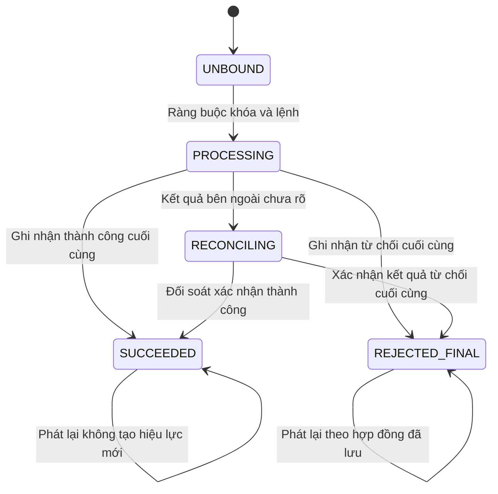

# Idempotency property — Thuộc tính không tạo thêm hiệu lực khi gửi lại

## 1. Mục tiêu của bài học

Người dùng bấm nút hai lần, trình duyệt gửi lại sau timeout, worker xử lý lại thông điệp hoặc kẻ lạm dụng phát lại yêu cầu đều có thể khiến một thao tác xuất hiện nhiều lần. Nếu mỗi lần tiếp nhận đều thu tiền, trừ hạn mức hoặc tạo thêm đơn hàng, hệ thống có thể vi phạm quy tắc nghiệp vụ dù từng request riêng lẻ hoàn toàn hợp lệ.

**Idempotency property** là thuộc tính mô tả việc thực hiện lại cùng một thao tác đã được định danh không tạo thêm hiệu lực nghiệp vụ ngoài hiệu lực được phép của thao tác đó. Property-based testing giúp kiểm tra thuộc tính này trên nhiều dữ liệu, số lần lặp, chuỗi hành động và điểm gián đoạn, thay vì chỉ gửi hai request giống nhau trong một ví dụ cố định.

Bài học thuộc module `SECURITY_APPLICATION_SECURITY_BUSINESS_LOGIC_SECURITY`, kết nối idempotency với business invariants, state machine, quyền theo đối tượng, phê duyệt và transaction. Trọng tâm là viết thuộc tính đúng, sinh tình huống có ý nghĩa và quan sát đủ bằng chứng để phát hiện lạm dụng logic.

Sau bài học, bạn có thể:

- Xác định thế nào là cùng một thao tác và phạm vi của khóa idempotency.
- Phân biệt hiệu lực nghiệp vụ với số request, số lần thử và nội dung phản hồi.
- Thiết kế bộ sinh, mô hình tham chiếu và oracle cho thuộc tính idempotency.
- Kiểm thử phát lại tuần tự, đồng thời, sau lỗi và qua dịch vụ ngoài.
- Thu nhỏ phản ví dụ mà vẫn giữ được điều kiện gây lỗi.

## 2. Từ tính chất toán học đến lệnh nghiệp vụ

### 2.1. Vì sao công thức quen thuộc chưa đủ?

Với một phép biến đổi trạng thái `f`, tính idempotent thường được biểu diễn:

```text
f(f(S)) = f(S)
```

Đặt trạng thái đích thành `CANCELLED` có thể mang tính chất này nếu lần đặt lại không tạo thêm tác động. Tuy nhiên, một lệnh nghiệp vụ thường làm nhiều việc: kiểm tra quyền, thay đổi dữ liệu, ghi sổ, phát sự kiện và trả kết quả. Chỉ nhìn trường trạng thái cuối cùng có thể bỏ sót việc gửi hai lệnh hoàn tiền hoặc tạo hai lần giữ chỗ.

Một lệnh “trừ 200000 VND” tự thân không idempotent. Hệ thống có thể cung cấp một thao tác đã định danh, chẳng hạn “thực hiện lần thu `op-42`”, để các lần phát lại đều tham chiếu cùng một hiệu lực. Thuộc tính cần kiểm tra thuộc về hợp đồng xử lý thao tác đó, không phải do tên HTTP method hay việc client gửi một header đặc biệt tự bảo đảm.

### 2.2. Quan sát phần trạng thái có ý nghĩa

Gọi `B(S)` là phép lấy phần trạng thái nghiệp vụ được bảo vệ: sổ tiền, số đơn hàng, hạn mức đã dùng và các hiệu lực liên quan. Với cùng trạng thái ban đầu, cùng điều kiện môi trường và cùng lệnh đã định danh `C`, một thuộc tính tuần tự có thể viết:

```text
B(execute(S0, [C, C, ..., C])) = B(execute(S0, [C]))
```

Phép so sánh này không yêu cầu toàn bộ database giống từng byte. Số lần thử, log truy cập và dấu thời gian quan sát có thể tăng hợp lệ. Cần xác định trước những trường nào thuộc hiệu lực nghiệp vụ và những thay đổi nào chỉ phục vụ vận hành.

Nếu môi trường thay đổi giữa các lần gửi, chẳng hạn quyền bị thu hồi hoặc báo giá hết hạn, không áp dụng máy móc phép so sánh hai lần chạy trên điều kiện khác nhau. Khi đó phải kiểm tra thuộc tính theo lịch sử: lần phát lại không tái thực hiện hiệu lực đã hoàn tất, và dữ liệu kết quả chỉ được trả cho người còn quyền truy cập theo chính sách.

## 3. Xác định danh tính của thao tác

### 3.1. Khóa không đứng một mình

Một khóa idempotency cần có phạm vi rõ ràng. Ví dụ minh họa:

```text
K = (tenantId, operationKind, callerNamespace, idempotencyKey)
```

Trong đó:

- `tenantId` xác định tổ chức theo ngữ cảnh đáng tin cậy.
- `operationKind` phân biệt loại lệnh, chẳng hạn thu tiền và hoàn tiền.
- `callerNamespace` là không gian định danh được chính sách lựa chọn, có thể gắn với người dùng hoặc ứng dụng tích hợp.
- `idempotencyKey` là giá trị nhận diện lần thao tác trong không gian đó.

Đây là một thiết kế minh họa, không phải công thức bắt buộc cho mọi API. Nếu cùng thao tác cần tiếp tục sau khi đăng nhập lại, không nên vô tình gắn danh tính thao tác với một token phiên ngắn hạn. Nếu cho phép nhiều chủ thể phối hợp trên cùng thao tác, cần xác định rõ quyền và không gian khóa phù hợp.

Các thành phần về tổ chức hoặc chủ thể không được tin chỉ vì client gửi chúng trong body. Kiểm thử cần xác nhận việc đổi trường do client tự khai không chuyển được thao tác sang phạm vi khác.

### 3.2. Khóa phải gắn với nội dung có ý nghĩa

Khi khóa đã được ràng buộc với một lệnh, gửi cùng khóa nhưng đổi số tiền, người nhận hoặc đối tượng không được biến thao tác cũ thành thao tác khác.

Một cách triển khai thường dùng là lưu dấu vân tay của nội dung lệnh đã chuẩn hóa. Thuộc tính kiểm thử phải dựa trên quy tắc chuẩn hóa được định nghĩa, không chỉ dựa trên chuỗi JSON nguyên bản.

| Thành phần | Câu hỏi cần làm rõ |
| --- | --- |
| ID đơn hàng, kỳ thu, người nhận | Thay đổi có tạo ra ý định nghiệp vụ khác không? |
| Số tiền và tiền tệ | Được biểu diễn theo đơn vị nào, có chấp nhận nhiều biểu diễn tương đương không? |
| Revision hoặc tham chiếu báo giá | Có gắn lệnh với nội dung đã được xác nhận không? |
| Thứ tự phần tử trong danh sách | Có ý nghĩa nghiệp vụ hay chỉ là cách biểu diễn? |
| Mã theo dõi request | Chỉ là metadata vận chuyển hay tham gia quyết định nghiệp vụ? |
| Trường mặc định, trường bị bỏ qua | Hai biểu diễn khác nhau có được coi là cùng một lệnh không? |

Không loại một trường khỏi dấu vân tay chỉ để giảm xung đột nếu trường đó có thể thay đổi kết quả nghiệp vụ. Cũng không tự sắp xếp mọi danh sách nếu thứ tự mang ý nghĩa.

### 3.3. Cùng nội dung không luôn là cùng thao tác

Hai lần chuyển tiền có cùng người nhận và số tiền vẫn có thể là hai ý định hợp lệ nếu được người dùng xác nhận riêng. Không tự khử trùng mọi payload giống nhau trên toàn hệ thống.

Ngược lại, một đơn hàng chỉ được phép tạo một khoản thu cho một kỳ có thể cần ràng buộc nghiệp vụ trên kỳ thu, dù người gọi đổi khóa. Idempotency theo khóa và giới hạn trên đối tượng là hai lớp bảo vệ cần kiểm thử riêng.

## 4. Chốt hợp đồng kết quả trước khi viết property

Không thể xác định “phát lại đúng” nếu chưa biết ứng dụng lưu kết quả nào và cho phép đánh giá lại trong trường hợp nào.

| Trạng thái của thao tác | Hành vi minh họa khi gửi lại cùng khóa và cùng lệnh |
| --- | --- |
| Chưa được đăng ký bền vững | Có thể tiếp nhận thao tác mới theo cơ chế nguyên tử |
| Đã ràng buộc khóa, đang xử lý | Trả trạng thái đang xử lý hoặc theo dõi cùng thao tác; không thực thi song song không kiểm soát |
| Đã thành công | Trả kết quả được phép công bố của thao tác cũ; không tạo thêm hiệu lực |
| Đã từ chối cuối cùng và hợp đồng lưu kết quả này | Phát lại kết quả từ chối đã lưu theo chính sách truy cập |
| Chưa xác định kết quả bên ngoài | Tiếp tục theo dõi hoặc đối soát; không mặc định bắt đầu hiệu lực mới |

Lỗi kiểm tra đầu vào xảy ra trước khi ràng buộc khóa có thể không được lưu như một kết quả thao tác. Do đó, yêu cầu “cùng khóa, nội dung khác phải xung đột” cần tiền điều kiện rằng khóa đã được ràng buộc theo hợp đồng. Không tự áp thuộc tính đó cho một khóa chưa từng được tiếp nhận.

Một mô hình vòng đời tối giản:



Đây là mô hình phục vụ suy luận, không bao quát mọi trạng thái triển khai. `Timeout` ở client không tự chuyển thao tác trên server về `UNBOUND`. Tương tự, một lỗi kỹ thuật chưa rõ hiệu lực không được tùy tiện phân loại là từ chối cuối cùng.

## 5. Bộ thuộc tính cần kiểm chứng

### 5.1. Không quá một hiệu lực cho một thao tác logic

Với một thao tác chỉ được phép tạo một khoản thu, gọi `N(K)` là số khoản thu có hiệu lực gắn với danh tính thao tác đó:

```text
N(K) <= 1
```

Thuộc tính áp dụng cho gửi lần lượt, gửi đồng thời và phát lại sau lỗi trong phạm vi hợp đồng. Tuy nhiên, chỉ kiểm tra `N(K) <= 1` là chưa đủ: một hệ thống luôn từ chối cũng vượt qua được điều kiện này.

Vì vậy cần thuộc tính đối chứng: với tiền điều kiện hợp lệ, hệ thống và phụ thuộc cuối cùng sẵn sàng, thao tác phải đi tới kết quả thành công trong giới hạn kiểm thử và tạo đúng một hiệu lực. Đây là kiểm tra khả năng hoàn thành, bổ trợ cho việc không tạo trùng.

### 5.2. Không thay nội dung đã ràng buộc

Nếu `K` đã gắn với `C1`, một lệnh `C2` khác về ý nghĩa không được thay số tiền hoặc đối tượng của hiệu lực đã gắn với `K`. Khi người gọi có quyền nhận thông tin xung đột, phản hồi cần tuân thủ hợp đồng xung đột đó.

Kiểm tra cả bản ghi thao tác, sổ nghiệp vụ và tham số gửi tới dịch vụ ngoài. Chỉ kiểm tra phản hồi xung đột có thể bỏ sót việc nội dung cũ đã bị ghi đè trước khi trả lỗi.

### 5.3. Kết quả nghiệp vụ ổn định sau khi hoàn tất

Nếu lần đầu đã thu thành công `200000 VND`, phát lại không được trả một giao dịch mới với số tiền khác do giá hiện tại thay đổi. Các giá trị thuộc kết quả bất biến, chẳng hạn định danh khoản thu, tiền tệ và số tiền đã thu, phải tiếp tục phản ánh thao tác cũ.

Không yêu cầu mọi phản hồi giống từng byte. Mã theo dõi request có thể mới; lần đầu có thể trả đang xử lý, lần sau trả hoàn tất. Nếu quyền đã bị thu hồi, ứng dụng có thể phải từ chối cung cấp kết quả thay vì phát lại dữ liệu riêng tư. Bất kể phản hồi, hiệu lực cũ không được thực hiện lại.

### 5.4. Không vượt quyền và không phá bất biến khác

Khóa idempotency không phải thông tin cấp quyền. Người biết khóa vẫn phải đáp ứng quyền tra cứu kết quả hoặc thực hiện thao tác mới. Một lệnh mới cũng phải kiểm tra state machine, revision được duyệt, giá và hạn mức hiện tại.

Phát lại một thao tác đã hoàn tất khác với thực hiện lệnh mới. Nếu hồ sơ hiện đã chuyển sang trạng thái không còn cho phép thu tiền, hệ thống vẫn có thể trả kết quả khoản thu cũ cho người có quyền, nhưng không được dùng đường phát lại để tạo khoản thu mới.

## 6. Chuẩn bị fixture và oracle độc lập

### 6.1. Ví dụ có thể tính tay

Giả sử một mô hình sổ tiền nội bộ có:

- Số dư ban đầu: `1000000 VND`.
- Hồ sơ đã được duyệt đúng revision cho thao tác thu `200000 VND`.
- Không có phí, hoàn tiền hoặc thao tác đồng thời không liên quan trong ví dụ này.

Sau một lần thu thành công và mọi lần phát lại hợp lệ:

```text
số khoản thu có hiệu lực của K = 1
tổng tiền đã trừ cho K = 200000 VND
số dư cuối cùng = 800000 VND
```

Nếu chỉ kiểm tra số dư, một lỗi trừ hai lần rồi cộng bù sai có thể che mất lịch sử trái hợp đồng. Nên quan sát cả sổ giao dịch và định danh hiệu lực. Nếu chỉ kiểm tra một bản ghi thao tác, lỗi gọi thu tiền ngoài hệ thống hai lần vẫn có thể lọt qua.

### 6.2. Chọn phép chiếu nghiệp vụ

Có thể xây snapshot gồm:

- Số và tổng giá trị các khoản thu đã commit cho thao tác.
- Trạng thái kỳ thu hoặc đơn hàng liên quan.
- Revision cùng quyết định phê duyệt được tham chiếu.
- Các hiệu lực giữ hoặc giải phóng hạn mức liên quan.
- Các sự kiện logic đã ghi nhận để tích hợp.

Loại khỏi phép so sánh những biến động được phép như số lần thử hoặc dấu thời gian truy cập. Việc loại bỏ phải được giải thích bằng hợp đồng, tránh loại luôn một trường đang chứa dấu hiệu tạo trùng.

Snapshot để so sánh giữa hai lần chạy độc lập có thể chứa ID sinh ngẫu nhiên khác nhau. Khi đó cần chuẩn hóa theo vai trò và định danh logic, thay vì so trực tiếp toàn bộ ID vật lý. Trong cùng một thao tác đã hoàn tất, định danh kết quả nghiệp vụ phải ổn định theo hợp đồng.

### 6.3. Tránh oracle tự xác nhận

Không dùng chính hàm production quyết định “request này trùng” để tính kỳ vọng của test. Mô hình tham chiếu nên nhỏ hơn và dựa trên đặc tả: khóa nào đã ràng buộc, lệnh nào tương đương và hiệu lực nào được phép tồn tại.

Với ví dụ số tiền, kỳ vọng có thể là hằng số fixture hoặc phép tính độc lập đơn giản. Với hệ thống phức tạp, có thể bổ sung quan hệ bảo toàn giữa số dư và sổ tiền, nhưng phải tính đúng phí, đơn vị tiền và loại giao dịch của nghiệp vụ thực tế.

## 7. Thiết kế bộ sinh dữ liệu có ý nghĩa

Property-based testing không chỉ là lặp nhiều lần với chuỗi ngẫu nhiên. Bộ sinh phải tạo được cả dữ liệu hợp lệ, dữ liệu sát biên và các biến thể lạm dụng có tiền điều kiện rõ ràng.

| Nhóm dữ liệu | Biến thể nên sinh |
| --- | --- |
| Trạng thái ban đầu | Chưa xử lý, đang xử lý, đã thành công, đã từ chối cuối cùng |
| Chủ thể | Có quyền, cùng tổ chức nhưng ngoài phạm vi, khác tổ chức, mất quyền sau lần gửi đầu |
| Nội dung lệnh | Số tiền hợp lệ, sát giới hạn, khác tiền tệ, revision cũ, tham chiếu đối tượng khác |
| Khóa | Cùng khóa trong cùng phạm vi, khác khóa, cùng chuỗi khóa ở phạm vi khác |
| Số lần gửi | Một lần làm đối chứng, nhiều lần tuần tự, các nhóm gửi đồng thời |
| Biểu diễn | Thứ tự trường JSON khác nhau, trường mặc định, biểu diễn tương đương theo hợp đồng |
| Điểm lỗi | Trước ràng buộc, sau ràng buộc, trước commit, sau commit, sau hiệu lực ngoài |

Ưu tiên sinh trực tiếp các trạng thái thỏa tiền điều kiện, thay vì tạo rất nhiều dữ liệu rồi loại gần hết. Ví dụ thuộc tính “phát lại khoản thu thành công” cần thường xuyên bắt đầu từ một lệnh thật sự có thể thành công, không phải từ hồ sơ sai quyền hoặc chưa được duyệt.

Với số lần lặp, có thể chọn một miền nhỏ để dễ thu nhỏ phản ví dụ và bổ sung các trường hợp lớn có chủ đích. Tăng số lần lặp không thay thế việc tạo đúng điểm lỗi hoặc lịch cạnh tranh.

Theo dõi phân bố ca được sinh: bao nhiêu ca thành công ban đầu, bao nhiêu ca cùng khóa khác nội dung, bao nhiêu ca đồng thời và bao nhiêu ca mất phản hồi sau commit. Nếu hầu hết ca đều bị từ chối trước khi tiếp cận cơ chế idempotency, số lượng test lớn vẫn ít giá trị.

## 8. Thuộc tính phát lại tuần tự và biến đổi nội dung

Các đoạn dưới đây là giả mã về cấu trúc kiểm thử, không phụ thuộc một thư viện property testing cụ thể.

### 8.1. Phát lại cùng lệnh

```text
forAll validApprovedCharge, repeatCount >= 1:
    environment = isolatedFixture(validApprovedCharge)
    K = freshOperationIdentity()

    submit(K, validApprovedCharge)
    awaitFinalOutcome(K, deadline)
    firstResult = readAuthorizedResult(K)
    firstSnapshot = committedBusinessSnapshot(K)

    repeat repeatCount times:
        submit(K, equivalentEncoding(validApprovedCharge))
        awaitFinalOutcome(K, deadline)

    assert successfulEffectCount(K) == 1
    assert committedBusinessSnapshot(K) == firstSnapshot
    assert immutableResultFields(K) == immutableFields(firstResult)
```

Tiền điều kiện là chủ thể giữ quyền phù hợp trong test này và các biểu diễn được sinh thực sự tương đương theo hợp đồng. Kiểm thử mất quyền là một thuộc tính riêng để không trộn hai kỳ vọng khác nhau.

Nếu API không trả kết quả cuối cùng ngay, `awaitFinalOutcome` phải chờ theo điều kiện có thời hạn. Hết thời hạn mà thao tác còn treo là thất bại hoặc kết quả cần điều tra, không phải bằng chứng thuộc tính đã được giữ.

### 8.2. Cùng khóa nhưng thay lệnh

```text
forAll validCommand C1, semanticMutation C2:
    bindAndComplete(K, C1)
    before = committedBusinessSnapshot(K)

    response = submit(K, C2)

    assert response matches authorizedConflictContract
    assert committedBusinessSnapshot(K) == before
    assert noEffectCreatedForMutation(K, C2)
```

`semanticMutation` cần bảo đảm `C2` khác `C1` về ý nghĩa. Đổi thứ tự trường JSON không phải là biến đổi ngữ nghĩa nếu hợp đồng xem chúng tương đương. Ngược lại, đổi người nhận hoặc tiền tệ thường không được coi là cùng lệnh.

Nếu khóa chỉ đang ở trạng thái xử lý, phản hồi cụ thể có thể khác theo hợp đồng. Thuộc tính cốt lõi vẫn là không ghi đè nội dung đã ràng buộc và không tạo hiệu lực cho lệnh thay thế.

### 8.3. Khác khóa trên cùng đối tượng

Sinh hai khóa khác nhau cùng nhắm tới một kỳ thu chỉ được thanh toán một lần. Sau cả hai lệnh, tổng hiệu lực phải tuân thủ quy tắc của kỳ thu. Đây là property về bất biến nghiệp vụ bổ sung, không nên gọi nó là bằng chứng rằng hai khóa luôn đại diện cùng thao tác.

Với nghiệp vụ cho phép lặp ý định hợp lệ, cần đối chứng rằng hai khóa mới có thể tạo hai hiệu lực khi tất cả điều kiện đều đáp ứng. Điều này giúp phát hiện cơ chế khử trùng quá rộng làm mất giao dịch hợp lệ.

## 9. Sinh lịch sử với mô hình trạng thái

Để kiểm tra lỗi xuất hiện sau nhiều bước, dùng mô hình giữ thông tin tối thiểu về mỗi khóa: chưa ràng buộc, nội dung đã ràng buộc, đang xử lý và kết quả cuối cùng. Mô hình không cần sao chép thuật toán khóa hoặc transaction của production.

Các lệnh sinh trong một lịch sử có thể gồm:

```text
Submit(K, C)
Replay(K, equivalent(C))
Submit(K, changed(C))
ReadOutcome(K)
DropClientResponse(K)
CrashWorkerAt(point)
RecoverWorker()
AdvanceControlledTime(delta)
RevokeReadPermission(actor, resource)
```

Những lệnh điều khiển lỗi, thời gian và quyền chỉ được cung cấp trong môi trường kiểm thử thích hợp. Chúng không phải API khôi phục mở cho người dùng.

Sau mỗi bước, kiểm tra các bất biến quan sát được. Sau những bước làm hệ thống có thể hoàn tất, chờ kết quả theo hợp đồng rồi kiểm tra khả năng tiến triển. Nếu chỉ kiểm tra cuối chuỗi, một hiệu lực trùng ở giữa có thể bị bước khác che khuất.

Một lịch sử đáng chú ý:

```text
Submit(K, C)
  -> server commit thành công
  -> phản hồi không tới client
Replay(K, C)
ReadOutcome(K)
```

Mô hình kỳ vọng một hiệu lực và cùng kết quả nghiệp vụ đã hoàn tất. Client không nhận phản hồi không phải lý do để đặt lại mô hình về chưa từng thực hiện.

Lịch sử khác:

```text
Complete(K, C)
RevokeReadPermission(actor, resource)
ReadOutcome(K)
Replay(K, C)
```

Kỳ vọng công bố dữ liệu theo chính sách quyền có hiệu lực, đồng thời không phát sinh hiệu lực mới. Test phải phân biệt việc không được đọc kết quả với việc thao tác cũ chưa từng xảy ra.

## 10. Kiểm thử gửi đồng thời

Hai request cùng khóa có thể đều thấy “chưa có thao tác” nếu triển khai kiểm tra rồi ghi mà thiếu cơ chế nguyên tử. Kiểm thử tuần tự không tạo ra tình huống này.

### 10.1. Thuộc tính cần quan sát

Với một lệnh hợp lệ và một khóa đã xác định, cho nhiều request bắt đầu gần đồng thời. Sau khi hệ thống kết thúc xử lý:

- Có tối đa một thao tác logic được ràng buộc trong phạm vi khóa.
- Có đúng một hiệu lực thành công khi điều kiện thành công và khả năng tiến triển được đáp ứng.
- Các phản hồi phù hợp hợp đồng, có thể gồm đang xử lý, thành công hoặc chỉ dẫn tra cứu.
- Mọi kết quả thành công được công bố đều tham chiếu cùng hiệu lực nghiệp vụ.
- Không có khoản trừ tiền, đơn hàng hoặc giữ chỗ dư thừa.

Không bắt buộc mọi request đều trả thành công ngay, trừ khi hợp đồng API yêu cầu điều đó. Điều quan trọng là các kết quả không mâu thuẫn về thao tác và không tạo trùng.

### 10.2. Kiểm soát lịch cạnh tranh

Dùng điểm đồng bộ đầu vào hoặc bộ điều khiển lịch chạy trong test để tăng khả năng hai request tiếp cận vùng tranh chấp. Chỉ dùng `sleep` tùy ý thường tạo test lúc lỗi lúc không.

Tránh đặt một hàng rào chờ sau khi request đầu đã giữ khóa mà request thứ hai cần để tới cùng hàng rào. Khi đó bộ test tự tạo deadlock không phản ánh lỗi cần kiểm tra.

Với lịch sử song song phức tạp, ghi nhận thời điểm gọi, thời điểm trả và kết quả. Có thể đối chiếu với một thứ tự xử lý hợp lệ theo đặc tả. Những request chồng lấn không nhất thiết có thứ tự cố định; không ép một worker cụ thể luôn thắng nếu nghiệp vụ không yêu cầu.

Đọc bằng chứng từ dữ liệu đã commit trong ngữ cảnh mới phù hợp. Mock repository hoặc một database có đặc tính khóa khác môi trường cần kiểm chứng không đủ chứng minh thuộc tính đồng thời của triển khai thật.

## 11. Lỗi, transaction và tiến trình phục hồi

Một cơ chế giữ khóa tốt vẫn có thể thất bại nếu việc ghi hiệu lực và lưu kết quả bị tách rời không an toàn.

| Điểm gián đoạn | Rủi ro | Thuộc tính sau khi phục hồi và phát lại |
| --- | --- | --- |
| Trước khi ràng buộc khóa | Chưa rõ yêu cầu có được tiếp nhận | Theo hợp đồng, có thể tiếp nhận nhưng không tạo trùng |
| Sau khi ràng buộc, trước hiệu lực | Thao tác mắc kẹt ở đang xử lý | Có đường tiếp tục hoặc kết thúc rõ ràng khi điều kiện phục hồi đáp ứng |
| Sau ghi hiệu lực trong transaction, trước commit | Dữ liệu dở dang | Rollback phần chưa commit; retry không cộng lặp |
| Sau commit, trước phản hồi | Client tưởng chưa xử lý | Phát lại nhận diện kết quả cũ, không thực hiện lại |
| Sau hiệu lực ngoài, trước lưu kết quả nội bộ | Thu tiền có thể đã xảy ra | Theo dõi, đối soát hoặc phát lại cùng định danh ngoài theo hợp đồng |
| Khi worker cũ hoạt động lại sau worker phục hồi | Hai worker cùng tạo hiệu lực | Cơ chế sở hữu và kiểm soát hiệu lực ngăn xử lý trùng |

Với lệnh thuần database, hiệu lực nghiệp vụ, bản ghi thao tác và sự kiện outbox có thể được thiết kế để commit cùng transaction. Kiểm thử cần chứng minh chúng không lệch nhau tại các điểm lỗi liên quan. Việc ghi một dòng vào bảng idempotency trước rồi mặc định coi mọi lần sau là thành công có thể làm mất thao tác nếu tiến trình chết trước khi tạo hiệu lực.

Nếu dùng lease để cho worker khác tiếp quản, lease hết hạn không chứng minh worker cũ đã ngừng. Cần kiểm thử worker cũ tỉnh lại và cố tiếp tục. Tùy thiết kế, cơ chế cập nhật có điều kiện, thế hệ xử lý hoặc kiểm soát tại nơi tạo hiệu lực phải ngăn chủ sở hữu cũ tạo kết quả không còn hợp lệ.

Không biến mọi lỗi kỹ thuật thành từ chối cuối cùng rồi xóa khóa. Khi hiệu lực chưa rõ, cách làm đó có thể khiến lần gửi tiếp theo tạo thêm giao dịch. Mô hình phải giữ được sự khác biệt giữa chưa thực hiện, đang xử lý, đã hoàn tất và chưa xác định kết quả.

## 12. Dịch vụ ngoài và thông điệp được giao lại

### 12.1. Quan sát hiệu lực ngoài hệ thống

Idempotency trong database nội bộ không tự bảo đảm cổng thanh toán chỉ thu một lần. Trong test tích hợp, dùng bộ giả lập có thể ghi nhận định danh thao tác ngoài, số lần gọi và số khoản thu được chấp nhận.

Một phản ví dụ cần sinh:

```text
dịch vụ ngoài nhận và tạo khoản thu
  -> phản hồi bị mất
  -> worker nội bộ phục hồi
  -> worker gửi lại
```

Nếu dịch vụ ngoài hỗ trợ khử trùng theo định danh phù hợp và ứng dụng dùng đúng hợp đồng, nhiều lần gọi có thể vẫn tương ứng một khoản thu. Thuộc tính cần kiểm tra là số hiệu lực cùng sự nhất quán nội bộ, không mặc định số lần gọi mạng phải bằng một.

Nếu không có cơ chế chống trùng hoặc cách tra cứu đáng tin cậy ở ranh giới ngoài, không được suy ra bảo đảm một hiệu lực chỉ từ test cục bộ. Cần giới hạn điều được khẳng định và kiểm chứng quy trình đối soát hoặc xử lý bù trừ mà thiết kế thực sự cung cấp.

### 12.2. Outbox và consumer idempotent

Một sự kiện logic có thể được giao nhiều lần. Property cho consumer có thể là: xử lý lại cùng định danh sự kiện không cộng thêm tiền hoặc tạo thêm hiệu lực đã được ghi nhận.

Sinh lỗi ở khoảng giữa kiểm tra sự kiện đã xử lý và ghi nghiệp vụ. Nếu hai bước không được bảo vệ phù hợp, hai consumer có thể cùng áp dụng hiệu lực. Lưu một tập `processedEventIds` trong bộ nhớ chỉ là oracle yếu nếu tiến trình có thể khởi động lại hoặc nhiều instance cùng chạy.

Việc outbox có một sự kiện logic không có nghĩa chỉ có một lần giao kỹ thuật. Kiểm thử cần phân biệt số sự kiện logic được tạo, số lần giao và số hiệu lực consumer áp dụng. Dưới giả định thông điệp cuối cùng được giao và thành phần phục hồi hoạt động, hệ thống vừa phải tránh cộng lặp vừa phải tiến tới hiệu lực cần thiết.

## 13. Thời hạn lưu khóa, quyền và thay đổi môi trường

### 13.1. Kiểm thử gần và sau thời hạn

Nếu hợp đồng có thời hạn lưu khóa, dùng đồng hồ có thể điều khiển trong test để sinh các mốc trước, sát và sau thời hạn. Không cần chờ thời gian thật dài để kiểm tra hành vi hết hạn.

Thuộc tính phát lại trong cửa sổ được cam kết khác với hành vi sau khi bản ghi đã bị dọn. Sau thời hạn, hệ thống có thể không còn phát lại được kết quả theo khóa. Tuy vậy, hiệu lực tài chính hoặc đơn hàng cũ vẫn tồn tại; các ràng buộc nghiệp vụ dài hạn phải tiếp tục đúng trong phạm vi chính sách.

Thử đồng thời việc dọn bản ghi và phát lại. Kết quả không được là khóa đang gắn với hiệu lực còn chưa rõ bị giải phóng theo cách cho phép tạo giao dịch mới trái quy tắc.

### 13.2. Kiểm thử tách biệt phạm vi

Sinh cùng một chuỗi khóa trong hai phạm vi hợp lệ khác nhau. Nếu hợp đồng tách biệt chúng, các thao tác không được trả nhầm kết quả của nhau. Đồng thời thử thay `tenantId` từ client hoặc dùng khóa của chủ thể khác để bảo đảm sự tách biệt được thực thi từ ngữ cảnh đáng tin cậy.

Không đánh đồng việc khóa ở phạm vi khác được phép tồn tại với việc chủ thể được phép tác động cùng một đối tượng. Quyền theo đối tượng và bất biến trên đơn hàng vẫn cần được kiểm tra.

### 13.3. Báo giá và phê duyệt thay đổi

Sau một lần thành công, phát lại thao tác cũ phải giữ đúng kết quả đã xảy ra, thay vì tính lại khoản thu bằng báo giá mới. Trước một thao tác mới, hệ thống phải kiểm tra lại giá, trạng thái và revision được duyệt theo chính sách hiện tại.

Nếu kết quả từ chối cuối cùng được lưu, việc người dùng được cấp thêm quyền không tự biến phát lại khóa cũ thành một lệnh mới thành công. Bộ test cần mô tả rõ khi nào phải tạo thao tác mới và xác nhận lại ý định.

## 14. Thu nhỏ phản ví dụ và tái hiện lỗi

Một lần chạy property testing có thể tìm ra lỗi sau hàng chục bước. Giá trị của kết quả tăng lên khi có thể rút về một lịch sử ngắn, ổn định và giải thích được.

Ví dụ phản ví dụ tối thiểu có thể là:

```text
1. Gửi K để thu 200000 VND
2. Dịch vụ ngoài thu thành công nhưng không trả phản hồi
3. Khởi động lại worker
4. Phát lại K và tạo thêm khoản thu
```

Khi thu nhỏ, cần giữ:

- Cùng danh tính thao tác ở các lần phát lại liên quan.
- Nội dung thật sự tương đương hoặc thật sự khác theo thuộc tính đang kiểm tra.
- Tiền điều kiện quyền, trạng thái và phê duyệt cần thiết.
- Điểm lỗi hoặc quan hệ chồng lấn tạo ra cạnh tranh.
- Cửa sổ thời gian hoặc trạng thái khóa nếu lỗi phụ thuộc chúng.

Nếu shrinker đổi hai khóa thành hai giá trị khác nhau, một lỗi “cùng khóa tạo trùng” có thể biến thành bài toán khác. Nếu nó thu nhỏ số tiền về giá trị bị validation từ chối, chuỗi không còn đi qua đoạn gây lỗi. Cần bộ thu nhỏ phù hợp dữ liệu có ràng buộc.

Lưu seed, dữ liệu đã thu nhỏ, lịch lỗi và các mốc thực thi cần thiết. Seed giúp tái hiện phần sinh ngẫu nhiên nhưng không luôn tái hiện lịch chạy của hệ điều hành hoặc mạng. Với lỗi đồng thời, cần thêm cách điều khiển hoặc ghi nhận lịch có ý nghĩa.

Sau khi sửa lỗi, giữ lại một ca hồi quy rõ ràng cho phản ví dụ tối thiểu và tiếp tục chạy property tổng quát. Không chỉ sửa bộ sinh để tránh chuỗi từng gây thất bại.

## 15. Đặt kiểm thử ở lớp có thể chứng minh thuộc tính

| Lớp | Bằng chứng phù hợp | Giới hạn cần nhớ |
| --- | --- | --- |
| Unit hoặc mô hình | Tương đương lệnh, vòng đời, quy tắc phát lại | Không chứng minh tính nguyên tử của database thật |
| Integration với database phù hợp | Ràng buộc khóa, transaction, phục hồi, cạnh tranh | Cần kiểm soát commit và dữ liệu giữa các lần chạy |
| API | Phạm vi khóa, quyền tra cứu, xung đột payload, hợp đồng công khai | Phải bổ sung quan sát hiệu lực đã commit |
| Tích hợp dịch vụ ngoài | Timeout sau hiệu lực, định danh ngoài, đối soát | Bộ giả lập phải phản ánh các hành vi cần kiểm chứng |
| Luồng toàn hệ thống chọn lọc | Retry qua nhiều thành phần và thông điệp trùng | Chi phí cao, khó bao phủ mọi lịch lỗi |

Đặt phần sinh và kiểm tra tương đương lệnh ở nhóm chạy nhanh. Chạy các thuộc tính transaction, cạnh tranh và lỗi ranh giới khi thay đổi cơ chế xử lý nhạy cảm. Các lịch dài hoặc nhiều seed có thể thuộc nhóm mở rộng, nhưng không thay thế ca hồi quy tối thiểu cần chạy thường xuyên.

Mỗi lần thử cần dữ liệu tách biệt và cách dọn dẹp không ảnh hưởng lần khác. Với test crash, việc khởi tạo lại bộ nhớ của dịch vụ là cần thiết để phát hiện triển khai chỉ giữ khóa trong RAM; dữ liệu bền vững của kịch bản vẫn phải còn để kiểm tra phục hồi.

Không để transaction bao ngoài của framework test che mất commit thực tế hoặc tuần tự hóa các request vốn cần cạnh tranh. Không kết luận thuộc tính đồng thời của database thật chỉ từ một bản thay thế có hành vi khóa khác.

Các dấu hiệu kiểm thử yếu thường gặp:

- Chỉ gửi hai request tuần tự và kiểm tra cùng mã HTTP.
- Chỉ kiểm tra có một dòng idempotency nhưng không nhìn sổ tiền hoặc dịch vụ ngoài.
- Chỉ kiểm tra không tạo trùng mà không có ca hợp lệ phải hoàn thành.
- Dùng cùng hàm production để phân loại lệnh và tạo toàn bộ kỳ vọng.
- Tạo khóa mới ở mọi lần retry nên không hề kiểm tra đường phát lại.
- Bỏ qua quyền hiện tại vì client đã biết khóa.
- Dùng số lần gọi mạng thay cho số hiệu lực nghiệp vụ trong một thiết kế có retry.
- Cho test vượt qua khi thao tác còn đang xử lý và chưa có kết luận cuối cùng.

## 16. Danh sách kiểm tra cho idempotency property

- Đã định nghĩa rõ danh tính thao tác, phạm vi khóa và quy tắc tương đương nội dung.
- Đã xác định thời điểm khóa được ràng buộc và loại kết quả nào được lưu.
- Đã mô tả phần trạng thái nghiệp vụ cần bất biến khi phát lại.
- Đã kiểm tra cùng khóa cùng lệnh, cùng khóa khác lệnh và biến thể biểu diễn tương đương.
- Đã có đối chứng hợp lệ chứng minh thao tác có thể hoàn thành đúng một lần.
- Đã kiểm tra quyền truy cập kết quả và cô lập giữa các phạm vi.
- Đã kiểm tra bất biến theo đối tượng khi người gọi đổi khóa.
- Đã sinh yêu cầu đồng thời và quan sát dữ liệu đã commit.
- Đã tiêm lỗi trước commit, sau commit và tại ranh giới hiệu lực bên ngoài có liên quan.
- Đã kiểm tra phục hồi tiến trình, thời hạn lưu khóa và trạng thái chưa rõ kết quả theo hợp đồng.
- Đã phân biệt request, lần giao thông điệp và hiệu lực nghiệp vụ.
- Đã chuẩn bị seed, dữ liệu thu nhỏ và lịch lỗi đủ để tái hiện.

Thuộc tính cần bảo vệ là mỗi thao tác đã định danh chỉ tạo hiệu lực được phép, trong khi thao tác hợp lệ vẫn có thể hoàn thành và kết quả chỉ được công bố đúng quyền. Property-based testing biến phát biểu đó thành nhiều lịch sử có thể kiểm chứng, gồm cả những lần gửi lại xảy ra đúng lúc hệ thống dễ mất nhất quán nhất.
