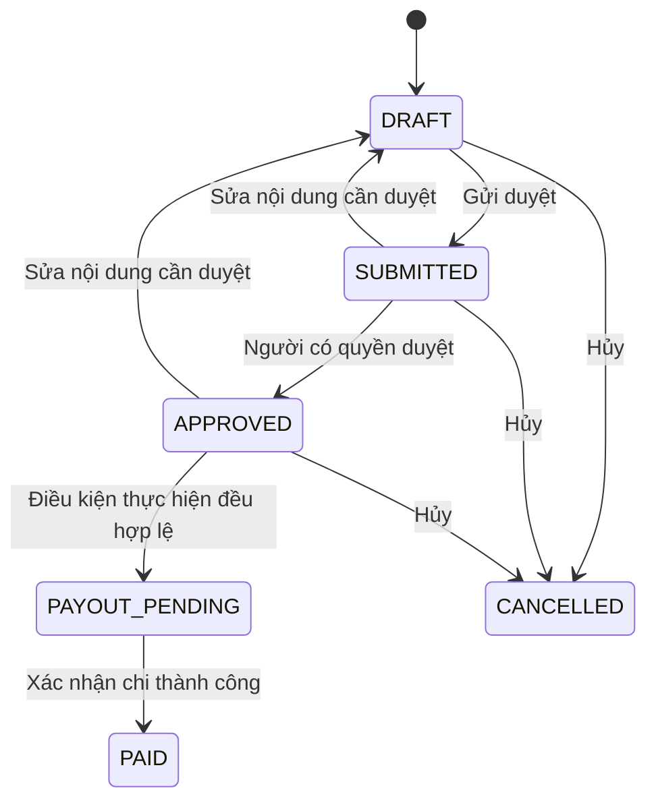

# Workflow skipping test

## 1. Mục tiêu kiểm thử bỏ qua bước nghiệp vụ

**Workflow skipping test** là kiểm thử khả năng thực hiện một hành động nghiệp vụ khi chưa hoàn thành điều kiện bắt buộc của các bước trước. Đích kiểm tra là quy tắc được server thực thi, không chỉ thứ tự các màn hình trên giao diện.

Ví dụ, một ứng dụng chi trả có các màn hình tạo đề nghị, gửi duyệt, phê duyệt và thực hiện chi. Nếu người dùng gọi thẳng API thực hiện chi từ đề nghị chưa được duyệt mà vẫn tạo lệnh chuyển tiền, ứng dụng có lỗi bỏ qua bước nghiệp vụ.

OWASP WSTG xem việc hoàn thành quy trình bằng cách bỏ bước hoặc đi sai thứ tự là một hướng kiểm thử vượt luồng nghiệp vụ. Bài học áp dụng hướng đó vào những tình huống có điều kiện và bằng chứng cụ thể. Tham khảo [OWASP WSTG v4.2 — Testing for the Circumvention of Work Flows](https://owasp.github.io/www-project-web-security-testing-guide/v42/4-Web_Application_Security_Testing/10-Business_Logic_Testing/06-Testing_for_the_Circumvention_of_Work_Flows).

Trong chương **Security Testing** của module bảo mật logic nghiệp vụ, mục tiêu là phát hiện những trường hợp:

- Bỏ phê duyệt nhưng vẫn thanh toán, chi trả hoặc kích hoạt quyền lợi.
- Bỏ kiểm tra người thụ hưởng hoặc dùng lại xác nhận không còn phù hợp.
- Sửa số tiền, giá hoặc đối tượng sau bước kiểm tra rồi thực hiện bằng bằng chứng cũ.
- Dùng actor, đối tượng hoặc tenant khác để vượt điều kiện.
- Dùng retry, phiên khôi phục hoặc lệnh bất đồng bộ để đi vào bước cuối theo đường khác.

Một kiểm thử tốt phải trả lời được: **điều kiện nào bị thiếu, hành động nào vẫn được yêu cầu và bằng chứng nào cho thấy server đã chặn hoặc đã cho phép sai?**

## 2. Phân biệt bước giao diện và điều kiện nghiệp vụ

Không phải mọi thao tác bị bỏ trên giao diện đều là lỗ hổng.

| Điều bị bỏ qua | Khi nào có ý nghĩa bảo mật? |
| --- | --- |
| Màn hình hướng dẫn sử dụng | Chỉ khi sản phẩm quy định một xác nhận nghiệp vụ có hiệu lực ở bước đó |
| Trang xem lại thông tin | Khi thao tác cuối cần bằng chứng xác nhận nội dung cụ thể mà người dùng chưa cung cấp |
| Bước phê duyệt | Khi phê duyệt là điều kiện bắt buộc nhưng chưa có hoặc không còn hiệu lực |
| Kiểm tra người thụ hưởng | Khi chưa có bằng chứng phù hợp với người thụ hưởng đang dùng |
| Màn hình tải lại trạng thái | Việc không mở màn hình này tự nó không chứng minh vi phạm |
| Bước đăng nhập lại | Khi chính sách yêu cầu mức xác thực mới cho thao tác nhạy cảm và server chưa kiểm chứng |

Nếu server đã lưu một phê duyệt còn hiệu lực, người dùng mở phiên mới rồi gọi bước thực hiện có thể hoàn toàn hợp lệ. Không yêu cầu họ phải mở lại mọi màn hình chỉ để tái hiện đúng hành trình giao diện.

Ngược lại, giao diện có thể ẩn nút “Thực hiện chi” nhưng endpoint vẫn gọi được. Nút bị ẩn không phải bằng chứng rằng điều kiện nghiệp vụ đã được bảo vệ.

Phân biệt các kiểu lạm dụng có liên quan:

- **Bỏ bước:** không thực hiện bước phê duyệt nhưng gọi thực hiện chi.
- **Đảo thứ tự:** yêu cầu thực hiện chi trước, sau đó mới gửi phê duyệt.
- **Dùng lại bằng chứng:** lấy phê duyệt của đề nghị A áp dụng cho B.
- **Dùng bằng chứng cũ:** sửa nội dung sau khi duyệt rồi chi theo nội dung mới.
- **Lặp bước:** thực hiện lại bước cuối để tạo tác dụng lần hai.

Bài học lấy bỏ bước làm trọng tâm. Các biến thể còn lại giúp kiểm tra rằng server không chỉ nhìn thấy một dấu hiệu “đã đi qua bước trước” mà thực sự xác minh điều kiện còn đúng.

## 3. Hợp đồng mẫu: đề nghị chi trả nội bộ

Xét ứng dụng có nhiều tenant. Alice tạo đề nghị chi trả trong tenant A; Bob là người có quyền duyệt phù hợp trong cùng tenant. Alice không được tự duyệt đề nghị của mình.

Hợp đồng của ví dụ:

1. Đề nghị phải được gửi duyệt trước khi có thể phê duyệt.
2. Phê duyệt phải do người được phép thực hiện, khác người tạo và có hạn mức phù hợp.
3. Phê duyệt gắn với ID đề nghị, tenant, phiên bản nội dung, số tiền, loại tiền và người thụ hưởng.
4. Người thụ hưởng phải có bằng chứng kiểm tra còn hiệu lực theo chính sách của sản phẩm.
5. Chỉ chủ thể được phép mới có thể yêu cầu thực hiện chi.
6. Chỉ đề nghị được duyệt hợp lệ mới tạo được payout operation.
7. Khi số tiền hoặc người thụ hưởng thay đổi trước thực hiện chi, phê duyệt cũ bị vô hiệu; đề nghị cần gửi và duyệt lại.
8. Khi đã có thao tác chi đang xử lý, nội dung được thực hiện bị đóng băng theo snapshot của thao tác.
9. Một đề nghị chỉ được chi thành công tối đa một lần; retry không tạo thêm khoản chi.

Các quy tắc trên là giả định minh họa, không phải chính sách mặc định của mọi hệ thống.

### 3.1. Trạng thái và điều kiện



Bằng chứng kiểm tra người thụ hưởng là điều kiện riêng, không nhất thiết là một trạng thái trong sơ đồ. Vì vậy, thấy `APPROVED` chưa đủ để kết luận mọi điều kiện thực hiện đã thỏa.

Sơ đồ rút gọn chưa mô tả đầy đủ thất bại, hết hạn hoặc đối soát. Timeout khi gửi chi không tự chứng minh khoản chi đã thất bại; phải xử lý theo trạng thái và quy trình khôi phục của sản phẩm.

### 3.2. Nội dung phê duyệt phải khớp điều gì?

Một bản ghi phê duyệt có thể chứa:

```text
approvalId
requestId
tenantId
approvedContentVersion
approvedAmount
currency
beneficiaryId
approverId
validUntil
revokedAt
```

Không nhất thiết mọi trường đều nằm trực tiếp trong một hàng dữ liệu; thiết kế có thể dùng snapshot hoặc bằng chứng có chữ ký. Điều cần kiểm thử là quan hệ ràng buộc tương đương được server xác minh.

Phân biệt `contentVersion` với phiên bản kỹ thuật phục vụ optimistic locking. Đổi số tiền làm thay đổi nội dung cần duyệt; tăng phiên bản ghi chỉ vì chuyển trạng thái không nhất thiết làm phê duyệt mất hiệu lực.

## 4. Chuyển quy trình thành các mệnh đề kiểm thử

Trước khi sửa request, viết điều kiện cho hành động cuối:

```text
CanExecutePayout(actor, request) =
    actor được phép thao tác trên request
    AND request thuộc tenant được phép
    AND request đang ở trạng thái cho phép thực hiện
    AND có phê duyệt hợp lệ cho đúng nội dung
    AND bằng chứng người thụ hưởng còn phù hợp
    AND không có khoản chi thành công hoặc thao tác xung đột
```

Các điều kiện cần được kiểm tra tại điểm quyết định thực hiện, với cơ chế ngăn dữ liệu thay đổi ngoài ý muốn giữa kiểm tra và tạo tác dụng.

OWASP khuyến nghị thực thi kiểm soát ủy quyền giao dịch phía server, bảo vệ dữ liệu quan trọng và có kiểm tra gắn với bước thực hiện cuối. Xem [OWASP Transaction Authorization Cheat Sheet](https://cheatsheetseries.owasp.org/cheatsheets/Transaction_Authorization_Cheat_Sheet.html).

Từ hợp đồng mẫu, lập các mệnh đề:

| Mã | Điều kiện bị thiếu hoặc sai | Kết quả bắt buộc |
| --- | --- | --- |
| W1 | Chưa gửi duyệt | Không ghi nhận phê duyệt hợp lệ theo đường không được phép |
| W2 | Đã gửi nhưng chưa được duyệt | Không tạo payout operation hoặc lệnh chi |
| W3 | Phê duyệt cho phiên bản nội dung khác | Không chi nội dung mới bằng phê duyệt cũ |
| W4 | Phê duyệt thuộc đề nghị hoặc tenant khác | Không được dùng thay bằng chứng của đề nghị đích |
| W5 | Người thụ hưởng chưa được kiểm tra theo chính sách | Không tạo lệnh chi cho người thụ hưởng đó |
| W6 | Actor không có quyền trên đối tượng | Không tạo tác dụng nghiệp vụ dù đề nghị đã được duyệt |
| W7 | Đã hủy, hết hạn hoặc bị thu hồi phê duyệt | Không chuyển sang thực hiện trái hợp đồng |
| W8 | Đã chi hoặc đã có thao tác đang xử lý | Không phát sinh khoản chi thành công thứ hai |

Mã HTTP là một phần hợp đồng API. Bằng chứng quan trọng hơn là không có thao tác hoặc tác dụng nghiệp vụ bị cấm.

Một yêu cầu bị từ chối có thể ghi audit hoặc tăng bộ đếm giám sát. Không yêu cầu mọi bảng dữ liệu đều bất biến; chỉ yêu cầu những dữ liệu nghiệp vụ cần bảo vệ không bị thay đổi trái phép.

## 5. Chuẩn bị một đường chuẩn và các điểm quan sát

### 5.1. Chạy đường hợp lệ trước

Thực hiện một ca đối chứng:

```text
Alice tạo đề nghị
-> Alice gửi duyệt
-> Bob duyệt đúng nội dung
-> bằng chứng người thụ hưởng hợp lệ
-> Alice yêu cầu thực hiện
-> hệ thống tạo một payout operation
-> bộ mô phỏng chi trả ghi một khoản chi đúng nội dung
```

Đường chuẩn xác minh rằng tài khoản, token, payload, chính sách và hạ tầng kiểm thử đều hoạt động. Nếu mọi ca đều trả `401` vì token sai, chưa thể kết luận ứng dụng chống bỏ bước.

Dùng dữ liệu và nhà cung cấp mô phỏng trong môi trường kiểm thử để quan sát khoản chi. Không cần thực hiện chuyển tiền thật để chứng minh lỗi điều kiện nghiệp vụ.

### 5.2. Ghi lại request cùng ý nghĩa của từng bước

Có thể lấy request từ HTTP client kiểm thử, công cụ phát triển trình duyệt hoặc proxy của môi trường test. Ghi lại:

- Endpoint, HTTP method và payload.
- Actor, vai trò, tenant và quyền trên đối tượng.
- ID đề nghị, phiên bản nội dung và bằng chứng liên quan.
- Trạng thái trước và sau.
- Bút toán, payout operation, outbox và khoản chi bên mô phỏng.

Các header như cookie hoặc bearer token là dữ liệu xác thực cần thiết cho request, nhưng không đưa giá trị bí mật thật vào báo cáo. Dùng tài khoản và token kiểm thử.

### 5.3. Chụp trạng thái trước khi thử bỏ bước

Với ca bỏ phê duyệt, tạo đề nghị ở `SUBMITTED`, bảo đảm người thụ hưởng đã hợp lệ và actor có quyền thực hiện. Xác minh không có phê duyệt có hiệu lực.

Sau đó gọi bước thực hiện. Cách này chỉ bỏ đúng điều kiện đang kiểm tra.

Nếu gọi từ `DRAFT`, hệ thống có thể từ chối vì chưa gửi duyệt, trong khi kiểm tra phê duyệt vẫn bị thiếu. Ca từ nháp hữu ích cho bao phủ tổng thể, nhưng chưa cô lập được riêng kiểm soát “phải được duyệt”.

Đối với ca bỏ kiểm tra người thụ hưởng, làm ngược lại: giữ phê duyệt hợp lệ, chỉ bỏ bằng chứng của người thụ hưởng. Mỗi ca nên thiếu một điều kiện chính để dễ xác định nguyên nhân.

## 6. Thực hành: bỏ đúng bước phê duyệt

Các request dưới đây minh họa một API giả định. Tên endpoint, field và mã lỗi phải được thay theo hợp đồng của ứng dụng đang kiểm thử; đây không phải API sẵn có của module.

### 6.1. Tạo đề nghị và gửi duyệt

```http
POST /api/payout-requests HTTP/1.1
Authorization: Bearer <alice-test-token>
Content-Type: application/json

{
  "amountMinor": 1000000,
  "currency": "VND",
  "beneficiaryId": "beneficiary-A"
}
```

Phản hồi minh họa:

```json
{
  "id": "request-A1",
  "state": "DRAFT",
  "contentVersion": 1
}
```

Gửi duyệt:

```http
POST /api/payout-requests/request-A1/submit HTTP/1.1
Authorization: Bearer <alice-test-token>
Content-Type: application/json

{}
```

Chuẩn bị để `beneficiary-A` đã được kiểm tra hợp lệ, Alice có quyền thực hiện và không có lỗi độc lập khác. Sau đó xác minh:

```text
state = SUBMITTED
contentVersion = 1
effectiveApproval = none
payoutOperationCount = 0
```

### 6.2. Bỏ lời gọi duyệt, gọi thẳng thực hiện

Không gửi request duyệt của Bob. Gửi:

```http
POST /api/payout-requests/request-A1/execute HTTP/1.1
Authorization: Bearer <alice-test-token>
Idempotency-Key: skip-approval-case-01
Content-Type: application/json

{}
```

Nếu hợp đồng từ chối đồng bộ, một kết quả có thể là:

```http
HTTP/1.1 409 Conflict
Content-Type: application/json

{
  "code": "APPROVAL_REQUIRED",
  "requestId": "request-A1"
}
```

Đây là phản hồi minh họa cho actor vốn có quyền trên đối tượng. Các trường trả về và cách ẩn thông tin cho actor không có quyền cần theo chính sách riêng.

### 6.3. Kiểm tra hậu điều kiện

Sau phản hồi, đọc lại dữ liệu đã commit:

| Điểm quan sát | Kết quả mong đợi |
| --- | --- |
| Trạng thái đề nghị | Vẫn `SUBMITTED` |
| Phiên bản và nội dung | Không bị đổi trái phép |
| Phê duyệt có hiệu lực | Vẫn không có |
| Payout operation | Không có thao tác chi được tạo |
| Outbox phát lệnh chi | Không có ý định chi cho đề nghị này |
| Ledger | Không có bút toán tiền phát sinh từ yêu cầu bị cấm |
| Nhà cung cấp mô phỏng | Không ghi nhận khoản chi |

Nếu API trả `409` nhưng đã tạo một thông điệp mà worker sẽ chuyển tiền sau đó, kiểm soát vẫn thất bại.

Một API xử lý lệnh bất đồng bộ có thể trả `202` rồi quyết định từ chối ở phía worker. Khi đó kiểm thử phải chờ kết quả nghiệp vụ và chứng minh không có khoản chi. Không kết luận đã khai thác thành công chỉ từ `202`, cũng không coi `202` là bằng chứng đã chặn.

### 6.4. Khôi phục đường hợp lệ để đối chứng

Trên dữ liệu phù hợp, cho Bob duyệt rồi yêu cầu thực hiện bằng key mới theo hợp đồng. Đề nghị phải có thể được xử lý đúng một lần.

Đối chứng này phát hiện trường hợp hệ thống “chặn bỏ bước” chỉ vì endpoint thực hiện luôn hỏng hoặc mọi đề nghị đều bị từ chối.

## 7. Ma trận các cách bỏ bước cần thử

| Biến thể | Cách chuẩn bị để cô lập kiểm soát | Thuộc tính cần giữ |
| --- | --- | --- |
| Bỏ gửi duyệt | Đề nghị còn nháp, actor duyệt và dữ liệu khác hợp lệ | Không duyệt ngoài chuyển trạng thái cho phép |
| Bỏ phê duyệt | Đề nghị đã gửi, actor thực hiện và người thụ hưởng hợp lệ | Không tạo lệnh chi |
| Bỏ kiểm tra người thụ hưởng | Đề nghị đã duyệt đúng nội dung | Không chi khi thiếu bằng chứng bắt buộc |
| Tự đánh dấu hoàn tất | Chèn trường trạng thái hoặc cờ đã duyệt | Client không quyết định kết quả kiểm soát |
| Dùng phê duyệt khác | Hai đề nghị cùng chủ sở hữu, chỉ một đề nghị đã duyệt | Không dùng bằng chứng của A để chi B |
| Dùng phê duyệt cũ | Sửa số tiền hoặc người thụ hưởng sau duyệt | Nội dung mới cần thỏa lại điều kiện |
| Mở phiên mới | Cùng actor, đối tượng vẫn thiếu phê duyệt | Phiên mới không xóa điều kiện nghiệp vụ |
| Khôi phục ở bước cuối | Dùng đường resume hoặc saved draft của sản phẩm | Resume không tự tạo bằng chứng còn thiếu |
| Đi đường batch hoặc quản trị | Dùng actor và dữ liệu được phép gọi đường đó | Áp dụng đúng chính sách cho đường thay thế |
| Callback hoặc message | Dùng đầu vào kiểm thử qua ranh giới thật | Thông điệp không tự chứng minh đã được duyệt |
| Nhánh khác của workflow | Điều kiện nhánh do server xác định | Không chọn nhánh ít kiểm soát bằng tham số tự khai |
| Gọi đồng thời | Hai transaction độc lập | Không đạt tác dụng trên nội dung chưa được duyệt |

Đối với đường quản trị, có thể tồn tại quyền ngoại lệ cho phép bỏ một phê duyệt. Chỉ coi đó là lỗi khi hành vi trái chính sách đã công bố, thiếu quyền cần thiết hoặc không đáp ứng các điều kiện của ngoại lệ. Không suy ra rằng mọi đường rút gọn đều bất hợp lệ.

## 8. Giả mạo trạng thái và dùng lại bằng chứng

### 8.1. Chèn trường điều khiển vào request

Nếu API có đường cập nhật nội dung, thử các trường không được client tự quyết:

```json
{
  "amountMinor": 1000000,
  "status": "APPROVED",
  "approved": true,
  "approvedBy": "bob",
  "step": 4
}
```

Kết quả an toàn có thể là từ chối field không hợp lệ hoặc bỏ qua chúng theo hợp đồng. Sau đó vẫn phải thử thực hiện chi và kiểm tra dữ liệu thật.

Nếu server bỏ qua `approved` nhưng lại gán `status` qua một đường mass assignment khác, việc kiểm tra riêng một field chưa đủ. Ưu tiên các field và đường cập nhật mà ứng dụng thực sự cung cấp, bao gồm thao tác hàng loạt nếu có.

Các tham số như `expectedVersion` hoặc header `If-Match` có thể hỗ trợ kiểm soát cạnh tranh. Chúng không tự thay thế bằng chứng phê duyệt.

### 8.2. Lấy bằng chứng của đối tượng khác

Chuẩn bị hai đề nghị A1 và A2 cùng thuộc Alice trong tenant A. Duyệt A1, giữ A2 ở trạng thái đã gửi nhưng chưa được duyệt. Dùng `approvalId` hoặc bằng chứng hợp lệ của A1 khi yêu cầu thực hiện A2.

Cách chuẩn bị này giúp kiểm tra ràng buộc giữa phê duyệt và đối tượng. Nếu đổi luôn actor sang người không sở hữu A2, một lỗi quyền sở hữu có thể chặn request trước và che mất lỗi ràng buộc cần tìm.

Với bằng chứng người thụ hưởng, chính sách có thể cho phép tái sử dụng cho nhiều đề nghị cùng người thụ hưởng. Hãy thử bằng chứng không phù hợp, chẳng hạn bằng chứng của người thụ hưởng khác hoặc đã hết hiệu lực, thay vì mặc định mọi lần dùng lại đều bị cấm.

### 8.3. Token có chữ ký và đường resume

Chữ ký hợp lệ chỉ chứng minh token được phát hành bởi bên có khóa tương ứng. Tùy giao thức, server còn cần xác minh những ràng buộc như:

- Đối tượng hoặc thao tác mà token cho phép.
- Tenant và chủ thể được sử dụng.
- Phiên bản hoặc nội dung quan trọng đã được xác nhận.
- Thời hạn và điều kiện thu hồi.
- Loại hành động được phép.
- Giới hạn sử dụng lại nếu token là một lần.

Không chỉ thử sửa token làm chữ ký sai. Một phép thử mạnh hơn là dùng token vẫn có chữ ký hợp lệ nhưng thuộc đối tượng, nội dung hoặc thời điểm khác.

Trạng thái có thể nằm trong database, trong một bằng chứng có chữ ký hoặc kết hợp cả hai. Điểm cần bảo vệ là server xác minh điều kiện và tính hợp lệ của chuyển trạng thái; không bắt buộc mọi thiết kế phải lưu cùng một loại bản ghi.

## 9. Sửa sau phê duyệt: bỏ qua việc duyệt lại

Một workflow có thể chặn đề nghị chưa duyệt nhưng vẫn cho phép:

```text
Tạo đề nghị 1.000.000 đồng cho người thụ hưởng A
-> Bob duyệt nội dung đó
-> Alice đổi thành 9.000.000 đồng hoặc người thụ hưởng B
-> Alice gọi thực hiện bằng phê duyệt cũ
```

Đây là bỏ qua bước phê duyệt **nội dung mới**, dù lịch sử có một lần phê duyệt.

Thiết kế ca kiểm thử:

1. Tạo và duyệt đề nghị qua luồng hợp lệ.
2. Lưu phiên bản, số tiền và người thụ hưởng đã được duyệt.
3. Sửa đúng một dữ liệu quan trọng bằng API được hỗ trợ.
4. Xác minh phê duyệt cũ không còn hiệu lực hoặc yêu cầu sửa bị cấm theo hợp đồng.
5. Gọi thực hiện với bằng chứng cũ, kể cả từ tab hoặc phiên vẫn giữ dữ liệu cũ.
6. Kiểm tra không có lệnh chi cho nội dung chưa được phép.
7. Nếu cho phép sửa, gửi và duyệt lại rồi xác minh có thể tiếp tục hợp lệ.

Kiểm tra cả những đường cập nhật khác nhau thực sự tồn tại: sửa một trường, thay toàn bộ tài nguyên, cập nhật hàng loạt và sửa trong trang quản trị. Không để một đường sửa phụ quên vô hiệu phê duyệt.

Khi đề nghị đã chuyển sang đang chi, hợp đồng mẫu đóng băng snapshot thực hiện. Một thay đổi không được phép lúc này phải bị chặn; không sửa snapshot rồi mong worker tự đoán nội dung nào đã được duyệt.

## 10. Nhánh có điều kiện và bước có thời hạn

### 10.1. Nhánh rút gọn phải do chính sách quyết định

Một sản phẩm khác có thể quy định khoản nhỏ chỉ cần một người duyệt, khoản lớn cần hai người; hoặc một người thụ hưởng đã được kiểm tra có thể bỏ bước kiểm tra lại trong thời hạn nhất định.

Trong trường hợp đó, thử:

- Giá trị ngay trước, tại và sau ngưỡng.
- Tăng số tiền sau khi đã được phân vào nhánh ít kiểm soát.
- Sửa trường tự khai như `riskLevel = LOW` hoặc `approvalRequired = false`.
- Dùng quyết định nhánh cũ sau khi dữ liệu thay đổi.
- Gọi endpoint của nhánh rút gọn trực tiếp cho đối tượng không đủ điều kiện.

Kết quả mong đợi phải dựa trên chính sách server và dữ liệu còn hiệu lực. Một nhánh hợp lệ không cần đi qua bước vốn không bắt buộc cho nó.

### 10.2. Hiệu lực theo thời gian và quyền

Nếu phê duyệt hoặc bằng chứng xác minh có hạn, kiểm thử trước hạn, đúng tại hạn và sau hạn theo quy ước của sản phẩm. Dùng nguồn thời gian có thể điều khiển trong test để không phải chờ thực.

Chốt thời điểm đánh giá hiệu lực: khi tiếp nhận lệnh, khi tạo payout operation hay một thời điểm khác theo hợp đồng. Không tự suy ra rằng một phê duyệt hết hạn sau khi thao tác đã được chấp nhận hợp lệ phải làm mọi retry của thao tác đó thất bại.

Tương tự, kiểm thử thay đổi quyền theo chính sách hiệu lực đã công bố. Nếu token tự chứa còn hiệu lực đến khi hết hạn, không giả định sửa vai trò trong database lập tức vô hiệu mọi token cũ khi hệ thống chưa có cơ chế đó.

Điều cần phát hiện là một đường thực hiện không áp dụng kiểm soát mà sản phẩm đã cam kết, hoặc áp dụng trên dữ liệu sai.

## 11. Tự động hóa thành kiểm thử hồi quy Java

Các đoạn dưới là mã minh họa theo phong cách JUnit. `flow`, `api`, `probe` và `provider` là helper cần được dự án triển khai; không phải API có sẵn của một thư viện.

Quy ước:

- `flow` tạo trạng thái bằng các lệnh ứng dụng thật.
- `api` gọi server kiểm thử qua cơ chế xác thực thật của môi trường test.
- `probe` đọc dữ liệu đã commit qua kết nối riêng.
- `provider` là bộ mô phỏng chi trả có sổ khoản chi.
- Snapshot nghiệp vụ bỏ qua audit được phép ghi khi từ chối, nhưng gồm dữ liệu và ý định chi cần bảo vệ.

Trong hợp đồng API minh họa, thiếu phê duyệt trả `409 APPROVAL_REQUIRED`; thực hiện hợp lệ trả `202`. Với API có hợp đồng khác, thay các kỳ vọng tương ứng.

### 11.1. Bỏ phê duyệt nhưng giữ các điều kiện khác hợp lệ

```java
@Test
void executeCannotSkipApproval() {
    var request = flow.submittedRequest(
        alice,
        1_000_000L,
        "VND",
        verifiedBeneficiaryA
    );
    assertFalse(probe.hasEffectiveApproval(request.id()));
    assertTrue(probe.beneficiaryEvidenceIsValid(request.id()));

    var before = probe.businessSnapshot(request.id());

    var response = api.execute(
        alice, request.id(), "skip-approval-01"
    );

    assertEquals(409, response.status());
    assertEquals("APPROVAL_REQUIRED", response.errorCode());
    assertEquals(before, probe.businessSnapshot(request.id()));
    assertEquals(0, probe.payoutOperationCount(request.id()));
    assertEquals(0, probe.payoutOutboxCount(request.id()));
    assertEquals(0, probe.moneyPostingCount(request.id()));
    assertEquals(0, provider.successfulPayoutCount(request.id()));

    // Đối chứng: cùng đề nghị có thể đi tiếp khi đủ điều kiện.
    api.approve(bob, request.id()).expectStatus(200);
    api.execute(alice, request.id(), "after-approval-01")
        .expectStatus(202);

    flow.awaitPaidAndDrained(
        request.id(), Duration.ofSeconds(5)
    );

    assertEquals(1, provider.successfulPayoutCount(request.id()));
    assertEquals(
        1_000_000L,
        provider.onlySuccessfulPayout(request.id()).amountMinor()
    );
    assertEquals(
        verifiedBeneficiaryA.id(),
        provider.onlySuccessfulPayout(request.id()).beneficiaryId()
    );
    assertEquals(
        "VND",
        provider.onlySuccessfulPayout(request.id()).currency()
    );
}
```

Helper `awaitPaidAndDrained` phải chờ kết quả và công việc liên quan trong phạm vi test đã hoàn tất, không chỉ chờ thấy một cột trạng thái đổi thành `PAID`.

Nếu kiến trúc có đường gọi nhà cung cấp trực tiếp, hàng đợi khác hoặc bộ lập lịch riêng, cần quan sát các đường đó. Một bảng outbox trống không tự chứng minh mọi đường tạo khoản chi đều không hoạt động.

### 11.2. Không dùng phê duyệt của đề nghị khác

```java
@Test
void approvalIsBoundToItsRequest() {
    var approved = flow.approvedRequest(
        alice, bob, 1_000_000L, "VND", verifiedBeneficiaryA
    );
    var target = flow.submittedRequest(
        alice, 1_000_000L, "VND", verifiedBeneficiaryA
    );
    var foreignApproval = probe.effectiveApproval(approved.id());
    var before = probe.businessSnapshot(target.id());

    var response = api.executeWithApprovalReference(
        alice,
        target.id(),
        foreignApproval.id(),
        "approval-substitution-01"
    );

    assertEquals(409, response.status());
    assertEquals(before, probe.businessSnapshot(target.id()));
    assertFalse(probe.hasEffectiveApproval(target.id()));
    assertEquals(0, probe.payoutOperationCount(target.id()));
    assertEquals(0, provider.successfulPayoutCount(target.id()));
}
```

Ca này chỉ áp dụng nếu API thực sự nhận tham chiếu hoặc bằng chứng phê duyệt. Nếu server hoàn toàn tự truy phê duyệt từ đề nghị, kiểm thử quan hệ ở đường có thể bị tác động tương ứng, thay vì tự thêm một tham số không được hỗ trợ.

Có thể thêm biến thể khác tenant, nhưng ca cùng tenant và cùng chủ sở hữu vẫn cần thiết để kiểm tra riêng việc ràng buộc bằng chứng.

### 11.3. Tham số hóa theo từng điều kiện bị thiếu

Một bảng dữ liệu test có thể tạo các trường hợp:

```text
caseId                 preparedState      missingCondition
skip-submit             DRAFT              submitted
skip-approval           SUBMITTED          approval
skip-beneficiary-check  APPROVED           beneficiaryEvidence
stale-approval          DRAFT              approvalForCurrentContent
revoked-approval        APPROVED           effectiveApproval
```

Factory của từng trường hợp phải bảo đảm các điều kiện khác hợp lệ. Không dùng một factory chung luôn tạo dữ liệu thiếu nhiều điều kiện rồi chỉ thay tên ca.

Với ca `stale-approval`, trạng thái nháp là kết quả sửa nội dung theo hợp đồng mẫu. Khi ứng dụng thực tế chọn cấm sửa hoặc dùng trạng thái khác, cập nhật factory và kỳ vọng cho đúng.

Không gắn transaction bao quanh toàn bộ test rồi giả định nó đại diện cho commit của HTTP server hoặc worker. Những luồng đó thường dùng transaction riêng; test cần đọc và dọn dữ liệu theo phạm vi thực tế.

## 12. Race condition tại bước kiểm tra cuối

Một lỗi tinh vi có thể xảy ra dù đường tuần tự đã đúng:

```text
T1: kiểm tra đề nghị đã duyệt ở contentVersion = 5
T2: đổi người thụ hưởng, contentVersion thành 6
T1: đọc dữ liệu mới rồi tạo lệnh chi cho phiên bản 6
```

Khi đó, bước kiểm tra đã diễn ra nhưng nội dung thực hiện chưa từng được duyệt.

Một ca tái hiện có thể:

1. Chuẩn bị đề nghị được duyệt ở phiên bản 5.
2. Tạm dừng request thực hiện tại ranh giới kiểm tra và ghi nhận thao tác.
3. Cho request sửa nội dung chạy qua transaction độc lập.
4. Cho request thực hiện tiếp tục.
5. Kiểm tra hệ thống không chi phiên bản 6 bằng phê duyệt phiên bản 5.

Kết quả hợp lệ phụ thuộc cơ chế đồng bộ và điểm quyết định:

- Request sửa thắng trước: thực hiện bị từ chối hoặc phải kiểm tra lại nội dung mới.
- Request thực hiện đã chốt snapshot hợp lệ trước: request sửa bị chặn theo hợp đồng, và khoản chi dùng snapshot phiên bản 5.
- Hệ thống phát hiện xung đột phiên bản: một request thất bại an toàn, không tạo tác dụng trái phép.

Không yêu cầu một thứ tự cố định nếu hợp đồng cho phép nhiều thứ tự hợp lệ. Cũng không kết luận lỗi chỉ vì request thực hiện được gửi trước response phê duyệt: nếu phê duyệt đã commit trước điểm quyết định thực hiện, kết quả có thể đúng.

Transaction tự nó chưa bảo đảm loại bỏ race ở mọi mức cô lập. Cần cơ chế phù hợp như khóa, cập nhật có điều kiện theo trạng thái và phiên bản, hoặc một phép claim nguyên tử kết hợp ràng buộc dữ liệu. Kiểm thử phải đi qua cơ chế thật đó.

Các cặp thao tác đáng kiểm tra thêm:

| Cặp cạnh tranh | Bất biến cần giữ |
| --- | --- |
| Phê duyệt và sửa số tiền | Không duyệt nhầm phiên bản rồi thực hiện phiên bản khác |
| Thu hồi phê duyệt và thực hiện | Kết quả tuân điểm hiệu lực đã công bố |
| Hủy và thực hiện | Không vừa hủy hợp lệ vừa tạo khoản chi trái hợp đồng |
| Hai request thực hiện | Không tạo hai khoản chi cho cùng đề nghị |
| Callback cũ và thao tác mới | Không dùng kết quả cũ để bỏ điều kiện của thao tác mới |

## 13. Đường bất đồng bộ và đường thay thế

### 13.1. HTTP chặn nhưng worker vẫn có thể bỏ bước

Một ứng dụng có thể kiểm tra đủ ở controller nhưng tồn tại đường gửi lệnh qua batch, scheduler hoặc message consumer. Lỗi xuất hiện khi đường này tạo lệnh chi mà không có bằng chứng nghiệp vụ tương đương.

Kiểm thử cần theo dõi mọi đường có quyền tạo payout operation, không chỉ màn hình chính. Dùng actor, tài khoản dịch vụ và đầu vào phù hợp với môi trường kiểm thử để xác minh chính sách thực sự được áp dụng.

Đối với một message có dạng:

```json
{
  "requestId": "request-A1",
  "approved": true,
  "amountMinor": 1000000
}
```

Không coi `approved = true` tự nó là bằng chứng đủ. Theo kiến trúc, worker cần liên kết thông điệp với thao tác đã được cho phép, snapshot hợp lệ hoặc bằng chứng được xác minh.

Không nhất thiết worker phải lặp toàn bộ quy trình tương tác của người dùng. Nếu một operation đã được chấp nhận hợp lệ và lưu snapshot bất biến, worker có thể thực hiện operation đó theo hợp đồng. Điều cần ngăn là thông điệp không hợp lệ hoặc không được phép tự tạo ra một operation như vậy.

### 13.2. Callback thành công không được thay thế phê duyệt

Một callback xác nhận khoản chi có thể cập nhật kết quả của operation tương ứng. Nó không nên tự biến một đề nghị chưa có operation được phép thành khoản chi hợp lệ chỉ vì payload chứa `SUCCESS`.

Kiểm tra callback:

- Có bằng chứng xác thực đúng cơ chế tích hợp.
- Khớp đúng operation, tài khoản tích hợp và đề nghị.
- Khớp số tiền, loại tiền và người thụ hưởng theo hợp đồng.
- Không tạo chuyển trạng thái ngoài những chuyển đổi được phép.
- Không nhân đôi ledger hoặc tác dụng tiếp theo khi giao lại.

Một callback có chữ ký hợp lệ nhưng thuộc operation khác vẫn không được dùng để hoàn tất đề nghị đích.

### 13.3. Lệnh giao lại và trạng thái đang chờ

Thử giao lại message hoặc retry cùng operation sau khi worker đã xử lý. Hệ thống cần tìm lại kết quả hoặc tiếp tục khôi phục mà không tạo khoản chi lần hai.

Timeout không đồng nghĩa “chưa chi”. Nếu nhà cung cấp đã nhận lệnh nhưng phản hồi bị mất, dùng cơ chế đối soát hoặc retry với định danh ổn định theo hợp đồng. Không quay đề nghị về trạng thái có thể bỏ qua lịch sử rồi tạo một khoản chi mới tùy tiện.

## 14. Đánh giá kết quả và tránh kết luận sai

Một kết quả kiểm thử cần được phân loại theo tác dụng nghiệp vụ:

| Quan sát | Cách đánh giá |
| --- | --- |
| Từ chối đúng lỗi, không có ý định hoặc tác dụng chi | Kiểm soát tương ứng đã chặn trong phạm vi ca |
| Trả lỗi nhưng tạo operation hoặc phát lệnh bị cấm | Kiểm soát thất bại dù response trông an toàn |
| Trả `202`, sau đó từ chối và không chi | Có thể đúng với hợp đồng bất đồng bộ |
| Trả `200` nhưng không có bằng chứng xử lý cuối | Chưa đủ dữ liệu để kết luận có khoản chi |
| Tạo khoản chi khi điều kiện bắt buộc còn thiếu | Có bằng chứng vượt workflow |
| Không gọi được do token sai hoặc dữ liệu không hợp lệ độc lập | Chưa kiểm tra được kiểm soát mục tiêu |
| Không quan sát được worker hoặc nhà cung cấp | Kết luận bị giới hạn ở ranh giới đã quan sát |

Các sai lầm thường gặp:

- Dùng một actor không có quyền rồi kết luận kiểm tra trạng thái hoạt động.
- Bỏ nhiều bước cùng lúc nên không biết điều kiện nào thực sự chặn.
- Chỉ thử sửa token làm chữ ký sai, chưa thử bằng chứng hợp lệ của đối tượng khác.
- Chỉ kiểm tra nút bị ẩn hoặc chuyển hướng trên trình duyệt.
- Đọc đối tượng trong cache thay vì dữ liệu đã commit.
- Chờ một khoảng cố định rồi khẳng định không có tác dụng bất đồng bộ.
- Chỉ kiểm tra số tiền mà quên người thụ hưởng, loại tiền hoặc tenant.
- Gọi thành công một nhánh được chính sách cho phép rồi báo nhầm là vượt bước.

Với mệnh đề phủ định như “không chi tiền”, nên chứng minh không tạo ý định chi tại điểm commit, hoặc cho toàn bộ công việc liên quan trong phạm vi test được xử lý hết rồi đối chiếu. Một khoảng chờ hữu hạn đơn thuần không chứng minh sự kiện sẽ không bao giờ xảy ra.

## 15. Ghi phát hiện thành bằng chứng có thể sửa được

Một báo cáo tốt nêu điều kiện thiếu và tác động cụ thể, chẳng hạn:

> Đề nghị đã gửi nhưng chưa được duyệt vẫn tạo payout operation và được bộ mô phỏng thực hiện chi khi chủ đề nghị gọi trực tiếp endpoint execute.

Các phần nên có:

| Nội dung | Ví dụ bằng chứng |
| --- | --- |
| Quy tắc bị vi phạm | Mọi đề nghị cần người độc lập duyệt trước khi thực hiện |
| Tiền điều kiện | Actor có quyền, người thụ hưởng hợp lệ, đề nghị chưa có phê duyệt |
| Chuỗi tái hiện | Tạo → gửi duyệt → bỏ approve → gọi execute |
| Request liên quan | Method, endpoint, payload và định danh kiểm thử |
| Trạng thái trước và sau | `SUBMITTED` không có phê duyệt → `PAYOUT_PENDING` |
| Tác dụng | Operation ID, outbox ID, khoản chi ở simulator, số tiền và người nhận |
| Đối chứng | Khi đủ phê duyệt, đường hợp lệ vẫn hoạt động |
| Phạm vi ảnh hưởng | Vai trò, tenant, loại đề nghị và đường thay thế đã xác minh |
| Kiểm thử hồi quy | Ca thiếu điều kiện cùng hậu điều kiện không có khoản chi |

Không cần một khoản chi thật để báo lỗi nếu môi trường test đã chứng minh đường tạo tác dụng với thành phần nghiệp vụ thật và nhà cung cấp mô phỏng có trạng thái. Đồng thời, ghi đúng giới hạn: một phát hiện ở tầng service chưa tự chứng minh mọi cấu hình triển khai đều truy cập được cùng đường đó.

Hướng khắc phục nên gắn với điểm thất bại: đưa kiểm tra điều kiện vào ranh giới tạo tác dụng, ràng buộc phê duyệt với nội dung, vô hiệu bằng chứng sau thay đổi quan trọng, và bảo vệ quyết định với cơ chế concurrency phù hợp.

Ẩn thêm nút, bắt frontend chuyển hướng hoặc thêm một field `approved = true` không thay thế kiểm soát nghiệp vụ phía server.

## 16. Checklist thiết kế workflow skipping test

Trước khi coi một bước bắt buộc đã được kiểm thử, cần xác định được:

- Điều kiện nghiệp vụ của bước đó là gì, khác gì với một màn hình giao diện?
- Có ca đường chuẩn chứng minh actor, dữ liệu và hạ tầng đều hợp lệ không?
- Ca bỏ bước đã giữ những điều kiện khác hợp lệ để cô lập kiểm soát chưa?
- Có gọi trực tiếp bước sau bằng request hợp lệ về hình thức không?
- Có thử giả mạo trạng thái, dùng phê duyệt khác và dùng phê duyệt cũ không?
- Có kiểm tra quyền theo đối tượng và tenant ở bước cuối không?
- Có thử nhánh có điều kiện, đường resume và các đường ghi thay thế thực sự tồn tại không?
- Có kiểm tra nội dung sau khi duyệt và cửa sổ cạnh tranh trước khi tạo operation không?
- Có đọc dữ liệu đã commit, outbox, ledger và sổ tác dụng của simulator không?
- Có phân biệt từ chối nghiệp vụ với timeout hoặc việc chỉ tiếp nhận bất đồng bộ không?
- Có chứng minh luồng hợp lệ vẫn tiếp tục được sau khi bổ sung điều kiện còn thiếu không?
- Có đủ dữ liệu để tái hiện và biến phát hiện thành kiểm thử hồi quy không?

Mục tiêu là bảo đảm bước cuối chỉ thực hiện khi các điều kiện nghiệp vụ bắt buộc còn đúng đối với chính actor, đối tượng và nội dung đang được xử lý. Một lịch sử có màn hình “đã duyệt” hoặc một cờ do client gửi không thay thế được bằng chứng đó.
