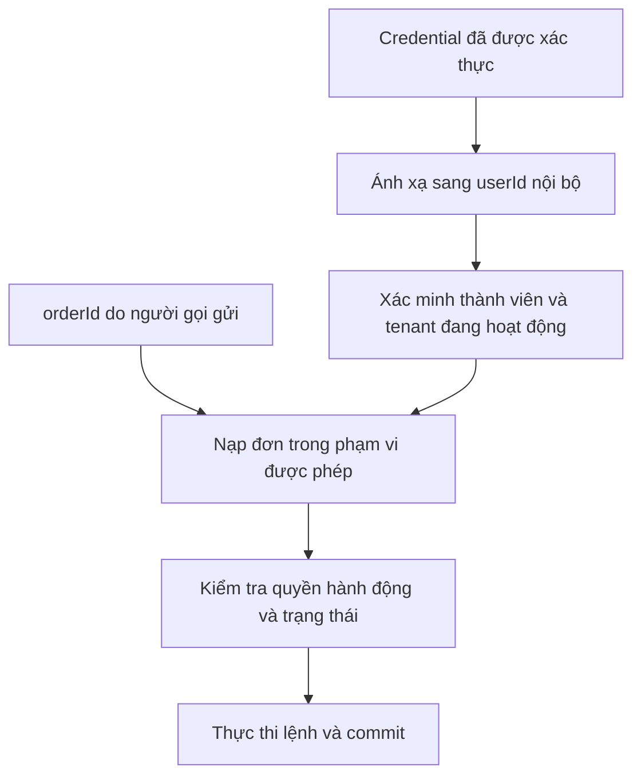

# Object ownership test — Kiểm thử quyền sở hữu đối tượng

## 1. Mục tiêu của bài học

Trong chương **Security Testing** của nội dung bảo mật logic nghiệp vụ, object ownership test kiểm tra xem hệ thống có áp dụng đúng quan hệ giữa người gọi và **đối tượng cụ thể** mà người đó muốn truy cập hay không.

Một người dùng có thể được phép gọi API sửa đơn hàng nhưng chỉ được sửa đơn hàng của mình. Nếu thay `orderId` bằng ID đơn của người khác mà thao tác vẫn thành công, kiểm tra quyền ở mức chức năng chưa bảo vệ được đối tượng. Kết quả có thể là đọc thông tin giao hàng, sửa dòng hàng, hủy đơn, chiếm tài sản hoặc kích hoạt hoàn tiền cho đối tượng ngoài phạm vi.

OWASP gọi nhóm lỗi kiểm tra quyền không đầy đủ trên đối tượng là **Broken Object Level Authorization — BOLA**. Định danh bị thay đổi có thể nằm trong đường dẫn, query, header hoặc body; việc định danh là số nguyên hay UUID không làm mất nhu cầu kiểm tra quyền. [OWASP API1:2023 — Broken Object Level Authorization](https://api-security.owasp.org/editions/2023/en/0xa1-broken-object-level-authorization/).

Sau bài học, bạn có thể:

- Xác định nguồn danh tính và nguồn thông tin sở hữu đáng tin cậy.
- Dựng dữ liệu có nhiều người cùng quyền, nhiều đối tượng và nhiều tenant.
- Viết ca đối chứng được phép và ca thay đối tượng bị từ chối.
- Kiểm tra quyền trên quan hệ cha–con, trường chủ sở hữu và các đường truy cập gián tiếp.
- Chứng minh lệnh bị từ chối không làm thay đổi dữ liệu hoặc tạo tác dụng phụ nghiệp vụ.
- Nhận biết những kiểm thử pass vì fixture hỏng, lỗi xác thực hoặc đối tượng không tồn tại.

Các quy tắc đơn hàng trong bài là chính sách minh họa. Khi áp dụng, cần thay bằng quan hệ sở hữu và quyền hành động thực tế của sản phẩm.

## 2. Quyền sở hữu là một quan hệ trong chính sách

### 2.1. Được gọi chức năng chưa có nghĩa được tác động mọi đối tượng

Giả sử Alice và Bob đều có quyền chức năng `orders:write`. Cả hai được gọi:

```http
PATCH /orders/{orderId}
Content-Type: application/json

{"deliveryNote":"Giao trong giờ hành chính"}
```

Đối với endpoint dành cho khách hàng trong ví dụ, lệnh chỉ được thực hiện khi:

```text
người gọi đã được xác thực
AND tư cách thành viên tenant đang hoạt động là hợp lệ
AND có quyền chức năng orders:write
AND order.tenantId == tenant đã được máy chủ xác minh
AND order.ownerUserId == userId nội bộ của người gọi
AND order.state == DRAFT
AND payload chỉ chứa trường được phép sửa
```

Quan hệ sở hữu là một điều kiện trong số đó. Test về ownership cần giữ những điều kiện khác hợp lệ để lỗi bị từ chối có thể được quy cho đúng hàng rào.

Ví dụ, Bob sửa đơn DRAFT của Alice là ca kiểm tra truy cập ngang. Bob sửa một đơn đã bị khóa, thuộc tenant khác và dùng credential hết hạn cùng lúc là ca tổ hợp, nhưng không cô lập được điều kiện sở hữu.

### 2.2. Chủ sở hữu, người tạo và người được cấp quyền có thể khác nhau

| Khái niệm | Ý nghĩa có thể có | Điều cần thống nhất trước khi viết test |
| --- | --- | --- |
| Người tạo | Người khởi tạo bản ghi | Có giữ quyền sau khi bàn giao không? |
| Chủ sở hữu | Cá nhân hoặc tổ chức chịu quyền quản lý đối tượng | Quyền nào gắn với quan hệ này? |
| Người được chia sẻ | Chủ thể được cấp quyền theo đối tượng | Chỉ xem hay được sửa? Có hết hạn không? |
| Người được ủy quyền | Người hành động thay một chủ thể khác | Phạm vi đối tượng, hành động và thời hạn là gì? |
| Người vận hành | Nhân sự hỗ trợ hoặc quản trị | Có ngoại lệ rõ ràng hay cần quy trình riêng? |

Không áp dụng máy móc quy tắc “không phải owner thì luôn cấm”. Một tài liệu có chia sẻ cho Bob có thể cho Bob đọc hợp lệ. Một người phê duyệt có thể cần duyệt yêu cầu do người khác tạo, trong khi chủ yêu cầu lại bị cấm tự duyệt.

Ngược lại, cũng không suy ra “là owner thì làm gì cũng được”. Chủ đơn không được tự sửa giá đã chốt, chuyển trạng thái bỏ qua bước duyệt hoặc gửi hoàn tiền trùng. Ownership test cần gắn với **một hành động**, trong **một trạng thái**, theo **một chính sách cụ thể**.

### 2.3. Những nguồn dữ liệu phải phân biệt



`orderId` từ request là một tham chiếu để tìm đối tượng, không phải bằng chứng quyền. `ownerUserId` và `tenantId` của đơn phải được lấy từ dữ liệu máy chủ, không lấy từ một bản sao JSON do người gọi gửi lên.

Danh tính cũng cần ánh xạ đúng. Nếu hệ thống dùng nhà cung cấp danh tính bên ngoài, `sub` trong token không nhất thiết bằng khóa người dùng nội bộ. Cần ánh xạ theo hợp đồng, chẳng hạn cặp issuer–subject, rồi so sánh các định danh cùng loại. Email hoặc tên hiển thị có thể thay đổi và không nên tự động được coi là khóa sở hữu ổn định.

## 3. Chuẩn bị fixture đủ để phát hiện truy cập ngang

### 3.1. Ít nhất hai người cùng quyền và đối tượng có thật

Một fixture nhỏ nhưng hữu ích cho bài học:

| Chủ thể/đối tượng | Dữ liệu |
| --- | --- |
| Alice | Subject `sub-alice`, user nội bộ `usr-alice`, thành viên tenant-A |
| Bob | Subject `sub-bob`, user nội bộ `usr-bob`, thành viên tenant-A |
| Eve | Subject `sub-eve`, user nội bộ `usr-eve`, thành viên tenant-B |
| Vai trò chức năng | Cả ba có quyền đọc và sửa đơn khách hàng trong tenant của mình |
| `order-a1` | Tenant-A, owner Alice, DRAFT; chứa `item-a1` |
| `order-a2` | Tenant-A, owner Alice, DRAFT; chứa `item-a2` |
| `order-b1` | Tenant-A, owner Bob, DRAFT; chứa `item-b1` |
| `order-e1` | Tenant-B, owner Eve, DRAFT; chứa `item-e1` |
| ID vắng mặt | Một định danh đúng cấu trúc nhưng chắc chắn không tồn tại |

Hai đơn của Alice giúp kiểm tra quan hệ cha–con ngay cả khi người gọi sở hữu cả hai đối tượng cha. Bob giúp kiểm tra cùng tenant nhưng khác owner. Eve giúp kiểm tra ranh giới tenant. ID vắng mặt giúp phân biệt hành vi không tìm thấy với truy cập một đối tượng thật ngoài quyền.

OWASP WSTG đề xuất dùng ít nhất hai tài khoản để kiểm tra các đối tượng thuộc những người dùng khác nhau. Cách dựng fixture trên cụ thể hóa phương pháp đó cho luồng đơn hàng. [OWASP WSTG — Testing for Insecure Direct Object References](https://owasp.github.io/www-project-web-security-testing-guide/stable/4-Web_Application_Security_Testing/05-Authorization_Testing/04-Testing_for_Insecure_Direct_Object_References).

### 3.2. Bảo đảm fixture không vô tình che lỗi

- Seed các đối tượng thật và commit trước khi request ở kết nối khác đọc chúng.
- Tạo danh tính và tư cách thành viên mà ứng dụng có thể ánh xạ được.
- Dùng cùng quyền chức năng cho Alice và Bob để cô lập truy cập ngang.
- Dùng trạng thái DRAFT và payload hợp lệ cho ca kiểm tra ownership của lệnh sửa.
- Mỗi test có dữ liệu độc lập hoặc được phục hồi đầy đủ; không phụ thuộc thứ tự chạy.
- Không lấy ID thật từ dữ liệu người dùng production để làm fixture.

Không dùng một ID ngẫu nhiên không tồn tại rồi gọi đó là “đơn của người khác”. Test như vậy chỉ chứng minh hệ thống xử lý bản ghi vắng mặt, không chứng minh hệ thống kiểm tra owner.

## 4. Xác định hợp đồng trước khi chọn assertion

### 4.1. Hợp đồng API mẫu

Trong ví dụ, endpoint khách hàng chỉ cho phép owner truy cập đơn của mình trong tenant hiện hành. Nhóm thống nhất:

| Trường hợp | Hành vi mong đợi |
| --- | --- |
| Không có credential hợp lệ | `401` |
| Đơn không tồn tại hoặc ngoài phạm vi được phép nhận biết | `404`, body `{"code":"ORDER_NOT_FOUND"}` |
| Owner đọc đơn của mình | `200`, chỉ trả các trường được hợp đồng cho phép |
| Owner sửa ghi chú của đơn DRAFT | `200`, lưu ghi chú mới và tăng version một lần |
| Owner sửa đơn ở trạng thái không cho phép | `409`, không thay dữ liệu nghiệp vụ |
| Payload có trường cấm như owner/tenant | `400`, không thay dữ liệu nghiệp vụ |
| Quan hệ đơn–dòng hàng không đúng | `404`, không sửa bất kỳ đối tượng liên quan nào |

`404` là lựa chọn của ví dụ để không xác nhận sự tồn tại của đơn ngoài phạm vi. Một hệ thống khác có thể chọn `403` cho một số trường hợp đã được phép nhận biết đối tượng. Test cần khẳng định hợp đồng đã chọn, không chấp nhận tùy ý mọi mã lỗi.

Giấu sự tồn tại không có nghĩa có thể bỏ kiểm tra quyền. Hệ thống phải thực sự ngăn đọc/sửa đối tượng; mã lỗi chỉ là phần phản hồi ra ngoài. Nếu cần bảo vệ khỏi các kênh suy đoán khác như thời gian phản hồi, đó là yêu cầu riêng với phương pháp đo phù hợp; một phép so sánh body không chứng minh mọi kênh đều đã được loại bỏ.

### 4.2. Bộ ca nền cho endpoint owner-only

| ID | Chủ thể | Đối tượng/hành động | Kỳ vọng |
| --- | --- | --- | --- |
| O01 | Alice | GET `order-a1` | Được đọc đúng đơn của Alice |
| O02 | Bob | GET `order-a1` | 404; không lộ dữ liệu đơn |
| O03 | Bob | PATCH ghi chú `order-b1` | Thành công; chứng minh Bob gọi được chức năng |
| O04 | Bob | PATCH cùng payload lên `order-a1` | 404; dữ liệu đơn Alice giữ nguyên |
| O05 | Eve, tenant-B | PATCH `order-a1` tenant-A | 404; không đổi dữ liệu hoặc tác dụng phụ |
| O06 | Alice | GET ID đúng cấu trúc nhưng không tồn tại | 404 theo hợp đồng |
| O07 | Alice | PATCH item-a1 dưới order-a1 | Được sửa nếu payload và trạng thái hợp lệ |
| O08 | Alice | PATCH item-b1 dưới order-a1 | 404; chặn dòng hàng của người khác |
| O09 | Alice | PATCH item-a2 dưới order-a1 | 404 dù Alice sở hữu cả hai đơn |
| O10 | Bob | PATCH order-a1 và chèn ownerUserId=Bob | Không chiếm quyền sở hữu; không có thay đổi nghiệp vụ |
| O11 | Bob | GET order-a1 sau khi Alice đã đọc và làm nóng cache | Vẫn bị từ chối |
| O12 | Bob | Gửi lại khóa idempotency của Alice trên lệnh của order-a1 | Không đọc kết quả riêng của Alice hoặc tạo tác dụng mới |

O02 và O04 cần tách riêng: có hệ thống bảo vệ đường sửa nhưng để lộ đường đọc hoặc ngược lại. O08 và O09 cũng khác nhau: O08 kiểm tra quyền với đối tượng con; O09 kiểm tra đối tượng con có thực sự thuộc đối tượng cha trên đường dẫn không.

Với O10, nếu bộ kiểm tra schema trả `400` trước khi kiểm tra quyền trên đối tượng, test chỉ chứng minh trường cấm bị từ chối. O04 dùng payload hợp lệ vẫn bắt buộc để chứng minh Bob không sửa được đơn của Alice.

## 5. Thực hiện phép đổi đối tượng có kiểm soát

Một kịch bản cốt lõi nên giữ nguyên người gọi, quyền chức năng, phương thức HTTP và payload, rồi chỉ đổi đối tượng:

```http
# Bob sửa đơn của Bob: phải được phép
PATCH /orders/order-b1
Authorization: Bearer <credential hợp lệ của Bob>
Content-Type: application/json

{"deliveryNote":"Giao sau 17h"}
```

```http
# Cùng Bob, cùng payload, chỉ đổi sang đơn thật của Alice
PATCH /orders/order-a1
Authorization: Bearer <credential hợp lệ của Bob>
Content-Type: application/json

{"deliveryNote":"Giao sau 17h"}
```

Sau request thứ hai, kiểm tra cả phản hồi từ chối và dữ liệu đã commit. Nếu đối tượng bị sửa trước rồi mới trả `404`, hệ thống vẫn có lỗi nghiêm trọng.

Cũng nên chạy phép đổi chủ thể: giữ nguyên `order-a1`, dùng Alice để xác nhận hành vi được phép, sau đó dùng Bob để xác nhận bị từ chối. Cách này hỗ trợ phát hiện nhầm danh tính trong test harness, chẳng hạn mọi request đều vô tình dùng phiên đăng nhập của Alice.

Trong môi trường kiểm thử có session, cookie hoặc authentication cache, cần bảo đảm mỗi request mang đúng danh tính. Tên biến `bobToken` không chứng minh bên trong thật sự là Bob; kiểm tra cách fixture tạo subject và ứng dụng ánh xạ subject thành user nội bộ.

## 6. Nhận diện implementation mà test cần phát hiện

### 6.1. So sánh với owner trong request là kiểm tra sai nguồn

Đoạn mã giả sau không chứng minh người gọi sở hữu đơn:

```java
Order order = repository.findById(orderId).orElseThrow(NotFound::new);

// Sai: request.ownerUserId() do người gọi tự khai.
if (!actor.userId().equals(request.ownerUserId())) {
    throw new Forbidden();
}

order.changeDeliveryNote(request.deliveryNote());
```

Bob chỉ cần gửi `ownerUserId` của chính Bob cùng ID đơn Alice. Phép so sánh thành công nhưng không liên quan tới owner đang lưu của đơn được sửa.

Một biến thể nguy hiểm khác là map toàn bộ request lên entity, bao gồm owner, rồi mới kiểm tra entity có thuộc người gọi không. Khi đó chính dữ liệu dùng để quyết định quyền đã bị thay đổi trước khi kiểm tra.

### 6.2. Nạp đối tượng trong phạm vi quyền đáng tin cậy

Với endpoint owner-only và owner không được chuyển trong luồng mẫu, có thể tổ chức service như đoạn mã giả sau:

```java
Actor actor = identityResolver.requireVerifiedActor();
VerifiedTenant tenant = memberships.requireActiveTenant(actor);
permissions.require(actor, tenant, "orders:write");

Order order = repository.findByIdAndTenantIdAndOwnerUserId(
    orderId, tenant.id(), actor.userId()
).orElseThrow(OrderNotFound::new);

order.requireDraft();
order.changeDeliveryNote(validatedCommand.deliveryNote());
```

Truy vấn có phạm vi là một cách triển khai, không phải điều kiện duy nhất để một hệ thống đúng. Một hệ thống dùng policy object hoặc cơ chế kiểm tra quyền khác vẫn có thể đáp ứng cùng hành vi. Test nên kiểm tra bảo đảm từ bên ngoài và dữ liệu sau lệnh, không buộc mọi implementation phải có đúng tên repository method như ví dụ.

Không để `tenant.id()` hoặc `actor.userId()` ở đoạn trên được lấy trực tiếp từ query/body chưa xác minh. Khi có chia sẻ hoặc ủy quyền, điều kiện truy cập cần biểu diễn các quan hệ đó; truy vấn owner-only đơn giản không đủ cho mọi nghiệp vụ.

### 6.3. Ràng buộc quan hệ cha–con

Với đường dẫn:

```http
PATCH /orders/{orderId}/items/{itemId}
```

Cần đồng thời bảo đảm người gọi có quyền trên đơn và item thuộc đúng đơn đó. Một cách diễn đạt ở tầng truy vấn là tìm item với `itemId`, `orderId`, `tenantId` và phạm vi quyền phù hợp trên đơn cha.

Chỉ kiểm tra owner của đơn cha rồi `findItemById(itemId)` có thể sửa nhầm dòng của đơn khác. Chỉ kiểm tra người gọi sở hữu item mà không đối chiếu cha cũng không bảo vệ hợp đồng của đường dẫn. O09 được thiết kế để phát hiện riêng sai lệch thứ hai.

## 7. Ví dụ kiểm thử tích hợp với Java và MockMvc

### 7.1. Phạm vi và thành phần của khung minh họa

Các đoạn dưới đây đặt trong lớp integration test đã cấu hình ứng dụng, MockMvc, Spring Security và database test. Đây là **khung kiểm thử cần nối vào dự án**, không phải một project hoàn chỉnh có thể chạy độc lập.

Các thành phần được dùng:

| Thành phần | Trách nhiệm |
| --- | --- |
| `mvc` | MockMvc có áp dụng security configuration của ứng dụng |
| `json` | ObjectMapper để đọc body JSON |
| `fixtures.committedOwnershipScenario()` | Tạo và commit các user, membership, đơn và item trong bảng fixture; trả về ID thực |
| `inspect.businessSnapshot(id)` | Đọc trạng thái đã commit qua ngữ cảnh mới; trả snapshot bất biến, có thứ tự ổn định |
| `f.alice()`, `f.bob()` | ActorFixture chứa subject và tenant hoạt động tương ứng |
| `f.orderA1()`, `f.orderA2()`, `f.orderB1()` | Định danh các đơn thật, kèm ID item theo fixture |

Snapshot nghiệp vụ nên bao gồm owner, tenant, state, version, ghi chú, các dòng hàng, tổng tiền và những bản ghi/tác dụng phụ gắn với lệnh đang kiểm tra. Audit cho lần truy cập bị từ chối có thể được ghi theo thiết kế; không đưa nó vào tập dữ liệu bắt buộc bất biến.

### 7.2. Tạo danh tính test nhưng giữ nguyên hàng rào ownership

Spring Security hỗ trợ `jwt()` để đưa JWT giả lập vào request kiểm thử và cho phép khai báo claims, authorities. Cách dùng này giúp kiểm tra phân quyền mà không phải ký token cho mỗi test. Nó không kiểm tra chữ ký, issuer validation hay toàn bộ luồng giải mã token thật. [Spring Security — Testing JWT Authentication](https://docs.spring.io/spring-security/reference/servlet/test/mockmvc/oauth2.html#_testing_jwt_authentication).

Các import và helper liên quan:

```java
import static org.junit.jupiter.api.Assertions.*;
import static org.springframework.security.test.web.servlet.request
    .SecurityMockMvcRequestPostProcessors.csrf;
import static org.springframework.security.test.web.servlet.request
    .SecurityMockMvcRequestPostProcessors.jwt;
import static org.springframework.test.web.servlet.request
    .MockMvcRequestBuilders.get;
import static org.springframework.test.web.servlet.request
    .MockMvcRequestBuilders.patch;
import static org.springframework.test.web.servlet.result
    .MockMvcResultMatchers.jsonPath;
import static org.springframework.test.web.servlet.result
    .MockMvcResultMatchers.status;

import org.junit.jupiter.api.Test;
import org.springframework.http.MediaType;
import org.springframework.security.core.authority.SimpleGrantedAuthority;
import org.springframework.test.web.servlet.request.RequestPostProcessor;

record ActorFixture(String subject, String activeTenantId) {}

private RequestPostProcessor asCustomer(ActorFixture actor) {
    return jwt()
        .jwt(token -> token
            .claim("iss", "https://issuer.example.test")
            .subject(actor.subject())
            .claim("active_tenant", actor.activeTenantId()))
        .authorities(
            new SimpleGrantedAuthority("SCOPE_orders:read"),
            new SimpleGrantedAuthority("SCOPE_orders:write")
        );
}
```

`active_tenant` là claim theo hợp đồng giả định của bài. Ứng dụng vẫn phải đối chiếu tư cách thành viên hiện tại theo thiết kế; helper không thay thế bước đó. Alice và Bob có cùng authorities để ca truy cập ngang không bị che bởi việc Bob thiếu quyền chức năng.

Các request ghi dưới đây có `.with(csrf())` để tránh một ca ownership bị từ chối chỉ vì thiếu CSRF trong ứng dụng đang bật cơ chế này. Nếu ứng dụng có cấu hình khác, dùng request hợp lệ theo đúng cấu hình đó; không tắt cả security filter để làm test chạy qua.

### 7.3. Ca đối chứng: Bob sửa được đơn của mình

```java
@Test
void O03_bobCanUpdateHisOwnDraft() throws Exception {
    var f = fixtures.committedOwnershipScenario();
    var before = inspect.businessSnapshot(f.orderB1().id());

    mvc.perform(patch("/orders/{id}", f.orderB1().id())
            .with(asCustomer(f.bob()))
            .with(csrf())
            .contentType(MediaType.APPLICATION_JSON)
            .content("""
                {"deliveryNote":"Giao sau 17h"}
                """))
        .andExpect(status().isOk());

    var after = inspect.businessSnapshot(f.orderB1().id());
    assertEquals("Giao sau 17h", after.order().deliveryNote());
    assertEquals(before.order().version() + 1, after.order().version());
    assertEquals(before.order().ownerUserId(), after.order().ownerUserId());
    assertEquals(before.order().tenantId(), after.order().tenantId());
    assertEquals(before.order().totalVnd(), after.order().totalVnd());
}
```

Đây là bằng chứng request hợp lệ của Bob có thể đi đến logic sửa đơn. Nếu ca này thất bại vì subject không ánh xạ được, database chưa thấy fixture hoặc payload sai, cần giải quyết fixture trước khi dùng các ca deny để kết luận quyền đã được bảo vệ.

Version tăng một lần là hợp đồng của ví dụ. Nếu ứng dụng có cơ chế version khác, thay assertion bằng bảo đảm cụ thể của ứng dụng. Đồng thời kiểm tra các tác dụng phụ hợp lệ mà chức năng thực sự định nghĩa, thay vì tự giả định mọi lệnh sửa ghi chú đều phát sự kiện hay tạo giao dịch tài chính.

### 7.4. Ca cốt lõi: Bob không sửa được đơn của Alice

```java
@Test
void O04_bobCannotUpdateAlicesDraft() throws Exception {
    var f = fixtures.committedOwnershipScenario();
    var before = inspect.businessSnapshot(f.orderA1().id());

    var response = mvc.perform(patch("/orders/{id}", f.orderA1().id())
            .with(asCustomer(f.bob()))
            .with(csrf())
            .contentType(MediaType.APPLICATION_JSON)
            .content("""
                {"deliveryNote":"Giao sau 17h"}
                """))
        .andExpect(status().isNotFound())
        .andReturn().getResponse();

    assertEquals(
        json.readTree("{\"code\":\"ORDER_NOT_FOUND\"}"),
        json.readTree(response.getContentAsString())
    );

    var after = inspect.businessSnapshot(f.orderA1().id());
    assertEquals(before, after);
}
```

So sánh JSON với error contract ngắn giúp phát hiện phản hồi vô tình kèm dữ liệu đơn. So sánh snapshot sau request giúp phát hiện trường hợp service đã cập nhật một phần rồi mới trả lỗi.

Nếu snapshot có danh sách, cần thứ tự đọc ổn định hoặc chuẩn hóa trước khi so sánh. Nếu có trường thay đổi tự nhiên nhưng không nằm trong bảo đảm của lệnh, cần mô tả rõ phạm vi snapshot; không bỏ tùy ý các trường chỉ vì chúng làm test thất bại.

### 7.5. Đọc cũng phải kiểm tra ownership

```java
@Test
void O02_bobCannotReadAlicesOrder() throws Exception {
    var f = fixtures.committedOwnershipScenario();

    mvc.perform(get("/orders/{id}", f.orderB1().id())
            .with(asCustomer(f.bob())))
        .andExpect(status().isOk())
        .andExpect(jsonPath("$.id").value(f.orderB1().id()));

    var response = mvc.perform(get("/orders/{id}", f.orderA1().id())
            .with(asCustomer(f.bob())))
        .andExpect(status().isNotFound())
        .andReturn().getResponse();

    assertEquals(
        json.readTree("{\"code\":\"ORDER_NOT_FOUND\"}"),
        json.readTree(response.getContentAsString())
    );
}
```

Đường đọc có thể làm lộ địa chỉ, số điện thoại hoặc dữ liệu tài chính ngay cả khi đường ghi đã bị chặn. Cần kiểm tra các biến thể thực sự tồn tại như chi tiết đơn, hóa đơn, lịch sử và file đính kèm, không suy ra tất cả được bảo vệ từ một lần PATCH bị từ chối.

### 7.6. Trộn item của một đơn khác mà người gọi cũng sở hữu

```java
@Test
void O09_aliceCannotUseAnItemFromAnotherOwnedOrder() throws Exception {
    var f = fixtures.committedOwnershipScenario();
    var beforeA1 = inspect.businessSnapshot(f.orderA1().id());
    var beforeA2 = inspect.businessSnapshot(f.orderA2().id());

    mvc.perform(patch("/orders/{orderId}/items/{itemId}",
                f.orderA1().id(), f.orderA2().itemId())
            .with(asCustomer(f.alice()))
            .with(csrf())
            .contentType(MediaType.APPLICATION_JSON)
            .content("{\"quantity\":2}"))
        .andExpect(status().isNotFound());

    assertEquals(beforeA1, inspect.businessSnapshot(f.orderA1().id()));
    assertEquals(beforeA2, inspect.businessSnapshot(f.orderA2().id()));
}
```

Ca này cố tình để quyền sở hữu trên cả hai đơn đều hợp lệ. Điều sai duy nhất là quan hệ giữa `orderId` và `itemId`. Thêm ca O08 với item của Bob để kiểm tra riêng truy cập vào đối tượng con ngoài quyền, cùng ca O07 hợp lệ để xác nhận request sửa item được dựng đúng.

### 7.7. Những gì khung test này chưa chứng minh

`jwt()` cung cấp ngữ cảnh xác thực giả lập. Khi test thiết lập authorities trực tiếp, nó chưa chứng minh converter của token thật ánh xạ scope đúng. Cần có kiểm thử riêng cho xác thực credential thật và mapping danh tính/quyền theo kiến trúc ứng dụng.

Các đoạn minh họa cũng chưa tự tạo test cho mọi endpoint, việc chia sẻ, chuyển owner hoặc cạnh tranh đồng thời. Chúng cung cấp cách dựng chứng cứ cho từng hàng rào; phạm vi còn lại cần được bổ sung từ chính sách và bề mặt thực thi thực tế.

## 8. Thử giả mạo và thay đổi chủ sở hữu

### 8.1. Khi tạo đối tượng mới

Với endpoint tạo đơn cho chính người đăng nhập, máy chủ phải gắn owner từ danh tính đã xác minh. Trong hợp đồng mẫu, request có trường `ownerUserId` hoặc `tenantId` ngoài schema nhận `400`.

Cần ít nhất hai ca:

1. Alice tạo đơn bằng payload hợp lệ; đọc database để xác nhận owner là `usr-alice`, tenant đúng tư cách thành viên đã được xác minh.
2. Alice gửi thêm owner của Bob hoặc tenant khác; request bị từ chối và không tạo đơn, item hoặc tác dụng phụ nghiệp vụ.

Nếu sản phẩm cố ý bỏ qua trường lạ thay vì trả lỗi, test phải xác nhận owner cuối cùng vẫn do máy chủ quyết định. Không dùng hai hành vi thay thế nhau tùy lần chạy; hợp đồng phải rõ.

### 8.2. Khi cập nhật đối tượng có sẵn

Các payload có thể thử trong môi trường test:

```json
{
  "deliveryNote": "Ghi chú mới",
  "ownerUserId": "usr-bob",
  "tenantId": "tenant-b",
  "state": "APPROVED",
  "totalVnd": 1
}
```

Không cần gộp mọi trường vào một ca duy nhất. Tách các ca để biết trường nào đang bị xử lý sai. Đặc biệt, nếu schema chặn `ownerUserId` trước, điều đó không nói được `totalVnd` có bị mass assignment trong một lệnh khác hay không.

Kiểm tra cả hai hướng: owner hiện tại không được tùy ý chuyển owner qua endpoint sửa thông thường; non-owner không được tự gắn mình làm owner để vượt kiểm tra. Sau request, đọc lại owner/tenant/trạng thái/tổng tiền từ database, không chỉ đọc các trường mà response đã lọc.

### 8.3. Nếu sản phẩm có chuyển quyền sở hữu hợp lệ

Chuyển owner cần một hành động và chính sách riêng, chẳng hạn quyền chuyển, người nhận hợp lệ, giới hạn tenant, điều kiện trạng thái và audit. Đừng để endpoint PATCH tổng quát trở thành cơ chế chuyển quyền ngoài ý muốn.

Kịch bản cần kiểm tra gồm chuyển hợp lệ, người không có quyền cố chuyển, chuyển sang người nhận không hợp lệ, gửi lại lệnh chuyển và dùng version cũ. Sau chuyển, xác định rõ owner cũ còn quyền gì do chia sẻ/ủy quyền và owner mới có quyền gì; không tự giả định mọi quyền của owner cũ biến mất nếu sản phẩm có quan hệ khác.

Trong luồng đơn hàng mẫu, owner bất biến. Phần chuyển quyền này chỉ áp dụng khi sản phẩm thực sự hỗ trợ tính năng đó, không phải yêu cầu thêm tính năng vào ví dụ.

## 9. Bao phủ những đường tham chiếu khác

### 9.1. Query, body, batch và GraphQL

Đổi ID ở các vị trí mà server thực sự sử dụng:

| Bề mặt | Kịch bản kiểm tra |
| --- | --- |
| Query | Bob truyền `ownerUserId=Alice` khi tìm đơn |
| Body | Bob đưa ID đơn Alice vào lệnh hủy hoặc hoàn tiền |
| Batch | Danh sách gồm đơn Bob và đơn Alice |
| GraphQL | Đổi ID trong variables, node hoặc mutation tương ứng |
| Header tùy chỉnh | Thay tenant/đối tượng mục tiêu nhưng giữ credential Bob |
| Đường dẫn lồng nhau | User trong URL là Bob nhưng ID đơn thuộc Alice |

Không cần thử mọi cách mã hóa hoặc endpoint tưởng tượng. Lập danh sách từ những đường tham chiếu mà ứng dụng cung cấp, rồi bảo đảm từng đường có kiểm thử theo đối tượng.

Với batch, chọn hợp đồng rõ. Nếu toàn bộ lệnh phải nguyên tử, một phần tử ngoài quyền phải khiến toàn bộ bị từ chối mà không sửa phần tử nào. Nếu cho phép thành công một phần, kiểm tra riêng từng kết quả và không tiết lộ dữ liệu của phần tử ngoài quyền.

### 9.2. Danh sách, tìm kiếm và phân trang

Một endpoint chi tiết được bảo vệ chưa chứng minh endpoint liệt kê đã lọc đúng. Dùng fixture trộn đơn Alice, Bob và Eve, rồi kiểm tra:

- Nội dung từng trang chỉ chứa đối tượng được phép thấy.
- `totalCount`, tổng tiền hoặc facet không tính cả dữ liệu ngoài phạm vi nếu hợp đồng không cho phép.
- Bộ lọc owner do người gọi gửi không mở rộng phạm vi đã được cấp quyền.
- Cursor hoặc token phân trang của Alice không giúp Bob tiếp tục đọc danh sách riêng của Alice.

Nếu sản phẩm có danh sách công khai và chi tiết riêng, cần xác định trường nào công khai. Non-owner có thể xem một số metadata theo chính sách, nhưng điều đó không cấp quyền sửa hoặc đọc dữ liệu riêng.

### 9.3. Hóa đơn, file và export

Quyền trên đơn gốc và quyền tải artifact được tạo từ đơn cần liên kết đúng. Kiểm tra Bob không thể tải PDF hóa đơn hoặc export của Alice bằng cách đổi `fileId`, `jobId` hoặc đường dẫn.

Với URL ký sẵn có tính chất bearer, chính sách truy cập trong thời gian URL còn hiệu lực có thể khác API yêu cầu đăng nhập. Khi đó phải kiểm tra chủ thể nào được cấp URL, phạm vi nội dung, hạn dùng và yêu cầu thu hồi nếu có. Không viết một test giả định storage tự kiểm tra owner người dùng trong khi cơ chế thực tế cấp quyền bằng việc sở hữu URL.

### 9.4. Job bất đồng bộ và service dùng chung

Một API đã kiểm tra quyền trước khi tạo job không tự chứng minh worker thực thi đúng đối tượng sau đó. Cần xác định job giữ danh tính và phạm vi nào, có kiểm tra lại quyền khi chạy không và xử lý thay đổi quyền ra sao.

Đường admin, import hoặc lời gọi service nội bộ có thể dùng chính sách khác endpoint khách hàng. Mỗi đường phải có chính sách rõ, thay vì suy ra “service nội bộ được phép mọi đối tượng”. Kiểm thử service là cách bổ sung hữu ích khi nhiều entry point cùng thực hiện một lệnh nghiệp vụ.

## 10. Ownership theo thời gian: cache, replay và cạnh tranh

### 10.1. Cache không được phát kết quả của owner cho người khác

Một ca dễ bỏ sót là Alice đọc đơn thành công, sau đó Bob gọi cùng URL. Nếu cache chỉ dùng URL làm key và trả nguyên DTO trước khi kiểm tra quyền, Bob có thể nhận dữ liệu riêng của Alice.

Kịch bản O11 cần làm nóng đúng cache trước khi đổi chủ thể. Cũng thử thứ tự Bob bị từ chối trước rồi Alice đọc hợp lệ, để phát hiện cache phản hồi từ chối được chia sẻ sai.

Không phải mọi cache đều phải chứa userId trong key. Ví dụ, cache dữ liệu đối tượng ở phía server có thể dùng chung nếu mọi lần sử dụng đều kiểm tra quyền trước khi trả dữ liệu. Test cần khẳng định hành vi cách ly, không ép một cấu trúc cache duy nhất cho mọi kiến trúc.

### 10.2. Nhánh idempotency cũng cần quyền trên đối tượng

Nếu Alice gửi một lệnh hợp lệ rồi Bob gửi cùng key, hệ thống không được trả riêng kết quả đã lưu của Alice trước khi kiểm tra người gọi có quyền trên đơn.

Cần kiểm tra ít nhất:

- Cùng Alice, cùng đối tượng, cùng lệnh và key: phát lại theo hợp đồng, không thực hiện thêm lần logic thứ hai.
- Bob, cùng key và đối tượng Alice: không lộ kết quả; không thay đổi nghiệp vụ.
- Cùng key nhưng đổi đối tượng: không trộn kết quả giữa hai đơn.
- Nếu quyền được thu hồi hoặc owner được chuyển theo tính năng có thật: nhánh phát lại tuân theo chính sách quyền hiện hành hoặc hợp đồng đã xác định rõ.

Phạm vi khóa và thứ tự xác thực/phân quyền/đọc kết quả phải được kiểm tra bằng hành vi. Một unique constraint đơn lẻ không chứng minh nhánh phát lại an toàn.

### 10.3. Tránh kiểm tra trên owner cũ rồi ghi sau thay đổi

Nếu sản phẩm cho phép chuyển owner hoặc thay đổi quyền chia sẻ đồng thời, lệnh sửa có thể đọc quyền cũ, tạm dừng, rồi ghi sau khi quan hệ quyền đã thay đổi.

Cần xác định điểm có hiệu lực của thay đổi và cách sắp thứ tự các lệnh. Kiểm thử có thể dùng hai transaction riêng và latch/barrier để tạo tranh chấp tại điểm cần kiểm tra. Sau đó đối chiếu kết quả với hợp đồng, chẳng hạn từ chối version cũ hoặc bảo đảm cập nhật và chuyển owner được tuần tự hóa phù hợp.

Một request bắt đầu trước lúc chuyển owner không mặc nhiên phải có cùng kết quả với request mới bắt đầu sau khi chuyển đã commit. Chính sách phải nói rõ mức bảo đảm; test cần kiểm tra mức đó. Một chuỗi request tuần tự hoặc hai thread không được đồng bộ chưa đủ chứng minh không có race.

## 11. Bằng chứng cần có để kết luận test đạt

### 11.1. Kiểm tra dữ liệu và tác dụng phụ sau request

Đối với một lệnh ngoài quyền, đối chiếu những phần liên quan:

| Phần cần quan sát | Dấu hiệu lỗi |
| --- | --- |
| Owner và tenant | Đối tượng bị chiếm hoặc chuyển phạm vi |
| Các trường nghiệp vụ | Ghi chú, số lượng, giá hoặc tổng tiền bị thay đổi |
| State và version | Đã chuyển bước hoặc ghi dữ liệu dù trả lỗi |
| Đối tượng cha và con | Một phía bị sửa hoặc dòng hàng bị chuyển nhầm |
| Ledger/payment/refund command | Phát sinh hiệu ứng tài chính ngoài quyền |
| Outbox/sự kiện nghiệp vụ | Tạo sự kiện cho hành động bị từ chối |
| Kết quả idempotency thành công | Ghi hoặc trả kết quả của một chủ thể không được phép |

Không cần mọi endpoint đều có tất cả các thành phần trên. Snapshot và assertion phải khớp với tác dụng thực tế của chức năng, kể cả tác dụng gián tiếp quan trọng.

Sau khi request hoàn tất, đọc dữ liệu đã commit trong một transaction hoặc persistence context mới. Chỉ nhìn entity đã được cache trong test có thể bỏ qua thay đổi thật; bọc test trong transaction rollback cũng có thể che vấn đề xuất hiện ở thời điểm commit.

### 11.2. Không để lỗi khác làm ca ownership pass

| Test pass vì… | Vì sao chưa chứng minh ownership | Cách sửa |
| --- | --- | --- |
| ID không tồn tại | Không có đối tượng thật để thử truy cập | Seed đơn thật của người khác |
| Credential Bob không hợp lệ | Request dừng ở xác thực | Có ca Bob thao tác hợp lệ trên đơn Bob |
| Bob thiếu scope chức năng | Chưa chạm điều kiện owner | Cấp cùng scope như Alice cho ca truy cập ngang |
| Thiếu CSRF hoặc sai JSON | Request bị chặn trước logic cần kiểm tra | Dùng request hợp lệ ngoài điều kiện ownership |
| Đơn ở trạng thái không cho sửa | Bị từ chối vì state, không phải owner | Dùng DRAFT cho ca ownership của PATCH |
| Chỉ mock policy trả deny | Chỉ chứng minh controller phản ứng với mock | Chạy policy/service thật trong ca tích hợp |
| Tắt security filter | Bỏ qua một phần cấu hình cần kiểm chứng | Giữ đường security phù hợp với mục tiêu test |
| Chấp nhận bất kỳ mã lỗi nào | Crash hoặc validation cũng làm xanh | Assert mã và error contract cụ thể |
| Chỉ assert 404/403 | Dữ liệu có thể đã đổi trước khi trả lỗi | Readback database và tác dụng phụ |
| Mọi request vô tình dùng Alice | Tên biến không phản ánh principal thực | Kiểm tra mapping subject và tách danh tính rõ ràng |

UUID khó đoán có thể làm việc tìm ID khó hơn nhưng không thay thế authorization. Một ID có thể xuất hiện hợp lệ trong log, đường dẫn, email hoặc dữ liệu liên quan; test cần dùng một ID đối tượng thật ngoài quyền để đánh giá hàng rào.

### 11.3. Báo cáo một lỗi ownership bằng chứng cứ cụ thể

Báo cáo nên chỉ ra endpoint/action, danh tính và quyền chức năng của người gọi, quan hệ thực với đối tượng, tenant, trạng thái trước lệnh, request đã thay đổi yếu tố nào và dữ liệu nào bị lộ hoặc bị sửa.

Ví dụ mô tả ngắn:

```text
O04 — Bob và Alice có cùng scope đọc/sửa đơn trong tenant-A.
Bob sửa được order-b1 của Bob như ca đối chứng.
Khi chỉ đổi ID sang order-a1 thuộc Alice, API vẫn trả 200.
Readback sau commit: deliveryNote của order-a1 đã đổi, version tăng.
Owner vẫn là Alice; vì vậy lỗi là cập nhật đối tượng ngoài quyền,
không phải hành vi chuyển quyền sở hữu hợp lệ.
```

Chỉ dùng định danh và dữ liệu test trong báo cáo tự động. Không ghi token, cookie hoặc thông tin khách hàng thật vào log CI. Khi sửa lỗi, giữ các ca đối chứng cùng ca phủ định để bảo đảm hệ thống vừa chặn truy cập ngoài quyền vừa tiếp tục phục vụ owner hợp lệ.

## 12. Bài tập áp dụng

Giả sử sản phẩm bổ sung chia sẻ quyền đọc đơn cho một thành viên cùng tenant, nhưng người được chia sẻ không được sửa hoặc hủy đơn.

1. Viết rõ quyền của owner, người được chia sẻ và người không có quan hệ với đơn cho từng hành động đọc/sửa/hủy.
2. Mở rộng fixture để Alice chia sẻ order-a1 cho Bob, nhưng không chia sẻ order-a2.
3. Viết ca Bob đọc được order-a1, không sửa/hủy được nó và không đọc được order-a2.
4. Thu hồi chia sẻ, commit thay đổi, rồi dùng một request mới của Bob để kiểm tra hợp đồng quyền sau thu hồi.
5. Làm nóng cache khi chia sẻ còn hiệu lực, sau đó thu hồi và thử lại; xác định rõ yêu cầu về độ mới của quyền.
6. Thử chia sẻ hoặc truy cập bằng người tenant-B và bằng ID item/file khác đối tượng cha.
7. Với mọi lệnh bị từ chối, đọc lại dữ liệu và tác dụng phụ để xác nhận không có thay đổi nghiệp vụ.

Kết quả mong đợi phải được xác định từ chính sách chia sẻ trước khi sửa test. Không đổi mọi ca non-owner thành được phép, cũng không giữ quy tắc owner-only ở nơi sản phẩm đã cố ý cấp quyền đọc theo đối tượng. Giá trị của ownership test nằm ở việc chứng minh đúng quan hệ được cấp quyền cho đúng hành động và đúng đối tượng.
