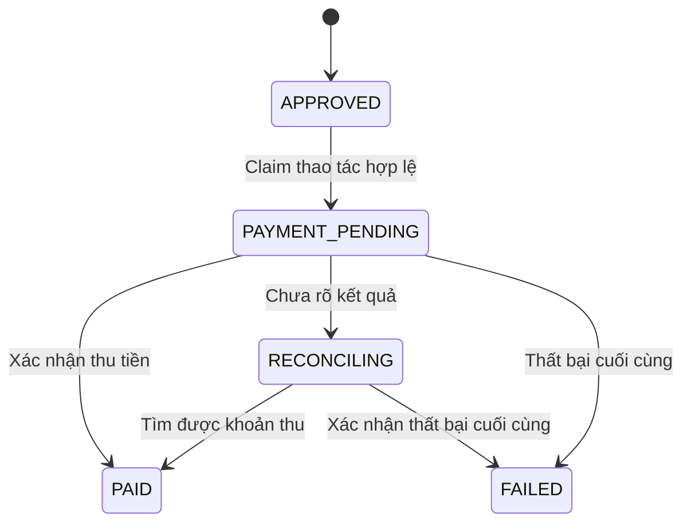

# Concurrent payment load

## 1. Mục tiêu: thanh toán đúng khi nhiều yêu cầu cùng đến

**Concurrent payment load** là kiểm thử tải thanh toán khi nhiều yêu cầu thực thi chồng lấn. Trong chương **Load Testing** của module bảo mật logic nghiệp vụ, câu hỏi không chỉ là hệ thống xử lý được bao nhiêu request mỗi giây, mà còn là các quy tắc nghiệp vụ có tiếp tục được giữ khi xuất hiện tranh chấp, timeout và retry hay không.

Những lỗi cần phát hiện gồm:

- Hai request cùng thấy đơn chưa trả tiền rồi cùng tạo khoản thu.
- Retry sau timeout bị hiểu thành một giao dịch mới.
- Nội dung thanh toán khác số tiền hoặc người thụ hưởng đã được duyệt.
- Cạnh tranh làm chi vượt số dư, vượt hạn mức hoặc ghi ledger không đầy đủ.
- Đường xử lý nhanh dưới tải bỏ qua quyền theo đối tượng hoặc tenant.
- API phản hồi nhanh nhưng hàng đợi tăng mãi, hoặc công việc đã tiếp nhận không được hoàn tất.

Một hệ thống trả về ít lỗi HTTP vẫn có thể thu tiền hai lần. Ngược lại, nhiều phản hồi xung đột có thể là hành vi bảo vệ đúng khi nhiều request cùng thanh toán một đơn.

Bài học trình bày cách xây workload, quan sát kết quả tiền tệ, dùng ví dụ k6 và đối soát sau tải. Các số liệu cấu hình là minh họa cho thiết kế kiểm thử, không phải kết quả đo của hệ thống hiện tại.

## 2. Xác định hợp đồng thanh toán trước khi tăng tải

Xét hệ thống có nhiều tenant, mỗi đơn cần được phê duyệt trước khi thanh toán. Hợp đồng mẫu:

1. Actor phải có quyền thanh toán đúng đơn trong tenant phù hợp.
2. Số tiền, loại tiền và người thụ hưởng phải khớp nội dung được phép thực hiện.
3. Mỗi đơn có tối đa một khoản thu thành công.
4. Retry cùng thao tác không tạo tác dụng thu tiền mới.
5. Một key khác không cho phép thu lại đơn đã trả tiền.
6. Trạng thái, payment operation, ledger và ý định phát lệnh phải phối hợp đúng qua transaction.
7. Nếu chưa rõ kết quả bên ngoài do timeout, hệ thống giữ khả năng đối soát thay vì tùy tiện coi như chưa thu.
8. Quá tải có thể làm hệ thống từ chối tiếp nhận theo hợp đồng, nhưng không được làm mất kiểm soát tiền hoặc quyền.

Mô hình rút gọn:



Sơ đồ bắt đầu ở đơn đã duyệt để tập trung vào tải thanh toán. Kiểm thử bỏ phê duyệt vẫn cần có trong workload bảo mật riêng.

Sản phẩm có thể cho phép tạo lần thử mới sau thất bại cuối cùng. Khi đó phải mô tả ranh giới giữa **lần thử** và **nghĩa vụ thanh toán của đơn**: có thể có nhiều lần thử thất bại, nhưng không được có hai khoản thu thành công trái hợp đồng.

## 3. Phân biệt request, operation và khoản thu

Ba bộ đếm sau không tương đương:

| Đối tượng | Ý nghĩa | Khi retry |
| --- | --- | --- |
| HTTP request | Một lần client gửi yêu cầu | Có thể tăng nhiều lần |
| Payment operation | Thao tác nghiệp vụ được hệ thống ghi nhận | Retry có thể tìm lại operation cũ |
| Khoản thu thành công | Tác dụng tiền tệ đã xảy ra tại nhà cung cấp | Không được nhân đôi vì retry |

Giả sử 100 request cùng thanh toán một đơn. Kết quả đúng có thể là một operation, một khoản thu và 99 phản hồi cho biết đang xử lý hoặc trả lại kết quả đã có.

Không lấy 100 phản hồi `200` hoặc `202` làm “100 thanh toán thành công”. Cần đếm operation và khoản thu theo định danh nghiệp vụ.

Idempotency key cũng có phạm vi: có thể theo tenant, principal và loại thao tác, tùy hợp đồng. Một chuỗi key trùng giữa hai tenant không tự có nghĩa là cùng một thanh toán.

Các quy tắc sau cần được kiểm tra tách biệt:

- Cùng key, cùng nội dung: không lặp tác dụng.
- Cùng key, khác nội dung có ý nghĩa: không thực hiện nhầm hoặc dùng nhầm kết quả.
- Khác key, cùng đơn: vẫn giữ giới hạn một khoản thu thành công.
- Khác đơn, các ý định hợp lệ riêng biệt: không bị gộp nhầm chỉ vì cùng số tiền.

## 4. Bất biến và tiêu chí đạt

### 4.1. Bất biến nghiệp vụ

| Mã | Điều kiện | Nguồn bằng chứng |
| --- | --- | --- |
| C1 | Mỗi đơn tối đa một khoản thu thành công | Sổ khoản thu độc lập của nhà cung cấp mô phỏng |
| C2 | Số tiền, loại tiền và người nhận đúng nội dung đã duyệt | Snapshot phê duyệt, operation và khoản thu |
| C3 | Actor và tenant được phép | Principal, đối tượng và quyết định phân quyền |
| C4 | Không trừ hoặc ghi nhận tiền nhiều lần cho cùng tác dụng | Ledger và định danh giao dịch |
| C5 | Không chi vượt số dư hoặc giới hạn tổng hợp | Số dư, tiền giữ chỗ và hạn mức |
| C6 | Retry hoặc giao lại thông điệp không tạo tác dụng trùng | Operation, key, outbox và consumer |
| C7 | Đơn và các bản ghi liên quan không ở trạng thái mâu thuẫn khi hội tụ | Trạng thái, ledger và kết quả bên ngoài |
| C8 | Công việc đã tiếp nhận có thể được truy vết và khôi phục | Operation, backlog, trạng thái đối soát |

Không cho phép “một tỷ lệ nhỏ thu trùng” như một ngân sách lỗi thông thường. Một vi phạm tiền tệ đã được xác nhận là thất bại về tính đúng của ca kiểm thử.

### 4.2. Chỉ tiêu hiệu năng và khả năng hoàn tất

Chốt riêng:

- Độ trễ tiếp nhận HTTP theo phân vị.
- Thời gian từ tiếp nhận hợp lệ đến kết quả nghiệp vụ cuối.
- Tốc độ tạo **operation mới hợp lệ**.
- Tốc độ hoàn tất **khoản thu duy nhất**.
- Tỷ lệ từ chối theo hợp đồng, timeout và lỗi hạ tầng.
- Độ dài hàng đợi, tuổi công việc cũ nhất và thời gian xử lý hết sau tải.
- Mức sử dụng tài nguyên của ứng dụng, database, worker và bộ tạo tải.

Một ngưỡng như “p95 tiếp nhận dưới 500 ms” chỉ có ý nghĩa khi gắn với workload, môi trường, dữ liệu và cấu hình nhà cung cấp cụ thể. Không áp dụng số đó như chuẩn chung.

Độ trễ thấp trên toàn bộ response có thể bị chi phối bởi những request trùng được từ chối rất nhanh. Phải tách nhóm tiếp nhận mới, replay, xung đột và từ chối quá tải.

## 5. Thiết kế các workload khác nhau

### 5.1. Nhiều đơn độc lập

Mỗi iteration thanh toán một đơn mới đủ điều kiện. Mục tiêu là đo năng lực xử lý công việc thật khi mức tranh chấp trên một đơn thấp.

Nếu dùng lại các đơn đã trả tiền từ lần chạy trước, phần lớn request có thể chỉ truy vấn kết quả cũ. RPS cao lúc đó không phản ánh năng lực thanh toán mới.

### 5.2. Cùng đơn, cùng key

Nhiều request dùng cùng order ID, cùng key và cùng nội dung. Mục tiêu là kiểm tra điều phối idempotency trong lúc operation đầu còn đang xử lý.

Đo cả thời gian chờ của request trùng và số tác dụng cuối cùng. Không chỉ thử khi khoản thu đầu đã hoàn tất, vì đường replay từ cache có thể dễ hơn đường tranh chấp ban đầu.

### 5.3. Cùng đơn, nhiều key

Nhiều request dùng cùng đơn nhưng key khác nhau. Workload này kiểm tra ràng buộc nghiệp vụ ở tầng đơn, ngoài lớp lưu kết quả theo key.

Một kho idempotency hoạt động đúng cho từng key vẫn có thể cho phép hai khoản thu nếu mỗi key tạo một operation độc lập không được phối hợp.

### 5.4. Nhiều đơn dùng chung nguồn tiền hoặc hạn mức

Mỗi đơn riêng lẻ có thể hợp lệ nhưng tổng tác động vượt số dư ví, hạn mức ngày hoặc ngân sách chung.

Ví dụ, hai đơn cùng trừ 60.000 đồng từ ví có 100.000 đồng. Cần giữ giới hạn không âm và xử lý tiền giữ chỗ an toàn; chỉ kiểm tra “mỗi đơn một khoản thu” chưa đủ.

### 5.5. Tải pha trộn và biến thể bảo mật

Sau khi hiểu từng nhóm độc lập, có thể pha trộn theo một phân bố được mô tả rõ:

| Nhóm | Ví dụ tỷ trọng minh họa | Mục tiêu |
| --- | ---: | --- |
| Đơn mới hợp lệ | 70% | Công việc thanh toán thật |
| Retry cùng key | 15% | Đường idempotency |
| Nhiều key cho cùng đơn | 10% | Ràng buộc chống thu trùng |
| Request sai quyền hoặc thiếu điều kiện | 5% | Kiểm soát nghiệp vụ dưới tải |

Các tỷ trọng trên không phải phân bố mặc định. Tách kết quả của request cố tình không hợp lệ khỏi tỷ lệ thất bại của thanh toán hợp lệ.

Nếu chỉ dùng một đơn nóng, hệ thống có thể đang đo khả năng chờ khóa hoặc trả xung đột. Nếu chỉ dùng đơn độc lập, nó có thể không bao giờ chạm lỗi tranh chấp cần tìm.

## 6. Chọn mô hình tạo tải và mô tả tải thực đạt

**Mô hình đóng** giữ một tập virtual users; mỗi VU bắt đầu iteration tiếp khi iteration trước của nó xong. Khi response chậm hơn, tốc độ gửi có thể tự giảm.

**Mô hình mở** lập lịch iteration theo tốc độ đến, tương đối độc lập với thời gian hoàn tất iteration trước. Nó phù hợp khi mục tiêu là kiểm tra hệ thống trước một arrival rate cụ thể. Xem [Grafana k6 — Open and closed models](https://grafana.com/docs/k6/latest/using-k6/scenarios/concepts/open-vs-closed/).

Cần phân biệt:

```text
iteration được lập lịch
    -> iteration thực sự bắt đầu
    -> HTTP request được gửi
    -> operation mới được tiếp nhận
    -> khoản thu duy nhất hoàn tất
```

Một iteration có thể gửi một hoặc nhiều request. Arrival rate theo iteration không tự bằng RPS nếu trong iteration còn có đăng nhập, polling hoặc retry.

Với hệ thống tương đối ổn định, có thể dùng quan hệ xấp xỉ `L = lambda * W` để ước lượng số công việc đồng thời, nhưng phải dùng cùng ranh giới đo. Không trộn tốc độ HTTP tiếp nhận với thời gian xử lý cuối của worker rồi gọi kết quả là số HTTP connection cần thiết.

Ghi lại tải cấu hình và tải thực đạt. Nếu bộ tạo tải thiếu VU, hết CPU hoặc mạng bị giới hạn, một biểu đồ latency đẹp có thể chỉ cho thấy nó chưa tạo đủ tải.

Trong k6, `dropped_iterations` phản ánh iteration chưa được bắt đầu do giới hạn executor, như thiếu VU cho arrival-rate hoặc hết thời lượng cho nhóm iteration hữu hạn. Nó cần được đọc cùng cấu hình và trạng thái hệ thống. Xem [Grafana k6 — Dropped iterations](https://grafana.com/docs/k6/latest/using-k6/scenarios/concepts/dropped-iterations/).

## 7. Chuẩn bị dữ liệu và môi trường có thể đối soát

### 7.1. Dữ liệu trước tải

Mỗi đơn thuộc workload hợp lệ cần có:

- Tenant và actor có quyền thật trên đơn.
- Phê duyệt đúng phiên bản nội dung và còn hiệu lực tại điểm quyết định theo chính sách.
- Số tiền, loại tiền, người thụ hưởng và payment method kiểm thử.
- Trạng thái chưa trả tiền, không có operation đang xử lý ngoài kế hoạch.
- ID riêng cho phạm vi chạy và quan hệ với các request dự kiến.

Tạo trạng thái bằng luồng ứng dụng hoặc fixture bảo toàn đầy đủ quan hệ nghiệp vụ. Chỉ cập nhật `status = APPROVED` trong database có thể bỏ qua chính dữ liệu mà kiểm soát thanh toán cần.

Dùng nhóm đơn riêng cho warm-up và nhóm đo chính. Nếu warm-up đã thanh toán các đơn của nhóm đo, kết quả chính có thể chỉ còn replay hoặc xung đột.

Danh sách fixture cũng là bản kê kỳ vọng: đơn nào phải được thu, đơn nào cố tình bị từ chối, số tiền nào được phép và request nào thuộc cùng một ý định thanh toán.

### 7.2. Môi trường

Giữ thật những thành phần bảo vệ bất biến: xác thực, phân quyền, policy phê duyệt, transaction, database, constraint, kho idempotency và worker trong phạm vi kiểm thử.

Dùng database cùng loại với môi trường triển khai cho các kết luận về khóa và tranh chấp. Ghi cấu hình connection pool, số instance ứng dụng, worker, cache và vị trí lưu key.

Một test chỉ có một instance có thể bỏ sót lỗi dùng khóa trong bộ nhớ tiến trình. Nếu triển khai nhiều instance, cần có chiến dịch phản ánh đường request đi qua chúng.

Nhà cung cấp mô phỏng nên ghi được:

- Số lần nhận request.
- Operation hoặc định danh idempotency mà ứng dụng gửi.
- Khoản thu thực sự được chấp nhận.
- Số tiền, loại tiền, merchant và người thụ hưởng.
- Trường hợp đã thu nhưng phản hồi bị mất.
- Callback trùng, chậm hoặc đến khác thứ tự.

Một mock luôn trả thành công ngay có thể làm operation đầu kết thúc quá nhanh, giảm cửa sổ tranh chấp và che mất hành vi retry.

### 7.3. Phân bổ dữ liệu

Với workload đơn độc lập, mỗi iteration cần được cấp một đơn mới theo kế hoạch. Không dùng phép modulo trên một danh sách nhỏ rồi vô tình biến test năng lực thanh toán mới thành test replay.

Với workload tranh chấp, lặp order ID là có chủ đích; key được giữ hoặc đổi theo nhóm. Mô tả cả phân bố thời gian: những request dùng cùng đơn có thực sự chồng lấn lúc operation còn pending hay chỉ quay lại sau khi hoàn tất?

Danh sách định trước giúp đối soát số công việc phải có. Đối với arrival-rate dài, cần đủ dữ liệu hoặc cơ chế cấp fixture không làm thay đổi loại workload khi danh sách cạn.

## 8. Ví dụ k6: một tập request hữu hạn chạy đồng thời

Ví dụ dưới dùng `shared-iterations`: một tập iteration được chia cho các VU, mỗi iteration lấy một dòng dữ liệu. Nó phù hợp cho chiến dịch hữu hạn có bản kê rõ ràng; không giữ một RPS cố định.

Theo tài liệu k6, `scenario.iterationInTest` giúp chọn dòng dữ liệu riêng trong một scenario; nếu có nhiều scenario, cần phân chia dữ liệu phù hợp. Xem [Grafana k6 — Data parameterization](https://grafana.com/docs/k6/latest/examples/data-parameterization/).

### 8.1. Dữ liệu minh họa

Tệp dữ liệu của ví dụ là một mảng. Ba dòng dưới cố tình cùng dùng một đơn:

```json
[
  {
    "orderId": "order-101",
    "actor": "alice-a",
    "paymentMethodRef": "method-test-ok",
    "idempotencyKey": "run-01-order-101-pay",
    "profile": "same_key"
  },
  {
    "orderId": "order-101",
    "actor": "alice-a",
    "paymentMethodRef": "method-test-ok",
    "idempotencyKey": "run-01-order-101-pay",
    "profile": "same_key"
  },
  {
    "orderId": "order-101",
    "actor": "alice-a",
    "paymentMethodRef": "method-test-ok",
    "idempotencyKey": "run-01-order-101-pay-alt",
    "profile": "different_key"
  }
]
```

Đây chỉ là cấu trúc nhỏ để đọc hiểu. Workload độc lập cần nhiều order ID khác nhau; workload tranh chấp cần số lần lặp và lịch gửi phù hợp với mục tiêu.

Token được ánh xạ từ nhãn actor qua biến môi trường `TEST_TOKENS_JSON`, thay vì đưa vào bản kê dữ liệu chia sẻ. Token phải hợp lệ cho môi trường kiểm thử và còn hiệu lực trong khoảng đo. Nếu test có refresh token, tính cả lưu lượng đó vào kế hoạch.

### 8.2. Hợp đồng API giả định của script

Ví dụ giả định:

| HTTP | Code trong JSON | Ý nghĩa |
| --- | --- | --- |
| 202 | `PAYMENT_ACCEPTED` | Tiếp nhận operation |
| 200 | `EXISTING_OPERATION` | Trả lại operation đã có |
| 409 | `PAYMENT_IN_PROGRESS` hoặc `ORDER_ALREADY_PAID` | Bảo vệ khỏi thao tác trùng |
| 429 | `RATE_LIMITED` | Từ chối theo chính sách tốc độ |
| 503 | `OVERLOADED` | Từ chối tiếp nhận theo hợp đồng quá tải |

Ba nhóm đầu trả `operationId`. Các tên endpoint và code này là ví dụ, cần sửa theo API thực tế.

Script mặc định dùng cho tải bình thường: 429 hoặc 503 là ngoài kỳ vọng. Biến `ALLOW_OVERLOAD=true` chỉ bật phân loại hai phản hồi từ chối đã được hợp đồng cho phép trong chiến dịch quá tải; tiêu chí về tỷ lệ tiếp nhận và hoàn tất vẫn phải kiểm tra riêng.

### 8.3. Script minh họa

```javascript
import http from 'k6/http';
import { check } from 'k6';
import { SharedArray } from 'k6/data';
import { scenario } from 'k6/execution';
import { Counter, Trend } from 'k6/metrics';

const baseUrl = __ENV.BASE_URL;
const runId = __ENV.RUN_ID;
const allowOverload = __ENV.ALLOW_OVERLOAD === 'true';
const actorTokens = JSON.parse(__ENV.TEST_TOKENS_JSON || '{}');

if (!baseUrl || !runId || !__ENV.JOBS_FILE) {
  throw new Error('BASE_URL, RUN_ID and JOBS_FILE are required');
}

const jobs = new SharedArray('payment-jobs', function () {
  return JSON.parse(open(__ENV.JOBS_FILE));
});

const requestedVus = Number(__ENV.VUS || 20);
if (!jobs.length ||
    !Number.isInteger(requestedVus) ||
    requestedVus < 1) {
  throw new Error('Non-empty jobs and positive integer VUS required');
}

const allowedProfiles = new Set([
  'independent', 'same_key', 'different_key', 'shared_budget'
]);
for (let i = 0; i < jobs.length; i++) {
  const job = jobs[i];
  if (!job ||
      typeof job.orderId !== 'string' || !job.orderId ||
      typeof job.idempotencyKey !== 'string' || !job.idempotencyKey ||
      typeof job.paymentMethodRef !== 'string' || !job.paymentMethodRef ||
      !actorTokens[job.actor] ||
      !allowedProfiles.has(job.profile)) {
    throw new Error('Invalid fixture row at index ' + i);
  }
}

const replies = new Counter('payment_replies');
const unexpected = new Counter('unexpected_contract');
const transportErrors = new Counter('transport_errors');
const httpMs = new Trend('payment_http_ms', true);

export const options = {
  systemTags: [
    'status', 'method', 'name', 'scenario',
    'check', 'expected_response'
  ],
  scenarios: {
    payments: {
      executor: 'shared-iterations',
      vus: Math.min(requestedVus, jobs.length),
      iterations: jobs.length,
      maxDuration: __ENV.MAX_DURATION || '2m',
      gracefulStop: '20s'
    }
  },
  thresholds: {
    checks: ['rate==1'],
    unexpected_contract: ['count<1'],
    transport_errors: ['count<1'],
    dropped_iterations: ['count<1']
  }
};

function classify(response) {
  if (response.status === 0) return 'transport_error';

  let body;
  try {
    body = response.json();
  } catch (_) {
    return 'unexpected';
  }

  if (!body || typeof body !== 'object') return 'unexpected';
  const hasOperation =
    typeof body.operationId === 'string' &&
    body.operationId.length > 0;

  if (hasOperation && response.status === 202 &&
      body.code === 'PAYMENT_ACCEPTED') return 'accepted';

  if (hasOperation && response.status === 200 &&
      body.code === 'EXISTING_OPERATION') return 'replayed';

  if (hasOperation && response.status === 409 &&
      ['PAYMENT_IN_PROGRESS', 'ORDER_ALREADY_PAID']
        .includes(body.code)) return 'business_conflict';

  if (allowOverload && response.status === 429 &&
      body.code === 'RATE_LIMITED') return 'load_shed';

  if (allowOverload && response.status === 503 &&
      body.code === 'OVERLOADED') return 'load_shed';

  return 'unexpected';
}

export default function () {
  const index = scenario.iterationInTest;
  const job = jobs[index];
  if (!job || !actorTokens[job.actor]) {
    throw new Error('Missing job or test actor token');
  }

  const response = http.post(
    baseUrl + '/api/orders/' +
      encodeURIComponent(job.orderId) + '/pay',
    JSON.stringify({ paymentMethodRef: job.paymentMethodRef }),
    {
      headers: {
        Authorization: 'Bearer ' + actorTokens[job.actor],
        'Content-Type': 'application/json',
        'Idempotency-Key': job.idempotencyKey,
        'X-Test-Run-Id': runId,
        'X-Request-Id': runId + '-payments-' + index
      },
      tags: {
        name: 'POST /api/orders/:id/pay',
        profile: job.profile
      },
      timeout: __ENV.REQUEST_TIMEOUT || '10s'
    }
  );

  const outcome = classify(response);
  replies.add(1, { outcome: outcome, profile: job.profile });
  httpMs.add(response.timings.duration, { outcome: outcome });
  unexpected.add(outcome === 'unexpected' ? 1 : 0);
  transportErrors.add(outcome === 'transport_error' ? 1 : 0);

  check(response, {
    api_contract: () =>
      outcome !== 'unexpected' && outcome !== 'transport_error'
  });
}
```

Các giá trị `profile` nên thuộc một tập nhỏ đã xác định. Script chuẩn hóa tên endpoint và không đưa order ID hoặc key vào metric tag. Những ID cụ thể dùng trong trace hoặc log có kiểm soát; không tạo một chuỗi thời gian riêng cho từng đơn.

Header phục vụ quan sát không phải bằng chứng phân quyền. Quyền của request vẫn phải do server kiểm tra từ principal và đối tượng.

### 8.4. Giới hạn của kết quả script

Script kiểm tra hợp đồng tiếp nhận, không chứng minh khoản thu cuối cùng đúng. Toàn bộ request có thể nhận xung đột do fixture sai, trong khi các check HTTP vẫn đạt. Bước đối soát phải xác minh số đơn hợp lệ thực sự được xử lý và hoàn tất.

Trong k6, `http_req_failed` mặc định có thể tính những phản hồi như 409 là thất bại HTTP. Đối chiếu metric đó với phân loại nghiệp vụ; không đơn giản cho phép mọi mã 409 hoặc tắt toàn bộ đo lỗi.

Ví dụ không tự retry khi timeout. Các lần gửi lại có thể được biểu diễn thành các dòng dữ liệu cùng key trong chiến dịch này. Một chiến dịch kiểm tra retry thực tế cần mô hình thời gian chờ, giới hạn lần thử và cách tìm lại operation.

`shared-iterations` cũng không bảo đảm mọi request cùng đơn chạm đúng một cửa sổ race. Dùng thêm kiểm thử tích hợp có điều khiển lịch cho race cần tái hiện ổn định, và dùng kiểm thử tải để khảo sát hành vi khi nhiều xung đột xảy ra tự nhiên.

## 9. Đo theo từng giai đoạn thay vì chỉ một biểu đồ latency

### 9.1. Các mốc thời gian

```text
Client gửi
    -> API quyết định tiếp nhận hoặc từ chối
    -> operation chờ worker
    -> nhà cung cấp xử lý
    -> callback hoặc đối soát cập nhật kết quả
    -> trạng thái và ledger hội tụ
```

Các khoảng thời gian cần phân biệt:

| Khoảng đo | Ý nghĩa |
| --- | --- |
| HTTP request duration | Thời gian chờ response trong ranh giới HTTP đã chọn |
| Admission latency | Thời gian đến quyết định tiếp nhận hoặc từ chối |
| Queue wait | Thời gian operation đợi trước khi được xử lý |
| Provider latency | Thời gian chờ hoặc tìm lại kết quả ở nhà cung cấp |
| End-to-end completion | Thời gian từ điểm bắt đầu đã định đến kết quả nghiệp vụ cuối |
| Drain time | Thời gian xử lý hết công việc liên quan sau khi dừng tạo tải |

Không trừ timestamp của hai máy rồi mặc định đó là độ trễ chính xác nếu chưa kiểm soát đồng bộ đồng hồ. Dùng trace hoặc các mốc đo có nguồn thời gian phù hợp với ranh giới đang đánh giá.

HTTP duration của request trả `202` không bao gồm toàn bộ thời gian hoàn tất thanh toán. API có thể rất nhanh trong khi worker đang chậm dần.

### 9.2. Throughput và mẫu số

Ghi riêng:

```text
requestsSent
newUniqueOperations
existingOperationResponses
businessConflicts
loadShedResponses
unknownTransportOutcomes
uniqueSuccessfulCaptures
terminalBusinessFailures
unresolvedOperations
```

Một tỷ lệ thành công cần nói rõ mẫu số. “99% thành công” trên response không đồng nghĩa 99% đơn hợp lệ được thu đúng.

Ví dụ, nếu hệ thống gửi ra 1.000 request/s nhưng 900 là replay, năng lực thanh toán mới không phải 1.000 operation/s. Cũng không lấy 100 operation mới/s làm tốc độ khoản thu hoàn tất nếu worker chỉ hoàn tất 80/s.

Trong một giai đoạn ổn định, nếu tiếp nhận mới 100 operation/s nhưng hoàn tất 80 operation/s, backlog có thể tăng xấp xỉ 20 operation/s khi không có đường kết thúc khác. Bài toán phải dùng operation, không trộn số request trùng vào tốc độ đến.

### 9.3. Độ trễ và lỗi

Báo cáo phân vị theo nhóm kết quả và kèm số mẫu. Một p99 trên quá ít mẫu không đại diện tốt cho đuôi phân bố.

Timeout cần được ghi thành một kết quả chưa biết tại phía client; thời gian response bị cắt tại giới hạn timeout không phản ánh thời gian cuối cùng của operation. Tiếp tục đối soát operation thay vì loại chúng khỏi báo cáo rồi chỉ tính latency của các request nhanh.

Với request cố tình sai quyền hoặc thiếu phê duyệt, tách nhóm khỏi thanh toán hợp lệ. Tuy vậy, mọi tác dụng tiền phát sinh từ nhóm bị cấm vẫn là lỗi nghiêm trọng về tính đúng.

## 10. Đối soát sau tải là một phần bắt buộc của kiểm thử

### 10.1. Chờ phạm vi công việc hội tụ

Sau khi ngừng tạo request:

1. Ghi lại thời điểm kết thúc giai đoạn gửi và số request thực gửi.
2. Cho worker, callback và đối soát tiếp tục trong thời hạn đã đặt.
3. Theo dõi các operation, outbox và tác vụ liên quan đến tập đơn kiểm thử.
4. Đọc trạng thái nhất quán và sổ khoản thu độc lập.
5. So sánh với bản kê fixture và snapshot được phép.

Không cần toàn bộ hệ thống đứng yên nếu còn công việc không liên quan. Cần xác định đúng phạm vi đơn và operation của chiến dịch.

Nếu hết hạn mà vẫn có kết quả chưa rõ, báo rõ số lượng và tuổi operation. Có thể kết luận không đạt chỉ tiêu hoàn tất; chưa được tự khẳng định chúng đã thất bại tài chính hoặc không có khoản thu trùng.

### 10.2. Phát hiện thu trùng từ phía nhà cung cấp

SQL dưới đây minh họa trên bảng xuất dữ liệu của simulator và bảng phạm vi kiểm thử. Đây không phải schema của dự án hiện tại.

```sql
WITH captures AS (
    SELECT DISTINCT
        c.tenant_id,
        c.order_id,
        c.provider_account_id,
        c.provider_charge_id
    FROM provider_capture_export c
    JOIN test_scope_order s
      ON s.tenant_id = c.tenant_id
     AND s.order_id = c.order_id
    WHERE s.run_id = :run_id
      AND c.outcome = 'SUCCEEDED'
)
SELECT tenant_id, order_id, COUNT(*) AS successful_captures
FROM captures
GROUP BY tenant_id, order_id
HAVING COUNT(*) > 1;
```

Định danh khoản thu cần đủ phạm vi của nhà cung cấp, chẳng hạn cả provider account và charge ID. Không đếm mỗi lần giao lại callback như một khoản thu mới.

Đối chiếu toàn bộ khoản thu liên quan đến tập đơn, không chỉ những dòng vô tình có đúng header run ID. Một retry hoặc callback thiếu header quan sát vẫn có thể gây thu trùng.

Với fixture mới, mỗi đơn chưa có khoản thu trước chiến dịch. Nếu buộc dùng lại dữ liệu, lưu baseline và phân biệt tác dụng trước, trong và sau chiến dịch.

Dữ liệu xuất cần liên kết đúng operation với khoản thu; không chỉ tin một trường order ID tự khai mà không đối chiếu quan hệ và tài khoản tích hợp.

### 10.3. Đối chiếu nội dung được phép

Với mỗi khoản thu, xác minh:

```text
actual.amount   = approvedSnapshot.amount
actual.currency = approvedSnapshot.currency
actual.payee    = approvedSnapshot.payee
actual.tenant   = tenant được phép
```

Nếu nhà cung cấp trừ phí từ tiền nhận ròng, phân biệt số tiền thu từ khách với số tiền thực nhận sau phí. Không so sánh nhầm gross và net rồi báo sai lệch giả.

Kiểm tra cả dữ liệu phê duyệt còn phù hợp tại điểm chấp nhận thao tác và snapshot operation không bị sửa ngoài ý muốn sau đó.

### 10.4. Đối chiếu ledger và trạng thái

Các quan hệ cần kiểm tra:

- Mỗi khoản thu thật có đúng tác dụng ghi nhận tương ứng trong ledger.
- Giao lại callback không tạo thêm một tác dụng ledger.
- Đơn `PAID` gắn với khoản thu đã được xác nhận phù hợp.
- Không có đơn được báo chưa trả tiền trong khi khoản thu thật bị bỏ quên sau thời hạn hội tụ.
- Không có tiền giữ chỗ bị tiêu thụ hoặc giải phóng hai lần.
- Tổng các ngăn tiền và dòng qua ranh giới khớp mô hình kế toán theo từng loại tiền.

Ledger cân bằng tổng vẫn có thể chứa hai lần trừ và hai lần cộng trùng. Kiểm tra thêm định danh nghiệp vụ và biến động đúng của từng tài khoản.

### 10.5. Đối chiếu khả năng hoàn tất

Trong workload không chủ động gây lỗi, simulator luôn thành công và không cho phép từ chối quá tải, mỗi đơn hợp lệ dự kiến phải có đúng một khoản thu sau khi hội tụ.

Trong workload quá tải có cho phép từ chối tiếp nhận, tách:

- Công việc được xác nhận đã tiếp nhận.
- Request bị từ chối theo hợp đồng.
- Request timeout hoặc mất phản hồi, cần truy ra kết quả thật.

Một request timeout có thể đã được tiếp nhận và thu tiền. Không loại đơn đó khỏi đối soát chỉ vì client không thấy `202`.

Nếu mọi request chỉ nhận xung đột nhưng các đơn mới không có khoản thu nào, kiểm thử không đạt mục tiêu hoàn tất dù bộ check HTTP có thể xanh.

## 11. Chủ động gây lỗi khi có tải

Sau khi có baseline không lỗi, thêm từng loại lỗi để hiểu nguyên nhân thay vì bật tất cả cùng lúc.

| Tình huống | Kỳ vọng về tính đúng | Dấu hiệu cần quan sát |
| --- | --- | --- |
| Nhà cung cấp chậm | Không cho request sau tạo khoản thu độc lập trái phép | Operation pending, lock wait và số khoản thu |
| Đã thu nhưng mất phản hồi | Retry hoặc đối soát tìm lại kết quả, không thu thêm | Định danh gửi sang provider và charge ID |
| API commit rồi mất response | Client retry liên kết đúng operation đã có | Request ID, key và operation |
| Worker chết sau gửi lệnh | Giao lại công việc không nhân tác dụng | Outbox, số lần gửi và sổ khoản thu |
| Cache idempotency chậm hoặc không khả dụng | Cơ chế thay thế hoặc từ chối vẫn bảo vệ bất biến | Lỗi cache, operation và constraint dữ liệu |
| Khóa phân tán hết TTL khi operation còn chạy | Không có chủ thể thứ hai tạo tác dụng trùng | Vòng đời khóa và tính duy nhất của khoản thu |
| Read replica trễ | Quyết định cuối không dựa vào dữ liệu cũ theo cách cho phép thu trùng | Nguồn đọc, claim và trạng thái ghi |
| Nhà cung cấp giới hạn tốc độ | Retry có kiểm soát, không làm backlog tăng ngoài khả năng khôi phục | Tốc độ thử lại và tuổi công việc |
| Chạy nhiều instance | Kiểm soát không phụ thuộc khóa riêng trong một tiến trình | Phân bố request và kết quả theo instance |

Một lock có TTL không tự bảo đảm thao tác cũ đã dừng khi khóa hết hạn. Bài kiểm thử cần kéo dài bước bên ngoài hoặc điều khiển lỗi để kiểm tra trường hợp đó; chỉ xác minh “đã gọi acquire lock” là chưa đủ.

Không đổi idempotency key gửi sang provider sau mỗi timeout của cùng operation. Nếu cần thử lại bằng một operation mới sau thất bại cuối cùng, điều kiện cho phép phải rõ và có bằng chứng rằng lần trước không còn kết quả chưa xác định.

Một chiến dịch cố tình gây timeout sẽ có tiêu chí phân loại lỗi truyền tải khác script baseline. Kết quả quyết định vẫn là các bất biến tài chính, khả năng tìm lại trạng thái và giới hạn thời gian khôi phục.

## 12. Quy trình thực hiện một chiến dịch có thể so sánh

| Giai đoạn | Việc chính | Điều cần ghi |
| --- | --- | --- |
| Chốt giả thuyết | Chọn năng lực đơn mới, tranh chấp hoặc khôi phục | Workload, bất biến và tiêu chí đạt |
| Chuẩn bị | Tạo fixture và bản kê; kiểm tra token, quyền, approval | Tập đơn, key, snapshot và baseline |
| Smoke | Gửi ít request để xác minh hợp đồng và đối soát | Kết quả từng bước và dữ liệu cuối |
| Warm-up | Làm ổn định các thành phần cần thiết bằng dữ liệu riêng | Thời gian và phạm vi loại khỏi phép đo |
| Tăng tải | Tăng từng mức theo cùng workload | Tải đặt, tải thực đạt và tài nguyên |
| Giữ mức | Đo ở trạng thái đủ ổn định | Phân vị, backlog, throughput và lỗi |
| Giảm hoặc dừng gửi | Quan sát hệ thống xử lý công việc còn lại | Drain time và operation chưa rõ |
| Đối soát | So bản kê, provider, ledger và trạng thái | Vi phạm bất biến và số công việc hoàn tất |
| Lưu bằng chứng | Giữ cấu hình và dữ liệu tái hiện | Phiên bản mã, môi trường, seed và run ID |

Một số chiến dịch riêng có thể tập trung vào burst hoặc thời gian dài:

- **Burst:** tăng số request cùng đơn trong lúc operation còn pending để khảo sát tranh chấp.
- **Soak:** chạy đủ dài để quan sát backlog tích lũy, dữ liệu idempotency, cache và giữ chỗ không được giải phóng.
- **Recovery:** dừng gây lỗi rồi đo hệ thống có xử lý hết công việc đã nhận trong thời hạn hay không.

Khi thay đổi workload, số instance, pool, provider latency hoặc chính sách retry, ghi lại như một biến độc lập. Không gọi hai kết quả là cải thiện chỉ vì cấu hình sau đã giảm số công việc mới cần làm.

Nếu tăng tải đến mức phát hiện thu trùng hoặc sai số tiền, lưu trạng thái và chuyển sang tái hiện ở mức nhỏ hơn. Một ca hồi quy có lịch thực thi rõ sẽ hữu ích hơn việc tiếp tục tạo nhiều sai lệch giống nhau.

## 13. Đọc kết quả theo nguyên nhân

### 13.1. RPS cao nhưng khoản thu mới thấp

Có thể workload chủ yếu là replay, xung đột hoặc từ chối nhanh. Kiểm tra số đơn mới, operation mới và khoản thu duy nhất trước khi kết luận tăng năng lực.

### 13.2. HTTP nhanh nhưng backlog tăng

Có thể API chỉ đẩy việc sang worker. So tốc độ tiếp nhận operation với tốc độ kết thúc, tuổi công việc và drain time. Hệ thống chưa đạt năng lực bền vững ở mức đó nếu backlog tiếp tục tăng.

### 13.3. Latency tăng trên đơn nóng

Có thể có chờ khóa, truy vấn lặp hoặc nhiều request cùng chờ một operation. Kiểm tra lock wait, pool và thời gian từng giai đoạn.

Việc chuyển sang trả kết quả đang xử lý có thể giảm chờ HTTP, nhưng vẫn phải giữ cơ chế phối hợp tạo tác dụng ở backend.

### 13.4. Request lỗi nhưng nhà cung cấp có khoản thu

Có thể commit hoặc tác dụng bên ngoài đã xảy ra trước khi mất response. Cần truy operation và kiểm tra retry; không tự tạo khoản thu mới để “bù request thất bại”.

### 13.5. Thu trùng chỉ khi nhiều instance

Có thể kiểm soát dùng trạng thái riêng của từng instance hoặc cache không có ràng buộc đủ mạnh. Giảm test về hai instance, một đơn và vài request để tìm cửa sổ lỗi.

### 13.6. Nhiều dropped iterations nhưng server còn nhẹ

Có thể bộ tạo tải thiếu VU, bão hòa CPU, thiếu dữ liệu hoặc script làm quá nhiều công việc cục bộ. Chưa đủ cơ sở kết luận hệ thống đã đạt giới hạn xử lý.

### 13.7. Tải hợp lệ bị ảnh hưởng bởi nhóm tranh chấp

Theo dõi riêng độ trễ và tỷ lệ hoàn tất của tenant hoặc nhóm đơn độc lập. Một số đơn nóng không nên làm mất hoàn toàn khả năng xử lý công việc hợp lệ khác ngoài chính sách cách ly đã công bố.

Kiểm soát tốc độ theo tài khoản hoặc tenant, giới hạn công việc đang chờ và cơ chế chống retry dồn dập có thể giúp bảo vệ năng lực phục vụ. Cần kiểm thử tác dụng của chúng bằng workload phù hợp, không chỉ thêm cấu hình rồi giả định có hiệu quả.

## 14. Hướng cải thiện gắn với bằng chứng

Tùy nguyên nhân, thay đổi có thể gồm:

- Claim trạng thái và phiên bản nguyên tử trước khi tạo operation.
- Ràng buộc dữ liệu cho phép ngăn các thao tác đang hoạt động hoặc kết quả thành công xung đột theo hợp đồng.
- Gắn key và fingerprint với đúng phạm vi, đồng thời giữ định danh operation ổn định khi retry.
- Lưu snapshot nội dung đã được phép thay vì đọc lại dữ liệu có thể đổi sau phê duyệt.
- Đặt quyền theo đối tượng và tenant tại ranh giới tạo tác dụng.
- Ghi thay đổi nghiệp vụ với ý định phát lệnh trong cùng transaction khi kiến trúc dùng outbox.
- Thiết kế consumer, ledger và tích hợp provider chịu được giao lại.
- Giữ transaction database ngắn, tránh giữ khóa trong suốt một lời gọi mạng chậm khi không có thiết kế phù hợp.
- Tách năng lực API, worker và provider; điều chỉnh concurrency theo nút nghẽn đã đo.
- Từ chối tiếp nhận có kiểm soát khi không còn khả năng hoàn tất trong giới hạn đã công bố.

Một unique constraint theo key client chưa đủ thay cho ràng buộc theo nghĩa vụ thanh toán. Một transaction cũng chưa đủ nếu hai transaction vẫn cùng đọc trạng thái cũ rồi tạo hai thao tác không xung đột ở database.

Sau thay đổi, chạy lại chiến dịch cùng điều kiện cần so sánh, kiểm tra cả hiệu năng và đối soát. Cải thiện tốc độ không được đánh đổi bằng việc bỏ kiểm tra phê duyệt, quyền hoặc tính duy nhất.

## 15. Checklist cho concurrent payment load

Một thiết kế kiểm thử đủ cơ sở cần trả lời được:

- “Thành công” đang đếm response, operation hay khoản thu thực tế?
- Đã tách đơn độc lập, cùng key, khác key cùng đơn và nguồn tiền dùng chung chưa?
- Dữ liệu hợp lệ có phê duyệt đúng nội dung, đúng quyền và đúng tenant không?
- Tải đặt và tải thực đạt khác nhau bao nhiêu, có iteration chưa bắt đầu không?
- Request cùng đơn có thực sự chồng lấn trong lúc pending không?
- Có đo riêng độ trễ tiếp nhận, thời gian hoàn tất và drain time không?
- Có giữ số tiền, loại tiền và người thụ hưởng đúng snapshot được phép không?
- Có đối soát sổ khoản thu độc lập, ledger, giữ chỗ và trạng thái không?
- Có kiểm tra retry sau mất phản hồi và hoạt động qua nhiều instance không?
- Có phân biệt từ chối quá tải hợp lệ với thất bại hoặc kết quả chưa xác định không?
- Có phát hiện trường hợp mọi request trả xung đột nhưng không có đơn mới nào hoàn tất không?
- Có đủ bằng chứng để rút một lỗi dưới tải thành ca hồi quy nhỏ và tái hiện được không?

Kết quả cần chứng minh rằng hệ thống tiếp nhận và hoàn tất được một mức công việc xác định, trong khi mỗi khoản thu vẫn có đúng nguồn cho phép, đúng nội dung và đúng số lần theo quy tắc nghiệp vụ.
