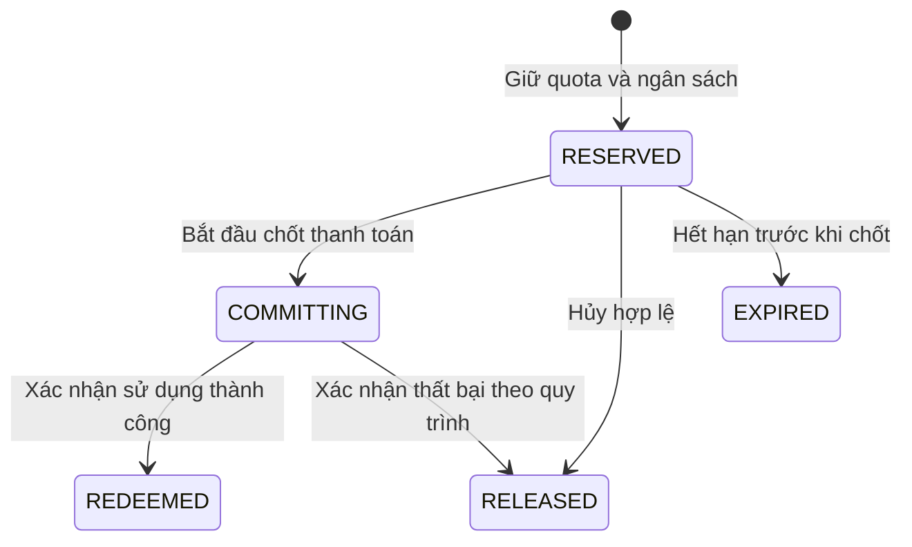

# Promotion peak load — Kiểm thử tải đỉnh chương trình khuyến mãi

## 1. Mục tiêu của bài học

Trong chương **Load Testing** của nội dung bảo mật logic nghiệp vụ, kiểm thử tải đỉnh khuyến mãi cần trả lời đồng thời hai câu hỏi: hệ thống phục vụ được lượng yêu cầu dự kiến hay không, và các quy tắc khuyến mãi có còn được giữ khi nhiều yêu cầu cạnh tranh cùng lúc hay không.

Một API có thể đáp ứng nhanh nhưng cấp thừa mã giảm giá, cho một người nhận nhiều suất hoặc áp dụng giảm giá từ dữ liệu giả trong request. Ngược lại, một hệ thống trả lỗi ngay cho mọi người có thể có latency rất thấp nhưng không hoàn thành chức năng. Vì vậy, kết quả cần bao gồm cả năng lực phục vụ, các quyết định nghiệp vụ và đối soát dữ liệu đã commit.

Sau bài học, bạn có thể:

- Mô hình hóa tải tăng mạnh tại thời điểm mở khuyến mãi.
- Xác định bất biến về quota, ngân sách, giới hạn mỗi người và số tiền giảm.
- Thiết kế fixture tránh vô tình chỉ đo đường từ chối hoặc đường cache.
- Viết một kịch bản k6 cho bước giữ suất khuyến mãi với chỉ số và assertion phù hợp.
- Kiểm tra gửi trùng, tranh suất cuối, hết hạn, hủy và phục hồi sau tải đỉnh.
- Đọc kết quả tải cùng dữ liệu nghiệp vụ để đưa ra kết luận có giới hạn rõ ràng.

Các con số, endpoint và mã lỗi trong bài là hợp đồng minh họa. Chúng không phải số đo năng lực của một hệ thống đã được chạy thử.

## 2. Vì sao khuyến mãi tạo áp lực đặc biệt lên logic nghiệp vụ?

### 2.1. Tải tập trung vào cùng một tài nguyên hữu hạn

Một chương trình bình thường có thể phân tán yêu cầu trên nhiều sản phẩm. Khi mở mã giảm giá, hàng nghìn người lại cùng truy cập một campaign, cùng bộ đếm quota hoặc cùng ngân sách. Tổng RPS chưa chắc rất lớn nhưng mức tranh chấp trên một khóa có thể cao.

Những điểm dễ có lỗi gồm:

- Đọc quota còn lại, kết luận đủ rồi ghi nhận sử dụng ở bước khác.
- Kiểm tra người dùng chưa nhận ưu đãi nhưng hai request cùng vượt qua kiểm tra.
- Ghi nhận giảm giá trước khi kiểm tra chủ sở hữu giỏ hàng.
- Trả kết quả idempotency đã lưu cho một người gọi không có quyền.
- Giữ quota nhưng không giải phóng đúng khi hết hạn hoặc thanh toán thất bại.
- Dùng giá/tổng tiền từ client hoặc cache cũ làm căn cứ tính ưu đãi.

OWASP chỉ ra rằng các thao tác đọc–quyết định–ghi, như kiểm tra coupon chưa dùng rồi ghi nhận dùng, có thể bị race nếu phần kiểm tra và tác động không được bảo vệ thích hợp. Tải đỉnh làm những tương tác này xuất hiện thường xuyên hơn. [OWASP Business Logic Security Cheat Sheet](https://cheatsheetseries.owasp.org/cheatsheets/Business_Logic_Security_Cheat_Sheet.html).

### 2.2. Tải khách hàng và tải lạm dụng có hình dạng khác nhau

| Nguồn tải | Hành vi | Điều cần kiểm tra |
| --- | --- | --- |
| Khách hàng hợp lệ | Mỗi người dùng một giỏ đủ điều kiện, nhận một ưu đãi | Tỉ lệ được phục vụ và độ trễ |
| Một tài khoản gửi nhiều lệnh | Nhiều giỏ hoặc nhiều key của cùng người dùng | Giới hạn theo người và tính nguyên tử |
| Gửi lại sau timeout | Cùng lệnh, cùng key, có thể tới nhiều instance | Chỉ một tác dụng logic |
| Chạy nhiều tài khoản | Nhiều danh tính cùng tranh campaign | Quota và ngân sách toàn cục |
| Sửa request | Đổi giá, số tiền giảm, owner hoặc tenant | Quyền và tính giá phía máy chủ |
| Luồng cạnh tranh | Thanh toán, hủy, hết hạn xử lý gần nhau | State machine và giải phóng tài nguyên |

Giới hạn theo tài khoản không tự ngăn được một người tạo nhiều tài khoản. Nếu sản phẩm có quy tắc nhận diện theo khách hàng, tổ chức, thiết bị hoặc điều kiện chống gian lận, cần mô tả chúng thành chính sách riêng và chuẩn bị dữ liệu phù hợp. Không suy ra bảo đảm chống nhiều tài khoản chỉ từ một unique key theo userId.

## 3. Định nghĩa chương trình mẫu và các bất biến

### 3.1. Chính sách giả định

Campaign `PEAK10` có các quy tắc:

| Thuộc tính | Giá trị minh họa |
| --- | --- |
| Phạm vi | Một tenant; chỉ người dùng đủ điều kiện trong tenant đó |
| Mức giảm | 10% giá trị hàng đủ điều kiện, tối đa 50.000 VND |
| Điều kiện tối thiểu | Giá trị hàng đủ điều kiện từ 200.000 VND |
| Quota | 1.000 suất đang chiếm quota hoặc đã sử dụng |
| Ngân sách | 30.000.000 VND đang giữ hoặc đã chi cho ưu đãi |
| Giới hạn mỗi người | Một suất đang chiếm quota hoặc đã sử dụng |
| Thời gian mở | Khoảng `[startsAt, endsAt)` theo thời gian máy chủ |
| Thời hạn giữ suất | Theo reservation TTL được cấu hình |
| Cộng dồn | Không cộng với một campaign khác cùng nhóm loại trừ |

Trong ví dụ, giá trị hàng đủ điều kiện đã loại các khoản không được giảm như phí vận chuyển. Máy chủ tính tiền giảm theo VND nguyên:

```text
discountVnd = min(floor(eligibleSubtotalVnd / 10), 50_000)
```

Nếu sản phẩm dùng loại tiền, thuế, phân bổ giảm giá hoặc quy tắc làm tròn khác, phải đưa các quy tắc đó vào oracle. Không so tổng tiền chỉ bằng một sai số tùy ý để che khác biệt về chính sách giá.

### 3.2. State machine giữ và sử dụng suất



Trong mô hình này, các trạng thái `RESERVED`, `COMMITTING`, `REDEEMED` đều chiếm quota và ngân sách. `RELEASED` và `EXPIRED` không còn chiếm tài nguyên. Người đã được giải phóng suất có thể thử lại nếu campaign còn mở; người đã REDEEMED không được nhận thêm. Nếu sản phẩm giới hạn một lần nhận trong toàn bộ lịch sử, kể cả đã hủy, cần một quy tắc đếm khác.

Không tự giải phóng COMMITTING chỉ vì client timeout: kết quả thanh toán có thể chưa rõ. Cần quy trình đối soát trước khi kết luận có thể trả quota/ngân sách. Hoàn tiền sau REDEEMED có khôi phục quyền nhận ưu đãi hay không cũng phải là quyết định nghiệp vụ riêng.

Ví dụ cho phép reservation còn hiệu lực tiếp tục chốt theo hợp đồng dù campaign vừa đóng. Việc tạo reservation mới phải tuân theo thời điểm mở/đóng tại điểm quyết định được máy chủ xác định. Điều kiện thời gian cho giữ suất và sử dụng suất không được ngầm trộn thành một.

### 3.3. Các bất biến phải được giữ

Gọi `A` là tập reservation thuộc các trạng thái đang chiếm tài nguyên:

```text
A = reservations có state thuộc {RESERVED, COMMITTING, REDEEMED}

|A| <= campaign.quota
sum(discountVnd của A) <= campaign.budgetVnd

Với mỗi người dùng u:
    count(A của u) <= 1

Với mỗi reservation được chấp nhận:
    tenant và owner của giỏ thỏa chính sách
    discountVnd được tính từ dữ liệu máy chủ hợp lệ
    không có ưu đãi cộng dồn trái quy tắc
```

Ngoài bất biến trạng thái, cần kiểm tra các quan hệ trước/sau:

- Cùng một lệnh idempotent không tạo thêm reservation hoặc đơn hàng logic.
- Một lần chuyển sang RELEASED/EXPIRED chỉ giải phóng phần tài nguyên của nó một lần.
- Hai nhánh chốt thành công và hủy không cùng thắng trên một phiên bản.
- Lệnh sai quyền hoặc payload bị từ chối không làm thay đổi dữ liệu nghiệp vụ.
- Sự kiện hoặc lệnh thanh toán chỉ được tạo theo chuyển trạng thái hợp lệ.

Không chỉ kiểm tra một cột `remainingQuota`. Cột tổng có thể trông đúng trong khi số reservation thực tế hoặc lệnh gửi sang thanh toán đã vượt giới hạn.

## 4. Thiết kế workload theo câu hỏi cần trả lời

### 4.1. Phân biệt số người, số request và số lệnh logic

Một khách hàng có thể xem ưu đãi nhiều lần, gửi một lệnh giữ suất, rồi retry hai lần. Đó là một người dùng, nhiều HTTP request và có thể chỉ một lệnh giữ suất logic.

Các số liệu nên tách gồm:

- Tốc độ lệnh mới được đưa vào hệ thống.
- Tổng request, bao gồm đọc, retry và polling.
- Số reservation mới, số phản hồi replay và số lần sử dụng cuối cùng.
- Số từ chối theo quota, ngân sách, điều kiện người dùng hoặc quyền.
- Số request lỗi kỹ thuật, timeout và yêu cầu bị throttle.

Nếu mỗi lượt kiểm thử gọi ba endpoint, 200 iteration/s không đồng nghĩa 200 request/s. Nếu mỗi iteration chỉ gửi một lệnh giữ suất như ví dụ k6 bên dưới, tốc độ iteration mới gần tương ứng tốc độ request của bước đó.

### 4.2. Dùng tải mở khi mô phỏng lượng người đến độc lập

Ở mô hình đóng với số VU cố định, khi hệ thống chậm, mỗi VU hoàn thành ít vòng hơn nên lượng request mới cũng giảm. Điều này có thể không phản ánh một đợt người dùng tiếp tục tới vào giờ mở mã.

Executor `ramping-arrival-rate` của k6 cho phép lên lịch tốc độ bắt đầu iteration độc lập với thời gian phản hồi, trong phạm vi số VU được cấp. Đây là một lựa chọn phù hợp cho bước nhận lượt khuyến mãi có lượng người đến tăng mạnh. [Grafana k6 — Ramping arrival rate](https://grafana.com/docs/k6/latest/using-k6/scenarios/executors/ramping-arrival-rate/).

Một profile minh họa:

| Giai đoạn | Thời lượng | Tốc độ bắt đầu lệnh mới |
| --- | --- | --- |
| Nền | 20 giây | 20/s |
| Tăng tải | 10 giây | Từ 20/s lên 200/s |
| Đỉnh | 20 giây | 200/s |
| Giảm tải | 10 giây | Từ 200/s về 20/s |
| Theo dõi sau tải | Theo thời hạn xử lý đã định | Không đưa thêm lệnh; theo dõi và đối soát |

Diện tích dưới đường tải của bốn giai đoạn phát lệnh xấp xỉ 6.400 iteration. Số thực tế cần được lấy từ kết quả chạy; không dùng phép ước lượng này thay cho số lệnh thực sự được phát và hoàn tất.

Profile trên tăng tải trong 10 giây, chưa mô phỏng một bước nhảy gần tức thời hoặc mọi người cùng tranh suất cuối. Nếu cần, bổ sung spike ngắn và một kịch bản tranh chấp có đồng bộ. Các iteration của arrival-rate được rải theo lịch, không tự động bắt đầu cùng một thời điểm.

### 4.3. Cấp VU và theo dõi tải thực tế

Ước lượng ban đầu về số lượt đang xử lý có thể dựa trên tốc độ đến nhân thời gian xử lý trung bình. Ví dụ, 200 lệnh/s với thời gian trung bình 0,4 giây tương ứng khoảng 80 lượt đang xử lý trong điều kiện ổn định. Cần thêm dư địa cho phần đuôi, thời gian của cả iteration và đặc điểm bộ phát tải.

Nếu không đủ VU rảnh, k6 có thể ghi nhận `dropped_iterations`. Nguyên nhân có thể là cấu hình bộ phát tải hoặc thời gian xử lý hệ thống tăng; cần đối chiếu tài nguyên máy phát và latency để phân biệt. Khi có nhiều iteration bị bỏ, chưa thể kết luận hệ thống đã nhận đầy đủ profile dự kiến. [Grafana k6 — Dropped iterations](https://grafana.com/docs/k6/latest/using-k6/scenarios/concepts/dropped-iterations/).

## 5. Chia các chiến dịch kiểm thử để tránh kết luận sai

| ID | Kịch bản | Dữ liệu và mục đích |
| --- | --- | --- |
| P01 | Năng lực nhận lệnh hợp lệ | Nhiều người, mỗi người một giỏ; quota/ngân sách đủ lớn để đo đường thành công |
| P02 | Cạn quota hoặc ngân sách | Nhiều người hợp lệ tranh tài nguyên nhỏ có chủ ý |
| P03 | Giới hạn mỗi người | Một người, nhiều giỏ và nhiều key khác nhau; không được nhận hơn giới hạn |
| P04 | Retry và gửi trùng | Cùng lệnh/key qua nhiều request hoặc instance; một tác dụng logic |
| P05 | Suất cuối | Chỉ còn một suất; nhiều lệnh có điều kiện hợp lệ tranh cùng lúc |
| P06 | Giá và quyền dưới tải | Một lượng probe có kiểm soát sửa giá, owner, tenant hoặc cộng dồn trái phép |
| P07 | Hết hạn, hủy và thanh toán | Các nhánh cùng tác động reservation; không giải phóng hoặc chiếm lại tài nguyên sai |
| P08 | Phục hồi sau đỉnh | Ngừng đưa lệnh mới; theo dõi backlog, reservation và trạng thái chưa rõ |

P01 không nên dùng nguyên quota 1.000 để phát khoảng 6.400 lệnh mới rồi kết luận đường thành công đáp ứng 200/s. Phần lớn request sau khi cạn quota có thể chỉ đi qua nhánh từ chối nhanh.

Với P01, có thể chuẩn bị một campaign test riêng có quota 10.000 và ngân sách 500.000.000 VND, đủ cho profile và mức giảm tối đa trong ví dụ. Với P02/P05, dùng quota nhỏ theo mục tiêu. Ghi lại cấu hình của từng campaign trước khi chạy; không thay quota hoặc xóa dữ liệu giữa lượt để làm số đo đẹp hơn.

P03 và P04 cũng phải tách: nhiều key khác nhau kiểm tra giới hạn mỗi người; cùng key kiểm tra idempotency. Hệ thống có thể đúng một quy tắc nhưng sai quy tắc còn lại.

## 6. Chuẩn bị dữ liệu và oracle

### 6.1. Dữ liệu cho lượt hợp lệ

Đối với P01, mỗi dòng dữ liệu đại diện cho một lệnh mới:

```json
[
  {
    "token": "<credential test của người 001>",
    "cartId": "cart-test-001",
    "expectedDiscountVnd": 20000
  },
  {
    "token": "<credential test của người 002>",
    "cartId": "cart-test-002",
    "expectedDiscountVnd": 50000
  }
]
```

Các giỏ phải tồn tại, thuộc đúng người và tenant, có dữ liệu giá phù hợp, đủ điều kiện và chưa dùng campaign. Với giới hạn một suất mỗi người, dùng lại cùng vài tài khoản cho hàng nghìn lệnh mới sẽ chủ yếu đo đường từ chối theo người dùng.

`expectedDiscountVnd` được tính trước từ fixture và chính sách đã thống nhất, không được sao chép từ phản hồi của hệ thống đang kiểm tra. Trường này dùng làm oracle trong test, không gửi lên server để yêu cầu mức giảm. Nếu giỏ có thể thay đổi trong lúc test, cần một snapshot/version giá được xác định rõ.

Chuẩn bị đủ dòng cho toàn bộ profile cùng dư địa phù hợp. Không dùng phép modulo để quay vòng dữ liệu khi hết dòng rồi tiếp tục gọi đó là tải lệnh mới. Với nhiều scenario hoặc chạy phân tán, phân hoạch dữ liệu và namespace key đúng phạm vi của từng scenario.

### 6.2. Dữ liệu rủi ro riêng

Nhóm probe cần có giỏ của người khác, giỏ tenant khác, giỏ không đạt điều kiện, campaign hết hạn, mã cùng nhóm loại trừ và dữ liệu sát biên giá. Tỉ lệ probe phải được ghi rõ để khi so sánh hai lượt chạy, workload thực sự tương đương.

Đối với P05, dựng trạng thái chỉ còn một suất hoặc một lượng ngân sách không đủ cho hai lệnh. Cả hai lệnh phải hợp lệ nếu chạy riêng. Nếu một lệnh sai quyền ngay từ đầu, nó không tạo được tranh chấp có ý nghĩa trên quota.

### 6.3. Tách việc tạo fixture khỏi đường đang đo

Nếu mục tiêu là năng lực giữ suất, tạo sẵn người dùng, giỏ và credential trước giai đoạn đo. Không vô tình trộn chi phí đăng ký, đăng nhập hoặc tạo hàng nghìn giỏ vào chỉ số của endpoint khuyến mãi.

Nếu mục tiêu là toàn bộ hành trình mua hàng, mô tả rõ tỉ lệ xem trang, tính giá, giữ suất, checkout, retry và bỏ giỏ. Kịch bản một endpoint không tự đại diện cho toàn bộ hành trình đó.

## 7. Ví dụ k6: tải đỉnh cho bước giữ suất

### 7.1. Hợp đồng được script sử dụng

Script minh họa chỉ đo bước:

```http
POST /promotions/{code}/reservations
Authorization: Bearer <credential test>
Idempotency-Key: <khóa của lệnh>
Content-Type: application/json

{"cartId":"cart-test-001"}
```

Hệ thống mẫu trả:

| Phản hồi | Ý nghĩa và cách đánh giá |
| --- | --- |
| `201` | Reservation mới đã được ghi nhận theo hợp đồng; body có id, cartId, state và discountVnd |
| `409` + PROMOTION_QUOTA_EXHAUSTED | Từ chối do hết quota; chỉ được chấp nhận trong lượt chủ ý kiểm tra cạn tài nguyên |
| `409` + PROMOTION_BUDGET_EXHAUSTED | Tương tự đối với ngân sách |
| `429` | Bị throttle; có Retry-After theo hợp đồng mẫu, được đo riêng |
| Lỗi mạng, timeout, `5xx` hoặc mã không dự kiến | Lỗi kỹ thuật hoặc vi phạm hợp đồng cần điều tra |

Các mã như USER_LIMIT_REACHED không được coi là bình thường cho P01 vì dữ liệu của P01 phải dùng người/giỏ mới đủ điều kiện. P03 sẽ có bộ kỳ vọng khác.

### 7.2. Script minh họa

Ví dụ giả định đã chuẩn bị `promotion-cases.json` theo cấu trúc ở trên. Tệp và script này là tài nguyên cần tạo khi triển khai test trong một dự án; đoạn mã trong bài không tự tạo fixture hoặc endpoint của ứng dụng.

```javascript
import http from 'k6/http';
import exec from 'k6/execution';
import { check } from 'k6';
import { SharedArray } from 'k6/data';
import { Counter, Rate, Trend } from 'k6/metrics';

const baseUrl = (__ENV.BASE_URL || '').replace(/\/$/, '');
const runId = __ENV.RUN_ID;
const promotionCode = __ENV.PROMOTION_CODE;
const minimumCreated = Number(__ENV.MIN_CREATED);
const allowExhaustion = __ENV.ALLOW_EXHAUSTION === 'true';

if (!baseUrl || !runId || !promotionCode
    || !Number.isSafeInteger(minimumCreated) || minimumCreated < 1) {
  throw new Error('Require BASE_URL, RUN_ID, PROMOTION_CODE and MIN_CREATED >= 1');
}

const cases = new SharedArray('promotion-cases', () => {
  const rows = JSON.parse(open('./promotion-cases.json'));
  if (!Array.isArray(rows) || rows.length === 0) {
    throw new Error('Promotion fixtures must be a non-empty array');
  }
  return rows;
});

const created = new Counter('promotion_created');
const exhausted = new Counter('promotion_exhausted');
const fixtureErrors = new Counter('promotion_fixture_errors');
const contractErrors = new Rate('promotion_contract_errors');
const throttled = new Rate('promotion_throttled');
const successMs = new Trend('promotion_success_ms', true);

// Expected HTTP status does not mean the business contract is correct.
const expectedStatuses = http.expectedStatuses(201, 409, 429);

export const options = {
  scenarios: {
    promotion_peak: {
      executor: 'ramping-arrival-rate',
      startRate: 20,
      timeUnit: '1s',
      preAllocatedVUs: 120,
      maxVUs: 300,
      gracefulStop: '30s',
      stages: [
        { duration: '20s', target: 20 },
        { duration: '10s', target: 200 },
        { duration: '20s', target: 200 },
        { duration: '10s', target: 20 },
      ],
    },
  },
  thresholds: {
    http_req_failed: ['rate<0.01'],
    promotion_contract_errors: ['rate==0'],
    promotion_fixture_errors: ['count==0'],
    promotion_throttled: ['rate<0.02'],
    promotion_created: [`count>${minimumCreated - 1}`],
    promotion_success_ms: ['p(95)<500'],
    dropped_iterations: ['count==0'],
  },
};

function readJson(response) {
  try {
    return response.json();
  } catch (_) {
    return null;
  }
}

export default function () {
  created.add(0);
  exhausted.add(0);
  fixtureErrors.add(0);

  const index = exec.scenario.iterationInTest;
  const item = cases[index];
  if (!item || typeof item.token !== 'string' || !item.token
      || typeof item.cartId !== 'string' || !item.cartId
      || !Number.isSafeInteger(item.expectedDiscountVnd)
      || item.expectedDiscountVnd <= 0) {
    fixtureErrors.add(1);
    exec.test.abort('Missing or invalid promotion fixture');
    return;
  }

  const key = `${runId}:${exec.scenario.name}:${index}`;
  const response = http.post(
    `${baseUrl}/promotions/${encodeURIComponent(promotionCode)}/reservations`,
    JSON.stringify({ cartId: item.cartId }),
    {
      headers: {
        Authorization: `Bearer ${item.token}`,
        'Content-Type': 'application/json',
        'Idempotency-Key': key,
        'X-Test-Run-Id': runId,
      },
      tags: { name: 'reserve_promotion', operation: 'reserve' },
      timeout: '5s',
      redirects: 0,
      responseCallback: expectedStatuses,
    }
  );

  const body = readJson(response);
  let valid = false;
  throttled.add(response.status === 429);

  if (response.status === 201) {
    created.add(1);
    successMs.add(response.timings.duration);
    valid = body !== null
      && typeof body.id === 'string' && body.id.length > 0
      && body.cartId === item.cartId
      && body.state === 'RESERVED'
      && body.discountVnd === item.expectedDiscountVnd;
  } else if (response.status === 409) {
    exhausted.add(1);
    valid = allowExhaustion && body !== null
      && ['PROMOTION_QUOTA_EXHAUSTED', 'PROMOTION_BUDGET_EXHAUSTED']
        .includes(body.code);
  } else if (response.status === 429) {
    valid = Boolean(response.headers['Retry-After']);
  }

  check(response, { 'promotion response matches contract': () => valid });
  contractErrors.add(!valid);
}
```

`MIN_CREATED` phải được chọn trước theo kịch bản và năng lực cần kiểm tra, không hạ sau lượt chạy để làm pass. Ví dụ, P01 có thể yêu cầu ít nhất 6.000 phản hồi tạo mới trên profile dự kiến khoảng 6.400 lệnh, đồng thời kiểm tra tỉ lệ throttle và lỗi kỹ thuật. P02 cần ngưỡng phù hợp với tài nguyên hữu hạn và dữ liệu đã chuẩn bị, không tái dùng mục tiêu của P01.

### 7.3. Những lựa chọn quan trọng trong script

Mỗi iteration dùng một dòng và một key mới. `scenario.iterationInTest` là định danh iteration theo scenario, phù hợp để chọn dữ liệu không trùng trong phạm vi đó. Khi có nhiều scenario, cần phân hoạch dữ liệu riêng; thêm tên scenario vào key không tự làm các dòng fixture của hai scenario khác nhau. [Grafana k6 — Data parameterization](https://grafana.com/docs/k6/latest/examples/data-parameterization/).

Script không quay vòng dữ liệu khi hết dòng và không tự retry. Vì thế, nó đo luồng lệnh mới. Cần thêm P04 để kiểm tra retry cùng key và một profile có retry thực tế để đo khuếch đại tải.

`responseCallback` phân loại các status dự kiến cho metric HTTP; assertion vẫn kiểm tra body và ngữ cảnh. Một `409` sai nguyên nhân hoặc xuất hiện trong P01 vẫn làm `promotion_contract_errors` thất bại. Việc đánh dấu status là expected không xác nhận quy tắc nghiệp vụ đã được thực thi. [Grafana k6 — Params.responseCallback](https://grafana.com/docs/k6/latest/javascript-api/k6-http/params/).

Latency riêng của phản hồi `201` được đo để các phản hồi hết quota nhanh không kéo đẹp số đo đường thành công. Đồng thời vẫn cần xem latency của toàn bộ request, lỗi kỹ thuật và số tạo mới. Nếu không có đủ thành công, ngưỡng số lượng sẽ thất bại; không chỉ nhìn một percentile không đủ mẫu.

`check()` cung cấp kết quả kiểm tra; các custom metric và threshold biến những điều kiện đã chọn thành tiêu chí đánh giá lượt chạy. Chỉ có check mà không có cơ chế fail tương ứng là chưa đủ cho một cổng kiểm tra tự động. [Grafana k6 — Thresholds](https://grafana.com/docs/k6/latest/using-k6/thresholds/).

### 7.4. Giới hạn của ví dụ

Các giá trị 120/300 VU, 500 ms và 2% throttle chỉ là tham số minh họa. Phải hiệu chỉnh theo SLO, môi trường và tài nguyên bộ phát. Script chưa kiểm tra checkout, retry, release, queue, cạn quota chính xác hay trạng thái database sau chạy.

`promotion_created` đếm phản hồi `201`, chưa phải số reservation duy nhất được chứng minh bằng đối soát. Timeout có thể xảy ra sau khi server đã commit; ngược lại, một response thành công có thể không phản ánh đúng tác dụng nếu implementation lỗi. Cần bước đối soát ở phần tiếp theo.

Header `X-Test-Run-Id` chỉ dùng tương quan quan sát trong môi trường test. Nó không cấp quyền, không thay tenant đã xác minh và không được dùng làm căn cứ duy nhất để bỏ qua các bản ghi bất thường không mang header.

## 8. Kiểm tra các tình huống lạm dụng trong tải đỉnh

### 8.1. Một người, nhiều key và nhiều instance

Giữ cùng danh tính nhưng gửi nhiều lệnh có key mới trên nhiều giỏ đủ điều kiện. Các request nên có cơ hội tới nhiều instance để phát hiện giới hạn chỉ được giữ trong bộ nhớ từng instance.

Đối soát số reservation đang chiếm quota hoặc đã REDEEMED của người đó. Nếu giới hạn là một, chỉ một lệnh logic được phép chiếm suất. Tỉ lệ `409`/mã giới hạn có thể cao và hoàn toàn đúng trong P03; chúng phải được phân loại theo hợp đồng của P03 thay vì dùng kỳ vọng của khách hàng mới.

Đổi key không được làm mất giới hạn theo người. Ngược lại, dùng cùng key cho mọi người không phải cách kiểm tra đúng giới hạn theo người, vì khi đó chủ yếu đang tranh một bản ghi idempotency.

### 8.2. Gửi lại cùng lệnh khi kết quả chưa rõ

Tạo trường hợp server commit nhưng response bị chậm hoặc mất, rồi gửi lại cùng key, cùng payload và cùng danh tính. Kỳ vọng là lấy lại kết quả theo hợp đồng hoặc tiếp tục một lệnh đang xử lý, không tạo reservation thứ hai.

Kiểm tra thêm cùng key nhưng đổi payload, đổi giỏ, đổi người hoặc đổi tenant. Không được trả kết quả riêng của người khác trước khi xác thực quyền. Một phản hồi `429` hoặc timeout trong nhánh replay chưa chứng minh có hoàn thành trùng; cần phân biệt không quan sát được kết quả với đã xác nhận vi phạm idempotency bằng dữ liệu.

### 8.3. Suất cuối và ngân sách cuối

Chuẩn bị hai hoặc nhiều lệnh hợp lệ, mỗi lệnh chạy riêng đều đủ điều kiện, nhưng tổng của chúng vượt tài nguyên còn lại. Ví dụ chỉ còn một suất hoặc còn 30.000 VND trong khi mỗi lệnh muốn giữ 20.000 VND.

Load test có thể phát hiện race, nhưng arrival-rate không bảo đảm chạm đúng cửa sổ tranh chấp. Bổ sung integration test có latch/barrier hoặc test hook tại điểm đọc–kiểm tra–ghi, với các transaction riêng, để chủ động tạo tình huống đó. Sau commit, kiểm tra cả counter, reservation, budget ledger và sự kiện.

### 8.4. Giá, quyền và cộng dồn không được nới lỏng khi quá tải

Trong lúc tải nền đang chạy, gửi một lượng probe có thể truy vết:

- Giỏ thuộc người khác hoặc tenant khác.
- Body chèn `discountVnd`, `finalPrice`, `ownerId` hoặc giá sản phẩm giả.
- Hai campaign không được cộng dồn trên cùng giỏ.
- Điều kiện tối thiểu ngay dưới, đúng và ngay trên ngưỡng.
- Yêu cầu trước giờ mở, đúng ranh giới đóng hoặc sau khi reservation hết hạn.

Giữ các điều kiện còn lại hợp lệ để biết hàng rào nào bị thử. Một request sai owner không được tính là “đã chặn sửa giá” chỉ vì bị từ chối trước khi đọc giá. Các probe cần assertion và snapshot riêng, không chỉ gộp vào tổng tỉ lệ lỗi HTTP.

Không chuyển sang dùng giá client hoặc bỏ kiểm tra quyền như một chế độ giảm tải. Nếu không thể quyết định an toàn, hệ thống cần từ chối/giãn xử lý theo hợp đồng thay vì cấp ưu đãi không có căn cứ.

## 9. Đối soát sau chạy và trong quá trình chạy

### 9.1. Chọn điểm quan sát nhất quán

Ngừng đưa lệnh mới, chờ các request đang chạy hoàn tất trong giới hạn đã định và theo dõi các worker liên quan. Đặt một deadline quan sát rõ ràng; nếu còn COMMITTING hoặc thông điệp chưa xử lý, báo số lượng và tình trạng chưa kết luận thay vì giả định tất cả đã thành công hoặc thất bại.

Graceful stop của công cụ phát tải không có nghĩa queue phía server đã rỗng. Cần theo dõi hoàn tất xử lý theo từng logical operation hoặc tiêu chí backlog cụ thể, không chỉ chờ một khoảng thời gian cố định rồi coi dữ liệu đã ổn định.

Đọc quota, budget, reservation và các bảng liên quan trong snapshot nhất quán phù hợp. Nhiều truy vấn chạy ở các thời điểm khác nhau trong khi worker vẫn cập nhật có thể tạo ra kết quả đối chiếu mâu thuẫn giả.

### 9.2. Các phép đối soát cần có

| Bằng chứng | Câu hỏi |
| --- | --- |
| Tập reservation duy nhất theo operation/key | Có hơn một kết quả logic cho cùng lệnh không? |
| Số bản ghi theo trạng thái | Bao nhiêu suất đang giữ, đang chốt, đã sử dụng, đã giải phóng? |
| Nhóm theo campaign và người dùng | Có ai chiếm quá giới hạn không? |
| Tổng discount của các trạng thái chiếm ngân sách | Có vượt budget hoặc lệch budget ledger không? |
| Giá và version giỏ/đơn | Discount được tính từ dữ liệu nào, đúng chính sách không? |
| Owner và tenant | Có bản ghi được tạo cho đối tượng ngoài quyền không? |
| Order/payment/outbox | Có nhiều tác dụng tài chính hoặc sự kiện trái phép không? |
| Những request timeout | Có commit thật không, và replay đã xử lý thế nào? |

Một truy vấn minh họa để phát hiện vượt giới hạn mỗi người:

```sql
SELECT user_id, COUNT(*) AS occupied_slots
FROM promotion_reservation
WHERE promotion_id = :promotion_id
  AND state IN ('RESERVED', 'COMMITTING', 'REDEEMED')
GROUP BY user_id
HAVING COUNT(*) > 1;
```

Kết quả phải rỗng theo chính sách mẫu. Cần kiểm tra thêm toàn campaign và tổng tiền trong cùng phạm vi dữ liệu nhất quán; một truy vấn nhóm theo người không chứng minh được quota toàn cục.

Nếu snapshot ban đầu đã có dữ liệu, đối chiếu cả số đầu kỳ, thay đổi và cuối kỳ. Không đếm chỉ các bản ghi có runId rồi bỏ sót một reservation lỗi thiếu runId. Dùng campaign/tenant và dữ liệu nền đã biết làm phạm vi nghiệp vụ chính; runId hỗ trợ tương quan.

### 9.3. Snapshot cuối không phát hiện mọi vi phạm đã xảy ra

Hệ thống có thể cấp vượt quota lúc đỉnh rồi hết hạn một phần trước khi đọc lại. Snapshot cuối khi đó nằm trong giới hạn dù từng cấp quá nhiều suất và có thể đã gây tác dụng phụ.

Để điều tra loại lỗi này, cần lịch sử quyết định/chuyển trạng thái hoặc số liệu tại điểm cập nhật có thứ tự đáng tin cậy, kết hợp các kiểm thử tranh chấp chủ động. Một metric scrape theo chu kỳ có thể bỏ lỡ một lần vượt ngắn; không coi giá trị lớn nhất quan sát được là bằng chứng tuyệt đối chưa từng vượt.

Tương tự, nếu mỗi bản ghi đều đúng nhưng đã gửi hai lệnh thanh toán cho một operation, đối soát chỉ reservation là chưa đủ. Sự kiện outbox logic duy nhất cũng không đồng nghĩa thông điệp vật lý chỉ được giao một lần; bên nhận phải xử lý phát lại theo thiết kế.

## 10. Đọc latency và throughput cùng các chỉ số nghiệp vụ

### 10.1. Bộ chỉ số tối thiểu

| Nhóm | Chỉ số nên quan sát |
| --- | --- |
| Tải thực tế | Iteration/request được phát, hoàn tất và bị bỏ; tốc độ theo thời gian |
| Phản hồi | Latency p50/p95/p99 theo endpoint và nhóm kết quả |
| Hữu ích | Reservation mới hợp lệ/s, số checkout hoàn tất, tỉ lệ người đủ điều kiện được phục vụ |
| Từ chối | Hết quota, hết ngân sách, giới hạn theo người, sai quyền, throttle |
| Toàn vẹn | Số vượt quota, vượt budget, operation trùng, sai giá hoặc sai owner |
| Tranh chấp | Thời gian chờ lock, xung đột version, deadlock/retry và connection pool |
| Bất đồng bộ | Độ trễ xử lý, backlog, COMMITTING tồn đọng và thời gian phục hồi |
| Bộ phát tải | CPU, bộ nhớ, mạng, VU và dropped iterations |

Không đưa userId, cartId hoặc idempotency key vào tag metric có số lượng giá trị rất lớn. Giữ tag theo endpoint/kịch bản/kết quả; dùng trace hoặc log có kiểm soát để tìm một operation cụ thể. Không ghi credential vào log.

### 10.2. Các mẫu kết quả cần diễn giải đúng

| Quan sát | Kết luận có thể rút ra | Điều cần kiểm tra thêm |
| --- | --- | --- |
| p95 thấp, phần lớn là 409 sau vài giây | Nhánh từ chối nhanh | Đường thành công đã được tải đủ lâu chưa? |
| HTTP ít lỗi nhưng quota vượt | Toàn vẹn nghiệp vụ thất bại | Điểm kiểm tra/cập nhật nào không nguyên tử? |
| Không vượt quota nhưng tất cả bị 429 | Bảo vệ đang chặn tải | Người hợp lệ có được phục vụ theo SLO không? |
| Đủ throughput nhưng COMMITTING tăng mãi | Chưa ổn định ở bước chốt | Worker hoặc phụ thuộc nào không theo kịp? |
| Nhiều dropped iterations | Tải thực tế thấp hơn kế hoạch | Bộ phát thiếu tài nguyên hay server làm iteration kéo dài? |
| HTTP timeout nhưng có reservation đã commit | Kết quả client chưa rõ | Retry có lấy lại đúng kết quả và tránh tác dụng trùng không? |
| Counter quota đúng nhưng receipt/order nhiều hơn | Có khả năng tổng bị ghi đè hoặc ledger lệch | Đối soát chi tiết và tác dụng ngoại vi |

Nên báo riêng kết quả các nhóm khách hàng hợp lệ và probe lạm dụng. Một tỉ lệ lỗi gộp không cho biết hệ thống đang bảo vệ đúng hay đang thất bại trong phục vụ.

## 11. Phân tích điểm nghẽn mà vẫn giữ quy tắc

### 11.1. Hot row và phần cần nguyên tử

Một counter toàn campaign có thể trở thành điểm tranh chấp. Tăng connection pool hoặc thêm instance chưa chắc tăng throughput nếu các lệnh vẫn chờ cùng một khóa. Ngược lại, chia counter tùy tiện có thể làm từng shard đều cho rằng còn quota và cấp vượt tổng.

Những thay đổi như conditional update, optimistic version, locking, phân bổ quota trước hoặc thiết kế ledger cần được kiểm tra với chính bất biến đã định. Đo thời gian chờ và throughput trước/sau nhưng không bỏ đối soát tài nguyên.

Đừng chỉ tăng thời gian chờ lock để giảm số lỗi hiển thị. Hàng đợi dài có thể đẩy latency vượt deadline client và tạo thêm retry, khiến lượng công việc tăng tiếp.

### 11.2. Cache và dữ liệu có thẩm quyền

Cache có thể phù hợp cho mô tả campaign hoặc hiển thị ước lượng còn suất. Quyết định cấp suất vẫn phải gắn với trạng thái có thẩm quyền và cơ chế cập nhật bảo vệ giới hạn.

Kiểm thử cả cache lạnh và cache nóng theo mục tiêu. Nếu chỉ đo lượt đã làm nóng hoàn toàn, cần ghi rõ giới hạn đó. Đồng thời kiểm tra cấu hình campaign/version giá thay đổi không khiến nhánh áp dụng ưu đãi dùng dữ liệu không còn hợp lệ theo hợp đồng.

### 11.3. Rate limit, backpressure và retry

Giới hạn request và giới hạn nghiệp vụ là hai cơ chế khác nhau. Rate limit có thể giảm áp lực nhưng không chứng minh mỗi người chỉ nhận một ưu đãi hoặc không vượt ngân sách.

Một giới hạn theo IP có thể chặn nhiều khách hàng hợp lệ cùng NAT, trong khi một người dùng nhiều IP vẫn vượt giới hạn nếu thiếu kiểm tra theo danh tính. Chọn chính sách và workload phản ánh cả hai tình huống khi chúng liên quan đến sản phẩm.

Retry cần có ngân sách, thời gian chờ/backoff phù hợp và giữ cùng key cho cùng lệnh. Nếu ba tầng đều retry một lệnh tối đa ba lần, số lần thử có thể nhân lên thay vì chỉ cộng. Đo lượng request thực tế với chính sách retry thực tế, đồng thời phân biệt các lần thử với số operation mới.

Với `429`, việc có Retry-After không đủ chứng minh khả năng phục vụ: phải kiểm tra client tuân thủ hợp đồng, không retry đồng loạt vào cùng một thời điểm và không đổi key thành lệnh mới ngoài ý muốn.

## 12. Quy trình thực hiện và tiêu chí kết luận

Một quy trình có thể áp dụng:

1. Chốt chính sách giảm giá, giới hạn, thời gian và chuyển trạng thái; chọn các bất biến cần bảo vệ.
2. Chọn P01–P08 phù hợp, profile tải, retry và tiêu chí pass/fail trước khi chạy.
3. Chuẩn bị fixture, credential và campaign test; ghi lại cấu hình và snapshot ban đầu.
4. Chạy smoke ít dữ liệu để xác nhận đường thành công, từ chối và oracle hoạt động như dự kiến.
5. Phát tải trong môi trường kiểm thử phù hợp, quan sát cả hệ thống và bộ phát.
6. Ngừng đưa lệnh mới, theo dõi công việc còn lại tới deadline và đối soát dữ liệu nhất quán.
7. Báo riêng năng lực phục vụ, toàn vẹn nghiệp vụ, bảo vệ lạm dụng và tình trạng chưa kết luận.

Một lượt đạt không chỉ là “p95 dưới 500 ms”. Nó cần đạt profile thực tế trong sai số đã chấp nhận, phục vụ đủ luồng hợp lệ theo mục tiêu, từ chối đúng các ca không hợp lệ và không phát hiện vi phạm bất biến trong phạm vi bằng chứng đã thu thập. Nếu còn operation chưa rõ kết quả hoặc tải chưa được phát đủ, phải ghi rõ giới hạn kết luận.

Không để một ngưỡng trung bình che vi phạm tài chính: chỉ một trường hợp cấp sai giá, vượt ngân sách hoặc tạo tác dụng trùng cũng có thể làm thất bại tiêu chí toàn vẹn, dù latency và throughput vẫn đạt.

## 13. Bài tập áp dụng

Giả sử campaign có quota 100 suất, ngân sách 3.000.000 VND và vẫn giảm 10% tối đa 50.000 VND. Chuẩn bị các giỏ có mức giảm dự kiến khác nhau để quota và budget không luôn cạn cùng lúc.

1. Thiết kế hai lượt riêng: một lượt đo năng lực đường thành công với tài nguyên đủ lớn và một lượt chủ động làm cạn tài nguyên.
2. Tạo P03 cho một người dùng nhiều giỏ/key, và P04 cho cùng lệnh/key gửi lại qua nhiều instance.
3. Dựng ca còn 30.000 VND ngân sách, hai người cùng giữ 20.000 VND; chỉ ra dữ liệu và tác dụng phụ phải đối soát.
4. Thêm race giữa hết hạn và chốt thanh toán, với kết quả thanh toán chưa rõ ở một nhánh.
5. Chọn tiêu chí latency, số thành công, throttle, backlog và deadline phục hồi; giải thích cách tránh pass khi mọi request đều bị từ chối.
6. Viết mẫu báo cáo ghi rõ tải dự kiến, tải thực tế, cấu hình campaign, số operation duy nhất, vi phạm tìm thấy và những kết quả chưa xác định.

Trước khi tối ưu, giữ lại các bất biến và oracle của lượt ban đầu. Sau thay đổi, so sánh các lượt có workload và cấu hình tương đương để xác nhận năng lực tăng mà giới hạn khuyến mãi, quyền trên đối tượng và khả năng chống gửi trùng vẫn được giữ.
