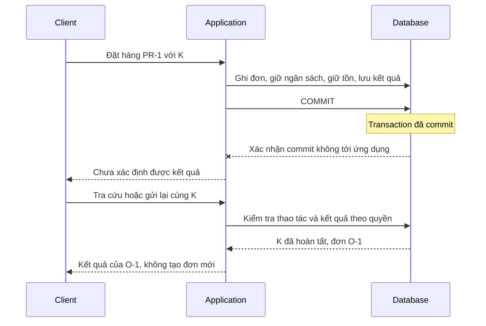

# Database failure scenario — Kiểm thử lỗi cơ sở dữ liệu trong logic nghiệp vụ

## 1. Mục tiêu và phạm vi

Database không chỉ lưu dữ liệu để hiển thị. Nó có thể là nơi quyết định ai được thao tác trên đối tượng nào, hồ sơ đã được duyệt chưa, hạn mức còn bao nhiêu và một giao dịch đã thực hiện hay chưa. Khi database lỗi, một đường dự phòng sai có thể biến sự cố vận hành thành lỗ hổng logic nghiệp vụ.

Ví dụ hệ thống không đọc được phê duyệt nhưng vẫn cho đặt hàng, không tra cứu được khóa idempotency nên tạo giao dịch mới, hoặc báo thanh toán thất bại dù hiệu lực đã được ghi nhận. Những tình huống này cần được kiểm thử bằng trạng thái nghiệp vụ, không chỉ bằng việc ứng dụng có bắt được exception.

**Database failure scenario** là kịch bản chủ động tạo lỗi tại một ranh giới liên quan đến database, rồi kiểm chứng hệ thống vẫn giữ quy tắc, công bố kết quả đúng mức chắc chắn và có đường phục hồi phù hợp.

Bài học thuộc module `SECURITY_APPLICATION_SECURITY_BUSINESS_LOGIC_SECURITY`, tập trung vào business invariants, state machine, quyền theo đối tượng, transaction, idempotency và kiểm thử lạm dụng logic khi có lỗi. Các thao tác gây lỗi trong bài chỉ được mô tả cho môi trường kiểm thử được kiểm soát.

Sau bài học, bạn có thể:

- Phân biệt chưa thực hiện, rollback đã xác nhận, commit thành công và kết quả chưa xác định.
- Thiết kế kịch bản lỗi trước, trong và sau transaction.
- Ngăn lỗi đọc quyền, trạng thái hoặc hạn mức trở thành đường cho phép mặc định.
- Kiểm chứng retry không tạo hiệu lực trùng hoặc bỏ qua phê duyệt.
- Quan sát dữ liệu đã commit, outbox và hiệu lực ngoài hệ thống để kết luận chính xác.

## 2. Phân loại kết quả trước khi thiết kế phục hồi

Không phải mọi lỗi database đều có nghĩa “không có thay đổi nào”. Cần phân biệt trạng thái thực tế với điều mà ứng dụng hoặc client hiện biết.

| Tình huống | Mức chắc chắn | Hướng xử lý nghiệp vụ |
| --- | --- | --- |
| Không lấy được kết nối trước khi gửi lệnh | Có thể xác định chưa gửi phần công việc đó | Không tự bỏ kiểm tra; phản hồi lỗi phù hợp và retry theo hợp đồng |
| Transaction bị rollback và kết quả rollback được xác nhận | Có bằng chứng phần thay đổi trong transaction không được commit | Có thể đánh giá một lần thực hiện lại an toàn nếu không có hiệu lực ngoài chưa rõ |
| Database xác nhận commit thành công | Biết thay đổi đã được chấp nhận theo bảo đảm độ bền của hệ thống | Không thực hiện lại như thao tác mới |
| Mất kết nối trong lúc commit hoặc mất phản hồi commit | Chưa chắc transaction đã commit hay chưa | Giữ trạng thái chưa xác định, tra cứu hoặc retry cùng danh tính theo cơ chế an toàn |
| Database commit xong nhưng phản hồi HTTP bị mất | Server có thể đã hoàn tất, client chưa biết | Khôi phục kết quả thao tác cũ, không tạo hiệu lực mới |

Timeout của một truy vấn hoặc yêu cầu hủy không luôn chứng minh toàn bộ transaction đã rollback. Cần căn cứ vào hành vi của database, driver và trạng thái transaction được xác nhận trong triển khai cụ thể.

Tương tự, mã lỗi gửi về client không đủ làm bằng chứng. Một phản hồi lỗi có thể xuất hiện sau commit; một phản hồi thành công được tạo trước commit có thể chưa bao giờ trở thành kết quả bền vững.

## 3. Ví dụ nghiệp vụ và các bất biến cần giữ

Giả sử hệ thống đặt hàng từ hồ sơ mua hàng đã được duyệt. Trong ví dụ thuần database này, tạo đơn, giữ ngân sách, giữ tồn kho, lưu kết quả thao tác và ghi outbox được thực hiện trong cùng một transaction.

Fixture ban đầu:

- Hồ sơ `PR-1`, revision 7, được duyệt hợp lệ cho đúng nội dung hiện tại.
- Người gọi có quyền đặt hàng trên hồ sơ trong tổ chức A.
- Số lượng cần đặt là 2, tổng tiền đã được server xác minh là `300000 VND`.
- Ngân sách khả dụng là `1000000 VND`, chưa có phần giữ cho thao tác này.
- Tồn khả dụng là 10 đơn vị, chưa có phần giữ cho thao tác này.
- Chưa có đơn hàng tương ứng; chính sách minh họa chỉ cho một đơn từ `PR-1`.

Các bất biến:

1. Chỉ nội dung đáp ứng điều kiện phê duyệt và quyền theo đối tượng mới được đặt hàng.
2. Ngân sách và tồn kho không bị cấp vượt.
3. Hồ sơ không tạo hai đơn do retry hoặc cạnh tranh.
4. Các thay đổi trong transaction nhất quán: không có đơn đã ghi mà thiếu phần giữ bắt buộc, hoặc phần giữ mồ côi do rollback không đầy đủ.
5. Kết quả thao tác được lưu phải tương ứng với hiệu lực nghiệp vụ thực tế.
6. Sự kiện đặt hàng không được công bố như một việc đã hoàn tất nếu transaction liên quan chưa commit.

Trạng thái mong đợi khi hoàn tất một lần:

| Dữ liệu | Ban đầu | Sau thành công |
| --- | --- | --- |
| Số đơn từ PR-1 | 0 | 1 |
| Ngân sách khả dụng | 1000000 VND | 700000 VND |
| Ngân sách giữ cho thao tác | 0 | 300000 VND |
| Tồn khả dụng | 10 | 8 |
| Tồn giữ cho thao tác | 0 | 2 |
| Kết quả thành công của thao tác | Chưa có | Gắn với đúng đơn hàng |
| Sự kiện logic đặt hàng trong outbox | 0 | 1 |

Nếu lỗi xảy ra trước commit và toàn bộ transaction đã rollback, các thay đổi nghiệp vụ của lần thực hiện này phải trở về trạng thái ban đầu. Log lỗi hoặc dấu vết thử lại có thể tồn tại hợp lệ theo thiết kế; không yêu cầu mọi dữ liệu vận hành đều bất biến.

## 4. Ma trận điểm lỗi cần kiểm thử

Thay vì chỉ tắt database rồi gọi một API, hãy chọn các điểm có ý nghĩa đối với quyết định và hiệu lực nghiệp vụ.

| Điểm gây lỗi | Rủi ro logic | Bằng chứng cần kiểm tra |
| --- | --- | --- |
| Lấy kết nối hoặc bắt đầu transaction | Ứng dụng đi vào đường dự phòng bỏ kiểm tra | Không tạo hiệu lực, không cấp quyền mặc định |
| Đọc quyền hoặc phạm vi đối tượng | Không đọc được bị hiểu thành được phép | Không đọc hoặc sửa vượt quyền |
| Đọc trạng thái, revision hoặc giá | Dùng giá trị client hoặc dữ liệu cũ thiếu kiểm soát | Không bỏ qua phê duyệt và xác minh giá |
| Sau khi giữ ngân sách, trước khi ghi đơn | Phần giữ bị bỏ lại nếu xử lý không nguyên tử | Không có phần giữ mồ côi sau rollback |
| Sau ghi đơn, trước giữ tồn hoặc ghi outbox | Đơn dở dang, sự kiện thiếu hoặc phát sai | Các bản ghi cùng transaction nhất quán |
| Trong lúc commit | Kết quả không xác định dẫn tới thực hiện lại | Tra cứu hoặc retry không tạo thêm hiệu lực |
| Sau commit, trước trả kết quả | Client nghĩ chưa làm và gửi lại | Nhận diện thao tác cũ, trả kết quả theo quyền |
| Khi worker đọc hoặc đánh dấu outbox | Giao thiếu hoặc giao lặp thông điệp | Không mất sự kiện logic, consumer không cộng lặp sai |
| Khi đọc dữ liệu sau chuyển đổi máy chủ | Dữ liệu cũ hoặc thiếu làm kết luận sai | Quan sát theo nguồn có thẩm quyền và bảo đảm failover đã cam kết |

Mỗi điểm lỗi cần một kỳ vọng riêng. Không dùng duy nhất câu “trả lỗi và không có thay đổi” cho cả lỗi trước commit lẫn lỗi mất phản hồi sau commit.

## 5. Kịch bản rollback trước commit

### 5.1. Tạo lỗi sau một phần ghi

Với fixture ở trên, cho transaction giữ `300000 VND`, sau đó tạo lỗi có kiểm soát trước khi hoàn tất và commit. Cấu trúc kiểm thử có thể mô tả bằng giả mã:

```text
given:
  PR-1 đủ điều kiện đặt hàng
  ngân sách 1000000 VND, tồn khả dụng 10
  K là định danh ổn định của thao tác đặt hàng

when:
  bắt đầu transaction
  giữ ngân sách cho K
  gây lỗi tại điểm kiểm thử trước commit
  chờ kết quả rollback được xác nhận

then:
  không có đơn hàng từ lần thực hiện này
  ngân sách khả dụng vẫn là 1000000 VND
  không còn phần giữ ngân sách hoặc tồn của lần này
  không có kết quả thành công hoặc sự kiện đặt hàng đã commit cho K
  không có tác động ngoài transaction bị che giấu
```

Đọc lại bằng một ngữ cảnh quan sát phù hợp sau khi transaction kết thúc. Nếu test chỉ kiểm tra đối tượng đang nằm trong bộ nhớ, nó có thể thấy giá trị đã đổi dù database đã rollback, hoặc không thấy dữ liệu thực sự đã commit.

### 5.2. Kiểm tra đường phục hồi

Sau khi bỏ điểm gây lỗi, thực hiện lại theo hợp đồng với cùng danh tính thao tác và nội dung không đổi. Với fixture vẫn hợp lệ, hệ thống phải có thể hoàn tất đúng một lần.

Đối chứng này phát hiện cách chống trùng sai: ghi một cờ “đã xử lý” ngoài transaction trước khi làm nghiệp vụ, rồi sau lỗi luôn bỏ qua retry. Cách đó tránh tạo trùng bằng cách làm mất thao tác hợp lệ.

Không giả định mọi thiết kế đều phải xóa bản ghi tiếp nhận sau lỗi. Một hệ thống có thể lưu trạng thái đang xử lý hoặc cần phục hồi bên ngoài transaction nghiệp vụ; khi đó test phải kiểm chứng vòng đời và đường tiếp tục được đặc tả, thay vì áp snapshot của ví dụ một transaction lên mọi kiến trúc.

## 6. Kịch bản mất phản hồi commit: kết quả chưa xác định

Đây là ranh giới dễ tạo giao dịch trùng. Database có thể đã commit trong khi ứng dụng nhận lỗi kết nối hoặc không nhận được xác nhận.



Để kiểm thử đúng tình huống này, cần tạo được bằng chứng commit đã xảy ra rồi làm mất xác nhận hoặc phản hồi tương ứng. Ném exception trước khi gọi commit chỉ kiểm thử rollback, không đại diện cho commit thành công nhưng mất xác nhận.

Các kỳ vọng quan trọng:

- Ứng dụng không tuyên bố chắc chắn “không có thay đổi” khi chưa có bằng chứng.
- Không tạo danh tính thao tác mới chỉ vì kết nối cũ lỗi.
- Khi nguồn dữ liệu có thẩm quyền xác nhận kết quả, mọi lần phát lại được phép đều trỏ tới cùng hiệu lực.
- Kết quả chỉ được công bố cho chủ thể có quyền xem.

Không thấy bản ghi trong một lần đọc không luôn chứng minh transaction cũ chưa commit. Transaction có thể chưa kết thúc hoặc nơi đọc có thể đang chậm hơn nguồn ghi. Cơ chế đăng ký thao tác, ràng buộc nghiệp vụ và quy trình đối soát phải xử lý được khoảng chưa rõ đó.

## 7. Lỗi database không được trở thành quyền cho phép mặc định

### 7.1. Không đọc được khác với không có ràng buộc

Một đoạn suy luận nguy hiểm:

```text
Không đọc được người duyệt được phân công
  -> coi như không cần người duyệt
  -> cho phép đặt hàng
```

Lỗi hạ tầng không phải bằng chứng người gọi có quyền hoặc hồ sơ đã được duyệt. Với hành động cần quyết định bảo mật đáng tin cậy, hệ thống phải giữ việc thực thi trong phạm vi có thể xác minh theo chính sách.

Nếu thiết kế có dùng snapshot quyền hoặc chính sách lưu sẵn khi mất kết nối, cần quy định trước loại hành động, phạm vi, thời hạn và giới hạn rủi ro. Test phải kiểm tra đúng chính sách đó, không tự cấm mọi dữ liệu cache nhưng cũng không coi cache bất kỳ là nguồn cấp quyền hợp lệ.

### 7.2. Các biến thể cần thử

- Database lỗi khi đọc quyền trên đúng đối tượng, trong khi người gọi có một vai trò chung.
- Không đọc được revision đã duyệt, nhưng client gửi `approved=true` hoặc ID phê duyệt cũ.
- Lỗi đọc báo giá, client gửi lại giá thấp trong payload.
- Không đọc được hạn mức, đường dự phòng lấy mặc định rất lớn.
- Tra cứu khóa idempotency lỗi, ứng dụng coi như khóa chưa từng tồn tại.
- Lỗi đọc phạm vi tổ chức, truy vấn dự phòng bỏ điều kiện tenant.

Kỳ vọng là không có hiệu lực trái quyền hoặc trái bất biến. Thông báo công khai có thể nói thao tác tạm thời chưa thực hiện được; không cần tiết lộ chi tiết quyền, SQL hay dữ liệu của đối tượng ngoài phạm vi.

### 7.3. Đừng biến lỗi hạ tầng thành kết luận sai về người dùng

Không đọc được chính sách cũng không tự chứng minh người dùng thực sự bị cấm. Cần phân biệt quyết định từ chối nghiệp vụ với việc tạm thời không thể đánh giá. Sự phân biệt này giúp UX, retry và vận hành xử lý đúng mà vẫn không cho phép hành động chưa được xác minh.

## 8. Retry, idempotency và kiểm tra lại điều kiện

### 8.1. Chỉ retry theo mức chắc chắn phù hợp

Một deadlock hoặc xung đột tuần tự hóa có thể được xử lý bằng việc chạy lại transaction nếu triển khai đã xác định phần cũ rollback và không có hiệu lực ngoài cần giải quyết. Lỗi kết nối trong lúc commit cần cách xử lý khác vì kết quả có thể chưa rõ.

Chính sách retry cần giới hạn số lần, khoảng chờ và thời hạn tổng. Khi nhiều request cùng gặp lỗi database, retry không kiểm soát có thể tạo một đợt tải mới làm hệ thống khó phục hồi hơn.

### 8.2. Giữ danh tính và ràng buộc nội dung

Với cùng thao tác, retry phải dùng danh tính ổn định theo hợp đồng. Nếu khóa đã gắn với lệnh đặt hàng PR-1, không được dùng lại khóa đó để thay số tiền, đối tượng hoặc người nhận.

Trong lúc retry, quyền, giá, hạn mức và trạng thái có thể đã thay đổi. Đối với một lần thực thi mới chưa có hiệu lực, server phải đánh giá lại các điều kiện hiện tại theo chính sách, đồng thời bảo đảm nội dung không bị đổi âm thầm ngoài ý định đã xác nhận.

Đối với thao tác đã hoàn tất, đường phát lại trả kết quả cũ được phép xem, không tính lại giá rồi thực hiện thêm lần nữa. Hai đường này cần được phân biệt rõ trong test.

### 8.3. Không coi vi phạm ràng buộc duy nhất là thành công một cách mù quáng

Một xung đột khóa có thể cho thấy thao tác đã tồn tại, nhưng chưa đủ kết luận nội dung giống nhau hoặc người gọi được quyền xem kết quả. Cần kiểm tra danh tính, nội dung đã ràng buộc, trạng thái và quyền theo hợp đồng.

Thử cả hai request đồng thời cùng khóa và hai khóa khác nhau cùng nhắm tới PR-1. Idempotency bảo vệ thao tác đã định danh; ràng buộc nghiệp vụ trên hồ sơ còn phải ngăn tạo thêm đơn bằng cách đổi khóa.

## 9. Hiệu lực ngoài database: rollback cục bộ chưa đủ

Giả sử ứng dụng gọi dịch vụ thanh toán, dịch vụ đã thu tiền, rồi database lỗi khi lưu kết quả. Database rollback không tự hoàn tác khoản thu bên ngoài.

Một kịch bản cần kiểm thử:

```text
dịch vụ ngoài tạo hiệu lực cho externalOperationId E
  -> ghi kết quả nội bộ thất bại
  -> worker hoặc client thử lại
  -> hệ thống phải nhận diện, tra cứu hoặc đối soát E
```

Nếu dịch vụ ngoài hỗ trợ khử trùng theo định danh, cần kiểm tra ứng dụng tiếp tục dùng đúng định danh và tuân thủ cửa sổ bảo đảm của dịch vụ đó. Nếu có thể tra cứu, test cần mô phỏng cả kết quả đã xảy ra và kết quả chưa xác định.

Nếu thiết kế dùng bù trừ, bù trừ là một thao tác nghiệp vụ khác cũng có thể lỗi hoặc bị gửi lại. Kiểm tra quyền, trạng thái và idempotency của bước bù, thay vì mặc định một lần gọi hoàn tác luôn thành công.

Không khẳng định chống tạo hiệu lực trùng tuyệt đối chỉ từ một database nội bộ khi ranh giới ngoài không có cơ chế tương ứng. Kết luận của test phải giới hạn theo bảo đảm thực tế mà thiết kế và môi trường tích hợp cung cấp.

Với ví dụ đặt hàng thuần database ở đầu bài, chưa có khoản thu bên ngoài. Khi thêm thanh toán vào luồng, cần mở rộng bất biến và oracle, không tiếp tục dùng kỳ vọng “rollback là không có bất cứ hiệu lực nào” cho toàn hệ thống.

## 10. Outbox và lỗi trong quá trình phát sự kiện

Ghi sự kiện cần phát vào outbox cùng transaction nghiệp vụ có thể giúp tránh tình trạng đơn đã commit nhưng thông tin để phát sự kiện chưa được lưu. Tuy nhiên, outbox không tự làm mọi lần giao thông điệp chỉ xảy ra một lần.

Các tình huống nên kiểm thử:

1. Transaction tạo đơn rollback: không có sự kiện đặt hàng đã commit của transaction đó.
2. Đơn và outbox commit, worker chưa chạy: sau phục hồi, sự kiện vẫn có thể được xử lý.
3. Worker gửi thành công nhưng database lỗi khi đánh dấu đã gửi: lần gửi lại không làm consumer cộng lặp hiệu lực nghiệp vụ.
4. Hai worker cạnh tranh nhận cùng công việc: cơ chế phân công và consumer giữ đúng bất biến.
5. Database lỗi khi consumer lưu cả hiệu lực và bằng chứng đã xử lý: phục hồi không bỏ mất hoặc áp dụng hai lần sai hợp đồng.

Phân biệt số sự kiện logic, số lần giao và số hiệu lực phía nhận. Có thể có nhiều lần giao cùng sự kiện, nhưng số đơn hoặc khoản giữ liên quan phải đúng.

Quan sát sau một điểm kết thúc có ý nghĩa: các thao tác và thông điệp liên quan đã hoàn tất trong môi trường test. Một phép kiểm tra “chưa có thông báo trùng” ngay sau phản hồi API không đủ nếu worker vẫn còn chạy.

## 11. Thiết kế cơ chế gây lỗi có kiểm soát

### 11.1. Điểm lỗi trong ứng dụng

Điểm điều khiển dành riêng cho test có thể ném lỗi sau một bước ghi hoặc giữ transaction tại một mốc để tạo cạnh tranh. Cách này hữu ích để tái hiện rollback và lịch xử lý cụ thể.

Nó không tự đại diện cho lỗi mạng hoặc mất xác nhận commit thật. Ghi rõ mỗi điểm điều khiển mô phỏng điều gì, đồng thời tránh thay đổi quyết định nghiệp vụ hay bỏ qua cơ chế bảo vệ để ép kết quả.

### 11.2. Lỗi ở kết nối và thành phần dữ liệu

Trong môi trường test phù hợp, có thể mô phỏng từ chối kết nối, độ trễ, mất kết nối, kết nối cũ trong pool, gián đoạn tiến trình hoặc chuyển đổi máy chủ. Chọn cơ chế tương ứng với ranh giới cần kiểm chứng, có đường phục hồi và giới hạn thời gian.

Không cần bắt đầu bằng nhiều lỗi cùng lúc. Một điểm lỗi xác định với oracle tốt thường giúp chẩn đoán rõ hơn một lần làm mọi thành phần đều không sẵn sàng.

### 11.3. Ranh giới bảo vệ của bộ test

- Fixture và các tác động ngoài phải được cô lập theo lần chạy.
- Điểm gây lỗi chỉ hoạt động trong môi trường kiểm thử thích hợp.
- Mọi điểm chờ cần có thời hạn và đường giải phóng khi test thất bại.
- Thời hạn client không thay thế thời hạn câu lệnh database hoặc khả năng dừng tác vụ từ xa.
- Không dọn dữ liệu khi request, transaction hoặc worker cũ vẫn có thể tiếp tục ghi vào đó.

Việc hủy một tác vụ ở máy chạy test không chứng minh database đã rollback. Khi hết thời hạn, cần giữ kết quả ở trạng thái chưa kết luận cho tới khi có bằng chứng phù hợp.

## 12. Oracle: kiểm chứng trạng thái và hiệu lực thực tế

| Lớp quan sát | Điều cần kiểm tra |
| --- | --- |
| Phản hồi công khai | Mức chắc chắn đúng, không lộ SQL, token hoặc dữ liệu ngoài quyền |
| Đối tượng nghiệp vụ | Trạng thái, revision và đơn hàng phù hợp quy tắc |
| Ngân sách và tồn kho | Phần khả dụng, phần giữ và lịch sử khớp nhau |
| Thao tác đã định danh | Nội dung không bị đổi, kết quả trỏ tới đúng hiệu lực |
| Outbox và consumer | Không mất sự kiện cần thiết hoặc cộng lặp sai |
| Dịch vụ ngoài | Số hiệu lực thực tế đúng trong phạm vi hợp đồng |
| Kiểm toán | Có dấu vết cần thiết, không ghi bí mật |

### 12.1. Dùng kỳ vọng độc lập

Với fixture PR-1, tính kỳ vọng từ số tiền `300000 VND` và số lượng 2 đã xác định. Không gọi lại cùng đoạn mã production giữ ngân sách để tính “ngân sách mong đợi”. Lỗi giống nhau ở hai phía có thể làm test vượt qua sai.

Kiểm tra cả tổng hợp lẫn định danh. Số dư đúng không loại trừ khả năng có hai khoản giữ rồi một bút toán bù không hợp lệ; một dòng kết quả thao tác cũng không chứng minh ngoài hệ thống chỉ có một hiệu lực.

### 12.2. Đọc từ nguồn phù hợp

Sau lỗi commit hoặc failover, không lấy một lần đọc từ cache hoặc bản sao đang chậm làm bằng chứng chắc chắn transaction không tồn tại. Cần hiểu nguồn quan sát, mức nhất quán và thời điểm transaction đã kết thúc.

Một test chạy trong transaction bao ngoài có thể che commit thật hoặc giữ snapshot cũ. Với integration test, commit fixture trước, để request có ranh giới transaction thực tế và đọc lại bằng ngữ cảnh mới khi cần.

### 12.3. Kiểm tra khả năng tiến triển

Không tạo trùng chưa đủ. Sau khi database phục hồi và tiền điều kiện vẫn hợp lệ, thao tác cần có thể hoàn tất hoặc đi tới kết quả cuối rõ ràng theo hợp đồng. Một bản ghi đang xử lý bị mắc kẹt mãi là vấn đề cần phát hiện, kể cả chưa vi phạm bất biến số lượng.

## 13. Kết hợp lỗi với cạnh tranh và chuyển đổi máy chủ

### 13.1. Request cũ chưa rõ, request mới đã tới

Giữ transaction đầu ở ranh giới commit hoặc làm mất xác nhận, rồi cho một request phát lại cùng danh tính tới instance khác. Kiểm tra cơ chế xử lý không cho cả hai cùng tạo đơn hoặc giữ ngân sách hai lần.

Thử thêm hai khóa khác nhau trên cùng PR-1 để kiểm chứng ràng buộc nghiệp vụ không phụ thuộc hoàn toàn vào khóa retry.

### 13.2. Phục hồi worker và chủ sở hữu cũ

Database lỗi có thể khiến worker mất lease hoặc không gia hạn được quyền xử lý. Worker khác tiếp quản, trong khi worker cũ vẫn có thể tỉnh lại và tiếp tục.

Test cần kiểm tra chủ sở hữu cũ không tạo thêm hiệu lực sau khi quyền xử lý đã chuyển theo hợp đồng. Lease hết hạn không tự chứng minh tiến trình cũ ngừng chạy. Cơ chế cập nhật có điều kiện, phiên xử lý hoặc kiểm soát tại nơi tạo hiệu lực phải được kiểm chứng ở ranh giới thích hợp.

### 13.3. Bảo đảm độ bền khi failover

Nếu hệ thống cam kết giữ các transaction đã xác nhận thành công qua loại failover được hỗ trợ, test cần ghi nhận các transaction đó trước sự cố rồi kiểm tra sau chuyển đổi. Kiểm tra cả dữ liệu nghiệp vụ và bằng chứng chống trùng liên quan.

Nếu cấu hình có thể làm mất một phần ghi đã xác nhận trong một loại sự cố, phải nêu giới hạn đó khi đánh giá idempotency. Một hiệu lực ngoài có thể vẫn còn trong khi bản ghi chống trùng nội bộ mất; không được suy ra an toàn chỉ vì database mới không thấy thao tác.

Không mở rộng kết luận vượt loại sự cố và cấu hình đã kiểm thử. Việc một kết nối mới hoạt động trở lại không tự chứng minh dữ liệu, quyền và kết quả thao tác đã nhất quán.

## 14. UX, thông báo lỗi và khả năng điều tra

Thông báo cần phản ánh điều đã biết:

| Bằng chứng hiện có | Thông báo minh họa |
| --- | --- |
| Chưa tiếp nhận được thao tác | “Tạm thời chưa thể gửi yêu cầu. Hãy thử lại sau.” |
| Đã xác nhận không commit và không có hiệu lực ngoài | “Yêu cầu chưa được hoàn tất. Bạn có thể thử lại.” |
| Kết quả chưa xác định | “Chưa xác định được kết quả. Hệ thống đang kiểm tra thao tác đã gửi.” |
| Đã khôi phục kết quả cũ | “Yêu cầu đã hoàn tất trước đó. Đây là kết quả của thao tác đó.” |

Chỉ dùng các câu khẳng định khi hệ thống thật sự có bằng chứng tương ứng. Có thể cung cấp mã theo dõi và đường tra cứu, nhưng mã không thay thế kiểm tra quyền. Nếu người dùng đã mất quyền xem, đường khôi phục vẫn phải giữ chính sách công bố dữ liệu.

Giữ bản nháp hoặc dữ liệu nhập theo độ nhạy cảm và chính sách lưu. Không phục hồi giá, vai trò hay trạng thái phê duyệt bằng cách tin lại payload cũ.

Thông tin điều tra nên có mã thao tác, điểm lỗi, trạng thái transaction được biết, số lần retry và định danh hiệu lực liên quan. Không đưa stack trace, câu SQL chứa dữ liệu riêng tư, thông tin kết nối hoặc token vào phản hồi và báo cáo không được bảo vệ.

Nhân viên hỗ trợ cần xác minh kết quả theo nguồn phù hợp, không bấm “thực hiện lại” chỉ vì client báo lỗi. Nếu có thao tác sửa chữa, nó phải có quyền riêng, phạm vi rõ ràng và dấu vết kiểm toán, đồng thời giữ các bất biến nghiệp vụ.

## 15. Tổ chức bộ kiểm thử và tiêu chí kết luận

Chọn lớp kiểm thử theo bằng chứng cần có:

- Unit hoặc domain test cho quy tắc khi dữ liệu cần thiết không sẵn sàng và cách phân loại kết quả.
- Integration test với database phù hợp cho rollback, commit, ràng buộc và cạnh tranh.
- API test cho retry, quyền tra cứu và thông báo công khai.
- Kiểm thử tích hợp ngoài cho hiệu lực đã xảy ra nhưng kết quả nội bộ chưa lưu được.
- Các kịch bản phục hồi hoặc failover chọn lọc cho bảo đảm độ bền đã cam kết.

Mock exception hữu ích để kiểm tra nhánh xử lý, nhưng không chứng minh database thật đã rollback hoặc tình huống mất xác nhận commit được xử lý đúng. Một số ranh giới cần integration test có kiểm soát trực tiếp hơn.

Với mỗi ca, báo rõ một trong các kết luận:

1. **Đạt:** bất biến được giữ, kết quả đã xác định và phục hồi đúng hợp đồng.
2. **Lỗi nghiệp vụ hoặc bảo mật:** có hiệu lực trái quyền, trái trạng thái, tạo trùng hoặc dữ liệu không nhất quán.
3. **Chưa kết luận:** thao tác còn treo, nguồn quan sát chưa đủ hoặc môi trường không tạo đúng điểm lỗi cần kiểm tra.

Không chuyển ca chưa kết luận thành đạt chỉ vì chưa nhìn thấy hiệu lực xấu. Khi phát hiện lỗi thực, giữ ca tái hiện nhỏ với điểm lỗi và kỳ vọng rõ ràng; sau khi sửa, chạy lại cả ca hồi quy và đối chứng hợp lệ.

Kiểm thử khả năng phục hồi cũng cần ngưỡng thời gian, số lần retry và số thao tác còn chưa xác định theo yêu cầu dự án. Các ngưỡng vận hành không thay thế bất biến nghiêm ngặt về quyền và số hiệu lực.

## 16. Danh sách kiểm tra cho database failure scenario

- Đã xác định điểm lỗi nằm trước commit, trong lúc commit hay sau commit.
- Đã phân biệt chưa thực hiện, rollback xác nhận, thành công và kết quả chưa rõ.
- Đã có fixture và đối chứng hợp lệ cho cùng hành động khi không gây lỗi.
- Đã viết bất biến về quyền, revision, giá, hạn mức và số hiệu lực liên quan.
- Đã kiểm tra lỗi đọc dữ liệu không mở đường cho phép mặc định ngoài chính sách.
- Đã đọc dữ liệu thực sự đã commit bằng nguồn và ngữ cảnh phù hợp.
- Đã kiểm tra retry giữ danh tính và không đổi nội dung đã ràng buộc.
- Đã thử phát lại cùng khóa và đổi khóa trên cùng quyền nghiệp vụ.
- Đã quan sát outbox, consumer và dịch vụ ngoài khi chúng tham gia hiệu lực.
- Đã kiểm tra phục hồi có thể hoàn tất công việc, không chỉ tránh tạo trùng.
- Đã xác định thời hạn, đường giải phóng điểm lỗi và cách xử lý tác vụ còn chạy.
- Đã giữ bằng chứng tái hiện mà không làm lộ dữ liệu hoặc thông tin xác thực.

Database failure testing đạt giá trị khi nó chứng minh sự cố lưu trữ không biến thành quyền bổ sung, giao dịch trùng hoặc trạng thái nghiệp vụ sai. Kết luận phải dựa trên mức chắc chắn của transaction, dữ liệu đã commit và các hiệu lực thực tế trong toàn bộ luồng xử lý.
