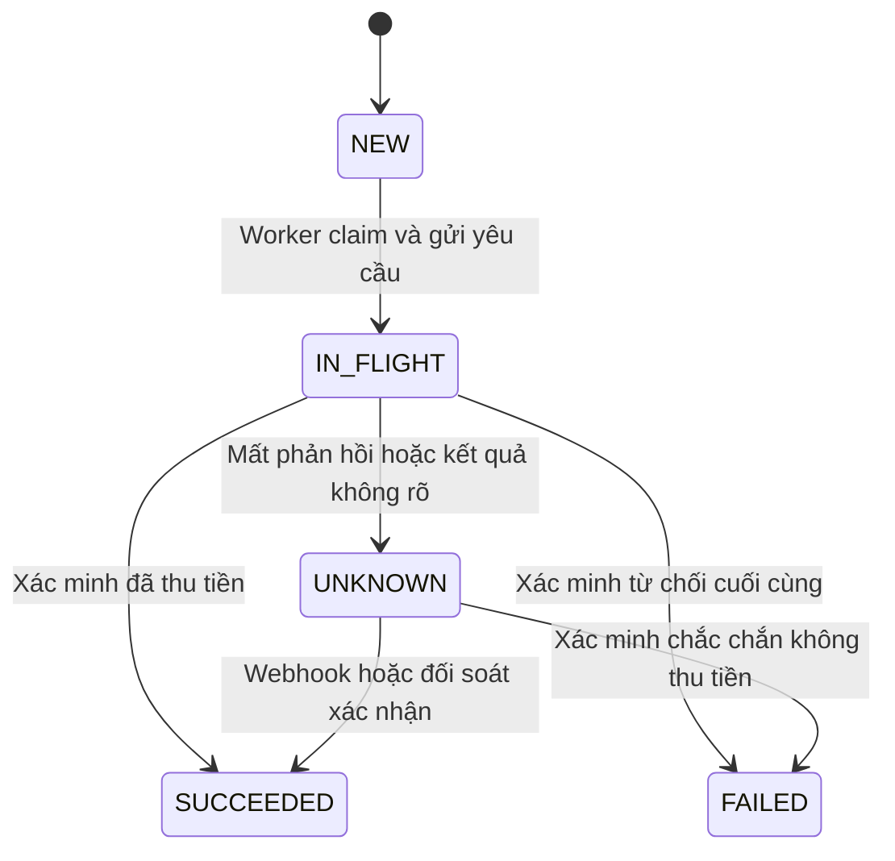

# Payment provider failure

## 1. Mục tiêu của bài học

Trong chương **Failure Testing**, lỗi nhà cung cấp thanh toán là một phép thử quan trọng đối với bảo mật logic nghiệp vụ. Một ứng dụng có thể kiểm tra dữ liệu đầu vào đúng, xác thực người dùng đầy đủ, nhưng vẫn thu tiền hai lần hoặc giao hàng khi chưa nhận tiền nếu xử lý sai timeout, retry và thông báo bất đồng bộ.

Bài học này tập trung vào việc giữ đúng các quy tắc nghiệp vụ khi nhà cung cấp thanh toán chậm, mất kết nối, trả kết quả không rõ ràng hoặc gửi sự kiện nhiều lần. Sau bài học, bạn có thể:

- Phân biệt lỗi truyền thông với kết quả nghiệp vụ của giao dịch.
- Thiết kế trạng thái thanh toán và những điều kiện bắt buộc trước khi chuyển trạng thái.
- Kết hợp transaction, idempotency, phân quyền theo đối tượng và đối soát.
- Xây dựng kịch bản kiểm thử lỗi có thể làm lộ lỗ hổng thu tiền, hoàn tiền và giao hàng.

Ví dụ xuyên suốt là một đơn hàng trị giá **500.000 VND**. Máy chủ tính số tiền từ dữ liệu đơn hàng đã chốt; trình duyệt không được tự quyết định giá. Hệ thống dùng mô hình thu tiền ngay, vì vậy `SUCCEEDED` trong bài có nghĩa là nhà cung cấp đã xác nhận **thu tiền thành công**. Nếu sản phẩm dùng hai bước authorization/capture, cần có các trạng thái riêng; giữ chỗ tiền chưa đủ để thỏa mãn điều kiện đã thu tiền.

## 2. Timeout không chứng minh thanh toán thất bại

Xét chuỗi sự kiện sau:

1. Máy chủ tạo yêu cầu thu 500.000 VND.
2. Nhà cung cấp nhận yêu cầu và thu tiền thành công.
3. Phản hồi về máy chủ bị mất trên đường truyền.
4. Máy chủ nhận timeout; người dùng bấm “Thanh toán lại”.

Nếu lần bấm sau tạo một yêu cầu thu tiền độc lập, khách hàng có thể bị trừ tổng cộng 1.000.000 VND. Kẻ tấn công cũng có thể chủ động khai thác khoảng không chắc chắn này bằng cách gửi đồng thời nhiều yêu cầu, phát lại thao tác hoặc cố ý ngắt kết nối phía trình duyệt.

Timeout chỉ cho biết bên gọi chưa nhận được câu trả lời trong thời hạn. Nó không cho biết nhà cung cấp đã nhận yêu cầu hay chưa, đã xử lý hay chưa, và có gửi phản hồi thành công hay không.

| Hiện tượng quan sát được | Điều có thể kết luận | Hướng xử lý nghiệp vụ |
| --- | --- | --- |
| Bị từ chối bởi kiểm tra nội bộ trước khi gửi | Chưa gửi thao tác thu tiền trong luồng này | Sửa điều kiện đầu vào; không cần suy đoán kết quả từ nhà cung cấp |
| Nhà cung cấp xác nhận từ chối cuối cùng và không thu tiền | Attempt đó thất bại dứt khoát theo hợp đồng tích hợp | Ghi `FAILED`; cân nhắc attempt mới nếu đơn còn đủ điều kiện |
| Timeout, mất kết nối hoặc phản hồi hỏng sau khi có thể đã gửi | Chưa biết kết quả | Giữ `UNKNOWN`, tra cứu hoặc retry an toàn bằng cùng định danh |
| HTTP 5xx hoặc 429 | Chỉ biết trạng thái phản hồi HTTP | Dựa vào hợp đồng của nhà cung cấp; nếu có khả năng đã xử lý thì chưa được kết luận thất bại |
| Nhà cung cấp báo đang xử lý | Chưa có kết quả cuối cùng | Giữ trạng thái đang xử lý; chờ webhook hoặc đối soát |
| Webhook có chữ ký sai | Không thể tin nội dung thông báo | Không áp dụng chuyển trạng thái; kết quả thanh toán thực vẫn cần xác minh |
| Trang redirect của trình duyệt hiển thị thành công | Người dùng đã đi qua một luồng giao diện | Máy chủ vẫn phải xác minh bằng dữ liệu đáng tin cậy |

Đừng dùng quy tắc tổng quát “mọi mã khác 2xx đều thất bại”. Ngay cả phản hồi 2xx cũng có thể chỉ xác nhận tiếp nhận yêu cầu, trong khi trạng thái nghiệp vụ bên trong vẫn là pending.

## 3. Những business invariants phải giữ được

Trước khi tiêm lỗi, hãy viết các điều kiện có thể kiểm chứng. Với mô hình một đơn được thanh toán toàn bộ bằng một lần thu tiền, các invariant chính là:

1. **Số tiền và tiền tệ có nguồn đáng tin cậy.** Amount lấy từ snapshot giá đã chốt trên máy chủ và được biểu diễn bằng số nguyên theo đơn vị tiền tệ nhỏ nhất mà tích hợp quy định. Không dùng số thực dấu phẩy động cho phép tính tiền.
2. **Một đơn không tạo ra nhiều lần thu tiền độc lập khi kết quả lần trước còn chưa rõ.** Hai lần bấm, hai tab hoặc hai worker không được mở hai attempt đang hoạt động cho cùng nghĩa vụ thanh toán.
3. **Chỉ ghi nhận đã thanh toán sau xác nhận thu tiền đáng tin cậy.** Định danh merchant, môi trường, giao dịch, đơn hàng, amount và currency phải khớp.
4. **Một giao dịch thu tiền chỉ được hạch toán một lần và gắn với đúng đơn.** Không dùng cùng một `provider_payment_id` để trả tiền cho hai đơn khác nhau.
5. **Giao hàng hoặc cấp quyền sử dụng chỉ được tạo một lần khi đủ điều kiện.** Webhook trùng không được tạo thêm kiện hàng, mã bản quyền hoặc số dư ví.
6. **Quyền truy cập luôn gắn với đối tượng.** Người dùng chỉ xem hoặc thao tác thanh toán của đơn mình có quyền truy cập; biết `order_id`, `attempt_id` hay idempotency key không tạo ra quyền đó.
7. **Hoàn tiền không vượt phần còn có thể hoàn.** Phải tính cả các yêu cầu hoàn đang chờ hoặc chưa rõ kết quả, tránh hai yêu cầu đồng thời cùng sử dụng một khoản tiền còn lại.

Mục tiêu “không thu tiền hai lần” cần được kiểm tra ở cả hệ thống của merchant và nhà cung cấp. Ràng buộc trong cơ sở dữ liệu merchant chỉ kiểm soát dữ liệu nội bộ; nó không tự ngăn một dịch vụ bên ngoài thực hiện hai giao dịch nếu ứng dụng đã gửi hai lệnh độc lập.

Invariant về an toàn cũng cần đi cùng khả năng hoàn tất: một attempt `UNKNOWN` không được treo vô thời hạn mà không có đối soát, cảnh báo hoặc người chịu trách nhiệm xử lý.

## 4. Mô hình trạng thái: tách đơn hàng khỏi lần thử thanh toán

Một **payment attempt** là một lần thử thực hiện một nghĩa vụ thanh toán, có định danh, snapshot số tiền và idempotency key riêng. Gửi lại cùng một thao tác kỹ thuật không mặc nhiên tạo attempt mới.

| Trạng thái attempt | Ý nghĩa | Hành động cho phép |
| --- | --- | --- |
| `NEW` | Đã ghi ý định thanh toán, chưa xác nhận hoàn tất việc gửi | Worker nhận việc bằng cơ chế claim có kiểm soát |
| `IN_FLIGHT` | Yêu cầu đang gửi hoặc nhà cung cấp đang xử lý | Tra cứu, nhận webhook; không mở attempt cạnh tranh |
| `UNKNOWN` | Có thể đã thu tiền nhưng chưa biết chắc | Đối soát; chỉ phát lại cùng thao tác nếu hợp đồng idempotency còn bảo vệ |
| `SUCCEEDED` | Đã xác minh thu tiền thành công | Ghi nhận tiền đúng một lần; đánh giá điều kiện thực hiện đơn |
| `FAILED` | Đã xác minh kết quả cuối cùng là không thu tiền | Cho phép attempt mới nếu chính sách và trạng thái đơn cho phép |



Sơ đồ thể hiện đường đi thông thường. Worker chết ở `IN_FLIGHT` cũng phải được phát hiện qua thời hạn lease hoặc tuổi của attempt và đưa vào quy trình đối soát. Một attempt `NEW` tồn tại sau khi worker chết cũng có thể đã được gửi nếu điểm cập nhật trạng thái và điểm gọi mạng chưa được phối hợp đúng. Vì vậy, định danh ổn định quan trọng hơn việc suy luận chỉ từ tên trạng thái.

Trạng thái đơn hàng là chiều khác, chẳng hạn `AWAITING_PAYMENT`, `PAID`, `CANCELED`, `FULFILLED`. Đơn đã hủy vẫn có thể nhận xác nhận thu tiền đến muộn. Khi đó:

- Ghi nhận sự thật là đã có tiền được thu và liên kết đúng giao dịch.
- Không tự mở lại đơn đã hủy hoặc phát lệnh giao hàng.
- Chuyển vào quy trình ngoại lệ, thường là hoàn tiền theo chính sách với idempotency riêng.

Không đổi `SUCCEEDED` thành `FAILED` chỉ vì một thông báo cũ đến sau. Refund và tranh chấp là những nghiệp vụ tiếp theo, cần bản ghi và trạng thái riêng. Nếu hai nguồn đáng tin cậy báo kết quả mâu thuẫn, ghi nhận xung đột và tra cứu trạng thái chuẩn; không tự chọn nguồn đến sau làm chân lý.

## 5. Idempotency bảo vệ một ý định thanh toán như thế nào?

### 5.1. Phân biệt định danh ở hai biên

Hệ thống thường cần hai lớp chống lặp:

| Biên xử lý | Khóa hoặc ràng buộc | Mục đích |
| --- | --- | --- |
| Client → API merchant | Khóa yêu cầu gắn với người gọi, thao tác và fingerprint dữ liệu | Bấm lại hoặc gửi lại cùng thao tác trả về cùng kết quả |
| Merchant → nhà cung cấp | Khóa cố định cho payment attempt | Gửi lại sau timeout không tạo khoản thu mới trong phạm vi cam kết của nhà cung cấp |
| Webhook → merchant | Định danh sự kiện trong phạm vi provider/account/environment | Không xử lý lại cùng sự kiện |
| Ghi nhận tiền và thực hiện đơn | Định danh giao dịch và khóa nghiệp vụ của side effect | Hai sự kiện khác nhau về cùng giao dịch vẫn không gây hiệu ứng kép |

Khóa API của người dùng không nên được chuyển nguyên xi sang nhà cung cấp mà thiếu kiểm soát. Merchant tạo và lưu khóa phía provider cùng attempt, đồng thời kiểm soát quyền truy cập và vòng đời của khóa đó.

### 5.2. Quy tắc sử dụng khóa

- Tạo và lưu khóa **trước** lần gọi mạng đầu tiên. Worker khởi động lại vẫn đọc được khóa cũ.
- Cùng khóa và cùng ý định hợp lệ phải ánh xạ đến cùng attempt. Không sinh khóa mới trong mỗi vòng retry.
- Cùng khóa nhưng khác fingerprint phải bị từ chối. Với API merchant, fingerprint phải bao quát dữ liệu có ý nghĩa như đơn hàng, thao tác, phiên bản giá dự kiến và phương thức thanh toán dạng token khi áp dụng.
- Dữ liệu gửi đến provider phải là snapshot bất biến đã lưu. Nếu giá hoặc phương thức cần đổi, giải quyết attempt cũ và tạo ý định mới theo chính sách; không âm thầm đổi payload dưới cùng khóa.
- Vẫn kiểm tra quyền trước khi trả về kết quả đã lưu. Cache idempotency không được trở thành cách đọc thanh toán của người khác.
- Ghi rõ phạm vi và thời hạn lưu idempotency của nhà cung cấp trong thiết kế tích hợp. Đừng mặc định khóa được nhớ mãi.

Ví dụ, attempt `pay_att_781` dùng khóa provider `capture:pay_att_781`. Lần gọi đầu timeout, lần gọi sau dùng đúng khóa và payload đó. Nếu nhà cung cấp còn bảo đảm idempotency cho thao tác này, việc gửi lại có thể lấy về kết quả của cùng thao tác.

Nếu cửa sổ bảo vệ đã hết trong khi kết quả vẫn chưa rõ, không tiếp tục gửi lệnh thu tiền dựa vào giả định khóa cũ sẽ chống trùng. Ưu tiên tra cứu bằng định danh đã lưu, đối soát giao dịch và chuyển xử lý ngoại lệ khi chưa thể chứng minh không có khoản thu. Việc đổi sang nhà cung cấp dự phòng lúc này cũng có thể gây thu tiền hai lần.

### 5.3. Retry không đồng nghĩa với attempt mới

Một attempt mới chỉ hợp lệ khi hệ thống đã xác nhận attempt trước kết thúc mà không thu tiền, hoặc khi có một nghĩa vụ thanh toán khác được mô hình hóa rõ ràng. Việc người dùng đóng trình duyệt, hết thời gian chờ giao diện hoặc API trả 503 không phải bằng chứng đủ.

Retry kỹ thuật cần giới hạn số lần, backoff kèm jitter, thời hạn tổng và ngân sách tải. Circuit breaker giúp giảm áp lực khi provider lỗi, nhưng không được xóa kết quả chưa rõ hoặc tự chuyển mọi attempt thành `FAILED`. Hết lượt retry có nghĩa là ngừng tự động gửi lại; trạng thái nghiệp vụ vẫn phải phản ánh đúng mức độ chắc chắn.

## 6. Ranh giới transaction và xử lý đồng thời

### 6.1. Transaction cục bộ không bao trùm lần thu tiền bên ngoài

Một transaction cơ sở dữ liệu không thể rollback khoản thu đã được provider thực hiện. Nếu giữ khóa đơn hàng trong lúc gọi mạng, ứng dụng vừa giữ tài nguyên lâu vừa vẫn gặp tình huống provider thành công nhưng commit nội bộ thất bại.

Luồng thực tế thường chia thành ba giai đoạn:

1. **Ghi ý định trong transaction ngắn:** xác thực người gọi, khóa hoặc kiểm soát phiên bản đơn, kiểm tra trạng thái, lấy snapshot giá, tạo/reuse attempt và ghi outbox yêu cầu thanh toán. Commit tất cả cùng nhau.
2. **Gọi provider ngoài transaction đó:** worker đọc outbox, claim công việc, gửi đúng khóa và payload đã lưu. Outbox có thể được giao nhiều lần; handler phải chịu được điều đó.
3. **Ghi kết quả trong transaction ngắn khác:** khóa bản ghi liên quan, kiểm tra tính hợp lệ của kết quả, ghi nhận giao dịch, cập nhật trạng thái và ghi outbox thực hiện đơn nếu đủ điều kiện.

Nếu worker chết sau khi provider thu tiền nhưng trước bước 3, hệ thống có attempt và khóa đã lưu để tra cứu hoặc phát lại an toàn. Không mất dấu ý định thanh toán vì một transaction rollback.

### 6.2. Ràng buộc phải thắng được cuộc đua

Kiểm tra trong bộ nhớ kiểu `if (!order.isPaid())` không đủ khi có nhiều instance. Ví dụ sau minh họa một số ràng buộc trong PostgreSQL; đây là trích đoạn thiết kế, chưa phải schema hoàn chỉnh:

```sql
-- Một đơn chỉ có một attempt còn khả năng đang thực hiện thu tiền.
CREATE UNIQUE INDEX uq_active_payment_attempt
ON payment_attempt(order_id)
WHERE state IN ('NEW', 'IN_FLIGHT', 'UNKNOWN');

-- Một giao dịch của provider không được hạch toán cho hai đơn.
CREATE UNIQUE INDEX uq_captured_provider_payment
ON captured_payment(provider, provider_account, environment, provider_payment_id);

-- Một đơn chỉ phát một ý định thực hiện đơn trong mô hình của bài.
CREATE UNIQUE INDEX uq_order_fulfillment_intent
ON fulfillment_intent(order_id);
```

Nếu dữ liệu được chia tenant mà `order_id` chỉ duy nhất trong từng tenant, khóa phải bao gồm `tenant_id`. Một hệ thống có trả góp, tách shipment hoặc thanh toán một phần cần invariant và khóa tương ứng với mô hình đó.

Các index trên chỉ là một phần cơ chế. Mọi đường tạo attempt phải khóa cùng hàng đơn hoặc dùng phép cập nhật có điều kiện tương đương, đồng thời kiểm tra đơn chưa được thanh toán và chưa bị hủy. Index active không tự ngăn attempt mới sau khi attempt cũ thành công vì `SUCCEEDED` không thuộc tập active.

Khi gặp xung đột unique, phải đọc lại bản ghi và kiểm tra nó thuộc đúng đơn, đúng amount và currency. Không coi mọi lỗi trùng là “đã xử lý thành công”. Việc một giao dịch đã tồn tại ở đơn khác là dấu hiệu cần điều tra, không phải cơ sở để đánh dấu đơn hiện tại đã trả tiền.

### 6.3. Mã giả cho đường xử lý chính

Đoạn Java dưới đây thể hiện trách nhiệm của từng bước. Các hàm transaction và repository là mã giả; ứng dụng thật cần định nghĩa isolation, cơ chế claim, hợp đồng provider và xử lý lỗi cụ thể.

```java
PaymentView requestPayment(User user, PayCommand command) {
    return db.inTransaction(() -> {
        Order order = orders.lockById(command.orderId());
        authorization.requireCanPay(user, order);

        // Kiểm tra khóa trong scope của người gọi và thao tác.
        RequestReceipt prior = requests.find(user.id(), "PAY", command.key());
        if (prior != null) {
            prior.requireSameFingerprint(command.fingerprint());
            return attempts.view(prior.attemptId());
        }

        order.requirePayable();
        PaymentAttempt active = attempts.findActive(order.id());
        if (active != null) {
            // Không mở khoản thu độc lập vì client đổi request key.
            requests.bind(user.id(), "PAY", command, active.id());
            return attempts.view(active.id());
        }

        PaymentAttempt attempt = attempts.create(
            order.id(), order.frozenAmount(), order.currency(),
            providerKeys.newStableKey(), command.paymentMethodToken()
        );
        requests.bind(user.id(), "PAY", command, attempt.id());
        outbox.enqueuePayment(attempt.id());
        return attempts.view(attempt.id());
    });
}

void sendPayment(AttemptId id) {
    PaymentAttempt attempt = attempts.claimForSending(id);
    if (attempt == null) return;

    ProviderOutcome outcome;
    try {
        // Ngoài transaction cơ sở dữ liệu; dùng payload đã lưu.
        outcome = provider.capture(
            attempt.providerKey(), attempt.frozenProviderPayload()
        );
    } catch (UncertainTransportFailure error) {
        outcome = ProviderOutcome.unknown();
    }

    // Phải kiểm tra lại trạng thái: webhook có thể đã đến trước.
    paymentResults.applyVerifiedOutcome(id, outcome);
}
```

Trong nhánh reuse attempt, yêu cầu đổi phương thức thanh toán hoặc đổi dữ liệu có ý nghĩa không được lặng lẽ áp dụng vào attempt đang chạy. API phải trả lại trạng thái của attempt cũ hoặc báo xung đột theo hợp đồng đã công bố. `requirePayable()` cũng phải phân biệt trạng thái chờ kết quả và trạng thái đã trả tiền, để trả về kết quả rõ ràng cho người dùng.

Hàm `applyVerifiedOutcome` không được ghi đè mù quáng. Chẳng hạn, nếu webhook đã chuyển attempt thành `SUCCEEDED`, timeout ghi nhận sau đó không được kéo nó về `UNKNOWN`. Kết quả thu tiền đến cho đơn đã hủy vẫn được ghi vào sổ giao dịch, nhưng không tạo lệnh thực hiện đơn.

## 7. Webhook, inbox và đối soát

### 7.1. Xác thực webhook trước khi áp dụng nghiệp vụ

Một webhook hợp lệ cần đi qua các bước:

1. Xác minh nguồn theo cơ chế provider hỗ trợ, bao gồm chữ ký trên đúng raw body và kiểm tra thời gian khi giao thức có yêu cầu. Cửa sổ thời gian phải tương thích với cách provider ký lại khi gửi lại.
2. Kiểm tra provider account và môi trường để tránh lấy sự kiện sandbox hoặc merchant khác áp dụng vào dữ liệu production.
3. Ghi sự kiện vào inbox bền vững với khóa chống trùng phù hợp. Chỉ phản hồi đã tiếp nhận sau khi đã commit inbox hoặc xử lý bền vững tương đương.
4. Worker đối chiếu payment ID hoặc merchant reference do máy chủ tạo với attempt đã lưu; kiểm tra amount, currency và trạng thái thu tiền.
5. Trong transaction nghiệp vụ, ghi nhận tiền và ý định thực hiện đơn theo các khóa chống lặp; sau đó đánh dấu xử lý inbox thành công.

Không đánh dấu inbox “đã xử lý” trước transaction nghiệp vụ rồi bỏ qua nó khi worker khởi động lại. Cũng không trả thành công trước khi lưu sự kiện bền vững, vì provider có thể ngừng gửi lại sau phản hồi đó.

Thông tin `order_id` trong payload chỉ là một đầu mối ánh xạ, không phải bằng chứng đủ. Kể cả dữ liệu có chữ ký vẫn có thể không thuộc đúng đơn hoặc đúng tài khoản merchant đang xử lý.

### 7.2. Sự kiện trùng và sự kiện sai thứ tự

Cùng một event ID gửi ba lần chỉ nên tạo một hiệu ứng nghiệp vụ. Tuy nhiên, provider cũng có thể phát nhiều event ID khác nhau về cùng payment. Vì vậy, chỉ chống trùng theo event ID vẫn chưa đủ; cần thêm ràng buộc theo giao dịch và thao tác nghiệp vụ.

Không áp dụng quy tắc “timestamp mới nhất thắng” nếu provider không bảo đảm thứ tự hoặc timestamp không phải phiên bản của đối tượng thanh toán. Khi nhận pending sau succeeded, giữ kết quả đã xác minh và quyết định có cần tra cứu bổ sung. Khi nhận thông báo cuối cùng mâu thuẫn, lưu bằng chứng và đối soát thay vì chuyển trạng thái tùy ý.

### 7.3. Đối soát là đường phục hồi bắt buộc

Job đối soát cần tìm attempt quá tuổi ở `NEW`, `IN_FLIGHT` hoặc `UNKNOWN`, rồi tra cứu theo định danh ổn định đã có. Kết quả được đưa qua cùng đường áp dụng nghiệp vụ như webhook để dùng chung quy tắc và chống lặp.

Nếu tra cứu trả “không tìm thấy”, cần hiểu hợp đồng nhất quán và độ trễ của provider. Một lần không tìm thấy ngay sau timeout chưa chắc chứng minh không có giao dịch. Nếu provider không hỗ trợ tìm theo định danh sẵn có, hệ thống cần cơ chế báo cáo giao dịch, hỗ trợ vận hành hoặc xử lý thủ công có kiểm soát; không được bịa ra khả năng tra cứu.

Job phải có giới hạn tải, lịch chạy lại và ngưỡng cảnh báo. Sau một thời gian chưa thể tự khôi phục, chuyển thành một trường hợp cần xử lý với đầy đủ liên kết đơn, attempt, provider reference và lịch sử quyết định.

## 8. Thiết kế môi trường failure testing

Kiểm thử cần tái tạo được **provider đã làm gì** và **merchant đã biết gì**. Một mock chỉ ném timeout ngay lập tức không mô phỏng được tình huống đã thu tiền nhưng mất phản hồi.

Nên có fake provider hoặc adapter test với sổ giao dịch độc lập và các điểm tiêm lỗi:

- Trước khi provider nhận yêu cầu.
- Sau khi provider ghi nhận khoản thu nhưng trước khi trả kết quả.
- Sau khi merchant nhận thành công nhưng trước commit kết quả.
- Sau commit trạng thái thanh toán nhưng trước khi giao outbox.
- Trong lúc xử lý inbox hoặc trước khi consumer xác nhận hoàn tất.

Fake provider phải mô phỏng đúng phạm vi idempotency của tích hợp đang kiểm thử. Với cùng khóa hợp lệ, nhiều lần gọi có thể xuất hiện trong request log, nhưng sổ giao dịch chỉ có một khoản thu. Request count và charge count là hai đại lượng khác nhau.

Sử dụng barrier hoặc latch để điều phối hai request đồng thời tới đúng điểm tranh chấp, thay vì chỉ dùng `sleep` và hy vọng có race. Dùng đồng hồ điều khiển được để kiểm tra backoff, lease và hết hạn idempotency. Một nhóm kiểm thử tích hợp nên chạy với cơ sở dữ liệu thật của môi trường test để kiểm chứng khóa và unique constraint.

Ví dụ mã giả kiểm thử mất phản hồi sau khi thu tiền:

```java
@Test
void timeoutAfterCaptureDoesNotCreateSecondCharge() {
    fakeProvider.captureThenDropFirstResponse();

    PaymentView first = api.pay(alice, orderId, "client-request-01");
    workers.deliverPaymentOutbox();
    assertEquals(UNKNOWN, attempts.state(first.attemptId()));

    // Đổi request key cũng không được mở một khoản thu cạnh tranh.
    PaymentView second = api.pay(alice, orderId, "client-request-02");
    assertEquals(first.attemptId(), second.attemptId());

    reconciliation.runOnce();
    assertEquals(SUCCEEDED, attempts.state(first.attemptId()));
    assertEquals(1, fakeProvider.capturedChargesFor(orderId).size());
    assertEquals(1, ledger.capturesFor(orderId).size());
    assertEquals(1, fulfillmentIntents.countFor(orderId));
}
```

Kiểm thử này kiểm tra cả sổ provider và dữ liệu merchant. Để xác nhận thực hiện đơn chỉ xảy ra một lần, cần giao lại outbox nhiều lần và kiểm tra consumer thực hiện đơn cũng có ràng buộc chống lặp.

## 9. Ma trận tình huống lỗi và lạm dụng

| Tình huống | Cách tạo lỗi hoặc hành vi tấn công | Kết quả bắt buộc |
| --- | --- | --- |
| Provider thu tiền rồi mất phản hồi | Ghi khoản thu vào fake provider, sau đó ngắt phản hồi | Attempt chưa rõ kết quả; sau đối soát chỉ có một khoản thu và một ghi nhận tiền |
| Hai lần bấm đồng thời | Gửi hai request qua barrier, dùng cả khóa giống và khác nhau | Chỉ một active attempt; các request hợp lệ cùng theo dõi nghĩa vụ đang xử lý |
| Thay payload dưới cùng request key | Giữ key, đổi đơn hoặc phương thức thanh toán | Từ chối xung đột; không trả nhầm kết quả hoặc đổi payload provider |
| Hạ giá ở client | Gửi amount 1 VND cho đơn 500.000 VND | Không thu theo giá do client sửa; snapshot máy chủ là căn cứ |
| Thanh toán đơn của tài khoản khác | Dùng Alice gọi API với order ID của Bob | Bị chặn trước khi tạo attempt; không lộ trạng thái thanh toán của Bob |
| Đọc kết quả qua khóa đoán được | Alice gửi request key hoặc attempt ID thuộc Bob | Kiểm tra quyền vẫn được áp dụng; không trả cache vượt quyền |
| Webhook giả | Payload thành công nhưng chữ ký sai | Không cập nhật tiền, trạng thái đơn hay ý định giao hàng |
| Webhook có chữ ký hợp lệ nhưng sai ngữ cảnh | Sai merchant account, môi trường, amount hoặc currency | Không áp dụng vào đơn; lưu dấu vết để xử lý sai lệch |
| Webhook gửi lặp | Phát cùng event ID nhiều lần, gồm cả song song | Một hiệu ứng nghiệp vụ; handler xử lý lại an toàn |
| Hai event ID cùng payment | Gửi hai sự kiện khác ID xác nhận cùng khoản thu | Một bản ghi thu tiền và một ý định thực hiện đơn |
| Sự kiện sai thứ tự | Gửi succeeded trước pending | Không hạ trạng thái đã xác minh hoặc thu thêm tiền |
| Provider thành công, commit merchant lỗi | Tiêm lỗi DB trước commit ghi kết quả | Đối soát khôi phục từ giao dịch provider; không mở khoản thu mới |
| Commit xong, tiến trình chết trước ACK | Dừng worker tại điểm sau commit, trước xác nhận công việc | Giao lại không nhân đôi ghi nhận tiền hoặc thực hiện đơn |
| Webhook không bao giờ đến | Bỏ toàn bộ thông báo thành công | Đối soát đưa giao dịch về kết quả đúng trong thời hạn vận hành đã đặt |
| Từ chối cuối cùng, không thu tiền | Fake provider trả kết quả cuối cùng đã định nghĩa rõ | Attempt `FAILED`; không giao hàng; attempt sau chỉ được tạo nếu đơn còn hợp lệ |
| Provider lỗi kéo dài | Trả lỗi không rõ kết quả, làm chậm và giới hạn tải | Retry có giới hạn; trạng thái chưa rõ được giữ; không tạo bão request |
| Khóa provider hết thời hạn lưu | Tiến đồng hồ vượt cửa sổ idempotency khi attempt còn unknown | Không tự gửi lại lệnh thu dựa trên khóa đã hết bảo vệ; chuyển đối soát/xử lý ngoại lệ |
| Hủy đơn trong lúc thanh toán | Cho cancel và xác nhận thu tiền cạnh tranh ở barrier | Kết quả tuần tự hóa hợp lệ: hoặc hủy bị từ chối, hoặc giữ đơn đã hủy và xử lý tiền đến muộn; không giao đơn đã hủy |
| Hai yêu cầu hoàn tiền đồng thời | Cùng tính phần có thể hoàn rồi cùng gửi | Tổng phần hoàn đã xác nhận và đang giữ chỗ không vượt khoản thu hợp lệ |

Với mỗi hàng, ghi rõ điều kiện ban đầu, điểm tiêm lỗi, thứ tự sự kiện và các assertion trên cơ sở dữ liệu, sổ provider, outbox cùng side effect thực tế. Chỉ kiểm tra mã HTTP của API chưa đủ để kết luận nghiệp vụ an toàn.

## 10. Hoàn tiền và xử lý bù sau lỗi

Hoàn tiền cũng là một thao tác tiền tệ có thể timeout sau khi provider đã thực hiện. Nó cần định danh riêng, idempotency riêng, trạng thái chưa rõ và đối soát riêng. Không tái sử dụng khóa capture cho refund.

Trong transaction cục bộ, khóa giao dịch thanh toán hoặc dùng cập nhật có điều kiện để giữ chỗ phần tiền sắp hoàn. Với mô hình của bài:

```text
refundable_available = captured_amount
                     - confirmed_refunded_amount
                     - pending_or_unknown_refund_amount
```

Khi refund thành công, chuyển phần giữ chỗ thành hoàn tiền đã xác nhận trong cùng transaction để không tính hai lần. Khi được xác minh thất bại dứt khoát, giải phóng phần giữ chỗ. Timeout không đủ để giải phóng, vì refund có thể đã thực hiện.

Nếu hệ thống đã vô tình thu tiền hai lần, không xóa giao dịch dư khỏi sổ để làm số liệu trông đúng. Giữ dấu vết, xác minh khoản thu nào cần hoàn, tạo refund có kiểm soát và theo dõi đến kết quả cuối cùng. Xử lý bù giúp sửa hậu quả; nó không thay thế việc ngăn khoản thu trùng từ đầu.

## 11. Quan sát và vận hành khi provider gặp sự cố

Một giao diện hữu ích cần hiển thị rõ “đang xác minh thanh toán” và cho phép người dùng tra cứu tiến trình. Nút thử lại nên tiếp tục attempt hiện tại khi kết quả còn chưa rõ. Việc người dùng hết thời gian chờ không được tự động thay đổi sự thật nghiệp vụ.

Các chỉ số nên phục vụ phát hiện sai lệch:

- Số attempt ở trạng thái chưa rõ và tuổi lớn nhất của chúng.
- Tỷ lệ timeout, số lần retry và thời gian từ tạo attempt đến kết quả cuối cùng.
- Độ trễ webhook, outbox, inbox và số sự kiện xử lý lỗi.
- Số giao dịch provider đã thu nhưng chưa ghi nhận nội bộ, cùng các trường hợp merchant ghi đã thu nhưng thiếu xác nhận đáng tin cậy.
- Số vi phạm ràng buộc trùng, amount/currency mismatch và đơn hủy nhận tiền muộn.

Log nên liên kết `order_id`, `attempt_id`, provider reference và correlation ID. Không ghi PAN, CVV, secret ký webhook hoặc token thanh toán có thể sử dụng lại. Idempotency key không phải bằng chứng phân quyền; cũng không cần trả nó ra ngoài nếu API không có mục đích rõ ràng.

Chạy kiểm thử lỗi bằng dữ liệu và tài khoản test. Fake provider giúp điều khiển chính xác các khoảng lỗi; kiểm thử sandbox bổ sung bằng chứng về hợp đồng tích hợp thực. Không mặc định sandbox có mọi đặc tính độ trễ, giới hạn tải hoặc cơ chế sự kiện của production.

## 12. Tiêu chí hoàn thành bài thực hành

Một bài thực hành đạt yêu cầu khi có bằng chứng rằng:

1. Timeout sau khi thu tiền không tạo thêm khoản thu, kể cả khi client đổi request key.
2. Webhook giả bị từ chối; webhook trùng và sai thứ tự không tạo hiệu ứng kép hoặc làm lùi trạng thái.
3. Lỗi commit và tiến trình chết tại các ranh giới quan trọng được phục hồi bằng dữ liệu đã lưu bền vững.
4. Phân quyền theo đơn, kiểm tra giá và đối chiếu payment không bị bỏ qua trong đường retry, cache hoặc đối soát.
5. Giao hàng chỉ phát sinh khi điều kiện nghiệp vụ thỏa mãn; trường hợp hủy đơn cạnh tranh với thanh toán có kết quả được định nghĩa rõ.
6. Các attempt chưa rõ kết quả có đường đối soát, thời hạn xử lý và chủ thể nhận cảnh báo.
7. Refund đồng thời hoặc timeout không làm tổng tiền hoàn vượt phần tiền hợp lệ.

Hãy lưu lại chuỗi sự kiện và số lượng giao dịch quan sát ở hai phía cho từng kịch bản. Bằng chứng quan trọng là các invariant vẫn đúng sau khi hệ thống phục hồi, đồng thời người vận hành có thể giải thích được khoản tiền đang ở đâu và hành động tiếp theo là gì.
