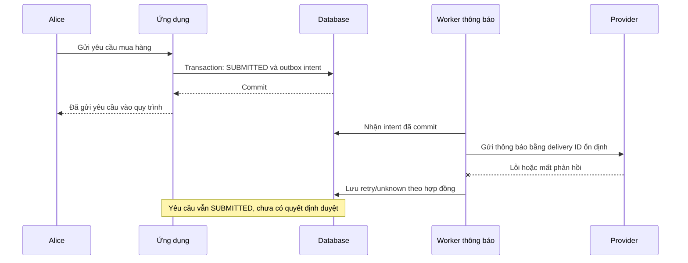

# Notification provider failure — Kiểm thử khi nhà cung cấp thông báo gặp lỗi

## 1. Mục tiêu của bài học

Trong chương **Failure Testing** của nội dung bảo mật logic nghiệp vụ, lỗi nhà cung cấp email, SMS hoặc push cần được kiểm thử theo tác động tới quy trình, quyền và các bất biến nghiệp vụ. Việc một lần gửi thất bại không được trở thành lý do tự động duyệt yêu cầu, bỏ qua OTP, nới quyền hoặc thực hiện lại một giao dịch đã hoàn tất.

Ví dụ, Alice gửi yêu cầu mua hàng để Carol phê duyệt. Nhà cung cấp email có thể từ chối, phản hồi chậm hoặc đã nhận thư nhưng làm mất phản hồi. Hệ thống cần giữ đúng trạng thái yêu cầu, lưu được ý định thông báo, phục hồi có kiểm soát và không nhầm “đã gửi email” với “đã được Carol phê duyệt”.

Sau bài học, bạn có thể:

- Phân loại thông báo theo vai trò của nó trong quy trình.
- Phân biệt chưa gửi, đã được nhà cung cấp nhận, đã giao và người dùng đã thực hiện hành động.
- Dựng lỗi ở các điểm trước/sau khi nhà cung cấp nhận thông điệp.
- Kiểm tra transaction, outbox, retry và kết quả chưa xác định.
- Kiểm tra email phê duyệt, OTP, callback và chuyển nhà cung cấp mà không làm yếu hàng rào bảo mật.
- Đối soát cả dữ liệu nghiệp vụ và trạng thái thông báo sau phục hồi.

Các trạng thái, lớp Java và test harness dưới đây là mô hình minh họa, cần được ánh xạ vào hợp đồng thực tế của ứng dụng và nhà cung cấp.

## 2. Xác định vai trò của thông báo trước khi chọn cách xử lý lỗi

Không có một quy tắc duy nhất như “gửi lỗi thì rollback mọi thứ” hoặc “gửi lỗi thì luôn bỏ qua”. Cần biết thông báo là kết quả phụ của hành động hay đang mang một bằng chứng bắt buộc cho hành động tiếp theo.

| Loại thông báo | Ví dụ | Quy tắc khi gửi lỗi |
| --- | --- | --- |
| Thông tin sau giao dịch | Biên nhận đơn đã đặt, thông báo cập nhật trạng thái | Không tự thực hiện lại giao dịch; giữ ý định gửi và trạng thái lỗi theo hợp đồng |
| Mời thực hiện một bước | Email báo có yêu cầu đang chờ duyệt | Yêu cầu vẫn chờ người có quyền xử lý; không tự chuyển sang đã duyệt |
| Mang bằng chứng xác minh | OTP hoặc link đặt lại mật khẩu | Không coi lỗi gửi là đã xác minh; vẫn yêu cầu bằng chứng hợp lệ |
| Cảnh báo bảo mật | Thay đổi phương thức đăng nhập, thay thông tin liên hệ | Áp dụng chính sách thông báo và phục hồi đã định; không tự chuyển sang địa chỉ do người chưa xác minh cung cấp |
| Một điều kiện bắt buộc của quy trình | Chỉ cho bước tiếp theo sau một xác nhận được định nghĩa rõ | Giữ trạng thái chờ hoặc từ chối theo hợp đồng; không ngầm bỏ điều kiện |

Với việc đổi email hoặc số điện thoại, “đã tạo yêu cầu đổi” và “đã xác minh địa chỉ mới” là hai trạng thái khác nhau. Nhà cung cấp thông báo gặp lỗi không được làm địa chỉ mới tự trở thành địa chỉ đã xác minh.

Trong luồng mua hàng mẫu, email chỉ giúp người duyệt biết có việc cần xử lý. Hệ thống vẫn có danh sách yêu cầu chờ duyệt trong ứng dụng. Carol có thể duyệt qua ứng dụng nếu còn đúng quyền; việc email chưa tới không tự phủ nhận một quyết định hợp lệ qua kênh này. Ngược lại, không có quyết định hợp lệ thì trạng thái không được chuyển sang APPROVED.

## 3. Phân biệt các sự thật thường bị gộp thành “đã gửi”

### 3.1. Bốn ranh giới độc lập

```text
1. Ứng dụng đã commit ý định gửi.
2. Nhà cung cấp đã nhận yêu cầu gửi.
3. Hệ thống có bằng chứng giao thông điệp theo hợp đồng của kênh.
4. Người dùng đã thực hiện hành động nghiệp vụ hợp lệ.
```

Không được suy ra bước 4 từ bước 2 hoặc bước 3. Ngay cả khi có bằng chứng đọc tin nhắn, điều đó cũng không phải một quyết định duyệt, một OTP đã được nhập đúng hoặc một lệnh thanh toán đã được ủy quyền.

Các nhà cung cấp có trạng thái khác nhau. Ví dụ, tài liệu Twilio phân biệt `queued`, `sent`, `delivered`, `undelivered`; ý nghĩa của `sent` không đồng nhất với thông điệp đã tới người nhận cuối cùng. Khi tích hợp, cần ánh xạ chính xác theo từng API/kênh. [Twilio — Message Status values](https://www.twilio.com/docs/messaging/api/message-resource#message-status-values).

### 3.2. Timeout không chứng minh nhà cung cấp chưa nhận

Hai tình huống có thể cho client cùng một lỗi timeout:

```text
Tình huống A:
Ứng dụng gửi -> lỗi trước khi nhà cung cấp nhận -> không có thông điệp mới.

Tình huống B:
Ứng dụng gửi -> nhà cung cấp đã nhận -> phản hồi bị mất -> có thông điệp mới.
```

Nếu ứng dụng xử lý cả hai bằng cách tạo delivery ID mới và gửi lại, tình huống B có thể sinh thông điệp trùng. Nếu ứng dụng đánh dấu cả hai là đã gửi thành công, tình huống A làm mất thông báo.

Kết quả chưa biết phải được biểu diễn riêng, chẳng hạn `UNKNOWN`, cùng thông tin đủ để đối soát hoặc retry an toàn theo khả năng của nhà cung cấp. Không tự coi mọi `5xx`, connection reset hoặc timeout là “chắc chắn chưa nhận”; mức chắc chắn phụ thuộc vị trí lỗi và hợp đồng thực tế.

### 3.3. Số lần thử khác số thông điệp được nhận

Một delivery logic có thể có ba lần gọi API nhưng chỉ một thông điệp được nhà cung cấp nhận nếu họ hỗ trợ idempotency đúng phạm vi. Cũng có thể cả ba lần đều được nhận nếu không có cơ chế đó.

Do đó, cần theo dõi riêng:

- Logical delivery ID của ứng dụng.
- Attempt ID của từng lần thử.
- Provider message ID nếu đã biết.
- Số lần gọi và số thông điệp được nhận ở phía nhà cung cấp test.
- Trạng thái giao cuối cùng nếu kênh cung cấp bằng chứng đó.

Một mock chỉ đếm số lần gọi `send()` chưa đủ để kiểm tra kết quả đã nhận nhưng mất phản hồi.

## 4. Mô hình luồng gửi không làm thay đổi quy tắc phê duyệt

### 4.1. Transaction nghiệp vụ và ý định thông báo

Luồng mẫu:



Cập nhật yêu cầu và ghi ý định gửi nằm trong cùng transaction local. Worker chỉ xử lý ý định đã commit. Nếu transaction rollback, không có ý định mới được phép phát ra ngoài từ lần thử đó.

Transactional outbox giải quyết khoảng hở giữa ghi dữ liệu và phát thông điệp bằng cách lưu dữ liệu nghiệp vụ cùng sự kiện trong một transaction. Việc phát hoặc xử lý vẫn có thể lặp, nên cần thiết kế idempotency phù hợp. [AWS Prescriptive Guidance — Transactional outbox pattern](https://docs.aws.amazon.com/prescriptive-guidance/latest/cloud-design-patterns/transactional-outbox.html).

Outbox không tạo transaction chung với dịch vụ email/SMS và không tự bảo đảm gửi vật lý đúng một lần. Worker vẫn có thể dừng sau khi provider nhận nhưng trước khi lưu kết quả.

### 4.2. Tách trạng thái gửi khỏi trạng thái nghiệp vụ

Ví dụ các trạng thái của job gửi:

| Trạng thái | Ý nghĩa |
| --- | --- |
| READY | Ý định đã commit, chưa được nhận xử lý |
| IN_FLIGHT | Worker đang thực hiện một lần thử có lease/ownership theo thiết kế |
| RETRY_WAIT | Được phép thử lại sau `nextAttemptAt` |
| UNKNOWN | Chưa biết provider đã nhận hay chưa; cần đối soát hoặc retry có bảo đảm |
| ACKNOWLEDGED | Đã có xác nhận provider nhận yêu cầu; chưa đồng nghĩa đã giao |
| DEAD | Không tiếp tục retry tự động theo chính sách hiện tại |
| EXPIRED hoặc SUPERSEDED | Thông báo không còn được phép gửi do thời hạn hoặc đã bị thay thế |

Nếu có callback giao cuối cùng, lưu thêm trạng thái giao phù hợp như `deliveryOutcome`, không tự biến ACKNOWLEDGED thành “người dùng đã xác nhận”. Một callback báo không giao được cũng không được tự rollback một giao dịch mua hàng đã hoàn tất.

Yêu cầu mua hàng có state riêng, chẳng hạn DRAFT → SUBMITTED → APPROVED/REJECTED. Mọi thay đổi của job gửi phải giữ các bất biến nghiệp vụ, trừ hành động nghiệp vụ rõ ràng được một chủ thể có quyền thực hiện.

### 4.3. Dữ liệu nhận diện để retry đúng lệnh

Một ý định gửi có thể gồm:

```text
deliveryId, businessEventId, aggregateId, aggregateVersion,
tenantId, recipientRef, channel, templateVersion, payloadFingerprint,
createdAt, expiresAt, attemptCount, nextAttemptAt,
submissionState, providerMessageId, deliveryOutcome
```

`deliveryId` ổn định qua retry của cùng thông điệp. Attempt ID thay đổi theo từng lần thử. Không tạo delivery ID mới chỉ vì một lần gọi timeout. Nếu nội dung hoặc người nhận thay đổi theo một lệnh nghiệp vụ hợp lệ, cần một ý định mới hoặc một hợp đồng thay thế rõ ràng; không tái dùng cùng key cho payload khác.

Không mặc định mọi provider đều hỗ trợ idempotency, có cùng thời hạn giữ key hoặc cho phép truy vấn bằng key của client. Kiểm thử adapter theo khả năng và giới hạn thực tế, kể cả trường hợp retry sau khi cửa sổ khử trùng đã hết.

## 5. Ma trận lỗi cần chủ động tạo

| ID | Điểm lỗi | Kỳ vọng về gửi | Kỳ vọng về nghiệp vụ |
| --- | --- | --- | --- |
| F01 | Provider từ chối tạm thời trước khi nhận theo kịch bản đã biết | RETRY_WAIT; lưu lần thử | Yêu cầu vẫn SUBMITTED |
| F02 | Không kết nối được hoặc response quá chậm | Phân loại theo bằng chứng, có thể UNKNOWN | Không tự duyệt hoặc tạo lại yêu cầu |
| F03 | Provider nhận rồi mất phản hồi | UNKNOWN; đối soát/retry an toàn | Không có quyết định nghiệp vụ mới |
| F04 | Ứng dụng dừng sau commit, trước khi worker gửi | Ý định còn bền vững sau restart | Không mất yêu cầu hoặc phát sinh lần gửi duyệt mới |
| F05 | Worker dừng sau provider nhận, trước khi lưu ACK | Có thể xử lý lại; dùng cùng nhận diện logic | Không tạo tác dụng nghiệp vụ trùng |
| F06 | Địa chỉ/payload không hợp lệ, lỗi được phân loại là vĩnh viễn | DEAD hoặc luồng sửa dữ liệu có kiểm soát | Không gửi bừa sang người nhận khác |
| F07 | Sai credential hoặc tài khoản provider bị đình chỉ | Dừng/circuit theo chính sách, phát tín hiệu vận hành | Không nới quyền hay bỏ bước xác minh |
| F08 | Provider throttle | Retry theo hợp đồng, có giới hạn | Không khuếch đại request vô hạn |
| F09 | Đã nhận nhưng callback báo undelivered/bounce | Cập nhật kết quả giao; phục hồi theo chính sách | Không coi là người dùng đã hành động |
| F10 | Callback trùng, đến muộn hoặc không đúng thứ tự | Xử lý lặp an toàn, không ghi đè sai trạng thái | Không phát sinh duyệt/xác minh giả |
| F11 | Transaction gửi duyệt rollback | Không có intent đã commit để phát | Yêu cầu giữ trạng thái trước lệnh |
| F12 | Quyền người nhận hoặc trạng thái yêu cầu đổi khi job đang chờ | Áp dụng chính sách stale/superseded | Không lộ nội dung hoặc thực thi link ngoài quyền |
| F13 | OTP/link hết hạn trong lúc provider lỗi | Không hồi sinh hoặc kéo dài token bằng retry | Không xác minh bằng chứng đã hết hạn |
| F14 | Chuyển provider sau kết quả UNKNOWN | Đánh giá trùng và điều kiện chuyển | Không chuyển sang kênh yếu hoặc địa chỉ chưa xác minh |

Ma trận cần có ca khỏe mạnh đối chứng. Nếu mọi lần gửi đều lỗi do fixture, test không chứng minh worker có thể phục hồi và gửi đúng sau khi provider hoạt động lại.

Đừng chỉ thử một HTTP `500` trả ngay. Nó không đại diện cho chậm phản hồi, đã nhận rồi mất ACK, callback giao thất bại hoặc worker chết ở giữa hai lần ghi dữ liệu.

## 6. Provider giả lập có thể giữ được hai phía của sự thật

### 6.1. Mục đích của fake

Đoạn Java 17+ dưới đây tạo một fake có ba chế độ: nhận và ACK, từ chối trước khi nhận, hoặc nhận rồi làm mất phản hồi. Fake giữ riêng số lần gọi và những thông điệp đã nhận.

**Fake này có hợp đồng idempotency riêng của ví dụ**: cùng delivery ID và cùng nội dung trả cùng provider message ID; đổi nội dung trên key cũ tạo xung đột. Không suy ra API email/SMS bất kỳ có bảo đảm này.

Mã minh họa cho `ScriptedNotificationProvider.java`:

```java
package example.failure;

import java.util.LinkedHashMap;
import java.util.Map;

public final class ScriptedNotificationProvider {
    public enum Mode {
        ACK,
        REJECT_BEFORE_ACCEPT,
        ACCEPT_THEN_LOSE_RESPONSE
    }

    public record Command(
            String deliveryId,
            String recipientRef,
            String payloadFingerprint) {}

    public record Receipt(String providerMessageId) {}
    private record Accepted(Command command, Receipt receipt) {}

    public static final class TemporaryProviderFailure
            extends RuntimeException {}

    public static final class DeliveryOutcomeUnknown
            extends RuntimeException {}

    public static final class IdempotencyConflict
            extends RuntimeException {}

    private final Map<String, Accepted> accepted = new LinkedHashMap<>();
    private Mode nextMode = Mode.ACK;
    private int calls;

    public synchronized void nextSendUses(Mode mode) {
        nextMode = mode;
    }

    public synchronized Receipt send(Command command) {
        calls++;
        Mode mode = nextMode;
        nextMode = Mode.ACK;

        if (mode == Mode.REJECT_BEFORE_ACCEPT) {
            throw new TemporaryProviderFailure();
        }

        Accepted previous = accepted.get(command.deliveryId());
        Receipt receipt;
        if (previous != null) {
            if (!previous.command().equals(command)) {
                throw new IdempotencyConflict();
            }
            receipt = previous.receipt();
        } else {
            receipt = new Receipt("provider-message-" + (accepted.size() + 1));
            accepted.put(command.deliveryId(), new Accepted(command, receipt));
        }

        if (mode == Mode.ACCEPT_THEN_LOSE_RESPONSE) {
            throw new DeliveryOutcomeUnknown();
        }
        return receipt;
    }

    public synchronized int calls() {
        return calls;
    }

    public synchronized int acceptedCount() {
        return accepted.size();
    }
}
```

Mỗi chế độ lỗi chỉ áp dụng cho lần gọi kế tiếp; lần tiếp theo mặc định ACK. Fixture giả định các trường command đã hợp lệ. `payloadFingerprint` là nhãn so sánh trong fake, không phải cơ chế xác thực hay chữ ký bảo mật.

Fake không thực sự giao email/SMS, không chứng minh người nhận đã đọc và không mô phỏng TCP timeout. Nó giúp kiểm tra logic quyết định một cách xác định. Để kiểm tra timeout, parse lỗi, TLS hoặc connection reset của adapter thật, dùng HTTP stub/proxy hoặc môi trường tích hợp có điều khiển tương ứng.

### 6.2. Những giới hạn cần giữ khi dùng fake

Không reset map `accepted` khi chỉ mô phỏng restart worker; phía provider phải vẫn nhớ thông điệp đã nhận. Nếu tạo lại cả fake, bạn đã xóa bằng chứng phía ngoài và có thể bỏ qua lỗi gửi trùng.

Fake không mô phỏng thời hạn giữ idempotency key, giới hạn rate, thay đổi payload được provider chuẩn hóa hay callback. Các khả năng đó cần kịch bản riêng. Nếu provider thật không có idempotency như fake, phải thay kỳ vọng F03/F05 bằng đối soát hoặc chính sách chấp nhận rủi ro trùng rõ ràng, thay vì giữ nguyên test và kết luận an toàn.

## 7. Kiểm thử tích hợp quanh ranh giới commit

### 7.1. Hợp đồng test harness

Các đoạn dưới đây là mã minh họa đặt trong một lớp integration test của dự án. Chúng cần fixture, service, worker, database test và adapter nối tới fake ở trên; đây không phải project chạy độc lập.

| Thành phần | Trách nhiệm |
| --- | --- |
| `fixtures.committedDraftRequest()` | Tạo yêu cầu DRAFT, người tạo Alice và người duyệt hợp lệ; commit fixture |
| `application.submit(...)` | Chạy service thật; sau khi trả thành công, transaction gửi duyệt đã commit |
| `worker.runOneDueDelivery()` | Xử lý một delivery đủ điều kiện; các thay đổi trạng thái của lượt xử lý đã hoàn tất |
| `inspect.request(...)` | Đọc dữ liệu đã commit trong ngữ cảnh mới |
| `inspect.businessSnapshot(...)` | Chụp dữ liệu nghiệp vụ bất biến, tách khỏi trạng thái vận chuyển thông báo |
| `inspect.delivery(...)` | Đọc job gửi, delivery ID, số lần thử và thời điểm thử tiếp |
| `clock.advanceTo(...)` | Điều khiển thời gian, không cần sleep |
| `faults` | Tạo điểm lỗi đúng vị trí đã định trong transaction/worker |

Business snapshot có thể gồm state, version, tổng tiền, người tạo, approval record và lệnh tài chính. Trạng thái gửi và attempt log được kiểm tra riêng, vì chúng được phép đổi khi worker retry. Nếu hệ thống có audit attempt hợp lệ, không nhầm thay đổi audit đó với một tác dụng nghiệp vụ trái phép.

### 7.2. F01: provider lỗi không làm mất bước chờ duyệt

```java
@Test
void providerRejectionKeepsTheRequestAwaitingApproval() {
    var f = fixtures.committedDraftRequest();
    provider.nextSendUses(Mode.REJECT_BEFORE_ACCEPT);

    application.submit(f.alice(), f.requestId(), "submit-key-1");

    assertEquals("SUBMITTED", inspect.request(f.requestId()).state());
    assertEquals(1, inspect.notificationIntentCount(f.requestId()));
    assertEquals(0, provider.calls());
    var beforeWorker = inspect.businessSnapshot(f.requestId());

    worker.runOneDueDelivery();

    assertEquals(1, provider.calls());
    assertEquals(0, provider.acceptedCount());
    assertEquals("RETRY_WAIT", inspect.delivery(f.requestId()).state());
    assertEquals(0, inspect.approvalCount(f.requestId()));
    assertEquals(beforeWorker, inspect.businessSnapshot(f.requestId()));
}
```

Test giả định worker không tự chạy nền trong fixture; vì vậy `provider.calls() == 0` ngay sau submit có ý nghĩa. Trong ứng dụng có scheduler thật, cần tắt điều phối tự động và gọi worker có kiểm soát ở test này để tránh phụ thuộc lịch chạy.

Không chỉ assert “không ném exception”. Bằng chứng cần có là yêu cầu đã vào SUBMITTED, ý định được lưu, lần gửi được thử và trạng thái nghiệp vụ không bị đổi sang đã duyệt hoặc trở lại DRAFT.

### 7.3. F03: provider nhận rồi mất phản hồi

Test này cấu hình worker biết provider giả lập hỗ trợ idempotency, nên UNKNOWN có thể được retry bằng cùng command khi tới hạn:

```java
@Test
void lostResponseRetriesTheSameLogicalDelivery() {
    var f = fixtures.committedDraftRequest();
    application.submit(f.alice(), f.requestId(), "submit-key-2");
    var beforeWorker = inspect.businessSnapshot(f.requestId());
    var originalDeliveryId = inspect.delivery(f.requestId()).deliveryId();

    provider.nextSendUses(Mode.ACCEPT_THEN_LOSE_RESPONSE);
    worker.runOneDueDelivery();

    assertEquals("UNKNOWN", inspect.delivery(f.requestId()).state());
    assertEquals(1, provider.calls());
    assertEquals(1, provider.acceptedCount());
    assertEquals(beforeWorker, inspect.businessSnapshot(f.requestId()));

    clock.advanceTo(inspect.delivery(f.requestId()).nextAttemptAt());
    worker.runOneDueDelivery();

    assertEquals(2, provider.calls());
    assertEquals(1, provider.acceptedCount());
    assertEquals("ACKNOWLEDGED", inspect.delivery(f.requestId()).state());
    assertEquals(originalDeliveryId,
                 inspect.delivery(f.requestId()).deliveryId());
    assertNotNull(inspect.delivery(f.requestId()).providerMessageId());
    assertEquals(beforeWorker, inspect.businessSnapshot(f.requestId()));
}
```

Số lần gọi là hai nhưng số thông điệp được fake nhận là một. Điều này kiểm tra hợp đồng của fake và cách worker dùng lại command; không chứng minh gửi vật lý đúng một lần cho provider không hỗ trợ cùng cơ chế.

Thêm ca cùng delivery ID nhưng payload/người nhận khác phải tạo xung đột và không tăng số thông điệp được nhận. Đừng sửa fake để âm thầm nhận payload mới trên key cũ, vì như vậy test mất khả năng phát hiện retry sai lệnh.

### 7.4. F11: transaction rollback không để lọt thông báo

```java
@Test
void rolledBackSubmissionDoesNotPublishANotification() {
    var f = fixtures.committedDraftRequest();
    var before = inspect.businessSnapshot(f.requestId());
    faults.failAfterOutboxInsertBeforeSubmitCommit();

    assertThrows(InjectedFailure.class, () ->
        application.submit(f.alice(), f.requestId(), "submit-key-3")
    );

    assertEquals(before, inspect.businessSnapshot(f.requestId()));
    assertEquals("DRAFT", inspect.request(f.requestId()).state());
    assertEquals(0, inspect.notificationIntentCount(f.requestId()));

    worker.runOneDueDelivery();
    assertEquals(0, provider.calls());
    assertEquals(0, provider.acceptedCount());
}
```

`InjectedFailure` và fault hook cần được hiện thực theo project để thực sự làm transaction rollback tại vị trí đã chọn. Nếu có action token hoặc idempotency record tạo trong lệnh submit, kiểm tra chúng cũng tuân theo ranh giới transaction đã định, không để một kết quả thành công giả tồn tại sau rollback.

Trong Spring, rollback phụ thuộc loại exception và cấu hình. Mặc định thường rollback với RuntimeException/Error, không tự rollback mọi checked exception; cấu hình có thể thay đổi. Kiểm thử cần đọc trạng thái đã commit thay vì suy ra rollback chỉ từ annotation hoặc việc một exception xuất hiện. [Spring Framework — Rolling Back a Declarative Transaction](https://docs.spring.io/spring-framework/reference/data-access/transaction/declarative/rolling-back.html).

### 7.5. F04/F05: khởi động lại đúng phía bị lỗi

Với F04, commit submit xong, dừng worker trước khi gửi, rồi khởi động worker mới dùng cùng database. Ý định vẫn phải được tìm thấy và xử lý theo chính sách.

Với F05, cho provider nhận và trả ACK, nhưng tạo lỗi trước khi worker commit kết quả. Sau restart/lease hết hạn, job có thể được nhận lại. Giữ nguyên dữ liệu phía provider và kiểm tra delivery ID/payload không đổi, trạng thái được phục hồi đúng và yêu cầu mua hàng không bị gửi duyệt lần nữa.

F03 và F05 đều có thể dẫn tới xử lý lại, nhưng lỗi nằm ở hai ranh giới khác nhau. Chỉ thử mất phản hồi mạng chưa chứng minh hành vi sau khi ghi trạng thái worker thất bại là đúng.

### 7.6. Client gửi lại lệnh khi provider đang lỗi

Retry gửi thông báo và retry lệnh nghiệp vụ là hai việc cần kiểm tra riêng. Trong hợp đồng minh họa này, Alice gửi lại cùng lệnh `submit` với cùng idempotency key và cùng nội dung thì hệ thống trả kết quả của lệnh đã commit, giữ nguyên yêu cầu và ý định thông báo. Client không cần tạo yêu cầu mua hàng mới để khắc phục một email chưa gửi được.

```java
@Test
void repeatedSubmissionDuringProviderFailureKeepsOneBusinessCommand() {
    var f = fixtures.committedDraftRequest();
    var submitKey = "submit-key-4";
    application.submit(f.alice(), f.requestId(), submitKey);
    var committed = inspect.businessSnapshot(f.requestId());
    var deliveryId = inspect.delivery(f.requestId()).deliveryId();

    provider.nextSendUses(Mode.REJECT_BEFORE_ACCEPT);
    worker.runOneDueDelivery();
    assertEquals("RETRY_WAIT", inspect.delivery(f.requestId()).state());

    application.submit(f.alice(), f.requestId(), submitKey);

    assertEquals(committed, inspect.businessSnapshot(f.requestId()));
    assertEquals(1, inspect.notificationIntentCount(f.requestId()));
    assertEquals(deliveryId, inspect.delivery(f.requestId()).deliveryId());
    assertEquals("RETRY_WAIT", inspect.delivery(f.requestId()).state());
    assertEquals(1, provider.calls());
    assertEquals(0, provider.acceptedCount());

    clock.advanceTo(inspect.delivery(f.requestId()).nextAttemptAt());
    worker.runOneDueDelivery();

    assertEquals(2, provider.calls());
    assertEquals(1, provider.acceptedCount());
    assertEquals("ACKNOWLEDGED", inspect.delivery(f.requestId()).state());
    assertEquals(deliveryId, inspect.delivery(f.requestId()).deliveryId());
    assertEquals(committed, inspect.businessSnapshot(f.requestId()));
    assertEquals(1, inspect.notificationIntentCount(f.requestId()));
}
```

Test vẫn dùng fixture không có scheduler nền. Việc gọi lại `submit` không được tự gửi thông báo ngay hoặc đặt lại lịch retry; worker tiếp tục xử lý ý định cũ theo lịch đã lưu. Kiểm tra snapshot bao gồm version, tổng tiền và approval record để phát hiện lệnh bị thực hiện thêm lần nữa dù trạng thái cuối vẫn là SUBMITTED.

Idempotency key của lệnh `submit` và `deliveryId` có phạm vi khác nhau; không lấy số thông điệp provider nhận để kết luận lệnh nghiệp vụ chỉ chạy một lần. Bổ sung ca cùng key nhưng khác request/nội dung phải bị từ chối theo hợp đồng, cùng chuỗi key ở tenant khác phải được phân vùng đúng, và replay bởi người không có quyền phải bị chặn trước khi trả dữ liệu nhạy cảm hoặc tạo tác dụng phụ. Giới hạn lưu kết quả idempotency của ứng dụng cũng cần được định nghĩa riêng với cửa sổ khử trùng của provider.

## 8. Retry và chuyển provider mà không tạo đường lạm dụng

### 8.1. Phân loại lỗi bằng hợp đồng, không chỉ bằng một con số

Lỗi payload sai thường cần sửa dữ liệu, không nên retry vô hạn. Lỗi credential có thể cần can thiệp vận hành. Throttle cần điều phối theo giới hạn provider. Kết quả UNKNOWN cần được xử lý theo khả năng idempotency/tra cứu và thời hạn tương ứng.

Không mặc định mọi lỗi 4xx là vĩnh viễn hoặc mọi lỗi 5xx đều an toàn để gửi lại. Adapter nên ánh xạ phản hồi và lỗi transport thành nhóm có ý nghĩa, kèm bằng chứng hiện có về việc đã nhận hay chưa.

Kiểm thử tối thiểu cần xác nhận:

- Backoff tăng có giới hạn, có jitter nếu thiết kế yêu cầu và có `nextAttemptAt` bền vững.
- Không retry trước thời điểm được phép; thông tin Retry-After được xử lý theo hợp đồng.
- Có ngân sách số lần thử/thời gian và cách chuyển sang DEAD hoặc đối soát.
- Worker không giữ transaction/khóa nghiệp vụ dài trong suốt thời gian chờ network.
- Retry ở nhiều tầng không âm thầm nhân số lần gọi.

Clock và nguồn jitter có thể được thay bằng thành phần điều khiển được trong test. Không cần sleep hàng phút để chứng minh lịch retry; kiểm tra trạng thái lịch và tiến thời gian có chủ đích.

### 8.2. Chuyển provider sau UNKNOWN có thể gửi trùng

Key được khử trùng ở provider A không tự được provider B biết. Nếu A đã nhận nhưng mất phản hồi, gửi ngay qua B có thể tạo hai thông điệp dù cả hai adapter đều có idempotency riêng.

Chính sách có thể chọn đối soát với A trước, chờ một khoảng có giới hạn, cho phép thông báo trùng đối với nội dung thông tin, hoặc cần xử lý thủ công. Quyết định phải rõ theo loại thông báo. Không tuyên bố exactly-once xuyên hai provider chỉ vì dùng cùng chuỗi key.

Với OTP/link nhạy cảm, chuyển provider không được đồng nghĩa chuyển sang email/số điện thoại do người chưa xác minh tự nhập, gửi nội dung bảo mật sang kênh yếu hơn hoặc kéo dài hiệu lực bằng chứng.

### 8.3. Resend là một hành động có quyền và giới hạn

Endpoint “gửi lại” cần kiểm tra ai được gửi lại thông báo của đối tượng nào, giới hạn tần suất và thông báo có còn hiệu lực không. Bob không được gửi lại thông báo của yêu cầu Alice chỉ bằng delivery ID, đổi người nhận hoặc xem nội dung/token qua màn hình lỗi.

Tách retry vận chuyển của cùng delivery khỏi lệnh nghiệp vụ “phát hành mã mới” hay “thay người nhận”. Lệnh mới cần chính sách quyền, chống lặp và vô hiệu hóa bằng chứng cũ nếu hợp đồng yêu cầu.

## 9. Không để lỗi thông báo vượt hàng rào phê duyệt hoặc xác minh

### 9.1. Email phê duyệt chỉ dẫn tới một hành động cần kiểm tra lại

Trong mô hình bài học, link email không tự cấp toàn quyền duyệt. Khi người dùng thực hiện quyết định, server cần kiểm tra danh tính, tenant, quyền trên yêu cầu, trạng thái hiện tại, version và quy tắc không tự duyệt.

Nếu yêu cầu bị hủy hoặc đã có quyết định trước khi email tới, link cũ không được tạo chuyển trạng thái mới trái phép. Nếu quyền của Carol bị thu hồi, email đã được gửi trước đó không tự bảo tồn quyền duyệt vô thời hạn.

Đối với sản phẩm cố ý dùng link dạng capability thay cho đăng nhập, cần hợp đồng khác về phạm vi, thời hạn, số lần dùng và thu hồi. Không trộn hai mô hình bằng cách bỏ đăng nhập tạm thời chỉ vì provider đang lỗi.

Các ca cần có gồm link đến muộn, dùng lại sau quyết định, người không được chỉ định dùng link, requester tự duyệt và hai người cùng duyệt một version. GET xem trang/link không nên tự được coi là quyết định duyệt; cần một hành động xác nhận theo hợp đồng của ứng dụng.

### 9.2. OTP và link khôi phục không tự hợp lệ vì đã giao

Đối với OTP/link, assertion phải kiểm tra trạng thái xác minh và hành động được bảo vệ, không chỉ trạng thái thông báo. Những ca quan trọng:

| Ca | Bảo đảm cần kiểm tra |
| --- | --- |
| Provider không nhận OTP | Không có phiên/giao dịch được xác minh tự động |
| Callback báo delivered | Chỉ cập nhật bằng chứng giao; chưa xác minh mã |
| Queue chậm tới sau expiresAt | Mã cũ không thực hiện được hành động |
| Retry cùng delivery | Không đổi expiresAt hoặc reset số lần nhập sai ngoài hợp đồng |
| Phát hành challenge mới | Mã cũ bị xử lý theo chính sách vô hiệu hóa đã chọn |
| Provider hoạt động lại sau outage | Job cũ không hồi sinh challenge hết hạn |
| Gửi lại vượt giới hạn | Bị chặn mà không làm yếu yêu cầu bằng chứng |

OWASP khuyến nghị token khôi phục có thời hạn, chỉ dùng một lần và không thay đổi tài khoản trước khi có token hợp lệ. Các quy tắc đó cần tiếp tục được giữ khi dịch vụ gửi lỗi hoặc giao chậm. [OWASP Forgot Password Cheat Sheet](https://cheatsheetseries.owasp.org/cheatsheets/Forgot_Password_Cheat_Sheet.html).

Không đưa OTP, link đầy đủ hoặc bí mật vào response debug/log để “hỗ trợ người dùng trong lúc SMS lỗi”. Nếu có quy trình khôi phục thay thế, quy trình đó phải có bằng chứng và quyền được định nghĩa riêng.

### 9.3. Thông báo không còn phù hợp với trạng thái hoặc người nhận

Với email có nội dung/hành động nhạy cảm đang chờ gửi, xác định chính sách khi đối tượng, người nhận hoặc quyền thay đổi. Ví dụ, yêu cầu phê duyệt đã bị hủy có thể làm thông báo cũ SUPERSEDED; người nhận vừa bị rút khỏi phạm vi không nên tiếp tục nhận chi tiết nhạy cảm theo chính sách của luồng này.

Không có một quy tắc chung rằng mọi thông báo lịch sử đều phải dùng dữ liệu hiện tại. Biên nhận có thể cần phản ánh sự kiện tại thời điểm giao dịch; lời mời hành động lại cần gắn với quyền/trạng thái còn hiệu lực. Test phải mô tả đúng loại nội dung, phiên bản và ranh giới kiểm tra đã chọn.

## 10. Callback là dữ liệu đầu vào cần xác thực và đối chiếu

### 10.1. Không tin providerMessageId hoặc state do bất kỳ người gọi nào gửi

Endpoint callback phải xác minh nguồn theo cơ chế provider hỗ trợ, đối chiếu đúng provider account, message ID và delivery của ứng dụng. Không cho callback tự chọn tenant/aggregate để cập nhật chỉ bằng một trường JSON hoặc query.

Ví dụ, Twilio cung cấp cơ chế kiểm tra chữ ký request; việc tích hợp cần tuân theo cách tạo request, URL và tham số của provider, thay vì chỉ kiểm tra một header có tồn tại. [Twilio — Validating requests](https://www.twilio.com/docs/usage/security#validating-requests).

Các test cần có callback thiếu/sai chữ ký, đúng chữ ký nhưng message ID không thuộc tài khoản/delivery đang xử lý, callback trùng và callback có trường bổ sung hợp lệ theo hợp đồng. Dùng verifier thật trong kiểm thử adapter; mock verifier luôn trả true không chứng minh xác thực callback hoạt động.

### 10.2. Xử lý callback lặp và sai thứ tự

Lưu callback hoặc version/trạng thái đủ để quyết định cập nhật theo hợp đồng. Không chỉ gán trạng thái nhận được cuối cùng vào một cột rồi gọi đó là trạng thái mới nhất: event đến muộn có thể cũ hơn thông tin đã ghi nhận.

Mặt khác, không tự sắp mọi status theo một số tăng dần chung cho tất cả provider. Một số chuyển trạng thái thất bại hoặc điều chỉnh cần quy tắc riêng. Thiết kế adapter theo sơ đồ chuyển trạng thái, thời gian/version/event ID mà hợp đồng thực sự cung cấp.

Sau callback, kiểm tra rằng approval record, trạng thái xác minh, quyền tài khoản và lệnh tài chính không đổi nếu callback chỉ là báo giao thông báo. Chỉ một hành động nghiệp vụ rõ ràng với bằng chứng phù hợp mới được tác động các dữ liệu đó.

## 11. Quan sát, đối soát và phục hồi

### 11.1. Những chỉ số giúp thấy lỗi nghiệp vụ

| Nhóm | Chỉ số/bằng chứng |
| --- | --- |
| Tồn đọng | Số READY/RETRY_WAIT/UNKNOWN, tuổi job cũ nhất theo loại thông báo |
| Gửi | Attempt rate, latency, nhóm lỗi, throttle, số ACK |
| Giao | Delivered/undelivered/bounce theo bằng chứng có thật |
| Toàn vẹn | Intent mồ côi, key trùng sai payload, event thiếu intent hoặc intent không có sự kiện hợp lệ |
| Quy trình | Yêu cầu chờ duyệt quá hạn; không có approval tự sinh vì lỗi gửi |
| Xác minh | Challenge hết hạn, replay bị chặn, không có xác minh từ callback giao |
| Phục hồi | Backlog được xử lý trong deadline, job DEAD/UNKNOWN còn lại và nguyên nhân |

Không dùng tỉ lệ ACK để báo “người dùng đã nhận và hành động”. Cũng không dùng queue rỗng để kết luận thành công nếu job đã bị đánh dấu DEAD hoặc bị xóa.

Quan sát theo tenant/loại thông báo phù hợp nhưng tránh tag có số lượng giá trị khổng lồ hoặc làm lộ địa chỉ/token. Dùng các định danh tương quan có kiểm soát để nối business event, delivery, attempt và provider message.

### 11.2. Đối soát sau một đợt provider lỗi

Chụp số liệu đầu kỳ, tạo lỗi có giới hạn, phát các lệnh nghiệp vụ có thể truy vết, rồi phục hồi provider. Đặt deadline quan sát thay vì chờ vô hạn.

Sau đó đối chiếu:

1. Các lệnh nghiệp vụ nào đã commit, rollback hoặc chưa rõ kết quả phía client?
2. Mỗi sự kiện cần thông báo có đủ ý định đúng recipient/channel theo chính sách không?
3. Có ý định nào được gửi dù transaction nguồn rollback không?
4. Mỗi delivery có command ổn định qua retry và provider ID đúng không?
5. Có gửi nội dung cũ, hết hạn hoặc ngoài quyền sau khi phục hồi không?
6. Có job UNKNOWN/DEAD chưa xử lý và yêu cầu chờ duyệt cần can thiệp không?
7. Có thay đổi nghiệp vụ trái phép nào xuất hiện trong lúc lỗi hoặc replay không?

Đọc dữ liệu đã commit qua transaction/persistence context mới hoặc cơ chế quan sát phù hợp. Nếu chỉ xem entity cache trong test hoặc rollback cả test trước khi lỗi commit được thực thi, kết luận có thể sai.

Không chỉ lọc các intent còn tồn tại. Cần có danh sách sự kiện đầu vào hoặc dữ liệu nguồn để phát hiện intent đã bị mất/xóa; nếu không, tập dữ liệu lỗi có thể tự biến mất khỏi truy vấn đối soát.

### 11.3. Can thiệp thủ công cũng cần giữ bất biến

Nút replay trong công cụ vận hành phải kiểm tra quyền, ghi nhận người thao tác, lý do và các điều kiện còn hiệu lực. Không cho nhập recipient mới tùy ý hoặc làm sống lại token cũ chỉ để xử lý backlog.

Nếu cần người duyệt khác xử lý một yêu cầu quá hạn, đó là hành động phân công/escalation có chính sách và audit riêng. Nó không đồng nghĩa hệ thống tự duyệt hoặc xem delivery failure là bằng chứng đồng ý.

Không xóa thông tin lỗi rồi đánh dấu toàn bộ job là thành công để làm sạch dashboard. Phục hồi phải giữ khả năng phân biệt đã nhận, đã giao, hết hạn, bị thay thế và chưa rõ kết quả.

## 12. Những kiểm thử tạo cảm giác an toàn sai

| Cách kiểm tra | Điều bị bỏ sót | Cách cải thiện |
| --- | --- | --- |
| Chỉ mock send ném exception | Không có bằng chứng provider đã nhận hay chưa | Fake giữ state phía provider và lỗi sau nhận |
| Chỉ assert service không ném lỗi | Có thể đã mất intent hoặc tự chuyển bước | Đọc state nghiệp vụ, outbox và dữ liệu liên quan |
| Chỉ assert send gọi đúng một lần | Một lần gọi vẫn có thể mất ACK; retry có thể cần thiết | Đếm attempt và thông điệp đã nhận riêng |
| Reset cả provider khi restart worker | Xóa bằng chứng thông điệp đã nhận | Giữ state phía provider qua lỗi worker |
| Retry với delivery ID mới | Có thể tạo thông điệp logic mới | Giữ ID/payload ổn định theo hợp đồng |
| Đánh dấu mọi timeout là thất bại chắc chắn | Có thể gửi lại khi provider đã nhận | Biểu diễn UNKNOWN và quy trình xử lý phù hợp |
| Xem ACK/delivered là approval hoặc OTP verified | Vượt điều kiện nghiệp vụ | Kiểm tra hành động và bằng chứng riêng |
| Chỉ thử provider hoạt động lại | Không thấy token/recipient đã stale | Thay đổi thời gian, trạng thái và quyền khi job đang chờ |
| Test được bọc rollback, không quan sát commit | Che lỗi transaction/outbox | Dùng fixture đã commit và readback độc lập |
| Chỉ xem queue rỗng | Job có thể bị mất hoặc đẩy DEAD | Đối soát với danh sách sự kiện và trạng thái cuối |

## 13. Bài tập áp dụng

Giả sử yêu cầu mua hàng có email phê duyệt hết hạn sau 30 phút. Provider nhận email nhưng làm mất phản hồi, rồi dịch vụ gửi ngừng hoạt động trong 40 phút. Trong thời gian đó, quyền duyệt của Carol bị thu hồi và yêu cầu được phân công lại cho Dora theo một lệnh hợp lệ.

1. Xác định trạng thái của yêu cầu, delivery cũ và quyền/token của Carol tại từng thời điểm.
2. Viết test F03 giữ được bằng chứng phía provider đã nhận email, nhưng ứng dụng còn UNKNOWN.
3. Tiến clock tới sau 40 phút và phục hồi worker; mô tả delivery nào được gửi tiếp, delivery nào hết hạn hoặc bị thay thế.
4. Kiểm tra link cũ của Carol không duyệt được yêu cầu, kể cả khi callback delivered tới muộn.
5. Tạo thông báo cho Dora từ sự kiện phân công hợp lệ; không tái dùng key cũ cho người nhận mới.
6. Thử replay từ công cụ vận hành bằng người không có quyền và xác nhận không có thay đổi nghiệp vụ.
7. Đối soát approval record, version yêu cầu, lịch sử phân công, delivery/attempt và provider message; ghi rõ thông tin nào còn chưa xác định.

Kết quả đạt phải chứng minh lỗi provider không biến thành đường bỏ qua phê duyệt, không làm token cũ hợp lệ trở lại và không khiến retry đổi chủ thể hoặc lệnh ngoài ý muốn. Khả năng gửi lại thông báo chỉ là một phần của kết luận; các quy tắc nghiệp vụ và quyền cần được giữ trong cả giai đoạn lỗi lẫn phục hồi.
