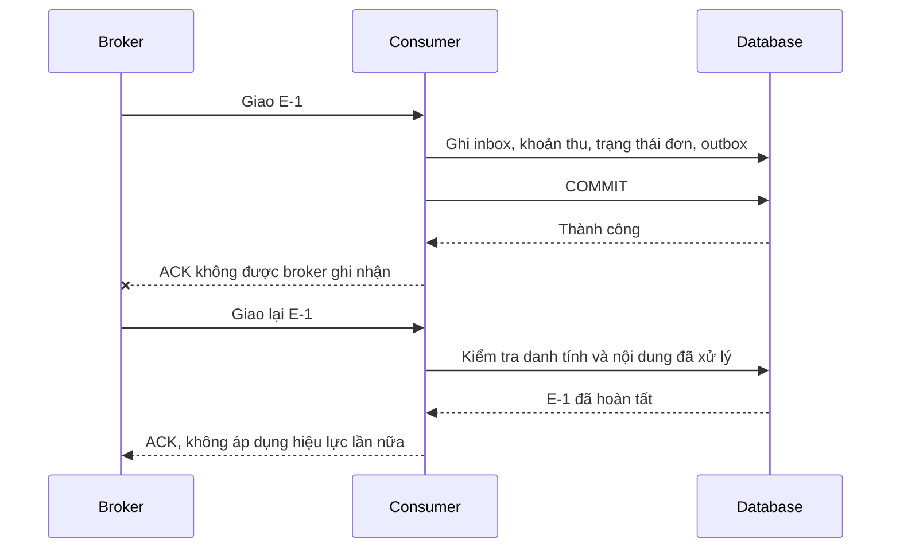

# Message duplication failure — Kiểm thử lỗi thông điệp trùng lặp

## 1. Mục tiêu và phạm vi

Một thông điệp có thể được giao nhiều lần dù producer chỉ muốn thông báo một sự kiện. Broker đã nhận nhưng producer mất xác nhận, consumer commit rồi mất ACK, hoặc worker khởi động lại đều có thể dẫn tới giao lại. Nếu mỗi lần nhận đều tạo thêm hiệu lực, hệ thống có thể cộng tiền, giữ hàng, hoàn tiền hoặc tạo yêu cầu giao hàng nhiều lần.

Trong bảo mật logic nghiệp vụ, đường giao lại cũng có thể bị lạm dụng. Người gọi hoặc thành phần tích hợp có thể phát lại sự kiện, đổi định danh hay lợi dụng lỗi kho chống trùng để cố nhận thêm quyền lợi.

**Message duplication failure testing** kiểm chứng rằng hệ thống xử lý đúng thông điệp trùng trong điều kiện lỗi, cạnh tranh và phục hồi. Điều cần bảo vệ là số hiệu lực nghiệp vụ và tính đúng của trạng thái, đồng thời công việc hợp lệ không bị bỏ mất.

Bài học thuộc module `SECURITY_APPLICATION_SECURITY_BUSINESS_LOGIC_SECURITY`, nối business invariants với state machine, quyền theo đối tượng, transaction và idempotency. Các tình huống chỉ được mô tả cho môi trường kiểm thử có dữ liệu, broker, database và tích hợp được kiểm soát.

Sau bài học, bạn có thể:

- Phân biệt lần giao trùng, sự kiện trùng về ý nghĩa và hai hiệu lực thực tế khác nhau.
- Xác định khóa chống trùng theo nguồn, consumer và thao tác nghiệp vụ.
- Kiểm thử lỗi giữa xử lý, commit và ACK mà không nhầm kết quả chưa rõ với thất bại chắc chắn.
- Kiểm chứng inbox, outbox và ràng buộc nghiệp vụ bằng dữ liệu đã commit.
- Xử lý retry, dead-letter queue và thông điệp đến muộn mà không mở đường bỏ qua bảo mật.

## 2. Phân biệt thông điệp, lần giao và hiệu lực nghiệp vụ

Một hệ thống có ít nhất ba đơn vị cần quan sát:

1. **Sự kiện logic:** một sự việc cần thông báo, chẳng hạn khoản thanh toán P-1 đã được ghi nhận.
2. **Lần giao kỹ thuật:** một lần broker hoặc cơ chế vận chuyển đưa bản thông điệp tới consumer.
3. **Hiệu lực nghiệp vụ:** thay đổi được ghi nhận, chẳng hạn cập nhật sổ thanh toán và tạo quyền giao hàng.

Cùng một sự kiện có thể có nhiều lần giao nhưng chỉ được tạo số hiệu lực mà hợp đồng cho phép. Không nên lấy số callback của consumer làm số sự kiện nghiệp vụ đã xảy ra.

| Trường hợp | Ví dụ | Cách đánh giá |
| --- | --- | --- |
| Giao trùng cùng sự kiện | Event E-1 được giao lại sau khi mất ACK | Không áp dụng lại hiệu lực đã hoàn tất |
| Định danh sự kiện khác, cùng hiệu lực | Hai event cùng mô tả một giao dịch thanh toán P-1 | Dùng danh tính nghiệp vụ thích hợp để tránh ghi cùng khoản tiền hai lần |
| Sự kiện khác trên cùng đối tượng | Thanh toán rồi hoàn tiền cho cùng đơn | Không khử trùng chỉ theo order ID làm mất sự kiện hợp lệ |
| Hai hiệu lực thực sự khác nhau | Cổng thanh toán đã thu P-1 và P-2 cho cùng đơn | Không giấu khoản thu thứ hai bằng cách gọi nó là bản sao; cần ghi nhận và xử lý theo chính sách |

Phân biệt dòng cuối đặc biệt quan trọng. Chống trùng thông điệp không được làm mất sự thật tài chính. Nếu có hai khoản thu ngoài hệ thống thật sự khác nhau, hệ thống có thể cần ghi nhận tình trạng thu thừa và quy trình giải quyết, thay vì bỏ qua khoản thứ hai như chưa từng tồn tại.

## 3. Vì sao thông điệp trùng xuất hiện khi có lỗi?

### 3.1. Producer không biết broker đã nhận

Producer gửi E-1, broker lưu thông điệp, nhưng xác nhận không quay về producer. Producer gửi lại để tránh làm mất sự kiện. Nếu lần gửi lại tạo event ID mới tùy tiện, phía nhận có thể không còn nhận ra cùng sự kiện logic.

### 3.2. Consumer hoàn tất nhưng ACK bị mất

Consumer cập nhật database thành công rồi gửi ACK. Nếu kết nối lỗi trước khi broker ghi nhận ACK, broker có thể giao lại E-1. Lần giao sau phải khôi phục kết quả đã xử lý, không thực hiện lại hiệu lực.

### 3.3. Tiến trình chết ở khoảng giữa

Worker có thể chết sau một bước ghi hoặc sau khi gọi dịch vụ ngoài. Sau khởi động lại, trạng thái trong bộ nhớ không còn. Một tập `seenEventIds` chỉ lưu trong RAM không bảo vệ được tình huống này hoặc các instance khác.

### 3.4. Retry, chuyển hàng đợi và phục hồi vận hành

Thông điệp có thể đi qua hàng đợi retry, dead-letter queue hoặc công cụ phát lại. Việc đổi nơi chứa không tạo thêm quyền nghiệp vụ. Các đường xử lý lại cần giữ thông tin nhận diện cần thiết và tuân thủ cùng quy tắc.

Cờ “đã giao lại”, số lần nhận hoặc delivery tag là metadata vận chuyển theo hợp đồng của broker. Không mặc định chúng là danh tính nghiệp vụ bền vững, cũng không tin một cờ do người gửi tự khai để quyết định có cần kiểm tra bảo mật hay không.

## 4. Ví dụ nghiệp vụ và các bất biến

Giả sử consumer nhận sự kiện `PaymentCaptured` từ một nguồn thanh toán được xác thực. Trong ví dụ, các thay đổi dưới đây cùng nằm trong một database và một transaction:

- Ghi khoản thanh toán vào sổ nội bộ.
- Cập nhật trạng thái thanh toán của đơn.
- Ghi sự kiện logic yêu cầu thực hiện đơn vào outbox.
- Ghi bằng chứng consumer đã hoàn tất xử lý sự kiện.

Fixture:

- Đơn O-1 thuộc tổ chức A, đang chờ khoản thanh toán `300000 VND`.
- Lần thanh toán P-1 gắn với đúng đơn và kỳ thu I-1 theo dữ liệu đáng tin cậy.
- Event E-1 xác nhận P-1 đã được thu, với số tiền và tiền tệ phù hợp.
- Chưa có hiệu lực xử lý E-1 trong consumer này.
- Chính sách ví dụ chỉ tạo một quyền thực hiện đơn O-1 sau khi điều kiện thanh toán được đáp ứng.

Sau một lần thành công và các lần giao trùng:

```text
số bản ghi khoản thu logic P-1 = 1
tổng ghi nhận thanh toán cho I-1 = 300000 VND
số tiền còn phải trả của I-1 = 0
trạng thái đơn = đã thanh toán
số yêu cầu thực hiện đơn logic cho O-1 = 1
```

Các bất biến bảo mật bổ sung:

1. Sự kiện chỉ được tác động tới đối tượng và phạm vi mà nguồn gửi được phép thông báo.
2. Event ID đã ràng buộc với nội dung không bị dùng lại để thay số tiền, tổ chức hoặc đơn hàng.
3. Trạng thái đã thanh toán chỉ hình thành từ bằng chứng và điều kiện nghiệp vụ hợp lệ.
4. Thông điệp trùng không tạo thêm quyền giao hàng, hoàn tiền hoặc hiệu lực khác ngoài chính sách.
5. Lỗi kho chống trùng không được hiểu mặc định là “chưa từng xử lý”.

Không áp các con số trên cho hệ thống hỗ trợ thanh toán một phần hoặc nhiều kỳ nếu chưa điều chỉnh mô hình. Bất biến phải phản ánh đúng đơn vị hiệu lực của nghiệp vụ thật.

## 5. Chọn danh tính chống trùng đúng phạm vi

### 5.1. Danh tính của sự kiện đã nhận

Một khóa inbox minh họa có thể là:

```text
inboxKey = (consumerScope, verifiedSourceScope, eventId)
```

- `consumerScope` phân biệt các chức năng xử lý độc lập. Hai consumer nghiệp vụ khác nhau có thể đều cần xử lý cùng E-1.
- `verifiedSourceScope` phân biệt nguồn hoặc tài khoản nguồn theo hợp đồng đã xác thực.
- `eventId` nhận diện sự kiện trong không gian của nguồn đó.

Nếu event ID chỉ duy nhất trong từng tài khoản nguồn, dùng nó như giá trị duy nhất toàn cục có thể làm mất sự kiện hợp lệ của tài khoản khác. Ngược lại, tin `sourceScope` tùy ý trong body có thể cho phép người gửi né chống trùng bằng cách đổi phạm vi.

### 5.2. Danh tính của hiệu lực nghiệp vụ

Inbox theo event ID không đủ nếu cùng khoản thu P-1 xuất hiện trong hai event khác nhau. Có thể cần ràng buộc theo nguồn thanh toán, tài khoản, loại hiệu lực và định danh giao dịch ngoài phù hợp.

Không chỉ dùng order ID cho mọi loại sự kiện. Đơn có thể có thanh toán, hoàn tiền, hủy hoặc nhiều kỳ thu hợp lệ. Khóa quá rộng tránh cộng lặp bằng cách bỏ mất công việc cần làm.

### 5.3. Ràng buộc nội dung

Lưu dấu vân tay hoặc dữ liệu cần thiết để phát hiện cùng event ID nhưng nội dung có ý nghĩa khác. Quy tắc so sánh cần chuẩn hóa những phần tương đương theo hợp đồng và giữ các trường quyết định nghiệp vụ.

Metadata giao như số lần nhận hoặc mã theo dõi mạng có thể khác hợp lệ. Số tiền, tiền tệ, đối tượng và định danh giao dịch không được bị bỏ khỏi so sánh chỉ để giảm xung đột.

Khi phát hiện xung đột nội dung, không ghi đè sự kiện cũ rồi tiếp tục. Cần kết quả từ chối hoặc cách ly và điều tra phù hợp, đồng thời không làm lộ dữ liệu ngoài quyền qua thông báo lỗi.

## 6. Inbox và hiệu lực cần có ranh giới nhất quán

### 6.1. Mô hình xử lý trong một transaction

Giả mã dưới đây minh họa consumer có inbox và dữ liệu nghiệp vụ cùng database. Đây là cấu trúc thiết kế, không phải API có sẵn của một thư viện cụ thể.

```text
verifyEnvelopeAndAllowedSource(message)
command = parseAndValidateBusinessFields(message)

result = transaction:
    insert inboxKey with content fingerprint using an atomic uniqueness rule

    if the same completed event already exists:
        require equivalent bound content
        return ALREADY_PROCESSED

    load target order in the verified tenant scope
    validate source authority, payment reference, amount and state

    if the same business effect already exists:
        require consistency with that effect
        record this event as completed without applying the effect again
        return ALREADY_APPLIED

    record payment effect
    update order according to business rules
    append fulfillment event to outbox
    mark this inbox event completed
    commit

acknowledge delivery only after the transaction outcome is known
```

Việc chèn có ràng buộc duy nhất và đọc kết quả cạnh tranh phải được triển khai đúng với database được dùng. Không bắt mọi lỗi SQL rồi tiếp tục trong một transaction có thể đã bị đánh dấu thất bại.

Nếu transaction rollback trước commit, cả bằng chứng xử lý và hiệu lực trong transaction đều không được xuất hiện như công việc đã hoàn tất. Nếu commit thành công, lần giao lại có thể nhận diện kết quả cũ.

### 6.2. Cờ “đã thấy” không đồng nghĩa “đã hoàn tất”

Hai cách tách rời dễ lỗi:

```text
ghi đã xử lý -> tiến trình chết -> chưa có hiệu lực -> lần sau bỏ qua
```

```text
tạo hiệu lực -> tiến trình chết -> chưa ghi đã xử lý -> lần sau tạo thêm
```

Một thiết kế đăng ký tiếp nhận trong transaction riêng có thể hợp lệ, nhưng phải có vòng đời như đang xử lý, hoàn tất hoặc cần phục hồi, cùng cơ chế tiếp quản thích hợp. Test không được coi việc bản ghi inbox tồn tại là bằng chứng hiệu lực đã hoàn tất.

## 7. Kịch bản lỗi giữa commit và ACK

Đây là ca trọng tâm vì việc giao lại có thể xuất hiện sau một lần xử lý hoàn toàn thành công.



Kỳ vọng sau lần giao lại: khoản thu P-1, tổng tiền và quyền thực hiện đơn vẫn như sau lần thành công đầu. Log số lần nhận có thể tăng; số hiệu lực logic không được tăng trái chính sách.

Tạo exception trước commit không đại diện cho ca này. Cần tạo được bằng chứng commit đã thành công rồi ngăn ACK được ghi nhận hoặc gây lỗi ở ranh giới tương đương trong môi trường kiểm thử.

Nếu mất kết nối trong lúc commit, consumer có thể chưa biết commit đã xảy ra hay chưa. Không ACK như thể chưa có gì xảy ra hoặc xóa bằng chứng xử lý chỉ dựa trên timeout. Lần giao lại cần được phân xử bằng dữ liệu bền vững và ràng buộc nghiệp vụ phù hợp.

ACK trước khi công việc cần thiết đã được lưu bền vững có thể làm mất thao tác khi tiến trình chết. Chống trùng và không làm mất công việc phải được kiểm thử cùng nhau.

## 8. Producer outbox và phát hành lặp

Phía phát cũng có khoảng không chắc chắn: database đã commit sự kiện cần gửi, broker đã nhận nhưng producer chưa đánh dấu gửi xong.

Với outbox, việc ghi thay đổi nghiệp vụ và sự kiện cần phát có thể nằm cùng transaction. Worker đọc sự kiện rồi gửi tới broker. Nếu phải gửi lại cùng sự kiện logic, định danh cần thiết nên được giữ theo hợp đồng thay vì sinh sự kiện nghiệp vụ mới chỉ vì một lần gửi kỹ thuật mới.

Các ca cần kiểm thử:

1. Transaction nguồn rollback: không có sự kiện logic đã commit tương ứng.
2. Transaction nguồn commit, worker chưa chạy: sự kiện vẫn có thể được gửi sau phục hồi.
3. Broker nhận nhưng xác nhận bị mất: producer có thể phát lại mà consumer không cộng lặp hiệu lực.
4. Producer gửi thành công nhưng lỗi khi đánh dấu outbox: lần gửi sau vẫn nhận diện cùng sự kiện logic.
5. Hai worker phát hành cạnh tranh: hiệu lực downstream vẫn tuân thủ bất biến.

Một dòng outbox không chứng minh broker chỉ giao một lần. Một broker có khả năng chống trùng trong một phạm vi cũng không tự chứng minh hiệu lực database hoặc dịch vụ ngoài nằm trong cùng bảo đảm đó.

Test cần nêu rõ ranh giới nào đã được kiểm chứng: dữ liệu nguồn, phát hành, lần giao hay hiệu lực downstream. Tránh kết luận “toàn hệ thống chỉ xử lý một lần” từ một tính năng cục bộ.

## 9. Giao trùng đồng thời và worker phục hồi

### 9.1. Hai consumer cùng nhận một danh tính

Cho hai instance hoặc hai tác vụ độc lập xử lý E-1 gần đồng thời. Cả hai có thể cùng đọc “chưa có trong inbox” nếu cơ chế là kiểm tra rồi chèn mà thiếu ràng buộc nguyên tử.

Kỳ vọng sau khi các thao tác kết thúc:

- Chỉ có một hiệu lực logic của P-1 trong ví dụ.
- Nội dung đã ràng buộc không bị ghi đè.
- Các bản ghi inbox, sổ tiền, đơn và outbox nhất quán.
- Request hoặc lần giao thua cạnh tranh được retry, bỏ qua hợp lệ hoặc xử lý theo hợp đồng, không làm mất hiệu lực đúng.

Nếu hai event ID khác nhau cùng mô tả P-1, chạy thêm biến thể đó để kiểm tra ràng buộc danh tính nghiệp vụ. Ràng buộc theo event ID không tự phân xử trường hợp này.

### 9.2. Lease hết hạn không chứng minh worker cũ đã chết

Một worker có thể bị chậm, mất quyền sở hữu công việc, rồi tiếp tục sau khi worker mới tiếp quản. Tạo lịch test này có kiểm soát để kiểm chứng worker cũ không tạo thêm hiệu lực ngoài quyền xử lý hiện tại.

Cơ chế thế hệ xử lý, cập nhật có điều kiện hoặc kiểm soát tại nơi tạo hiệu lực cần được đánh giá theo thiết kế. Chỉ đợi lease hết hạn rồi cho worker mới chạy không đủ nếu worker cũ vẫn có thể gọi dịch vụ ngoài.

### 9.3. Không tự tạo deadlock trong test

Điểm đồng bộ cần có thời hạn và đường giải phóng. Nếu worker A đã giữ khóa mà B cần, không yêu cầu B đi qua khóa đó trước khi cho A tiếp tục. Một triển khai đúng có thể cố tình tuần tự hóa tại điểm đó.

Ghi lại các mốc có ý nghĩa để biết test đã tạo chồng lấn hay chỉ chạy tuần tự. Nhiều lần không thấy lỗi không thay thế bằng chứng đã tiếp cận lịch nguy hiểm cần kiểm tra.

## 10. Hiệu lực ngoài database và consumer phía sau

Nếu consumer gọi dịch vụ giao hàng, thanh toán hoặc hoàn tiền bên ngoài, transaction nội bộ không tự bao phủ hiệu lực ở đó.

Tình huống cần thử:

```text
dịch vụ ngoài tạo hiệu lực cho operation X
  -> phản hồi bị mất hoặc ghi kết quả nội bộ lỗi
  -> thông điệp được giao lại
  -> consumer tiếp tục với cùng danh tính nghiệp vụ của X
```

Nếu dịch vụ ngoài hỗ trợ khử trùng theo định danh, test cần xác nhận ứng dụng dùng đúng định danh và hợp đồng. Nếu có cơ chế tra cứu, kiểm tra cả kết quả đã xảy ra và trạng thái chưa rõ.

Không tự tạo X mới chỉ vì một lần gọi timeout. Không coi rollback database nội bộ là đã hoàn tác một đơn giao hàng hoặc khoản hoàn bên ngoài.

Bộ giả lập dịch vụ ngoài nên ghi cả số lần gọi và số hiệu lực được chấp nhận. Có thể có nhiều lần gọi kỹ thuật hợp lệ nhưng chỉ một hiệu lực. Ngược lại, một dòng inbox duy nhất vẫn có thể đi cùng hai hiệu lực ngoài nếu việc gọi và ghi kết quả không được điều phối đúng.

Nếu thiết kế dùng bù trừ, thao tác bù cũng cần trạng thái, quyền và idempotency của riêng nó. Một lần bù thất bại hoặc bị giao lại không được âm thầm tạo thêm vấn đề.

## 11. Thông điệp không hợp lệ và quyền theo đối tượng

### 11.1. Chống việc chiếm danh tính trước

Một thông điệp không được xác thực có thể cố dùng event ID của thông điệp thật. Nếu hệ thống ghi “đã xử lý” trước khi xác minh nguồn, kẻ gửi có thể làm thông điệp hợp lệ sau đó bị bỏ qua.

Kiểm thử rằng dữ liệu chưa được xác thực hoặc ngoài phạm vi không tùy tiện tiêu thụ danh tính chống trùng của công việc hợp lệ. Ranh giới nào xác minh nguồn và ranh giới nào tin kết quả xác minh cần được thiết kế rõ ràng.

### 11.2. Thay tenant, đơn hàng hoặc số tiền

Phát lại cùng event ID với nội dung thay đổi, dùng nguồn chỉ có quyền trên tổ chức A nhưng khai đối tượng thuộc B, hoặc dùng một tham chiếu thanh toán không gắn với đơn mục tiêu.

Kỳ vọng là không ghi đè lịch sử và không tạo quyền nghiệp vụ trái phạm vi. Không dùng metadata như `redelivered=true` để bỏ qua kiểm tra nội dung hoặc quyền của một thông điệp chưa được ràng buộc hợp lệ.

Nếu bằng chứng thanh toán không khớp số tiền hoặc tiền tệ dự kiến, không tự đánh dấu đơn đã thanh toán chỉ vì loại sự kiện có tên `PaymentCaptured`. Cần xử lý chênh lệch theo chính sách, đồng thời không làm mất dấu vết một hiệu lực tài chính thực tế cần đối soát.

### 11.3. Không retry vô hạn lỗi cuối cùng

Phân biệt lỗi tạm thời, xung đột nội dung, dữ liệu sai và nguồn không được phép. Retry lỗi tạm thời có giới hạn; thông điệp không thể xử lý cần cách ly, từ chối hoặc xử lý cuối theo hợp đồng.

Nếu ACK để kết thúc sau khi đưa vào khu vực cách ly, cần xác nhận thông tin điều tra cần thiết đã được lưu bền vững theo chính sách. Không ACK mù quáng rồi làm mất dấu vết, cũng không để một thông điệp lỗi bị lặp vô hạn và chiếm tài nguyên của công việc hợp lệ.

## 12. Dead-letter queue, dữ liệu hết hạn và thứ tự sự kiện

### 12.1. Xử lý lại từ dead-letter queue

Thực hiện lại thông điệp từ khu vực lỗi không mặc nhiên cho phép bỏ inbox hoặc tắt kiểm tra quyền. Giữ định danh nghiệp vụ cần thiết; nếu sửa nội dung, phải có quy trình phân biệt thông điệp cũ với một lệnh sửa chữa được cấp quyền.

Thử đưa E-1 đã hoàn tất qua đường xử lý lại. Kỳ vọng không có khoản thu hoặc quyền giao hàng thứ hai. Thử thêm thông điệp trước đó chưa hoàn tất để xác nhận đường phục hồi vẫn có thể làm việc hợp lệ.

### 12.2. Thời hạn lưu dữ liệu chống trùng

Khoảng lưu inbox cần phù hợp cửa sổ giao lại, retry, phục hồi và yêu cầu nghiệp vụ. Thông điệp cũ có thể được phát lại từ bản lưu hoặc công cụ vận hành lâu hơn TTL ngắn hạn của một cache.

Sau khi dữ liệu chống trùng bị dọn, ràng buộc dài hạn trên giao dịch hoặc đối tượng vẫn phải giữ đúng trong phạm vi chính sách. Xóa event ID không làm một khoản thanh toán cũ trở thành khoản thanh toán mới.

Kiểm thử gần và sau thời hạn bằng nguồn thời gian có thể điều khiển trong môi trường phù hợp. Nêu rõ điều còn được bảo đảm sau khi hết cửa sổ lưu, thay vì mặc định mọi loại phát lại đều được hỗ trợ vô hạn.

### 12.3. Giao trùng khác với đảo thứ tự

Nhận một sự kiện trạng thái cũ sau một sự kiện mới có thể làm đối tượng lùi trạng thái, dù hai event ID khác nhau và đều hợp lệ về nguồn. Chống trùng không tự giải quyết thứ tự.

Sinh cả các lịch có giao lặp và đảo thứ tự theo hợp đồng nguồn. Kiểm tra phiên bản, state machine hoặc quy trình đối soát mà hệ thống sử dụng. Không chỉ bỏ mọi sự kiện đến muộn nếu chúng chứa một hiệu lực tài chính thật cần ghi nhận.

## 13. Thiết kế bộ kiểm thử gây lỗi

Một ma trận khởi đầu có thể là:

| Mã | Điểm lỗi hoặc biến thể | Kỳ vọng chính |
| --- | --- | --- |
| D01 | Giao E-1 hai lần tuần tự | Một hiệu lực, kết quả lịch sử nhất quán |
| D02 | Commit consumer xong, mất ACK | Giao lại không áp dụng thêm |
| D03 | Ghi inbox rồi lỗi trước hiệu lực trong cùng transaction | Rollback không làm mất cơ hội xử lý lại |
| D04 | Ghi sổ rồi lỗi trước commit trong cùng transaction | Không có sổ dở dang đã commit |
| D05 | Hai consumer xử lý cùng E-1 đồng thời | Một hiệu lực, không ghi đè nội dung |
| D06 | Hai event ID cùng mô tả P-1 | Không ghi cùng khoản thu hai lần |
| D07 | Producer mất xác nhận từ broker | Phát lại giữ danh tính cần thiết, downstream không cộng lặp |
| D08 | Worker chết sau hiệu lực ngoài, trước ghi kết quả | Phục hồi theo dõi hoặc đối soát cùng thao tác |
| D09 | Kho inbox không sẵn sàng | Không giả định chưa xử lý rồi tạo hiệu lực không kiểm soát |
| D10 | Phát lại từ dead-letter queue hoặc sau restart | Giữ bất biến và vẫn hoàn tất công việc chưa làm |
| D11 | Cùng event ID nhưng thay nội dung | Phát hiện xung đột, không thay hiệu lực cũ |
| D12 | Cùng chuỗi event ID ở hai phạm vi nguồn hợp lệ | Không làm mất sự kiện do khóa quá rộng |

Mỗi ca cần có fixture đã commit, danh tính nguồn và kết quả mong đợi rõ ràng. Đối với consumer đồng thời, dùng các transaction hoặc instance thật sự độc lập; một transaction bao ngoài của framework test có thể che hành vi commit và khóa.

Dùng điểm điều khiển trong ứng dụng để tái hiện lỗi ở vị trí xác định, nhưng phân biệt nó với lỗi mạng hoặc broker thật. Ném exception trước commit không kiểm chứng được mất ACK sau commit. Mock callback hai lần cũng chưa chứng minh cơ chế giao lại và phục hồi của broker tích hợp hoạt động như mong đợi.

Các điểm chờ và lời gọi ngoài cần có thời hạn. Hủy tác vụ ở máy test không chứng minh request từ xa đã dừng; phải xác định hoặc cô lập công việc còn chạy trước khi dọn fixture.

### 13.1. Đặc tả ca mất ACK sau commit

Ca D02 nên chỉ ra được cả điểm đã commit và bằng chứng broker thực sự giao lại. Giả mã sau là đặc tả cho bộ điều khiển kiểm thử, không phải API của một broker hay framework cụ thể. Bộ điều khiển dùng ACK thủ công và điểm dừng chỉ có trong môi trường test, đặt sau khi transaction đã commit nhưng trước khi consumer gửi ACK.

```text
fixture = commitFixture(
    tenant = A, order = O1, installment = I1,
    payment = P1, expectedAmount = 300000, currency = VND
)
message = validPaymentCaptured(eventId = E1, payment = P1)

try:
    workerA = startConsumer(
        manualAck = true,
        pauseOnce = afterCommitBeforeAck(E1)
    )
    publish(message)
    awaitWithDeadline(workerA.reachedPause(E1))

    beforeRedelivery = readCommittedSnapshotUsingNewConnection(fixture)
    assert beforeRedelivery.paymentCount(P1) == 1
    assert beforeRedelivery.paidAmount(I1) == 300000
    assert beforeRedelivery.outstandingAmount(I1) == 0
    assert beforeRedelivery.orderState(O1) == PAID
    assert beforeRedelivery.fulfillmentOutboxCount(O1) == 1
    assert beforeRedelivery.inboxState(E1) == COMPLETED

    terminateWithoutGracefulAck(workerA)
    awaitWithDeadline(brokerCanRedeliver(E1))
    workerB = startConsumer(manualAck = true)
    awaitWithDeadline(workerB.observedBrokerDelivery(E1))
    awaitWithDeadline(scenarioReachedDefinedCompletion(fixture))

    afterRedelivery = readCommittedSnapshotUsingNewConnection(fixture)
    assert afterRedelivery.paymentCount(P1) == 1
    assert afterRedelivery.paidAmount(I1) == 300000
    assert afterRedelivery.outstandingAmount(I1) == 0
    assert afterRedelivery.orderState(O1) == PAID
    assert afterRedelivery.fulfillmentOutboxCount(O1) == 1
    assert afterRedelivery.inboxState(E1) == COMPLETED
    assert observedBrokerDeliveries(E1) >= 2
finally:
    releaseAllTestGates()
    stopAndAccountForRemainingScenarioWork()
    cleanFixtureOnlyAfterWorkIsIsolated()
```

`terminateWithoutGracefulAck` phải được hiện thực sao cho đường shutdown không gửi ACK hộ cho worker đang dừng. `brokerCanRedeliver` là điều kiện do bộ tích hợp của broker xác định, chẳng hạn kết nối cũ đã bị đóng và thông điệp chưa ACK đủ điều kiện giao lại; đây không phải lời gọi phát hành một bản sao mới từ test. Bằng chứng worker B nhận E1 phải đến từ lần giao của broker, gắn với fixture đang chạy.

Trong fixture này, outbox được giữ lại để kiểm tra số dòng sự kiện logic. Nếu hệ thống dọn dòng sau khi gửi, dùng nhật ký bền vững hoặc bộ thu test tương ứng để đếm sự kiện đã tạo, thay vì kết luận không có hiệu lực từ việc bảng outbox trống. Nếu bật cả luồng thực hiện đơn, điều kiện kết thúc phải bao gồm luồng đó và oracle phải kiểm tra số quyền hoặc hiệu lực thực hiện đơn thực tế.

Các hàm chờ đều có thời hạn và ghi lại mốc đạt được. Nếu worker A chưa tới điểm sau commit, test chưa tái hiện D02. Nếu worker B chưa nhận được lần giao lại, test cũng chưa đủ bằng chứng cho ca mất ACK; không dùng riêng các assert trên database để đánh dấu đạt.

### 13.2. Ca đối chứng để không che mất công việc hợp lệ

Đi cùng ca lỗi, cần các đầu vào đối chứng có kết quả phân biệt rõ:

| Đầu vào đối chứng | Kết quả cần kiểm tra |
| --- | --- |
| E1 đã rollback hoàn toàn trước commit rồi được giao lại | Lần sau vẫn hoàn tất một khoản thu P1 và quyền thực hiện đơn theo fixture |
| E2 có event ID khác nhưng vẫn mô tả đúng P1 | Ghi nhận việc đã tiếp nhận E2 theo thiết kế, không cộng thêm khoản thu P1 |
| E3 mô tả một khoản thu thật sự khác P2 | Ghi nhận hoặc chuyển đối soát theo chính sách; không gộp P2 vào P1 chỉ vì cùng đơn |
| Một sự kiện hợp lệ của nguồn B có chuỗi event ID giống E1 của nguồn A | Xử lý độc lập khi hợp đồng quy định event ID chỉ duy nhất trong từng nguồn |
| Sự kiện hoàn tiền hợp lệ cho cùng đơn sau thanh toán | Đi theo state machine và quyền hoàn tiền; không bị chặn chỉ vì order ID đã xuất hiện |

Mỗi đầu vào cần fixture và kỳ vọng riêng. Không tái sử dụng số tiền hoặc số quyền thực hiện đơn của O1 cho mọi tình huống nếu chính sách thanh toán nhiều lần, hoàn tiền hoặc đối soát làm thay đổi kết quả hợp lệ.

## 14. Oracle, số đo và điểm kết thúc quan sát

Oracle là cơ sở để kết luận kết quả đúng hay sai. Với thông điệp trùng, cần ít nhất các lớp sau theo phạm vi kịch bản:

| Lớp | Bằng chứng |
| --- | --- |
| Nhận và xác thực | Nguồn hợp lệ, nội dung không bị thay ngoài hợp đồng |
| Inbox | Danh tính và nội dung đã ràng buộc, trạng thái hoàn tất đúng |
| Sổ nghiệp vụ | Đúng số khoản và tổng giá trị theo giao dịch thực tế |
| Đối tượng | Trạng thái, revision và quyền thực hiện đơn hợp lệ |
| Outbox | Đúng số sự kiện logic cần phát, không mất sau phục hồi |
| Consumer downstream hoặc dịch vụ ngoài | Đúng số hiệu lực, không chỉ số lần gọi |
| Kiểm toán | Có dấu vết đủ điều tra và không lộ bí mật |

Tính kỳ vọng từ fixture và chính sách độc lập, không dùng lại chính hàm production xác định “đã trùng chưa”. Với ví dụ O-1, số tiền là `300000 VND`, không cần gọi lại hàm ghi sổ để tính kết quả mong đợi.

Đọc dữ liệu đã commit bằng ngữ cảnh phù hợp. Quan sát một đối tượng trong bộ nhớ hoặc cache cũ không đủ kết luận transaction đã ghi gì.

Các số đo hữu ích gồm số lần giao, số sự kiện logic, số hiệu lực áp dụng, số lần bỏ qua bản sao, xung đột nội dung, retry, thông điệp cách ly và tuổi của công việc đang xử lý. Tỷ lệ bỏ qua bản sao cao không tự là thành công nếu hệ thống đồng thời bỏ mất công việc chưa hoàn tất.

Xác định điểm kết thúc theo các thao tác liên quan và công việc downstream. Hàng đợi đang trống không đủ nếu còn thông điệp đã được lấy ra nhưng chưa hoàn tất hoặc còn yêu cầu ngoài đang chạy.

Chờ theo điều kiện có thời hạn. Nếu hết hạn mà kết quả còn treo, báo chưa kết luận hoặc lỗi khả năng phục hồi; không đánh dấu đạt chỉ vì chưa thấy hiệu lực trùng tại thời điểm đó.

## 15. Báo cáo lỗi và biến thành hồi quy

Báo cáo cần cho thấy bất biến bị phá, không chỉ nói “consumer được gọi hai lần”. Ví dụ có giá trị là: sau một lần mất ACK, cùng khoản thu P-1 được ghi hai lần, tổng thanh toán thành `600000 VND` và có hai quyền thực hiện đơn O-1.

Lưu mã kịch bản, nguồn test, event ID, business operation ID, điểm gây lỗi, lịch giao và snapshot đã commit. Che token, khóa ký và payload riêng tư. Với hiệu lực ngoài, ghi định danh thao tác test và bằng chứng từ bộ giả lập hoặc môi trường tích hợp tương ứng.

Phân biệt:

- Lỗi bảo vệ nghiệp vụ: cộng lặp, mất công việc, sai trạng thái hoặc vượt quyền.
- Oracle sai: gộp hai hiệu lực thực sự khác nhau thành một bản sao, hoặc quan sát quá sớm.
- Fixture sai: nguồn, trạng thái hoặc tham chiếu không đúng tiền điều kiện.
- Môi trường chưa kết luận: điểm lỗi không xảy ra hoặc công việc còn chưa xác định kết quả.

Thu nhỏ còn số lần giao và điểm lỗi tối thiểu. Giữ ca hồi quy sau khi sửa, cùng ca đối chứng chứng minh sự kiện hợp lệ chưa từng xử lý vẫn có thể hoàn tất.

Không sửa test để chấp nhận hiệu lực trùng chỉ vì cơ chế vận chuyển cho phép giao lại. Giao lại có thể là hành vi bình thường; việc áp dụng bao nhiêu hiệu lực nghiệp vụ vẫn phải tuân thủ hợp đồng của ứng dụng.

## 16. Danh sách kiểm tra cho message duplication failure

- Đã phân biệt sự kiện logic, lần giao và hiệu lực nghiệp vụ.
- Đã xác định khóa theo consumer, nguồn đã xác thực và event ID phù hợp.
- Đã có ràng buộc nghiệp vụ khi nhiều event mô tả cùng một hiệu lực.
- Đã tránh khử trùng quá rộng làm mất sự kiện hợp lệ khác trên cùng đối tượng.
- Đã kiểm tra cùng event ID nhưng nội dung thay đổi và phạm vi khác.
- Đã thử rollback trước commit, mất ACK sau commit và kết quả commit chưa rõ.
- Đã thử giao trùng đồng thời, restart và worker cũ tiếp tục sau phục hồi.
- Đã kiểm tra outbox nguồn, inbox đích và hiệu lực downstream có liên quan.
- Đã quan sát dịch vụ ngoài bằng số hiệu lực được chấp nhận, không chỉ số lần gọi.
- Đã thử đường retry, dead-letter queue và dữ liệu chống trùng hết hạn theo rủi ro.
- Đã có điểm kết thúc quan sát cùng thời hạn và cách xử lý công việc còn chạy.
- Đã giữ đối chứng hợp lệ để chứng minh hệ thống không tránh trùng bằng cách bỏ mất công việc.

Message duplication failure testing có giá trị khi nó chứng minh nhiều lần giao không biến thành nhiều hiệu lực trái chính sách, trong khi công việc hợp lệ vẫn được hoàn tất. Bằng chứng cần nối được danh tính sự kiện với transaction, trạng thái nghiệp vụ và các hiệu lực thực tế trên toàn bộ luồng xử lý.
