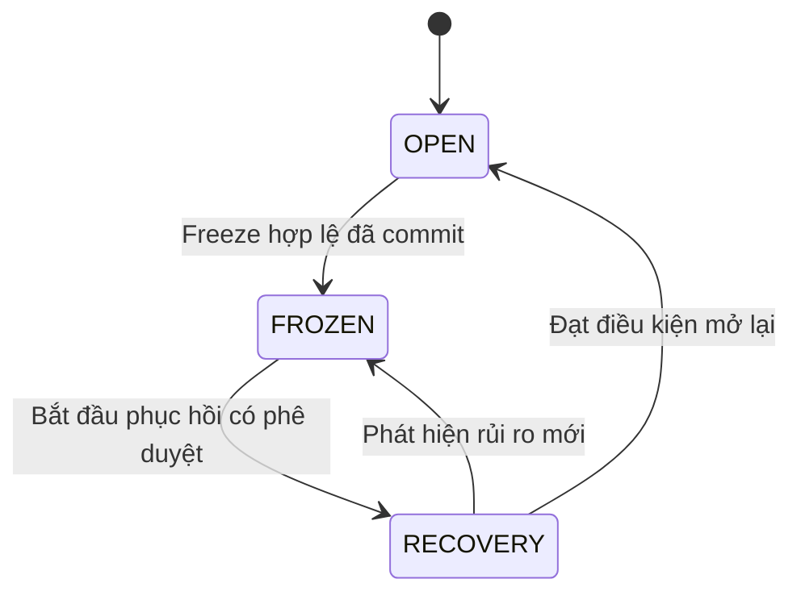

# Transaction freeze — Đóng băng giao dịch khi ứng phó sự cố logic nghiệp vụ

## 1. Mục tiêu và tình huống cần đóng băng

Trong chương **Incident Response** của bảo mật logic nghiệp vụ, **transaction freeze** là biện pháp tạm thời chặn một tập hành động nghiệp vụ có khả năng gây thêm thiệt hại trong lúc điều tra hoặc khắc phục sự cố. Phạm vi có thể là chi trả của một tenant, hoàn tiền của một tài khoản hoặc bước thực thi của một quy trình phê duyệt.

Ví dụ, hệ thống phát hiện cùng một yêu cầu hoàn tiền có thể bị thực hiện nhiều lần qua API và worker. Nhóm ứng phó cần ngăn những lần thực thi tiếp theo, xác định khoản nào đã ghi sổ hoặc đã được nhà cung cấp nhận, giữ bằng chứng và chỉ mở lại sau khi sửa lỗ hổng. Việc tắt nút “Hoàn tiền” trên giao diện không đủ nếu API, batch hoặc job retry vẫn hoạt động.

Sau bài học, bạn có thể:

- Chọn phạm vi đóng băng phù hợp với bất biến đang bị đe dọa.
- Định nghĩa chính xác thời điểm một lệnh freeze có hiệu lực.
- Chặn thực thi tại ranh giới transaction, kể cả khi request chạy đồng thời.
- Phân loại giao dịch chưa thực hiện, đang thực hiện, đã hoàn tất và chưa rõ kết quả.
- Giữ đúng quyền theo đối tượng, phê duyệt và idempotency khi đóng băng hoặc mở lại.
- Thiết kế kiểm thử và runbook chứng minh không có tác dụng phụ ngoài chính sách.

Các trạng thái, bảng SQL, endpoint và test harness trong bài là **thiết kế minh họa**. Chúng cần được ánh xạ vào mô hình quyền, database, ledger và hợp đồng nhà cung cấp của ứng dụng thực tế.

## 2. Đóng băng điều gì, và khác gì với các thao tác quen thuộc?

### 2.1. Freeze là một chính sách nghiệp vụ có trạng thái

Một freeze cần trả lời tối thiểu bốn câu hỏi: đối tượng nào bị ảnh hưởng, hành động nào bị chặn, từ ranh giới nào và ai có quyền thay đổi quyết định đó.

| Biện pháp | Tác dụng chính | Giới hạn cần hiểu |
| --- | --- | --- |
| Transaction freeze | Tạm chặn các chuyển trạng thái nghiệp vụ theo phạm vi | Không tự đảo ngược giao dịch đã hoàn tất |
| Khóa hàng trong database | Điều phối truy cập đồng thời trong một transaction | Không nên giữ khóa suốt nhiều giờ điều tra |
| Rollback transaction local | Hủy các thay đổi chưa commit trong transaction đó | Không tự hủy tác dụng đã được hệ thống ngoài chấp nhận |
| Hủy yêu cầu nghiệp vụ | Chuyển đối tượng sang trạng thái hủy theo quy tắc | Có thể không còn hợp lệ khi đã thực thi |
| Bút toán bù/hoàn tác nghiệp vụ | Ghi một hành động mới để điều chỉnh tác dụng trước đó | Cần quyền, điều kiện và chống lặp riêng |
| Circuit breaker | Hạn chế gọi một phụ thuộc đang lỗi | Không tự diễn đạt tenant, đối tượng hoặc quy tắc phê duyệt |
| Tạm dừng queue | Ngừng một đường xử lý nền | Không chặn API hoặc một consumer khác nếu chúng vẫn thực thi được |

Trong bài, freeze là trạng thái bền vững trong hệ thống. Database transaction dùng để ghi quyết định freeze phải ngắn; không mở một transaction rồi giữ kết nối và khóa cho tới khi sự cố kết thúc.

### 2.2. Một cam kết cụ thể thay cho lời hứa “đã dừng mọi thứ”

Hợp đồng minh họa:

> Khi freeze của phạm vi `(tenant, MONEY_OUT)` đã commit trên cơ chế điều phối có thẩm quyền, không một lần thực thi local mới nào trong phạm vi đó được commit nếu nó phải đi qua cùng cổng kiểm soát.

“Local” ở đây là các thay đổi nghiệp vụ thuộc transaction database minh họa. Những lệnh đã được gửi ra ngoài được phân loại và đối soát riêng; freeze local không chứng minh nhà cung cấp đã dừng xử lý.

Không dùng riêng thời gian nhận HTTP request để quyết định một giao dịch nằm trước hay sau freeze. Request đến trước nhưng chưa đi qua cổng thực thi vẫn có thể bị chặn. Request đã thực thi và commit trước ranh giới freeze vẫn là một kết quả cần được bảo toàn, đối soát.

## 3. Viết bất biến trước khi thiết kế nút freeze

Với luồng hoàn tiền mẫu, có thể đặt các bất biến sau:

| ID | Bất biến | Bằng chứng kiểm tra |
| --- | --- | --- |
| I1 | Freeze có hiệu lực thì không có lần thực thi local mới trong phạm vi bị chặn | Gate, execution record và thứ tự commit theo cơ chế điều phối |
| I2 | Một yêu cầu không sinh hai khoản hoàn tiền cho cùng nghĩa vụ | Unique constraint, ledger và idempotency record |
| I3 | Freeze không tự tạo phê duyệt hoặc sửa người thụ hưởng, giá trị, tiền tệ | Version đối tượng, approval record, dữ liệu nguồn |
| I4 | Người không có quyền trên tenant/đối tượng không thể freeze, unfreeze hoặc replay | Quyết định authorization và audit |
| I5 | Kết quả UNKNOWN không bị đổi thành FAILED chỉ để gửi lệnh mới | Attempt record và bằng chứng từ nhà cung cấp |
| I6 | Mở lại không làm sống lại quyền, OTP hoặc phê duyệt đã hết hiệu lực | Kiểm tra quyền và điều kiện tại lần thực thi mới |
| I7 | Không mất giao dịch hoặc bằng chứng chỉ vì queue đã được dọn | Đối soát từ tập lệnh/sự kiện nguồn tới kết quả |
| I8 | Hành động bù là lệnh riêng, có quyền và idempotency riêng | Liên kết lệnh gốc, lệnh bù và audit |

Freeze là hàng rào bổ sung. Các kiểm tra vốn có như số tiền hoàn không vượt số tiền được phép hoàn, trạng thái phê duyệt hợp lệ, tenant đúng và không tự duyệt vẫn phải được giữ.

Chẳng hạn, nếu tổng tiền đã bị sửa trái phép trước khi freeze, việc mở lại không khiến giá trị đó trở thành đáng tin. Cần xác định phiên bản dữ liệu hợp lệ và quy trình sửa hoặc phê duyệt lại trước khi thực thi.

## 4. Chọn phạm vi và lập ma trận hành động

### 4.1. Phạm vi cần dựa trên đường gây thiệt hại

| Phạm vi | Khi phù hợp | Nguy cơ nếu chọn quá hẹp |
| --- | --- | --- |
| Một yêu cầu | Một đối tượng cụ thể đang bị tranh chấp hoặc nghi bị lạm dụng | Kẻ tấn công tạo đối tượng khác để tiếp tục |
| Một tài khoản hoặc merchant | Rủi ro tập trung vào một chủ thể đã xác định | Các tài khoản liên kết tiếp tục gây thiệt hại |
| Một tenant | Khuyết điểm ảnh hưởng dữ liệu hoặc quyền trong tenant đó | Endpoint dùng tenant khác từ input để vượt phạm vi |
| Một loại hành động | Hoàn tiền, chi trả hoặc phát hành tài sản đang có lỗi | Cùng tác dụng được thực hiện qua tên lệnh khác |
| Toàn hệ thống | Chưa thể khoanh vùng hoặc có nguy cơ lan rộng | Chi phí gián đoạn lớn; phải có điều kiện thu hẹp |

Phải liệt kê API, worker, scheduler, công cụ vận hành, import và luồng replay có thể tạo cùng tác dụng. Đóng băng endpoint `/refunds/execute` nhưng để batch chi trả trực tiếp vào ledger vẫn không bảo vệ được bất biến.

Trong mô hình minh họa, mỗi tenant có một gate `MONEY_OUT` được tạo từ trước. Request không được tự chọn gate để kiểm tra; server suy ra tenant và loại hành động từ đối tượng cùng dữ liệu đã xác thực.

### 4.2. Không phải mọi thao tác đều phải bị chặn

Một chính sách có thể được định nghĩa như sau:

| Thao tác | Trong FROZEN | Điều kiện |
| --- | --- | --- |
| Xem trạng thái, tra cứu giao dịch | Cho phép | Vẫn kiểm tra quyền và che dữ liệu nhạy cảm |
| Gửi yêu cầu hoàn tiền mới | Từ chối tạm thời hoặc tiếp nhận vào trạng thái chờ | Phải công bố rõ lựa chọn của sản phẩm |
| Phê duyệt yêu cầu | Tùy chính sách | Không được dẫn tới tự thực thi; có thể cần phê duyệt lại |
| Thực thi hoàn tiền/chi trả | Chặn | Bao gồm API, worker và replay |
| Hủy yêu cầu chưa thực thi | Có thể cho phép | State machine và reservation cho phép |
| Ghi nhận bằng chứng kết quả từ provider | Cho phép có kiểm soát | Callback hợp lệ, đúng đối tượng; không phát thêm lệnh |
| Giải phóng reservation | Tùy trạng thái | Chỉ khi không còn nguy cơ external execution chưa rõ |
| Bút toán bù | Luồng riêng | Phê duyệt riêng; không có ngoại lệ admin mặc định |
| Thay đổi người thụ hưởng | Thường chặn trong phạm vi điều tra | Tránh làm sai bằng chứng hoặc chuyển rủi ro |
| Mở lại/replay backlog | Chặn với người dùng thông thường | Quy trình phục hồi có quyền riêng |

Bài chọn chính sách: **không tiếp nhận lệnh thực thi mới khi FROZEN**, nhưng vẫn cho phép đọc, điều tra và ghi nhận kết quả đã xảy ra. Nếu hệ thống cho phép tiếp nhận để chờ, phải có trạng thái rõ như `HELD_BY_INCIDENT`; không trả “đã hoàn tiền” cho một lệnh chỉ mới được giữ lại.

## 5. Tách trạng thái gate khỏi trạng thái giao dịch

### 5.1. Vòng đời gate minh họa



- `OPEN`: cho phép các hành động theo quyền và quy tắc bình thường.
- `FROZEN`: chặn tập hành động đã định, giữ bằng chứng và xử lý đối soát.
- `RECOVERY`: chỉ cho phép tập lệnh phục hồi được chọn rõ; người dùng thông thường chưa được thực thi như OPEN.

Mỗi chuyển trạng thái hợp lệ tăng một số phiên bản đơn điệu, gọi là `epoch`. Không đặt epoch về 0 khi mở lại. Ví dụ, OPEN/17 → FROZEN/18 → RECOVERY/19 → OPEN/20.

Trong mô hình này, lệnh thực thi thông thường chỉ được chạy ở OPEN. Lệnh phục hồi tại RECOVERY đi qua một policy riêng, có manifest lệnh được phép chạy, quyền thực hiện và kiểm tra trạng thái hiện tại. Không triển khai RECOVERY bằng điều kiện “khác FROZEN thì cho qua”.

### 5.2. Giao dịch nghiệp vụ vẫn có vòng đời riêng

Ví dụ:

```text
DRAFT -> SUBMITTED -> APPROVED -> EXECUTED
                   -> REJECTED

APPROVED -> CANCELLED nếu quy tắc còn cho phép
```

Freeze không tự đổi tất cả APPROVED thành CANCELLED, không đặt mọi giao dịch đang chạy thành FAILED và không chuyển giao dịch đã hoàn tất về trạng thái trước đó.

Nếu cần đánh dấu một yêu cầu bị giữ lại, có thể lưu hold record gắn với incident và gate epoch. Hold không thay thế approval record hoặc lịch sử thực thi. Điều này giúp mở lại đúng đối tượng mà không phải suy đoán trạng thái trước khi freeze.

## 6. Quyền điều khiển freeze và bằng chứng bắt buộc

### 6.1. Quyền ứng phó khác quyền thực thi tiền

Có quyền tạo hoàn tiền không đồng nghĩa có quyền mở lại toàn tenant. Cũng không nên để mọi service account được gắn nhãn “internal” tự vượt gate.

Một mô hình phân quyền minh họa:

- Incident operator được freeze trong phạm vi được giao.
- Incident reviewer được chấp thuận điều kiện phục hồi.
- Recovery operator được chạy các lệnh có trong manifest đã duyệt.
- Người dùng nghiệp vụ vẫn chỉ có quyền theo đối tượng và trạng thái thông thường.

Có thể cho phép freeze khẩn cấp bởi một chủ thể đã xác định để giảm thời gian ngăn thiệt hại, trong khi unfreeze cần một chủ thể khác phê duyệt. Đây là quyết định chính sách cần được chuẩn bị trước; không tạo ngoại lệ tạm thời trong lúc xử lý sự cố.

Nếu sử dụng quyền khẩn cấp, phải có danh tính riêng, phạm vi, thời hạn và audit. Quyền khẩn cấp không làm một giao dịch có số tiền sai trở thành hợp lệ.

### 6.2. Dữ liệu cần lưu cùng quyết định

Một thay đổi gate nên có:

```text
commandId, incidentId, tenantId, operationClass,
oldMode, newMode, oldEpoch, newEpoch,
requestedBy, approvedBy nếu chính sách yêu cầu,
reasonCode, evidenceReference, recordedAt, requestCorrelationId
```

Trạng thái gate, audit nghiệp vụ và idempotency record của lệnh điều khiển cần có ranh giới lưu nhất quán theo thiết kế. Nếu audit bắt buộc mà ghi thất bại, không trả thành công giả rồi mong log bên ngoài sẽ bù được bằng chứng.

Log phân phối hoặc thông báo cho vận hành có thể được phát qua outbox. Ý định phát nằm cùng transaction với thay đổi gate; lỗi gửi cảnh báo không được tự mở lại gate đã đóng băng.

Không ghi credential, OTP, số tài khoản đầy đủ hoặc payload nhạy cảm vào log chỉ để tiện điều tra. Dùng định danh tham chiếu và kho bằng chứng có quyền truy cập phù hợp.

## 7. Đặt cổng kiểm soát tại ranh giới thực thi local

### 7.1. Vì sao kiểm tra ở đầu request chưa đủ?

Một lịch chạy sai:

```text
A: đọc gate = OPEN
B: commit gate = FROZEN
A: ghi EXECUTED và ledger
```

Cả A và B đều “đã kiểm tra trạng thái”, nhưng không có cơ chế ràng buộc quyết định của A với freeze. Đây là khoảng hở giữa kiểm tra và sử dụng kết quả.

OWASP khuyến nghị có cổng kiểm soát cuối gắn với việc thực thi giao dịch, nhằm tránh bỏ qua ủy quyền hoặc sử dụng kết quả kiểm tra đã cũ. [OWASP — Transaction Authorization](https://cheatsheetseries.owasp.org/cheatsheets/Transaction_Authorization_Cheat_Sheet.html#28-system-should-check-each-transaction-execution-and-make-sure-it-has-been-properly-authorized).

Với freeze, kiểm tra ở gateway có thể giúp từ chối sớm, nhưng cổng có thẩm quyền vẫn phải ràng buộc với lần chuyển trạng thái tạo tác dụng nghiệp vụ.

### 7.2. Một thiết kế đơn giản với cùng gate row

Ví dụ PostgreSQL dưới đây dùng một gate row có sẵn cho mỗi tenant và loại hành động:

```sql
CREATE TABLE transaction_gate (
    tenant_id UUID NOT NULL,
    operation_class VARCHAR(40) NOT NULL,
    mode VARCHAR(16) NOT NULL
        CHECK (mode IN ('OPEN', 'FROZEN', 'RECOVERY')),
    epoch BIGINT NOT NULL CHECK (epoch >= 0),
    incident_id UUID,
    changed_by UUID,
    changed_at TIMESTAMPTZ NOT NULL DEFAULT CURRENT_TIMESTAMP,
    PRIMARY KEY (tenant_id, operation_class)
);
```

Hai đường **execute** và **freeze** đều lấy khóa trên cùng row trước khi thay đổi dữ liệu liên quan. Minh họa dùng transaction ngắn ở READ COMMITTED. Trong PostgreSQL, `SELECT ... FOR UPDATE` điều phối các khóa/xuất bản cập nhật xung đột trên row và giữ khóa tới khi transaction kết thúc; không có nghĩa các truy vấn đọc thông thường đều bị chặn. [PostgreSQL 18 — Row-Level Locks](https://www.postgresql.org/docs/18/explicit-locking.html#LOCKING-ROWS).

Khung thực thi local, chưa phải một script hoàn chỉnh:

```sql
BEGIN ISOLATION LEVEL READ COMMITTED;

SELECT mode, epoch
FROM transaction_gate
WHERE tenant_id = :resolved_tenant_id
  AND operation_class = 'MONEY_OUT'
FOR UPDATE;

-- Server yêu cầu tìm đúng một row và mode = OPEN.
-- Thiếu row hoặc không đọc được gate: không tiếp tục thực thi.
-- Sau đó xử lý idempotency và khóa đối tượng theo thứ tự thống nhất.

SELECT id, state, version, amount_minor, currency, beneficiary_id
FROM refund_request
WHERE tenant_id = :resolved_tenant_id
  AND id = :refund_id
FOR UPDATE;

-- Kiểm tra quyền hiện tại, phê duyệt, hạn mức, số tiền,
-- người thụ hưởng và kết quả idempotency đã có.
-- Các kiểm tra dữ liệu có thể thay đổi cũng cần đồng bộ thích hợp.

UPDATE refund_request
SET state = 'EXECUTED',
    version = version + 1,
    executed_gate_epoch = :locked_gate_epoch
WHERE tenant_id = :resolved_tenant_id
  AND id = :refund_id
  AND state = 'APPROVED'
  AND version = :expected_version
RETURNING id;

-- Yêu cầu đúng một row được cập nhật.
-- Ghi ledger và kết quả idempotency trong cùng transaction.
-- Bất kỳ bước bắt buộc nào lỗi: rollback toàn bộ transaction.

COMMIT;
```

Các cột và bảng như `refund_request`, ledger, idempotency được giả định đã tồn tại trong ứng dụng. Số tiền phải lấy từ dữ liệu nghiệp vụ đã kiểm tra ở server; không lấy giá trị tùy ý trong request để ghi sổ.

Đường freeze:

1. Xác thực người điều khiển và quyền trên tenant.
2. Bắt đầu transaction; khóa đúng gate row bằng cùng quy ước.
3. Kiểm tra `commandId`, expected epoch và chuyển trạng thái được phép.
4. Ghi FROZEN, tăng epoch; ghi audit và kết quả lệnh điều khiển.
5. Commit, sau đó mới trả rằng freeze local đã có hiệu lực.

Nếu row đã FROZEN, trả trạng thái hiện tại theo hợp đồng idempotency, không tạo một incident khác hay tăng epoch chỉ vì cùng lệnh bị gửi lại. Nếu freeze mở rộng phạm vi, đó phải là quyết định được ghi nhận rõ.

### 7.3. Thứ tự khóa tạo ra ranh giới nào?

| Bên lấy gate lock trước | Diễn biến | Kết luận |
| --- | --- | --- |
| Execute | Execute kiểm tra OPEN, ghi dữ liệu và commit; freeze chờ rồi commit | Execute nằm trước ranh giới freeze |
| Freeze | Freeze commit FROZEN; execute lấy lock sau và thấy FROZEN | Execute bị chặn, không ghi tác dụng nghiệp vụ mới |
| Freeze nhưng rollback | Không có thay đổi gate đã commit | Không được báo freeze thành công |
| Execute nhưng rollback | Không có thực thi local đã commit từ lần thử đó | Tiếp tục đối soát riêng nếu đã gọi hệ thống ngoài |

Cam kết chỉ đúng khi **mọi đường thực thi trong phạm vi đều tuân theo gate này**, và thao tác tạo tác dụng local nằm trong cùng transaction giữ khóa. Một hàm `isFrozen()` chạy ở transaction khác không tạo ra cam kết đó.

Gate row dùng khóa độc quyền trong ví dụ sẽ tuần tự hóa các lần thực thi cùng phạm vi, có thể gây nghẽn. Đây là mô hình dễ giải thích ranh giới, không phải cấu hình tối ưu cho mọi tải. Nếu thay bằng shared lock, permit service hoặc cơ chế khác, phải chứng minh lại quan hệ xung đột với freeze và kiểm thử trên database thật.

### 7.4. Tránh biến freeze thành sự cố khóa kéo dài

- Giữ transaction ngắn; không gọi network hoặc chờ người duyệt khi đang giữ gate lock.
- Quy định một thứ tự khóa chung, ví dụ gate → idempotency → đối tượng → tài nguyên ledger liên quan.
- Đặt ngân sách chờ và xử lý deadlock/serialization failure theo database thực tế.
- Nếu lệnh freeze chưa lấy được khóa hoặc chưa commit, trả trạng thái yêu cầu đang xử lý/thất bại phù hợp; không gắn nhãn “đã đóng băng”.
- Gate bị thiếu, nguồn trạng thái không truy cập được hoặc lỗi đọc không được mặc định là OPEN đối với hành động đang được bảo vệ.

Nếu hệ thống hỗ trợ cả gate toàn cục, tenant và tài khoản, cần thiết kế thứ tự khóa và quan hệ chồng lấp từ trước. Chỉ khóa các row tình cờ đang tồn tại có thể bỏ sót một phạm vi mới được thêm đồng thời.

## 8. Worker, queue và hệ thống phân tán

### 8.1. Job được tạo trước freeze vẫn phải bị kiểm soát

Một job APPROVED được đưa vào queue lúc gate OPEN không có quyền thực thi vĩnh viễn. Consumer phải kiểm tra lại gate cùng điều kiện nghiệp vụ tại ranh giới thực thi.

```text
Event đã commit -> Job chờ -> Worker nhận job
                              |
                              v
                 Gate + quyền + state + version
                       /                 \
                  được phép             bị freeze
                     |                     |
                 thực thi           giữ lại có lý do
```

Khi bị chặn:

- Giữ nhận diện lệnh và đối tượng để đối soát.
- Lưu lý do hold và gate epoch quan sát được theo thiết kế.
- Không tạo job mới liên tục hoặc retry nóng làm đầy queue.
- ACK hoặc chuyển queue theo cơ chế broker chỉ sau khi việc giữ lại đã bền vững, tránh làm mất công việc.
- Không đánh dấu EXECUTED chỉ để consumer ngừng retry.

Dữ liệu giữ lại có thể nằm ở database rồi ACK message, hoặc ở cơ chế trì hoãn bền vững của broker. Cần kiểm thử khoảng hở giữa ghi hold, ACK và restart theo lựa chọn thực tế.

### 8.2. Cache và sự kiện chỉ là phương tiện phân phối

Thông báo `GateFrozen` giúp các service dừng nhận việc sớm. Nhưng mất event, cache cũ, restart hoặc một worker không subscribe vẫn có thể tạo lỗ hổng nếu cache là hàng rào duy nhất.

Số epoch giúp phát hiện dữ liệu cũ: một worker đang giữ epoch 17 không được coi việc hệ thống đã đi qua freeze rồi mở lại ở epoch 20 là cùng một bối cảnh. Tuy nhiên, chỉ gắn số epoch vào JSON không ngăn được tác dụng phụ. Thành phần thực hiện tác dụng phải kiểm tra và cưỡng chế điều kiện đó.

Nếu mỗi service có database riêng, một row ở database A không tự bảo vệ commit tại database B. Cần một giao thức điều phối, cơ chế cưỡng chế tại từng nơi tạo tác dụng và định nghĩa rõ khả năng bảo đảm. Không gọi việc phát một event tới nhiều service là transaction freeze nguyên tử xuyên hệ thống.

### 8.3. Biểu diễn tiến độ áp dụng khi cần

Với hệ thống phân tán, nên tách:

```text
freezeRequest: đã nhận / đang triển khai / lỗi
localGate: FROZEN ở epoch nào
dispatchControl: đã dừng cấp lệnh mới hay chưa
externalExposure: còn in-flight / UNKNOWN / đã đối soát
```

Một dashboard chỉ hiển thị nút đỏ “Frozen” có thể che việc một đường dispatch vẫn hoạt động. Trạng thái thành công phải gắn với bảo đảm cụ thể và danh sách nơi chưa xác nhận.

Nếu không thể liên hệ nguồn kiểm soát có thẩm quyền trong network partition, đường thực thi được bảo vệ cần có hành vi đã định, thường là chặn hành động rủi ro và báo tạm gián đoạn. Không tự mở gate vì cache hết TTL.

## 9. Giao dịch đang bay và ranh giới với nhà cung cấp ngoài

### 9.1. Phân loại theo bằng chứng thay vì ép về một trạng thái

| Tình trạng khi freeze | Cách xử lý minh họa |
| --- | --- |
| Chưa được tiếp nhận | Từ chối tạm thời, không tạo execution/ledger |
| Đã tiếp nhận nhưng chưa thực thi | Giữ lại, không tự phát lệnh khi freeze còn hiệu lực |
| Đang trong transaction local, chưa commit | Tuân theo cơ chế khóa và thứ tự với freeze |
| Local execution đã commit | Bảo toàn kết quả; điều tra và bù riêng nếu cần |
| Đã tạo ý định dispatch nhưng chưa gửi | Chặn tại dispatcher, giữ ý định có thể đối soát |
| Đã gửi ra ngoài, chưa biết đã nhận hay chưa | UNKNOWN; tra cứu/đối soát, không gửi lại bằng ID mới tùy tiện |
| Provider đã nhận, còn xử lý | Theo dõi kết quả; yêu cầu hủy nếu hợp đồng hỗ trợ |
| Đã hoàn tất bên ngoài nhưng callback chưa tới | Ghi nhận bằng chứng khi xác minh được; không tạo execution thứ hai |

Không giải phóng số tiền đang reserve chỉ vì request timeout hoặc vừa freeze. Nếu provider vẫn có thể thực thi, giải phóng sớm có thể cho cùng nguồn tiền được dùng hai lần.

### 9.2. “Kiểm tra ngay trước send” vẫn có một khoảng hở

```text
Dispatcher: kiểm tra gate OPEN
Incident:   commit FROZEN
Dispatcher: gửi yêu cầu tới provider
```

Giữ một database transaction mở trong lúc gọi provider cũng không tạo rollback chung với provider. Nếu provider nhận lệnh rồi kết nối mất, local rollback không xóa được lệnh ngoài.

Vì vậy, phải phân biệt:

- Dừng cấp **quyền dispatch mới** sau ranh giới đã định.
- Các attempt đã được cấp quyền hoặc đã phát ra trước ranh giới.
- Tác dụng bên ngoài thực sự đã được xác nhận hoặc vẫn chưa rõ.

Nếu yêu cầu bảo đảm mạnh hơn, cần khả năng cưỡng chế tại nơi tạo tác dụng: chẳng hạn provider hỗ trợ khóa tài khoản, hủy lệnh đang chờ hoặc kiểm tra fencing token theo hợp đồng. Cơ chế đó phải được xác nhận và kiểm thử. Một provider không hiểu epoch của ứng dụng sẽ không tự từ chối lệnh cũ chỉ vì request có thêm trường `epoch`.

Không tuyên bố “sau freeze không còn tiền rời hệ thống” nếu thực tế chỉ ngừng tạo outbox mới. Báo rõ những attempt đang bay, rủi ro còn lại và tiến độ đối soát.

### 9.3. Callback trong lúc freeze

Callback có thể là bằng chứng của một sự kiện đã xảy ra trước đó. Chặn mọi callback có thể khiến hệ thống mất khả năng nhận biết khoản đã hoàn tất.

Endpoint callback vẫn cần xác thực nguồn, đối chiếu provider account, message/operation ID, tenant và đối tượng; xử lý lặp và thứ tự theo hợp đồng. Việc ghi nhận kết quả hợp lệ phải tách khỏi việc phát thêm hành động nghiệp vụ.

Ví dụ, callback xác nhận khoản hoàn tiền cũ đã thành công được phép cập nhật kết quả quan sát. Nó không được tự bỏ freeze rồi chi trả lệnh kế tiếp. Callback giả không được dùng để chuyển UNKNOWN thành một kết quả thuận tiện cho replay.

## 10. Idempotency khi đóng băng và mở lại

### 10.1. Ba loại nhận diện cần tách

| Nhận diện | Đại diện cho | Cần giữ qua |
| --- | --- | --- |
| Control command ID | Một lệnh freeze/unfreeze cụ thể | Retry của chính lệnh điều khiển |
| Business command ID/idempotency key | Một lệnh nghiệp vụ với nội dung xác định | Retry từ client, worker hoặc phục hồi |
| Provider operation ID/key | Một tác dụng gửi tới một provider trong phạm vi hợp đồng | Tra cứu, retry hoặc đối soát attempt tương ứng |

Dùng cùng business key với số tiền hoặc người thụ hưởng khác phải tạo xung đột theo hợp đồng, không âm thầm biến thành một yêu cầu mới. Key cần có phạm vi tenant/chủ thể/hành động phù hợp và không thay thế authorization.

### 10.2. Kết quả cũ và lệnh chưa được tiếp nhận

Hai tình huống cần phân biệt:

1. Lệnh đã EXECUTED trước freeze nhưng response bị mất: retry hợp lệ có thể trả kết quả đã lưu, không thực thi lại.
2. Lệnh bị từ chối trước khi tiếp nhận vì FROZEN: không được trả như đã hoàn tất; cần chỉ rõ có hay không công việc đang chờ.

Chính sách có thể không lưu lỗi freeze như kết quả nghiệp vụ cuối cùng, để sau phục hồi client được thử lại cùng lệnh theo hợp đồng. Nếu hệ thống lưu mọi response thành kết quả cố định, phải định nghĩa cách tiếp tục khác một cách rõ ràng; không hướng dẫn người dùng đổi key liên tục để tìm đường vượt gate.

Với một lệnh đã được tiếp nhận và đang HELD hoặc UNKNOWN, giữ nguyên nhận diện để tra cứu và phục hồi. Một key mới không giải quyết được việc chưa biết lệnh cũ đã gây tác dụng hay chưa.

Khả năng lưu và trả kết quả idempotency phụ thuộc provider/API. Ví dụ tài liệu Stripe mô tả hành vi riêng cho API v1 và v2; không lấy một giả định “retry luôn trả nguyên response cũ” áp dụng cho mọi tích hợp. [Stripe — Idempotent requests](https://docs.stripe.com/api/idempotent_requests).

### 10.3. Mở lại không làm mất lịch sử chống lặp

Không xóa idempotency record, execution record hoặc unique constraint khi dọn backlog. Nếu thời gian lưu key ngắn hơn thời gian sự cố, phải có chiến lược phát hiện lặp từ nghĩa vụ nghiệp vụ và dữ liệu thực thi lâu dài.

Replay phải kiểm tra lại trạng thái, version, quyền và phê duyệt cần thiết. Nếu quyền của người duyệt đã bị thu hồi hoặc phê duyệt chỉ hợp lệ trong một khoảng thời gian, cần chính sách rõ trước khi tiếp tục. Không cập nhật timestamp để làm bằng chứng hết hạn trông như còn mới.

## 11. Runbook đóng băng và phục hồi

### 11.1. Kích hoạt và xác nhận phạm vi

1. Ghi nhận incident, dấu hiệu lạm dụng và bất biến có nguy cơ bị phá vỡ.
2. Khoanh vùng tenant, tài khoản, loại hành động và các đường thực thi liên quan.
3. Chọn phạm vi freeze theo mức chắc chắn hiện có; ghi lý do nếu phải đóng rộng.
4. Người có quyền gửi lệnh điều khiển với command ID và expected epoch.
5. Đọc lại gate từ nguồn có thẩm quyền sau commit; ghi nhận phạm vi và epoch thực tế.
6. Kiểm chứng các đường API/worker bị chặn, không chỉ quan sát giao diện quản trị.
7. Liệt kê các attempt đang bay hoặc UNKNOWN và giao trách nhiệm đối soát.

Nếu freeze không commit hoặc một đường thực thi chưa được bảo vệ, báo rõ giới hạn. Không để incident operator nghĩ rằng một thông báo “đã nhận yêu cầu” đồng nghĩa mọi tác dụng đã dừng.

### 11.2. Bảo toàn dữ liệu và điều tra

Lưu bằng chứng từ dữ liệu nguồn: yêu cầu, phiên bản, approval, giá trị được duyệt, idempotency, ledger, outbox, attempt, callback và audit điều khiển. Phân biệt thời gian quan sát với thứ tự được xác nhận bởi transaction hoặc provider.

Chụp danh sách nghĩa vụ nghiệp vụ cần đối soát. Nếu chỉ truy vấn các job còn trong queue, những job bị xóa/mất sẽ biến mất khỏi điều tra.

Đối với dữ liệu nghi bị sửa giá hoặc đổi người thụ hưởng, tránh tự sửa hàng loạt trước khi giữ bằng chứng. Quy trình sửa dữ liệu phải nêu nguồn giá trị đúng, người phê duyệt và liên kết tới incident.

### 11.3. Điều kiện trước khi chuyển sang RECOVERY

Một checklist minh họa:

- Đường lạm dụng đã được sửa hoặc vô hiệu hóa và đã có kiểm chứng tương ứng.
- Quyền/credential bị xâm phạm đã được xử lý; không dựa vào freeze để thay thế việc thu hồi quyền.
- Các giao dịch EXECUTED, HELD, UNKNOWN và đang xử lý đã được thống kê.
- Khoản cần bù hoặc hủy có lệnh riêng với quyền và chống lặp.
- Backlog đã được kiểm tra hạn dùng, dữ liệu, quyền và trạng thái.
- Có manifest phục hồi nêu chính xác lệnh, version, hạn mức và người thực hiện.
- Có điều kiện dừng và quyền freeze lại ngay khi xuất hiện bất biến bị vi phạm.

Không bắt buộc mọi hệ thống phải chờ tất cả UNKNOWN biến mất mới có thể mở một phạm vi độc lập khác. Nhưng phải chứng minh sự độc lập về tài nguyên, nghĩa vụ và hạn mức; không chỉ tách chúng thành hai queue có tên khác nhau.

### 11.4. Mở có kiểm soát và theo dõi

Bắt đầu từ tập nhỏ đã duyệt ở RECOVERY, kiểm tra số tiền, ledger và kết quả provider sau mỗi đợt theo ngân sách đặt trước. Rate limit giúp kiểm soát tải; nó không thay thế validation hoặc authorization.

Chỉ chuyển OPEN khi điều kiện chính sách đạt. Tăng epoch, ghi người phê duyệt, lý do và audit. Nếu phải quay về FROZEN, giữ lịch sử và trạng thái lệnh đã thực hiện; không reset mọi thứ để “chạy lại từ đầu”.

Thông báo cho người dùng cần phản ánh đúng tình trạng: tạm dừng thực thi, đang chờ xử lý hay đã hoàn tất. Không công bố thành công cho lệnh còn giữ lại và không tiết lộ chi tiết nhạy cảm của sự cố qua response công khai.

## 12. Kiểm thử freeze theo tác dụng nghiệp vụ

### 12.1. Test harness cần nhìn được dữ liệu đã commit

Các ví dụ Java dưới đây là mã minh họa cho integration test, không phải project chạy độc lập.

| Thành phần | Hợp đồng |
| --- | --- |
| `fixtures.committedApprovedRefund()` | Tạo tenant, gate OPEN và yêu cầu đã được duyệt; commit fixture |
| `controls.freeze(...)` | Chạy lệnh điều khiển thật; khi trả thành công thì gate local đã commit |
| `refunds.executeLocal(...)` | Thực thi nghiệp vụ thật với idempotency và database |
| `worker.runOne(...)` | Xử lý một job có điều khiển, không có scheduler nền cạnh tranh |
| `inspect.businessSnapshot(...)` | Đọc state, version, số tiền, approval và ledger trong ngữ cảnh mới |
| `inspect.gate(...)` | Đọc gate đã commit, không dùng cache của request trước |
| `provider` | Fake/stub giữ riêng lệnh đã nhận để kiểm tra tác dụng ngoài |

Test không nên được bọc trong một transaction rollback che khuất commit thật của service. Gate, ledger và kết quả phải được đọc trong ngữ cảnh quan sát phù hợp.

### 12.2. Freeze có hiệu lực thì không tạo execution mới

```java
@Test
void frozenScopeRejectsNewLocalExecution() {
    var f = fixtures.committedApprovedRefund();
    var before = inspect.businessSnapshot(f.refundId());

    controls.freeze(
        f.incidentOperator(),
        f.tenantId(),
        "MONEY_OUT",
        "freeze-command-1",
        f.gateEpoch()
    );

    assertEquals("FROZEN", inspect.gate(f.tenantId()).mode());

    assertThrows(ScopeFrozen.class, () ->
        refunds.executeLocal(
            f.requester(),
            f.refundId(),
            "refund-command-1"
        )
    );

    assertEquals(before, inspect.businessSnapshot(f.refundId()));
    assertEquals(0, inspect.executionCount(f.refundId()));
    assertEquals(0, inspect.dispatchIntentCount(f.refundId()));
    assertEquals(0, provider.acceptedCount());
}
```

Snapshot loại trừ audit hợp lệ của lần bị từ chối và thay đổi gate, vì các dữ liệu đó được phép thay đổi. Nó phải bao gồm tác dụng nghiệp vụ cần bảo vệ, không chỉ một cột state.

### 12.3. Kiểm thử race bằng hai lịch có điều khiển

Không chỉ bắn nhiều request rồi hy vọng race xuất hiện. Dùng hai kết nối/transaction thực và barrier hoặc hook được đặt đúng trước/sau khi lấy gate lock.

| Lịch | Các bước điều khiển | Kỳ vọng |
| --- | --- | --- |
| Freeze thắng | Freeze lấy gate lock; bắt đầu execute và xác nhận nó chưa qua lock; commit freeze | Execute đọc FROZEN rồi từ chối; không có execution/ledger mới |
| Execute thắng | Execute lấy gate lock khi OPEN; bắt đầu freeze và xác nhận nó phải chờ; commit execute; cho freeze tiếp tục | Có đúng một execution trước ranh giới; freeze commit; execute tiếp theo bị chặn |
| Freeze rollback | Freeze giữ lock rồi bị lỗi trước commit | Không báo FROZEN đã có hiệu lực; dữ liệu gate vẫn đúng trạng thái đã commit trước đó |
| Execute rollback | Tạo lỗi sau cập nhật state nhưng trước commit ledger/idempotency bắt buộc | Không có state EXECUTED hoặc ledger một phần đã commit |

Phải có timeout hữu hạn và giải phóng barrier trong cleanup để test không treo khi thất bại. Việc mock repository trả FROZEN không chứng minh tính điều phối của row lock.

### 12.4. Ma trận kiểm thử bảo mật và phục hồi

| Ca | Kết quả cần kiểm tra |
| --- | --- |
| Người ở tenant A freeze tenant B | Bị từ chối; gate và dữ liệu B không đổi |
| Thiếu gate hoặc nguồn gate lỗi | Hành động được bảo vệ không mặc định chạy |
| API bị chặn nhưng worker còn backlog | Worker cũng không tạo execution mới |
| Replay qua công cụ vận hành | Vẫn qua quyền, gate và version; không có bypass theo nhãn internal |
| Cùng freeze command gửi hai lần | Cùng kết quả đã định; không nhân quyết định hoặc epoch tùy tiện |
| Lệnh unfreeze dùng expected epoch cũ | Không ghi đè một freeze mới hơn |
| Gate đi OPEN → FROZEN → OPEN | Worker cũ không dùng permit/version cũ như bằng chứng còn hợp lệ |
| Response execute bị mất trước freeze | Retry hợp lệ trả/tra cứu kết quả cũ; không thực thi lại |
| Provider nhận lệnh rồi timeout | UNKNOWN được giữ; không giải phóng tiền hoặc tạo key mới tùy tiện |
| Callback hợp lệ tới khi FROZEN | Ghi nhận bằng chứng cũ, không kích hoạt giao dịch kế tiếp |
| Callback giả/trùng/sai đối tượng | Không tạo tác dụng mới hoặc thay sai kết quả |
| Quyền hoặc approval hết hạn trong hold | Phục hồi yêu cầu điều kiện hợp lệ theo chính sách |
| Payload hoặc số tiền thay đổi trên key cũ | Xung đột, không thực thi nội dung mới |
| Restart sau freeze | Gate vẫn FROZEN; cache mặc định không mở đường |
| Gate commit nhưng phát cảnh báo lỗi | Không tự mở lại; ý định cảnh báo còn để xử lý |
| Phục hồi thất bại giữa đợt | Phân biệt lệnh đã thực hiện và chưa thực hiện; freeze lại không làm lặp |
| Tenant không thuộc phạm vi | Tuân theo chính sách riêng; không bị chặn hoặc cho qua do nhầm tenant |

Với external dispatch, cần một fake/stub giữ được tình huống “đã nhận nhưng chưa trả lời”. Nếu mỗi lần restart worker lại reset cả fake provider, test sẽ xóa mất bằng chứng của lệnh đã nhận.

## 13. Quan sát hiệu lực và tránh kết luận sai

Các chỉ số hữu ích gồm:

| Nhóm | Quan sát |
| --- | --- |
| Áp dụng freeze | Mode/epoch theo phạm vi, thời gian từ yêu cầu tới commit, đường xử lý chưa xác nhận |
| Vi phạm | Lần thực thi local mới trái với gate; request đi qua đường chưa được kiểm soát |
| Backlog | Số HELD, tuổi công việc cũ nhất, số lệnh hết hạn hoặc cần phê duyệt lại |
| Bên ngoài | Attempt đang bay, UNKNOWN, số khoản đã được đối soát và exposure còn lại |
| Toàn vẹn | Execution trùng, nghĩa vụ không có kết quả tương ứng, ledger sai lệch |
| Điều khiển | Freeze/unfreeze/replay bị từ chối, expected epoch xung đột, thao tác khẩn cấp |
| Phục hồi | Tiến độ manifest, sai lệch theo đợt, nguyên nhân phải freeze lại |

Không dùng “API trả lỗi” làm bằng chứng duy nhất rằng không có tiền được ghi sổ. Không dùng “queue rỗng” để kết luận phục hồi xong. Cần đối chiếu từ lệnh/sự kiện nguồn tới execution, ledger và kết quả bên ngoài.

Một freeze toàn tenant cũng có thể trở thành mục tiêu gây gián đoạn nếu quyền điều khiển bị lạm dụng. Theo dõi tần suất và phạm vi thao tác, nhưng không tự unfreeze chỉ vì vượt thời gian mong muốn. Một mốc thời gian nhắc đánh giá lại khác với giấy phép tự mở lại.

Nếu có `reviewAt`, đó là thời điểm phải đánh giá. Nếu sản phẩm có cơ chế tự hết hạn freeze, điều kiện đó phải được thiết kế và kiểm thử riêng; không dùng TTL mặc định của cache làm thời hạn nghiệp vụ.

## 14. Bài tập áp dụng

Một tenant có ba yêu cầu hoàn tiền:

- R1 đã được provider nhận nhưng response bị mất; ứng dụng đang UNKNOWN.
- R2 đã APPROVED, còn trong queue, chưa có attempt gửi.
- R3 vừa tới API, chưa được tiếp nhận.

Nhóm ứng phó phát hiện lỗ hổng có thể bỏ qua approval qua endpoint batch và đóng băng `MONEY_OUT` ở epoch 42. Trong thời gian freeze, quyền duyệt của người đã duyệt R2 bị thu hồi; một người khác thử đổi số tiền R2 rồi gửi lại cùng key.

Hãy thực hiện:

1. Xác định mọi đường API, batch, worker và replay cần cùng tuân theo gate.
2. Mô tả ranh giới freeze local và các tác dụng ngoài chưa thể khẳng định đã dừng.
3. Thiết kế đối soát R1 mà không đổi key hoặc giải phóng reservation vì timeout.
4. Giữ R2 mà không tạo execution; xác định yêu cầu phê duyệt lại theo chính sách.
5. Từ chối sửa nội dung trên key cũ và kiểm tra quyền trên đúng đối tượng.
6. Trả tình trạng chính xác cho R3, nêu rõ có hay không công việc đã được tiếp nhận.
7. Lập manifest phục hồi, điều kiện chuyển RECOVERY và tiêu chí freeze lại.
8. Viết hai test race theo mục 12.3 và một test callback R1 tới sau freeze.

Bài làm đạt cần có bằng chứng rằng freeze đã chặn các lần thực thi mới trong phạm vi đã cam kết, R1 vẫn được đối soát đúng, R2 không vượt phê duyệt bằng replay và R3 không bị báo thành công giả. Khi mở lại, lịch sử thực thi và chống lặp phải còn đủ để tiếp tục an toàn; mọi điều chỉnh giao dịch cũ phải đi qua lệnh nghiệp vụ có quyền và bằng chứng riêng.

