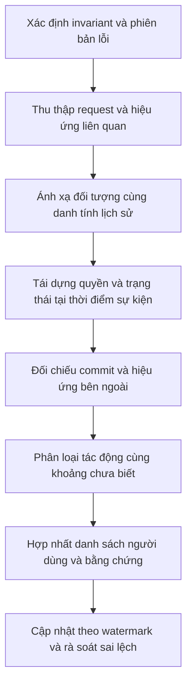

# Affected user identification

## 1. Mục tiêu và phạm vi

Trong ứng phó sự cố bảo mật logic nghiệp vụ, **affected user identification** là quá trình xác định người dùng nào đã hoặc có thể đã chịu tác động khi một quy tắc nghiệp vụ bị vi phạm. Kết quả phải trả lời được: ai bị ảnh hưởng, qua đối tượng nào, vào thời điểm nào, với tác động gì, dựa trên bằng chứng nào và còn điều gì chưa biết.

Một danh sách tài khoản xuất hiện trong access log chưa đủ để trả lời các câu hỏi đó. Người gửi request có thể đang tác động vào đơn hàng của người khác. Một request trả lỗi có thể đã commit dữ liệu. Một request thành công có thể chỉ tạo tác vụ chờ, chưa làm thay đổi hàng hóa hoặc tiền. Ngược lại, dữ liệu nhạy cảm có thể đã được trả ra dù không có thay đổi trong cơ sở dữ liệu.

Bài học đặt việc xác định người bị ảnh hưởng trong phạm vi **business logic security**: kiểm tra business invariants, trạng thái nghiệp vụ, quyền theo đối tượng, transaction, idempotency và hiệu ứng bên ngoài hệ thống. Mục tiêu thực hành là tạo một tập kết quả có thể giải thích, kiểm tra lại và cập nhật khi bằng chứng mới xuất hiện.

Ví dụ xuyên suốt: endpoint thay đổi địa chỉ giao hàng đã kiểm tra đăng nhập nhưng thiếu kiểm tra quyền sửa **từng đơn hàng**. Một tài khoản có thể thay `orderId` để thao tác đơn thuộc người khác. Nhóm ứng phó cần xác định chủ đơn nào bị ảnh hưởng, thông tin người nhận nào có thể bị lộ và kiện hàng nào đã sử dụng địa chỉ bị sửa.

## 2. Bắt đầu từ invariant bị phá vỡ

Trước khi viết truy vấn, mô tả rõ hành vi đúng mà hệ thống phải bảo vệ:

> Một yêu cầu đổi địa chỉ chỉ được áp dụng khi người gọi có quyền thao tác đơn hàng tại thời điểm yêu cầu, thông tin thay đổi hợp lệ và trạng thái đơn còn cho phép đổi địa chỉ. Snapshot được gửi cho hệ thống giao hàng phải xuất phát từ một thay đổi đã được phép.

Invariant này dẫn tới các câu hỏi điều tra khác nhau:

| Câu hỏi | Bằng chứng cần tìm | Người có thể bị ảnh hưởng |
| --- | --- | --- |
| Có thao tác vượt quyền trên đối tượng không? | Người gọi đã xác thực, đơn được máy chủ thực sự truy cập, chính sách quyền tại thời điểm đó | Chủ đơn và các chủ thể dữ liệu liên quan |
| Thay đổi có commit không? | Audit hoặc lịch sử thay đổi gắn với transaction và đối tượng | Chủ đơn có địa chỉ bị đổi trái phép |
| Dữ liệu có bị trả ra ngoài quyền không? | Bằng chứng về các trường thực sự được đưa ra trong phản hồi | Người có tên, địa chỉ, số điện thoại hoặc dữ liệu khác trong phản hồi |
| Hệ thống giao hàng có dùng dữ liệu bị sửa không? | Phiên bản địa chỉ trong shipment snapshot, outbox và xác nhận bên giao hàng | Chủ đơn, người nhận dự kiến và người chịu trách nhiệm vận hành |
| Việc sửa đã được hoàn tác trước khi giao chưa? | Lịch sử phiên bản, thời điểm sửa lại và snapshot bên giao hàng | Người có thay đổi trái phép nhưng mức hậu quả có thể đã được giảm |

Không dùng hậu quả cuối cùng để xóa sự kiện vi phạm trước đó. Địa chỉ bị sửa trái phép rồi được khôi phục vẫn là một trường hợp đã bị ảnh hưởng về tính toàn vẹn. Nếu dữ liệu đã bị lộ, hoàn tác địa chỉ không thể làm mất đi sự phơi nhiễm đó.

Đối với sự cố khác, hãy thay invariant tương ứng: giới hạn sử dụng coupon, tổng tiền hoàn không vượt khoản đã thu, chỉ người có quyền mới được phê duyệt, hay mỗi yêu cầu idempotent chỉ tạo một hiệu ứng. Cách lập luận vẫn bắt đầu từ điều kiện nghiệp vụ bị phá vỡ rồi lần theo người chịu tác động.

## 3. Phân biệt vai trò trước khi đếm người

Một sự kiện có thể liên quan nhiều danh tính với vai trò khác nhau:

| Vai trò | Ý nghĩa | Sai lầm thường gặp |
| --- | --- | --- |
| Actor | Tài khoản hoặc service principal thực hiện thao tác | Coi mọi actor là nạn nhân hoặc kết luận ngay đó là con người tấn công |
| Object owner | Người hoặc tổ chức sở hữu đối tượng tại thời điểm liên quan | Dùng chủ sở hữu hiện tại cho một đối tượng đã đổi chủ |
| Data subject | Người có dữ liệu xuất hiện trong đối tượng hoặc phản hồi | Chỉ tìm user ID, bỏ sót người nhận hàng không có tài khoản |
| Intended recipient | Người nhận hợp lệ theo giao dịch | Cho rằng luôn trùng với người mua hàng |
| Beneficiary | Bên thực tế nhận lợi ích từ hành vi | Coi địa chỉ do actor nhập là bằng chứng đã nhận hàng |
| Tenant | Phạm vi tổ chức hoặc khách hàng chứa dữ liệu | Gộp các user ID giống nhau từ nhiều tenant |

Tài khoản thực hiện request có thể đã bị chiếm quyền. Nhãn `actor` chỉ mô tả vai trò quan sát được, không kết luận danh tính người đứng sau. IP, thiết bị, email gần giống hoặc địa chỉ giao hàng chung là đầu mối điều tra; chúng không tự chứng minh hai tài khoản thuộc cùng một người.

Ví dụ, actor `U-A` sửa đơn của `U-B`, trong đơn có thông tin người nhận `R-C`. Tập người bị ảnh hưởng có thể bao gồm `U-B` và `R-C`; `U-A` cần nằm trong tập actor để điều tra. Chỉ đưa `U-A` vào tập người bị ảnh hưởng nếu có bằng chứng riêng, chẳng hạn tài khoản này bị chiếm quyền hoặc có đơn của chính họ bị tác động.

Trong hệ thống nhiều tenant, định danh chuẩn thường là cặp `(tenant_id, user_id)`, trừ khi kiến trúc bảo đảm `user_id` duy nhất toàn cục. Không dùng email hiện tại làm khóa duy nhất: email có thể đổi, được tái sử dụng hoặc khác với thông tin lịch sử.

## 4. Chọn cửa sổ điều tra và nguồn bằng chứng

### 4.1. Cửa sổ điều tra có nhiều mốc

Không mặc định thời điểm cảnh báo đầu tiên là thời điểm bắt đầu sự cố. Cũng không mặc định thời điểm deploy bản vá là thời điểm mọi hậu quả kết thúc.

Cần xác định ít nhất:

- **Cửa sổ tồn tại lỗ hổng:** phiên bản hoặc cấu hình dễ tổn thương bắt đầu phục vụ request từ lúc nào, trên instance, vùng và luồng xử lý nào.
- **Cửa sổ hành vi quan sát được:** request hoặc hành động nghi vấn sớm nhất và muộn nhất đã có bằng chứng.
- **Cửa sổ hiệu ứng:** job, outbox, cache hoặc dịch vụ giao hàng còn tiếp tục xử lý dữ liệu phát sinh trước khi chặn lỗi trong bao lâu.
- **Cửa sổ dữ liệu sẵn có:** nguồn nào còn log đầy đủ, nguồn nào bị sampling, đã hết thời hạn lưu hoặc có khoảng mất dữ liệu.

Ví dụ, API được vá lúc 10:00 nhưng lệnh đổi địa chỉ trong queue vẫn được worker cũ xử lý lúc 10:12. Phạm vi hậu quả phải theo cả các lệnh đó. Một lệnh khôi phục địa chỉ trong ứng dụng lúc 10:15 cũng chưa chứng minh bên giao hàng đã thay snapshot cũ.

Chuẩn hóa thời gian về UTC và giữ timestamp gốc cùng múi giờ khi cần đối chiếu. Phân biệt `event_time` với `ingested_at`: sự kiện xảy ra lúc 09:55 có thể chỉ được đưa vào kho phân tích lúc 10:20. Với nguồn có lệch đồng hồ, ghi nhận khoảng bất định thay vì ép ra một thứ tự chính xác giả tạo.

Dùng khoảng thời gian nửa mở `[from, to)` cho mỗi lần truy vấn để giảm trùng lặp ở ranh giới. Chạy bù cho dữ liệu đến muộn bằng watermark và hợp nhất theo khóa sự kiện ổn định; không chỉ tăng `from` rồi bỏ qua toàn bộ quá khứ.

### 4.2. Mỗi nguồn chứng minh một phần khác nhau

| Nguồn | Giá trị chính | Giới hạn cần ghi nhận |
| --- | --- | --- |
| Gateway hoặc application request log | Người gọi, route, phiên bản dịch vụ, thời gian và tương quan request | HTTP 200 không chứng minh commit; HTTP 500 không chứng minh rollback |
| Authentication và session audit | Principal thực sự được xác thực, phiên đăng nhập, tenant | Không tự chứng minh người thật đang điều khiển tài khoản |
| Authorization decision hoặc lịch sử quyền | Quyền được cấp, bị thu hồi, phạm vi ủy quyền | Log từ chính bộ kiểm tra bị lỗi có thể ghi allow sai |
| Database audit, CDC hoặc lịch sử nghiệp vụ | Thay đổi trước/sau, phiên bản đối tượng, liên kết transaction | Dữ liệu hiện tại không thể hiện đầy đủ lịch sử; phải hiểu transaction đã commit hay chưa |
| Outbox và inbox | Ý định gửi đi, tiếp nhận, retry, khóa idempotency | Có outbox chưa đồng nghĩa dịch vụ bên ngoài đã thực hiện |
| Dịch vụ giao hàng hoặc thanh toán | Snapshot đã nhận, hiệu ứng thực tế và trạng thái xác nhận | Có thể trả dữ liệu trễ hoặc không giữ lịch sử đủ chi tiết |
| Ticket và phản ánh người dùng | Dấu hiệu hậu quả, thông tin bổ sung | Chỉ phản ánh người đã phát hiện và chủ động báo |

Trong ví dụ, việc tái dựng quyền phải dựa vào chính sách **đáng lẽ phải áp dụng**, cùng chủ đơn và ủy quyền lịch sử. Không coi dòng log `authorization=ALLOW` của phiên bản có lỗi là bằng chứng thao tác hợp lệ.

Lưu tham chiếu tới bằng chứng gốc, nguồn, thời gian thu thập và người hoặc job tạo bản trích xuất. Hash giúp phát hiện bản trích xuất thay đổi sau khi lưu, nhưng tự nó không chứng minh nguồn ban đầu đúng hoặc đầy đủ. Tránh sao chép toàn bộ dữ liệu cá nhân vào bảng phân tích nếu chỉ cần định danh và tham chiếu kiểm chứng.

## 5. Xây dựng tập ứng viên trước, phân loại sau

Một quy trình có thể kiểm tra lại gồm các bước sau:



### 5.1. Tạo tập ứng viên đủ rộng

Điểm xuất phát có thể là các request đi vào route dễ tổn thương trên build và cấu hình liên quan. Sau đó mở rộng theo `order_id`, transaction, outbox, shipment và các route thay thế có cùng lỗi. Nếu có xử lý theo lô, một request có thể tác động nhiều đơn; phải mở rộng xuống từng đối tượng.

Không chỉ lấy request trả 2xx, request từ IP đã biết hoặc người dùng đã gửi ticket. Các bộ lọc đó có thể làm mất trường hợp thành công một phần, actor khác hoặc nạn nhân chưa nhận ra hậu quả.

Với lỗi quyền theo đối tượng, phân biệt **tenant của actor** và **tenant thực sự của đối tượng bị truy cập**. Nếu truy vấn log chỉ trong tenant của actor, sự cố vượt tenant có thể bị bỏ sót ngay từ bước lập ứng viên.

### 5.2. Ánh xạ qua định danh đáng tin cậy

Ưu tiên đối tượng mà máy chủ đã thực sự resolve hoặc sửa trong transaction, không chỉ `orderId` do client khai báo. Dùng khóa gồm tenant và đối tượng theo mô hình dữ liệu. Ánh xạ chủ sở hữu, người nhận và quyền ủy nhiệm tại thời điểm liên quan.

Nếu chỉ còn địa chỉ email, tên hoặc số điện thoại chưa xác minh, lưu trường hợp vào nhóm chưa ánh xạ chắc chắn. Không tự gộp các tài khoản theo độ giống chuỗi. Một data subject không có tài khoản vẫn cần được giữ trong danh sách chủ thể liên quan, tách khỏi số lượng tài khoản người dùng đã xác định.

### 5.3. Tái dựng quyền, trạng thái và hiệu ứng

Đối với từng ứng viên, trả lời theo thứ tự:

1. Danh tính actor có được xác thực và gắn chắc với request không?
2. Đối tượng đích và chủ thể liên quan có được xác định chắc không?
3. Theo chính sách đúng và dữ liệu lịch sử, actor có quyền thực hiện thao tác không? Có ủy quyền, vai trò hỗ trợ hoặc service principal hợp lệ không?
4. Tại thời điểm thao tác có hiệu lực, trạng thái nghiệp vụ có cho phép thay đổi không?
5. Thay đổi có commit, có đưa dữ liệu ra ngoài hoặc có phát sinh hiệu ứng bên ngoài không?
6. Có bước khôi phục nào đã hoàn tất, và bước đó khôi phục được loại tác động nào?

Không suy luận vượt quyền chỉ bằng `actor_user_id != owner_user_id`. Nhân viên hỗ trợ hoặc người được ủy quyền có thể có quyền hợp lệ. Ngược lại, actor là chủ đơn cũng không tự làm cho một thao tác bỏ qua phê duyệt hoặc sửa đơn sau trạng thái khóa trở nên hợp lệ.

## 6. Phân loại ảnh hưởng và biểu diễn điều chưa biết

Cần công bố định nghĩa phân loại trước khi tổng hợp số lượng:

| Nhãn | Điều kiện sử dụng | Ví dụ |
| --- | --- | --- |
| `CONFIRMED` | Có bằng chứng đủ để liên kết chủ thể với ít nhất một tác động của vi phạm | Thay đổi trái quyền đã commit trên đơn của người đó |
| `POTENTIAL` | Có đường phơi nhiễm liên quan nhưng còn thiếu bằng chứng để xác nhận tác động | Request vào đường lỗi nhưng lịch sử commit hoặc phản hồi bị thiếu |
| `EXCLUDED_WITH_EVIDENCE` | Có bằng chứng giải thích ứng viên không vi phạm điều kiện đang xét | Quyền ủy nhiệm lịch sử hợp lệ và trạng thái thay đổi cũng hợp lệ |

Nhãn loại trừ luôn gắn với **phạm vi kiểm tra cụ thể**. Chứng minh một thao tác không vượt quyền không tự loại trừ tác động do bỏ qua state machine trong cùng sự cố. Một người có nhiều sự kiện chỉ cần có một tác động đã xác nhận để thuộc tập `CONFIRMED` ở cấp người dùng.

Tách nhãn ảnh hưởng khỏi **loại tác động**, **mức nghiêm trọng** và **độ tin cậy**. Ví dụ:

```text
subject: (tenant-T2, user-U17)
affected_status: CONFIRMED
impact_types: [UNAUTHORIZED_ADDRESS_CHANGE]
external_effect_status: UNKNOWN
evidence_quality: HIGH_FOR_DB_CHANGE
remediation_status: ADDRESS_RESTORED_IN_APP
```

Bản ghi này xác nhận thay đổi trái phép trong ứng dụng, nhưng chưa khẳng định kiện hàng đã bị chuyển hướng hay đã được khôi phục ở bên giao hàng. Không nén tất cả ý nghĩa đó thành một cột `affected=true`.

Một người có nhiều loại tác động có thể xuất hiện trong nhiều thống kê theo loại. Tổng các nhóm tác động vì vậy có thể lớn hơn tổng số người duy nhất. Khi báo cáo, ghi rõ đơn vị đếm là người dùng, chủ thể dữ liệu, đơn hàng, request, shipment hay giao dịch tiền.

Không có bản ghi trong một nguồn bị thiếu log phải được hiểu là **không biết**, không phải **không xảy ra**. Nếu thời hạn lưu không bao phủ toàn bộ cửa sổ lỗ hổng, báo số đã xác nhận như một giới hạn dưới kèm khoảng thiếu dữ liệu; không biến nó thành tổng số nạn nhân chắc chắn của toàn sự cố.

## 7. Ví dụ truy vấn tạo bằng chứng cho nhóm vượt quyền

Đoạn SQL sau minh họa bằng PostgreSQL và các view điều tra giả định. Đây là mẫu thiết kế, không phải truy vấn để chạy nguyên trạng trên hệ thống thật.

Các view cần có hợp đồng rõ ràng:

- `incident_request_evidence`: một hàng cho mỗi sự kiện request đã chuẩn hóa; `target_tenant_id` và `target_order_id` lấy từ đối tượng máy chủ đã resolve, tách khỏi tenant của actor.
- `reconstructed_order_authorization`: tối đa một kết luận trên mỗi sự kiện, tái dựng từ chính sách đúng và quyền lịch sử; `decision` là `ALLOWED`, `DENIED` hoặc `UNKNOWN`. `DENIED` chỉ được dùng khi đã đủ dữ liệu cần thiết.
- `order_effect_evidence`: tối đa một hàng tổng hợp trên mỗi sự kiện, thể hiện bằng chứng commit và việc trả trường nhạy cảm. Bằng chứng không xác định được để `NULL` hoặc `UNKNOWN`, không ép thành `false`.
- `order_owner_at_event`: ánh xạ chủ đơn tại thời điểm sự kiện, có kiểm tra khoảng hiệu lực không chồng lấn. Thiếu ánh xạ phải được giữ lại để điều tra.

```sql
WITH candidates AS (
    SELECT
        request_event_id,
        event_time,
        actor_tenant_id,
        actor_user_id,
        actor_identity_verified,
        target_tenant_id,
        target_order_id
    FROM incident_request_evidence
    WHERE environment = 'production'
      AND http_method = 'PATCH'
      AND route_template = '/orders/{orderId}/delivery-address'
      AND service_build = ANY (:vulnerable_builds)
      AND event_time >= :from_utc
      AND event_time < :to_utc
), assessed AS (
    SELECT
        c.*,
        o.owner_user_id,
        COALESCE(a.decision, 'UNKNOWN') AS authorization_result,
        e.mutation_commit_status,
        e.sensitive_fields_returned_verified,
        CASE
            WHEN c.actor_identity_verified IS TRUE
             AND a.decision = 'DENIED'
             AND (
                 e.mutation_commit_status = 'COMMITTED'
                 OR e.sensitive_fields_returned_verified IS TRUE
             )
            THEN 'CONFIRMED'
            ELSE 'POTENTIAL'
        END AS event_affected_status
    FROM candidates c
    LEFT JOIN reconstructed_order_authorization a
      ON a.request_event_id = c.request_event_id
    LEFT JOIN order_effect_evidence e
      ON e.request_event_id = c.request_event_id
    LEFT JOIN order_owner_at_event o
      ON o.request_event_id = c.request_event_id
     AND o.tenant_id = c.target_tenant_id
     AND o.order_id = c.target_order_id
)
SELECT *
FROM assessed
WHERE authorization_result <> 'ALLOWED';
```

Truy vấn cố ý dùng `LEFT JOIN` để không làm biến mất ứng viên thiếu quyền lịch sử, hiệu ứng hoặc chủ sở hữu. Các hàng thiếu `owner_user_id` vẫn nằm trong tập sự kiện cần điều tra; chúng chưa được tính thành người dùng cụ thể đã xác nhận. Khi ánh xạ bổ sung người nhận hoặc data subject, cần kiểm chứng mối liên hệ trước khi gán tác động cho họ.

Những request được tái dựng là `ALLOWED` bị loại khỏi **cohort vượt quyền** của truy vấn này, nhưng vẫn cần đi qua phép kiểm tra invariant về trạng thái nếu sự cố bao gồm đổi địa chỉ sai bước. Truy vấn cũng chưa bao phủ route khác, request không xác định được build hay dữ liệu mất log; các khoảng đó phải có cohort và báo cáo riêng.

Trước khi đếm người dùng, xác minh các view thật sự có quan hệ tối đa một-một như mô tả. Join request với nhiều audit record và nhiều shipment có thể nhân số hàng. Hãy tổng hợp ở cấp sự kiện hoặc đối tượng trước, rồi mới đếm danh tính đã kiểm chứng; không dùng `COUNT(*)` trên kết quả join để báo số người bị ảnh hưởng.

## 8. Đối chiếu transaction, idempotency và hệ thống bên ngoài

### 8.1. Request không phải đơn vị duy nhất của tác động

Một request có thể không tạo hiệu ứng, tạo một hiệu ứng hoặc tạo nhiều hiệu ứng nếu có lỗi lặp. Một hiệu ứng cũng có thể có nhiều dấu vết vì retry, webhook hoặc giao lại message. Để không đếm sai:

- Giữ `request_event_id` cho bằng chứng về từng lần gọi.
- Giữ định danh transaction hoặc thay đổi đã commit cho tác động dữ liệu.
- Giữ operation ID hoặc idempotency key có scope cho ý định nghiệp vụ.
- Giữ shipment ID, provider transaction ID hoặc entitlement ID cho hiệu ứng thực tế.

Nếu một operation có ba request retry và chỉ một địa chỉ được cập nhật, có thể có ba lần gọi nhưng một thay đổi nghiệp vụ. Nếu lỗi idempotency khiến cùng operation tạo hai shipment độc lập, không được gộp hai shipment thành một chỉ vì chúng dùng cùng khóa yêu cầu.

Không xem một trường idempotency key do client tùy ý truyền là định danh duy nhất toàn hệ thống. Cần hiểu phạm vi tenant, principal, loại thao tác, thời hạn giữ và fingerprint của khóa. Khóa giống nhau ở hai tài khoản không tự chứng minh đó là cùng nghiệp vụ.

### 8.2. Phân biệt ý định, commit và hiệu ứng bên ngoài

Trong ví dụ đổi địa chỉ, chuỗi bằng chứng có thể là:

```text
request R101
  -> transaction TX55 đã commit address version V8
  -> outbox O77 mang version V8
  -> shipment S9 tiếp nhận snapshot V8
  -> carrier xác nhận đã dùng snapshot V8
```

Nếu chỉ có `O77`, chỉ có thể xác nhận ý định đồng bộ. Nếu ứng dụng đã quay về `V7` nhưng `S9` vẫn dùng `V8`, dữ liệu hiện tại của đơn không phản ánh đầy đủ hậu quả. Nếu không còn lịch sử carrier, trạng thái hiệu ứng bên ngoài phải được ghi là chưa rõ.

Với sự cố thanh toán hoặc hoàn tiền, đối chiếu thêm sổ giao dịch và trạng thái provider. Không suy ra tiền đã chuyển từ một dòng log “refund requested”, và không coi timeout là bằng chứng không có khoản hoàn. Các khoản đang xử lý hoặc chưa rõ kết quả cần được giữ riêng khỏi khoản đã xác nhận.

### 8.3. Tách sửa chữa khỏi bằng chứng gốc

Trước khi khôi phục dữ liệu, giữ phiên bản, liên kết và dấu thời gian cần thiết để xác định phạm vi. Nếu tác vụ sửa chữa ghi đè lịch sử, nhóm ứng phó có thể mất khả năng phân biệt dữ liệu do tấn công với dữ liệu hợp lệ.

Lệnh khôi phục cũng cần kiểm tra quyền, trạng thái và idempotency. Không phát lại request nghi vấn vào production để “xem có bị ảnh hưởng không”, vì thao tác đó có thể tạo tác động mới và làm nhiễu bằng chứng.

## 9. Tạo danh sách có thể bàn giao và cập nhật

Nên giữ hai lớp kết quả:

1. **Bảng sự kiện và bằng chứng:** mỗi sự kiện/đối tượng có một bản ghi phân tích, liên kết nguồn, điều kiện phân loại và khoảng chưa biết.
2. **Bảng người hoặc chủ thể bị ảnh hưởng:** tổng hợp từ các quan hệ đã kiểm chứng, giữ khả năng truy ngược xuống từng sự kiện.

Một cấu trúc tối thiểu cho bảng tổng hợp gồm:

| Trường | Mục đích |
| --- | --- |
| `incident_id`, `analysis_run_id` | Biết kết quả thuộc sự cố và lần phân tích nào |
| `subject_type`, `tenant_id`, `subject_id` | Định danh user, tổ chức hoặc data subject theo cách được kiểm soát |
| `affected_status`, `impact_types` | Tách đã xác nhận, tiềm năng và loại tác động |
| `first_event_at`, `last_event_at` | Khoảng sự kiện liên quan đã quan sát được |
| `object_refs`, `evidence_refs` | Truy ngược về đơn, giao dịch hoặc bằng chứng |
| `external_effect_status` | Không nhầm thay đổi nội bộ với hậu quả bên ngoài |
| `uncertainty_reasons` | Nêu rõ thiếu log, thiếu quyền lịch sử hoặc chưa ánh xạ được danh tính |
| `remediation_status` | Theo dõi khôi phục, hoàn tiền hoặc biện pháp khác riêng với trạng thái ảnh hưởng |
| `classification_rule_version` | Giải thích kết luận được tạo bằng tiêu chí nào |

Manifest của một lần phân tích nên ghi cửa sổ truy vấn, nguồn và watermark, phiên bản truy vấn, thời điểm chạy, giới hạn dữ liệu và người rà soát. Snapshot nhất quán trong một cơ sở dữ liệu giúp giảm sai lệch do đọc giữa chừng; nó không tạo snapshot chung cho database, carrier và kho log. Với nhiều nguồn, phải ghi độ mới của từng nguồn và các khoảng chưa đồng bộ.

Khi dữ liệu đến muộn hoặc tiêu chí được sửa, tạo lần phân tích mới và xuất chênh lệch: thêm chủ thể nào, đổi nhãn nào, vì bằng chứng gì. Không âm thầm xóa người đã từng nằm trong danh sách. Chuyển từ `CONFIRMED` sang nhãn khác cần lý do và rà soát vì có thể ảnh hưởng các hành động đã thực hiện.

Danh sách này là đầu vào để quyết định khắc phục, hỗ trợ và thông báo. Thông tin liên hệ nên được lấy trong bước bàn giao có kiểm soát và kiểm tra tính phù hợp; không tự gộp việc lập danh sách với việc gửi email hàng loạt.

## 10. Kiểm chứng độ bao phủ và sai số

Một truy vấn chạy không lỗi chưa chứng minh danh sách đúng. Cần kiểm tra cả **false positive** và **false negative** bằng các tình huống có kết quả kỳ vọng rõ ràng.

| Tình huống kiểm chứng | Kết quả kỳ vọng |
| --- | --- |
| Chủ đơn tự đổi địa chỉ trong trạng thái cho phép | Không đưa vào cohort vượt quyền |
| Nhân viên có ủy quyền hợp lệ tại thời điểm thao tác | Không kết luận vượt quyền chỉ vì actor khác owner |
| Ủy quyền đã bị thu hồi trước request | Đánh giá theo thời điểm request, không theo vai trò hiện tại |
| Actor tenant A sửa đơn tenant B | Tìm đúng tenant đích và chủ đơn B |
| HTTP 500 nhưng transaction đã commit | Vẫn xác nhận tác động về tính toàn vẹn nếu chứng minh thao tác trái quyền |
| HTTP 200 nhưng không đổi dữ liệu và phản hồi không lộ dữ liệu | Không dùng mã HTTP để kết luận có tác động; cần bằng chứng đầy đủ trước khi loại trừ |
| Không commit nhưng trả thông tin nhạy cảm vượt quyền | Xác nhận loại tác động lộ dữ liệu nếu có bằng chứng phản hồi phù hợp |
| Một operation có nhiều request retry | Đếm đúng số request, thay đổi và người dùng theo từng đơn vị |
| Một request xử lý theo lô nhiều đơn | Mở rộng đầy đủ từng đối tượng và người bị ảnh hưởng |
| Đơn hiện tại đã được khôi phục | Giữ lịch sử tác động; kiểm tra riêng snapshot bên giao hàng |
| Người nhận không có tài khoản | Giữ data subject riêng, không tạo user ID giả |
| Người dùng đã bị xóa mềm hoặc đổi email | Ánh xạ bằng định danh và lịch sử còn được phép sử dụng |
| Log đến muộn hoặc nằm đúng ranh giới thời gian | Lần chạy bù thu nhận được, không bỏ sót hoặc đếm lặp |
| Thiếu dữ liệu lịch sử quyền hoặc thiếu object mapping | Giữ trạng thái chưa rõ, không tự loại trừ |

Lấy mẫu có chủ đích ở từng nhóm và đối chiếu bằng chứng gốc, đặc biệt các nhóm đã xác nhận, bị loại trừ và chưa rõ. Kiểm tra các số đối ứng như tổng đối tượng thay đổi, số shipment nhận snapshot và số chủ thể duy nhất. Chênh lệch không nhất thiết là lỗi, nhưng phải giải thích được bằng mô hình quan hệ hoặc khoảng dữ liệu thiếu.

Trong tình huống thực tế, một người thứ hai nên rà soát tiêu chí phân loại và các kết luận có tác động lớn. Mục đích là kiểm tra lập luận và bằng chứng, không chỉ xem lại cú pháp SQL.

## 11. Bảo vệ dữ liệu trong quá trình ứng phó

Danh sách người bị ảnh hưởng có thể tập trung nhiều thông tin nhạy cảm hơn từng hệ thống ban đầu. Chỉ cấp quyền cho người cần dùng; tách báo cáo tổng hợp khỏi bảng định danh; ghi nhận truy cập và sử dụng thời hạn lưu phù hợp với quy trình của tổ chức.

Trong báo cáo điều phối, ưu tiên subject ID và evidence reference thay cho địa chỉ, số điện thoại hoặc nội dung phản hồi đầy đủ. Không đưa token đăng nhập, mật khẩu, secret, dữ liệu thẻ hoặc payload nhạy cảm vào bảng tổng hợp. Khi cần kiểm tra bằng chứng chi tiết, truy cập qua nguồn được bảo vệ thay vì sao chép sang nhiều file hoặc công cụ trò chuyện.

Thông tin liên hệ chưa được xác minh, địa chỉ mới do actor nhập hoặc email trong payload tấn công không nên tự trở thành đích nhận thông báo. Việc chọn kênh liên hệ cần dựa vào dữ liệu tài khoản đáng tin cậy và tình trạng an toàn của tài khoản.

## 12. Mẫu diễn giải kết quả và tiêu chí hoàn tất

Một báo cáo hữu ích có thể viết như sau; các con số chỉ là ví dụ minh họa:

> Với dữ liệu thu thập đến 12:00 UTC, lần phân tích IR-07 xác định 18 tài khoản thuộc 2 tenant có thay đổi địa chỉ trái quyền đã commit trên 23 đơn. Trong số này, 4 tài khoản có shipment được xác nhận sử dụng phiên bản địa chỉ bị sửa. Có thêm 7 tài khoản thuộc nhóm tiềm năng do thiếu lịch sử commit hoặc phản hồi. Bốn tài khoản có shipment bị tác động là tập con của 18 tài khoản đã xác nhận. Ngoài ra còn 3 sự kiện chưa ánh xạ được chủ đơn và 2 người nhận không có tài khoản, được theo dõi riêng. Kho log thiếu dữ liệu trong 20 phút đầu cửa sổ lỗ hổng nên số đã xác nhận chưa đại diện đầy đủ cho toàn sự cố.

Mẫu này phân biệt số người, số đơn, tác động bên ngoài và khoảng chưa biết. Nếu một người nhận cũng là một trong 18 tài khoản, cần liên kết danh tính đã xác minh trước khi cộng hoặc gộp; không cộng cơ học mọi bảng thành tổng người.

Trước khi bàn giao danh sách, kiểm tra:

1. Invariant bị vi phạm, đường xử lý và cửa sổ điều tra đã được mô tả rõ.
2. Actor, chủ đối tượng, data subject và tenant được tách đúng vai trò, có xét lịch sử.
3. Mỗi trường hợp đã xác nhận có bằng chứng tác động; mỗi trường hợp bị loại trừ có lý do trong đúng phạm vi kiểm tra.
4. Thiếu dữ liệu, tác động bên ngoài chưa rõ và danh tính chưa ánh xạ được vẫn được giữ trong báo cáo.
5. Retry, idempotency, xử lý theo lô và join nhiều nguồn không làm mất hoặc nhân sai số người.
6. Có manifest đủ để kiểm tra lại kết quả và quy trình cập nhật khi nguồn đến muộn.
7. Thông tin bàn giao đủ để khắc phục nhưng được giới hạn theo nhu cầu truy cập.

Kết quả xác định người bị ảnh hưởng là một tập kết luận gắn với thời điểm và mức bằng chứng. Khi đối soát bổ sung hoàn tất, nhóm ứng phó cần cập nhật tập kết quả và giải thích được vì sao phạm vi thay đổi.
