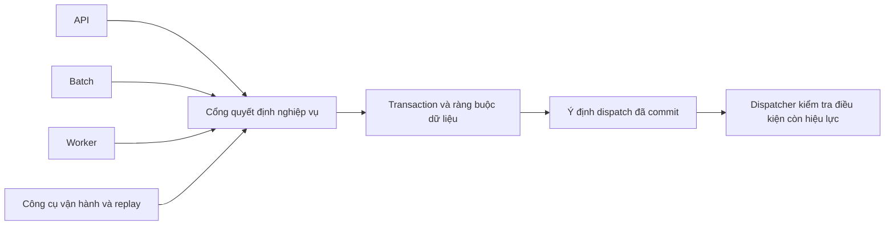

# Post incident rule correction — Sửa quy tắc nghiệp vụ sau sự cố

## 1. Mục tiêu: biến phát hiện sau sự cố thành hàng rào có thể kiểm chứng

Trong chương **Incident Response** của bảo mật logic nghiệp vụ, **post incident rule correction** là quá trình làm rõ, sửa, triển khai và xác minh các quy tắc đã cho phép một sự cố xảy ra hoặc làm tác động của nó lớn hơn. Kết quả cần thể hiện trong hành vi hệ thống, dữ liệu và bằng chứng kiểm thử.

Ví dụ, một hệ thống hoàn tiền phát hiện endpoint batch không kiểm tra phê duyệt như API thông thường. Một yêu cầu đã đổi người thụ hưởng vẫn giữ trạng thái APPROVED. Hai yêu cầu đồng thời còn có thể cùng sử dụng một phần số tiền được phép hoàn. Chặn IP gây sự cố giúp giảm lạm dụng trước mắt, nhưng các điều kiện sai vẫn có thể bị khai thác qua tài khoản khác hoặc worker.

Bài học tập trung vào cách:

- Phân biệt thiếu quy tắc, hiểu sai quy tắc và cưỡng chế sai quy tắc.
- Tái dựng điều kiện cho phép hành vi lạm dụng từ bằng chứng đã có.
- Viết bất biến và hợp đồng quyết định đủ rõ để triển khai.
- Sửa quyền theo đối tượng, state machine, giá trị được duyệt, transaction và idempotency.
- Xử lý yêu cầu đang chờ, dữ liệu lịch sử và phiên bản policy.
- Triển khai, theo dõi và xác nhận bản sửa đã ngăn tái diễn trong phạm vi đã cam kết.

NIST mô tả bài học từ các hoạt động ứng phó được phân tích, ưu tiên và đưa trở lại quá trình cải tiến. Trong bài này, ta áp dụng tinh thần đó vào các điều kiện nghiệp vụ cụ thể. [NIST — Incident Response và continuous improvement](https://csrc.nist.gov/projects/incident-response).

Các trạng thái, mã Java, bảng SQL và quy trình dưới đây là thiết kế minh họa. Cần ánh xạ chúng vào hợp đồng nghiệp vụ và mô hình dữ liệu của ứng dụng thực tế.

## 2. Phân biệt bốn loại việc sau một sự cố

### 2.1. Chặn thiệt hại, sửa luật, sửa cưỡng chế và sửa dữ liệu

| Loại việc | Ví dụ | Bằng chứng hoàn thành |
| --- | --- | --- |
| Ngăn thiệt hại tiếp diễn | Tạm dừng endpoint batch, đóng băng chi trả trong phạm vi bị ảnh hưởng | Đường thực thi rủi ro đã bị chặn tại nơi tạo tác dụng |
| Sửa quy tắc | Xác định phê duyệt chỉ hợp lệ cho một revision và người thụ hưởng cụ thể | Quy tắc được chủ thể có thẩm quyền nghiệp vụ chấp thuận |
| Sửa việc cưỡng chế | API, worker và công cụ vận hành cùng kiểm tra điều kiện ở ranh giới thực thi | Test đi qua từng đường và quan sát dữ liệu đã commit |
| Khắc phục dữ liệu/tác động | Cô lập yêu cầu sai, đối soát khoản đã gửi, tạo bút toán bù có quyền | Danh sách đối tượng, kết quả từng lệnh và sai lệch còn lại |

Bốn loại việc có thể cần phối hợp nhưng không thay thế nhau. Một constraint mới không tự hoàn lại khoản đã chuyển nhầm. Một đợt sửa dữ liệu không bảo vệ các request mới nếu đường thực thi cũ còn hoạt động.

### 2.2. Xác định bản chất của sai sót

| Tình trạng | Câu hỏi cần giải quyết |
| --- | --- |
| Chưa từng có quy tắc rõ | Ai có quyền quyết định điều kiện hợp lệ? Ngoại lệ nào thực sự cần? |
| Quy tắc trong tài liệu nhưng code không làm theo | Điều kiện bị thiếu ở đường nào, vì sao kiểm thử không phát hiện? |
| Nhiều cách hiểu khác nhau | API, batch và bộ phận nghiệp vụ đang dùng các hợp đồng nào? |
| Kiểm tra đúng nhưng sai thời điểm | Dữ liệu, quyền hoặc số dư thay đổi sau lúc kiểm tra có bị phát hiện không? |
| Quy tắc đúng với dữ liệu mới nhưng sai với backlog | Yêu cầu cũ cần giữ nguyên, phê duyệt lại, cô lập hay hủy theo chính sách nào? |

Không mặc định mọi sự cố đều cần thêm điều kiện từ chối. Có thể cần bỏ một giả định sai, gắn phê duyệt với dữ liệu bất biến hoặc điều phối transaction thay vì siết hạn mức tùy tiện.

Ví dụ, cấm mọi hoàn tiền lần thứ hai của một payment có thể chặn lặp, nhưng cũng phá các khoản hoàn từng phần hợp lệ. Cần xác định “một nghĩa vụ được thực hiện một lần” và “tổng số tiền không vượt giới hạn” thay vì dùng một quy tắc quá rộng.

## 3. Tái dựng lỗ hổng từ bằng chứng

### 3.1. Từ chuỗi thao tác tới giả định bị phá vỡ

Một bản tái dựng nên có:

```text
Đối tượng và revision ban đầu
-> chủ thể, quyền và tenant tại từng bước
-> dữ liệu được phê duyệt
-> dữ liệu thay đổi trước khi thực thi
-> đường gọi API/batch/worker/replay
-> kiểm tra thực sự đã chạy
-> transaction và tác dụng đã commit
-> lệnh gửi ra ngoài, phản hồi hoặc kết quả UNKNOWN
```

Giữ liên kết giữa business command, idempotency key, object revision, approval, execution, ledger, outbox và attempt phía ngoài. Không dùng một status cuối cùng làm nguồn sự thật duy nhất.

Phân biệt điều đã được chứng minh với giả thuyết. Chẳng hạn, thiếu log authorization không đủ chứng minh không có kiểm tra; cần đối chiếu code đang chạy, cấu hình, audit và dữ liệu. Ngược lại, log “authorized” cũng không chứng minh đã kiểm tra đúng đối tượng hoặc đúng revision.

### 3.2. Một cách mô tả nguyên nhân có thể sửa được

Mô tả quá chung:

> Người dùng thực hiện hoàn tiền sai và đội vận hành không phát hiện kịp.

Mô tả hữu ích hơn:

> Đường batch cho phép chuyển APPROVED sang EXECUTED mà không đối chiếu approval với revision hiện tại. Tổng tiền còn được kiểm tra bằng phép đọc trước ghi không điều phối, nên hai transaction có thể cùng sử dụng một phần ngân sách hoàn tiền.

Mô tả thứ hai chỉ ra điều kiện bị thiếu và cơ chế gây lỗi. Nó dẫn tới kiểm thử và thay đổi cụ thể, đồng thời vẫn cần kiểm tra phạm vi ảnh hưởng trên những đường khác.

### 3.3. Tạo bảng truy vết phát hiện

| Phát hiện | Bằng chứng | Quy tắc liên quan | Câu hỏi còn mở |
| --- | --- | --- | --- |
| Batch bỏ qua phê duyệt | Request và execution cùng object ID; không có approval hợp lệ | Chỉ revision được duyệt mới được thực thi | Công cụ vận hành có dùng cùng đường không? |
| Đổi người thụ hưởng sau duyệt | Revision trước/sau và approval cũ | Dữ liệu quan trọng phải được ràng buộc với quyết định duyệt | Trường nào khác cũng làm approval mất hiệu lực? |
| Hoàn vượt số đã thu | Hai transaction cùng đọc số dư còn lại | Tổng đã hoàn và đang reserve không vượt số được phép | Có attempt ngoài nào UNKNOWN chưa được tính? |
| Replay tạo execution mới | Cùng nghĩa vụ nhưng khác client key | Một nghĩa vụ không sinh hai tác dụng | Khoảng lưu key có ngắn hơn thời gian replay không? |

Bảng này giúp tránh sửa duy nhất biểu hiện được nhìn thấy trong incident. Đổi tên endpoint hoặc đổi idempotency key không làm mất bất biến nghiệp vụ.

## 4. Viết lại bất biến và quyết định nghiệp vụ

### 4.1. Tình huống hoàn tiền xuyên suốt bài

Giả sử một payment có số tiền được phép hoàn là 1.000.000 đơn vị nhỏ nhất của cùng một tiền tệ. Đã hoàn 600.000, chưa có khoản reserve. Hai yêu cầu mới mỗi yêu cầu 300.000 cùng đến.

Nếu cả hai đều đọc “còn 400.000” rồi tự thực thi, tổng sẽ thành 1.200.000. Một kiểm tra số tiền đúng ở từng request vẫn không bảo vệ tổng thể khi chạy đồng thời.

Quy tắc sửa cần phân biệt:

- Số tiền đã thu và đủ điều kiện hoàn theo nguồn có thẩm quyền.
- Số tiền đã hoàn được xác nhận.
- Số tiền đang reserve cho các nghĩa vụ chưa kết thúc.
- Khoản chưa rõ kết quả bên ngoài vẫn có khả năng hoàn tất.

Không quy đổi tiền tệ hoặc cộng các giá trị khác đơn vị chỉ vì chúng đều được lưu dạng số nguyên. Quy tắc đơn vị nhỏ nhất và chuyển đổi, nếu có, phải được định nghĩa riêng.

### 4.2. Bộ bất biến minh họa

| ID | Quy tắc được yêu cầu |
| --- | --- |
| R1 | Actor phải có quyền trên đúng tenant và đối tượng tại lần thực thi |
| R2 | Chỉ trạng thái được phép mới chuyển tới bước tạo tác dụng |
| R3 | Approval phải ràng buộc đúng tenant, yêu cầu và revision dữ liệu quan trọng |
| R4 | Người tạo không tự duyệt; approval còn hiệu lực theo chính sách hiện tại |
| R5 | Số tiền dương, tiền tệ và người thụ hưởng lấy từ dữ liệu server đã xác minh |
| R6 | `refunded + reserved <= refundableLimit` cho cùng payment và tiền tệ |
| R7 | Một nghĩa vụ nghiệp vụ chỉ có một allocation/execution hợp lệ theo mô hình |
| R8 | Retry cùng key và cùng nội dung không tạo tác dụng mới; đổi nội dung trên key cũ bị từ chối |
| R9 | Mọi đường API, batch, worker, replay đều chịu các điều kiện tương ứng |
| R10 | Dữ liệu lịch sử và bằng chứng thực thi không bị viết lại để trông như đã tuân thủ policy mới |

R6 là bất biến tổng hợp; không thể chứng minh chỉ bằng việc validate DTO. R7 cần nhận diện nghĩa vụ độc lập với key do client tự đổi.

### 4.3. Những quyết định cần người có thẩm quyền nghiệp vụ

Sau sự cố, nhóm kỹ thuật có thể phát hiện rằng approval cũ không đủ bằng chứng. Tuy nhiên, lựa chọn hủy, yêu cầu duyệt lại hoặc công nhận theo một chính sách chuyển tiếp cần người có thẩm quyền quyết định.

Ví dụ, bài chọn chính sách v2 như sau:

- Mọi yêu cầu chưa thực thi phải có approval cho revision hiện tại theo v2.
- Thay số tiền, tiền tệ, payment nguồn hoặc người thụ hưởng tạo revision mới và cần duyệt lại.
- Quyền của người duyệt phải còn hợp lệ tại lúc thực thi trong mô hình minh họa.
- Giao dịch đã thực hiện không bị gán nhãn “đã thực hiện dưới v2” bằng một thao tác backfill.
- Kết quả UNKNOWN phải được đối soát; không cấp ngân sách lại chỉ vì đã đổi policy.

Đây là lựa chọn của ví dụ, không phải luật chung cho mọi hệ thống. Một sản phẩm giữ hiệu lực approval theo thời điểm ký cần quy tắc khác và bằng chứng tương ứng.

## 5. Lập đặc tả thay đổi đủ để triển khai

### 5.1. Một bản ghi sửa quy tắc

```text
Rule ID: REFUND_EXECUTION
New version: v2
Incident reference: incident và bằng chứng liên quan
Business owner: người/chức năng chịu trách nhiệm quy tắc
Technical owner: đội chịu trách nhiệm cưỡng chế

Protected action: reserve và thực thi nghĩa vụ hoàn tiền
Subjects: tenant, payment, refund, revision, approval, actor
Authoritative inputs: payment ledger, revision, quyền hiện tại, policy đang hiệu lực
Preconditions: R1-R8 theo đặc tả
Denied outcome: không tạo allocation, execution hoặc dispatch mới
Allowed outcome: lưu kết quả và ý định tiếp theo trong transaction đã định

Pending work: cần approval v2 cho revision hiện tại
Completed work: giữ lịch sử; đối soát/điều chỉnh bằng lệnh riêng
Unknown external outcome: tiếp tục giữ exposure theo chính sách
Exceptions: phạm vi, chủ thể phê duyệt, thời hạn và bằng chứng riêng
Validation: test chức năng, tấn công logic, race và phục hồi
Rollout: thành phần cần cập nhật, điều kiện mở lại, điều kiện dừng
```

Mỗi điều kiện từ chối cần một kết quả không gây hiểu nhầm. Ví dụ, `REAPPROVAL_REQUIRED` khác `EXECUTED`; lỗi quyền khác lỗi provider. Mã lỗi có thể rõ cho vận hành nhưng response công khai vẫn phải tránh lộ dữ liệu của tenant hoặc đối tượng ngoài quyền.

### 5.2. Version của rule, dữ liệu và bản triển khai

Ba version có ý nghĩa khác nhau:

| Version | Mục đích |
| --- | --- |
| Policy version | Hợp đồng nghiệp vụ nào được dùng để ra quyết định |
| Object/revision version | Dữ liệu nào được phê duyệt và dữ liệu nào đang được thực thi |
| Build/configuration version | Thành phần triển khai nào thực sự cưỡng chế quyết định |

Gắn `policyVersion=v2` vào event không chứng minh worker đang chạy logic v2. Cần biết consumer đã được cập nhật, cấu hình nào đang hiệu lực và đường tạo tác dụng có từ chối dữ liệu thiếu bằng chứng hay không.

Policy version phải do server chọn từ nguồn có thẩm quyền. Client không được gửi `policyVersion=v1` để được dùng quy tắc yếu hơn.

## 6. Cưỡng chế tại mọi đường tạo tác dụng

### 6.1. Lập bản đồ đường thực thi



Có thể dùng cùng một service nghiệp vụ hoặc nhiều thành phần với hợp đồng thống nhất. Điều cần chứng minh là mọi đường đều cưỡng chế cùng bất biến, không chỉ cùng gọi một helper có tên giống nhau.

OWASP WSTG nhấn mạnh việc xây dựng misuse case để thử bỏ qua, đổi thứ tự hoặc lặp các bước của workflow. Vì vậy, phạm vi kiểm chứng bản sửa phải bao gồm những cách đi khác qua cùng quy trình. [OWASP WSTG v4.2 — Circumvention of Work Flows](https://wstg.owasp.org/v4.2/4-Web_Application_Security_Testing/10-Business_Logic_Testing/06-Testing_for_the_Circumvention_of_Work_Flows/).

### 6.2. Kiểm tra sớm và kiểm tra cuối cùng

Validation ở API giúp trả lỗi sớm. Quyết định cuối cần gắn với dữ liệu và ranh giới tạo tác dụng:

1. Xác định tenant, object và actor từ dữ liệu đã xác thực.
2. Lấy quyền và policy có thẩm quyền theo cơ chế nhất quán của hệ thống.
3. Đọc/khóa hoặc kiểm tra version đối tượng và các tài nguyên cùng bất biến.
4. Kiểm tra idempotency, state, revision và approval.
5. Giành phần ngân sách hợp lệ và ghi nhận nghĩa vụ duy nhất.
6. Ghi thay đổi cùng ý định tiếp theo trong transaction local.
7. Khi dispatch hoặc tiếp tục sau trì hoãn, kiểm tra các điều kiện cần còn hiệu lực.

Một snapshot được đọc từ cache trước transaction có thể đã cũ. Kiểm tra lại boolean `approved=true` cũng không đủ nếu không biết nó phê duyệt dữ liệu nào.

### 6.3. Quyền theo đối tượng và công cụ nội bộ

Quyền vai trò như `REFUND_EXECUTOR` chỉ là một phần quyết định. Còn cần tenant, phạm vi payment/refund, quan hệ người tạo-người duyệt và các giới hạn hiện tại.

Tài khoản vận hành hoặc service account không mặc định được bỏ R1-R8. Nếu có ngoại lệ phục hồi, dùng hành động riêng với phạm vi, thời hạn, phê duyệt, idempotency và audit rõ. Không thêm `if (internal) return allowed` để khôi phục nhanh backlog.

Khi kết quả idempotency chứa thông tin nhạy cảm, vẫn kiểm tra quyền trước khi trả dữ liệu cũ cho người gọi. Chống lặp không phải bằng chứng rằng người đang cầm key có quyền xem giao dịch.

## 7. Sửa điều phối transaction và ràng buộc dữ liệu

### 7.1. Bảo vệ ngân sách hoàn tiền bằng một điểm cập nhật chung

Một mô hình minh họa dùng row ngân sách cho từng payment và tiền tệ. Trong mô hình này, `captured_minor` là hạn mức hoàn lấy từ số tiền đã thu đủ điều kiện, không có chuyển đổi tiền tệ.

```sql
CREATE TABLE refund_budget (
    tenant_id UUID NOT NULL,
    payment_id UUID NOT NULL,
    currency CHAR(3) NOT NULL,
    captured_minor BIGINT NOT NULL CHECK (captured_minor >= 0),
    refunded_minor BIGINT NOT NULL CHECK (refunded_minor >= 0),
    reserved_minor BIGINT NOT NULL CHECK (reserved_minor >= 0),
    version BIGINT NOT NULL CHECK (version >= 0),
    PRIMARY KEY (tenant_id, payment_id, currency),
    CHECK (refunded_minor <= captured_minor),
    CHECK (reserved_minor <= captured_minor - refunded_minor)
);
```

DDL thể hiện giới hạn trong cùng row. Các kiểm tra approval, quyền và revision vẫn cần cơ chế riêng.

PostgreSQL không dùng `CHECK` tham chiếu dữ liệu các row khác để bảo đảm bất biến xuyên row. Với điều kiện có thể nhận NULL, `CHECK` cũng không tự thay thế `NOT NULL`. [PostgreSQL 18 — Constraints](https://www.postgresql.org/docs/18/ddl-constraints.html).

### 7.2. Không tách kiểm tra số dư và cấp ngân sách thành hai bước độc lập

Trong transaction đã kiểm tra đúng actor, refund, approval và idempotency, thực hiện cập nhật có điều kiện:

```sql
UPDATE refund_budget
SET reserved_minor = reserved_minor + :amount_minor,
    version = version + 1
WHERE tenant_id = :resolved_tenant_id
  AND payment_id = :payment_id
  AND currency = :currency
  AND :amount_minor > 0
  AND :amount_minor <= captured_minor - refunded_minor - reserved_minor
RETURNING version;
```

Yêu cầu đúng một row được cập nhật. Không có row trả về thì không được ghi nhận đã cấp ngân sách; cần phân biệt nguyên nhân phù hợp cho vận hành và response.

`:amount_minor`, payment và currency được lấy từ revision server đã kiểm tra, không từ một giá trị client sửa tùy ý tại thời điểm execute. Thiết kế cần ràng buộc miền giá trị để không có lỗi biểu diễn số.

Sau khi giành ngân sách, ghi reservation duy nhất, trạng thái lệnh, idempotency result và outbox intent trong cùng transaction local. Nếu insert reservation hoặc một bước bắt buộc thất bại, rollback cả thay đổi ngân sách. Không bắt unique violation rồi commit phần ngân sách đã tăng.

Mô hình giả định mọi đường cấp hoặc giải phóng ngân sách cùng tuân theo cơ chế chung. Các thao tác thay đổi captured/refunded cũng phải duy trì bất biến. Nếu nhiều database cùng ghi cho một nghĩa vụ, một row local không tự giải quyết điều phối xuyên hệ thống.

### 7.3. Chọn đúng định danh chống lặp

Ví dụ:

- Idempotency command có khóa duy nhất theo `(tenant, commandType, key)` và kiểm tra nội dung chuẩn hóa.
- Reservation cho một refund có khóa duy nhất theo `(tenant, refundId)` trong mô hình một allocation cho mỗi refund.
- Execution có định danh nghĩa vụ đủ để không tạo lần thực thi mới chỉ vì client đổi key.
- Nhiều refund khác nhau vẫn có thể tham chiếu cùng payment nếu tổng còn trong ngân sách.

Không dùng `UNIQUE(paymentId)` để thay cho bài toán tổng tiền nếu hoàn từng phần là hợp lệ. Ngược lại, chỉ unique theo client key để hở trường hợp cùng nghĩa vụ bị gửi bằng hai key khác nhau.

Trong production, các cột tham gia định danh bắt buộc phải có miền giá trị và nullability phù hợp. Cần kiểm tra dữ liệu cũ và xung đột trước khi thêm constraint; việc tạo constraint thất bại không đồng nghĩa bản sửa đã được áp dụng một phần thành công.

### 7.4. Reservation, external outcome và ledger

Mô hình reservation chặn phần ngân sách có thể bị dùng đồng thời. Nó chưa phải xác nhận provider đã hoàn tiền.

- Provider xác nhận thành công: chuyển đúng reservation sang số tiền đã hoàn trong transaction đối soát, xử lý callback lặp an toàn.
- Provider xác nhận không thể thực hiện theo hợp đồng: giải phóng reservation qua lệnh hợp lệ.
- Timeout hoặc chưa rõ đã nhận: giữ trạng thái UNKNOWN và exposure phù hợp; không tự giải phóng rồi gửi lệnh mới.
- Kết quả tới muộn: đối chiếu định danh nghĩa vụ/provider operation, không tạo một khoản hoàn thứ hai.

Nếu cần điều chỉnh khoản đã hoàn sai, tạo bút toán/lệnh bù có quyền và chống lặp riêng. Không sửa trực tiếp số tiền lịch sử để làm báo cáo khớp policy mới.

## 8. Ví dụ kiểm tra approval gắn với revision

### 8.1. Dữ liệu quan trọng cần bất biến theo revision

Trong ví dụ, `revisionId` tham chiếu một bản nội dung bất biến gồm số tiền, tiền tệ, payment và người thụ hưởng. Thay một trường quan trọng tạo revision mới. Approval giữ định danh refund và revision được duyệt.

Version dùng cho optimistic locking có thể tăng khi state thay đổi; nó không nhất thiết là cùng khái niệm với revision nội dung. Phải phân biệt hai loại để tránh làm approval mất hiệu lực chỉ vì một cập nhật kỹ thuật không liên quan, hoặc giữ hiệu lực sau một thay đổi quan trọng.

### 8.2. Policy Java minh họa

Đoạn Java 17+ sau chỉ quyết định điều kiện approval. Nó giả định các trường trong record đã được xác thực không null, trừ việc approval có thể chưa tồn tại.

```java
import java.time.Instant;
import java.util.UUID;

public final class RefundExecutionPolicy {
    public enum State {
        DRAFT, SUBMITTED, APPROVED, EXECUTED, CANCELLED
    }

    public enum Decision {
        ALLOW,
        FORBIDDEN,
        NOT_APPROVED,
        APPROVAL_MISMATCH,
        APPROVAL_EXPIRED,
        REAPPROVAL_REQUIRED
    }

    public record Refund(
            UUID tenantId,
            UUID refundId,
            UUID requesterId,
            UUID revisionId,
            State state) {}

    public record Approval(
            UUID tenantId,
            UUID refundId,
            UUID revisionId,
            UUID approverId,
            Instant expiresAt,
            String policyVersion) {}

    public Decision check(
            Refund refund,
            Approval approval,
            boolean executorAuthorized,
            boolean approverStillAuthorized,
            Instant now,
            String requiredPolicyVersion) {

        if (!executorAuthorized) {
            return Decision.FORBIDDEN;
        }
        if (refund.state() != State.APPROVED || approval == null) {
            return Decision.NOT_APPROVED;
        }
        if (!refund.tenantId().equals(approval.tenantId())
                || !refund.refundId().equals(approval.refundId())
                || !refund.revisionId().equals(approval.revisionId())) {
            return Decision.APPROVAL_MISMATCH;
        }
        if (refund.requesterId().equals(approval.approverId())
                || !approverStillAuthorized) {
            return Decision.FORBIDDEN;
        }
        if (!now.isBefore(approval.expiresAt())) {
            return Decision.APPROVAL_EXPIRED;
        }
        if (!requiredPolicyVersion.equals(approval.policyVersion())) {
            return Decision.REAPPROVAL_REQUIRED;
        }
        return Decision.ALLOW;
    }
}
```

`executorAuthorized` và `approverStillAuthorized` là kết quả authorization do server tạo cho đúng đối tượng; không phải claim tùy ý từ request. `requiredPolicyVersion` lấy từ cấu hình có thẩm quyền. Clock cần có cách điều khiển trong test.

ALLOW ở đây chỉ có nghĩa các điều kiện trong hàm đạt. Service còn phải kiểm tra freeze, tiền tệ, số tiền, ngân sách, idempotency, trạng thái reservation và các điều kiện khác của R1-R9.

Hàm thuần này không chống race. Các snapshot, quyền và policy có thể thay đổi phải có cơ chế nhất quán phù hợp với cam kết thực thi. Nếu chỉ gọi hàm trước rồi ghi dữ liệu ở transaction khác, lỗ hổng kiểm tra-sử dụng vẫn có thể tồn tại.

## 9. Phiên bản policy và yêu cầu đang chờ

### 9.1. Không mở đường dùng lại quy tắc yếu

Một triển khai v2 thường có thời gian các bản build cũ và mới cùng tồn tại. Cần biết thành phần nào còn có thể tạo tác dụng theo v1.

Các cách kiểm soát có thể gồm giữ freeze trong phạm vi ảnh hưởng, chặn đường cũ, kiểm tra minimum policy version tại cổng thực thi hoặc thay quyền ghi của thành phần chưa cập nhật. Lựa chọn phải được thiết kế theo hệ thống thực tế.

Không fallback sang v1 khi policy store lỗi, thiếu metadata hoặc không nhận ra version của message. Với hành động nhạy cảm chưa đủ bằng chứng, giữ lại hoặc từ chối theo hợp đồng và phát tín hiệu vận hành.

Một timestamp effectiveAt chưa đủ nếu request đã bắt đầu trước mốc nhưng thực thi sau mốc. Phải định nghĩa ranh giới áp dụng: tiếp nhận, phê duyệt, reservation hay thực thi. Trong ví dụ, lệnh chưa có tác dụng phải đạt điều kiện v2 tại lần thực thi được cho phép.

### 9.2. Bảng xử lý dữ liệu đang tồn tại

| Đối tượng | Quyết định minh họa với v2 |
| --- | --- |
| Draft/chưa phê duyệt | Đi qua quy trình v2 khi gửi duyệt |
| Approval v1, chưa reserve/execute | Giữ lại và yêu cầu phê duyệt v2 |
| Approval đúng version nhưng revision đã đổi | Không thực thi; cần approval cho revision mới |
| Job cũ còn trong queue | Revalidate; không tin payload “approved” do job mang theo |
| Đã reserve nhưng chưa dispatch | Giữ nghĩa vụ và kiểm tra điều kiện tiếp tục; không cấp reserve lần hai |
| Đã gửi, UNKNOWN | Đối soát kết quả; không đổi nhận diện để tạo lệnh thay thế tùy tiện |
| Đã EXECUTED hợp lệ dưới v1 | Giữ lịch sử, kết quả và version thực tế |
| Đã EXECUTED sai | Điều tra, đối soát và xử lý bù riêng |
| Record thiếu bằng chứng approval/revision | NEEDS_REVIEW hoặc hold tương ứng; không tự sinh approval giả |

Không áp dụng v2 hồi tố bằng cách cập nhật `policyVersion` của mọi approval cũ thành v2. Việc chuyển đổi cần đủ bằng chứng và quyết định rõ; đổi nhãn không tạo ra quyết định duyệt chưa từng có.

### 9.3. Audit quyết định để truy vết

Có thể ghi:

```text
decisionId, commandId, tenantId, refundId, revisionId,
approvalId, policyVersion, buildVersion,
actorRef, decisionCode, observedObjectVersion,
reservationId, executionId, correlationId, recordedAt
```

Chỉ lưu dữ liệu cần thiết, kiểm soát quyền truy cập và tránh bí mật. Audit cần cho biết dùng dữ liệu nào và policy nào, không chỉ “rule passed”.

## 10. Khắc phục dữ liệu cũ mà không tạo thêm tác dụng sai

### 10.1. Xây dựng tập đối tượng cần xử lý từ nguồn

Tập đối tượng phải lấy từ payment/refund, execution, ledger và bằng chứng provider liên quan, không chỉ từ các job còn sống trong queue.

Phân loại ít nhất:

1. Có dữ liệu và bằng chứng hợp lệ, có thể tiếp tục theo quyết định chuyển tiếp.
2. Chưa thực thi nhưng thiếu điều kiện, cần giữ lại hoặc duyệt lại.
3. Đã thực thi sai, cần xác định tác động và hành động điều chỉnh.
4. UNKNOWN hoặc bằng chứng mâu thuẫn, cần đối soát.
5. Dữ liệu không thuộc phạm vi incident, vẫn cần kiểm tra không bị thay đổi nhầm.

Đọc dữ liệu đã commit trong ngữ cảnh mới. Nếu chỉ xem cache trong test hoặc snapshot không còn phù hợp với lúc sửa, có thể ghi đè một thay đổi hợp lệ mới hơn.

### 10.2. Thiết kế manifest và lệnh sửa

Một manifest minh họa gồm:

```text
incidentId, repairRunId, repairCommandId,
tenantId, objectId, expectedVersion,
classification, intendedAction, evidenceReference,
reviewer, approvalReference, outcome, outcomeReference
```

Trước khi ghi, chạy chế độ chỉ đọc để thống kê đối tượng và tác động dự kiến. Chế độ này không gọi provider hoặc làm thay đổi approval/ledger.

Lệnh sửa cần:

- Kiểm tra quyền và đúng tenant.
- So expected version hoặc điều kiện tương đương trước khi sửa.
- Có idempotency theo hành động sửa cụ thể.
- Lưu trạng thái tiến độ sau khi thay đổi bắt buộc đã commit.
- Ghi kết quả riêng cho đối tượng bị xung đột, không âm thầm bỏ qua.
- Dừng hoặc cô lập khi thấy điều kiện ngoài manifest.

Nếu batch dừng giữa chừng, lần chạy lại phải phân biệt phần đã commit và chưa commit. Không dựa vào một con số offset đã ghi trước transaction để kết luận mọi đối tượng trước offset đều được sửa.

### 10.3. Không sửa bằng chứng để hợp thức hóa

Những thao tác nguy hiểm gồm tạo approval thay cho người dùng, xóa execution trùng, thay timestamp, đổi người thụ hưởng lịch sử hoặc reset idempotency để chạy lại từ đầu.

Nếu cần dựng lại trạng thái dẫn xuất, phải có nguồn và liên kết tới sự kiện gốc. Nếu cần sửa nghĩa vụ tài chính, dùng hành động điều chỉnh có quyền và sổ theo dõi phù hợp. Dữ liệu điều tra phải phân biệt điều đã xảy ra với điều hệ thống mong muốn xảy ra.

## 11. Kiểm chứng bản sửa bằng tình huống lạm dụng và cạnh tranh

### 11.1. Bắt đầu từ một ca tái hiện có thể quan sát

Tạo fixture đã commit tương ứng với điều kiện incident, giữ đủ định danh và revision. Ghi lại:

- Lệnh nào được gọi và bằng chủ thể nào.
- Bản cũ vi phạm bất biến gì.
- Bản mới từ chối hoặc thay đổi hành vi tại ranh giới nào.
- State, version, reservation, execution, ledger và attempt bên ngoài sau cùng.

Một test chỉ assert HTTP 403/409 có thể bỏ sót việc service đã ghi tác dụng trước khi trả lỗi. Phải đọc dữ liệu đã commit và đếm tác dụng theo nghĩa vụ.

### 11.2. Ví dụ test approval cho revision cũ

Các đoạn test dùng một harness minh họa, cần service, database và fixture thực của dự án. Fixture ở đây mô phỏng một record legacy có state APPROVED nhưng approval trỏ revision cũ; provider fake không được gọi nền ngoài kiểm soát.

```java
@Test
void legacyApprovalCannotAuthorizeANewerRevision() {
    var f = fixtures.committedRefundWithApprovalForPreviousRevision();
    policies.activateForTest("v2");
    var before = inspect.businessSnapshot(f.refundId());

    assertThrows(RuleViolation.class, () ->
        refunds.execute(
            f.authorizedExecutor(),
            f.refundId(),
            "execute-command-1"
        )
    );

    assertEquals(before, inspect.businessSnapshot(f.refundId()));
    assertEquals(0, inspect.reservationCount(f.refundId()));
    assertEquals(0, inspect.executionCount(f.refundId()));
    assertEquals(0, inspect.dispatchIntentCount(f.refundId()));
    assertEquals(0, provider.acceptedCount());
}
```

Snapshot gồm nội dung, revision, state và dữ liệu nghiệp vụ cần bảo vệ, loại trừ audit từ chối hợp lệ. Việc kích hoạt policy cho test phải hoàn tất trước lệnh execute và không dùng chung trạng thái mutable với test chạy song song khác.

### 11.3. Test race cho bất biến tổng tiền

Với payment có captured 1.000.000, refunded 600.000 và reserved 0, tạo hai refund đã được duyệt hợp lệ, mỗi refund 300.000.

Dùng hai transaction thật và barrier/hook để hai lần xử lý cạnh tranh tại điểm giành ngân sách. Kỳ vọng:

- Chỉ một reservation 300.000 được commit.
- Lệnh còn lại bị từ chối hoặc giữ lại theo hợp đồng, không được ghi allocation thành công.
- Sau khi hai transaction kết thúc, refunded + reserved = 900.000.
- Không có execution/dispatch cho lệnh chưa giành được ngân sách.
- Retry lệnh đã thành công trả/tra cứu cùng kết quả, không tăng reserved thêm lần nữa.

Thêm ca hai refund 200.000 trên cùng phần còn lại 400.000: cả hai phải có thể được chấp nhận, tổng đúng 1.000.000. Ca này phát hiện bản sửa quá chặt như unique theo payment.

Barrier cần timeout hữu hạn và cleanup giải phóng chờ khi test lỗi. Mock trả một số dư cố định không chứng minh cập nhật có điều kiện hoặc cơ chế khóa thực tế bảo vệ được race.

### 11.4. Ma trận hồi quy cần bao phủ

| Nhóm | Ca cần thử |
| --- | --- |
| Quyền | Tenant khác, đối tượng ngoài phạm vi, quyền bị thu hồi, service account không có quyền phù hợp |
| Workflow | Bỏ qua duyệt, thực thi từ DRAFT, lặp execute, duyệt sau hủy, đổi thứ tự bước |
| Approval | Tự duyệt, sai tenant/refund/revision, hết hạn, version policy không hợp lệ |
| Dữ liệu quan trọng | Đổi số tiền, currency, payment, người thụ hưởng sau khi duyệt |
| Giá trị biên | Số tiền 0/âm, đúng phần còn lại, vượt một đơn vị, giá trị ngoài miền biểu diễn |
| Idempotency | Cùng key/cùng nội dung, cùng key/khác nội dung, khác key/cùng nghĩa vụ |
| Đường thực thi | API, batch, worker, replay và công cụ vận hành |
| Transaction | Lỗi sau reserve trước insert nghĩa vụ; lỗi ledger/outbox; rollback toàn phần bắt buộc |
| Bên ngoài | Nhận rồi mất response, callback trùng/muộn, UNKNOWN không giải phóng exposure sớm |
| Chuyển policy | Build cũ/mới cùng tồn tại, message v1, metadata thiếu, nguồn policy lỗi |
| Dữ liệu sửa | Repair chạy lại, expected version xung đột, batch dừng và resume |
| Hợp lệ | Hoàn từng phần hợp lệ, actor đúng quyền, approval đúng revision, retry không tạo mới |

Có thể bổ sung kiểm thử theo thuộc tính: mọi chuỗi thao tác thành công vẫn giữ tổng ngân sách, replay không tăng nghĩa vụ và chuyển revision quan trọng làm approval cũ không đủ điều kiện. Cần có mô hình tham chiếu độc lập, không sao chép nguyên điều kiện production vào test rồi so hai biểu thức giống nhau.

## 12. Triển khai và quan sát thay đổi quy tắc

### 12.1. Trình tự triển khai minh họa

1. Chốt đặc tả v2 và quyết định với dữ liệu đang chờ.
2. Giữ biện pháp ngăn thiệt hại trong phạm vi cần thiết.
3. Kiểm tra dữ liệu cũ, chuẩn bị schema/constraint và khả năng đọc tương thích.
4. Cập nhật các thành phần có quyền tạo tác dụng; chặn bản cũ còn đường bỏ qua.
5. Thực hiện phân loại và sửa dữ liệu theo manifest được duyệt.
6. Chạy kiểm chứng trên build/configuration sẽ triển khai.
7. Mở lại theo phạm vi có kiểm soát và theo dõi bất biến.
8. Giữ khả năng dừng xử lý nếu xuất hiện sai lệch.

Không có một thứ tự schema-code-data cố định cho mọi thay đổi. Cần thiết kế trạng thái trung gian để bản cũ không tạo dữ liệu mà bản mới hiểu sai, và bản mới không yêu cầu ngay một trường chưa được chuẩn bị.

### 12.2. Shadow evaluation không thay thế cưỡng chế

Chạy policy v2 để so quyết định với v1 có thể giúp ước lượng ảnh hưởng hợp lệ trước khi mở rộng. Nó chỉ có giá trị khi không gây tác dụng phụ và dùng dữ liệu đủ đáng tin để so sánh.

Trong giai đoạn một đường lạm dụng còn nguy hiểm, shadow-only vẫn cho phép v1 thực thi. Cần giữ hàng rào ngăn tác động tương ứng; không coi số liệu shadow đẹp là lý do bỏ containment sớm.

Những bất đồng cần được phân loại: v2 chặn đúng lạm dụng, v2 chặn nhầm nghiệp vụ hợp lệ, khác do dữ liệu thiếu hoặc khác do policy đọc snapshot khác nhau.

### 12.3. Chỉ số gắn với bất biến

| Chỉ số/bằng chứng | Ý nghĩa |
| --- | --- |
| Decision theo policy/build/đường xử lý | Thành phần nào còn dùng logic cũ hoặc thiếu policy |
| Approval mismatch và reapproval required | Backlog hoặc luồng sửa nội dung chưa tuân hợp đồng mới |
| Refund budget violation | Bất biến tổng tiền có bị phá vỡ không |
| Nghĩa vụ trùng trên nhiều key | Idempotency theo client key còn để hở nhận diện nghiệp vụ |
| UNKNOWN và tuổi reservation | Exposure chưa được giải quyết sau sự cố |
| Sai lệch đối soát nguồn-ledger-provider | Dữ liệu hoặc tác dụng bên ngoài chưa nhất quán |
| Từ chối trên luồng hợp lệ | Bản sửa có gây gián đoạn ngoài phạm vi dự kiến không |
| Repair conflict/pending review | Phần dữ liệu lịch sử chưa được xử lý đủ bằng chứng |

Không gắn số tài khoản, token hoặc định danh có số lượng giá trị khổng lồ vào metric label. Dùng correlation ID và hệ thống tra cứu có quyền để điều tra sâu.

### 12.4. Rollback cần giữ hàng rào đã biết là cần thiết

Nếu bản sửa gây lỗi vận hành, có thể cần rollback code hoặc dừng rollout. Nhưng quay về code cũ trong khi mở lại toàn bộ có thể phục hồi chính lỗ hổng vừa khai thác.

Kế hoạch rollback phải nêu hàng rào còn giữ, phạm vi tiếp tục bị chặn, tương thích schema/dữ liệu và cách xử lý job đã tạo dưới v2. Không xóa constraint hoặc hạ policy version như một thao tác mặc định chỉ để request trở lại thành công.

## 13. Điều kiện hoàn thành và trách nhiệm theo dõi

### 13.1. Bằng chứng cần có trước khi đóng hạng mục sửa rule

Một hạng mục có thể được coi là hoàn thành trong phạm vi đã xác định khi:

- Chủ thể có thẩm quyền đã chấp thuận nội dung quy tắc và xử lý ngoại lệ.
- Có liên kết từ phát hiện incident tới bất biến, điểm cưỡng chế và test.
- Mọi đường tạo tác dụng trong phạm vi đã được kiểm chứng.
- Test tái hiện lạm dụng bị chặn; các luồng hợp lệ quan trọng vẫn đạt.
- Dữ liệu cũ được phân loại, sửa hoặc có quyết định xử lý rõ với owner.
- Không còn đường dùng policy/build cũ để bỏ qua bản sửa trong phạm vi cam kết.
- Quan sát sau triển khai đủ bằng chứng, các sai lệch chưa giải quyết được ghi nhận.
- Runbook, threat model và hướng dẫn liên quan được cập nhật theo thay đổi đã duyệt.

Một ticket “đã merge” không chứng minh worker đã rollout, backlog đã được xử lý hoặc rule mới đang hiệu lực. Báo cáo cần phân biệt đã viết code, đã triển khai, đã sửa dữ liệu và đã kiểm chứng.

### 13.2. Giữ các câu hỏi chưa giải quyết ở trạng thái nhìn thấy được

Không cần giả vờ mọi thiệt hại hoặc UNKNOWN đều đã kết thúc để đóng phần sửa code. Có thể hoàn thành một hạng mục kỹ thuật và duy trì các hạng mục đối soát riêng, miễn là owner, phạm vi còn rủi ro và hàng rào hiện tại rõ ràng.

Mỗi action item nên có người chịu trách nhiệm, kết quả có thể kiểm chứng và mốc đánh giá. Tránh câu “tăng cường review” không có thay đổi cụ thể. Ví dụ tốt hơn là “đường batch gọi cùng cổng thực thi v2 và có test tenant/revision/race đi qua adapter batch thật”.

Sau một khoảng vận hành đủ theo kế hoạch, đánh giá lại tỷ lệ chặn nhầm, độ trễ, reservation tồn đọng và những cách đi khác mới xuất hiện. Cải tiến cần tiếp tục dựa trên bằng chứng, không dựa vào việc một thời gian ngắn chưa thấy tấn công.

## 14. Bài tập áp dụng

Một hệ thống xử lý hoàn tiền gặp sự cố sau:

- API thông thường kiểm tra approval, nhưng batch chỉ kiểm tra state APPROVED.
- Người dùng có thể đổi người thụ hưởng sau khi duyệt mà không tạo revision mới.
- Hai refund mỗi khoản 300.000 cùng đọc phần còn lại 400.000 và đều được thực thi.
- Một khoản khác đã được provider nhận nhưng mất response; worker định gửi lại bằng key mới.
- Khi sửa sự cố, một script đề xuất đổi tất cả approval cũ sang policy v2 để backlog chạy tiếp.

Hãy thực hiện:

1. Phân loại đâu là quy tắc chưa rõ, cưỡng chế thiếu, sai điều phối và khắc phục dữ liệu sai.
2. Viết bộ bất biến cùng quyết định cho dữ liệu mới, pending, đã thực thi và UNKNOWN.
3. Xác định dữ liệu quan trọng phải thuộc revision bất biến và cách vô hiệu hóa approval cũ.
4. Thiết kế nhận diện nghĩa vụ, idempotency và ngân sách hoàn tiền để chặn lặp mà vẫn cho hoàn từng phần hợp lệ.
5. Lập bản đồ API/batch/worker/replay và chọn điểm cưỡng chế tại từng ranh giới tác dụng.
6. Viết test tái hiện race, stale approval và provider nhận rồi mất response; nêu dữ liệu sẽ assert.
7. Lập manifest xử lý backlog và chỉ ra vì sao đổi nhãn policy không đủ bằng chứng.
8. Xây kế hoạch rollout/rollback, chỉ số theo dõi và điều kiện đóng hạng mục.

Bài làm đạt cần chứng minh quy tắc được hiểu thống nhất, quyết định được cưỡng chế ở nơi tạo tác dụng và dữ liệu cũ được xử lý theo bằng chứng. Kết quả không chỉ là chặn lại đúng request từng xuất hiện trong incident, mà còn bảo vệ cùng bất biến khi thay endpoint, actor, thứ tự bước, thời điểm hoặc số lần gửi lệnh.
