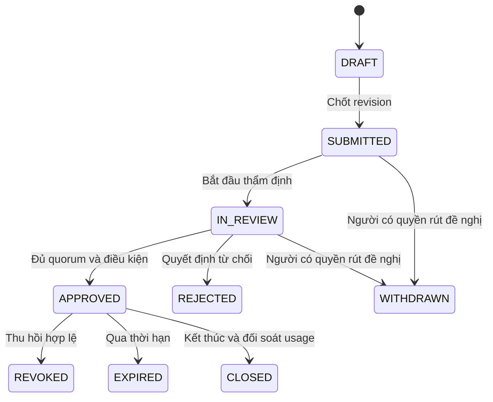

# Compliance exception approval — Phê duyệt ngoại lệ tuân thủ

## 1. Mục tiêu và tình huống xuyên suốt

Trong chương **Compliance** của bảo mật logic nghiệp vụ, **compliance exception approval** là quy trình xem xét, quyết định và cưỡng chế một ngoại lệ có giới hạn đối với yêu cầu hoặc kiểm soát được phép xử lý bằng ngoại lệ. Ngoại lệ phải gắn với thẩm quyền, phạm vi, rủi ro còn lại, điều kiện thực thi và bằng chứng.

Ví dụ, chính sách nội bộ yêu cầu đối soát tự động trước khi thực thi một batch hoàn tiền. Dịch vụ đối soát tạm gián đoạn. Đội vận hành đề nghị dùng báo cáo đối soát thủ công do người độc lập xác nhận cho một batch cụ thể, trong hai giờ, với hạn mức rõ ràng.

Quyết định hợp lệ không phải là “tắt compliance cho tenant”. Nó chỉ thay thế một kiểm soát đã chỉ định bằng điều kiện khác được chấp thuận. Quyền theo đối tượng, trạng thái phê duyệt hoàn tiền, số tiền được phép hoàn, chống lặp và audit vẫn phải được giữ.

Sau bài học, bạn có thể:

- Phân biệt chấp nhận rủi ro, phê duyệt ngoại lệ và căn cứ cho phép thay đổi một nghĩa vụ.
- Xác định ai được đề nghị, thẩm định, chấp thuận, sử dụng và thu hồi ngoại lệ.
- Ràng buộc quyết định với một revision nội dung không bị thay đổi âm thầm.
- Thiết kế state machine, thời hạn, quota và kiểm soát bù trừ.
- Ngăn tự duyệt, mở rộng phạm vi, replay, sử dụng khác tenant hoặc vượt hạn mức khi chạy đồng thời.
- Tạo bằng chứng và kiểm thử chứng minh ngoại lệ được sử dụng đúng giới hạn.

Các vai trò, hạn mức, mã Java, SQL và trạng thái trong bài là mô hình minh họa. Ví dụ áp dụng cho một kiểm soát nội bộ được xác định là có cơ chế ngoại lệ; không mặc định một phê duyệt trong ứng dụng làm thay đổi luật, hợp đồng hoặc yêu cầu bên ngoài.

## 2. Xác định yêu cầu nào thực sự có thể có ngoại lệ

### 2.1. Phân loại nguồn yêu cầu trước khi đưa ra quyết định

| Nguồn yêu cầu | Điều cần xác minh |
| --- | --- |
| Chính sách nội bộ | Ai có thẩm quyền ban hành và cho phép ngoại lệ? Có giới hạn nào không được thay đổi? |
| Hợp đồng với khách hàng/đối tác | Điều khoản có cho phép thay đổi hoặc cơ chế chấp thuận tương ứng không? |
| Luật hoặc quy định áp dụng | Có cơ chế miễn trừ/thay thế phù hợp và thẩm quyền nào quyết định không? |
| Tiêu chuẩn hoặc chương trình đánh giá | Điều kiện áp dụng, lựa chọn kiểm soát thay thế và bằng chứng phải đáp ứng là gì? |
| Quy tắc nghiệp vụ kỹ thuật | Đâu là tùy chọn vận hành, đâu là bất biến bảo vệ quyền, tiền hoặc dữ liệu? |

Một chức danh quản lý hoặc quyền admin trong phần mềm không tự chứng minh thẩm quyền đối với mọi nguồn yêu cầu. Quy trình cần có bước xác nhận căn cứ và người chịu trách nhiệm về cách hiểu yêu cầu đó.

Nếu không có căn cứ cho phép ngoại lệ, lựa chọn là giữ yêu cầu, đổi cách vận hành để đáp ứng hoặc chuyển quyết định tới đúng thẩm quyền. Không tạo một record APPROVED chỉ để hệ thống tiếp tục chạy.

### 2.2. Chấp nhận rủi ro khác với có quyền miễn yêu cầu

Chấp nhận rủi ro mô tả việc một chủ thể có trách nhiệm chấp thuận mức rủi ro còn lại trong phạm vi của mình. Nó không tự cấp quyền bỏ qua một nghĩa vụ ngoài thẩm quyền đó.

NIST RMF gắn quản lý rủi ro với trách nhiệm, hoạt động authorization và giám sát liên tục. Có thể tham khảo cách tiếp cận này để thiết kế quyền ra quyết định và theo dõi ngoại lệ, nhưng quy trình cụ thể vẫn phải dựa trên yêu cầu áp dụng cho tổ chức. [NIST SP 800-37 Rev. 2 — Risk Management Framework](https://csrc.nist.gov/pubs/sp/800/37/r2/final).

Trong ví dụ, tổ chức đã xác định kiểm soát đối soát tự động nội bộ có thể được thay bằng đối soát thủ công có điều kiện. Quyết định đó không cho phép sửa giá trị hoàn tiền, đổi người thụ hưởng hoặc thực thi một yêu cầu chưa được phê duyệt.

### 2.3. Phân biệt ba khái niệm dễ nhầm

| Khái niệm | Vai trò |
| --- | --- |
| Biện pháp thay thế/bù trừ | Cách giảm rủi ro khi kiểm soát gốc không được thực hiện theo cách thông thường |
| Ngoại lệ đã phê duyệt | Quyết định cho phép dùng điều kiện khác trong phạm vi, thời gian và hạn mức xác định |
| Khắc phục nguyên nhân | Công việc đưa hệ thống về kiểm soát thông thường hoặc thay chính sách qua quy trình chính thức |

Có báo cáo thủ công không đồng nghĩa ngoại lệ đã được duyệt. Có ngoại lệ đã duyệt không đồng nghĩa báo cáo cho batch hiện tại đã tồn tại. Cả hai điều kiện cần được kiểm tra độc lập.

## 3. Viết bất biến cho quy trình ngoại lệ

Một bộ bất biến minh họa:

| ID | Bất biến |
| --- | --- |
| E1 | Chỉ yêu cầu được phân loại cho phép ngoại lệ mới đi vào quy trình phê duyệt tương ứng |
| E2 | Người đề nghị không tự phê duyệt ngoại lệ của mình |
| E3 | Quyết định phải đủ người có đúng thẩm quyền cho phạm vi và mức rủi ro |
| E4 | Approval chỉ áp dụng cho đúng revision nội dung được xem xét |
| E5 | Ngoại lệ chỉ dùng cho đúng tenant, merchant, hành động, kiểm soát và batch revision |
| E6 | Quyết định sử dụng phải nằm trong khoảng hiệu lực và chưa bị thu hồi |
| E7 | Một hành động chỉ được phép khi kiểm soát bù trừ đã có bằng chứng hợp lệ |
| E8 | Tổng số lệnh và tổng giá trị được cấp không vượt quota, kể cả khi xử lý đồng thời |
| E9 | Retry không tiêu thụ quota hoặc tạo tác dụng nghiệp vụ thêm lần nữa |
| E10 | Các kiểm soát không thuộc phạm vi ngoại lệ vẫn được cưỡng chế |
| E11 | API, worker, batch, replay và công cụ vận hành cùng chịu điều kiện tương ứng |
| E12 | Có thể truy vết từ quyết định ngoại lệ tới từng lần sử dụng và kết quả thực tế |

Các kiểm soát như tenant isolation, quyền trên đối tượng, idempotency và toàn vẹn ledger được mô hình này quy định là không thể bỏ qua bằng loại ngoại lệ đang xét. Đây là phạm vi của thiết kế minh họa, không phải một danh sách pháp lý áp dụng chung.

Một thiết kế chỉ có trường `exceptionApproved=true` không biểu diễn được E1-E12. Đặc biệt, nó không cho biết ai duyệt, duyệt dữ liệu nào, còn hiệu lực không và đã dùng hết hạn mức chưa.

## 4. Vai trò, thẩm quyền và phân tách nhiệm vụ

### 4.1. Ma trận vai trò minh họa

| Vai trò | Được làm | Không mặc định được làm |
| --- | --- | --- |
| Requester | Tạo đề nghị, bổ sung bằng chứng trước khi chốt revision, rút đề nghị | Tự duyệt hoặc sửa nội dung đã duyệt |
| Control owner | Xác định tác động tới kiểm soát, đánh giá biện pháp thay thế | Chấp nhận mọi rủi ro kinh doanh ngoài phạm vi được giao |
| Risk owner | Chấp nhận rủi ro còn lại trong thẩm quyền | Miễn nghĩa vụ bên ngoài chỉ bằng quyết định nội bộ |
| Compliance/legal reviewer khi cần | Xác minh yêu cầu áp dụng và căn cứ xử lý | Tự biến một hồ sơ chưa đủ điều kiện thành quyền thực thi |
| Executor/service | Thực hiện đúng hành động được phép và ghi nhận usage | Mở rộng phạm vi hoặc thay điều kiện |
| Auditor | Đọc bằng chứng theo quyền để kiểm tra | Phê duyệt thay hoặc sửa lịch sử |
| Revocation operator | Thu hồi theo quyền và ghi lý do | Hợp thức hóa lần dùng sai đã xảy ra |

Trong mẫu này, một ngoại lệ cần approval của control owner và risk owner là hai người độc lập; requester không được là một trong hai. Đây là chính sách ví dụ, cần được thay bằng ma trận thẩm quyền thực tế.

### 4.2. Kiểm tra thẩm quyền theo thuộc tính, không chỉ theo tên role

Người có role `RISK_APPROVER` vẫn có thể chỉ được duyệt cho một tenant, một loại kiểm soát, một mức tiền hoặc một khoảng thời gian tối đa. Cần kiểm tra:

- Phạm vi tenant, đơn vị, sản phẩm và kiểm soát.
- Hạn mức giá trị, số lượng và thời gian được phép chấp thuận.
- Hiệu lực của quyền hoặc ủy quyền tại lúc ra quyết định.
- Xung đột lợi ích và quan hệ với requester/người hưởng lợi theo chính sách.
- Sự độc lập giữa những người tạo thành quorum.

Hai account khác nhau không nhất thiết là hai người độc lập. Nếu hệ thống yêu cầu phân tách theo con người, phải có định danh và dữ liệu quan hệ phù hợp; chỉ so username là chưa đủ.

Ủy quyền, nếu được cho phép, cần có phạm vi, người cấp, người nhận, thời hạn và audit. Không suy ra có thẩm quyền chỉ vì ai đó được chuyển tiếp email hoặc được gắn vào một nhóm chat.

### 4.3. Quyền duyệt ngoại lệ không cấp quyền thực thi giao dịch

Risk owner chấp thuận ngoại lệ không tự trở thành người có quyền hoàn tiền. Executor vẫn phải có quyền trên từng refund, còn refund vẫn cần approval nghiệp vụ riêng.

Ngược lại, một executor được phép hoàn tiền thông thường không tự được chọn biện pháp thay thế cho kiểm soát tuân thủ. Hai quyết định bảo vệ hai mục đích khác nhau và cần được ghi nhận riêng.

## 5. Hồ sơ ngoại lệ và revision được duyệt

### 5.1. Nội dung cần đủ cụ thể để hệ thống cưỡng chế

Ví dụ hồ sơ:

```text
exceptionId, revisionId, requestId
requirementId, controlId, controlVersion
sourceOfRequirement, exceptionBasisReference
requesterPersonId, controlOwner, riskOwner

tenantId, merchantId, allowedAction
allowedBatchId, allowedBatchRevisionId
currency, maxPerOperationMinor
maxAllocatedCount, maxAllocatedMinor

notBefore, expiresAt, reviewAt
reason, residualRisk, compensatingControlSpec
evidenceReferences, remediationOwner, remediationTarget
approvalPolicyVersion, decisionRecords
```

Không phải mọi hệ thống đều cần đúng các field trên. Mục tiêu là biến mô tả “cho phép tạm thời” thành một phạm vi xác định, có thể từ chối các trường hợp không khớp.

Trong mẫu, ngoại lệ cho phép thay `AUTO_RECONCILIATION/v3` bằng báo cáo thủ công đã được người độc lập xác nhận cho batch B1 revision BR7. Phạm vi là tenant T1, merchant M1, hành động EXECUTE_REFUND, tiền tệ VND, tối đa 200.000 mỗi lệnh, 20 lệnh và tổng 2.000.000 trong hai giờ.

Các con số này chỉ là dữ liệu bài học, không phải ngưỡng được suy ra từ một tiêu chuẩn.

### 5.2. Approval gắn với nội dung bất biến

Một revision phải xác định được toàn bộ nội dung quan trọng: scope, lý do, thời hạn, quota, biện pháp thay thế, bằng chứng và policy phê duyệt.

Nếu requester đổi merchant, tăng tổng hạn mức, kéo dài thời gian hoặc thay báo cáo sau khi một reviewer đã duyệt, phải tạo revision mới và thu thập lại approval cần thiết. Không giữ approval cũ rồi sửa row mà nó trỏ tới.

Có thể dùng revision ID tham chiếu nội dung bất biến cùng digest để hỗ trợ đối chiếu. Digest không tự tạo ra thẩm quyền, tính xác thực của bằng chứng hoặc quyền sử dụng; vẫn cần nguồn tin cậy và kiểm soát truy cập.

### 5.3. Không mở rộng bằng wildcard ngầm

Tránh các cách diễn đạt như “mọi batch tương tự”, “cùng nhóm merchant” hoặc “cho tới khi xử lý xong” nếu không có định nghĩa máy có thể kiểm tra.

Nếu cần scope rộng, nó phải được đề nghị và chấp thuận rõ với hạn mức tương ứng. Không tự chuyển một field thiếu thành wildcard. `merchantId=null` không được hiểu là mọi merchant chỉ vì code tiện xử lý như vậy.

## 6. State machine phê duyệt và hiệu lực sử dụng

### 6.1. Trạng thái quyết định



Mỗi transition cần kiểm tra state, version, actor và điều kiện hiện tại. Không cho client PATCH trực tiếp `state=APPROVED`.

APPROVED cho biết hồ sơ đã có quyết định phê duyệt. Nó chưa đủ chứng minh một lần sử dụng cụ thể hợp lệ. Ngoại lệ có thể chưa tới `notBefore`, đã hết hạn thực tế, bị thu hồi, hết quota hoặc thiếu bằng chứng bù trừ cho batch đang xử lý.

### 6.2. Hiệu lực không được phụ thuộc một job đổi nhãn

Có thể đánh giá khả năng sử dụng theo các điều kiện:

```text
decisionState == APPROVED
AND notBefore <= decisionTime < expiresAt
AND revision và policy còn được chấp nhận
AND scope khớp hành động hiện tại
AND điều kiện bù trừ đạt
AND quota được cấp nguyên tử
AND các quyền/kiểm soát còn lại đạt
```

Scheduler có thể đổi trạng thái sang EXPIRED để báo cáo, nhưng worker phải tự kiểm tra thời hạn ở ranh giới quyết định. Scheduler chạy chậm không được làm ngoại lệ sống thêm.

Dùng thời gian từ nguồn server được quy định; không tin timestamp do client gửi. Cần định nghĩa mốc kiểm tra là lúc cấp quyền local hoặc dispatch, thay vì ngầm lấy thời điểm request tới gateway.

### 6.3. Phê duyệt hoặc rút hồ sơ đồng thời

Approval phải ghi nhận đúng revision và được xử lý cùng state/version. Nếu một người rút hồ sơ trong khi reviewer duyệt, chỉ một chuyển trạng thái hợp lệ được commit theo cơ chế điều phối.

Quorum không chỉ là đếm hai row approval. Phải đủ loại thẩm quyền, đủ người độc lập, cùng revision và không có quyết định bị vô hiệu theo policy.

Nếu hồ sơ đã REJECTED hoặc WITHDRAWN, retry một request approve cũ không được mở lại hồ sơ. Việc đề nghị lại cần vòng đời và bằng chứng phù hợp.

## 7. Đánh giá rủi ro và kiểm soát bù trừ

### 7.1. Phê duyệt phải trả lời được điều gì thay đổi

Một bản thẩm định nên nêu:

- Kiểm soát gốc bảo vệ bất biến hoặc mục tiêu nào.
- Khi thay kiểm soát, hành vi lạm dụng nào có thể trở nên dễ hơn.
- Biện pháp bù trừ được thực hiện bởi ai, khi nào và trên đối tượng nào.
- Bằng chứng nào chứng minh biện pháp đó thực sự đã có hiệu lực.
- Rủi ro còn lại, giới hạn thiệt hại và điều kiện dừng.
- Công việc đưa hệ thống trở lại vận hành thông thường.

Ví dụ, “sẽ theo dõi sát” không thay cho đối soát có kết quả cụ thể. Với batch B1/BR7, cần báo cáo tham chiếu chính xác nội dung batch, người xác nhận độc lập, kết quả chênh lệch và thời điểm xác nhận theo policy.

### 7.2. Không chỉ ghi tên biện pháp trong một ô text

Nếu điều kiện là “báo cáo thủ công đã được xác nhận trước thực thi”, service phải đối chiếu được evidence với batch revision. Một file đã upload nhưng chưa xác minh không đáp ứng điều kiện.

Nếu báo cáo chỉ bao phủ 18 trong 20 refund, không được gán cả batch là đã đối soát. Nếu batch thay nội dung sau khi xác nhận, bằng chứng cũ phải được xử lý theo quy tắc revision.

Kiểm soát bù trừ có thể mất hiệu lực khi một điều kiện thay đổi. Ví dụ, người xác nhận bị thu hồi quyền hoặc phát hiện báo cáo sai. Policy cần chỉ ra việc giữ lại, thu hồi hoặc thẩm định lại, thay vì tiếp tục cho qua vì approval ban đầu vẫn tồn tại.

### 7.3. Hạn mức ngoại lệ không thay thế hạn mức nghiệp vụ

Một ngoại lệ cho tổng 2.000.000 không tạo ra 2.000.000 tiền được phép hoàn. Mỗi payment vẫn phải có số tiền đủ điều kiện, reservation và trạng thái phù hợp.

Ngược lại, có đủ số dư để hoàn không cho phép vượt tổng giá trị được ngoại lệ chấp thuận. Hai ngân sách bảo vệ hai mục đích khác nhau và phải cùng đạt.

## 8. Cưỡng chế khi sử dụng ngoại lệ

### 8.1. Chỉ thay đúng kết quả kiểm soát được chỉ định

Cách kết hợp đúng trong mô hình:

```text
đạt kiểm soát đối soát =
    đối soát tự động hợp lệ
    OR (ngoại lệ phù hợp AND bằng chứng thủ công hợp lệ)

được thực thi =
    quyền trên đối tượng hợp lệ
    AND trạng thái/phê duyệt nghiệp vụ hợp lệ
    AND dữ liệu và ngân sách hợp lệ
    AND các kiểm soát còn lại hợp lệ
    AND đạt kiểm soát đối soát
    AND cấp quota ngoại lệ thành công nếu dùng ngoại lệ
```

Cách kết hợp nguy hiểm là `allChecksPassed || hasApprovedException`. Nó biến một quyết định hẹp thành quyền vượt toàn bộ policy.

OWASP khuyến nghị từ chối theo mặc định và xác minh quyền trên mỗi request. Điều này đặc biệt cần khi request có thêm exception ID; việc biết ID không tự chứng minh quyền sử dụng. [OWASP — Authorization Cheat Sheet](https://cheatsheetseries.owasp.org/cheatsheets/Authorization_Cheat_Sheet.html).

### 8.2. Luồng xử lý minh họa

1. Xác thực actor, suy ra tenant và tải đối tượng từ nguồn server.
2. Kiểm tra các quyền và bất biến không được miễn bởi loại ngoại lệ này.
3. Thử đường kiểm soát thông thường; chỉ dùng ngoại lệ nếu cần và được phép.
4. Tải đúng grant/revision, kiểm tra scope, state, thời hạn và policy.
5. Xác minh bằng chứng bù trừ cho đúng batch revision.
6. Xử lý idempotency và cấp quota cùng transaction với bản ghi sử dụng.
7. Ghi ý định thực thi hoặc kết quả local theo thiết kế.
8. Khi tiếp tục sau trì hoãn, kiểm tra lại các điều kiện cần còn hiệu lực.

Actor không được tự gửi `controlPassed=true`, quota còn lại hoặc kết quả thẩm định. Exception ID trong request chỉ là tham chiếu để server kiểm tra.

### 8.3. Các đường xử lý khác phải có cùng hàng rào

Endpoint batch, consumer, replay và nút “force process” trong công cụ vận hành đều có thể tạo cùng tác dụng. Cần lập bản đồ các đường này và đặt enforcement ở nơi bảo vệ tài nguyên.

Không coi một header `X-Internal` hoặc nhãn “admin override” là quyền miễn điều kiện. Ngoại lệ khẩn cấp, nếu có, phải là một loại policy riêng với thẩm quyền, giới hạn và audit của nó.

Nếu có nhiều grant chồng lấp, không ghép scope của grant A với quota của grant B để tạo quyền chưa từng được duyệt. Một hành động phải có căn cứ sử dụng hoàn chỉnh; các hạn mức tổng của policy vẫn cần kiểm tra độc lập.

## 9. Transaction, quota và idempotency

### 9.1. Định nghĩa rõ “đã dùng hạn mức”

Trong mẫu, quota tính theo **số lệnh và tổng giá trị đã được cấp cho các nghĩa vụ dưới ngoại lệ**. Bộ đếm tăng lúc allocation được commit, không đợi callback thành công.

Bộ đếm này tăng đơn điệu trong vòng đời grant. Lệnh lỗi, bị hủy hoặc UNKNOWN không tự hoàn lại quota. Nếu sản phẩm cho phép hoàn quota, đó phải là một hành động có điều kiện và audit riêng để tránh vòng lặp cấp-hủy-cấp.

Lựa chọn này thận trọng và dễ đối soát, nhưng có thể giữ quota cho lệnh chưa thực thi. Cần công bố rõ cho vận hành, không ngầm gọi nó là “số giao dịch thành công”.

### 9.2. Chống race khi hai worker cùng sử dụng

Giả sử grant còn 300.000 hạn mức, hai worker cùng muốn cấp 200.000. Nếu mỗi worker đọc phần còn lại rồi ghi riêng, cả hai có thể cùng đi qua.

Một khung PostgreSQL minh họa sau bước lấy khóa trên đúng grant row và kiểm tra các điều kiện liên quan:

```sql
UPDATE compliance_exception_grant
SET allocated_count = allocated_count + 1,
    allocated_minor = allocated_minor + :amount_minor,
    version = version + 1
WHERE tenant_id = :resolved_tenant_id
  AND id = :grant_id
  AND revision_id = :approved_revision_id
  AND state = 'APPROVED'
  AND version = :locked_version
  AND :decision_at >= not_before
  AND :decision_at < expires_at
  AND :amount_minor > 0
  AND :amount_minor <= max_per_operation_minor
  AND allocated_count < max_allocated_count
  AND :amount_minor <= max_allocated_minor - allocated_minor
RETURNING version;
```

Yêu cầu đúng một row được cập nhật. SQL là khung minh họa, chưa phải schema/script hoàn chỉnh. Các cột phải có NOT NULL, miền giá trị và ràng buộc giữ bộ đếm không âm, không vượt max; số tiền phải đúng currency và lấy từ nội dung server đã kiểm tra.

`:decision_at` do server lấy theo nguồn thời gian đã định sau khi có quyền xử lý row, không lấy từ client hoặc thời điểm cũ trước một lần chờ khóa dài. Hợp đồng này kiểm tra hiệu lực tại quyết định cấp quyền; nó không tự chứng minh mọi tác dụng bên ngoài sẽ hoàn tất trước expiresAt.

### 9.3. Allocation và kết quả lệnh phải cùng nhất quán

Trong cùng transaction local, cần phối hợp:

- Khóa/kiểm tra grant và revision.
- Kiểm tra idempotency cùng nội dung lệnh.
- Cấp quota.
- Ghi allocation duy nhất cho nghĩa vụ được phép.
- Ghi trạng thái nghiệp vụ cần thiết và ý định dispatch.
- Ghi kết quả/bằng chứng bắt buộc.

Nếu một bước bắt buộc lỗi, rollback toàn bộ phần local. Không tăng quota rồi nuốt lỗi insert allocation. Chọn thứ tự khóa thống nhất với ngân sách payment và các tài nguyên khác để tránh deadlock không kiểm soát.

Idempotency key có phạm vi tenant/hành động phù hợp. Cùng key nhưng khác refund, số tiền hoặc grant phải được xử lý như xung đột theo hợp đồng. Cùng nghĩa vụ với key mới cũng không được tạo allocation hoặc execution trùng chỉ vì client đổi key.

### 9.4. Retry không tạo ra một lần sử dụng mới

Nếu allocation đã commit nhưng response mất, retry hợp lệ phải tra cứu/trả kết quả cũ hoặc tiếp tục cùng nghĩa vụ. Không tăng allocatedCount lần nữa.

Quyền xem kết quả cũ vẫn cần được kiểm tra. Nếu grant đã hết hạn sau allocation, response có thể cho biết lệnh cũ đang held hoặc đã có kết quả; điều đó không có nghĩa cấp quyền mới.

Gia hạn bằng grant mới không được tự reset hạn mức tổng mà policy áp cho merchant, thời kỳ hoặc một sự cố. Nếu rủi ro được giới hạn trên nhiều grant, cần bộ đếm/chính sách tổng tương ứng, không chỉ quota riêng từng ID.

## 10. Ví dụ Java kiểm tra phạm vi và thời hạn

Đoạn Java 17+ sau minh họa một phần quyết định sử dụng. Các field được giả định đã xác thực không null; `currentControlVersion` và `compensatingEvidenceValid` là dữ liệu do server xác minh.

```java
import java.time.Instant;
import java.util.UUID;

public final class ExceptionUsePolicy {
    public enum State {
        APPROVED, REVOKED, EXPIRED, CLOSED
    }

    public enum Decision {
        ELIGIBLE,
        NOT_APPROVED,
        OUTSIDE_VALIDITY,
        SCOPE_MISMATCH,
        CONTROL_VERSION_MISMATCH,
        COMPENSATING_CONTROL_MISSING,
        AMOUNT_OUT_OF_RANGE
    }

    public record Grant(
            UUID tenantId,
            UUID merchantId,
            UUID batchRevisionId,
            String action,
            String controlVersion,
            String currency,
            State state,
            Instant notBefore,
            Instant expiresAt,
            long maxPerOperationMinor) {}

    public record Operation(
            UUID tenantId,
            UUID merchantId,
            UUID batchRevisionId,
            String action,
            String currency,
            long amountMinor) {}

    public Decision check(
            Grant grant,
            Operation operation,
            String currentControlVersion,
            boolean compensatingEvidenceValid,
            Instant decisionTime) {

        if (grant.state() != State.APPROVED) {
            return Decision.NOT_APPROVED;
        }
        if (decisionTime.isBefore(grant.notBefore())
                || !decisionTime.isBefore(grant.expiresAt())) {
            return Decision.OUTSIDE_VALIDITY;
        }
        if (!grant.tenantId().equals(operation.tenantId())
                || !grant.merchantId().equals(operation.merchantId())
                || !grant.batchRevisionId().equals(operation.batchRevisionId())
                || !grant.action().equals(operation.action())
                || !grant.currency().equals(operation.currency())) {
            return Decision.SCOPE_MISMATCH;
        }
        if (!grant.controlVersion().equals(currentControlVersion)) {
            return Decision.CONTROL_VERSION_MISMATCH;
        }
        if (!compensatingEvidenceValid) {
            return Decision.COMPENSATING_CONTROL_MISSING;
        }
        if (operation.amountMinor() <= 0
                || operation.amountMinor() > grant.maxPerOperationMinor()) {
            return Decision.AMOUNT_OUT_OF_RANGE;
        }
        return Decision.ELIGIBLE;
    }
}
```

ELIGIBLE chỉ có nghĩa các điều kiện trong hàm đạt. Nó chưa cấp quota, chưa kiểm tra quyền actor, chưa chứng minh hồ sơ có quorum hợp lệ và chưa thực thi giao dịch.

Mẫu giả định một loại kiểm soát cố định; hệ thống có nhiều loại cần đối chiếu cả control ID, không chỉ version. Batch revision ID phải được ràng buộc đúng batch trong dữ liệu có thẩm quyền.

Hàm thuần này không bảo vệ race giữa kiểm tra và commit. Service phải sử dụng snapshot và cơ chế transaction/điều phối phù hợp với cam kết, không gọi hàm trên dữ liệu cache cũ rồi tin kết quả vô thời hạn.

## 11. Hết hạn, thu hồi, gia hạn và giao dịch đang bay

### 11.1. Hiệu lực thu hồi cần có ranh giới xác định

Lệnh revoke và lệnh cấp allocation cần điều phối trên cùng nguồn quyết định có thẩm quyền. Với mô hình cùng database và cùng grant lock:

- Allocation lấy khóa và commit trước: allocation tồn tại trước ranh giới revoke, cần xử lý tiếp theo chính sách.
- Revoke commit trước: lần cấp mới đọc trạng thái đã thu hồi và bị chặn.
- Revoke chưa commit hoặc rollback: không được báo đã chặn thành công mọi lần cấp mới.

Quy tắc này không tự thu hồi tác dụng đã gửi ra provider. Phải công bố phần bảo đảm local và phần còn cần đối soát.

### 11.2. Kiểm tra lại tại dispatch

Ví dụ bài học chọn chính sách: allocation còn chờ chưa đủ để tiếp tục dispatch sau khi ngoại lệ hết hạn hoặc bị thu hồi. Dispatcher phải giữ lại lệnh nếu không còn căn cứ sử dụng; allocation đã tiêu thụ vẫn được lưu theo mục 9.

Nếu việc kiểm tra và gọi provider nằm ở hai hệ thống, vẫn có khoảng hở giữa kiểm tra và tạo tác dụng. Cần thiết kế điều phối/permit phù hợp và không hứa rằng một epoch hoặc exception ID tự được provider hiểu.

Một attempt đã gửi và UNKNOWN cần tiếp tục tra cứu, nhận callback hợp lệ và đối soát. Không đổi nó thành FAILED để giải phóng mọi giới hạn rồi gửi một lệnh khác.

### 11.3. Gia hạn phải là quyết định mới có bằng chứng

Không sửa trực tiếp expiresAt trên grant đã duyệt để “tranh thủ chạy nốt”. Gia hạn cần đề nghị/revision mới hoặc transition được policy cho phép rõ, đánh giá lại rủi ro, kiểm soát bù trừ và thẩm quyền.

Cần xem lại tổng số lần gia hạn và exposure cộng dồn. Các ngoại lệ hai giờ nối tiếp nhiều ngày có thể đã trở thành một cách vận hành thường xuyên cần sửa chính sách hoặc hệ thống.

Quyền reviewer bị thu hồi sau khi duyệt cũng cần một chính sách rõ. Trong mẫu, việc đó kích hoạt đánh giá lại theo quy trình; không tự suy rằng mọi quyết định quá khứ đều vô hiệu hoặc luôn có hiệu lực vĩnh viễn.

## 12. Audit, bằng chứng và đóng ngoại lệ

### 12.1. Chuỗi bằng chứng từ đề nghị tới sử dụng

Một lần sử dụng nên có liên kết:

```text
requirement/control
-> exception revision
-> căn cứ và quyết định thẩm định
-> approvals đúng người/quyền/revision
-> grant và thời hạn
-> compensating evidence cho batch revision
-> allocation và business command
-> execution/dispatch/provider operation
-> kết quả, đối soát và quyết định đóng
```

Audit cần ghi actor, action, before/after state, revision, reason, decision code, thời gian và correlation ID phù hợp. Nó phải đủ để phân biệt chưa sử dụng, đã cấp quota, đã gửi, thành công, thất bại chắc chắn và UNKNOWN.

Không báo “20 giao dịch thành công” chỉ từ allocatedCount=20. Cũng không kết luận không có usage chỉ vì queue đã rỗng.

### 12.2. Bảo vệ bằng chứng và dữ liệu nhạy cảm

Áp dụng quyền đọc/ghi phù hợp, kiểm soát thay đổi, phát hiện sửa/xóa và lưu giữ theo yêu cầu đã xác định. Người vận hành một giao dịch không nên có khả năng âm thầm thay bằng chứng xác nhận cho chính nó.

Một hash nằm cùng row mà admin có thể sửa không tự tạo audit chống sửa. Nếu cần mức bảo đảm cao hơn, thiết kế nguồn bằng chứng, bảo vệ khóa, lưu trữ và đối chiếu độc lập theo threat model.

Tránh ghi credential, OTP, dữ liệu tài khoản đầy đủ hoặc nội dung nhạy cảm không cần thiết vào log. Bằng chứng có thể dùng tham chiếu tới kho có kiểm soát truy cập. Thời gian lưu giữ phải được xác định từ nghĩa vụ và mục đích áp dụng, không chọn tùy tiện trong code.

### 12.3. Đóng ngoại lệ không chỉ đổi trạng thái

Trước khi CLOSED, cần đối soát usage và khoản còn đang xử lý, xác nhận kiểm soát thông thường đã hoạt động trở lại hoặc có quyết định chuyển tiếp, ghi công việc khắc phục và phần exposure chưa giải quyết.

Hết expiresAt có thể chặn quyền mới trong khi vẫn còn UNKNOWN. Giữ trạng thái và trách nhiệm theo dõi phần đó; không xóa grant hoặc usage khi thời hạn kết thúc.

Những chỉ số hữu ích gồm số ngoại lệ đang hiệu lực, gần hết hạn, số lần gia hạn, quota đã cấp, usage bị từ chối, control evidence mismatch và nghĩa vụ còn UNKNOWN.

## 13. Kiểm thử tình huống lạm dụng và lỗi

### 13.1. Kiểm chứng approval đúng revision

Các test dưới đây là minh họa integration harness, cần service/database thực của ứng dụng. Fixture và thay đổi đã được commit; không có worker nền cạnh tranh ngoài kiểm soát.

```java
@Test
void anApprovalCannotAuthorizeAChangedExceptionRevision() {
    var f = fixtures.committedSubmittedException();
    approvals.approveAsControlOwner(
        f.controlOwner(),
        f.exceptionId(),
        f.revisionId(),
        "approval-command-1"
    );

    var replacement = exceptions.submitReplacementRevision(
        f.requester(),
        f.exceptionId(),
        f.expandedScope()
    );

    approvals.approveAsRiskOwner(
        f.riskOwner(),
        replacement.exceptionId(),
        replacement.revisionId(),
        "approval-command-2"
    );

    assertEquals(0, inspect.activeGrantCount(replacement.exceptionId()));
    assertEquals(1, inspect.validApprovalCount(replacement.revisionId()));
    assertFalse(inspect.hasRequiredQuorum(replacement.revisionId()));
}
```

Harness giả định revision thay thế không kế thừa approval cũ và policy cần cả hai vai trò cho cùng revision. Kiểm tra thêm approval cũ vẫn tồn tại trong lịch sử đúng revision, không bị gán lại sang nội dung mới.

### 13.2. Kiểm thử thời gian và quota có điều khiển

Dùng clock điều khiển được để kiểm tra trước notBefore, đúng notBefore, ngay trước expiresAt và đúng expiresAt. Trong mẫu, khoảng hiệu lực là `[notBefore, expiresAt)`; đúng expiresAt phải bị chặn dù scheduler chưa chạy.

Với quota còn 300.000, tạo hai lệnh độc lập mỗi lệnh 200.000 chạy trên hai transaction thật. Điều khiển cạnh tranh tại điểm cấp quota và kỳ vọng:

- Chỉ một allocation 200.000 được commit.
- Bộ đếm chỉ tăng một lần; không có tác dụng của lệnh không được cấp quota.
- Retry lệnh đã cấp thành công không tiêu thụ quota lần hai.
- Lỗi sau cập nhật counter nhưng trước insert allocation làm rollback toàn bộ phần local.
- Lệnh thuộc cùng nghĩa vụ với key mới không tạo allocation trùng.

Thêm test revoke chạy đồng thời với allocation theo cả hai thứ tự khóa. Không chỉ assert response; đọc state, counter, allocation, outbox và dữ liệu nghiệp vụ đã commit trong ngữ cảnh mới.

### 13.3. Ma trận kiểm thử bảo mật

| Ca | Bằng chứng cần có |
| --- | --- |
| Requester tự approve | Bị từ chối, không tăng quorum |
| Một người dùng hai account cho hai vai trò | Không đáp ứng tính độc lập nếu policy yêu cầu theo person |
| Reviewer ngoài tenant/ngoài hạn mức | Không tạo quyết định có hiệu lực |
| Hồ sơ thiếu căn cứ cho phép ngoại lệ | Không phát hành grant chỉ vì đã đủ click approval |
| Đổi scope/expiry/quota sau approve | Cần revision/quyết định mới, không dùng approval cũ |
| Exception của tenant hoặc merchant khác | Không tạo allocation hay tác dụng nghiệp vụ |
| Batch đổi revision sau đối soát thủ công | Evidence cũ không cấp quyền cho nội dung mới |
| Grant chưa tới hạn/hết hạn/đã revoke | Không cấp quyền mới |
| Policy store hoặc evidence store lỗi | Không mặc định điều kiện được miễn đã đạt |
| Replay qua worker hoặc công cụ nội bộ | Vẫn kiểm tra scope, quota, quyền và state |
| Cùng key nhưng khác nội dung | Xung đột, không tăng counter hoặc tạo tác dụng |
| Hai grant chồng lấp | Không ghép quyền hoặc vượt giới hạn tổng của policy |
| Provider nhận rồi mất response | Giữ UNKNOWN và nhận diện cũ để đối soát |
| Callback hợp lệ tới sau expiresAt | Ghi nhận bằng chứng cũ, không tự cấp quyền mới |
| Audit bắt buộc ghi lỗi | Không trả thành công giả cho quyết định chưa lưu đủ |
| Gia hạn liên tiếp | Có đánh giá và giới hạn cộng dồn theo policy |
| Luồng bình thường không cần ngoại lệ | Vẫn hoạt động, không tiêu thụ quota ngoại lệ |

Fake provider cần giữ bằng chứng đã nhận qua restart worker. Mock verifier luôn trả true không chứng minh evidence hoặc callback được xác thực đúng. Nếu có chữ ký, dùng thành phần xác minh thật trong kiểm thử adapter phù hợp.

## 14. Bài tập áp dụng

Một merchant đề nghị ngoại lệ cho batch B1 revision BR7 trong hai giờ, tối đa 20 lệnh và tổng 2.000.000 VND. Kiểm soát được thay thế là đối soát tự động; điều kiện bù trừ là báo cáo thủ công độc lập đúng revision.

Sau khi control owner duyệt, requester sửa merchant và tăng tổng hạn mức. Risk owner duyệt nội dung mới. Một worker vẫn giữ grant cũ trong cache. Gần thời điểm hết hạn, hai worker cùng muốn dùng phần quota còn lại 300.000 cho hai lệnh 200.000. Một attempt trước đó đã được provider nhận nhưng ứng dụng chưa biết kết quả.

Hãy thực hiện:

1. Xác định revision nào có đủ quorum, approval nào còn áp dụng và vì sao không được cộng approval khác revision.
2. Viết phạm vi có thể cưỡng chế và các kiểm soát không được miễn.
3. Chỉ ra bằng chứng cần kiểm tra cho BR7 và cách xử lý nếu batch đã đổi nội dung.
4. Thiết kế allocation, counter và idempotency để hai worker không vượt quota.
5. Xác định mốc hết hạn, hành vi worker dùng cache cũ và chính sách dispatch sau thời hạn.
6. Mô tả revoke đồng thời với allocation cùng giới hạn bảo đảm đối với provider.
7. Giữ và đối soát attempt UNKNOWN mà không tạo key mới tùy tiện.
8. Lập chuỗi audit, điều kiện đóng ngoại lệ và kiểm thử cho các hành vi lạm dụng.

Bài làm đạt cần chứng minh ngoại lệ có căn cứ và thẩm quyền, chỉ áp dụng cho đúng nội dung được duyệt, bị giới hạn ở lúc sử dụng và không làm yếu các bất biến nghiệp vụ còn lại. Mỗi lần dùng phải truy vết được từ quyết định tới tác dụng; hết hạn hoặc thu hồi phải chặn quyền mới mà vẫn giữ khả năng đối soát các việc đã xảy ra.
