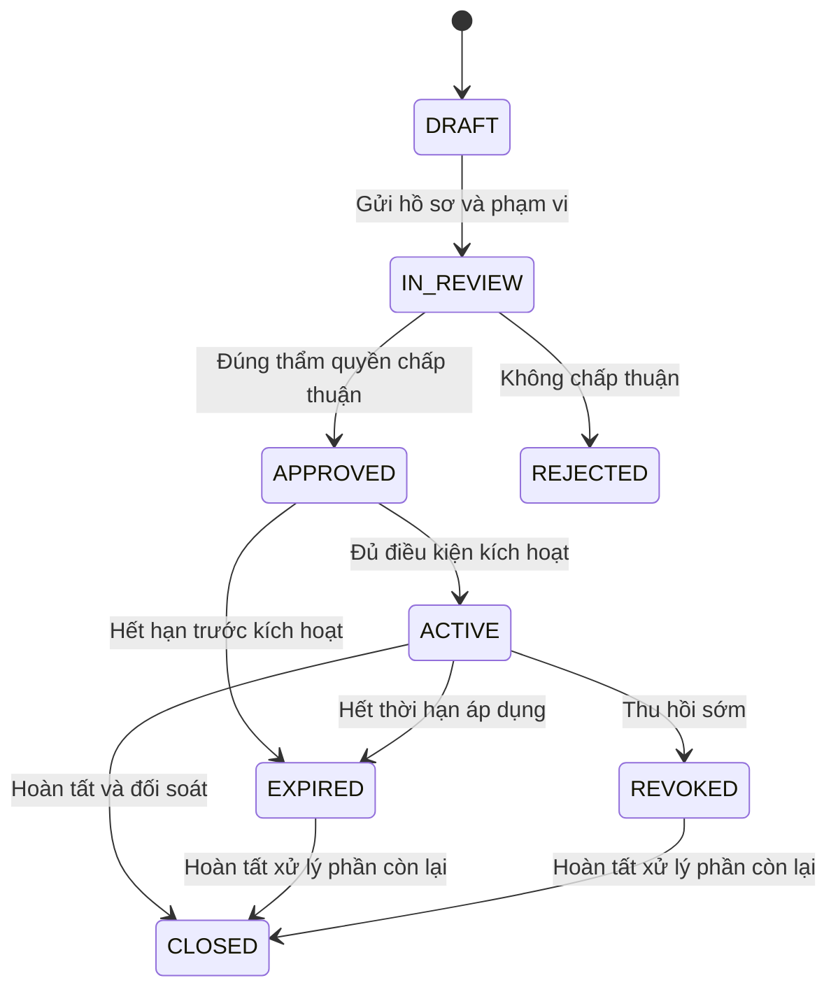

# Exception documentation

## 1. Ngoại lệ cần được mô tả như một quyết định có giới hạn

Trong chương **Documentation**, exception documentation là việc ghi lại một ngoại lệ đối với quy tắc, kiểm soát hoặc quy trình nghiệp vụ: vì sao cần ngoại lệ, ai có quyền cho phép, được áp dụng ở đâu, trong bao lâu và bằng cơ chế nào.

Trong bài học này, **exception** là ngoại lệ nghiệp vụ hoặc ngoại lệ kiểm soát có chủ đích. Nó khác với một đối tượng `Exception` được ném trong Java. Lỗi runtime có thể làm phát sinh nhu cầu xử lý đặc biệt, nhưng việc bắt một exception hoặc gặp sự cố không tự tạo thẩm quyền bỏ qua quy tắc nghiệp vụ.

Ví dụ, hệ thống phê duyệt hoàn tiền tạm thời không hoạt động. Nhóm vận hành cần xử lý một số yêu cầu theo kênh thay thế. Một ghi chú “cho phép xử lý thủ công đến khi sửa xong” không trả lời được ai được xử lý, đơn nào thuộc phạm vi, giới hạn tiền là bao nhiêu và chuyện gì xảy ra khi ngoại lệ hết hạn.

Mục tiêu của tài liệu là biến ngoại lệ thành một quyết định **cụ thể, có thể thực thi, kiểm tra và thu hồi**. Với bảo mật logic nghiệp vụ, tài liệu cần gắn với business invariants, state machine, quyền trên đối tượng, transaction, idempotency và các kiểm thử lạm dụng liên quan.

Một hồ sơ được phê duyệt không tự cấp quyền kỹ thuật. Hệ thống vẫn phải có cơ chế xác minh hồ sơ, áp dụng đúng phạm vi và ngăn các thao tác vượt quá điều kiện được chấp thuận.

## 2. Vì sao mô tả ngoại lệ mơ hồ tạo ra lỗ hổng?

Ngoại lệ thường xuất hiện trong lúc cần xử lý nhanh: hỗ trợ khách hàng, khôi phục sự cố, sửa dữ liệu hoặc vận hành một thị trường mới. Sự gấp gáp có thể làm điều kiện bảo vệ bị rút gọn thành một cờ như `skipValidation=true`.

Những rủi ro điển hình gồm:

- Một phê duyệt cho một giao dịch bị dùng cho mọi giao dịch của tenant.
- Ngoại lệ đã hết hạn nhưng feature flag hoặc script vẫn hoạt động.
- Người yêu cầu tự phê duyệt hoặc tài khoản hỗ trợ có quyền rộng hơn cần thiết.
- Số tiền, người nhận hoặc đối tượng thay đổi sau khi được duyệt.
- Retry của thao tác thủ công tạo thêm giao dịch vì không dùng định danh ổn định.
- Tài liệu ghi một phạm vi, trong khi API hoặc worker thực tế cho phép phạm vi rộng hơn.
- Một ngoại lệ “tạm thời” được gia hạn nhiều lần và trở thành đường xử lý không được quản trị.

Tài liệu tốt giúp phát hiện các khoảng trống này trước khi thao tác. Nó cũng giúp điều tra sau sự cố: phân biệt hành vi được phép trong giới hạn với hành vi lạm dụng quyền hoặc lỗi triển khai.

Không gọi mọi nhánh nghiệp vụ ít gặp là ngoại lệ kiểm soát. Nếu một sản phẩm có lựa chọn xử lý thường xuyên, được thiết kế và kiểm thử đầy đủ, lựa chọn đó có thể cần trở thành chính sách hoặc workflow chính thức. Ngoại lệ không nên thay thế việc thiết kế luồng nghiệp vụ cần dùng lâu dài.

## 3. Ví dụ xuyên suốt: thay kênh phê duyệt hoàn tiền

Giả sử sản phẩm có chính sách nội bộ:

- Refund phải đúng tenant và payment mà người thực hiện có quyền thao tác.
- Khoản trên 1.000.000 VND cần quản lý độc lập phê duyệt, người yêu cầu không được tự duyệt.
- Tổng tiền đã hoàn cùng phần giữ chỗ cho refund đang xử lý hoặc chưa rõ kết quả không vượt khoản thu hợp lệ.
- Một ý định hoàn tiền chỉ tạo một hiệu ứng; kết quả chưa rõ phải được đối soát.

Kênh phê duyệt tự động gặp sự cố. Ngoại lệ giả định `EX-REFUND-017` cho phép **thay kênh ghi nhận phê duyệt** bằng một bản ghi phê duyệt thủ công đã được xác minh, với các giới hạn:

| Thuộc tính | Phạm vi được cho phép trong ví dụ |
| --- | --- |
| Tenant | Chỉ `TENANT-42` |
| Đối tượng | Chỉ các payment nằm trong danh sách đã phê duyệt, có phiên bản hoặc digest |
| Thao tác | Thực hiện refund qua command handler được chỉ định |
| Mức tiền mỗi operation | Tối đa 1.500.000 VND |
| Tổng tiền được chấp nhận theo ngoại lệ | Tối đa 5.000.000 VND |
| Số operation được chấp nhận | Tối đa 10 |
| Thời hạn | Một khoảng UTC xác định, kéo dài 24 giờ |
| Phê duyệt thay thế | Quản lý có quyền, độc lập với người yêu cầu, xác nhận đúng payload/version |

Đây là chính sách minh họa, không phải ngưỡng chung cho mọi tổ chức. Trong chính sách của ví dụ, quyền theo đối tượng, tính đúng của sổ tiền, giới hạn phần tiền có thể hoàn và chống giao dịch lặp là các invariant **không được miễn trừ**.

Ngoại lệ này thay thế một cơ chế phê duyệt đang lỗi; nó không cho phép bỏ yêu cầu có người duyệt độc lập. Một ảnh chụp màn hình hoặc ticket có chữ “đồng ý” chưa đủ nếu hệ thống không xác minh được người duyệt, phạm vi và dữ liệu đã duyệt.

Ví dụ payment đã thu 2.000.000 VND, đã hoàn 300.000 VND và có 200.000 VND chưa rõ kết quả. Phần còn có thể giữ chỗ cho refund mới là 1.500.000 VND. Refund 1.200.000 VND chỉ hợp lệ nếu đồng thời đáp ứng ngân sách payment, giới hạn ngoại lệ và phê duyệt thủ công phù hợp. Ngoại lệ không làm tăng số tiền đã thu.

## 4. Một hồ sơ ngoại lệ cần có những trường nào?

### 4.1. Nhận diện, lý do và quy tắc bị thay thế

| Nhóm thông tin | Nội dung tối thiểu |
| --- | --- |
| Định danh | Exception ID ổn định, phiên bản, tiêu đề và loại ngoại lệ |
| Quy tắc gốc | Rule/control ID, phiên bản và hành vi bình thường |
| Sai khác được phép | Chính xác bước, điều kiện hoặc cơ chế nào được thay thế |
| Lý do | Vấn đề cần giải quyết, tác động nếu không có ngoại lệ, phương án khác đã cân nhắc |
| Rủi ro còn lại | Điều gì có thể xảy ra dù đã có kiểm soát bù |
| Chủ sở hữu | Người chịu trách nhiệm nghiệp vụ, kỹ thuật và theo dõi đến khi đóng |

Mô tả sai khác ở mức có thể kiểm tra. “Dùng kênh phê duyệt thủ công có xác minh thay service approval” rõ hơn “bỏ kiểm tra approval”. Không dùng tiêu đề chung để che việc thực tế cho phép thêm thao tác hoặc thay đổi nhiều quy tắc.

### 4.2. Phạm vi phải có điều kiện kết hợp rõ ràng

Ghi tenant, đối tượng, loại thao tác, môi trường, entry point, currency, giới hạn tiền, danh tính hoặc vai trò được thực hiện và các điều kiện trạng thái liên quan. Nếu có allowlist, lưu phiên bản hoặc digest và cơ chế quản lý thay đổi.

Trong ví dụ, các điều kiện được kết hợp bằng **AND**: đúng tenant **và** payment thuộc danh sách **và** đúng thao tác **và** còn hạn **và** đủ quota **và** có approval thay thế. Không được diễn giải thành chỉ cần đúng một điều kiện là được phép.

Tránh wildcard không giải thích như “mọi payment cần thiết” hoặc “nhân sự liên quan”. Nếu cần phạm vi động, định nghĩa tiêu chí, nguồn dữ liệu đáng tin cậy và cách ghi lại tập đối tượng thực sự được áp dụng.

### 4.3. Thẩm quyền, thời hạn, kiểm soát bù và bằng chứng

Hồ sơ cần phân biệt người đề xuất, người phê duyệt ngoại lệ, người duyệt giao dịch và người thực hiện. Một người có quyền phê duyệt ngoại lệ chưa chắc có quyền thực hiện mọi payment; thẩm quyền cần được kiểm tra theo vai trò và đối tượng tương ứng.

Ghi `valid_from`, `expires_at`, múi giờ, mốc kiểm tra hiệu lực và cách xử lý lệnh đã được chấp nhận trước khi hết hạn. Ghi điều kiện thu hồi sớm, hành vi khi mất nguồn xác minh và trách nhiệm xử lý operation chưa rõ kết quả.

Mỗi kiểm soát bù phải có nơi thực thi, chủ sở hữu và bằng chứng. “Sẽ theo dõi bằng log” còn thiếu: theo dõi chỉ số nào, ai xem, trong bao lâu, khi phát hiện sai lệch sẽ chặn hoặc xử lý gì và bằng chứng nào cho thấy việc đó đã diễn ra.

## 5. Vòng đời, hết hạn và thu hồi

Một vòng đời minh họa có thể là:



`APPROVED` nghĩa là quyết định ngoại lệ đã được chấp thuận. `ACTIVE` còn đòi hỏi cơ chế thực thi đúng phạm vi đã sẵn sàng, cấu hình cần thiết đã được kiểm tra và thời hạn cho phép đã bắt đầu. Không chỉ đổi trạng thái tài liệu rồi mặc định hệ thống đã được phép chạy.

### 5.1. Định nghĩa chính xác mốc kiểm tra hiệu lực

Trong ví dụ, điều kiện thời gian là:

```text
valid_from <= accepted_at < expires_at
```

`accepted_at` là mốc máy chủ ghi khi quyết định chấp nhận một lệnh nghiệp vụ mới trong transaction. Đây là mốc được chính sách chọn cho ví dụ; không phải thời điểm client mở màn hình hoặc thời điểm người duyệt bấm đồng ý.

Một đề nghị được tạo trước khi hết hạn nhưng chưa được chấp nhận không tự được hưởng ngoại lệ sau hạn. Ngược lại, lệnh đã được chấp nhận bền vững trước hạn có thể tiếp tục qua outbox theo chính sách xử lý lệnh đã nhận. Hồ sơ phải nêu rõ giới hạn và trách nhiệm theo dõi các lệnh đó.

Không phụ thuộc hoàn toàn vào cron đổi `ACTIVE` thành `EXPIRED`. Dù job hết hạn chạy chậm, kiểm tra thời gian tại điểm chấp nhận vẫn phải chặn lệnh mới. Đồng hồ máy chủ và timezone cần được quản lý; timestamp do client truyền không được thay thế mốc quyết định.

### 5.2. Thu hồi không đồng nghĩa rollback hiệu ứng bên ngoài

Trong ví dụ, thu hồi chặn chấp nhận operation mới và dừng các lệnh có thể xác minh là chưa được gửi. Operation đã hoặc có thể đã được provider tiếp nhận phải được đối soát. Không tự đánh dấu chúng thất bại rồi gửi lại qua một đường khác.

Cần xác định điểm worker claim/dispatch và cách phối hợp với thu hồi. Một lệnh đang ở giữa bước gọi mạng không thể được coi chắc chắn chưa gửi chỉ vì chưa có phản hồi. Hồ sơ phải mô tả phần có thể chặn, phần đang bay và rủi ro còn lại; thay đổi một flag không tạo khả năng hủy nguyên tử mọi hiệu ứng bên ngoài.

Hết hạn hoặc thu hồi cũng không có nghĩa được bỏ các khoản đang `UNKNOWN`. Đóng hồ sơ cần xử lý hoặc bàn giao rõ các trường hợp còn lại, cùng người chịu trách nhiệm và liên kết theo dõi.

## 6. Mẫu hồ sơ có thể liên kết với enforcement

Mẫu YAML sau là nội dung minh họa, không phải metadata trạng thái bài học. Các mã đối tượng và ngày giờ đều là dữ liệu giả định.

```yaml
exception_id: EX-REFUND-017
revision: 1
lifecycle_state: APPROVED
deviated_rule:
  id: REFUND-APPROVAL-CHANNEL
  version: policy-demo-v4
  permitted_change: VERIFIED_MANUAL_APPROVAL_CHANNEL
reason: Temporary unavailability of the normal approval service
scope:
  environment: production
  tenant_id: TENANT-42
  operation: EXECUTE_REFUND
  payment_allowlist_ref: PAYMENT-LIST-DEMO-V1
  enforcement_point: refund_command_handler
  currency: VND
limits:
  max_operation_amount_minor: 1500000
  max_total_accepted_amount_minor: 5000000
  max_accepted_operations: 10
  accounting_basis: CUMULATIVE_ACCEPTED
validity:
  valid_from: '2030-03-01T00:00:00Z'
  expires_at: '2030-03-02T00:00:00Z'
  evaluation_time: SERVER_ACCEPTED_AT
  interval: START_INCLUSIVE_END_EXCLUSIVE
  expiry_behavior: DRAIN_ALREADY_ACCEPTED_ONLY
  revocation_behavior: STOP_NEW_PAUSE_UNSENT_RECONCILE_UNCERTAIN
required_controls:
  - verified_independent_approval_bound_to_payload
  - object_authorization_and_tenant_isolation
  - atomic_payment_budget_reservation
  - stable_operation_and_provider_idempotency
  - durable_audit_and_reconciliation
owners:
  business: refund_operations_owner
  technical: payments_engineering_owner
  monitoring: incident_operations_owner
approval_record_ref: EXCEPTION-APPROVAL-DEMO-17
test_record_ref: EXCEPTION-TEST-DEMO-17
```

`CUMULATIVE_ACCEPTED` có nghĩa tổng tiền và số operation đã được chấp nhận theo ngoại lệ được tính cộng dồn. Trong ví dụ này, một operation về sau thất bại dứt khoát cũng không tự làm quota ngoại lệ quay lại. Cách tính này khác ngân sách có thể hoàn của payment; hai giới hạn phục vụ hai mục đích và phải được mô tả riêng.

Không tự reset quota khi tăng revision hoặc gia hạn. Nếu quyết định nghiệp vụ cho phép cấp thêm ngân sách, cần một phê duyệt rõ ràng và lịch sử cho thấy tổng phạm vi được mở rộng thế nào. Đổi revision không được biến thành cách vượt hạn mức hoặc tạo lại operation cũ.

Allowlist là một phần phạm vi đã duyệt. Nếu có thể sửa danh sách tùy ý sau duyệt, ngoại lệ thực tế rộng hơn hồ sơ. Cần khóa phiên bản, lưu digest hoặc dùng một cơ chế thay đổi có phê duyệt tương đương, đồng thời ghi đối tượng thực sự được áp dụng.

Các reference trong hồ sơ phải trỏ tới bản ghi có thể xác minh, được bảo vệ và còn truy cập được trong thời kỳ cần thiết. Việc gõ một chuỗi `approval_record_ref` hợp lệ về cú pháp chưa chứng minh đã có người có quyền phê duyệt.

## 7. Từ tài liệu đến transaction nghiệp vụ

### 7.1. Guard phải hẹp hơn một cờ bỏ qua kiểm tra

Tránh thiết kế:

```java
// Không đủ để bảo vệ nghiệp vụ.
if (request.hasExceptionId()) {
    executeRefundWithoutNormalChecks();
}
```

Exception ID là định danh hồ sơ, không phải quyền truy cập. Handler phải đọc hồ sơ có thẩm quyền và kiểm tra phiên bản, trạng thái, thời gian, scope, quota cùng kiểm soát bù. Quyền trên payment vẫn được kiểm tra độc lập.

Khóa hoặc cập nhật có điều kiện cần bảo vệ quota ngoại lệ và ngân sách payment trước các request đồng thời. Nếu hai request đều đọc “còn 1.500.000 VND” rồi cùng thực hiện, tài liệu ghi hạn mức chính xác cũng không ngăn được vượt hạn mức.

### 7.2. Mã giả cho điểm chấp nhận lệnh

Đoạn Java sau mô tả trách nhiệm chính. Repository, transaction và các kiểu dữ liệu là mã giả; ứng dụng thật cần định nghĩa isolation, ràng buộc unique và thứ tự lấy khóa nhất quán.

```java
RefundView acceptExceptionalRefund(User actor, SubmitCommand command) {
    return db.inTransaction(() -> {
        RefundContext context = refunds.lockIntentAndPayment(command.intentId());
        authorization.requireCanRefund(actor, context.payment());

        RequestReceipt prior = requests.find(actor, "REFUND", command.requestKey());
        if (prior != null) {
            prior.requireSameCanonicalFingerprint(command);
            return operations.authorizedView(actor, prior.operationId());
        }

        // Đổi request key không được nhân đôi cùng refund intent.
        RefundOperation existing = operations.findByIntent(context.intent().id());
        if (existing != null) {
            requests.bind(actor, command, existing.id());
            return operations.authorizedView(actor, existing.id());
        }

        ExceptionGrant grant = exceptions.lockById(command.exceptionId());
        Instant acceptedAt = serverClock.instant();
        grant.requireActiveRevisionAt(command.exceptionRevision(), acceptedAt);
        grant.requireScope(context, trustedExecutionEnvironment());

        normalRules.requireValidRefundIntent(context);
        manualApprovals.requireVerifiedIndependentAndBound(
            command.manualApprovalRef(), actor, context, grant
        );

        // Hai giới hạn được cập nhật nguyên tử trong cùng transaction.
        grant.consumeCumulativeAdmission(context.intent().amount());
        payments.reserveRefundBudget(context);

        RefundOperation operation = operations.accept(
            context, grant, acceptedAt, providerKeys.newStableKey()
        );
        requests.bind(actor, command, operation.id());
        audit.recordAdmission(actor, context, grant, operation);
        outbox.enqueueRefund(operation.id());
        return operations.authorizedView(actor, operation.id());
    });
}
```

Command không được sửa dữ liệu của intent đã có khi đi qua nhánh reuse. Nếu người dùng muốn đổi amount, currency, payment hoặc dữ liệu quan trọng, cần xử lý theo quy trình thay đổi intent và approval; không âm thầm cập nhật operation đã được chấp nhận.

Các liên kết request key và refund intent cần có ràng buộc dữ liệu đủ để thắng cuộc đua trên nhiều instance. Khi unique constraint báo trùng, đọc lại và đối chiếu đúng chủ thể, intent và fingerprint; không coi mọi xung đột là thành công.

Gọi provider ở worker sau khi transaction đã commit, dùng khóa và payload đã lưu. Khi worker chết sau hiệu ứng provider nhưng trước commit kết quả, dùng đối soát hoặc retry an toàn của cùng operation, không tạo operation mới.

### 7.3. Retry sau hết hạn là một trường hợp cần mô tả riêng

Một request phát lại của operation đã được chấp nhận có thể trả lại trạng thái đã lưu sau khi kiểm tra quyền và fingerprint. Việc trả trạng thái đó không phải cấp thêm ngoại lệ, không tiêu quota lần nữa và không tự cho phép một lệnh tiền tệ mới.

Nếu operation chưa tồn tại, ngoại lệ hết hạn phải chặn việc chấp nhận mới. Nếu operation còn chưa rõ kết quả, tiếp tục phục hồi theo chính sách đã ghi cho lệnh cũ, giữ nguyên định danh và kiểm tra phạm vi bảo vệ idempotency của provider. Không coi hết hạn hồ sơ là lý do làm mất lịch sử tiền.

## 8. Phê duyệt và bằng chứng kiểm soát bù

Một phê duyệt có thể cần hai lớp khác nhau:

1. **Phê duyệt ngoại lệ:** chấp nhận dùng cơ chế thay thế trong phạm vi, ngân sách và thời hạn đã nêu.
2. **Phê duyệt từng giao dịch:** xác nhận refund cụ thể theo điều kiện nghiệp vụ vẫn còn áp dụng.

Phê duyệt lớp thứ nhất không tự thay thế lớp thứ hai. Nếu chính sách thực sự cho phép gộp một tập giao dịch trong một approval, phải ràng buộc tập đó, tổng tiền, phiên bản và từng payload; không suy diễn từ một lời đồng ý chung.

Với phê duyệt thủ công, bằng chứng cần xác minh được danh tính và thẩm quyền người duyệt, tính độc lập cần thiết, thời điểm, payment/refund intent, amount, currency và phiên bản đã duyệt. Khi dữ liệu quan trọng thay đổi, kiểm tra approval cũ còn áp dụng không và yêu cầu duyệt lại khi cần.

Không coi ảnh chụp, email hoặc ticket là bằng chứng tự xác thực. Một kênh như vậy có thể là nguồn đầu vào, nhưng phải có quy trình kiểm chứng và bản ghi đáng tin cậy để enforcement sử dụng. Client truyền `approved=true`, tên quản lý hoặc đường dẫn ticket không đủ để vượt guard.

Chuỗi bằng chứng của một operation nên nối được:

```text
Quy tắc gốc và hồ sơ ngoại lệ có revision
  -> người có thẩm quyền duyệt ngoại lệ
  -> intent và approval thủ công đã xác minh
  -> quyết định chấp nhận cùng quota/budget
  -> outbox và định danh provider
  -> kết quả ghi sổ, đối soát và việc khắc phục nếu có
```

Lưu tham chiếu và dữ liệu đủ kiểm tra, hạn chế sao chép thông tin cá nhân hoặc bí mật vào hồ sơ. Không ghi secret, thông tin xác thực, CVV hoặc token thanh toán có thể dùng lại. Bảo vệ quyền đọc, sửa, duyệt và thu hồi; ghi lịch sử thay đổi của chính hồ sơ ngoại lệ.

## 9. Kiểm thử ngoại lệ như một bề mặt lạm dụng

Một hồ sơ có đủ trường chưa chứng minh enforcement làm đúng. Cần liên kết với các test cố vượt phạm vi hoặc tái sử dụng quyết định cũ.

| Tình huống | Hành vi thử | Kết quả cần kiểm chứng |
| --- | --- | --- |
| Giả mạo định danh | Truyền Exception ID không tồn tại hoặc tự tạo trường approved | Không cấp quyền hoặc tạo refund; có kết quả lỗi/đánh giá rõ ràng |
| Sai tenant | Dùng hồ sơ của `TENANT-42` cho payment tenant khác | Chặn theo quyền và scope, không lộ dữ liệu ngoài quyền |
| Ngoài allowlist | Payment đúng tenant nhưng không nằm trong danh sách đã duyệt | Không chấp nhận operation theo ngoại lệ |
| Đổi allowlist sau duyệt | Sửa nội dung danh sách mà giữ approval cũ | Phát hiện sai revision/digest hoặc buộc quy trình phê duyệt thay đổi |
| Sai loại thao tác | Dùng ngoại lệ refund để chuyển số dư hoặc đổi người nhận | Không mở rộng quyền sang hành vi khác |
| Tự duyệt | Người yêu cầu là người duyệt giao dịch | Không đáp ứng điều kiện phê duyệt độc lập |
| Đổi payload sau duyệt | Giữ approval nhưng tăng tiền hoặc đổi payment | Approval cũ không cho phép payload mới |
| Biên thời gian | `accepted_at` ngay trước, đúng và sau `expires_at` | Đúng điều kiện cuối khoảng không bao gồm mốc hết hạn |
| Cron hết hạn chạy chậm | Hồ sơ còn ghi `ACTIVE` sau `expires_at` | Không chấp nhận operation mới chỉ vì trạng thái chưa được cập nhật |
| Quota cạnh tranh | Hai request cùng tiêu phần quota còn lại | Tổng tiền và số operation được chấp nhận không vượt giới hạn |
| Ngân sách payment cạnh tranh | Hai operation theo hai ngoại lệ cùng refund một payment | Giới hạn payment vẫn được bảo vệ xuyên các hồ sơ ngoại lệ |
| Retry cùng key | Giao lại cùng request nhiều lần | Một operation, một lần tính quota và một hiệu ứng tiền tệ hợp lệ |
| Đổi request key | Gửi lại cùng refund intent với key khác | Không tạo operation độc lập thứ hai cho intent đó |
| Provider thành công rồi timeout | Mất phản hồi và khởi động lại worker | Không mở khoản hoàn mới; operation chưa rõ được đối soát |
| Hết hạn nhưng còn operation cũ | Retry hoặc tra cứu sau hạn | Không cấp admission mới; trả trạng thái/phục hồi operation cũ đúng chính sách |
| Thu hồi khi có lệnh chờ | Revoke cùng lúc worker chuẩn bị dispatch | Phân biệt chắc chắn chưa gửi với đã/có thể đã gửi; không giả định rollback bên ngoài |
| Đi qua đường thay thế | Dùng batch, API quản trị hoặc script hỗ trợ | Scope và các invariant tương đương vẫn được thực thi |

Kiểm thử đồng thời nên điều phối bằng barrier hoặc cơ chế đồng bộ rõ ràng. Dùng đồng hồ điều khiển được cho TTL và thời hạn. Kiểm tra số operation, quota, giữ chỗ, ghi sổ và hiệu ứng provider; chỉ nhìn mã HTTP không đủ để kết luận ngoại lệ được giới hạn đúng.

Ví dụ quota đã tiêu 4.000.000 VND, còn 1.000.000 VND. Hai request, mỗi request 800.000 VND, cùng đi tới điểm chấp nhận. Nếu cả hai được chấp nhận, tổng trở thành 5.600.000 VND và vi phạm hồ sơ, dù mỗi operation đều dưới mức 1.500.000 VND. Test phải tạo đúng cuộc đua này và kiểm tra dữ liệu sau khi cả hai hoàn tất.

Với lỗi mạng, fake provider cần có sổ giao dịch độc lập và khả năng tạo hiệu ứng trước khi làm mất phản hồi. Một mock ném timeout trước mọi thao tác không kiểm chứng được tình huống đã hoàn tiền nhưng merchant chưa biết.

## 10. Giám sát, gia hạn và đóng hồ sơ

### 10.1. Giám sát theo từng ngoại lệ và revision

Theo dõi số operation mới, tổng tiền đã chấp nhận, số lần bị từ chối theo lý do, quota còn lại, operation chưa rõ kết quả và sai lệch đối soát. Liên kết các số liệu với exception revision thực sự được dùng.

Một cảnh báo không thay cơ chế chặn quota. Nếu hệ thống chỉ báo sau khi tổng tiền vượt giới hạn, kiểm soát phòng ngừa đã không đạt mục tiêu. Tương tự, việc không có cảnh báo không chứng minh không có lạm dụng nếu đường script không phát audit hoặc nguồn log bị thiếu.

Đối chiếu operation được đánh dấu dùng ngoại lệ với sổ nội bộ, outbox và kết quả provider. Khi phát hiện lệnh ngoài scope, cần giữ bằng chứng, ngăn admission mới theo chính sách ứng phó và đánh giá phạm vi; không sửa hồ sơ để hợp thức hóa ngược hành vi đã xảy ra.

### 10.2. Gia hạn là một quyết định mới có liên kết lịch sử

Trước khi gia hạn, xem lại lý do còn tồn tại không, số tiền/số operation đã dùng, tác động thực tế, kết quả kiểm soát bù và tiến độ khôi phục luồng chuẩn. Nêu thời hạn mới, giới hạn mới nếu có và người có thẩm quyền chấp thuận.

Giữ Exception ID hoặc quan hệ nối tiếp để truy nguyên, nhưng quản lý revision và phạm vi được duyệt rõ ràng. Không sửa trực tiếp ngày hết hạn trong bản đã duyệt mà mất lịch sử. Không tự cấp lại 5.000.000 VND hoặc reset bộ đếm chỉ vì tạo revision mới.

Nếu một ngoại lệ cần lặp lại thường xuyên, chuyển nhu cầu sang thiết kế chính sách/workflow chính thức hoặc kế hoạch sửa kiểm soát gốc. Việc gia hạn liên tục là thông tin cần quản trị, không phải lý do để bỏ yêu cầu phê duyệt.

### 10.3. Đóng hồ sơ có bằng chứng

Điều kiện đóng có thể bao gồm:

- Luồng chuẩn đã được khôi phục và có kiểm chứng phù hợp.
- Đường thực thi ngoại lệ đã bị vô hiệu hóa cho admission mới; quyền tạm hoặc cấu hình liên quan đã được xử lý.
- Danh sách operation được chấp nhận và các lần từ chối quan trọng đã được đối chiếu.
- Các khoản đã gửi đều có kết quả, hoặc trường hợp chưa rõ đã được bàn giao có chủ sở hữu và tham chiếu theo dõi.
- Quota và ngân sách payment được giải thích đúng; không còn giữ chỗ hoặc tác vụ mồ côi không có người chịu trách nhiệm.
- Rủi ro, sự cố và hành động tiếp theo được ghi lại; bằng chứng vẫn được bảo vệ và lưu theo chính sách phù hợp.

Đóng không có nghĩa xóa tài liệu hoặc xóa operation. Hồ sơ đã đóng vẫn cần hỗ trợ điều tra và trả trạng thái khi gặp request phát lại hợp lệ; nó không được dùng để cấp một admission mới.

## 11. Chất lượng tài liệu và các lỗi cần sửa

| Mô tả hoặc thực hành yếu | Vấn đề | Cách viết hoặc thiết kế tốt hơn |
| --- | --- | --- |
| “Cho phép xử lý thủ công khi cần” | Không có scope hay điều kiện kết thúc | Ghi tenant, tập đối tượng, operation, giới hạn và thời gian cụ thể |
| “Được quản lý duyệt” | Không biết quản lý nào, duyệt điều gì và có quyền không | Tham chiếu bản ghi danh tính/thẩm quyền, payload và phiên bản đã duyệt |
| “Hết hạn sẽ có người tắt flag” | Có thể tiếp tục chạy nếu quên thao tác | Kiểm tra TTL ở enforcement, thêm giám sát và quy trình thu hồi |
| “Có ticket nên bỏ validation” | Biến định danh tài liệu thành quyền kỹ thuật | Xác minh quyết định có thẩm quyền và chỉ thay đúng kiểm soát được phép |
| “Nếu lỗi thì chạy lại script” | Có thể nhân đôi giao dịch hoặc vượt quota | Giữ operation ID, idempotency, trạng thái chưa rõ và đường đối soát |
| “Log sẽ chứng minh mọi thứ” | Log có thể không bao phủ commit hoặc hiệu ứng bên ngoài | Liên kết transaction, outbox, provider và ghi sổ theo mục đích bằng chứng |
| “Cập nhật nội dung đã duyệt cho tiện” | Approval có thể bị áp vào phạm vi mới | Tạo revision, rà soát và phê duyệt lại phần thay đổi có ý nghĩa |
| “Đã rollback config nên đã khắc phục” | Không hoàn tác tiền đã chuyển hoặc lệnh đã gửi | Theo dõi operation thực tế và quy trình xử lý bù có kiểm soát |

Hồ sơ có thể được quản lý cùng mã nguồn hoặc trong hệ thống quản trị khác. Điều quan trọng là người có trách nhiệm tìm được bản đang có hiệu lực, xác minh lịch sử và liên kết nó với enforcement đang chạy. Một comment trong code có ích để chỉ tới hồ sơ nhưng không thay thế phê duyệt hoặc kiểm tra runtime.

Khi nội dung được duyệt, cần ràng buộc approval với đúng revision hoặc digest. Cơ chế bảo vệ lịch sử giúp phát hiện sửa đổi; hash của một file tự nó không chứng minh người ký có thẩm quyền hay nội dung đã được diễn giải đúng.

Tách nội dung dành cho vận hành khỏi dữ liệu nhạy cảm chi tiết. Runbook cần đủ rõ để biết điều kiện thực hiện và điểm dừng; danh sách payment, bằng chứng cá nhân hoặc thông tin giao dịch có thể nằm ở nguồn được bảo vệ và được tham chiếu. Không sao chép toàn bộ các dữ liệu đó vào mọi phiên bản tài liệu.

## 12. Bài thực hành và tiêu chí hoàn thành

Hãy viết hồ sơ cho `EX-REFUND-017` với phạm vi và hạn mức trong bài. Sau đó xét yêu cầu refund 1.200.000 VND cho một payment của `TENANT-42`, có trong allowlist, còn đủ phần tiền hợp lệ và có approval thủ công đúng payload. Giả sử actor có quyền, các điều kiện trạng thái đều hợp lệ, ngoại lệ đã chấp nhận 3 operation với tổng 3.000.000 VND và `accepted_at` còn trong thời hạn.

Một lời giải cần nêu được:

1. Quy tắc nào được thay thế: kênh ghi nhận phê duyệt, không phải mọi kiểm soát refund.
2. Vì sao yêu cầu nằm trong phạm vi: tenant, payment, thao tác, môi trường, amount và thời gian đều khớp.
3. Vì sao approval đáp ứng yêu cầu: đúng người có quyền, độc lập và ràng buộc dữ liệu/version.
4. Quota sau admission: tổng tiền cộng dồn thành 4.200.000 VND và số operation đã chấp nhận tăng từ 3 lên 4.
5. Ngân sách payment được giữ chỗ riêng trong cùng transaction; không cộng nhầm nó với quota ngoại lệ.
6. Worker dùng operation và khóa provider đã lưu; timeout không tạo khoản hoàn mới.
7. Bằng chứng nào nối quyết định, người thực hiện, revision, quota và kết quả tiền tệ.

Tiếp tục thay từng điều kiện: payment ngoài danh sách, actor sai tenant, approval cho amount khác, `accepted_at` đúng thời điểm hết hạn, hai request tranh quota và provider đã hoàn tiền nhưng mất phản hồi. Ghi rõ trường hợp nào bị chặn, trường hợp nào chỉ được trả trạng thái operation cũ và trường hợp nào cần đối soát.

Hồ sơ đạt yêu cầu khi một người không tham gia cuộc trao đổi ban đầu vẫn xác định được phạm vi cho phép, các invariant còn nguyên, mốc hiệu lực, thẩm quyền, cơ chế thực thi, kiểm thử và điều kiện đóng. Ngoại lệ phải để lại một chuỗi quyết định có thể giải thích, thay vì trở thành lời cho phép chung để đi vòng qua quy tắc nghiệp vụ.
