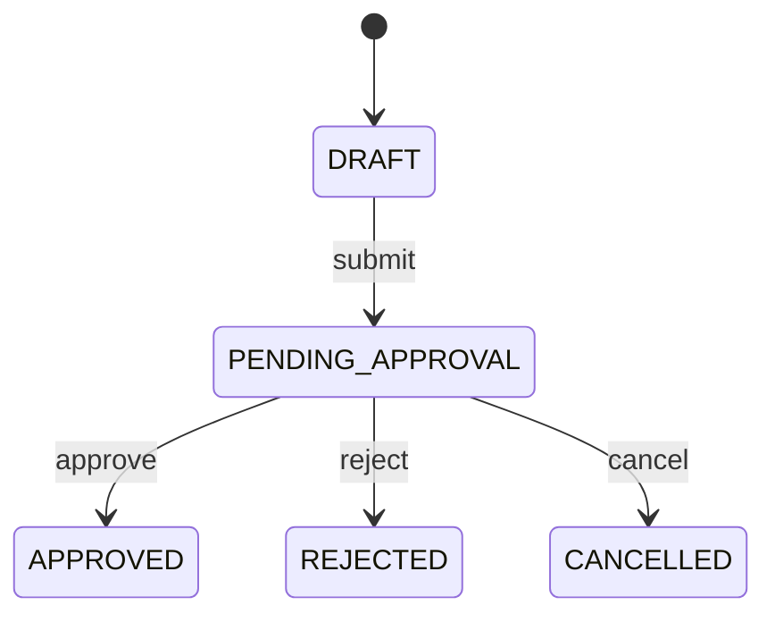
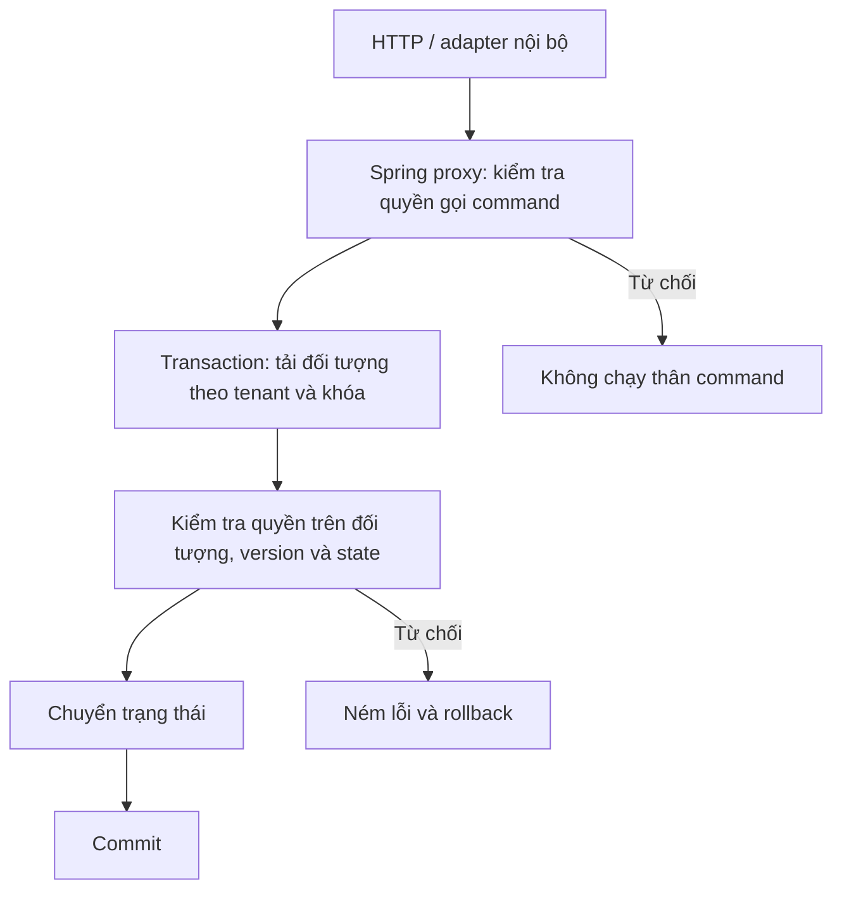

# Method security for commands

Trong chương **Spring Security Integration**, method security giúp đặt cổng kiểm soát quyền ngay tại phương thức thực hiện nghiệp vụ. Với một command như duyệt đơn hàng, hoàn tiền hoặc đổi giá, mục tiêu bảo vệ là: **chỉ chủ thể được phép mới có thể tạo ra một chuyển đổi trạng thái hợp lệ trên đúng đối tượng**.

Bài học thuộc phạm vi bảo mật logic nghiệp vụ: chống bỏ qua bước phê duyệt, sửa dữ liệu ngoài quyền hạn và gửi lệnh trùng. Ví dụ xuyên suốt là command duyệt đơn mua hàng trong hệ thống nhiều tenant. Mỗi tenant là một tổ chức có dữ liệu và người dùng riêng.

Sau bài học, bạn cần giải thích được:

- Vì sao kiểm tra URL và role chưa đủ để bảo vệ command.
- Cách kết hợp `@PreAuthorize` với quyền theo đối tượng và business invariants.
- Vì sao kiểm tra trạng thái phải gắn với transaction và cơ chế kiểm soát đồng thời.
- Cách kiểm thử trường hợp bị từ chối, lời gọi bỏ qua proxy và yêu cầu lặp lại.

## 1. Command cần được bảo vệ theo ý định nghiệp vụ

**Command** là yêu cầu thực hiện một hành động có thể thay đổi trạng thái: `ApproveOrder`, `CancelOrder`, `RefundPayment`. Command khác với query chỉ đọc dữ liệu.

Một API như sau biểu đạt khá rõ ý định:

```http
POST /orders/7e386da1-1264-436b-aedf-c6e9d63f24a2/approve
Content-Type: application/json

{
  "expectedVersion": 7
}
```

Server lấy mã đơn từ đường dẫn, phiên bản mong đợi từ body và danh tính từ ngữ cảnh xác thực. Client không được quyết định `approvedBy`, `tenantId`, `newStatus` hay giá cuối cùng trong command duyệt.

Nếu dùng một DTO tổng quát chứa mọi field của entity rồi sao chép trực tiếp xuống database, người gọi có thể thử gửi thêm:

```json
{
  "status": "APPROVED",
  "approvedBy": "another-user",
  "tenantId": "another-tenant",
  "totalAmount": 1
}
```

Đây là nguy cơ mass assignment: quyền cập nhật một field vô tình trở thành quyền cập nhật toàn bộ đối tượng. Biện pháp phù hợp là command nhỏ, chỉ chứa dữ liệu thật sự cần cho hành động, kèm các quy tắc do server thực thi. Nếu API từ chối field JSON không biết, đó là một lớp bảo vệ bổ sung; tính an toàn vẫn phải đến từ việc không bind các field nhạy cảm vào hành vi ghi dữ liệu.

Ẩn nút “Duyệt” trên giao diện chỉ cải thiện trải nghiệm. Người dùng vẫn có thể tự gửi HTTP request hoặc gọi một lối vào khác của hệ thống.

## 2. Viết invariants trước khi chọn annotation

Giả sử quy trình có các trạng thái:



Mỗi mũi tên là một hành vi riêng, cần command và policy phù hợp. Một endpoint “cập nhật status bất kỳ” sẽ làm mất ranh giới giữa các hành vi này.

Với `ApproveOrder`, đặt ra các bất biến:

| Điều kiện | Lý do | Nơi thực thi trong ví dụ |
|---|---|---|
| Có authority `order:approve` | Phân biệt người tạo đơn và người được duyệt | Method security |
| Đơn thuộc tenant đang được xác thực | Chống thao tác chéo tổ chức bằng cách đổi ID | Truy vấn có điều kiện tenant |
| Người duyệt khác người tạo | Bảo đảm nguyên tắc hai người | Hành vi domain |
| Đơn đang `PENDING_APPROVAL` | Không bỏ qua submit, không duyệt đơn đã hủy | Hành vi domain |
| Phiên bản trùng với phiên bản người dùng đã xem | Không duyệt dựa trên dữ liệu cũ | So sánh version trong transaction |
| Hai lệnh đồng thời không cùng hoàn tất một lần duyệt | Chống race condition và tác động lặp | Khóa, version và giao thức xử lý trùng |

Không thể suy ra toàn bộ các điều kiện này từ một role như `MANAGER`. Một người có vai trò quản lý vẫn có thể đang truy cập sai tenant, tự duyệt đơn của mình hoặc duyệt đơn đã bị hủy.

Nếu doanh nghiệp bổ sung hạn mức tiền, trạng thái hồ sơ pháp lý hoặc quyền phụ trách phòng ban, hãy đưa chúng thành quy tắc rõ ràng. Ví dụ trong bài chưa triển khai các điều kiện bổ sung đó.

## 3. Đặt cổng quyền tại application service

Một luồng xử lý nên có cấu trúc:



Controller kiểm tra định dạng request rồi gọi application service. Service chịu trách nhiệm điều phối một hành vi nghiệp vụ hoàn chỉnh; domain giữ các bất biến liên quan đến đối tượng.

Bảo vệ service giúp cùng một quy tắc áp dụng cho nhiều adapter, với điều kiện lời gọi đi qua Spring proxy và có ngữ cảnh xác thực phù hợp. Không nên tạo thêm một public method “internalApprove” không kiểm tra quyền rồi để controller, batch và consumer tùy ý gọi nó.

Request security vẫn cần cho endpoint, cơ chế đăng nhập và những biện pháp như CSRF khi phù hợp với cách xác thực. Method security bổ sung ranh giới ở tầng nghiệp vụ. Spring Boot Security starter không tự bật method security. [Nguồn: Spring Security — Method Security](https://docs.spring.io/spring-security/reference/servlet/authorization/method-security.html).

### Bật method security

Ví dụ dùng Java 17 trở lên, ứng dụng Servlet đồng bộ, Spring Security với `@EnableMethodSecurity` và JPA dùng package `jakarta.persistence`. Cần chọn các phiên bản Spring tương thích trong cùng bộ dependency của ứng dụng; không ghép tùy ý các bản mới nhất.

```java
import java.time.Clock;
import org.springframework.context.annotation.Bean;
import org.springframework.context.annotation.Configuration;
import org.springframework.security.config.annotation.method.configuration.EnableMethodSecurity;
import org.springframework.transaction.annotation.EnableTransactionManagement;

@Configuration
@EnableMethodSecurity
@EnableTransactionManagement
public class CommandSecurityConfig {

    @Bean
    Clock commandClock() {
        return Clock.systemUTC();
    }
}
```

Cấu hình này giả định ứng dụng đã có datasource, JPA và transaction manager. `@EnableTransactionManagement` bật cơ chế xử lý annotation transaction, không tự tạo kết nối database. [Nguồn: Spring Framework — Using @Transactional](https://docs.spring.io/spring-framework/reference/data-access/transaction/declarative/annotations.html).

`@EnableMethodSecurity` bật nhóm annotation pre/post theo mặc định. `@Secured` và nhóm JSR-250 như `@RolesAllowed` có tùy chọn bật riêng; không nên thấy annotation trong code rồi mặc định rằng nó đã hoạt động. [Nguồn: EnableMethodSecurity API](https://docs.spring.io/spring-security/reference/api/java/org/springframework/security/config/annotation/method/configuration/EnableMethodSecurity.html).

### Dùng authority diễn đạt hành động

```java
@PreAuthorize("hasAuthority('order:approve')")
```

Authority này biểu đạt quyền duyệt đơn. `hasRole('MANAGER')` mặc định kiểm tra tên có tiền tố `ROLE_`, còn `hasAuthority` kiểm tra authority đã được cấp theo tên tương ứng. Nếu ứng dụng có tùy chỉnh tiền tố hoặc cơ chế ánh xạ quyền, cần kiểm tra cấu hình thực tế. [Nguồn: SecurityExpressionRoot API](https://docs.spring.io/spring-security/reference/api/java/org/springframework/security/access/expression/SecurityExpressionRoot.html).

Một quy ước hữu ích là tách các quyền `order:create`, `order:submit`, `order:approve` và `order:cancel`. Việc một role được cấp những quyền nào thuộc chính sách cấp quyền; command chỉ cần kiểm tra đúng hành động của mình.

Nếu quyền bị rút nhưng session hoặc token vẫn chứa authority cũ, annotation không tự biết thay đổi đó. Với yêu cầu thu hồi tức thời, thiết kế thêm kiểm tra trạng thái quyền hiện hành hoặc cơ chế vô hiệu hóa phiên/token, phù hợp với mô hình xác thực.

## 4. Tách dữ liệu command khỏi danh tính người thực hiện

Các kiểu Java dưới đây được trình bày thành từng phần; khi triển khai, mỗi public type đặt trong file tương ứng. Ví dụ tập trung vào luồng duyệt, không phải toàn bộ ứng dụng CRUD.

### Command chỉ mang đầu vào được phép

```java
import java.util.Objects;
import java.util.UUID;

public record ApproveOrderCommand(UUID orderId, long expectedVersion) {
    public ApproveOrderCommand {
        Objects.requireNonNull(orderId, "orderId");
        if (expectedVersion < 0) {
            throw new IllegalArgumentException("expectedVersion must be non-negative");
        }
    }
}
```

`expectedVersion` là điều kiện từ client, không phải dữ liệu đáng tin tuyệt đối. Server luôn so nó với version đang lưu. Một người đoán đúng version vẫn phải vượt qua kiểm tra authority, tenant, người tạo và trạng thái.

Nếu sử dụng Bean Validation cho DTO HTTP, hãy nhớ rằng lời gọi service từ một adapter khác cũng cần đầu vào hợp lệ. Constructor của command ở đây bảo vệ những điều kiện hình dạng cơ bản ở mọi lối vào.

### Principal phải đến từ quá trình xác thực đáng tin

```java
import java.security.Principal;
import java.util.Objects;
import java.util.UUID;

public record AppPrincipal(UUID userId, UUID tenantId) implements Principal {
    public AppPrincipal {
        Objects.requireNonNull(userId, "userId");
        Objects.requireNonNull(tenantId, "tenantId");
    }

    @Override
    public String getName() {
        return userId.toString();
    }
}
```

Trong thiết kế này, tầng xác thực chỉ tạo `AppPrincipal` sau khi đã xác minh người dùng và quan hệ thành viên của tenant. Khi cho phép chọn tenant bằng header, server phải kiểm tra người dùng thật sự thuộc tenant đó trước khi xây dựng principal. Chỉ chép header hoặc body sang principal sẽ phá vỡ giả định bảo mật của ví dụ.

```java
import org.springframework.security.access.AccessDeniedException;
import org.springframework.security.core.Authentication;
import org.springframework.security.core.context.SecurityContextHolder;
import org.springframework.stereotype.Component;

@Component
public class CurrentActor {

    public AppPrincipal require() {
        Authentication authentication =
                SecurityContextHolder.getContext().getAuthentication();

        if (authentication == null
                || !authentication.isAuthenticated()
                || !(authentication.getPrincipal() instanceof AppPrincipal actor)) {
            throw new AccessDeniedException("Trusted actor is required");
        }

        return actor;
    }
}
```

Spring Security lưu `Authentication` trong `SecurityContext`; principal có kiểu tùy cơ chế xác thực. `AppPrincipal` ở đây là quy ước của ứng dụng, không phải kiểu mặc định của mọi cấu hình. Nếu dùng JWT Resource Server hoặc `UserDetails`, cần adapter ánh xạ danh tính đã xác minh sang mô hình actor phù hợp. [Nguồn: Servlet Authentication Architecture](https://docs.spring.io/spring-security/reference/servlet/authentication/architecture.html).

Không nhận một tham số `actorId` từ request rồi dùng nó để quyết định người duyệt. Không dùng username hiển thị hoặc email có thể thay đổi làm khóa nghiệp vụ nếu hệ thống đã có ID ổn định.

## 5. Giữ chuyển trạng thái trong hành vi domain

Để phân biệt lỗi từ chối quyền và xung đột nghiệp vụ, ví dụ dùng exception có reason rõ ràng:

```java
public class ApprovalRuleViolation extends RuntimeException {

    public enum Reason {
        SELF_APPROVAL_FORBIDDEN,
        STALE_VERSION,
        INVALID_STATE
    }

    private final Reason reason;

    public ApprovalRuleViolation(Reason reason) {
        super(reason.name());
        this.reason = reason;
    }

    public Reason reason() {
        return reason;
    }
}
```

Entity chỉ trình bày những field và hành vi cần cho việc duyệt. Các hành vi tạo đơn, sửa nội dung và submit phải có quy tắc riêng; không mở setter trạng thái tùy ý để thay thế chúng.

```java
import jakarta.persistence.Column;
import jakarta.persistence.Entity;
import jakarta.persistence.EnumType;
import jakarta.persistence.Enumerated;
import jakarta.persistence.Id;
import jakarta.persistence.Table;
import jakarta.persistence.Version;
import java.time.Instant;
import java.util.UUID;

@Entity
@Table(name = "purchase_orders")
public class PurchaseOrder {

    public enum Status {
        DRAFT, PENDING_APPROVAL, APPROVED, REJECTED, CANCELLED
    }

    @Id
    private UUID id;

    @Column(nullable = false, updatable = false)
    private UUID tenantId;

    @Column(nullable = false, updatable = false)
    private UUID createdBy;

    @Enumerated(EnumType.STRING)
    @Column(nullable = false)
    private Status status;

    @Version
    private long version;

    private UUID approvedBy;
    private Instant approvedAt;

    protected PurchaseOrder() {
    }

    public void approve(UUID actorId, long expectedVersion, Instant now) {
        if (createdBy.equals(actorId)) {
            throw new ApprovalRuleViolation(
                    ApprovalRuleViolation.Reason.SELF_APPROVAL_FORBIDDEN);
        }
        if (version != expectedVersion) {
            throw new ApprovalRuleViolation(
                    ApprovalRuleViolation.Reason.STALE_VERSION);
        }
        if (status != Status.PENDING_APPROVAL) {
            throw new ApprovalRuleViolation(
                    ApprovalRuleViolation.Reason.INVALID_STATE);
        }

        status = Status.APPROVED;
        approvedBy = actorId;
        approvedAt = now;
    }

    public UUID getId() {
        return id;
    }

    public Status getStatus() {
        return status;
    }
}
```

Hành vi `approve` nhận actor đã được application service xác định. Nó không tự cấp quyền `order:approve`; trách nhiệm đó nằm ở ranh giới command. Ngược lại, chỉ kiểm tra authority cũng không thay thế được các điều kiện bên trong `approve`.

Trong hệ thống thật, nếu thay đổi số tiền sau khi đã duyệt có thể làm mất hiệu lực phê duyệt, hành vi sửa đơn cần cấm việc đó hoặc chuyển đơn về quy trình duyệt lại. Bảo vệ riêng `approve` mà bỏ ngỏ một `updateOrder` ghi đè status hoặc số tiền vẫn làm hỏng invariant.

## 6. Tải đúng đối tượng và thực thi trong một transaction

### Repository phải mang điều kiện tenant

```java
import jakarta.persistence.LockModeType;
import java.util.Optional;
import java.util.UUID;
import org.springframework.data.jpa.repository.JpaRepository;
import org.springframework.data.jpa.repository.Lock;
import org.springframework.data.jpa.repository.Query;
import org.springframework.data.repository.query.Param;

public interface OrderRepository extends JpaRepository<PurchaseOrder, UUID> {

    @Lock(LockModeType.PESSIMISTIC_WRITE)
    @Query("""
        select o
        from PurchaseOrder o
        where o.id = :orderId
          and o.tenantId = :tenantId
        """)
    Optional<PurchaseOrder> findForApproval(
            @Param("orderId") UUID orderId,
            @Param("tenantId") UUID tenantId);
}
```

Spring Data JPA hỗ trợ đặt lock mode lên query method bằng `@Lock`. Ví dụ chọn `PESSIMISTIC_WRITE` và gọi truy vấn trong transaction đang hoạt động. [Nguồn: Spring Data JPA — Locking](https://docs.spring.io/spring-data/jpa/reference/jpa/locking.html).

Điều kiện tenant nằm trong truy vấn, nên một ID hợp lệ thuộc tenant khác cũng không trả đối tượng. Đây là một biện pháp chống truy cập đối tượng ngoài quyền hạn, thường được nhắc đến qua các tên IDOR hoặc BOLA.

UUID khó đoán chỉ giảm khả năng dò ngẫu nhiên. Nó không phải bằng chứng rằng người gọi có quyền trên đối tượng.

### Application service là ranh giới command

```java
import java.util.UUID;

public record ApprovalResult(UUID orderId, PurchaseOrder.Status status) {
}
```

```java
public class OrderNotAccessibleException extends RuntimeException {
    public OrderNotAccessibleException() {
        super("Order is not accessible");
    }
}
```

```java
import java.time.Clock;
import org.springframework.security.access.prepost.PreAuthorize;
import org.springframework.stereotype.Service;
import org.springframework.transaction.annotation.Transactional;

@Service
public class ApproveOrderHandler {

    private final OrderRepository orders;
    private final CurrentActor currentActor;
    private final Clock clock;

    public ApproveOrderHandler(
            OrderRepository orders,
            CurrentActor currentActor,
            Clock clock) {
        this.orders = orders;
        this.currentActor = currentActor;
        this.clock = clock;
    }

    @PreAuthorize("hasAuthority('order:approve')")
    @Transactional
    public ApprovalResult handle(ApproveOrderCommand command) {
        AppPrincipal actor = currentActor.require();

        PurchaseOrder order = orders.findForApproval(
                        command.orderId(), actor.tenantId())
                .orElseThrow(OrderNotAccessibleException::new);

        order.approve(
                actor.userId(), command.expectedVersion(), clock.instant());

        return new ApprovalResult(order.getId(), order.getStatus());
    }
}
```

Các thao tác đọc đối tượng, kiểm tra invariant và đổi trạng thái nằm trong cùng transaction. Entity được tải vào persistence context nên thay đổi được JPA ghi khi flush/commit; không cần một lần `save` chỉ để đánh dấu entity đang được quản lý.

Ở đây kết quả chỉ trả ID và trạng thái. Nếu muốn trả version mới, phải tính đến thời điểm JPA cập nhật `@Version`; đừng lấy version trước flush rồi quảng bá nó như version sau khi ghi.

Lệnh này chưa chứa idempotency store, audit store hoặc outbox. Những phần đó được giải thích ở mục 10; muốn cam kết xử lý trùng hay phát sự kiện đáng tin cậy thì phải triển khai chúng, không chỉ thêm annotation.

### Khóa giải quyết race condition nào?

Xét hai transaction cùng muốn duyệt một đơn:

| Thời điểm | Transaction A | Transaction B |
|---|---|---|
| 1 | Khóa và đọc đơn đang chờ | Chờ lấy khóa cùng đơn |
| 2 | Kiểm tra rồi đổi thành `APPROVED` | Chưa được sửa đơn |
| 3 | Commit | Tiếp tục sau khi khóa được giải phóng |
| 4 | Hoàn tất | Thấy dữ liệu đã đổi hoặc nhận lỗi xung đột theo DB/isolation; không được duyệt lần hai |

Đây là lập luận thiết kế cho đường ghi có khóa, không phải cam kết mọi database sẽ trả cùng một exception. Timeout, deadlock và isolation level phải được kiểm thử trên hệ quản trị đích.

`@Version` hỗ trợ phát hiện ghi dựa trên phiên bản cũ trong các đường cập nhật JPA có tuân thủ version. Nếu chọn optimistic locking thay khóa bi quan, phải xử lý xung đột lúc flush/commit; không giả định rằng đọc và so sánh version trong Java đã đủ nguyên tử.

Khóa một đơn không bảo vệ tự động một hạn mức dùng chung giữa nhiều đơn. Với quy tắc “tổng số tiền duyệt trong ngày không vượt ngân sách”, cần bảo vệ thêm bản ghi ngân sách, cập nhật có điều kiện hoặc cơ chế đồng thời phù hợp cho toàn bộ invariant đó. Các đường SQL/bulk update khác cũng phải tuân thủ cùng quy tắc.

## 7. Quyền theo đối tượng trong SpEL: dùng đúng giới hạn

Có thể đưa một policy bean vào biểu thức để kiểm tra quyền theo đối tượng:

```java
@PreAuthorize("""
    hasAuthority('order:approve')
    and @approvalScope.mayAccess(authentication, #cmd.orderId())
    """)
```

Đây là một biến thể thiết kế. `approvalScope` phải là bean thật của ứng dụng; `mayAccess` trả quyết định dựa trên danh tính đã xác minh và quyền truy cập đối tượng. Nó nên chỉ đọc dữ liệu, không đổi trạng thái hay phát sự kiện.

Nếu tham chiếu `#cmd`, phương thức cần có tên tham số được Spring nhận diện. Có thể bật metadata tên tham số Java qua `-parameters` hoặc dùng `@P("cmd")` của Spring Security trên tham số. Đừng để biểu thức phụ thuộc vào tên tham số mà build không lưu lại. [Nguồn: P API](https://docs.spring.io/spring-security/reference/api/java/org/springframework/security/core/parameters/P.html).

Ví dụ khai báo tên tham số:

```java
public interface ScopedApprovalCommands {

    @org.springframework.security.access.prepost.PreAuthorize("""
        hasAuthority('order:approve')
        and @approvalScope.mayAccess(authentication, #cmd.orderId())
        """)
    ApprovalResult handle(
            @org.springframework.security.core.parameters.P("cmd")
            ApproveOrderCommand command);
}
```

Interface này minh họa chữ ký cho biến thể dùng policy bean, không phải thành phần bắt buộc của `ApproveOrderHandler` ở mục 6.

**Kết quả kiểm tra trước khi gọi phương thức không khóa trạng thái nghiệp vụ.** Nếu policy đọc đơn đang chờ, rồi transaction khác hủy đơn trước lúc handler ghi, việc policy từng trả `true` không còn đủ. Handler vẫn phải tải và kiểm tra invariant trên dữ liệu được bảo vệ bởi transaction/cơ chế đồng thời.

Trong ví dụ chính, điều kiện tenant đã có trong query và điều kiện không tự duyệt nằm trong domain. Không cần thêm một truy vấn SpEL giống hệt chỉ để tăng số lớp annotation. Policy bean hữu ích hơn khi có ACL, phạm vi phụ trách hoặc một quy tắc quyền riêng cần tái sử dụng.

Nếu quyền theo đối tượng cũng có thể đổi đồng thời và yêu cầu hiệu lực tức thời, phải thiết kế tính nhất quán của dữ liệu quyền với transaction ghi. Đưa truy vấn vào transaction mà không có cơ chế khóa, version hay cập nhật có điều kiện phù hợp vẫn có thể để lại khoảng đua.

## 8. Những đường đi khiến annotation không bảo vệ command

Trong chế độ proxy thông thường, lời gọi phải đi qua proxy. Tự gọi một method khác trên `this` không tạo một lần kiểm tra method security mới. Tự `new` service cũng không tạo Spring proxy. Với proxy dựa trên subclass, method `final` và `private` không được advice như một public method có thể override. [Nguồn: Spring Framework — Proxying Mechanisms](https://docs.spring.io/spring-framework/reference/core/aop/proxying.html).

Ví dụ dễ nhầm:

```java
@Service
public class UnsafeApprovalFacade {

    public void approveFromImport(ApproveOrderCommand command) {
        this.approve(command);
    }

    @PreAuthorize("hasAuthority('order:approve')")
    public void approve(ApproveOrderCommand command) {
        writeApproval(command);
    }

    private void writeApproval(ApproveOrderCommand command) {
        // Minh họa vị trí có thể ghi dữ liệu sau khi bỏ qua cổng quyền.
    }
}
```

`approveFromImport` không được bảo vệ và gọi nội bộ `approve`; annotation trên `approve` không chặn được đường gọi này trong chế độ proxy.

Cách tổ chức rõ ràng hơn là để adapter import gọi bean `ApproveOrderHandler` được inject. Nếu có bước phối hợp nhiều command, đặt bước phối hợp ở bean khác và chỉ cho phép nó gọi những ranh giới command đã bảo vệ.

Các điểm cần chú ý thêm:

- Một public method mới trên service không tự được bảo vệ chỉ vì các method cũ có annotation.
- Khi dùng annotation cùng loại ở cấp class và method, cấu hình cấp method có thể thay thế cấu hình cấp class. Không suy đoán rằng mọi điều kiện luôn được cộng thêm. [Nguồn: Method Security — khai báo ở class/interface](https://docs.spring.io/spring-security/reference/servlet/authorization/method-security.html#_declaring_annotations_at_the_class_or_interface_level).
- Domain invariant giúp chống một số sai phạm dù bị gọi từ lối khác, nhưng không bù cho việc bỏ qua kiểm tra authority tại application boundary.
- Nếu cố ý dùng AspectJ weaving thay proxy, cơ chế interception khác; phải kiểm thử đúng chế độ được triển khai.

## 9. Không dùng kiểm tra sau thực thi để bảo vệ tác động ghi

`@PostAuthorize` đánh giá biểu thức sau khi phương thức đã chạy. [Nguồn: PostAuthorize API](https://docs.spring.io/spring-security/reference/api/java/org/springframework/security/access/prepost/PostAuthorize.html).

Với command, thiết kế “cứ ghi trước, kiểm tra quyền trên kết quả sau” dễ dẫn đến tình huống người gọi nhận lỗi nhưng dữ liệu hoặc tác động bên ngoài đã xảy ra. Database commit còn phụ thuộc thứ tự transaction advice và authorization advice; thứ tự các annotation trong mã nguồn không xác định thứ tự advice.

Transaction advice có thuộc tính thứ tự riêng, mặc định là `Ordered.LOWEST_PRECEDENCE`. Không suy ra một post-check nằm trong transaction chỉ vì hai annotation cùng xuất hiện trên một method. [Nguồn: Using @Transactional — cấu hình advice](https://docs.spring.io/spring-framework/reference/data-access/transaction/declarative/annotations.html).

Cách phù hợp cho luồng duyệt là kiểm tra quyền trước khi chạy command và kiểm tra trạng thái trước khi đổi trạng thái trong transaction. Gửi email, gọi API thanh toán hay phát message trực tiếp không được hoàn tác tự động chỉ vì transaction database rollback.

Trong cấu hình transaction mặc định, `RuntimeException` và `Error` dẫn đến rollback; checked exception cần rollback rule phù hợp nếu muốn rollback. Không bắt lỗi nghiệp vụ trong handler rồi trả “thất bại” sau khi đã thay đổi entity mà để transaction tiếp tục commit. [Nguồn: Rolling Back a Declarative Transaction](https://docs.spring.io/spring-framework/reference/data-access/transaction/declarative/rolling-back.html).

Với exception trong ví dụ:

| Tình huống | Ánh xạ HTTP gợi ý tại adapter |
|---|---|
| Thiếu quyền gọi command | `403 Forbidden` với người đã xác thực |
| `OrderNotAccessibleException` | `404 Not Found` chung cho không tồn tại/ngoài tenant |
| `SELF_APPROVAL_FORBIDDEN` | `403 Forbidden` |
| `STALE_VERSION` hoặc `INVALID_STATE` | `409 Conflict` |

Đây là hợp đồng API gợi ý, không phải Spring tự ánh xạ các exception tùy chỉnh này. Adapter cần triển khai xử lý lỗi nhất quán. Trường hợp chưa xác thực còn phụ thuộc entry point của ứng dụng; không gom mọi lỗi thành cùng một mã.

## 10. Phân quyền, idempotency và side effect là ba trách nhiệm khác nhau

Một người có quyền có thể bấm hai lần, retry vì mất kết nối hoặc chủ động gửi hàng loạt lệnh giống nhau. `@PreAuthorize` có thể cho phép mọi lần gọi đó vì danh tính và quyền đều hợp lệ.

Luồng ở mục 6 ngăn hai lần chuyển từ `PENDING_APPROVAL` sang `APPROVED`: lần sau sẽ gặp version/trạng thái không phù hợp. Tuy nhiên, nó chưa cung cấp trải nghiệm idempotency trả lại kết quả thành công của lần đầu khi phản hồi đầu tiên bị mất.

Một thiết kế idempotency cho command có thể dùng:

- Key do client gửi, được giới hạn trong phạm vi tenant, actor và loại command.
- Hash payload chuẩn hóa, có bao gồm mã đối tượng và các tham số mang ý nghĩa nghiệp vụ.
- Unique constraint bảo vệ việc nhận key trên database.
- Kết quả command, thay đổi nghiệp vụ và bản ghi outbox được hoàn tất trong cùng transaction khi cùng nằm trong một database.

Ví dụ phạm vi key:

```text
UNIQUE (tenant_id, actor_id, command_type, idempotency_key)
```

Đây là lựa chọn thiết kế cho ví dụ. Nếu nghiệp vụ muốn một tác vụ dùng chung key giữa nhiều actor, cần định nghĩa phạm vi và quyền xem kết quả khác, không đơn thuần bỏ `actor_id`.

Luồng xử lý khái niệm:

```text
1. Xác thực và kiểm tra quyền gọi command.
2. Xác định actor/tenant; kiểm tra đầu vào và phạm vi idempotency key.
3. Trong transaction, nhận key bằng cơ chế nguyên tử có unique constraint.
4. Nếu key đã hoàn tất:
   - Kiểm tra hash payload.
   - Kiểm tra lại quyền truy cập hiện tại vào kết quả/đối tượng.
   - Trả kết quả đã lưu nếu được phép.
5. Nếu là lần thực thi mới:
   - Tải và bảo vệ đối tượng theo tenant.
   - Kiểm tra quyền đối tượng, version và trạng thái.
   - Chuyển trạng thái; ghi audit thành công/outbox/kết quả idempotency.
6. Commit rồi mới công bố thành công.
```

Không chạy lại kiểm tra “phải đang chờ duyệt” như một điều kiện replay của lệnh đã hoàn tất: đơn đã duyệt là kết quả bình thường của lần đầu. Replay cần kiểm tra người gọi còn được phép đọc/nhận kết quả; invariant chuyển trạng thái áp dụng khi thực thi mới.

Cùng key nhưng payload khác phải bị từ chối theo hợp đồng API, chẳng hạn `409`. Khác key nhưng cùng đơn cũng không được vượt qua invariant trạng thái.

Không dùng “kiểm tra key chưa có rồi insert” mà thiếu ràng buộc nguyên tử. Nếu insert đụng unique constraint khiến transaction thất bại, cần xử lý ở ranh giới transaction thích hợp; không mặc định có thể bắt exception rồi tiếp tục sử dụng transaction đã bị đánh dấu rollback.

Trong mô hình một transaction, bản ghi key đang xử lý chưa commit có thể làm request cạnh tranh phải chờ hoặc nhận lỗi tùy database. Nếu chọn commit trạng thái `IN_PROGRESS` riêng, phải thiết kế thêm lease, timeout và phục hồi. Đó là một giao thức khác, không tự được bảo đảm bởi bảng key.

Outbox giúp chuyển ý định phát sự kiện cùng với thay đổi dữ liệu trong một commit. Worker phát outbox vẫn có thể giao message lặp lại; phía nhận cần chống trùng theo event ID hoặc khóa nghiệp vụ. Không gọi đây là bảo đảm “exactly once” cho mọi hệ thống bên ngoài.

## 11. Batch và tác vụ nền phải giữ nguyên ranh giới quyền

### Command theo lô

Với `ApproveOrders`, quyền tổng quát `order:approve` chưa đủ. Phải kiểm tra từng ID theo tenant, từng người tạo và từng trạng thái. Không dùng việc lọc bỏ ID không có quyền để âm thầm tạo ra một phần tác động mà client tưởng là tất cả.

Chọn một trong hai hợp đồng rõ ràng:

| Hợp đồng | Cách hiểu |
|---|---|
| Toàn bộ hoặc không gì cả | Mọi đối tượng đều hợp lệ thì mới commit toàn bộ |
| Kết quả từng phần | Mỗi đối tượng có kết quả và ranh giới transaction/idempotency được định nghĩa |

Với nhiều khóa, dùng thứ tự khóa nhất quán để giảm deadlock. Khử trùng ID và giới hạn kích thước batch cũng giúp tránh lặp tác động hoặc giữ khóa quá lâu. Không trả thông tin chi tiết về đối tượng thuộc tenant khác trong kết quả lỗi.

### Async, scheduler và consumer

Security context mặc định gắn với thread; chuyển sang thread khác cần cơ chế truyền context phù hợp. Spring Security cung cấp các wrapper/executor như `DelegatingSecurityContextRunnable` và `DelegatingSecurityContextAsyncTaskExecutor`. [Nguồn: Spring Security — Concurrency Support](https://docs.spring.io/spring-security/reference/servlet/integrations/concurrency.html).

Truyền context sang thread không tự trả lời câu hỏi “quyền cần được đánh giá lúc nhận yêu cầu hay lúc thực thi sau đó”. Với lệnh chạy trễ, phải định nghĩa rõ chính sách này.

Consumer nhận một message có `actorId` không có nghĩa actor đó đã được xác thực. Cần xác minh nguồn message và ngữ cảnh ủy quyền, hoặc dùng service identity được cấp quyền rõ ràng. Khi dùng service identity, vẫn cần bảo vệ tenant, trạng thái và điều kiện nghiệp vụ; không cấp một danh tính toàn quyền để tránh xử lý lỗi thiếu context.

## 12. Kiểm thử phải chứng minh cả từ chối lẫn không có tác động

Một unit test tạo service bằng `new ApproveOrderHandler(...)` có thể kiểm tra phần thân xử lý, nhưng không kiểm tra interceptor của method security.

Dùng test có Spring context và gọi bean được inject để kiểm tra cổng quyền. `spring-security-test` hỗ trợ `@WithMockUser`; `authorities` cho phép khai báo authority cụ thể. Principal mặc định của annotation này không phải `AppPrincipal` tùy chỉnh của ví dụ. [Nguồn: Testing Method Security](https://docs.spring.io/spring-security/reference/servlet/test/method.html).

### Ví dụ test nhỏ cho việc chặn trước khi vào handler

Đoạn sau dùng JUnit Jupiter, Mockito, Spring Test và Spring Security Test. Các kiểu nghiệp vụ là những kiểu đã trình bày phía trên; import của chúng phụ thuộc package thực tế.

```java
import static org.junit.jupiter.api.Assertions.assertThrows;
import static org.mockito.Mockito.mock;
import static org.mockito.Mockito.reset;
import static org.mockito.Mockito.verifyNoInteractions;

import java.time.Clock;
import java.util.UUID;
import org.junit.jupiter.api.BeforeEach;
import org.junit.jupiter.api.Test;
import org.springframework.beans.factory.annotation.Autowired;
import org.springframework.context.annotation.Bean;
import org.springframework.context.annotation.Configuration;
import org.springframework.security.access.AccessDeniedException;
import org.springframework.security.config.annotation.method.configuration.EnableMethodSecurity;
import org.springframework.security.test.context.support.WithMockUser;
import org.springframework.test.context.junit.jupiter.SpringJUnitConfig;

@SpringJUnitConfig(MethodCommandSecurityTest.Config.class)
class MethodCommandSecurityTest {

    @Configuration
    @EnableMethodSecurity
    static class Config {
        @Bean
        OrderRepository orders() {
            return mock(OrderRepository.class);
        }

        @Bean
        CurrentActor currentActor() {
            return mock(CurrentActor.class);
        }

        @Bean
        ApproveOrderHandler handler(
                OrderRepository orders, CurrentActor currentActor) {
            return new ApproveOrderHandler(
                    orders, currentActor, Clock.systemUTC());
        }
    }

    @Autowired
    ApproveOrderHandler handler;

    @Autowired
    OrderRepository orders;

    @Autowired
    CurrentActor currentActor;

    @BeforeEach
    void resetCollaborators() {
        reset(orders, currentActor);
    }

    @Test
    @WithMockUser(authorities = "order:view")
    void missingApproveAuthorityStopsBeforeHandlerBody() {
        ApproveOrderCommand command =
                new ApproveOrderCommand(UUID.randomUUID(), 0);

        assertThrows(AccessDeniedException.class,
                () -> handler.handle(command));

        verifyNoInteractions(orders, currentActor);
    }
}
```

Test này cố ý chỉ bật method security và dùng repository mock. Nó chứng minh người thiếu quyền không chạy tới phần lấy actor hay truy vấn đơn; nó không chứng minh transaction, khóa database hoặc ánh xạ principal hoạt động.

### Ma trận tình huống cần có khi triển khai

| Tình huống | Kỳ vọng cần kiểm tra |
|---|---|
| Có quyền, đúng tenant, người duyệt khác người tạo, đúng state/version | Duyệt thành công, lưu đúng actor và thời điểm |
| Chỉ có `order:view` | Bị chặn trước thân handler, không ghi dữ liệu |
| Không có ngữ cảnh xác thực | Bị từ chối theo cấu hình, không tạo tác động |
| Có quyền nhưng ID thuộc tenant khác | Không tải được đối tượng ngoài tenant, không đổi dữ liệu |
| Có quyền nhưng tự duyệt | Lỗi `SELF_APPROVAL_FORBIDDEN`, dữ liệu giữ nguyên |
| Đơn còn `DRAFT`, đã hủy hoặc đã duyệt | Lỗi state/version, không ghi thêm một lần duyệt |
| Client gửi version cũ | Xung đột, không chấp thuận nội dung mà người dùng chưa xem |
| Gửi thêm giá, tenant hoặc người duyệt trong payload | Các field đó không chi phối tác động command |
| Hai transaction duyệt đồng thời | Chỉ một chuyển đổi hợp lệ được commit |
| Cùng idempotency key và payload | Trả kết quả đã lưu theo quyền hiện tại, không thực thi lại |
| Cùng key nhưng payload khác | Bị từ chối, không sử dụng nhầm kết quả |
| Adapter import hoặc scheduler gọi command | Vẫn đi qua ranh giới được bảo vệ |
| Phát sự kiện thành công | Sự kiện/outbox và thay đổi nghiệp vụ tuân thủ ranh giới commit đã thiết kế |

Các dòng idempotency và outbox chỉ có ý nghĩa sau khi triển khai phần mở rộng tương ứng. Không coi ví dụ handler tối thiểu đã đáp ứng chúng.

Test đồng thời cần hai transaction độc lập và database phản ánh môi trường triển khai. Không chia sẻ một `EntityManager` giữa các thread. Sau khi cả hai lời gọi kết thúc, kiểm tra dữ liệu đã commit từ một transaction mới, cùng số bản ghi audit/outbox nếu có. Chỉ nhìn thấy một request trả `409` chưa đủ chứng minh request đó không gây tác động.

Ngoài test service, cần test adapter HTTP và cấu hình xác thực thật để xác nhận request không tự quyết định actor/tenant, các trường JSON được xử lý đúng và lỗi được ánh xạ như hợp đồng API.

## 13. Audit và khả năng điều tra

Một bản ghi thành công nên đủ để trả lời: ai thực hiện, trên tenant nào, command nào, đối tượng nào, chuyển từ trạng thái nào sang trạng thái nào, lúc nào và theo request/correlation ID nào.

Với lần bị từ chối, ghi reason có cấu trúc như `MISSING_AUTHORITY`, `SELF_APPROVAL_FORBIDDEN`, `STALE_VERSION` hoặc `INVALID_STATE`. Không trả toàn bộ chi tiết đó cho client nếu làm lộ dữ liệu ngoài phạm vi.

Audit thành công cần nhất quán với commit nghiệp vụ, ví dụ ghi trong cùng transaction hoặc qua outbox. Audit từ chối cần cơ chế phù hợp để không mất dấu chỉ vì transaction nghiệp vụ rollback. Đồng thời, không để lỗi gửi log biến một lần bị từ chối thành cho phép.

Không ghi access token, cookie, credential hoặc toàn bộ payload nhạy cảm vào log. Các ID và reason phục vụ điều tra phải tuân theo chính sách lưu trữ và quyền xem log của hệ thống.

## 14. Checklist áp dụng cho một command mới

Trước khi đưa một command vào sử dụng, kiểm tra:

- Ý định hành động và những field client được gửi đã được giới hạn.
- Có quyền hành động rõ ràng và method security được bật.
- Lời gọi thực tế đi qua Spring bean/proxy được bảo vệ.
- Actor và tenant đến từ nguồn xác thực đã kiểm tra.
- Đối tượng được tải theo đúng tenant/phạm vi truy cập.
- Điều kiện quyền theo đối tượng và chuyển trạng thái được kiểm tra trước tác động ghi.
- Transaction và cơ chế đồng thời bảo vệ đúng dữ liệu tham gia invariant.
- Yêu cầu lặp lại, side effect và batch có hợp đồng xử lý cụ thể.
- Test từ chối xác nhận dữ liệu không đổi, bên cạnh test thành công.
- Audit và xử lý lỗi cho phép điều tra mà không làm lộ thông tin.

Một command được bảo vệ tốt kết hợp **quyền gọi hành động, quyền trên đối tượng, trạng thái hợp lệ và tính nhất quán khi ghi**. Annotation là cổng kiểm soát của luồng đó; business invariants mới quyết định hành động có hợp lệ tại thời điểm thực thi hay không.

