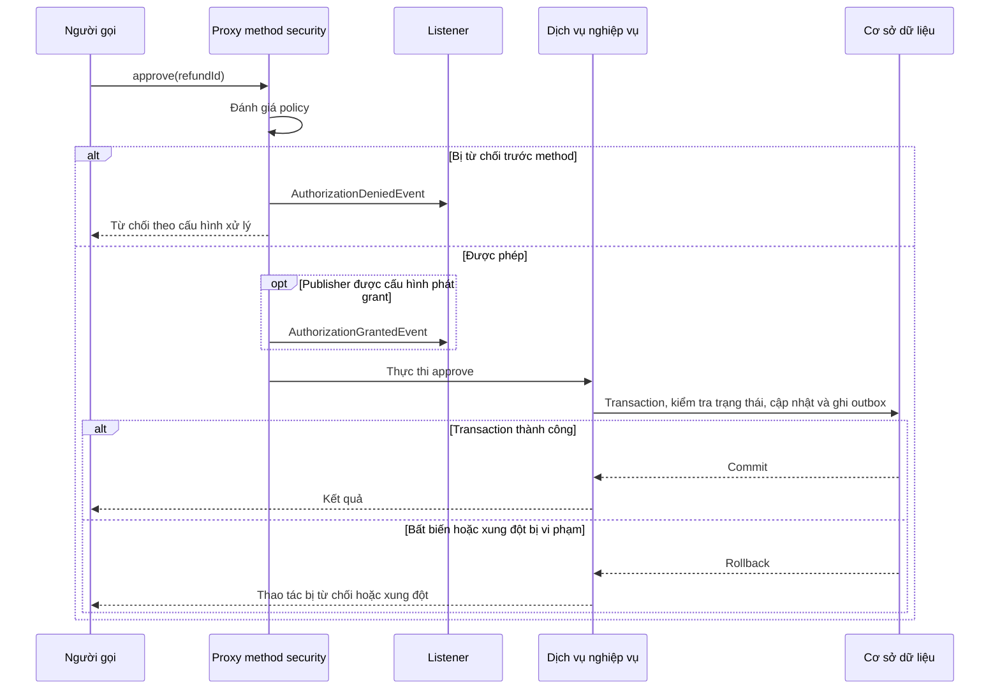

# Authorization event listeners

## 1. Vai trò trong bảo vệ logic nghiệp vụ

Authorization event listener là thành phần nhận sự kiện về một quyết định phân quyền: một lời gọi được cho phép hay bị từ chối tại ranh giới bảo vệ. Trong chương **Spring Security Integration**, listener giúp quan sát các hành vi như thử duyệt yêu cầu của tenant khác, gọi thao tác vượt vai trò hoặc liên tục thăm dò tài nguyên không thuộc quyền sở hữu.

Mục tiêu của bài là xây dựng luồng quan sát có thể giải thích được: quyết định được đưa ra ở đâu, listener thực sự biết điều gì, dữ liệu nào được ghi và sự kiện liên quan thế nào đến kết quả giao dịch. Listener hỗ trợ phát hiện lạm dụng; quy tắc nghiệp vụ vẫn phải được thực thi ở nơi quyết định và thay đổi trạng thái diễn ra.

Ví dụ xuyên suốt là hệ thống hoàn tiền với các bất biến:

- Chỉ người thuộc tenant sở hữu yêu cầu mới được thao tác trên yêu cầu đó.
- Người tạo yêu cầu không được tự phê duyệt yêu cầu của mình.
- Chỉ yêu cầu đang ở trạng thái `PENDING_APPROVAL` mới được duyệt.
- Tổng tiền hoàn không được vượt số tiền còn có thể hoàn của giao dịch gốc.
- Hai yêu cầu đồng thời hoặc một yêu cầu được gửi lại không được tạo hai khoản hoàn tiền.

Một người có authority `refund:approve` vẫn có thể vi phạm các bất biến trên. Sự kiện phân quyền hữu ích khi phản ánh đúng quyết định đã kiểm tra; nó không tự bổ sung những điều kiện còn thiếu vào policy.

**Phạm vi ví dụ:** Java 17, ứng dụng Servlet dùng Spring Security 6.5 và method security theo cơ chế `AuthorizationManager`. Đây là mốc API của bài, không phải chỉ dẫn chọn phiên bản triển khai. Các đoạn mã được đặt trong các tệp Java tương ứng; những ví dụ ghi rõ “mã giả” mô tả hợp đồng của ứng dụng, không phải API có sẵn trong Spring. WebFlux, cơ chế voter cũ và các phiên bản khác cần được đối chiếu riêng.

## 2. Phân biệt quyết định quyền với kết quả nghiệp vụ

| Tín hiệu | Khẳng định được | Chưa khẳng định được |
|---|---|---|
| Sự kiện authentication | Một bước xác thực thành công hoặc thất bại | Người dùng có quyền duyệt yêu cầu cụ thể |
| `AuthorizationDeniedEvent` | Một quyết định phân quyền bị từ chối tại điểm phát sự kiện | Toàn bộ request không có tác động phụ ở mọi tầng |
| `AuthorizationGrantedEvent` | Một quyết định tại điểm kiểm tra đã cho phép | Mọi bất biến đều đã được kiểm tra, hoặc giao dịch đã commit |
| Sự kiện miền như `RefundApproved` | Mã nghiệp vụ đã đi tới điểm phát sự kiện | Thay đổi đã bền vững nếu transaction còn có thể rollback |
| Bản ghi outbox được commit cùng dữ liệu | Dữ liệu và ý định phát sự kiện đã được lưu nguyên tử trong cùng transaction | Consumer đã xử lý, hoặc hệ thống thanh toán bên ngoài đã hoàn tất |

Vì vậy, cần phân biệt ít nhất ba kết quả trong thiết kế audit:

```text
AUTHORIZATION_GRANTED  -> được qua một cổng kiểm tra quyền
BUSINESS_REJECTED      -> bị chặn bởi bất biến hoặc trạng thái nghiệp vụ
REFUND_APPROVAL_COMMITTED -> thay đổi phê duyệt đã được commit
```

Nếu policy chỉ kiểm tra authority, một lần tự duyệt bị chặn trong domain có thể tạo tín hiệu `AUTHORIZATION_GRANTED` rồi `BUSINESS_REJECTED`. Hai tín hiệu không mâu thuẫn: chúng mô tả hai kiểm tra khác nhau. Nếu muốn tự duyệt là một denial của Spring Security, phải đưa điều kiện đó vào policy được `AuthorizationManager` đánh giá; vẫn cần giải quyết tính nhất quán khi dữ liệu thay đổi đồng thời.

## 3. Sự kiện được phát từ đâu?

Với luồng request dùng `AuthorizationFilter`, filter lấy kết quả từ manager, gọi publisher rồi mới đi tiếp hoặc từ chối. Đối tượng được bảo vệ đưa vào sự kiện của filter này là `HttpServletRequest`, dù manager bên trong cấu hình request matcher có thể làm việc với một ngữ cảnh khác. Không mặc định ép kiểu mọi sự kiện web thành `RequestAuthorizationContext`. Xem [mã nguồn AuthorizationFilter 6.5.0](https://github.com/spring-projects/spring-security/blob/6.5.0/web/src/main/java/org/springframework/security/web/access/intercept/AuthorizationFilter.java).

Với method security, kiểu đối tượng phụ thuộc thời điểm kiểm tra:

| Điểm kiểm tra | Đối tượng thường gặp trong luồng nêu ở bài | Ý nghĩa đối với nghiệp vụ |
|---|---|---|
| Trước method, chẳng hạn `@PreAuthorize` | `MethodInvocation` | Kiểm tra trước khi thực thi phần thân method |
| Sau method, chẳng hạn `@PostAuthorize` | `MethodInvocationResult` | Phần thân đã chạy; đối tượng ngữ cảnh có cả lời gọi và kết quả |
| Publisher tùy biến | Kiểu do ứng dụng lựa chọn | Phải có hợp đồng riêng, không suy đoán theo tên event |

`MethodInvocationResult` là lớp bao ngữ cảnh, không phải chính đối tượng miền được trả về. Chỉ lấy thông tin method cần thiết; không serialize kết quả nghiệp vụ vào log. Tham khảo [MethodInvocationResult 6.5.0](https://github.com/spring-projects/spring-security/blob/6.5.0/core/src/main/java/org/springframework/security/authorization/method/MethodInvocationResult.java) và [interceptor sau method](https://github.com/spring-projects/spring-security/blob/6.5.0/core/src/main/java/org/springframework/security/authorization/method/AuthorizationManagerAfterMethodInterceptor.java).

Luồng duyệt hoàn tiền có thể được mô hình hóa như sau:



Sơ đồ giả định kiểm tra trước method và cơ chế từ chối thông thường. Không dùng nó để suy ra thứ tự transaction advisor trong mọi ứng dụng. Nếu có `@PostAuthorize`, method đã chạy trước quyết định sau method; các tác động ngoài transaction như gọi cổng thanh toán không tự được đảo ngược. Tài liệu [Method Security](https://docs.spring.io/spring-security/reference/6.5/servlet/authorization/method-security.html) giải thích cơ chế trước/sau method và việc phối hợp với `@Transactional`.

## 4. Đăng ký publisher và listener cơ bản

### 4.1. Cấu hình publisher rõ ràng

```java
import org.springframework.context.ApplicationEventPublisher;
import org.springframework.context.annotation.Bean;
import org.springframework.context.annotation.Configuration;
import org.springframework.security.authorization.AuthorizationEventPublisher;
import org.springframework.security.authorization.SpringAuthorizationEventPublisher;
import org.springframework.security.config.annotation.method.configuration.EnableMethodSecurity;

@Configuration(proxyBeanMethods = false)
@EnableMethodSecurity
public class AuthorizationObservationConfig {

    @Bean
    AuthorizationEventPublisher authorizationEventPublisher(
            ApplicationEventPublisher applicationEvents) {
        return new SpringAuthorizationEventPublisher(applicationEvents);
    }
}
```

`@EnableMethodSecurity` kích hoạt kiểm tra method; việc chỉ có dependency Spring Security không tự bật tính năng này. Trong cấu hình chuẩn 6.5, bean publisher được nối vào các interceptor pre/post authorize. Interceptor do ứng dụng tự tạo cần được nối publisher phù hợp, chẳng hạn qua `setAuthorizationEventPublisher`. Đối chiếu [cấu hình method security 6.5.0](https://github.com/spring-projects/spring-security/blob/6.5.0/config/src/main/java/org/springframework/security/config/annotation/method/configuration/PrePostMethodSecurityConfiguration.java).

Trong 6.5, `SpringAuthorizationEventPublisher` bỏ qua kết quả `null` và kết quả cho phép; nó phát sự kiện khi kết quả là từ chối. Vì vậy, chỉ viết listener nhận `AuthorizationGrantedEvent` sẽ chưa tạo ra luồng ghi nhận thành công. Xem [mã nguồn publisher 6.5.0](https://github.com/spring-projects/spring-security/blob/6.5.0/core/src/main/java/org/springframework/security/authorization/SpringAuthorizationEventPublisher.java).

Cấu hình `authorizeHttpRequests` chuẩn 6.5 sử dụng bean publisher nếu có và có publisher mặc định khi không có bean. Điều này không chứng minh mọi đường đi tùy biến đều được quan sát. Khi tự dựng filter hoặc interceptor, kiểm tra cách gắn publisher và kiểm thử đường đi thực tế. Tham khảo [AuthorizeHttpRequestsConfigurer 6.5.0](https://github.com/spring-projects/spring-security/blob/6.5.0/config/src/main/java/org/springframework/security/config/annotation/web/configurers/AuthorizeHttpRequestsConfigurer.java).

### 4.2. Listener ghi tín hiệu tối thiểu

Ví dụ sau chỉ ghi kết quả, loại tác nhân và metadata method do chương trình định nghĩa. Nó không ghi tên người dùng, token, tham số, body hay kết quả trả về.

```java
import jakarta.servlet.http.HttpServletRequest;
import org.aopalliance.intercept.MethodInvocation;
import org.slf4j.Logger;
import org.slf4j.LoggerFactory;
import org.springframework.context.event.EventListener;
import org.springframework.security.authentication.AuthenticationCredentialsNotFoundException;
import org.springframework.security.authentication.AuthenticationTrustResolver;
import org.springframework.security.authentication.AuthenticationTrustResolverImpl;
import org.springframework.security.authorization.event.AuthorizationDeniedEvent;
import org.springframework.security.authorization.event.AuthorizationEvent;
import org.springframework.security.authorization.event.AuthorizationGrantedEvent;
import org.springframework.security.authorization.method.MethodInvocationResult;
import org.springframework.security.core.Authentication;
import org.springframework.stereotype.Component;

@Component
public class AuthorizationObservationListener {

    private static final Logger log =
            LoggerFactory.getLogger(AuthorizationObservationListener.class);

    private final AuthenticationTrustResolver trust =
            new AuthenticationTrustResolverImpl();

    @EventListener
    public void onDenied(AuthorizationDeniedEvent<?> event) {
        observe(event, "DENIED");
    }

    @EventListener
    public void onGranted(AuthorizationGrantedEvent<?> event) {
        observe(event, "GRANTED");
    }

    private void observe(AuthorizationEvent event, String outcome) {
        log.info("authorization outcome={} actorKind={} boundary={}",
                outcome, actorKind(event), boundary(event.getObject()));
    }

    private String actorKind(AuthorizationEvent event) {
        try {
            Authentication authentication = event.getAuthentication().get();
            if (authentication == null || trust.isAnonymous(authentication)) {
                return "ANONYMOUS";
            }
            return authentication.isAuthenticated()
                    ? "AUTHENTICATED" : "UNAUTHENTICATED";
        } catch (AuthenticationCredentialsNotFoundException ex) {
            return "UNAVAILABLE";
        }
    }

    private String boundary(Object object) {
        if (object instanceof MethodInvocation invocation) {
            return "METHOD_BEFORE:" + methodName(invocation);
        }
        if (object instanceof MethodInvocationResult invocationResult) {
            return "METHOD_AFTER:"
                    + methodName(invocationResult.getMethodInvocation());
        }
        if (object instanceof HttpServletRequest) {
            return "HTTP_REQUEST";
        }
        return "OTHER";
    }

    private String methodName(MethodInvocation invocation) {
        return invocation.getMethod().getDeclaringClass().getName()
                + "#" + invocation.getMethod().getName();
    }
}
```

`getAuthentication()` trả về `Supplier<Authentication>`, nên ví dụ giải quyết supplier ngay trong listener đồng bộ. API sự kiện còn có `getAuthorizationResult()` để lấy kết quả nếu cần; không cần ép mọi kết quả về `AuthorizationDecision`. Tham khảo [AuthorizationEvent 6.5.0](https://github.com/spring-projects/spring-security/blob/6.5.0/core/src/main/java/org/springframework/security/authorization/event/AuthorizationEvent.java).

`actorKind=AUTHENTICATED` chỉ nói về trạng thái xác thực, không nói người dùng có quyền trên đối tượng. Việc chỉ kiểm tra `isAuthenticated()` cũng không đủ để phân biệt anonymous token; ví dụ dùng thêm `AuthenticationTrustResolver`, như giải thích trong [Anonymous Authentication](https://docs.spring.io/spring-security/reference/6.5/servlet/authentication/anonymous.html). Log trên là bước khởi đầu để quan sát, chưa đủ cho audit theo đối tượng hoặc điều tra một tài khoản cụ thể.

## 5. Chỉ phát sự kiện cho phép ở thao tác cần theo dõi

Phát grant cho mọi request dễ làm tín hiệu nhạy cảm bị chìm trong lưu lượng thông thường. Một lựa chọn là phát grant cho các method được đánh dấu để audit, như phê duyệt hoàn tiền hoặc thay đổi hạn mức; denial vẫn được chuyển cho publisher mặc định. Đây là lựa chọn thiết kế của ví dụ, không phải annotation chuẩn của Spring Security.

Định nghĩa marker trong tệp `AuditAuthorization.java`:

```java
import java.lang.annotation.ElementType;
import java.lang.annotation.Retention;
import java.lang.annotation.RetentionPolicy;
import java.lang.annotation.Target;

@Target(ElementType.METHOD)
@Retention(RetentionPolicy.RUNTIME)
public @interface AuditAuthorization {
}
```

Publisher cho Spring Security 6.5:

```java
import java.lang.reflect.Method;
import java.util.function.Supplier;
import org.aopalliance.intercept.MethodInvocation;
import org.springframework.aop.support.AopUtils;
import org.springframework.context.ApplicationEventPublisher;
import org.springframework.core.annotation.AnnotatedElementUtils;
import org.springframework.security.authorization.AuthorizationDecision;
import org.springframework.security.authorization.AuthorizationEventPublisher;
import org.springframework.security.authorization.AuthorizationResult;
import org.springframework.security.authorization.SpringAuthorizationEventPublisher;
import org.springframework.security.authorization.event.AuthorizationGrantedEvent;
import org.springframework.security.core.Authentication;

public final class SelectiveAuthorizationEventPublisher
        implements AuthorizationEventPublisher {

    private final ApplicationEventPublisher events;
    private final AuthorizationEventPublisher deniedEvents;

    public SelectiveAuthorizationEventPublisher(ApplicationEventPublisher events) {
        this.events = events;
        this.deniedEvents = new SpringAuthorizationEventPublisher(events);
    }

    // Cầu nối còn cần để triển khai interface của nhánh 6.5.
    @Override
    @SuppressWarnings("deprecation")
    public <T> void publishAuthorizationEvent(
            Supplier<Authentication> authentication,
            T object, AuthorizationDecision decision) {
        publishAuthorizationEvent(authentication, object,
                (AuthorizationResult) decision);
    }

    @Override
    public <T> void publishAuthorizationEvent(
            Supplier<Authentication> authentication,
            T object, AuthorizationResult result) {
        if (result == null) {
            return;
        }
        if (!result.isGranted()) {
            deniedEvents.publishAuthorizationEvent(authentication, object, result);
            return;
        }
        if (isAuditedBeforeMethod(object)) {
            events.publishEvent(new AuthorizationGrantedEvent<>(
                    authentication, object, result));
        }
    }

    private boolean isAuditedBeforeMethod(Object object) {
        if (!(object instanceof MethodInvocation invocation)
                || invocation.getThis() == null) {
            return false;
        }
        Class<?> targetClass = AopUtils.getTargetClass(invocation.getThis());
        Method method = AopUtils.getMostSpecificMethod(
                invocation.getMethod(), targetClass);
        return AnnotatedElementUtils.hasAnnotation(method, AuditAuthorization.class)
                || AnnotatedElementUtils.hasAnnotation(
                        invocation.getMethod(), AuditAuthorization.class);
    }
}
```

Thay phần thân bean `authorizationEventPublisher` ở mục 4 bằng:

```java
return new SelectiveAuthorizationEventPublisher(applicationEvents);
```

Chỉ duy trì một bean publisher được chọn rõ ràng; không giữ đồng thời hai bean mẫu và kỳ vọng Spring tự đoán. Publisher tự tạo ở trên cũng không được đánh dấu `@Component`, vì đã được khởi tạo bằng `@Bean`.

Có hai chi tiết về tương thích cần hiểu:

- Interface 6.5 vẫn có phương thức abstract nhận `AuthorizationDecision` đã deprecated và overload nhận `AuthorizationResult`. Vì vậy, ví dụ triển khai cả hai và chuyển xử lý về overload mới. Không sao chép nguyên phương thức cầu nối sang một nhánh đã thay đổi interface. Xem [AuthorizationEventPublisher 6.5.0](https://github.com/spring-projects/spring-security/blob/6.5.0/core/src/main/java/org/springframework/security/authorization/AuthorizationEventPublisher.java).
- Event grant được tạo từ kết quả phân quyền, không được tạo vì service trả về HTTP 200. Constructor nhận `AuthorizationResult` có trong mốc API đang dùng. Xem [AuthorizationGrantedEvent 6.5.0](https://github.com/spring-projects/spring-security/blob/6.5.0/core/src/main/java/org/springframework/security/authorization/event/AuthorizationGrantedEvent.java).

Marker chỉ chọn mức quan sát, không cấp quyền. Bộ lọc ví dụ chỉ chọn grant trước method có marker, bỏ qua grant HTTP và grant sau method. Nếu cần audit các điểm khác, phải thiết kế và kiểm thử quy tắc chọn riêng. Đối với method có nhiều kiểm tra bảo vệ, một marker cũng không bảo đảm chỉ có một quyết định hay một event.

Kết quả `null` được xử lý là không có kết quả để phát event tại đây. Không đổi nó thành một event `GRANTED` tự tạo. Chính sách có cho phép manager không đưa ra quyết định hay không phải được xác định ở lớp phân quyền, không giao cho listener.

## 6. Đặt bất biến ở nơi cập nhật nghiệp vụ

Một ranh giới dịch vụ có thể khai báo:

```java
@AuditAuthorization
@PreAuthorize("hasAuthority('refund:approve')")
@Transactional
public void approve(UUID refundId) {
    // Đọc dữ liệu, kiểm tra quyền trên đối tượng và cập nhật trong transaction.
}
```

Đây là trích đoạn khai báo, không phải một dịch vụ hoàn chỉnh. Các import tương ứng là `PreAuthorize` từ Spring Security, `Transactional` từ Spring Transaction và `UUID` từ Java. Authority là kiểm tra đầu vào; phần thân vẫn phải xử lý quyền theo đối tượng, trạng thái, tiền và cạnh tranh cập nhật.

Ví dụ **mã giả** cho phần thân, trong đó mọi API nghiệp vụ do ứng dụng tự định nghĩa:

```text
actor = trustedIdentity.currentActor()

within transaction:
    refund = refunds.loadForUpdate(actor.tenantId, refundId)
    payment = payments.loadForUpdate(refund.paymentId)

    require objectPolicy.canApprove(actor, refund)
    require refund.createdBy != actor.id
    require refund.state == PENDING_APPROVAL
    require refund.amount > 0
    require refund.currency == payment.currency
    require payment.approvedAndReservedRefunds + refund.amount <= payment.paidAmount

    reserve refund.amount against payment
    transition refund from PENDING_APPROVAL to APPROVED
    insert audit/outbox event REFUND_APPROVAL_COMMITTED

commit transaction
```

`tenantId` dùng để giới hạn truy vấn phải đến từ ngữ cảnh danh tính đã được xác thực và kiểm tra, không lấy nguyên giá trị client gửi. “Tải có khóa” là một phương án minh họa; có thể dùng cập nhật có điều kiện, optimistic locking hoặc cơ chế tương đương nếu chứng minh được cùng bất biến.

Đặc biệt, chỉ khóa bản ghi yêu cầu hoàn tiền có thể chưa đủ: hai yêu cầu khác nhau cùng hoàn trên một giao dịch gốc vẫn cạnh tranh số tiền còn lại. Cần bảo vệ tài nguyên chung chứa hạn mức hoặc tổng tiền, với thứ tự lấy khóa nhất quán để giảm deadlock. Những bảo đảm này thuộc mô hình lưu trữ và transaction, không xuất hiện chỉ nhờ có listener.

Nếu kiểm tra quyền theo đối tượng ở `@PreAuthorize` rồi dữ liệu đổi trước khi ghi, có thể xuất hiện khoảng hở giữa kiểm tra và sử dụng dữ liệu. Cần tái xác nhận điều kiện quan trọng trong thao tác nguyên tử hoặc thiết kế policy cùng transaction phù hợp. Listener không sửa được khoảng hở này bằng cách kiểm tra lại sau khi nhận grant.

### 6.1. Không tự động có event cho mọi lần bị chặn

Một `DomainRuleViolation` trong phần thân method không tự biến thành `AuthorizationDeniedEvent`. Một `AccessDeniedException` do ứng dụng tự ném cũng không mặc nhiên chứng minh publisher đã được gọi. Manager ném exception thay vì trả kết quả có thể đi theo nhánh xử lý khác, nên cần kiểm thử chính cơ chế đang dùng. Trong luồng trước method 6.5, việc gọi publisher nằm sau bước nhận kết quả từ manager; xem [AuthorizationManagerBeforeMethodInterceptor](https://github.com/spring-projects/spring-security/blob/6.5.0/core/src/main/java/org/springframework/security/authorization/method/AuthorizationManagerBeforeMethodInterceptor.java).

Với một kiểm tra domain riêng, ứng dụng có thể phát tín hiệu riêng như `RefundApprovalRejected` với `reasonCode=SELF_APPROVAL_FORBIDDEN` hoặc `INVALID_STATE`. Mã lý do cần được xác định ngay tại nơi kiểm tra, theo danh mục cho phép. Không đoán lý do từ message exception, cũng không gắn nhãn “khác tenant” chỉ vì thấy status 403.

Nếu trả lỗi ra ngoài, tránh tiết lộ tài nguyên tồn tại ở tenant khác hay chỉ ra bước nào giúp vượt quy trình. Mã lý do chi tiết có thể dành cho kênh audit nội bộ được kiểm soát quyền truy cập.

### 6.2. Idempotency phải được bảo vệ trước tác động phụ

Giả sử client gửi lại cùng lệnh phê duyệt do mất kết nối. Một listener ghi nhận hai lần không có nghĩa đã phát sinh hai khoản hoàn; ngược lại, chỉ thấy một event cũng không chứng minh không bị xử lý trùng.

Thiết kế idempotency của lệnh cần có phạm vi rõ ràng, ví dụ `(tenantId, operation, idempotencyKey)`, ràng buộc duy nhất trong kho dữ liệu, dấu vết payload để phát hiện cùng key nhưng nội dung khác và kết quả có thể trả lại khi retry. Quyền truy cập vẫn phải được kiểm tra khi đọc kết quả đã lưu; key không được trở thành cách lấy kết quả của người khác. Khóa theo key cũng không thay thế kiểm tra trạng thái và hạn mức khi client đổi key.

`eventId` của audit phục vụ chống xử lý lại cùng một sự kiện. Nó khác khóa idempotency của lệnh nghiệp vụ. Consumer nên khử trùng theo định danh sự kiện bền vững và thiết kế tác động phụ có thể thử lại an toàn.

## 7. Snapshot dữ liệu trước khi xử lý bất đồng bộ

Spring application event thông thường được xử lý đồng bộ trên luồng phát sự kiện. Nếu chuyển sang executor hoặc `@Async`, không được mặc định rằng transaction context và các giá trị thread-local vẫn còn. Việc truyền context phải được cấu hình phù hợp nếu thực sự cần. Xem [cơ chế application events của Spring](https://docs.spring.io/spring-framework/reference/core/beans/context-introduction.html).

Authorization event có thể giữ supplier tham chiếu ngữ cảnh xác thực, request hoặc lời gọi method. Không đưa nguyên đối tượng đó vào hàng đợi để một worker khác đọc sau khi request đã kết thúc. Thay vào đó, listener đồng bộ trích xuất snapshot bất biến tối thiểu, rồi chuyển snapshot cho pipeline audit.

Một hợp đồng DTO do ứng dụng tự định nghĩa có thể là:

```java
import java.time.Instant;
import java.util.UUID;

public record AuthorizationAuditSnapshot(
        UUID eventId,
        Instant observedAt,
        String actorRef,
        String tenantRef,
        String operation,
        String boundary,
        String resourceRef,
        String outcome,
        String reasonCode,
        String correlationId) {
}
```

Các trường không có bằng chứng phải biểu diễn là chưa biết theo hợp đồng, không tự lấp bằng dữ liệu do client khẳng định. Ví dụ listener HTTP chạy trước MVC có thể chưa có route template do handler mapping thiết lập. Không thay route template thiếu bằng toàn bộ URI hay query string; có thể ghi một nhãn endpoint từ danh mục matcher đã kiểm soát hoặc để `UNKNOWN`.

| Trường | Nguồn và giới hạn nên áp dụng |
|---|---|
| `actorRef` | Định danh ổn định từ principal đã xác thực; dùng bí danh hoặc HMAC khi cần che danh tính; không dùng hash đơn giản của email dễ đoán |
| `tenantRef` | Tenant đã được máy chủ xác thực và chấp nhận; không tin header tùy ý |
| `operation`, `boundary` | Mã do chương trình định nghĩa, ví dụ `REFUND_APPROVE`, `METHOD_BEFORE`; tránh chuỗi tự do |
| `resourceRef` | ID đã chuẩn hóa nếu có; phân biệt ID đang bị yêu cầu với tài nguyên đã xác minh quyền sở hữu |
| `outcome`, `reasonCode` | Quyết định thực tế và lý do được policy cung cấp rõ ràng; có thể chỉ biết `AUTHORIZATION_DENIED` |
| `correlationId` | Do server tạo hoặc đã kiểm tra định dạng và độ dài; dùng để liên kết tín hiệu, không cấp quyền |
| `eventId`, `observedAt` | Tạo tại thời điểm snapshot; retry chuyển tiếp phải giữ nguyên định danh của cùng snapshot |

Không ghi `Authentication.toString()`, credentials, access token, session cookie, toàn bộ authorities, body, toàn bộ tham số method hoặc kết quả trả về. Chỉ đưa vào audit dữ liệu cần thiết cho điều tra, đặt giới hạn độ dài và dùng bộ mã hóa log có cấu trúc để tránh ký tự điều khiển phá bản ghi. Tên tài khoản hay lý do lỗi có thể chứa dữ liệu không đáng tin dù chúng xuất hiện trong một đối tượng của framework.

DTO bất biến không đồng nghĩa dữ liệu bên trong đáng tin hoặc đã được lưu bền vững. Hàng đợi trong bộ nhớ vẫn mất dữ liệu khi tiến trình dừng; phải xác định nhu cầu lưu trữ, quyền đọc, thời hạn lưu và khả năng phát hiện mất tín hiệu.

## 8. Transaction quyết định ý nghĩa và độ bền của audit

### 8.1. Denial cần được quan sát cả khi không có commit

Nếu listener ghi audit bằng cùng transaction đang bị rollback, bản ghi có thể mất cùng thao tác bị từ chối. Nếu dùng `@TransactionalEventListener(AFTER_COMMIT)` để bắt denial, có thể không thấy event vì không có transaction hoặc vì transaction không commit.

Theo [Transaction-bound Events](https://docs.spring.io/spring-framework/reference/data-access/transaction/event.html), listener gắn transaction mặc định chạy ở `AFTER_COMMIT`; khi không có transaction, nó không chạy trừ khi bật `fallbackExecution`. Bật fallback cũng không làm một transaction đã rollback trở thành commit, nên đây không phải cách sửa tổng quát cho audit denial.

Tùy mức bảo đảm cần có, ứng dụng có thể chọn kênh audit độc lập, bộ thu log bên ngoài hoặc ghi bằng transaction riêng. Nếu dùng `REQUIRES_NEW`, đặt thao tác ghi trên một bean riêng để lời gọi đi qua proxy, không phụ thuộc bản ghi chưa commit của transaction ngoài và tránh thiết kế gây tự chờ khóa. Transaction riêng có thể tiêu tốn thêm connection và vẫn cần chính sách xử lý khi kho audit lỗi.

Không chèn một dòng audit quan trọng rồi coi là bền vững chỉ vì hàm `save` đã trả về. Phải biết transaction nào sẽ commit nó, ai chịu trách nhiệm retry và điều gì xảy ra khi tiến trình dừng.

### 8.2. Thành công nghiệp vụ nên gắn với commit

Để ghi nhận phê duyệt thực sự được lưu, có thể ghi audit hoặc outbox trong cùng transaction cập nhật trạng thái. Sau commit, worker đọc outbox và chuyển tiếp. Một tiến trình dừng giữa commit và lúc gửi vẫn để lại ý định phát sự kiện đã được lưu.

`@TransactionalEventListener(AFTER_COMMIT)` hữu ích để thực hiện bước sau commit, nhưng bản thân Spring application event trong bộ nhớ không phải hàng đợi bền vững. Nếu tiến trình chết trước khi listener xử lý xong, thông báo có thể mất. Cần outbox hoặc cơ chế lưu bền vững tương đương khi mất thông báo là không chấp nhận được.

Nếu listener sau commit muốn ghi thêm dữ liệu, không giả định một thao tác repository thường sẽ được commit vào transaction cũ. Javadoc [TransactionalEventListener](https://docs.spring.io/spring-framework/docs/6.2.x/javadoc-api/org/springframework/transaction/event/TransactionalEventListener.html) nêu rằng tài nguyên transaction có thể vẫn truy cập được sau khi hoàn tất, nhưng thay đổi mới không được commit vào transaction đã kết thúc. Khi cần ghi riêng, dùng ranh giới transaction mới phù hợp hoặc chuyển việc ghi vào transaction nghiệp vụ trước commit.

Với outbox, consumer vẫn có thể nhận cùng event nhiều lần. Chỉ đánh dấu đã gửi sau khi hoàn thành bước tương ứng theo giao thức được chọn và thiết kế consumer idempotent. Đối với hoàn tiền ra hệ thống thanh toán, “phê duyệt đã commit” và “tiền đã được hoàn” là hai trạng thái khác nhau cần theo dõi riêng.

## 9. Listener không trở thành điểm nghẽn hay cổng cấp quyền

Ở cấu hình đồng bộ mặc định, listener chậm làm chậm request. Nếu listener ném lỗi mà không có xử lý phù hợp, lỗi có thể truyền về nơi publish và ngăn luồng tiếp tục. Đây là hành vi của cơ chế event, không phải cách thiết kế một policy phân quyền. Xem [SimpleApplicationEventMulticaster](https://docs.spring.io/spring-framework/docs/6.2.x/javadoc-api/org/springframework/context/event/SimpleApplicationEventMulticaster.html).

Thiết kế vận hành cần trả lời cụ thể:

- **Giới hạn thời gian:** listener không gọi chậm tới SIEM hay thực hiện truy vấn tổng hợp trên đường đi request; snapshot phải nhỏ và hữu hạn.
- **Giới hạn bộ đệm:** nếu dùng hàng đợi, phải có dung lượng, chính sách khi đầy, số worker và mức tải được kiểm thử. Không dùng bộ đệm vô hạn.
- **Lỗi quan sát:** với telemetry cho phép mất một phần, chỉ cô lập lỗi của kênh quan sát theo hợp đồng đã chọn và tăng metric mất sự kiện. Không bao cả luồng nghiệp vụ bằng một `catch` rồi tiếp tục như thành công.
- **Audit bắt buộc:** nếu chính sách yêu cầu không có audit thì không thực hiện thao tác nhạy cảm, ràng buộc này phải được đặt rõ trong dịch vụ/transaction trước tác động phụ. Không dựa vào một lỗi ngẫu nhiên trong listener để dừng nghiệp vụ.
- **Tấn công làm ngập log:** tổng hợp và giới hạn tín hiệu thông thường theo tác nhân, tenant và operation; lưu dấu vết mức rủi ro cao theo yêu cầu audit. Nếu sampling, phải ghi rõ tỷ lệ để số liệu không bị hiểu là tổng số thực tế.

Theo dõi các chỉ số như độ trễ listener, độ dài hàng đợi, số bản ghi bị bỏ, tuổi bản ghi outbox lâu nhất và số lần chuyển tiếp thất bại. Nhãn metric nên có số lượng giá trị hữu hạn như operation, outcome và boundary. Không dùng `userId`, `resourceId`, URI thô hoặc correlation ID làm nhãn metric.

Một request có thể tạo nhiều quyết định tại filter và service, hoặc qua các lần dispatch. Một lần phân quyền cho phép cũng có thể bị một kiểm tra tiếp theo từ chối. Vì vậy, không tính tỷ lệ duyệt thành công bằng cách đếm mọi event grant. Dùng event nghiệp vụ đã commit cho chỉ số đó; dùng authorization event để đo quyết định tại từng ranh giới.

## 10. Kiểm thử đường bảo vệ và ý nghĩa của sự kiện

Kiểm thử phải chứng minh cả hai điều: thao tác bị chặn đúng và tín hiệu phản ánh đúng điểm bị chặn. Một test chỉ gọi trực tiếp `listener.onDenied(...)` chứng minh được logic trích xuất/log, nhưng không chứng minh filter, proxy hay publisher đã được nối.

### 10.1. Ví dụ test tích hợp method security tối thiểu

Ví dụ dưới dùng JUnit 5, `spring-test`, `spring-security-test` và các dependency tương ứng với mốc API của bài. Nó tạo context nhỏ với một method được bảo vệ, publisher mặc định và bộ ghi nhận application events. Có thể đặt trong một tệp test riêng của ứng dụng khi triển khai; bài này chỉ cung cấp mã minh họa.

```java
import java.util.concurrent.atomic.AtomicInteger;
import org.junit.jupiter.api.BeforeEach;
import org.junit.jupiter.api.Test;
import org.junit.jupiter.api.extension.ExtendWith;
import org.springframework.beans.factory.annotation.Autowired;
import org.springframework.context.ApplicationEventPublisher;
import org.springframework.context.annotation.Bean;
import org.springframework.context.annotation.Configuration;
import org.springframework.security.access.AccessDeniedException;
import org.springframework.security.access.prepost.PreAuthorize;
import org.springframework.security.authorization.AuthorizationEventPublisher;
import org.springframework.security.authorization.SpringAuthorizationEventPublisher;
import org.springframework.security.authorization.event.AuthorizationDeniedEvent;
import org.springframework.security.authorization.event.AuthorizationGrantedEvent;
import org.springframework.security.config.annotation.method.configuration.EnableMethodSecurity;
import org.springframework.security.test.context.support.WithMockUser;
import org.springframework.test.context.ContextConfiguration;
import org.springframework.test.context.event.ApplicationEvents;
import org.springframework.test.context.event.RecordApplicationEvents;
import org.springframework.test.context.junit.jupiter.SpringExtension;
import static org.junit.jupiter.api.Assertions.assertEquals;
import static org.junit.jupiter.api.Assertions.assertThrows;

@ExtendWith(SpringExtension.class)
@ContextConfiguration(classes = AuthorizationEventsTest.Config.class)
@RecordApplicationEvents
class AuthorizationEventsTest {

    @Autowired
    ApprovalBoundary boundary;

    @Autowired
    ApplicationEvents events;

    @BeforeEach
    void reset() {
        boundary.reset();
    }

    @Test
    @WithMockUser(authorities = "refund:read")
    void deniedCallDoesNotExecuteMethodAndEmitsDenial() {
        assertThrows(AccessDeniedException.class, () -> boundary.approve());
        assertEquals(0, boundary.executions());
        assertEquals(1L, events.stream(AuthorizationDeniedEvent.class).count());
    }

    @Test
    @WithMockUser(authorities = "refund:approve")
    void allowedCallRunsButDefaultPublisherDoesNotEmitGrant() {
        boundary.approve();
        assertEquals(1, boundary.executions());
        assertEquals(0L, events.stream(AuthorizationDeniedEvent.class).count());
        assertEquals(0L, events.stream(AuthorizationGrantedEvent.class).count());
    }

    @Configuration(proxyBeanMethods = false)
    @EnableMethodSecurity
    static class Config {

        @Bean
        ApprovalBoundary approvalBoundary() {
            return new ApprovalBoundary();
        }

        @Bean
        AuthorizationEventPublisher publisher(ApplicationEventPublisher events) {
            return new SpringAuthorizationEventPublisher(events);
        }
    }

    public static class ApprovalBoundary {

        private final AtomicInteger executions = new AtomicInteger();

        @PreAuthorize("hasAuthority('refund:approve')")
        public void approve() {
            executions.incrementAndGet();
        }

        public int executions() {
            return executions.get();
        }

        public void reset() {
            executions.set(0);
        }
    }
}
```

Test trên chỉ có một ranh giới kiểm tra, nên assertion đúng một denial có ý nghĩa tại đây. Không sao chép kỳ vọng này cho toàn bộ HTTP request có nhiều tầng bảo vệ. Bộ đếm chỉ giúp chứng minh phần thân chưa chạy; trong test nghiệp vụ thực cần kiểm tra thêm dữ liệu, outbox và lời gọi ra hệ thống ngoài.

`@WithMockUser` tạo danh tính thử nghiệm; nó không tự mô phỏng principal chứa tenant của ứng dụng. Với quyền theo đối tượng, dùng principal thử phù hợp hoặc `@WithSecurityContext` tùy biến. Tham khảo [Testing Method Security 6.5](https://docs.spring.io/spring-security/reference/6.5/servlet/test/method.html).

### 10.2. Ma trận tình huống cho nghiệp vụ hoàn tiền

| Tình huống | Bảo đảm cần kiểm tra | Tín hiệu cần đối chiếu |
|---|---|---|
| Thiếu `refund:approve` | Method không chạy; không ghi dữ liệu hay gọi thanh toán | Denial ở ranh giới method trong cấu hình ví dụ |
| Có authority nhưng truy cập tenant khác | Không đọc hoặc sửa trái quyền; không lộ thông tin tài nguyên | Denial của policy hoặc sự kiện từ chối riêng tại nơi kiểm tra |
| Người tạo tự duyệt | Không chuyển trạng thái | Mã lý do nội bộ đúng, không suy từ HTTP status |
| Gọi duyệt trước bước gửi phê duyệt | State machine từ chối transition | `BUSINESS_REJECTED` dù có thể đã có grant về authority |
| Hai yêu cầu duyệt cùng một refund | Chỉ một chuyển trạng thái có hiệu lực | Kết quả commit, xung đột và số outbox phù hợp |
| Hai refund cùng vượt hạn mức một payment | Tổng đã duyệt/giữ chỗ không vượt tiền được hoàn | Kiểm tra dưới tải đồng thời bằng cơ sở dữ liệu thực |
| Retry cùng idempotency key | Không tạo tác động phụ thứ hai; trả kết quả theo hợp đồng | Phân biệt request lặp với event được chuyển tiếp lại |
| Cùng key nhưng payload khác | Bị từ chối theo hợp đồng idempotency | Lý do xung đột không chứa payload nhạy cảm |
| Grant rồi transaction rollback | Dữ liệu nghiệp vụ và outbox thành công không tồn tại | Có thể có grant; không có kết luận commit thành công |
| Audit sink lỗi hoặc hàng đợi đầy | Hành vi đúng chính sách telemetry/audit bắt buộc đã chọn | Có metric lỗi hoặc mất tín hiệu; denial vẫn được thực thi |
| Request kết thúc trước worker audit chạy | Snapshot còn đủ và đúng dữ liệu; không giữ request/supplier | Không nhầm tác nhân do đọc context của luồng khác |
| Một request qua nhiều tầng kiểm tra | Không đếm grant thành số nghiệp vụ thành công | Phân biệt boundary, operation và correlation ID |

Nếu kiểm thử HTTP, gửi request đủ điều kiện đi tới điểm cần kiểm tra. Chẳng hạn, một POST bị CSRF chặn sớm không chứng minh method policy đã hoạt động. Kiểm tra cookie, cơ chế xác thực và CSRF theo cấu hình thật; quan sát lớp nào thực sự từ chối trước khi kết luận thiếu authorization event.

Test transaction cần commit hoặc rollback thật theo kịch bản. Một test luôn được framework rollback sau khi chạy không đủ để xác nhận listener `AFTER_COMMIT` hoặc worker outbox đã hoạt động. Khi pipeline audit bất đồng bộ, chờ bằng điều kiện có timeout và kiểm tra dữ liệu đã xử lý; không dùng thời gian ngủ cố định làm bằng chứng.

## 11. Chẩn đoán khi không nhận được sự kiện mong đợi

| Hiện tượng | Điều cần xác minh trước |
|---|---|
| Không có grant nhưng thao tác được phép | Có đang dùng publisher mặc định chỉ phát denial không? Điều kiện chọn grant có khớp không? |
| Annotation có mặt nhưng không thấy kiểm tra method | Method security đã bật chưa? Đối tượng có do Spring quản lý và được gọi qua proxy không? |
| Controller trả 403 nhưng không có event method | Request có tới method không, hay bị filter, CSRF hoặc cơ chế khác chặn trước? |
| Chỉ nhận denial ở một tầng | Tầng trước đã dừng luồng chưa? Không có nghĩa tầng sau mất event nếu nó chưa được thực thi |
| Test dùng `new Service()` luôn chạy được | Đang bỏ qua proxy Spring; test chưa chứng minh cơ chế method security |
| Event có nhưng mất sau rollback | Bản ghi audit có dùng transaction bị rollback không? Có gắn `AFTER_COMMIT` sai mục đích không? |
| Actor rỗng hoặc không đúng khi chạy nền | Có giữ supplier/request thay vì snapshot không? Có đang đọc `SecurityContextHolder` ở luồng khác không? |
| Quá nhiều bản ghi cho một request | Có nhiều điểm kiểm tra, nhiều dispatch hoặc nhiều listener cùng ghi không? |
| Service tự ném lỗi nhưng không có denial event | Nhánh lỗi đó có thực sự gọi publisher không, hay thuộc kiểm tra domain riêng? |

Trong cơ chế proxy thông thường, lời gọi nội bộ dạng `this.approve(...)` không đi qua proxy một lần nữa, nên advice của method được gọi có thể bị bỏ qua. Cách tổ chức dễ kiểm soát là tách ranh giới nghiệp vụ cần bảo vệ sang một bean được gọi qua proxy và kiểm thử đường gọi đó. Xem [Spring AOP Proxying Mechanisms](https://docs.spring.io/spring-framework/reference/core/aop/proxying.html).

Không sửa hiện tượng thiếu event bằng cách phát một event thủ công ở mọi controller rồi coi như đã có bảo vệ. Event thủ công có thể chỉ phản ánh điều controller muốn ghi, trong khi thao tác nội bộ, job nền hoặc đường gọi khác vẫn chưa được kiểm soát. Trước hết xác minh điểm thực thi policy và đường đi tới điểm đó.

## 12. Dùng sự kiện để phát hiện lạm dụng có ngữ cảnh

Một denial đơn lẻ có thể là thao tác nhầm hoặc giao diện đã cũ. Giá trị điều tra tăng khi liên kết các tín hiệu theo cửa sổ thời gian và ngữ cảnh đã xác minh, chẳng hạn:

- Một actor thử phê duyệt nhiều `resourceRef` khác nhau và liên tục bị từ chối quyền theo đối tượng.
- Một tenant xuất hiện nhiều lần chuyển trạng thái không hợp lệ sau khi vẫn vượt qua kiểm tra authority.
- Một chuỗi grant ở thao tác nhạy cảm đi kèm nhiều rollback hoặc xung đột idempotency bất thường.
- Số request tăng nhưng pipeline audit giảm bản ghi và metric mất sự kiện tăng, cho thấy khả năng đang bị làm ngập hoặc lỗi vận hành.

Các quy tắc trên là gợi ý thiết kế phát hiện, không phải ngưỡng mặc định của Spring Security. Chọn ngưỡng dựa trên lưu lượng và hành vi hợp lệ của hệ thống, lưu bằng chứng cần thiết và đánh giá tỷ lệ cảnh báo sai. Không tự khóa tài khoản chỉ vì một event denial hoặc một trường dữ liệu chưa được xác minh.

Nếu kết quả phân tích rủi ro phải ảnh hưởng tới lệnh tiếp theo, cập nhật trạng thái rủi ro bằng cơ chế đáng tin và để policy kiểm tra trạng thái đó ở lần quyết định tiếp theo. Một listener quan sát sau quyết định không được coi là đã thu hồi quyền cho thao tác đang chạy.

Thiết kế hoàn chỉnh cần giữ rõ ba trách nhiệm: **policy quyết định quyền**, **dịch vụ và cơ sở dữ liệu bảo vệ bất biến khi cập nhật**, và **listener ghi nhận bằng chứng đúng nghĩa của từng quyết định**. Khi cần xác nhận thành công, theo dõi commit và trạng thái nghiệp vụ; khi cần phát hiện thử lạm dụng, giữ được dấu vết từ chối kể cả ngoài transaction hoặc sau rollback.
