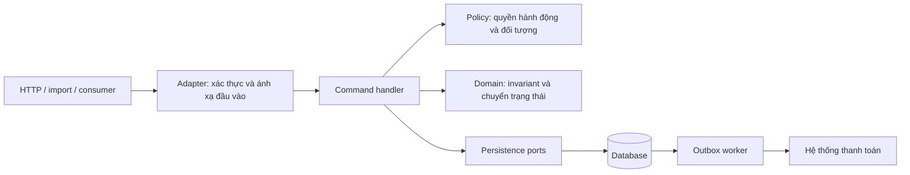
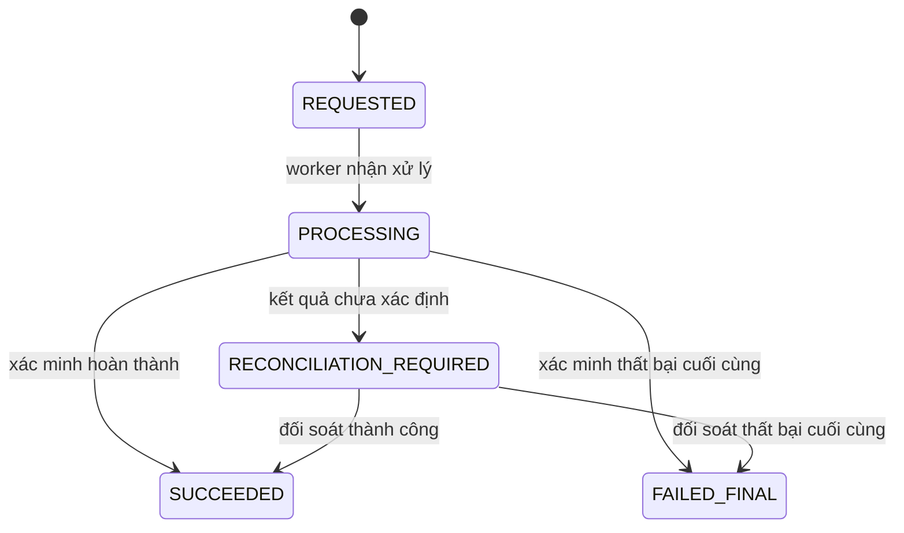

# Command handler pattern

Trong chương **Implementation Patterns**, command handler là cách tổ chức mỗi ý định thay đổi nghiệp vụ thành một luồng xử lý rõ ràng. Với bảo mật logic nghiệp vụ, giá trị chính của pattern là làm lộ ra nơi kiểm tra quyền, nơi bảo vệ trạng thái và ranh giới mà một thay đổi được phép commit.

Một handler tốt giúp trả lời: **ai được thực hiện hành động nào, trên đối tượng nào, trong trạng thái nào và với bảo đảm gì khi yêu cầu bị gửi lại hoặc chạy đồng thời?**

Bài học dùng ví dụ yêu cầu hoàn tiền. Đây là mô hình kỹ thuật minh họa cho việc bảo vệ quy tắc nghiệp vụ, không mô tả đầy đủ chính sách hoàn tiền của một sản phẩm cụ thể.

## 1. Command handler giải quyết vấn đề gì?

Giả sử logic hoàn tiền đang nằm trong nhiều nơi:

- Controller kiểm tra chủ sở hữu giao dịch.
- Một service kiểm tra số tiền còn có thể hoàn.
- Batch import gọi repository trực tiếp.
- Consumer nhận message rồi gọi API thanh toán.
- Một đường retry tạo lại yêu cầu mà không biết lần trước đã commit hay chưa.

Mỗi phần có thể đúng khi chạy riêng, nhưng toàn bộ hệ thống vẫn có đường đi bỏ qua quyền, vượt hạn mức hoặc hoàn lặp.

Command handler gom việc điều phối **một use case thay đổi trạng thái** về một ranh giới application rõ ràng:

```text
RequestRefundCommand
        ↓
RequestRefundHandler
        ↓
Quyền + dữ liệu hiện hành + invariant + transaction
        ↓
Kết quả nghiệp vụ đã được ghi nhận
```

Handler không cần tự chứa mọi thuật toán. Nó phối hợp policy, domain object và persistence để các bước diễn ra theo thứ tự hợp lệ.

### Command, handler và event khác nhau

| Khái niệm | Ý nghĩa | Ví dụ |
|---|---|---|
| Command | Ý định yêu cầu hệ thống làm một việc; có thể bị từ chối | `RequestRefund` |
| Handler | Thành phần xử lý ý định đó theo quy tắc hiện hành | `RequestRefundHandler` |
| Domain event | Sự kiện nghiệp vụ đã xảy ra trong ranh giới được định nghĩa | `RefundRequested` |
| Query | Yêu cầu đọc thông tin hiện có | `GetRefundStatus` |

`RefundRequested` có nghĩa yêu cầu đã được tiếp nhận và ghi nhận; nó không có nghĩa tiền đã được nhà cung cấp hoàn thành công.

Một command handler có thể trả biên nhận như ID và trạng thái. Bài học dùng cách gọi command theo use case ứng dụng; không áp dụng máy móc quy tắc “command không trả giá trị” của Command–Query Separation ở cấp phương thức. [Tham khảo khái niệm CQS của Martin Fowler](https://martinfowler.com/bliki/CommandQuerySeparation.html).

### Không bắt buộc triển khai CQRS đầy đủ

Command handler có thể dùng trong ứng dụng Spring đơn khối, gọi đồng bộ và dùng cùng database cho đọc/ghi. Không bắt buộc thêm message broker, command bus, event sourcing hay hai database.

CQRS nói đến việc tách mô hình phục vụ cập nhật và mô hình phục vụ đọc. Nó có liên hệ với cách đặt tên command nhưng là một quyết định kiến trúc rộng hơn. [Nguồn: Martin Fowler — CQRS](https://martinfowler.com/bliki/CQRS.html).

## 2. Xác định invariant trước khi viết handler

Giả sử payment lưu các tổng tiền theo đơn vị nhỏ nhất mà ứng dụng quy định cho đồng tiền:

```text
capturedMinor       = số tiền đã thu
refundedMinor       = số tiền đã hoàn thành công
refundReservedMinor = số tiền đang dành cho các yêu cầu chưa kết thúc
```

Điều kiện cần luôn đúng:

```text
capturedMinor >= 0
refundedMinor >= 0
refundReservedMinor >= 0

refundedMinor + refundReservedMinor <= capturedMinor
```

Số tiền còn có thể tiếp nhận yêu cầu hoàn:

```text
available = capturedMinor - refundedMinor - refundReservedMinor
```

Phải tính cả phần **đã dành trước**. Nếu chỉ trừ tiền đã hoàn thành công, hai yêu cầu đang xử lý có thể cùng sử dụng một hạn mức.

Ví dụ payment đã thu 1.000 đơn vị, đã hoàn 200 và đang dành trước 500. Một yêu cầu mới 400 phải bị từ chối vì chỉ còn 300, dù 800 đơn vị chưa được hoàn thành công.

Các điều kiện của use case:

| Nhóm | Điều kiện |
|---|---|
| Danh tính | Actor và tenant đến từ cơ chế xác thực đáng tin |
| Quyền hành động | Có quyền `refund:request` |
| Quyền đối tượng | Là chủ payment hoặc có quyền đặc biệt được cấp rõ ràng |
| Phạm vi dữ liệu | Payment thuộc đúng tenant của actor |
| Trạng thái | Payment ở trạng thái cho phép hoàn trong mô hình này |
| Dữ liệu | Số tiền dương, đúng đơn vị tiền tệ của payment |
| Hạn mức | Số tiền không vượt phần còn có thể dành trước |
| Gửi lại | Cùng idempotency key và payload không tạo yêu cầu mới |
| Đồng thời | Nhiều command không cùng tiêu dùng một phần hạn mức |

Các điều kiện này là thiết kế minh họa. Nếu sản phẩm cần phê duyệt hai người, hạn sử dụng, bằng chứng nghiệp vụ hoặc hạn mức theo ngày, phải thêm chúng vào invariant/policy và cơ chế nhất quán tương ứng.

## 3. Ranh giới trách nhiệm



| Thành phần | Nên làm | Dấu hiệu đang vượt trách nhiệm |
|---|---|---|
| Adapter | Kiểm tra cấu trúc, xác thực, dựng command, ánh xạ lỗi | Tự sửa số tiền dành trước trong database |
| Handler | Điều phối use case và transaction | Chứa mọi công thức, mọi chính sách và API ngoài |
| Policy | Quyết định quyền của actor với hành động/đối tượng | Tin role hoặc owner do client tự khai |
| Domain | Bảo vệ invariant, tạo trạng thái mới hợp lệ | Cho phép public setter phá vỡ invariant |
| Repository/store | Truy cập dữ liệu có phạm vi và tính đồng thời đúng | Tự vượt tenant hoặc âm thầm nuốt lỗi ghi |
| Outbox worker | Giao tiếp bên ngoài theo giao thức có retry | Coi gửi message thành công là hoàn tiền thành công |

Một handler thường phục vụ một loại command. Nó có thể cập nhật nhiều bảng trong cùng database khi các thay đổi đó thuộc cùng một hành vi cần nguyên tử.

Không nhất thiết tạo một handler cho mỗi thao tác SQL. Hành động “yêu cầu hoàn tiền” gồm dành hạn mức, tạo yêu cầu và ghi sự kiện; tách chúng thành ba command độc lập có thể để lại trạng thái dang dở.

## 4. Command chỉ chứa dữ liệu client được phép quyết định

Ví dụ dùng Java 17 trở lên. Các public type được trình bày riêng; khi triển khai, mỗi type đặt vào file và package tương ứng.

```java
import java.util.Objects;
import java.util.UUID;

public record RequestRefundCommand(
        UUID paymentId,
        long amountMinor,
        String idempotencyKey) {

    public RequestRefundCommand {
        Objects.requireNonNull(paymentId, "paymentId");
        Objects.requireNonNull(idempotencyKey, "idempotencyKey");

        if (amountMinor <= 0) {
            throw new IllegalArgumentException("amountMinor must be positive");
        }
        if (idempotencyKey.isBlank() || idempotencyKey.length() > 128) {
            throw new IllegalArgumentException("Invalid idempotency key");
        }
    }
}
```

Giới hạn 128 ký tự là lựa chọn của ví dụ, không phải chuẩn bắt buộc cho mọi API. Adapter còn cần giới hạn kích thước request và kiểu dữ liệu trước khi dựng command.

Command không chứa:

- `actorId`, `tenantId` hoặc role để tự nhận quyền.
- Tổng tiền đã thu/đã hoàn mà server sẽ dùng làm căn cứ.
- `refundStatus = SUCCEEDED`.
- Tiền tệ thay thế cho tiền tệ của payment.
- Cờ `skipValidation`, `isAdmin` hoặc `force` không có chính sách quyền riêng.

Trong ví dụ, client được chọn số tiền muốn yêu cầu nhưng server quyết định số tiền đó có hợp lệ không. Quy tắc tiền tệ và đơn vị lưu trữ phải được thống nhất ở server; không dùng `double` để biểu diễn tiền rồi so sánh bằng nhau.

Những field ẩn hoặc khóa trên giao diện vẫn là đầu vào không đáng tin. Server phải kiểm tra quyền sở hữu và dữ liệu nghiệp vụ cho từng yêu cầu. [Nguồn: OWASP — Business Logic Security](https://cheatsheetseries.owasp.org/cheatsheets/Business_Logic_Security_Cheat_Sheet.html).

## 5. Danh tính và policy nằm ngoài payload

Một mô hình actor tối thiểu:

```java
import java.util.Objects;
import java.util.Set;
import java.util.UUID;

public record Actor(
        UUID userId,
        UUID tenantId,
        Set<String> authorities) {

    public Actor {
        Objects.requireNonNull(userId, "userId");
        Objects.requireNonNull(tenantId, "tenantId");
        authorities = Set.copyOf(authorities);
    }

    public boolean has(String authority) {
        return authorities.contains(authority);
    }
}
```

```java
public interface CurrentActor {
    Actor require();
}
```

`CurrentActor` là port lấy danh tính đã xác minh từ môi trường chạy, chẳng hạn security context. Implementation phải từ chối khi thiếu danh tính phù hợp; không tự tạo actor toàn quyền để giúp một đường gọi nội bộ chạy được.

Dùng exception có mã lỗi cố định:

```java
public class CommandRejected extends RuntimeException {

    public enum Code {
        FORBIDDEN,
        RESOURCE_NOT_ACCESSIBLE,
        INVALID_AMOUNT,
        INVALID_STATE,
        REFUND_LIMIT_EXCEEDED,
        IDEMPOTENCY_CONFLICT
    }

    private final Code code;

    public CommandRejected(Code code) {
        super(code.name());
        this.code = code;
    }

    public Code code() {
        return code;
    }
}
```

Policy cho ví dụ:

```java
public class RefundAuthorization {

    public void requireAction(Actor actor) {
        if (!actor.has("refund:request")) {
            throw new CommandRejected(CommandRejected.Code.FORBIDDEN);
        }
    }

    public void requireObject(Actor actor, Payment payment) {
        boolean sameTenant = actor.tenantId().equals(payment.tenantId());
        boolean owner = actor.userId().equals(payment.customerId());
        boolean canRequestForOthers = actor.has("refund:request:any");

        if (!sameTenant || (!owner && !canRequestForOthers)) {
            throw new CommandRejected(CommandRejected.Code.FORBIDDEN);
        }
    }
}
```

Quyền `refund:request:any` chỉ mở phạm vi chủ thể trong cùng tenant. Nó không cho phép đi xuyên tenant, bỏ trạng thái hoặc vượt số tiền đã thu. Người có quyền đặc biệt vẫn phải có `refund:request` theo hợp đồng của ví dụ.

OWASP khuyến nghị từ chối theo mặc định và kiểm tra quyền trên mọi yêu cầu, thay vì chỉ dựa vào việc người dùng đã đăng nhập. [Nguồn: Authorization Cheat Sheet](https://cheatsheetseries.owasp.org/cheatsheets/Authorization_Cheat_Sheet.html).

Nếu quyền cần bị thu hồi tức thời, một tập authority lấy từ token cũ có thể không đủ. Thiết kế truy vấn quyền hiện hành hoặc cơ chế vô hiệu hóa thích hợp. Quyền dựa trên dữ liệu có thể đổi đồng thời cũng cần mức nhất quán phù hợp, không chỉ một lần đọc trước transaction.

## 6. Domain bảo vệ hạn mức bằng một phép chuyển đổi hợp lệ

Ví dụ dùng domain object bất biến để làm rõ rằng trạng thái mới chỉ được tạo qua hành vi có kiểm tra. Đây không phải một JPA entity.

```java
import java.util.Currency;
import java.util.Objects;
import java.util.UUID;

public record Payment(
        UUID id,
        UUID tenantId,
        UUID customerId,
        Currency currency,
        State state,
        long capturedMinor,
        long refundedMinor,
        long refundReservedMinor) {

    public enum State {
        AUTHORIZED, CAPTURED, CANCELLED
    }

    public Payment {
        Objects.requireNonNull(id, "id");
        Objects.requireNonNull(tenantId, "tenantId");
        Objects.requireNonNull(customerId, "customerId");
        Objects.requireNonNull(currency, "currency");
        Objects.requireNonNull(state, "state");

        if (capturedMinor < 0
                || refundedMinor < 0
                || refundReservedMinor < 0
                || refundedMinor > capturedMinor
                || refundReservedMinor > capturedMinor - refundedMinor) {
            throw new IllegalArgumentException("Invalid refund totals");
        }
    }

    public Payment reserveRefund(long amountMinor) {
        if (amountMinor <= 0) {
            throw new CommandRejected(CommandRejected.Code.INVALID_AMOUNT);
        }
        if (state != State.CAPTURED) {
            throw new CommandRejected(CommandRejected.Code.INVALID_STATE);
        }

        long available = capturedMinor - refundedMinor - refundReservedMinor;
        if (amountMinor > available) {
            throw new CommandRejected(
                    CommandRejected.Code.REFUND_LIMIT_EXCEEDED);
        }

        return new Payment(
                id, tenantId, customerId, currency, state,
                capturedMinor, refundedMinor,
                refundReservedMinor + amountMinor);
    }
}
```

Constructor kiểm tra tổng theo phép trừ để tránh việc cộng hai số lớn trước khi xác minh giới hạn. Sau khi kiểm tra `amountMinor <= available`, phần cộng tiền dành trước không vượt `capturedMinor - refundedMinor`.

Hai mức kiểm tra có mục đích khác nhau:

- Constructor của command loại bỏ đầu vào sai hình dạng.
- Hành vi domain vẫn bảo vệ invariant khi được gọi từ đường khác.

Domain object không đọc HTTP request, không lấy role từ JSON và không gọi API thanh toán. Nó xác định chuyển đổi hợp lệ trên dữ liệu đã được handler tải.

Tính bất biến của object Java không giải quyết race condition ở database. Hai handler vẫn có thể đọc cùng một snapshot nếu tầng persistence không bảo vệ việc đọc–ghi.

## 7. Các port phải có hợp đồng transaction rõ ràng

Trước khi viết handler, xác định ý nghĩa của persistence port. Những interface dưới đây là hợp đồng cần implementation thật; bản thân chúng không cung cấp khóa hoặc idempotency.

### Payment và yêu cầu hoàn tiền

```java
import java.util.Optional;
import java.util.UUID;

public interface PaymentStore {
    Optional<Payment> findForUpdate(UUID tenantId, UUID paymentId);
    void save(Payment payment);
}
```

Hợp đồng trong ví dụ:

- `findForUpdate` chỉ tải payment đúng tenant, giữ khóa ghi trên bản ghi trong transaction hiện tại.
- `save` cập nhật đúng payment đã tải, không dùng một connection/transaction độc lập.
- Các handler khác sửa các tổng hoàn tiền cũng phải khóa cùng bản ghi hoặc dùng giao thức tương đương.

```java
public enum RefundStatus {
    REQUESTED,
    PROCESSING,
    SUCCEEDED,
    FAILED_FINAL,
    RECONCILIATION_REQUIRED
}
```

```java
import java.time.Instant;
import java.util.UUID;

public record RefundRequest(
        UUID id,
        UUID tenantId,
        UUID paymentId,
        UUID requestedBy,
        long amountMinor,
        String currency,
        RefundStatus status,
        Instant requestedAt) {
}
```

```java
public interface RefundStore {
    void insert(RefundRequest request);
}
```

### Kết quả và idempotency

```java
import java.util.UUID;

public record RefundRequestResult(UUID refundId, RefundStatus status) {
}
```

```java
import java.util.UUID;

public record CommandKey(
        UUID tenantId,
        UUID actorId,
        String commandType,
        String key) {
}
```

```java
import java.util.UUID;

public record RefundPayload(UUID paymentId, long amountMinor) {
}
```

```java
import java.util.Optional;

public interface RefundDedupStore {
    Optional<RefundRequestResult> beginOrReplay(
            CommandKey key, RefundPayload payload);

    void complete(CommandKey key, RefundRequestResult result);
}
```

Hợp đồng của `beginOrReplay`:

1. Việc nhận key phải nguyên tử, có unique constraint trên toàn bộ phạm vi key.
2. Nếu transaction này nhận được key mới, trả `Optional.empty()`.
3. Nếu key đã hoàn tất với cùng payload, trả kết quả đã lưu.
4. Nếu key tồn tại với payload khác, ném `IDEMPOTENCY_CONFLICT`.
5. Bản ghi key mới và kết quả `complete` cùng nằm trong transaction nghiệp vụ.
6. Request cạnh tranh phải chờ, retry transaction hoặc nhận lỗi tạm thời theo hợp đồng; không coi “đang bận” là đã nhận được key mới.

Ví dụ lưu payload có cấu trúc thay vì chỉ một chuỗi hash. Nếu implementation dùng hash, cần biểu diễn payload chuẩn hóa và phiên bản schema ổn định. Không lấy raw JSON làm khóa so sánh nếu khác thứ tự field hoặc cách biểu diễn số có thể tạo hash khác cho cùng ý nghĩa.

### Outbox và audit

```java
import java.time.Instant;
import java.util.UUID;

public record RefundRequested(
        UUID eventId,
        UUID refundId,
        UUID tenantId,
        UUID paymentId,
        long amountMinor,
        String currency,
        Instant occurredAt) {
}
```

```java
public interface OutboxStore {
    void append(RefundRequested event);
}
```

```java
import java.time.Instant;
import java.util.UUID;

public interface RefundAudit {
    void recordRequested(
            Actor actor, UUID refundId, UUID paymentId, Instant occurredAt);
}
```

`append` chỉ ghi vào bảng outbox trong transaction hiện tại. Nó không đồng nghĩa đã publish broker. `recordRequested` trong ví dụ ghi audit thành công vào cùng database/transaction, không gọi một dịch vụ ngoài có thể gây dual write.

## 8. Handler điều phối một lần tiếp nhận yêu cầu

Interface chung là tùy chọn nhưng có thể hữu ích khi các handler có cùng quy ước:

```java
public interface CommandHandler<C, R> {
    R handle(C command);
}
```

Không cần một cây kế thừa sâu hoặc reflection dispatcher chỉ để dùng pattern. Controller có thể inject và gọi thẳng handler cụ thể.

Handler minh họa:

```java
import java.time.Clock;
import java.time.Instant;
import java.util.Optional;
import java.util.UUID;
import org.springframework.stereotype.Service;
import org.springframework.transaction.annotation.Transactional;

@Service
public class RequestRefundHandler
        implements CommandHandler<RequestRefundCommand, RefundRequestResult> {

    private final CurrentActor currentActor;
    private final RefundAuthorization authorization;
    private final PaymentStore payments;
    private final RefundStore refunds;
    private final RefundDedupStore dedup;
    private final OutboxStore outbox;
    private final RefundAudit audit;
    private final Clock clock;

    public RequestRefundHandler(
            CurrentActor currentActor,
            RefundAuthorization authorization,
            PaymentStore payments,
            RefundStore refunds,
            RefundDedupStore dedup,
            OutboxStore outbox,
            RefundAudit audit,
            Clock clock) {
        this.currentActor = currentActor;
        this.authorization = authorization;
        this.payments = payments;
        this.refunds = refunds;
        this.dedup = dedup;
        this.outbox = outbox;
        this.audit = audit;
        this.clock = clock;
    }

    @Override
    @Transactional
    public RefundRequestResult handle(RequestRefundCommand command) {
        Actor actor = currentActor.require();
        authorization.requireAction(actor);

        Payment payment = payments.findForUpdate(
                        actor.tenantId(), command.paymentId())
                .orElseThrow(() -> new CommandRejected(
                        CommandRejected.Code.RESOURCE_NOT_ACCESSIBLE));

        authorization.requireObject(actor, payment);

        CommandKey key = new CommandKey(
                actor.tenantId(), actor.userId(),
                "RequestRefund:v1", command.idempotencyKey());

        RefundPayload payload = new RefundPayload(
                command.paymentId(), command.amountMinor());

        Optional<RefundRequestResult> replay =
                dedup.beginOrReplay(key, payload);
        if (replay.isPresent()) {
            return replay.get();
        }

        Payment updated = payment.reserveRefund(command.amountMinor());
        UUID refundId = UUID.randomUUID();
        Instant now = clock.instant();
        String currency = payment.currency().getCurrencyCode();

        refunds.insert(new RefundRequest(
                refundId, actor.tenantId(), payment.id(), actor.userId(),
                command.amountMinor(), currency,
                RefundStatus.REQUESTED, now));

        payments.save(updated);

        outbox.append(new RefundRequested(
                UUID.randomUUID(), refundId, actor.tenantId(), payment.id(),
                command.amountMinor(), currency, now));

        audit.recordRequested(actor, refundId, payment.id(), now);

        RefundRequestResult result =
                new RefundRequestResult(refundId, RefundStatus.REQUESTED);
        dedup.complete(key, result);
        return result;
    }
}
```

Điểm đáng chú ý trong thứ tự này:

- Quyền hành động được kiểm tra trước khi tải payment.
- Payment được tìm theo tenant và được khóa trước khi tính hạn mức.
- Quyền trên payment được kiểm tra trước khi trả bất kỳ kết quả replay nào.
- Replay xảy ra trước việc dành thêm hạn mức, nên không chạy lại thay đổi của lần đầu.
- Kết quả mới, yêu cầu, phần tiền dành trước, audit và outbox cùng commit hoặc cùng rollback.

Kết quả replay là **biên nhận gốc**. Nếu yêu cầu đã tiến từ `REQUESTED` sang `SUCCEEDED`, biên nhận gốc vẫn có thể ghi `REQUESTED`; query trạng thái hiện tại có hợp đồng riêng. Không trộn hai ý nghĩa đó trong API.

Trong use case này, quyền truy cập payment là điều kiện được chọn để nhận lại biên nhận. Sản phẩm có chính sách bảo mật kết quả chặt hơn phải bổ sung kiểm tra trên refund/result.

### Điều kiện để ví dụ hoạt động đúng với Spring

Ứng dụng cần:

- Các implementation persistence thực sự dùng cùng transaction manager và database.
- Bean cho `CurrentActor`, `RefundAuthorization`, các store và `Clock`.
- Cơ chế transaction được bật và lời gọi đi qua Spring proxy.
- Chính sách xử lý lỗi và retry tại ranh giới phù hợp.

`@Transactional` không tự tạo datasource hoặc transaction manager. Trong chế độ proxy, tự `new` handler hoặc gọi method nội bộ trên `this` không cung cấp cùng ranh giới transaction như lời gọi qua proxy. [Nguồn: Spring Framework — Using @Transactional](https://docs.spring.io/spring-framework/reference/data-access/transaction/declarative/annotations.html).

`CommandRejected` kế thừa `RuntimeException`. Với cấu hình rollback mặc định, loại exception này làm transaction rollback. Không bắt nó trong handler rồi trả kết quả lỗi sau khi đã sửa dữ liệu mà vẫn để transaction commit. [Nguồn: Rolling Back a Declarative Transaction](https://docs.spring.io/spring-framework/reference/data-access/transaction/declarative/rolling-back.html).

Khi handler tham gia một transaction bên ngoài, việc method trả về chưa có nghĩa transaction ngoài đã commit. Chỉ công bố thành công ra ngoài sau khi ranh giới transaction thực tế hoàn tất.

## 9. Hiện thực khóa và idempotency trên database

Phần này dùng PostgreSQL làm ví dụ cụ thể cho hợp đồng persistence. SQL là minh họa cho adapter; placeholder có tên cần được bind bằng thư viện truy cập dữ liệu, không nối chuỗi từ request.

### Khóa theo đối tượng chứa invariant

```sql
SELECT id, tenant_id, customer_id, currency, state,
       captured_minor, refunded_minor, refund_reserved_minor
FROM payments
WHERE tenant_id = :tenant_id
  AND id = :payment_id
FOR UPDATE;
```

Trong PostgreSQL, khóa hàng của `FOR UPDATE` được giữ đến khi transaction kết thúc và chặn các thao tác xung đột trên cùng hàng. Khóa không có nghĩa mọi thao tác đọc đều bị chặn. [Nguồn: PostgreSQL — Explicit Locking](https://www.postgresql.org/docs/current/explicit-locking.html).

Nếu hai request cùng đòi 600 trên payment chỉ còn 1.000:

| Bước | Handler A | Handler B |
|---|---|---|
| 1 | Khóa payment, đọc còn 1.000 | Chờ khóa payment |
| 2 | Dành trước 600 rồi commit | Chưa được dành tiền |
| 3 | Hoàn tất | Đọc trạng thái mới còn 400 theo giao thức DB/isolation |
| 4 | Không có tác động thêm | Bị từ chối vì 600 vượt phần còn lại |

Nếu database/isolation báo xung đột thay vì tiếp tục đọc như ví dụ, xử lý tại ranh giới transaction. Không phụ thuộc vào một exception duy nhất cho mọi hệ quản trị.

Có thể thay khóa bằng optimistic locking hoặc một câu `UPDATE` có điều kiện nguyên tử, nhưng phải kiểm tra số hàng cập nhật và xử lý xung đột. Chỉ thêm field `version` rồi so sánh hai số trong Java không làm toàn bộ luồng nguyên tử.

Nếu dùng JPA, `@Lock` trên repository query là một cách khai báo lock mode; adapter vẫn phải tuân thủ transaction và không vô tình dùng snapshot cũ làm dữ liệu quyết định. [Nguồn: Spring Data JPA — Locking](https://docs.spring.io/spring-data/jpa/reference/jpa/locking.html).

### Nhận idempotency key bằng ràng buộc nguyên tử

Ví dụ cấu trúc bảng phục vụ riêng command này:

```sql
CREATE TABLE refund_command_dedup (
    tenant_id UUID NOT NULL,
    actor_id UUID NOT NULL,
    command_type VARCHAR(64) NOT NULL,
    idempotency_key VARCHAR(128) NOT NULL,
    payload_version INTEGER NOT NULL,
    payment_id UUID NOT NULL,
    amount_minor BIGINT NOT NULL CHECK (amount_minor > 0),
    refund_id UUID,
    result_status VARCHAR(32),
    completed_at TIMESTAMPTZ,
    PRIMARY KEY (tenant_id, actor_id, command_type, idempotency_key),
    CHECK (
        (refund_id IS NULL AND result_status IS NULL AND completed_at IS NULL)
        OR
        (refund_id IS NOT NULL AND result_status IS NOT NULL
         AND completed_at IS NOT NULL)
    )
);
```

Để thử nhận key:

```sql
INSERT INTO refund_command_dedup (
    tenant_id, actor_id, command_type, idempotency_key,
    payload_version, payment_id, amount_minor
)
VALUES (
    :tenant_id, :actor_id, :command_type, :idempotency_key,
    1, :payment_id, :amount_minor
)
ON CONFLICT (tenant_id, actor_id, command_type, idempotency_key)
DO NOTHING
RETURNING idempotency_key;
```

Nếu nhận được hàng trả về, transaction hiện tại đã tạo bản ghi mới. Nếu không, adapter phải đọc bản ghi tồn tại, so sánh payload và lấy kết quả. Không được suy ra rằng “không insert được” có nghĩa payload giống nhau.

`ON CONFLICT DO NOTHING` xử lý xung đột unique mà không cần cố ý gây unique-violation exception. `RETURNING` cho biết những hàng thực sự được insert trong trường hợp này. [Nguồn: PostgreSQL — INSERT](https://www.postgresql.org/docs/current/sql-insert.html).

Với Read Committed, mỗi câu lệnh đọc có snapshot phù hợp thời điểm bắt đầu của nó. Một insert cạnh tranh có thể không tạo hàng do transaction khác, nên việc đọc bản ghi bằng câu lệnh kế tiếp phải được thiết kế theo isolation đang dùng. Không ghép tùy ý insert và đọc vào một snapshot rồi cho rằng luôn nhìn thấy hàng thắng cuộc. [Nguồn: PostgreSQL — Transaction Isolation](https://www.postgresql.org/docs/current/transaction-iso.html).

Trong mô hình của bài, bản ghi mới được hoàn tất trong cùng transaction trước commit. Schema cho phép các field kết quả tạm thời null; application phải bảo đảm không commit một bản ghi chưa hoàn tất. Nếu đọc thấy bản ghi chưa hoàn tất đã commit, hãy coi đó là vi phạm giao thức hoặc xử lý theo cơ chế phục hồi đã định nghĩa, không trả thành công giả.

Nếu chọn một transaction riêng để commit trạng thái “đang xử lý”, cần bổ sung lease, timeout và phục hồi khi worker chết. Đó là thiết kế khác với handler ở mục 8.

### Phạm vi và thời hạn key

Cùng key nhưng actor hoặc tenant khác là phạm vi khác trong ví dụ. Quyết định này tránh việc một actor đoán key rồi nhận biên nhận của actor khác; nó không thay thế authorization.

Cùng actor và key nhưng payment/số tiền khác phải bị từ chối. Không thay payload cũ bằng payload mới và tiếp tục.

Thời hạn lưu key phải khớp hợp đồng retry. Sau khi xóa bản ghi dedup, key cũ có thể bị coi là mới; nếu cần chống lặp lâu hơn, dùng thêm khóa nghiệp vụ ổn định hoặc ràng buộc trên yêu cầu hoàn tiền. Idempotency key không phải cơ chế chống một người có quyền cố ý tạo nhiều yêu cầu với nhiều key khác nhau; invariant hạn mức và kiểm soát lạm dụng vẫn cần thiết.

## 10. Ranh giới tiếp nhận và thực thi bên ngoài

State machine tối thiểu của yêu cầu:



Handler tiếp nhận chỉ tạo `REQUESTED`. Một workflow khác chịu trách nhiệm gọi provider và cập nhật kết quả.

Khi provider thành công, giao dịch cập nhật kết quả cần chuyển số tiền tương ứng từ phần dành trước sang phần đã hoàn. Khi xác minh thất bại cuối cùng, mới giải phóng phần dành trước. Mỗi lần kết thúc phải chỉ tiêu thụ/giải phóng reservation một lần.

Timeout mạng không chứng minh provider chưa xử lý. Nếu giải phóng reservation ngay khi timeout rồi cho tạo yêu cầu mới, hệ thống có thể hoàn vượt số tiền khi provider hoàn tất yêu cầu cũ. Trạng thái chưa xác định cần đối soát hoặc retry bằng cùng mã thao tác ổn định theo giao thức provider.

### Vì sao dùng outbox?

Nếu commit database rồi publish trực tiếp, tiến trình có thể chết giữa hai việc. Nếu publish trước rồi database rollback, phía nhận có thể xử lý một yêu cầu chưa tồn tại hợp lệ.

Outbox ghi ý định phát sự kiện cùng transaction với dữ liệu nghiệp vụ; một tiến trình khác giao sự kiện sau commit. Sự kiện có thể được giao nhiều lần nên consumer cần xử lý trùng. [Nguồn: AWS — Transactional outbox pattern](https://docs.aws.amazon.com/prescriptive-guidance/latest/cloud-design-patterns/transactional-outbox.html).

Một outbox chưa được giao vẫn là công việc bền vững để retry. Worker cần cơ chế nhận việc, retry có giới hạn/backoff và quan sát backlog phù hợp.

Một cờ “đã xử lý event” đơn giản không đủ để biến lời gọi provider thành nguyên tử với database. Với hệ thống ngoài, cần mã thao tác/idempotency ổn định tại provider nếu được hỗ trợ, cùng lưu trạng thái và đối soát khi kết quả không rõ. Không tuyên bố toàn bộ luồng có “exactly once” chỉ vì đã có bảng outbox.

## 11. Decorator và pipeline: dùng khi có nhu cầu rõ

Khi nhiều command cùng cần logging, đo thời gian hoặc transaction, có thể tổ chức thành decorator:

```text
Adapter đã xác thực
    → Quan sát request/correlation
        → Kiểm tra quyền hành động
            → Ranh giới transaction
                → Tải đối tượng và kiểm tra quyền đối tượng
                    → Nhận key/replay
                        → Domain và ghi kết quả
```

Đây là thứ tự thiết kế cho ví dụ, không phải quy tắc bất biến cho mọi hệ thống.

Những phần có thể dùng chung:

- Trích xuất actor từ ngữ cảnh đáng tin.
- Correlation ID và đo thời gian.
- Ánh xạ exception tại adapter.
- Cơ chế retry lỗi database đã được phân loại.
- Hạ tầng lưu key, outbox và transaction.

Những phần vẫn cần hiểu nghiệp vụ:

- Chủ thể nào được tác động payment nào.
- Dữ liệu nào thuộc payload dùng so sánh idempotency.
- Replay có được trả cho actor hiện tại không.
- Invariant nào cần khóa và khóa ở cấp nào.
- Thời điểm được giải phóng reservation.

Nếu có retry do deadlock hoặc serialization failure, mỗi lần thử lại cần transaction mới và tải lại dữ liệu. Retry một thao tác ghi bên trong transaction đã thất bại không khôi phục tính hợp lệ của transaction.

Không tự động retry mọi `CommandRejected`. Thiếu quyền, payload key xung đột và vượt hạn mức là kết quả nghiệp vụ; lặp lại ngay không làm chúng hợp lệ hơn.

Nếu vừa dùng decorator vừa dùng annotation AOP, phải xác định ai thực sự mở transaction và retry bao quanh phần nào. Thứ tự hiển thị của annotation trên source không phải bằng chứng cho thứ tự runtime.

## 12. Những cách triển khai làm mất tác dụng của pattern

| Cách làm | Lỗ hổng có thể phát sinh | Hướng xử lý |
|---|---|---|
| Dùng `UpdatePaymentCommand` chứa mọi field | Ghi đè chủ sở hữu, tổng tiền hoặc trạng thái | Command theo ý định, giới hạn field |
| Chỉ controller kiểm tra quyền | Import/consumer đi thẳng tới phần ghi | Kiểm tra tại application boundary |
| Kiểm tra hạn mức ngoài transaction | Đọc đúng nhưng ghi dựa trên dữ liệu đã cũ | Bảo vệ đọc–quyết định–ghi bằng giao thức đồng thời |
| Mỗi store tự mở transaction riêng | Tạo refund nhưng thiếu reservation/outbox | Một ranh giới nguyên tử cho các ghi liên quan |
| Check key bằng SELECT rồi INSERT không constraint | Hai request cùng nhận là lần đầu | Unique constraint và giao thức nhận key |
| Tìm kết quả dedup rồi trả trước khi kiểm tra quyền | Lộ kết quả hoặc duy trì quyền đã bị thu hồi | Authorization cho cả replay |
| Gọi provider trong lúc giữ khóa payment lâu | Tăng tranh chấp, vẫn không có atomicity liên hệ thống | Ghi yêu cầu và outbox, xử lý theo workflow |
| Coi timeout là thất bại cuối cùng | Giải phóng hạn mức dù tiền có thể đã được hoàn | Trạng thái chưa xác định và đối soát |
| Tạo command bus có lệnh không đăng ký policy | Đường dispatch mới trở thành bypass | Registry/policy rõ ràng, từ chối khi thiếu cấu hình |
| Handler gọi handler khác theo vòng | Transaction, key và side effect khó kiểm soát | Điều phối use case hoặc workflow rõ ràng |

Nếu một use case đòi nhiều command qua nhiều dịch vụ, không mở một transaction database rồi cho rằng nó bao phủ toàn bộ mạng. Cần thiết kế workflow/saga và các bước bù có invariant riêng.

## 13. Kiểm thử theo hành vi và dữ liệu đã commit

Không chỉ test “handler trả ID”. Phải chứng minh những điều không được phép không tạo tác động.

### Test domain cho invariant số tiền

Ví dụ JUnit Jupiter, chạy độc lập với database:

```java
import static org.junit.jupiter.api.Assertions.assertEquals;
import static org.junit.jupiter.api.Assertions.assertThrows;

import java.util.Currency;
import java.util.UUID;
import org.junit.jupiter.api.Test;

class PaymentTest {

    @Test
    void pendingRefundsAlreadyConsumeTheRefundLimit() {
        Payment payment = new Payment(
                UUID.randomUUID(), UUID.randomUUID(), UUID.randomUUID(),
                Currency.getInstance("VND"), Payment.State.CAPTURED,
                1_000, 200, 500);

        CommandRejected error = assertThrows(
                CommandRejected.class,
                () -> payment.reserveRefund(400));

        assertEquals(
                CommandRejected.Code.REFUND_LIMIT_EXCEEDED, error.code());
        assertEquals(500, payment.refundReservedMinor());
    }

    @Test
    void reservingExactlyTheRemainingAmountIsAllowed() {
        Payment payment = new Payment(
                UUID.randomUUID(), UUID.randomUUID(), UUID.randomUUID(),
                Currency.getInstance("VND"), Payment.State.CAPTURED,
                1_000, 200, 500);

        Payment updated = payment.reserveRefund(300);

        assertEquals(800, updated.refundReservedMinor());
        assertEquals(500, payment.refundReservedMinor());
    }
}
```

Hai test này kiểm tra biên hạn mức và tính bất biến của domain object; không chứng minh tính nguyên tử của handler.

### Test handler và persistence

| Tình huống | Bằng chứng cần kiểm tra |
|---|---|
| Actor hợp lệ, payment thuộc quyền, đủ hạn mức | Một refund, một reservation, một kết quả dedup và một outbox tương ứng |
| Thiếu `refund:request` | Bị từ chối trước thao tác tải/ghi payment |
| Payment khác tenant | Không đọc hoặc thay đổi dữ liệu của tenant khác |
| Đúng tenant nhưng không sở hữu và thiếu quyền đặc biệt | Không tạo refund/reservation/outbox |
| Có quyền đặc biệt nhưng vượt hạn mức | Vẫn bị từ chối |
| Payment chưa thu tiền hoặc đã hủy | Không tạo yêu cầu |
| Cùng key, cùng payload sau lần đầu thành công | Cùng refund ID, không tăng reservation hoặc thêm sự kiện |
| Cùng key, payload khác | `IDEMPOTENCY_CONFLICT`, không có thay đổi mới |
| Cùng key nhưng quyền đã bị rút | Không trả biên nhận qua đường bỏ kiểm tra quyền |
| Lỗi khi ghi outbox hoặc complete key | Toàn bộ ghi nghiệp vụ rollback |
| Hai key khác nhau cùng tranh phần hạn mức | Tổng đã hoàn và dành trước không vượt số đã thu |
| Mất phản hồi sau commit | Retry nhận lại biên nhận, không tạo yêu cầu mới |
| Provider timeout sau khi có thể đã xử lý | Reservation được giữ để đối soát theo workflow |
| Sự kiện/callback bị giao lại | Không tiêu thụ hoặc giải phóng reservation lần thứ hai |

Test handler với mock hữu ích cho thứ tự điều phối, nhưng repository mock không chứng minh được lock, unique constraint hoặc rollback.

Test integration cần database phù hợp môi trường đích, hai transaction/connection độc lập cho tình huống đồng thời và một lần đọc mới sau khi các transaction kết thúc. Đồng bộ thời điểm chạy để thực sự tạo cạnh tranh; không chỉ gửi hai request lần lượt rồi gọi đó là test race condition.

Tình huống rollback nên chèn lỗi sau một lần ghi đã diễn ra, rồi kiểm tra cả payment, refund, dedup và outbox đều không để lại phần thành công. Không dựa riêng vào HTTP status hoặc exception.

Với Spring, unit test tự `new` handler có thể kiểm tra code Java bên trong nhưng không xác nhận transaction proxy. Test integration phải gọi bean được quản lý với cấu hình transaction thực tế.

## 14. Quan sát vận hành và lỗi nghiệp vụ

Một lần tiếp nhận thành công nên ghi được actor, tenant, command type, payment ID, refund ID, số tiền theo đơn vị quy định và correlation ID. Reason của lần từ chối nên có cấu trúc để phân biệt lỗi quyền, trạng thái, hạn mức và idempotency.

Không log credential, token hoặc dữ liệu thanh toán nhạy cảm không cần thiết. Không trả chi tiết payment ngoài quyền chỉ để giúp client phân biệt “không tồn tại” với “thuộc người khác”.

Ánh xạ lỗi gợi ý:

| Kết quả | Hợp đồng HTTP có thể chọn |
|---|---|
| Request sai cấu trúc | `400 Bad Request` |
| Actor đã xác thực nhưng thiếu quyền | `403 Forbidden` |
| Không tìm thấy trong phạm vi được phép | `404 Not Found` |
| Trạng thái/hạn mức/key xung đột | `409 Conflict` |
| Tiếp nhận xong để xử lý bất đồng bộ | `202 Accepted` với refund ID |

Đây là hợp đồng của API cần được triển khai, không phải framework tự suy ra từ exception trong ví dụ.

Audit từ chối cần đường ghi phù hợp để không mất dấu khi transaction nghiệp vụ rollback. Audit thành công phải phản ánh commit, tránh ghi “refund thành công” khi handler mới chỉ tạo yêu cầu.

Các tín hiệu vận hành đáng theo dõi gồm số lần replay, key xung đột, lock timeout/deadlock, outbox tồn đọng, tuổi của yêu cầu chưa kết thúc và số trường hợp cần đối soát. Tách chỉ số nghiệp vụ bị từ chối khỏi lỗi hạ tầng để không retry sai loại lỗi.

## 15. Checklist thiết kế một command handler an toàn

Trước khi hoàn thiện một handler mới, kiểm tra:

- Tên command thể hiện ý định nghiệp vụ cụ thể.
- Payload chỉ chứa lựa chọn client được quyền đưa ra.
- Danh tính và tenant đến từ nguồn đã được xác minh.
- Quyền hành động và quyền đối tượng đều có điểm thực thi rõ ràng.
- Dữ liệu quyết định được tải từ nguồn có thẩm quyền tại thời điểm xử lý.
- Invariant được bảo vệ trong domain và bằng cơ chế đồng thời phù hợp.
- Các ghi cần nguyên tử dùng chung ranh giới transaction.
- Idempotency có scope, payload, unique constraint, thời hạn và quy tắc replay rõ.
- Tác động bên ngoài có outbox/workflow và cách xử lý kết quả chưa xác định.
- Test kiểm tra từ chối, rollback, retry và dữ liệu đã commit khi chạy đồng thời.

Command handler pattern có ích khi nó tạo một nơi điều phối có thể đọc và kiểm chứng. Tính an toàn đến từ hợp đồng quyền, invariant và persistence được thực thi nhất quán trên mọi đường gọi, kể cả những lần gửi lại và những tác vụ chạy sau request ban đầu.
