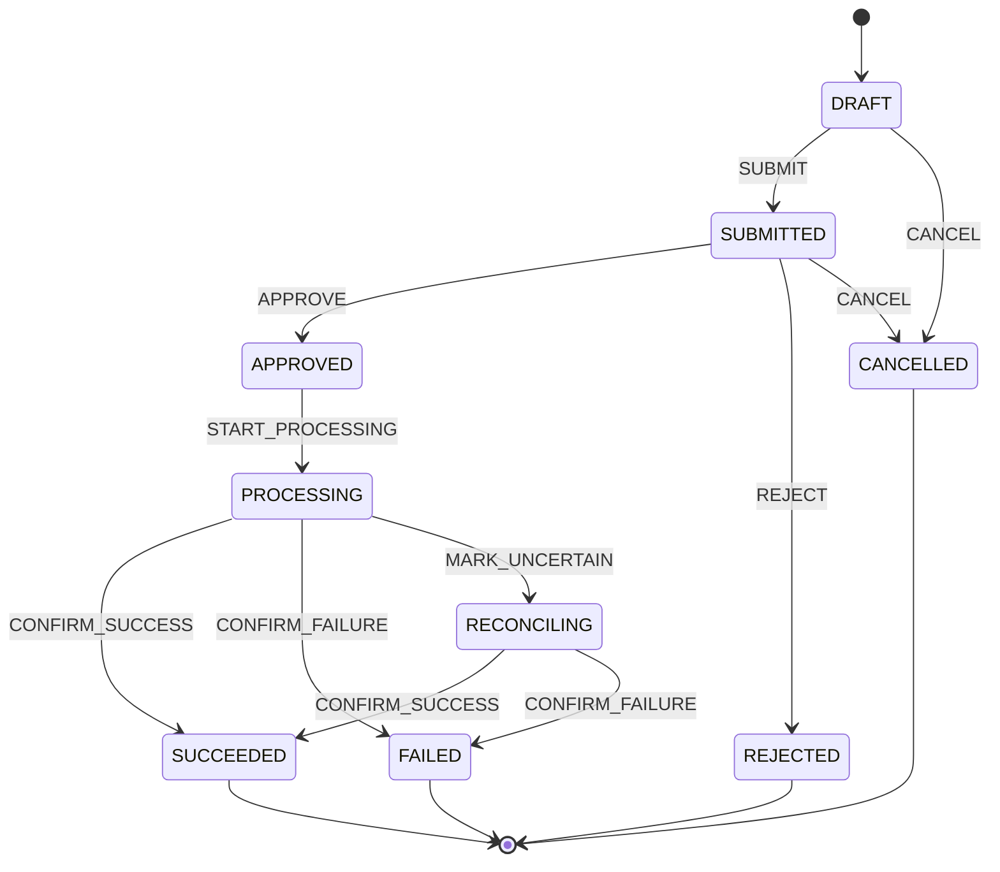
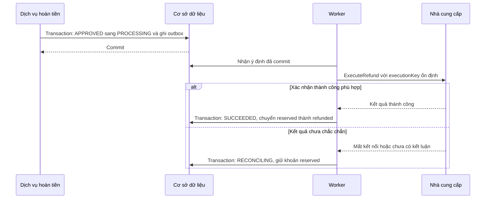

# State machine pattern

## 1. Vì sao quy trình cần một mô hình trạng thái rõ ràng?

State machine pattern biểu diễn quy trình bằng các trạng thái hữu hạn và những chuyển đổi được phép khi có một lệnh hoặc sự kiện cụ thể. Trong chương **Implementation Patterns** của nội dung bảo vệ logic nghiệp vụ, pattern này giúp máy chủ trả lời: **đối tượng đang ở bước nào, ai được thực hiện bước tiếp theo và điều kiện gì phải còn đúng khi cập nhật?**

Ví dụ, API hoàn tiền có ba endpoint tạo yêu cầu, phê duyệt và thực hiện hoàn tiền. Nếu endpoint thực hiện chỉ kiểm tra người gọi đã đăng nhập, kẻ lạm dụng có thể gọi thẳng endpoint đó mà chưa được phê duyệt. Ẩn nút trên giao diện hoặc kiểm tra thứ tự trong JavaScript không bảo vệ được đường gọi API trực tiếp.

Một cột `status` cũng chưa đủ. Nếu máy chủ nhận `{"status":"APPROVED"}` rồi cập nhật nguyên giá trị client gửi, ứng dụng đang lưu nhãn trạng thái nhưng chưa thực thi quy trình. [OWASP Transaction Authorization](https://cheatsheetseries.owasp.org/cheatsheets/Transaction_Authorization_Cheat_Sheet.html) yêu cầu kiểm soát chuyển trạng thái ở máy chủ, ngăn bỏ bước và kiểm tra việc ủy quyền gắn với thực thi giao dịch.

Có thể mô tả một chuyển đổi bằng:

```text
transition(currentState, command, trustedContext)
    -> nextState hoặc một kết quả từ chối rõ ràng

Chỉ chấp nhận khi:
    có cạnh (currentState, command)
    AND tác nhân có quyền trên đúng đối tượng
    AND các guard nghiệp vụ thỏa mãn
    AND điều kiện cạnh tranh cập nhật vẫn còn đúng khi ghi
```

Pattern này bảo vệ thứ tự và điều kiện của quy trình. Để bảo vệ tiền, hạn mức và thao tác gửi lại, cần kết hợp quyền theo đối tượng, transaction, ràng buộc dữ liệu, idempotency và giao thức xử lý tác động bên ngoài.

**Phạm vi ví dụ:** Java 17 và SQL minh họa theo PostgreSQL 18. Các trạng thái, tên bảng và policy hoàn tiền trong bài là thiết kế của ví dụ, không phải quy tắc bắt buộc cho mọi hệ thống. Các đoạn mã không tạo thành một ứng dụng hoàn chỉnh; phần ghi rõ mã giả dùng các hợp đồng do ứng dụng tự định nghĩa.

## 2. Các thành phần của state machine

| Thành phần | Ý nghĩa | Ví dụ trong quy trình hoàn tiền |
|---|---|---|
| State | Tình trạng nghiệp vụ đang được máy chủ công nhận | `SUBMITTED`: yêu cầu đã gửi và đang chờ quyết định |
| Command | Ý định yêu cầu một thay đổi, vẫn có thể bị từ chối | `APPROVE`: đề nghị phê duyệt |
| Event | Một sự việc đã được xác nhận hoặc thông báo cần xác minh | Nhà cung cấp thông báo hoàn tiền thành công |
| Transition | Cạnh hợp lệ giữa trạng thái nguồn và đích | `SUBMITTED + APPROVE -> APPROVED` |
| Guard | Điều kiện phải đúng để đi qua cạnh | Người duyệt khác người tạo; còn hạn mức hoàn |
| Action | Công việc gắn với chuyển đổi | Giữ chỗ số tiền và ghi lịch sử |
| Context | Dữ liệu dùng để đánh giá, có nguồn và độ tin cậy rõ ràng | Danh tính, tenant, phiên bản, giao dịch gốc |

Guard nên tập trung đánh giá điều kiện, tránh gọi cổng thanh toán hoặc tạo tác động phụ khó thử lại. Action có thể thay đổi dữ liệu trong transaction hoặc ghi ý định xử lý tiếp theo. Khi đọc thuật ngữ từ một thư viện, cần kiểm tra ngữ nghĩa cụ thể của thư viện đó; một callback action không tự có bảo đảm nguyên tử với cơ sở dữ liệu.

Lệnh `APPROVE` không đồng nghĩa với sự kiện “đã phê duyệt”. Chỉ phát sự kiện thành công từ một thay đổi đã được commit hoặc từ outbox được commit cùng thay đổi. Việc request được nhận hoặc guard trả về `true` chưa chứng minh transaction đã thành công.

## 3. Thiết kế quy trình hoàn tiền mẫu

### 3.1. Ý nghĩa từng trạng thái

| Trạng thái | Ý nghĩa trong mô hình này |
|---|---|
| `DRAFT` | Bản nháp, chưa được gửi để phê duyệt |
| `SUBMITTED` | Nội dung quan trọng đã được chốt để người duyệt xem xét |
| `APPROVED` | Đã được duyệt và đã giữ chỗ hạn mức hoàn tiền |
| `PROCESSING` | Đã lưu ý định thực hiện ra nhà cung cấp; kết quả cuối có thể chưa có |
| `RECONCILING` | Chưa biết chắc kết quả bên ngoài; cần đối soát |
| `SUCCEEDED` | Có bằng chứng phù hợp xác nhận hoàn tiền thành công |
| `FAILED` | Có bằng chứng xác nhận lần hoàn này thất bại và không còn khả năng thành công muộn theo giao thức nhà cung cấp |
| `REJECTED` | Người có quyền đã từ chối phê duyệt |
| `CANCELLED` | Yêu cầu đã được hủy ở một bước còn cho phép hủy |

`PROCESSING` ở đây có thể bắt đầu trước lúc gửi mạng thực tế: transaction đã commit một ý định thực hiện, còn worker sẽ chuyển tiếp. Định nghĩa này giúp mô hình vẫn đúng nếu tiến trình dừng ngay sau commit.



Mũi tên tới `[*]` chỉ việc kết thúc vòng đời nghiệp vụ trong sơ đồ, không phải một endpoint để xóa dữ liệu. Các trạng thái kết thúc vẫn được giữ để kiểm tra lịch sử, phản hồi retry và phát hiện thông báo bất thường.

### 3.2. Bảng chuyển đổi kèm quyền và điều kiện

| Nguồn | Lệnh | Đích | Tác nhân và guard chính |
|---|---|---|---|
| `DRAFT` | `SUBMIT` | `SUBMITTED` | Người được sửa/gửi đúng yêu cầu; tiền, loại tiền và giao dịch gốc hợp lệ |
| `DRAFT` hoặc `SUBMITTED` | `CANCEL` | `CANCELLED` | Người có quyền hủy trên đối tượng; chưa bước sang phê duyệt |
| `SUBMITTED` | `APPROVE` | `APPROVED` | Người có quyền duyệt, cùng tenant, khác người tạo; đủ hạn mức để giữ chỗ |
| `SUBMITTED` | `REJECT` | `REJECTED` | Người có quyền quyết định trên yêu cầu; lý do từ chối được kiểm soát |
| `APPROVED` | `START_PROCESSING` | `PROCESSING` | Worker được cấp quyền, có phê duyệt hợp lệ và khoản giữ chỗ tương ứng |
| `PROCESSING` | `MARK_UNCERTAIN` | `RECONCILING` | Worker phát hiện chưa thể kết luận kết quả; không giải phóng hạn mức |
| `PROCESSING` hoặc `RECONCILING` | `CONFIRM_SUCCESS` | `SUCCEEDED` | Thông báo hoặc đối soát đã xác minh; khớp giao dịch, tiền và tài khoản nhà cung cấp |
| `PROCESSING` hoặc `RECONCILING` | `CONFIRM_FAILURE` | `FAILED` | Bằng chứng thất bại cuối cùng theo giao thức; xử lý giải phóng giữ chỗ nguyên tử |

Không có cạnh thì mặc định từ chối. Trong mô hình này, không thể `DRAFT -> PROCESSING`, `REJECTED -> APPROVED` hay `SUCCEEDED -> CANCELLED` bằng cách đổi tên lệnh. Nếu nghiệp vụ cần mở lại hoặc sửa sai, phải thiết kế lệnh, quyền, bằng chứng và tác động kế toán riêng.

Các lệnh `CONFIRM_*` không dành cho người dùng cuối chỉ vì họ biết ID yêu cầu. Xác thực một callback là bước đầu; máy chủ còn phải đối chiếu callback với giao dịch đúng, giá trị đúng và trạng thái hiện tại.

## 4. Viết bất biến trước khi viết handler

Đối với mô hình trên, một bộ bất biến tối thiểu gồm:

1. Mỗi thao tác chỉ truy cập tài nguyên thuộc tenant đã được xác thực và được policy cho phép.
2. Người tạo không được tự duyệt; người có vai trò quản trị cũng phải tuân theo policy này trừ khi có quy trình ngoại lệ được thiết kế rõ.
3. Số tiền hoàn dương, dùng đúng loại tiền và được đối chiếu với giao dịch gốc do máy chủ quản lý.
4. Nội dung mà người duyệt chấp thuận không bị thay đổi âm thầm sau khi gửi duyệt.
5. Với mỗi giao dịch gốc: `refundedMinor + reservedMinor <= paidMinor`.
6. Mỗi lần phê duyệt giữ chỗ đúng một lần; khi thành công, chuyển giữ chỗ thành tiền đã hoàn; khi thất bại chắc chắn, giải phóng đúng một lần.
7. Chỉ chuyển trạng thái qua cạnh được định nghĩa, với phiên bản hiện hành.
8. Retry, callback trùng và worker chạy lại không tạo thêm tác động tài chính cho cùng một lần hoàn.

Các số tiền trong bài dùng đơn vị nhỏ nhất theo loại tiền, chẳng hạn đồng với VND; không mặc định mọi loại tiền đều có hai chữ số thập phân. Khi dùng số nguyên, vẫn cần kiểm tra miền giá trị và tràn số. Khi dùng số thập phân, phải quy định scale và cách làm tròn theo nghiệp vụ.

Một đồ thị đúng có thể vẫn chứa guard sai. Ví dụ, chỉ kiểm tra `state == SUBMITTED` không ngăn người khác tenant duyệt yêu cầu. Ngược lại, người có authority duyệt vẫn không được vượt state machine. Quyền, trạng thái và bất biến dữ liệu phải cùng thỏa mãn.

### 4.1. Ràng buộc phê duyệt với nội dung được duyệt

Nếu cho phép chỉnh số tiền hoặc người thụ hưởng sau khi đã phê duyệt, trạng thái `APPROVED` sẽ không còn diễn đạt đúng điều được duyệt. Một thiết kế đơn giản là khóa các trường quan trọng từ `SUBMITTED`; muốn sửa thì tạo một bản sửa đổi và quay lại quy trình duyệt theo cạnh được định nghĩa riêng.

Có thể lưu `contentRevision` hoặc fingerprint chuẩn hóa của nội dung quan trọng và gắn phê duyệt với phiên bản đó. Trước khi thực hiện, xác nhận bản hiện tại vẫn khớp bản đã duyệt. Fingerprint không thay thế phân quyền hoặc tính toàn vẹn lưu trữ; nếu client tự chọn nội dung và dấu vết mà máy chủ không kiểm tra, kiểm soát vẫn bị vượt qua.

Không đưa thời gian hiện tại vào một guard rồi chỉ kiểm tra ở giao diện. Nếu phê duyệt có hạn, kiểm tra hạn ở máy chủ tại điểm thực thi; định nghĩa cả cách xử lý lệnh hết hạn và khoản giữ chỗ. [OWASP Business Logic Security](https://cheatsheetseries.owasp.org/cheatsheets/Business_Logic_Security_Cheat_Sheet.html) nhấn mạnh trạng thái phía máy chủ, kiểm tra giá trị liên quan bảo mật và thao tác kiểm tra-rồi-cập nhật nguyên tử.

## 5. Thiết kế API theo lệnh nghiệp vụ

Thay vì endpoint nhận mọi giá trị trạng thái:

```http
PATCH /refunds/{refundId}
Content-Type: application/json

{"state":"APPROVED","approvedBy":"another-user","amountMinor":100}
```

hãy dùng một hợp đồng lệnh có phạm vi hẹp, ví dụ:

```http
POST /refunds/{refundId}/approve
Idempotency-Key: a-random-command-key
Content-Type: application/json

{"expectedVersion":7}
```

Đường dẫn này là lựa chọn thiết kế API, không phải yêu cầu duy nhất của pattern. Máy chủ lấy actor và tenant từ ngữ cảnh xác thực đã kiểm tra; tra cứu số tiền từ dữ liệu nghiệp vụ; tính trạng thái đích từ lệnh và trạng thái nguồn. Không nhận `approvedBy`, quyền, số tiền sẽ hoàn hoặc trạng thái đích tùy ý để gán trực tiếp vào entity.

`expectedVersion` giúp phát hiện người gọi đang thao tác trên bản cũ; nó không chứng minh quyền và không thay thế điều kiện cập nhật trong cơ sở dữ liệu. Một attacker có thể biết phiên bản mới nhất mà vẫn không được phép duyệt.

Cần kiểm soát cả các đường ghi ngoài HTTP: job nền, callback, công cụ quản trị và consumer message. Tất cả phải đi qua ranh giới chuyển đổi có policy tương ứng. Quyền chạy SQL của tài khoản vận hành và ứng dụng cũng cần được giới hạn để một đường ghi tổng quát không trở thành cách bỏ qua quy trình.

## 6. Hiện thực lõi chuyển đổi bằng Java

Với đồ thị nhỏ, có thể dùng enum và bảng cạnh thay vì thêm một thư viện. Ví dụ dưới đặt topology ở một chỗ và chỉ công khai thao tác phê duyệt có guard. Đây là phần đánh giá trên snapshot; thao tác lưu an toàn được trình bày ở mục tiếp theo.

```java
import java.util.Map;
import java.util.Objects;
import java.util.Set;
import java.util.UUID;
import static java.util.Map.entry;

public final class RefundStateMachine {

    public enum State {
        DRAFT, SUBMITTED, APPROVED, PROCESSING, RECONCILING,
        SUCCEEDED, FAILED, REJECTED, CANCELLED
    }

    public enum Command {
        SUBMIT, APPROVE, REJECT, CANCEL, START_PROCESSING,
        CONFIRM_SUCCESS, CONFIRM_FAILURE, MARK_UNCERTAIN
    }

    private record Edge(State source, Command command) {}

    private static final Map<Edge, State> TRANSITIONS = Map.ofEntries(
            entry(new Edge(State.DRAFT, Command.SUBMIT), State.SUBMITTED),
            entry(new Edge(State.DRAFT, Command.CANCEL), State.CANCELLED),
            entry(new Edge(State.SUBMITTED, Command.APPROVE), State.APPROVED),
            entry(new Edge(State.SUBMITTED, Command.REJECT), State.REJECTED),
            entry(new Edge(State.SUBMITTED, Command.CANCEL), State.CANCELLED),
            entry(new Edge(State.APPROVED, Command.START_PROCESSING), State.PROCESSING),
            entry(new Edge(State.PROCESSING, Command.CONFIRM_SUCCESS), State.SUCCEEDED),
            entry(new Edge(State.PROCESSING, Command.CONFIRM_FAILURE), State.FAILED),
            entry(new Edge(State.PROCESSING, Command.MARK_UNCERTAIN), State.RECONCILING),
            entry(new Edge(State.RECONCILING, Command.CONFIRM_SUCCESS), State.SUCCEEDED),
            entry(new Edge(State.RECONCILING, Command.CONFIRM_FAILURE), State.FAILED)
    );

    public record Actor(UUID id, UUID tenantId, Set<String> permissions) {
        public Actor {
            Objects.requireNonNull(id);
            Objects.requireNonNull(tenantId);
            permissions = Set.copyOf(permissions);
        }
    }

    public record RefundSnapshot(
            UUID id, UUID tenantId, UUID createdBy, State state,
            long version, long amountMinor, String currency) {
        public RefundSnapshot {
            Objects.requireNonNull(id);
            Objects.requireNonNull(tenantId);
            Objects.requireNonNull(createdBy);
            Objects.requireNonNull(state);
            Objects.requireNonNull(currency);
        }
    }

    public static State approve(
            Actor actor, RefundSnapshot refund, long expectedVersion) {
        Objects.requireNonNull(actor);
        Objects.requireNonNull(refund);

        if (!actor.tenantId().equals(refund.tenantId())
                || !actor.permissions().contains("refund:approve")
                || actor.id().equals(refund.createdBy())) {
            throw new SecurityException("NOT_AUTHORIZED");
        }
        if (refund.version() != expectedVersion) {
            throw new IllegalStateException("VERSION_CONFLICT");
        }
        if (refund.amountMinor() <= 0) {
            throw new IllegalStateException("INVALID_AMOUNT");
        }
        return next(refund.state(), Command.APPROVE);
    }

    private static State next(State current, Command command) {
        State target = TRANSITIONS.get(new Edge(current, command));
        if (target == null) {
            throw new IllegalStateException("TRANSITION_NOT_ALLOWED");
        }
        return target;
    }

    private RefundStateMachine() {}
}
```

Có một số giới hạn cố ý trong đoạn mã:

- `Actor` phải được dựng từ danh tính đã xác thực và policy của máy chủ; record không tự làm dữ liệu trở nên đáng tin.
- Ví dụ quyền chỉ gồm cùng tenant, permission và cấm tự duyệt. Hệ thống có thêm hạn mức người duyệt, nhóm phụ trách hoặc quan hệ sở hữu phải bổ sung policy tương ứng.
- Chỉ có handler `approve` được minh họa đầy đủ ở mức snapshot; các lệnh khác cần handler và guard riêng. Không công khai helper topology để mọi controller tự chọn lệnh mà bỏ qua guard.
- Chưa có kiểm tra hạn mức giao dịch gốc, giữ chỗ tiền, idempotency hay cập nhật bền vững. Chúng phải nằm trong luồng transaction, không thể suy ra từ việc phương thức trả về `APPROVED`.
- Mã lỗi trong exception dành cho lớp ánh xạ lỗi của ví dụ. Không trả nguyên stack trace hoặc chi tiết tài nguyên cho client.

Tách phần đánh giá thuần khỏi I/O giúp kiểm thử rõ hơn, nhưng không được đánh giá trên dữ liệu cũ rồi ghi vô điều kiện. Kết quả chỉ có giá trị khi những điều kiện liên quan được bảo vệ đến thời điểm commit.

## 7. Đưa chuyển đổi vào transaction và cơ sở dữ liệu

### 7.1. Lược đồ lưu được những điều kiện cơ bản

Lược đồ minh họa dưới dùng khóa ghép tenant và ID để hạn chế liên kết nhầm tenant. ID actor được giả định có kiểu UUID; hệ thống thực tế cần bổ sung quan hệ danh tính và các chỉ mục phù hợp.

```sql
CREATE TABLE payment (
    tenant_id uuid NOT NULL,
    id uuid NOT NULL,
    currency varchar(3) NOT NULL,
    paid_minor bigint NOT NULL CHECK (paid_minor >= 0),
    refunded_minor bigint NOT NULL DEFAULT 0 CHECK (refunded_minor >= 0),
    reserved_minor bigint NOT NULL DEFAULT 0 CHECK (reserved_minor >= 0),
    PRIMARY KEY (tenant_id, id),
    CHECK (reserved_minor <= paid_minor - refunded_minor)
);

CREATE TABLE refund_request (
    tenant_id uuid NOT NULL,
    id uuid NOT NULL,
    payment_id uuid NOT NULL,
    created_by uuid NOT NULL,
    approved_by uuid,
    currency varchar(3) NOT NULL,
    amount_minor bigint NOT NULL CHECK (amount_minor > 0),
    state varchar(20) NOT NULL CHECK (state IN (
        'DRAFT', 'SUBMITTED', 'APPROVED', 'PROCESSING', 'RECONCILING',
        'SUCCEEDED', 'FAILED', 'REJECTED', 'CANCELLED'
    )),
    version bigint NOT NULL DEFAULT 0 CHECK (version >= 0),
    content_revision bigint NOT NULL DEFAULT 0 CHECK (content_revision >= 0),
    approved_revision bigint,
    PRIMARY KEY (tenant_id, id),
    FOREIGN KEY (tenant_id, payment_id) REFERENCES payment (tenant_id, id),
    CHECK (approved_by IS NULL OR approved_by <> created_by),
    CHECK (
        state NOT IN ('APPROVED', 'PROCESSING', 'RECONCILING', 'SUCCEEDED', 'FAILED')
        OR (approved_by IS NOT NULL
            AND approved_revision IS NOT NULL
            AND approved_revision = content_revision)
    )
);
```

Ràng buộc `state IN (...)` chỉ kiểm tra giá trị đích thuộc danh mục, không biết trạng thái trước đó. Nó vẫn cho phép một câu SQL tùy ý đặt bản nháp thành trạng thái đang xử lý nếu các ràng buộc dòng khác thỏa mãn. Phải bảo vệ cạnh bằng lệnh cập nhật có điều kiện và ranh giới ghi được kiểm soát; khi có nhiều hệ thống ghi trực tiếp, có thể cần thủ tục hoặc trigger được thiết kế phù hợp.

`CHECK` cũng không phải cách tổng quát để kiểm tra tổng tiền ở các dòng khác. PostgreSQL không hỗ trợ dùng `CHECK` để bảo đảm điều kiện phụ thuộc dữ liệu ở các dòng khác; xem [PostgreSQL Constraints](https://www.postgresql.org/docs/18/ddl-constraints.html). Trong mô hình này, bộ đếm trên `payment` cần được cập nhật đồng bộ với từng thay đổi liên quan của yêu cầu hoàn tiền.

### 7.2. Một transaction phê duyệt cần làm gì?

Một phương án dùng khóa bi quan có thể tổ chức theo **mã giả** sau:

```text
authenticate command caller
derive trusted actor and tenant

begin transaction
    load payment of the scoped refund, lock payment row
    load scoped refund, lock refund row
    check object access and access to any stored idempotent result
    claim or inspect idempotency record
    if same command already committed:
        return stored result according to current access policy

    check current version, source state and approval policy
    validate amount, currency and unchanged submitted content
    reserve payment budget with a conditional update
    update refund to APPROVED with source state and version conditions
    write transition history
    write any domain notification to outbox
    store idempotent result
commit
return committed result
```

Mọi đường xử lý liên quan phải lấy khóa theo cùng quy ước, chẳng hạn `payment` trước rồi `refund_request`. Muốn tìm payment có thể dùng truy vấn join theo tenant và refund ID rồi khóa `payment` bằng `FOR UPDATE OF p`, sau đó tải và khóa refund. Quan hệ tới giao dịch gốc trong mô hình này phải bất biến; không cho phép một lệnh khác đổi `payment_id` âm thầm giữa các bước.

Khóa `FOR UPDATE` ngăn những thao tác ghi xung đột trên dòng đang khóa cho đến khi transaction kết thúc; vẫn cần thiết kế thứ tự khóa và xử lý deadlock. Xem [PostgreSQL Explicit Locking](https://www.postgresql.org/docs/18/explicit-locking.html). Chỉ thêm từ khóa khóa ở một repository mà các đường ghi khác không tuân theo cùng giao thức chưa đủ để bảo vệ toàn bộ quy trình.

Các câu SQL chính có thể là như dưới đây. Ký hiệu `:name` là tham số được driver bind, không phải cú pháp một script SQL độc lập. Số tiền và loại tiền phải lấy từ refund đã tải và kiểm tra, không lấy trực tiếp từ body của lệnh duyệt.

```sql
UPDATE payment
SET reserved_minor = reserved_minor + :amount_minor
WHERE tenant_id = :tenant_id
  AND id = :payment_id
  AND currency = :currency
  AND :amount_minor > 0
  AND :amount_minor <= paid_minor - refunded_minor - reserved_minor;

UPDATE refund_request
SET state = 'APPROVED',
    approved_by = :actor_id,
    approved_revision = content_revision,
    version = version + 1
WHERE tenant_id = :tenant_id
  AND id = :refund_id
  AND state = 'SUBMITTED'
  AND version = :expected_version
  AND created_by <> :actor_id;
```

Ứng dụng phải kiểm tra mỗi câu cập nhật tác động đúng một dòng. Nếu một câu không đạt, rollback toàn bộ transaction, bao gồm cả khoản giữ chỗ vừa cập nhật. Không tiếp tục commit vì câu trước đã thành công. Trạng thái mới, tiền giữ chỗ, lịch sử, outbox và kết quả idempotency phải cùng commit hoặc cùng không tồn tại.

SQL trên không tự kiểm tra người gọi có permission duyệt; điều đó vẫn do policy trong dịch vụ và cơ chế bảo vệ đường ghi đảm nhiệm. Khi các thuộc tính quyền có thể thay đổi đồng thời, phải xác định yêu cầu hiệu lực của việc thu hồi quyền và bảo vệ hoặc xác nhận lại dữ liệu policy tại ranh giới phù hợp.

### 7.3. Optimistic locking bảo vệ điều gì?

Điều kiện `WHERE state = 'SUBMITTED' AND version = :expected_version` có thể dùng như compare-and-set: chỉ bản ghi còn đúng trạng thái và phiên bản được chuyển. Trong PostgreSQL ở `READ COMMITTED`, khi gặp cập nhật đồng thời vào dòng mục tiêu, điều kiện tìm kiếm của `UPDATE` được đánh giá lại trên phiên bản dòng đã cập nhật sau khi chờ phù hợp. Tham khảo [Transaction Isolation](https://www.postgresql.org/docs/18/transaction-iso.html).

Ví dụ hai lệnh `APPROVE` và `CANCEL` cùng nhìn thấy phiên bản 7: lệnh commit trước chuyển trạng thái và tăng version; lệnh còn lại không được ghi đè kết quả đó bằng dữ liệu cũ. Đối với lệnh mới xung đột, trả kết quả yêu cầu tải lại hoặc từ chối theo hợp đồng; không tự chuyển sang trạng thái mới chỉ để request “thành công”.

Version của một refund không bảo vệ tổng tiền của nhiều refund khác nhau cùng payment. Nếu giao dịch gốc trả 1.000.000 đồng và hai refund khác nhau cùng xin hoàn 700.000 đồng, cả hai có thể có version hợp lệ nhưng tổng vẫn sai. Dòng hạn mức chung hoặc cơ chế tương đương phải được bảo vệ. Không chỉ đọc `SUM(...)` rồi cập nhật các dòng độc lập ở mức cô lập mặc định.

`@Transactional` không có nghĩa mọi cạnh tranh đều biến mất. Cần chứng minh đúng transaction, điều kiện cập nhật, tài nguyên bị khóa và đường retry. Nếu chọn mức cô lập serializable, ứng dụng vẫn phải xử lý lỗi serialization và thử lại toàn bộ transaction theo hợp đồng an toàn.

## 8. Kết hợp state machine với idempotency

State machine có thể chặn lệnh duyệt lần hai vì đối tượng không còn `SUBMITTED`. Tuy nhiên, sau khi request đầu đã commit nhưng response bị mất, người gọi cần biết kết quả của chính lệnh đó, thay vì chỉ nhận lỗi “sai trạng thái”. Idempotency bổ sung hợp đồng nhận diện lệnh lặp và trả lại kết quả đã lưu mà không thực hiện lại tác động.

Một phạm vi khóa có thể là:

```text
(tenantId, actorId, resourceId, command, idempotencyKey)
```

Đây là lựa chọn của ví dụ. Hệ thống có thể chọn phạm vi khác, nhưng phải tránh lấy cùng key của một người làm kết quả cho người khác hoặc cho tài nguyên khác. Cần ràng buộc duy nhất trong cơ sở dữ liệu; cách kiểm tra “chưa có key” rồi chèn ở hai bước không được bảo vệ vẫn có thể tranh chấp.

Bản ghi lệnh nên có fingerprint chuẩn hóa của payload có ý nghĩa, trạng thái xử lý theo hợp đồng và kết quả đã commit. Với lệnh phê duyệt, fingerprint có thể bao gồm operation, refund ID và expected version; actor/tenant lấy từ ngữ cảnh tin cậy. Cùng key nhưng fingerprint khác phải bị từ chối, không được coi là retry tương đương.

Thứ tự xử lý quan trọng:

1. Xác thực người gọi, xác định tenant và kiểm tra quyền truy cập đối tượng cũng như kết quả lệnh đã lưu.
2. Tra cứu hoặc giành quyền xử lý key một cách nguyên tử theo phạm vi đã định.
3. Nếu đúng lệnh đã commit, trả kết quả được phép đọc, không chạy lại transition hoặc giữ chỗ tiền.
4. Nếu là lệnh mới, kiểm tra source state, version và toàn bộ guard rồi cập nhật trong transaction.
5. Lưu kết quả idempotency cùng transaction với thay đổi nghiệp vụ.

Không kiểm tra source state trước rồi từ chối mọi retry vì đối tượng đã sang `APPROVED`; cần phân biệt lệnh mới với việc hỏi lại kết quả của một lệnh đã thực hiện. Ngược lại, không trả kết quả nhạy cảm chỉ vì client biết key. Quyền có thể đã bị thu hồi sau lần gọi đầu.

Một client đổi key vẫn không được duyệt cùng refund hai lần hoặc vượt hạn mức. State machine và bất biến dữ liệu tiếp tục bảo vệ điều đó. Thời hạn lưu key cũng không được là bảo đảm duy nhất chống hoàn tiền trùng; sau khi key hết hạn, trạng thái và định danh nghiệp vụ bền vững vẫn phải ngăn thực hiện lại.

Khi gọi API ngoài, hợp đồng idempotency tùy nhà cung cấp và phiên bản API. Chẳng hạn [Stripe Idempotent requests](https://docs.stripe.com/api/idempotent_requests) mô tả việc nhận diện retry bằng key và kiểm tra tham số theo hợp đồng tương ứng. Không suy ra một API bất kỳ có cùng thời hạn lưu, cách xử lý lỗi hoặc phạm vi key.

## 9. Chuyển trạng thái khi có tác động bên ngoài

### 9.1. Tránh ghi cơ sở dữ liệu và gửi mạng như một thao tác nguyên tử giả định

Một luồng dễ lỗi là:

```text
gọi nhà cung cấp hoàn tiền
đặt state = SUCCEEDED
commit cơ sở dữ liệu
```

Nếu mạng đã tạo khoản hoàn nhưng tiến trình chết trước commit, máy chủ vẫn thấy trạng thái cũ. Retry bằng một định danh mới có thể tạo khoản hoàn thứ hai. Đảo hai bước cũng không giải quyết được: cơ sở dữ liệu có thể báo thành công trong khi lệnh chưa được gửi.

Một phương án là transactional outbox: khi chuyển `APPROVED -> PROCESSING`, ghi một ý định `ExecuteRefund` vào outbox trong cùng transaction. Worker chuyển tiếp ý định đã commit, dùng một định danh thực hiện ổn định với nhà cung cấp. Outbox giải quyết nguy cơ lệch giữa ghi dữ liệu và ghi ý định gửi, nhưng vẫn có thể chuyển tiếp trùng; consumer phải xử lý được điều đó. Xem [AWS Transactional outbox pattern](https://docs.aws.amazon.com/prescriptive-guidance/latest/cloud-design-patterns/transactional-outbox.html).



Định danh thực hiện ngoài, ví dụ gắn với tenant, refund ID và một lần thực hiện được lưu bền vững, phải giữ nguyên qua retry của lần đó. Không tạo key mới từ số lần thử hoặc thời điểm chạy lại. Nếu nhà cung cấp không có cơ chế idempotency hay tra cứu đủ tin cậy, không được tuyên bố đạt hiệu quả đúng một lần chỉ nhờ state machine hoặc outbox.

### 9.2. Timeout không đồng nghĩa thất bại nghiệp vụ

Khi mất response, có ít nhất hai khả năng: nhà cung cấp chưa thực hiện hoặc đã thực hiện nhưng response bị mất. Chuyển ngay sang `FAILED`, giải phóng hạn mức rồi cho tạo một refund mới có thể khiến cùng số tiền được hoàn hai lần.

Trong mô hình này, chuyển sang `RECONCILING`, tiếp tục giữ chỗ và tra cứu theo định danh đã lưu. Chỉ kết luận `FAILED` khi có bằng chứng đáp ứng định nghĩa thất bại cuối cùng của nhà cung cấp; nếu giao thức còn có thể trả thành công muộn, tiếp tục xử lý như một kết quả chưa chắc chắn. Cần lịch đối soát, cảnh báo và quy trình xử lý thủ công có quyền riêng để tránh yêu cầu mắc kẹt vô thời hạn.

Không dùng một timeout hoặc TTL nội bộ như bằng chứng tiền chưa được hoàn. Nếu cần giải phóng khoản giữ chỗ tự động, phải chứng minh điều kiện an toàn bằng giao thức bên ngoài và cập nhật điều kiện đó vào mô hình.

### 9.3. Callback trùng, sai thứ tự hoặc không khớp

Đối với callback nhà cung cấp:

- Xác minh nguồn gửi theo giao thức, bao gồm chữ ký và giới hạn thời gian khi giao thức yêu cầu; không tin trường `providerStatus` do người dùng cuối gửi.
- Đối chiếu tài khoản nhà cung cấp, định danh giao dịch gốc, định danh refund ngoài, số tiền và loại tiền với dữ liệu máy chủ.
- Ghi nhận định danh sự kiện theo phạm vi nhà cung cấp/tài khoản bằng ràng buộc duy nhất hoặc inbox; giữ việc xử lý inbox và cập nhật nghiệp vụ nhất quán.
- Với event mới hợp lệ, khóa hoặc cập nhật có điều kiện đối tượng rồi thực hiện transition cho phép; chuyển tiền giữa `reserved` và `refunded` trong cùng transaction.
- Nếu cùng một sự việc đã được áp dụng, xác nhận theo giao thức mà không tạo tác động lần hai. Nếu thông báo mới mâu thuẫn với kết quả đã kết thúc, ghi bất thường và đối soát; không tự đảo kết quả tài chính hoặc im lặng coi mọi thông báo là giống nhau.

Khử trùng theo event ID chỉ xử lý được cùng một event được gửi lại. Hai event ID khác nhau vẫn có thể mô tả cùng kết quả, nên trạng thái và định danh nghiệp vụ phải tiếp tục ngăn tác động trùng. Tài liệu [Stripe Webhooks](https://docs.stripe.com/webhooks) là một ví dụ nguồn chính thức mô tả xác minh chữ ký, sự kiện trùng và việc không bảo đảm thứ tự giao nhận; mỗi nhà cung cấp cần được kiểm tra riêng.

## 10. Chọn hình thức hiện thực phù hợp

| Cách hiện thực | Khi hữu ích | Điều phải tự bảo vệ |
|---|---|---|
| Enum và bảng cạnh | Đồ thị nhỏ, dễ liệt kê và kiểm thử | Guard, quyền, transaction, version, lịch sử và tác động ngoài |
| Lớp hành vi cho từng trạng thái | Hành vi của từng state lớn và khác nhau đáng kể | Không để các lớp tự thay đổi trạng thái trái hợp đồng hoặc phân tán policy |
| Thư viện state machine | Có trạng thái lồng nhau, timer, vùng song song hoặc cấu hình phức tạp | Tính nhất quán khi persist, vòng đời instance, context và các bảo đảm phân tán |
| Workflow engine | Quy trình dài, nhiều bên tham gia, cần điều phối và khôi phục | Phân quyền tác vụ, idempotency của activity, phiên bản workflow và bất biến của dịch vụ |

State machine là mô hình quy trình; State pattern theo kiểu mỗi trạng thái là một lớp là một lựa chọn tổ chức mã. Dùng nhiều lớp không tự bảo đảm đồ thị an toàn, và dùng một enum không tự làm thiết kế kém an toàn. Điều cần chứng minh là mọi đường ghi đều thực thi cùng hợp đồng.

Nếu chọn Spring Statemachine, cần hiểu guard, action, persistence và interceptor của phiên bản đang dùng. Tài liệu [Spring Statemachine — Persisting a State Machine](https://docs.spring.io/spring-statemachine/docs/current/reference/index.html#sm-persist) chỉ ra rủi ro lưu trạng thái bằng listener sau khi trạng thái trong bộ nhớ đã đổi: lưu ngoài thất bại có thể làm hai nơi không nhất quán. Đây là lý do phải thiết kế persistence gắn với chuyển đổi, không chỉ ghi log sau callback.

Một state machine trong bộ nhớ của một JVM không đủ phối hợp nhiều instance dịch vụ. Không dùng một singleton chứa “trạng thái hiện tại” chung cho mọi refund. Phân biệt cấu hình đồ thị có thể chia sẻ với dữ liệu trạng thái của từng đối tượng; dữ liệu đó phải có định danh và cách lưu/khóa phù hợp.

Không tăng độ phức tạp đồ thị chỉ để biểu diễn mọi sự cố kỹ thuật thành một trạng thái nghiệp vụ. Ví dụ lỗi gửi email sau commit có thể là một tác vụ retry riêng, không cần kéo refund từ `APPROVED` về `SUBMITTED`. Ngược lại, kết quả tiền chưa chắc chắn là thông tin nghiệp vụ quan trọng nên cần được mô hình hóa rõ.

## 11. Kiểm thử quy trình theo góc nhìn lạm dụng

Kiểm thử một đường đi thành công chưa đủ cho state machine dùng làm kiểm soát bảo mật. Cần kiểm tra cả cạnh không tồn tại, guard sai, dữ liệu cũ, gọi đồng thời và lỗi giữa các bước I/O.

### 11.1. Ba lớp kiểm thử bổ sung cho nhau

| Lớp | Nội dung cần chứng minh | Giới hạn nếu chỉ có lớp này |
|---|---|---|
| Lõi quyết định | Cặp state/lệnh, guard và policy tạo đúng kết quả | Không chứng minh SQL, khóa hoặc rollback đúng |
| Tích hợp lưu trữ | Điều kiện cập nhật, ràng buộc, hạn mức chung, idempotency và transaction hoạt động trên cơ sở dữ liệu mục tiêu | Không chứng minh callback hoặc đường vào ứng dụng được xác thực đúng |
| Luồng ứng dụng và khôi phục | Mọi entry point dùng cùng quy tắc; retry, worker, callback và lỗi mạng không tạo tác động trùng | Khó bao phủ hết đồ thị nếu thiếu kiểm thử lõi |

Đối với đồ thị trong bài, kiểm tra toàn bộ cặp state/lệnh: cạnh chưa khai báo phải bị từ chối. Với cạnh có khai báo, thay đổi từng guard để chứng minh không thể đi qua khi điều kiện sai. “Có cạnh” chỉ là điều kiện cần; không phải mọi actor đều được đi qua cạnh đó.

Các tính chất nên giữ sau mọi chuỗi lệnh được chấp nhận:

```text
refundedMinor >= 0
reservedMinor >= 0
refundedMinor + reservedMinor <= paidMinor

approvedBy != createdBy với yêu cầu đã được duyệt
approvedRevision == contentRevision trên phần vòng đời đã phê duyệt

mỗi transition đã commit làm version tăng đúng theo hợp đồng
transition bị từ chối không gây tác động tài chính
retry của cùng lần thực hiện không tạo một lần hoàn ngoài mới
```

Có thể dùng kiểm thử sinh chuỗi lệnh để tìm đường đi khó thấy bằng các ví dụ đơn lẻ. Mô hình kiểm tra nên được mô tả độc lập từ bất biến, tránh sao chép nguyên bảng triển khai rồi chỉ chứng minh mã giống chính nó.

### 11.2. Ma trận tình huống tối thiểu

| Tình huống tấn công hoặc sự cố | Kết quả cần kiểm tra |
|---|---|
| Gọi thực hiện hoàn tiền khi còn `DRAFT` | Bị chặn; không ghi ý định thực hiện và không gọi nhà cung cấp |
| Có permission nhưng khác tenant | Không đọc/sửa trái quyền, không lộ dữ liệu qua kết quả idempotency |
| Người tạo tự duyệt | Không đổi trạng thái, không giữ chỗ tiền |
| Đổi amount hoặc nội dung quan trọng sau gửi duyệt | Bị chặn hoặc phải đi qua quy trình sửa đổi và duyệt lại đã định nghĩa |
| Dùng `expectedVersion` cũ | Không ghi đè trạng thái mới; không tạo history/outbox thành công |
| Hai người cùng duyệt một refund | Chỉ một transition và một khoản giữ chỗ có hiệu lực |
| Duyệt và hủy đồng thời | Chỉ một cạnh thắng từ phiên bản nguồn; không xuất hiện trạng thái hủy nhưng vẫn gửi hoàn |
| Hai refund khác nhau cùng vượt hạn mức payment | Tổng tiền giữ chỗ và đã hoàn không vượt tiền giao dịch gốc |
| Response mất sau commit, client gửi lại cùng key | Trả lại kết quả theo quyền hiện tại; không giữ chỗ lần hai |
| Cùng key nhưng payload khác | Từ chối xung đột, không lấy kết quả cũ để che payload mới |
| Worker dừng sau khi nhà cung cấp đã thực hiện | Chạy lại dùng cùng định danh; khôi phục bằng idempotency/đối soát |
| Timeout nhưng nhà cung cấp có thể đã hoàn | Chuyển/giữ trạng thái chưa chắc chắn và khoản giữ chỗ; không tự cho hoàn lần mới |
| Callback trùng hoặc hai event mô tả cùng thành công | Không tăng `refundedMinor` hoặc giảm `reservedMinor` lần hai |
| Callback giả hoặc không khớp amount/currency/account | Không thay trạng thái; lưu bằng chứng bất thường phù hợp |
| Outbox ghi lỗi trước commit | Rollback cả thay đổi tương ứng; không gửi tác động ngoài từ transaction chưa commit |
| Thông báo mới mâu thuẫn với trạng thái kết thúc | Không âm thầm đảo kết quả; đưa vào quy trình điều tra/đối soát |

### 11.3. Một lịch thực thi cạnh tranh cụ thể

Giả sử payment có `paidMinor = 1.000.000`, `refundedMinor = 0`, `reservedMinor = 0`. Hai refund A và B đều đang `SUBMITTED`, mỗi yêu cầu 700.000 đồng.

```text
T1: khóa payment để duyệt A
T2: yêu cầu khóa cùng payment để duyệt B, phải chờ
T1: giữ chỗ 700.000, duyệt A, commit
T2: đọc dữ liệu sau khi lấy khóa, chỉ còn 300.000 khả dụng
T2: giữ chỗ không đạt điều kiện, rollback

Kết quả: A được duyệt, B chưa được duyệt, reservedMinor = 700.000
```

Kiểm thử cạnh tranh cần hai transaction/connection thực sự và đồng bộ điểm chạy bằng latch, barrier hoặc công cụ tương đương. Hai lời gọi tuần tự hoặc hai luồng dùng chung một transaction không chứng minh được lịch trên. Khi lỗi buộc phải retry, xác nhận cả lần thử lại vẫn giữ bất biến và không lặp tác động ngoài.

Đừng chỉ assert response là lỗi. Cần đọc lại state, version, số tiền, history, outbox, bản ghi idempotency và số lần thực hiện ngoài theo kịch bản. Với thao tác bị từ chối, bằng chứng quan trọng là tác động bị cấm đã không xảy ra.

## 12. Audit, thay đổi mô hình và khôi phục an toàn

### 12.1. Ghi lịch sử đủ để giải thích một chuyển đổi

Một lịch sử transition có thể chứa tenant, resource ID, actor hoặc danh tính worker, command, state trước/sau, version trước/sau, content revision, mã policy, thời điểm và correlation ID. Tạo ràng buộc phù hợp để một transition đã commit không bị ghi nhận thành nhiều transition khác nhau cho cùng phiên bản nguồn.

Lịch sử thành công nên commit cùng dữ liệu nghiệp vụ. Dấu vết bị từ chối có thể cần một kênh độc lập để vẫn tồn tại khi transaction rollback; phải xác định rõ độ bền và chính sách khi kênh audit lỗi. Không ghi token, cookie, toàn bộ payload hay dữ liệu cá nhân không cần thiết.

Các cảnh báo hữu ích gồm số lần gọi cạnh không hợp lệ tăng, nhiều lần tự duyệt, truy cập chéo tenant, thời gian ở `PROCESSING`/`RECONCILING` vượt kỳ vọng, lệch tổng giữ chỗ và sự kiện nhà cung cấp mâu thuẫn. Một cảnh báo chỉ là tín hiệu điều tra; nó không tự chứng minh gian lận hoặc cho phép bỏ qua quy trình đối soát.

### 12.2. Triển khai phiên bản mới của đồ thị

Khi thêm trạng thái hoặc thay guard, cần biết các yêu cầu đang chạy sẽ tuân theo phiên bản quy trình nào. Có thể lưu `workflowVersion` hoặc policy revision để diễn giải được một quyết định cũ. Tránh tự động áp dụng một quy tắc mới lên yêu cầu đã được duyệt mà không đánh giá tác động đến quyền, số tiền và khả năng thực hiện.

Trong triển khai nhiều phiên bản dịch vụ cùng tồn tại, bản cũ có thể không hiểu state do bản mới ghi. Cần kế hoạch tương thích người đọc/người ghi và migration dữ liệu; với trạng thái chưa biết, đưa đối tượng vào xử lý an toàn có kiểm soát thay vì mặc định về `DRAFT` hoặc tự cho đi tiếp.

Thay đổi đồ thị cũng cần cập nhật command handler, guard, schema nếu có danh mục trạng thái, callback mapping, worker và kiểm thử liên quan. Một sơ đồ được sửa trong tài liệu nhưng các đường ghi vẫn dùng quy tắc cũ không tạo ra bảo vệ mới.

### 12.3. Khôi phục không phải sửa nhãn cho đẹp

Nếu một yêu cầu bị kẹt, không sửa thẳng `state='SUCCEEDED'` hoặc `state='SUBMITTED'` để làm dashboard hết lỗi. Trước hết cần xác minh tác động ngoài, khoản giữ chỗ, lịch sử và phiên bản. Lệnh phục hồi phải có quyền riêng, điều kiện rõ ràng, bằng chứng và audit; tránh một nút “force state” có thể nhảy tới mọi trạng thái.

Hoàn tác một transaction chưa commit khác với bù trừ một tác động đã xảy ra bên ngoài. Khi tiền đã được hoàn, đổi state về trước không thu hồi tiền. Nếu nghiệp vụ cần bù trừ, hãy mô hình hóa đó là một thao tác mới có quyền và kiểm soát riêng, liên kết với giao dịch gốc.

Một state machine bảo vệ logic nghiệp vụ khi mỗi chuyển đổi thể hiện đúng quyền, điều kiện và bằng chứng của quy trình, đồng thời được lưu nguyên tử với các bất biến liên quan. Đồ thị quyết định đường đi hợp lệ; transaction, idempotency và cơ chế đối soát bảo đảm đường đi đó vẫn đúng khi có cạnh tranh, retry và lỗi bên ngoài.
