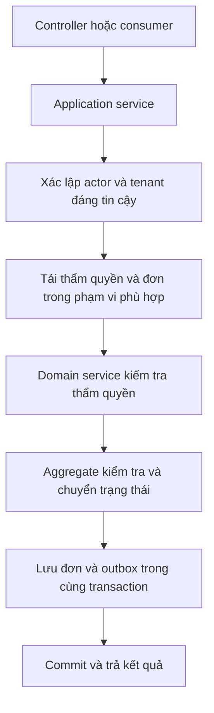

# Domain service pattern

## 1. Domain service giải quyết vấn đề gì?

Domain service biểu diễn một thao tác hoặc quyết định nghiệp vụ không thuộc về một entity hay value object riêng lẻ một cách tự nhiên. Nó dùng ngôn ngữ của miền và phối hợp các khái niệm miền để thực hiện một quy tắc có ý nghĩa đối với người làm nghiệp vụ. Định nghĩa này xuất phát từ cách mô tả service trong DDD; không phải mọi lớp có hậu tố `Service` đều là domain service. [DDD Reference của Eric Evans](https://www.domainlanguage.com/wp-content/uploads/2016/05/DDD_Reference_2015-03.pdf).

Trong module bảo mật logic nghiệp vụ, pattern này hữu ích khi quyền thực hiện hành động phụ thuộc đồng thời vào đối tượng, người thực hiện, hạn mức, trạng thái và chính sách hiện hành. Ví dụ, việc phê duyệt một đơn mua hàng cần kết hợp đơn với thẩm quyền phê duyệt của người gọi; một kiểm tra role ở controller không diễn đạt hết quyết định đó.

Domain service thường không lưu trạng thái hội thoại hay trạng thái riêng của từng request trong các field. Nó có thể giữ dependency bất biến, nhận dữ kiện làm tham số và thay đổi aggregate thông qua hành vi hợp lệ. “Stateless” ở đây không có nghĩa là nghiệp vụ không làm thay đổi dữ liệu.

Các khái niệm cần phân biệt:

- **Domain service** là một thành phần trong mô hình nghiệp vụ.
- **Application service** điều phối một use case: xác lập người gọi, tải dữ liệu, mở transaction, gọi mô hình miền và lưu kết quả.
- **Infrastructure service** cung cấp khả năng kỹ thuật như truy cập database, gửi email hoặc gọi hệ thống ngoài.
- **Microservice** là một đơn vị triển khai/giao tiếp. Một domain service có thể chỉ là một đối tượng Java trong một ứng dụng duy nhất.
- `@Service` của Spring đánh dấu một bean; annotation đó không tự xác định trách nhiệm của lớp là domain hay application.

Mục tiêu học bài này là biết đặt quy tắc đúng nơi, tạo một đường thực hiện nghiệp vụ khó bị bỏ qua và nhận diện những bảo đảm mà pattern này cần transaction, idempotency hoặc database hỗ trợ thêm.

## 2. Phân chia trách nhiệm với entity và application service

Không nên lấy toàn bộ hành vi ra khỏi entity rồi đặt vào một lớp service lớn. Aggregate vẫn cần bảo vệ những invariant mà nó có đủ dữ liệu để quyết định. Mô hình miền nên giữ các quy tắc cốt lõi độc lập với tầng trình bày và điều phối ứng dụng. [Tài liệu thiết kế các tầng DDD của Microsoft](https://learn.microsoft.com/en-us/dotnet/architecture/microservices/microservice-ddd-cqrs-patterns/ddd-oriented-microservice).

| Thành phần | Câu hỏi chính | Ví dụ trong phê duyệt đơn |
|---|---|---|
| Value object | Giá trị này hợp lệ và được so sánh như thế nào? | Số tiền không âm, có loại tiền, so sánh đúng loại tiền |
| Entity/aggregate | Đối tượng này có thể thay đổi như thế nào? | Chỉ đơn `SUBMITTED` được duyệt; người tạo không tự duyệt |
| Domain service | Kết hợp nhiều khái niệm miền để quyết định ra sao? | Thẩm quyền của người gọi có áp dụng cho tenant và số tiền của đơn không? |
| Application service | Thực hiện use case trong hệ thống bằng các bước nào? | Lấy người gọi đáng tin cậy, tải đơn, gọi domain service, lưu đơn và outbox |
| Adapter hạ tầng | Thực thi cổng kỹ thuật như thế nào? | Khóa hàng, ánh xạ dữ liệu, ghi outbox trong database |
| Controller/consumer | Biến giao thức thành lệnh ứng dụng như thế nào? | Chuyển path parameter thành `ApproveOrderCommand` |

Ranh giới này là một lựa chọn thiết kế cần được giải thích bằng dữ liệu và ngôn ngữ nghiệp vụ. Một quy tắc có thể chuyển về aggregate khi mô hình thay đổi và aggregate đã có đủ thông tin. Không cần tạo domain service chỉ để bọc một lời gọi `order.submit()`.

Ví dụ này đặt quy tắc trạng thái, thời hạn của đơn và không tự duyệt trong `PurchaseOrder`. Domain service kiểm tra thẩm quyền phê duyệt: còn hiệu lực, đúng tenant, có quyền tương ứng và đủ hạn mức. Application service không tự tính lại những quy tắc đó bằng các nhánh `if` riêng.

## 3. Vấn đề bảo mật khi quy tắc nằm rải rác

Một cách triển khai dễ bị lạm dụng:

```java
// Ví dụ có vấn đề, không phải mã nên áp dụng.
if (currentUser.hasRole("MANAGER")) {
    order.setStatus(APPROVED);
    repository.save(order);
}
```

Đoạn này không trả lời các câu hỏi:

- Manager có quyền với tenant chứa đơn không?
- Manager có phải người tạo đơn không?
- Đơn đã gửi duyệt hay vẫn là bản nháp?
- Số tiền có vượt hạn mức hoặc dùng loại tiền khác không?
- Hai request cùng đọc trạng thái cũ sẽ được xử lý ra sao?
- Một API cập nhật chung có thể gán thẳng `status = APPROVED` không?

Nếu controller đã kiểm tra đủ nhưng consumer hàng đợi hoặc batch job cập nhật trực tiếp trạng thái, cùng một invariant vẫn có thể bị bỏ qua. Vì vậy, việc tập trung quyết định ở mô hình miền chỉ hữu ích khi các đường ghi liên quan thực sự đi qua mô hình đó.

Kiểm tra quyền phải bao gồm tài nguyên và quan hệ cụ thể, được áp dụng ở các điểm truy cập thích hợp; một role tổng quát không thay thế quyết định quyền theo đối tượng. [OWASP Authorization Cheat Sheet](https://cheatsheetseries.owasp.org/cheatsheets/Authorization_Cheat_Sheet.html).

## 4. Quy tắc và nguồn dữ kiện của ví dụ

Xét chức năng phê duyệt đơn mua hàng:

```http
POST /purchase-orders/{orderId}/approve
```

Các invariant trong mô hình minh họa:

| Invariant | Thành phần chịu trách nhiệm chính |
|---|---|
| Người thực hiện có thẩm quyền đang hoạt động và chưa hết hạn | Domain service |
| Thẩm quyền có capability `purchase-order:approve` | Domain service |
| Tenant của thẩm quyền trùng tenant của đơn | Domain service |
| Loại tiền của đơn trùng loại tiền của hạn mức | Value object và domain service |
| Tổng tiền không vượt hạn mức cho mỗi đơn | Domain service |
| Đơn đang ở `SUBMITTED` | Aggregate |
| Người thực hiện khác người tạo | Aggregate |
| Thời điểm phê duyệt trước hạn cuối của đơn | Aggregate |
| Không có trạng thái duyệt đã commit mà thiếu sự kiện outbox bắt buộc | Application service và transaction |
| Request cạnh tranh không tạo hai lần chuyển trạng thái | Repository và cơ chế đồng bộ của database |

Hạn mức trong bài là **hạn mức cho một đơn**, không phải tổng ngân sách ngày. Hai khái niệm đó có cơ chế đồng bộ khác nhau. Nếu cần giới hạn tổng ngày, phải mô hình hóa số đã dùng và việc đặt chỗ hạn mức; so sánh mỗi đơn riêng lẻ không bảo vệ được tổng ngân sách.

Nguồn dữ kiện cần rõ ràng:

- `orderId` là lựa chọn tài nguyên của client; bản thân nó không chứng minh quyền truy cập.
- Actor và tenant đang hoạt động được xác lập từ ngữ cảnh xác thực và quan hệ thành viên đã kiểm tra.
- Capability, hạn mức và thời hạn của thẩm quyền được tải từ nguồn do server quản lý.
- Tổng tiền được lấy từ đơn đã được server chốt theo chính sách giá.
- Thời điểm quyết định được lấy từ `Clock` phía server.

Không cho client tự gửi một `ApprovalAuthority` rồi coi nó là chứng cứ. Đây là giá trị miền nội bộ, không phải credential hoặc capability token có thể tự xác minh.

## 5. Thiết kế đường đi của một lệnh



Một lớp bảo vệ HTTP có thể kiểm tra quyền gọi chức năng ở mức tổng quát. Domain service tiếp tục kiểm tra điều kiện nghiệp vụ theo đơn cụ thể. Khi lỗi xảy ra, application service để giao dịch kết thúc theo chính sách rollback; controller chỉ ánh xạ kết quả sang giao thức.

Kiểm tra trước trên UI, chẳng hạn hiển thị nút “Duyệt”, chỉ phục vụ trải nghiệm. Thẩm quyền và trạng thái có thể thay đổi trước lúc gửi lệnh; đường thực thi phải kiểm tra lại bằng dữ kiện đủ mới.

## 6. Mô hình Java: thẩm quyền, aggregate và domain service

Mã dưới đây dùng Java 17 trở lên. Để tập trung vào mô hình, các kiểu được đặt trong một lớp chứa `ApprovalDomain`; trong dự án thực có thể tách thành các tệp theo cùng bounded context.

Đây là mô hình nghiệp vụ không phụ thuộc Spring, HTTP hoặc JPA. Nó chưa có adapter lưu trữ. Domain service không làm I/O, nhưng có chủ đích gọi hành vi làm thay đổi aggregate được truyền vào.

```java
package example.approval.domain;

import java.math.BigDecimal;
import java.time.Instant;
import java.util.Currency;
import java.util.Objects;
import java.util.Set;

public final class ApprovalDomain {
    private ApprovalDomain() {}

    public enum OrderState {
        DRAFT, SUBMITTED, APPROVED, CANCELLED
    }

    public enum ViolationCode {
        AUTHORITY_INACTIVE,
        AUTHORITY_EXPIRED,
        APPROVE_NOT_GRANTED,
        TENANT_MISMATCH,
        CURRENCY_MISMATCH,
        LIMIT_EXCEEDED,
        INVALID_STATE,
        SELF_APPROVAL,
        APPROVAL_WINDOW_CLOSED
    }

    public static final class DomainViolation extends RuntimeException {
        private final ViolationCode code;

        public DomainViolation(ViolationCode code) {
            super(code.name());
            this.code = code;
        }

        public ViolationCode code() {
            return code;
        }
    }

    public record Money(BigDecimal amount, Currency currency) {
        public Money {
            Objects.requireNonNull(amount);
            Objects.requireNonNull(currency);
            if (amount.signum() < 0) {
                throw new IllegalArgumentException("Số tiền không được âm");
            }
        }

        public boolean exceeds(Money limit) {
            Objects.requireNonNull(limit);
            if (!currency.equals(limit.currency())) {
                throw new DomainViolation(ViolationCode.CURRENCY_MISMATCH);
            }
            return amount.compareTo(limit.amount()) > 0;
        }
    }

    // Snapshot được tạo từ dữ liệu tin cậy phía server.
    public record ApprovalAuthority(
            String actorId,
            String tenantId,
            boolean active,
            Set<String> capabilities,
            Money perOrderLimit,
            Instant validUntil) {

        public ApprovalAuthority {
            actorId = requiredText(actorId);
            tenantId = requiredText(tenantId);
            capabilities = Set.copyOf(capabilities);
            Objects.requireNonNull(perOrderLimit);
            Objects.requireNonNull(validUntil);
        }
    }

    public record OrderApproved(
            String orderId,
            String tenantId,
            String approverId,
            Instant occurredAt) {}

    public static final class PurchaseOrder {
        private final String id;
        private final String tenantId;
        private final String createdBy;
        private final Money total;
        private final Instant approvalDeadline;
        private OrderState state;
        private String approvedBy;
        private Instant approvedAt;

        private PurchaseOrder(
                String id,
                String tenantId,
                String createdBy,
                Money total,
                Instant approvalDeadline) {
            this.id = requiredText(id);
            this.tenantId = requiredText(tenantId);
            this.createdBy = requiredText(createdBy);
            this.total = Objects.requireNonNull(total);
            this.approvalDeadline = Objects.requireNonNull(approvalDeadline);
            this.state = OrderState.DRAFT;
        }

        public static PurchaseOrder draft(
                String id,
                String tenantId,
                String createdBy,
                Money total,
                Instant approvalDeadline) {
            return new PurchaseOrder(
                    id, tenantId, createdBy, total, approvalDeadline);
        }

        public void submit() {
            if (state != OrderState.DRAFT) {
                throw new DomainViolation(ViolationCode.INVALID_STATE);
            }
            state = OrderState.SUBMITTED;
        }

        public void cancel() {
            if (state != OrderState.DRAFT && state != OrderState.SUBMITTED) {
                throw new DomainViolation(ViolationCode.INVALID_STATE);
            }
            state = OrderState.CANCELLED;
        }

        // Chỉ thành phần miền trong ví dụ mới gọi được hành vi này.
        private OrderApproved approveBy(String actorId, Instant now) {
            actorId = requiredText(actorId);
            Objects.requireNonNull(now);
            if (state != OrderState.SUBMITTED) {
                throw new DomainViolation(ViolationCode.INVALID_STATE);
            }
            if (createdBy.equals(actorId)) {
                throw new DomainViolation(ViolationCode.SELF_APPROVAL);
            }
            if (!now.isBefore(approvalDeadline)) {
                throw new DomainViolation(ViolationCode.APPROVAL_WINDOW_CLOSED);
            }

            var event = new OrderApproved(id, tenantId, actorId, now);
            state = OrderState.APPROVED;
            approvedBy = actorId;
            approvedAt = now;
            return event;
        }

        public String id() { return id; }
        public String tenantId() { return tenantId; }
        public String createdBy() { return createdBy; }
        public Money total() { return total; }
        public OrderState state() { return state; }
        public String approvedBy() { return approvedBy; }
        public Instant approvedAt() { return approvedAt; }
    }

    public static final class ApprovalDomainService {
        public static final String APPROVE = "purchase-order:approve";

        public OrderApproved approve(
                PurchaseOrder order,
                ApprovalAuthority authority,
                Instant now) {
            Objects.requireNonNull(order);
            Objects.requireNonNull(authority);
            Objects.requireNonNull(now);

            if (!authority.active()) {
                throw new DomainViolation(ViolationCode.AUTHORITY_INACTIVE);
            }
            if (!now.isBefore(authority.validUntil())) {
                throw new DomainViolation(ViolationCode.AUTHORITY_EXPIRED);
            }
            if (!authority.capabilities().contains(APPROVE)) {
                throw new DomainViolation(ViolationCode.APPROVE_NOT_GRANTED);
            }
            if (!order.tenantId().equals(authority.tenantId())) {
                throw new DomainViolation(ViolationCode.TENANT_MISMATCH);
            }
            if (order.total().exceeds(authority.perOrderLimit())) {
                throw new DomainViolation(ViolationCode.LIMIT_EXCEEDED);
            }

            return order.approveBy(authority.actorId(), now);
        }
    }

    private static String requiredText(String value) {
        if (value == null || value.isBlank()) {
            throw new IllegalArgumentException("Thiếu định danh");
        }
        return value;
    }
}
```

### 6.1. Vì sao đây là domain service?

`ApprovalDomainService` kết hợp một đơn và một thẩm quyền phê duyệt. Quy tắc “thẩm quyền này có áp dụng cho đơn này không?” có ý nghĩa nghiệp vụ, không phải thao tác kỹ thuật lưu dữ liệu. Lớp không nhận `HttpServletRequest`, JWT thô hay repository JPA cụ thể.

Lớp cũng không tự chứa các field như `currentOrder`, `currentActor` hoặc `lastDecision`. Mỗi lần gọi nhận dữ kiện riêng, tránh việc hai request dùng chung bean làm lẫn trạng thái người gọi.

Các quy tắc mà aggregate đủ thông tin vẫn ở aggregate. `approveBy` kiểm tra trạng thái, người tạo và hạn cuối trước khi thay đổi bất kỳ field nào. Một lần bị từ chối không để lại đối tượng đã bị sửa một phần trong mô hình này.

### 6.2. Những quyết định cần đọc kỹ

- `now == validUntil` hoặc `now == approvalDeadline` đều bị từ chối; cửa sổ hợp lệ không bao gồm thời điểm kết thúc.
- Tổng tiền bằng hạn mức được phép; chỉ lớn hơn mới bị từ chối.
- So sánh tiền dùng `BigDecimal.compareTo`, tránh coi khác scale như `100.0` và `100.00` là khác giá trị số khi kiểm tra hạn mức.
- Khác loại tiền bị từ chối. Ví dụ không tự quy đổi bằng tỷ giá client gửi lên.
- Tiền không âm là quy tắc của mô hình mua hàng này; một miền khác có bút toán âm cần mô hình giá trị phù hợp riêng.
- `OrderApproved` là kết quả miền chưa được công bố. Tạo đối tượng event không có nghĩa transaction đã commit hoặc message đã tới broker.
- Modifier `private` trong các lớp lồng giúp minh họa đường gọi. Nếu tách tệp, có thể tổ chức package/module để giới hạn API chuyển trạng thái; phạm vi truy cập Java không thay thế kiểm soát quyền truy cập dữ liệu.

Trong sản phẩm, adapter lưu trữ còn cần cơ chế tái tạo aggregate từ trạng thái hợp lệ đã lưu. Không mở một API cập nhật trạng thái tùy ý cho client chỉ để tiện ánh xạ dữ liệu.

## 7. Application service: đưa dữ kiện đáng tin cậy vào mô hình

Lớp sau minh họa cổng ứng dụng cho thao tác phê duyệt. Nó cần bean cho domain service, `Clock` và các adapter triển khai những interface bên dưới; đây không phải một ứng dụng Spring có đầy đủ persistence mapping và cấu hình xác thực.

```java
package example.approval.application;

import java.time.Clock;
import java.util.Objects;
import java.util.Optional;
import java.util.UUID;

import org.springframework.stereotype.Service;
import org.springframework.transaction.annotation.Transactional;

import static example.approval.domain.ApprovalDomain.*;

@Service
public class ApproveOrderHandler {
    private final CurrentActor currentActor;
    private final AuthorityRepository authorities;
    private final OrderRepository orders;
    private final ApprovalDomainService approval;
    private final Outbox outbox;
    private final Clock clock;

    public ApproveOrderHandler(
            CurrentActor currentActor,
            AuthorityRepository authorities,
            OrderRepository orders,
            ApprovalDomainService approval,
            Outbox outbox,
            Clock clock) {
        this.currentActor = currentActor;
        this.authorities = authorities;
        this.orders = orders;
        this.approval = approval;
        this.outbox = outbox;
        this.clock = clock;
    }

    @Transactional
    public ApprovalResult handle(ApproveOrderCommand command) {
        Objects.requireNonNull(command);
        Actor actor = currentActor.requireAuthenticated();
        ApprovalAuthority authority = authorities.requireFor(
                actor.actorId(), actor.tenantId());

        // Kiểm tra binding giữa ngữ cảnh người gọi và dữ kiện được tải.
        if (!actor.actorId().equals(authority.actorId())
                || !actor.tenantId().equals(authority.tenantId())) {
            throw new SecurityException("Authority không khớp người gọi");
        }

        PurchaseOrder order = orders.findForUpdate(
                actor.tenantId(), command.orderId())
                .orElseThrow(OrderNotVisible::new);

        var event = approval.approve(order, authority, clock.instant());
        orders.save(order);

        UUID eventId = UUID.randomUUID();
        outbox.append(eventId, event);
        return new ApprovalResult(order.id(), order.state(), eventId);
    }

    public record ApproveOrderCommand(String orderId) {
        public ApproveOrderCommand {
            if (orderId == null || orderId.isBlank()) {
                throw new IllegalArgumentException("Thiếu orderId");
            }
        }
    }

    public record ApprovalResult(
            String orderId,
            OrderState state,
            UUID eventId) {}

    public record Actor(String actorId, String tenantId) {
        public Actor {
            if (actorId == null || actorId.isBlank()
                    || tenantId == null || tenantId.isBlank()) {
                throw new IllegalArgumentException("Thiếu ngữ cảnh người gọi");
            }
        }
    }

    public interface CurrentActor {
        // Phải xác thực danh tính và quyền chọn tenant đang hoạt động.
        Actor requireAuthenticated();
    }

    public interface AuthorityRepository {
        // Dữ liệu phía server; không lấy capability/hạn mức từ body request.
        ApprovalAuthority requireFor(String actorId, String tenantId);
    }

    public interface OrderRepository {
        // Adapter phải khóa bản ghi phù hợp cho tới hết transaction hiện tại.
        Optional<PurchaseOrder> findForUpdate(String tenantId, String orderId);

        void save(PurchaseOrder order);
    }

    public interface Outbox {
        // Ghi vào cùng database/transaction với thay đổi của đơn.
        void append(UUID eventId, OrderApproved event);
    }

    public static final class OrderNotVisible extends RuntimeException {}
}
```

Các quyết định bảo mật nằm ở ranh giới dữ kiện:

- Command không có `actorId`, `tenantId`, `approvedBy`, `limit` hay `total` do client tự khai.
- `CurrentActor` phải từ chối danh tính anonymous hoặc ngữ cảnh tenant không hợp lệ. Nếu dùng JWT, adapter phải dựa trên token đã được xác minh và chính sách chọn tenant, không chỉ giải mã chuỗi JSON.
- Authority được tải đúng actor và tenant. Việc kiểm tra binding ngăn lỗi ánh xạ hoặc cache trả thẩm quyền của người khác bị dùng tiếp.
- Truy vấn đơn có tenant trong điều kiện. Domain service vẫn kiểm tra tenant để bảo vệ invariant khi được gọi từ một đường khác.
- `Outbox` phải tham gia cùng transaction; một implementation chỉ gửi message trực tiếp không thỏa hợp đồng này.

Domain service có thể đăng ký làm Spring bean bằng phương thức `@Bean` trả về `new ApprovalDomainService()`. Dùng `Clock.systemUTC()` cho môi trường chạy và clock cố định trong test. Không cần đưa annotation transaction vào domain service chỉ để nó được tiêm dependency.

Với consumer hàng đợi, `CurrentActor` cần nguồn danh tính và ủy quyền phù hợp giao thức đó. Đừng tự gán actor toàn quyền cho mọi message để tái sử dụng handler; một tác nhân hệ thống cũng cần scope và chính sách rõ ràng.

## 8. Transaction không được suy ra từ tên pattern

Trong mã minh họa, `@Transactional` được đặt trên application service vì thao tác cần lưu đơn và outbox như một đơn vị. Domain service tự nó không mở transaction và không bảo đảm database rollback.

Với chế độ proxy thông thường của Spring, lời gọi phải đi qua bean được quản lý; tự gọi một method có `@Transactional` bằng `this` không tạo thêm ranh giới giao dịch như nhiều người mong đợi. Cần nạp cấu hình transaction phù hợp và gọi handler từ bên ngoài proxy. [Tài liệu `@Transactional`](https://docs.spring.io/spring-framework/reference/data-access/transaction/declarative/annotations.html).

Nếu `orders.save` thành công nhưng `outbox.append` lỗi, toàn bộ thay đổi phải rollback. `DomainViolation` trong ví dụ là `RuntimeException`, phù hợp với cơ chế rollback mặc định thông dụng của Spring. Nếu ứng dụng dùng checked exception hoặc thay đổi rollback rules, cần cấu hình và kiểm thử tương ứng. Không bắt lỗi rồi trả một kết quả “thất bại” bình thường khi transaction vẫn có thể commit. [Tài liệu rollback của Spring](https://docs.spring.io/spring-framework/reference/data-access/transaction/declarative/rolling-back.html).

Rollback dữ liệu lưu trữ cũng không tự đưa mọi đối tượng Java đã thay đổi về giá trị cũ. Aggregate của một transaction thất bại nên được bỏ khỏi phạm vi sử dụng, không đưa vào cache dùng chung hoặc tái dùng cho request kế tiếp.

Event miền chỉ nên được chuyển thành tác dụng bên ngoài qua một cơ chế giao nhận phù hợp. Transactional outbox lưu sự kiện cùng thay đổi nghiệp vụ rồi có tiến trình riêng chuyển tiếp; tiến trình đó vẫn có thể gửi trùng, nên phía nhận cần xử lý idempotent. [Mô tả pattern Transactional Outbox](https://microservices.io/patterns/data/transactional-outbox.html).

Audit của lần bị từ chối cần thiết kế riêng về độ bền. Nếu ghi audit vào cùng transaction rồi rollback, bản ghi audit cũng có thể biến mất. Việc giữ dấu vết từ chối không được làm phát sinh một sự kiện “đã phê duyệt”.

## 9. Bảo vệ khoảng cách giữa kiểm tra và ghi

Giả sử hai request cùng tải đơn `SUBMITTED`, cùng vượt qua domain service, rồi cùng lưu `APPROVED`. Mỗi đối tượng Java có thể hợp lệ riêng, nhưng hệ thống đã tạo hai event cho một chuyển trạng thái.

Vì vậy, cần liên kết quyết định với trạng thái dữ liệu mà nó dựa vào:

| Cơ chế | Điều cần thực hiện | Giới hạn cần hiểu |
|---|---|---|
| Khóa bi quan | Đọc đơn với khóa ghi, giữ khóa tới commit, kiểm tra trên dữ liệu sau khi giành khóa | Có chờ khóa, timeout và deadlock; cần thứ tự khóa nhất quán |
| Khóa lạc quan | Tải version, ghi có điều kiện theo version, rollback khi xung đột | Không được bỏ qua lỗi version hoặc phát tác dụng ngoài trước commit |
| Cập nhật có điều kiện | `UPDATE` chỉ thành công khi trạng thái/version còn phù hợp, kiểm tra số hàng sửa | Điều kiện SQL không tự thay thế mọi quyết định nghiệp vụ |
| Constraint | Cấm trùng một bản ghi nghiệp vụ theo khóa đúng phạm vi | Không tự diễn đạt toàn bộ quyền và trạng thái |

Jakarta Persistence có cơ chế optimistic locking qua version và các lock mode cho pessimistic locking. Adapter cần hiện thực đúng chiến lược đã chọn; tên `findForUpdate` của interface không tự tạo khóa. [Đặc tả Jakarta Persistence, phần Locking and Concurrency](https://jakarta.ee/specifications/persistence/3.2/jakarta-persistence-spec-3.2).

Ví dụ handler dùng hợp đồng khóa bi quan cho **đơn**. Nó chưa khóa bản ghi thẩm quyền. Nếu quản trị viên thu hồi quyền đồng thời, cần xác định chính sách: chấp nhận snapshot tại lúc giải quyết lệnh hay bắt buộc việc thu hồi có hiệu lực trước mọi commit sau đó. Chính sách nghiêm ngặt hơn có thể cần khóa, kiểm tra revision hoặc cơ chế đồng bộ liên quan đến cả thẩm quyền, không chỉ hàng đơn.

Tương tự, nếu phải bảo đảm tổng duyệt trong ngày không vượt ngân sách, việc khóa từng đơn khác nhau không khóa chung ngân sách. Hạn mức tổng cần một aggregate/ledger/đặt chỗ có ranh giới đồng bộ phù hợp.

Không retry bằng cách giữ nguyên aggregate và một kết quả `allowed = true` từ lần trước. Khi retry toàn bộ transaction do xung đột, cần tải lại trạng thái và đánh giá lại các điều kiện có thể thay đổi.

## 10. Idempotency và state machine là hai phần phối hợp

Trong mô hình trên, lần phê duyệt thứ hai bị từ chối vì đơn đã ở `APPROVED`. Điều đó bảo vệ chuyển trạng thái khi dữ liệu được đồng bộ đúng, nhưng chưa cung cấp trải nghiệm trả lại kết quả cũ cho client bị mất response.

Nếu API hỗ trợ idempotency key, application service cần thêm một giao thức xử lý lệnh. Ví dụ:

```text
Xác thực actor và quyền trong phạm vi liên quan
  -> xác định phạm vi key và fingerprint lệnh
  -> giành quyền xử lý key bằng cơ chế atomic
  -> tải lại dữ liệu, gọi domain service
  -> lưu đơn, outbox và kết quả lệnh trong ranh giới nhất quán
  -> commit
```

Các tình huống phải định nghĩa:

- Cùng key và cùng nội dung trong cùng phạm vi: trả lại kết quả đã ghi theo hợp đồng.
- Cùng key nhưng khác `orderId` hoặc khác nội dung có ý nghĩa: từ chối xung đột.
- Hai request cùng key: chỉ một request được thực hiện tác vụ nghiệp vụ.
- Cùng chuỗi key ở tenant khác: không đọc nhầm kết quả của tenant trước.
- Actor mất quyền trước lần retry: quyền xem kết quả cũ vẫn phải tuân theo chính sách đã chọn.

Đây là phần bổ sung, chưa được triển khai trong `ApproveOrderHandler` ở trên. Không được tuyên bố handler đã có idempotency chỉ vì nó gọi một domain service hoặc kiểm tra `SUBMITTED`.

Một kết quả idempotency còn hạn không phải giấy phép vượt quyền đối tượng. Khi lấy kết quả cũ, cần kiểm tra scope và quyền hiện tại theo hợp đồng; không dùng key do client biết làm bằng chứng truy cập.

## 11. Khi domain service cần dữ liệu bên ngoài

Ví dụ chọn cách application service tải dữ kiện rồi truyền vào domain service để giữ quyết định dễ kiểm thử. Đây không phải luật cấm domain service có dependency.

Một domain service có thể phụ thuộc vào một interface biểu diễn khái niệm miền, chẳng hạn `ExchangeRatePolicy` hoặc `CreditExposure`. Implementation truy cập mạng/database nằm ở hạ tầng. Cần cân nhắc:

- Quyết định đang dựa trên snapshot tại thời điểm nào?
- Dữ liệu thiếu hoặc quá hạn được xử lý ra sao?
- Timeout có bị coi nhầm là đồng ý không?
- Một lời gọi bị retry có làm trùng tác dụng phụ không?
- Dữ kiện có thể được bảo đảm nhất quán với transaction hiện tại không?

Nếu đối tác tính điểm rủi ro hoặc kiểm tra thẩm quyền không phản hồi, không tự chuyển thành “được phép” chỉ để luồng xử lý tiếp tục. Có thể từ chối, trả trạng thái chờ hoặc đưa vào bước thẩm định; lựa chọn nào cũng cần một trạng thái nghiệp vụ rõ ràng.

Khi kiểm tra cần gọi một hệ thống từ xa, giữ khóa database trong thời gian chờ mạng có thể làm tăng tranh chấp. Một lựa chọn là lấy dữ kiện có revision/thời hạn trước, sau đó kiểm tra tính áp dụng khi thực hiện lệnh. Nếu cần quy trình nhiều bước lâu dài, hãy mô hình hóa trạng thái chờ và cơ chế đặt chỗ/hoàn tác phù hợp thay vì coi một transaction cục bộ bao trùm mọi hệ thống.

Cache quyết định theo mỗi `actorId` thường không đủ. Một quyết định còn phụ thuộc tenant, tài nguyên, phiên bản trạng thái, hành động, số tiền, chính sách và thời điểm. Kết quả kiểm tra để hiển thị UI không nên được tái sử dụng vô điều kiện làm quyết định ghi dữ liệu.

## 12. Kiểm thử domain service bằng invariant

Vì domain service trong ví dụ không làm I/O, có thể kiểm thử bằng JUnit mà không khởi động Spring. Đoạn sau đặt trong `ApprovalDomainServiceTest.java`; đây là mã học tập, không phải báo cáo các test đã được chạy.

```java
package example.approval.domain;

import java.math.BigDecimal;
import java.time.Instant;
import java.util.Currency;
import java.util.Set;

import org.junit.jupiter.api.Test;

import static example.approval.domain.ApprovalDomain.*;
import static example.approval.domain.ApprovalDomain.ApprovalDomainService.APPROVE;
import static org.junit.jupiter.api.Assertions.*;

class ApprovalDomainServiceTest {
    private static final Instant NOW = Instant.parse("2030-01-01T00:00:00Z");
    private final ApprovalDomainService service = new ApprovalDomainService();

    @Test
    void allowsAmountEqualToPerOrderLimit() {
        var order = submittedOrder();
        var authority = authority("approver-1", "tenant-a", "1000.00");

        var event = service.approve(order, authority, NOW);

        assertEquals(OrderState.APPROVED, order.state());
        assertEquals("approver-1", order.approvedBy());
        assertEquals(NOW, order.approvedAt());
        assertEquals("po-01", event.orderId());
        assertEquals("tenant-a", event.tenantId());
    }

    @Test
    void rejectsOtherTenantWithoutChangingOrder() {
        var order = submittedOrder();
        var authority = authority("approver-1", "tenant-b", "1000.00");

        var error = assertThrows(DomainViolation.class,
                () -> service.approve(order, authority, NOW));

        assertEquals(ViolationCode.TENANT_MISMATCH, error.code());
        assertStillSubmitted(order);
    }

    @Test
    void creatorCannotApproveEvenWithSufficientAuthority() {
        var order = submittedOrder();
        var authority = authority("creator-1", "tenant-a", "5000.00");

        var error = assertThrows(DomainViolation.class,
                () -> service.approve(order, authority, NOW));

        assertEquals(ViolationCode.SELF_APPROVAL, error.code());
        assertStillSubmitted(order);
    }

    @Test
    void rejectsAmountAboveLimit() {
        var order = submittedOrder();
        var authority = authority("approver-1", "tenant-a", "999.99");

        var error = assertThrows(DomainViolation.class,
                () -> service.approve(order, authority, NOW));

        assertEquals(ViolationCode.LIMIT_EXCEEDED, error.code());
        assertStillSubmitted(order);
    }

    @Test
    void rejectsAtExactOrderDeadline() {
        var order = submittedOrder();
        var authority = authority("approver-1", "tenant-a", "1000.00");

        var error = assertThrows(DomainViolation.class,
                () -> service.approve(order, authority, NOW.plusSeconds(600)));

        assertEquals(ViolationCode.APPROVAL_WINDOW_CLOSED, error.code());
        assertStillSubmitted(order);
    }

    @Test
    void rejectsRepeatedTransitionAndPreservesFirstApproval() {
        var order = submittedOrder();
        var authority = authority("approver-1", "tenant-a", "1000.00");
        service.approve(order, authority, NOW);

        var error = assertThrows(DomainViolation.class,
                () -> service.approve(order, authority, NOW.plusSeconds(1)));

        assertEquals(ViolationCode.INVALID_STATE, error.code());
        assertEquals(OrderState.APPROVED, order.state());
        assertEquals("approver-1", order.approvedBy());
        assertEquals(NOW, order.approvedAt());
    }

    private static PurchaseOrder submittedOrder() {
        var order = PurchaseOrder.draft(
                "po-01", "tenant-a", "creator-1",
                money("1000.0"), NOW.plusSeconds(600));
        order.submit();
        return order;
    }

    private static ApprovalAuthority authority(
            String actorId, String tenantId, String limit) {
        return new ApprovalAuthority(actorId, tenantId, true,
                Set.of(APPROVE), money(limit), NOW.plusSeconds(3600));
    }

    private static Money money(String amount) {
        return new Money(new BigDecimal(amount), Currency.getInstance("USD"));
    }

    private static void assertStillSubmitted(PurchaseOrder order) {
        assertEquals(OrderState.SUBMITTED, order.state());
        assertNull(order.approvedBy());
        assertNull(order.approvedAt());
    }
}
```

Khi kiểm thử một điều kiện bị từ chối, giữ các điều kiện còn lại hợp lệ. Ví dụ test hết hạn đơn phải dùng thẩm quyền còn hạn; nếu thẩm quyền cũng đã hết hạn thì test có thể bị chặn ở một quy tắc khác.

Các tình huống nên bổ sung gồm thẩm quyền không hoạt động, thiếu capability, đúng thời điểm thẩm quyền hết hạn, khác loại tiền, đơn `DRAFT`, đơn `CANCELLED`, và số tiền ngay dưới/trên hạn mức. Có thể dùng kiểm thử tham số hóa cho các biên, hoặc sinh chuỗi hành động để xác nhận không có đường chuyển trạng thái cấm.

## 13. Kiểm thử tích hợp để chứng minh đường ghi được bảo vệ

Unit test của domain service chỉ chứng minh quy tắc trên dữ kiện được truyền vào. Cần các bài kiểm thử tích hợp riêng cho những giả định ở application service và adapter:

| Tình huống | Bằng chứng cần quan sát |
|---|---|
| Client thêm `actorId`, `tenantId`, `limit`, `status` vào request | Các trường đặc quyền không thay đổi danh tính, thẩm quyền hay trạng thái ngoài hợp đồng |
| Thay `orderId` sang tenant khác | Không đọc/sửa được đơn đó và không tạo outbox phê duyệt |
| Repository authority trả dữ liệu lệch binding | Handler dừng trước khi thực hiện thay đổi |
| Ghi outbox thất bại sau thao tác lưu đơn | Không có đơn đã duyệt được commit riêng lẻ |
| Hai transaction cùng duyệt một đơn | Chỉ một chuyển trạng thái và đúng số bản ghi/event sau commit |
| Retry sau khi mất response | Hành vi theo hợp đồng idempotency, không thêm tác dụng nghiệp vụ |
| Gọi qua consumer hoặc batch | Không bỏ qua các điều kiện mà API phải tuân thủ |

Với tranh chấp, tạo fixture đã commit và hai transaction độc lập; phối hợp bằng latch/barrier ở vị trí phù hợp chiến lược khóa. Đọc lại kết quả sau khi cả hai kết thúc trong một transaction mới. Một test dùng repository giả trong bộ nhớ không chứng minh hành vi khóa của database.

Ngoài phản hồi HTTP hoặc exception, hãy quan sát trạng thái đơn, người duyệt, số event/outbox và những dữ liệu tiền liên quan. Bảo mật logic quan tâm đến việc gì đã xảy ra trong hệ thống, không chỉ nội dung phản hồi.

Các mã lỗi miền có thể được ánh xạ thành `403`, `404`, `409` hoặc hợp đồng khác ở adapter giao thức. Chẳng hạn, đơn khác tenant có thể dùng cùng phản hồi với đơn không tồn tại để hạn chế tiết lộ thông tin. Không để domain service phụ thuộc trực tiếp `HttpStatus` chỉ để tiện trả lỗi.

## 14. Những cách dùng sai thường gặp

| Cách dùng sai | Hậu quả | Hướng điều chỉnh |
|---|---|---|
| Domain service chỉ gọi `repository.save` | Không tập trung được quy tắc miền nào | Xác định quyết định nghiệp vụ thực sự hoặc bỏ lớp bọc không cần thiết |
| Dồn mọi hành vi vào một `BusinessService` | Entity chỉ còn setter, trách nhiệm khó theo dõi | Đưa invariant cục bộ về aggregate và chia theo khái niệm miền |
| Nhận `isAdmin`, hạn mức hoặc `approvedBy` từ client | Client tự cung cấp căn cứ để vượt quyền | Giải quyết dữ kiện từ nguồn đáng tin cậy phía server |
| Chỉ trả `boolean allowed` rồi ghi ở một nơi khác | Dữ kiện thay đổi giữa kiểm tra và ghi | Gắn kiểm tra với ranh giới thực hiện và kiểm soát version/khóa |
| Cho API cập nhật chung sửa `status` | Vượt qua domain service | Dùng command theo hành động và giới hạn đường ghi |
| Lưu current actor vào field của singleton | Request này có thể dùng trạng thái của request khác | Truyền dữ kiện theo lời gọi, giữ dependency bất biến |
| Gọi hệ thống thanh toán ngay trong domain service | Khó rollback và dễ tạo tác dụng phụ trùng | Mô hình hóa kết quả miền và ranh giới giao nhận đáng tin cậy |
| Coi `@Transactional` là khóa mọi dữ liệu đã đọc | Quyết định dựa trên snapshot có thể cũ | Chọn isolation/khóa/điều kiện ghi phù hợp invariant |
| Retry sau lỗi bằng kết quả cho phép cũ | Vượt trạng thái hoặc chính sách mới | Tải lại và đánh giá lại trong lần thử mới |
| Thiết kế domain service như API quản trị toàn quyền | Batch/consumer trở thành đường bỏ qua chính sách | Xác định actor hệ thống và scope rõ ràng |

Domain service cũng không sửa được việc có các đường ghi SQL trực tiếp khác bỏ qua mô hình. Cần rà soát các tác nhân có quyền ghi: ứng dụng, job, script quản trị, import và tích hợp cũ. Constraint, quyền database và quy trình vận hành bổ sung cho ranh giới mã nguồn.

## 15. Khi nào nên dùng, khi nào nên giữ thiết kế đơn giản?

Nên cân nhắc domain service khi có một quyết định nghiệp vụ cần kết hợp nhiều giá trị hoặc đối tượng mà không có một chủ sở hữu tự nhiên; cùng quyết định được nhiều use case dùng lại; hoặc quy tắc cần được kiểm thử độc lập với framework và nguồn dữ liệu.

Giữ hành vi trong entity khi nó chỉ dựa vào dữ liệu và vòng đời của entity. Giữ ở application service những bước điều phối như tải dữ liệu, gọi mô hình, lưu kết quả và xử lý giao thức transaction. Một use case CRUD ít quy tắc không tự nhiên trở nên an toàn hơn chỉ nhờ thêm nhiều lớp.

Không bắt buộc mỗi domain service phải có interface riêng. Interface hữu ích khi nó biểu diễn một cổng miền hoặc có nhiều chính sách triển khai; một class cụ thể nhỏ có thể đủ khi chỉ có một quyết định. Tên nên thể hiện khái niệm như `ApprovalPolicy`, `TransferPolicy` hoặc `OrderApproval`, thay vì một tập tiện ích chung không rõ trách nhiệm.

Khi quy tắc phát triển, hãy xem lại ranh giới aggregate. Nếu một domain service liên tục thao tác sâu vào nhiều entity và phải tự giữ mọi invariant, đó có thể là dấu hiệu mô hình cần được tổ chức lại, không chỉ cần chia nhỏ method.

## 16. Bài tập áp dụng và tiêu chí tự đánh giá

Các bài tập mở rộng từ mô hình:

1. Thêm yêu cầu hai người phê duyệt độc lập cho đơn vượt một ngưỡng. Xác định nơi lưu các lần duyệt, điều kiện không trùng người và trạng thái hoàn tất.
2. Thêm ngân sách theo ngày. Chỉ ra dữ liệu cần đặt chỗ/khóa chung để hai đơn khác nhau không cùng vượt tổng hạn mức.
3. Cho phép thay đổi giá sau khi gửi duyệt. Xác định cần hủy hiệu lực phê duyệt cũ hay tạo phiên bản đơn mới; kiểm tra việc client phát lại lệnh trên phiên bản cũ.
4. Triển khai idempotency cho handler, bao gồm cùng key khác nội dung, key ở tenant khác và retry sau commit.
5. Thay authority snapshot bằng dữ liệu có revision, rồi mô tả chính sách thu hồi quyền đồng thời với phê duyệt.

Khi hoàn thành một thiết kế, hãy chỉ ra được: nguồn dữ kiện nào đáng tin cậy; aggregate giữ invariant nào; domain service quyết định điều gì; application service mở ranh giới transaction ở đâu; adapter ngăn tranh chấp bằng cách nào; và kiểm thử nào chứng minh request bị từ chối không làm thay đổi nghiệp vụ.
