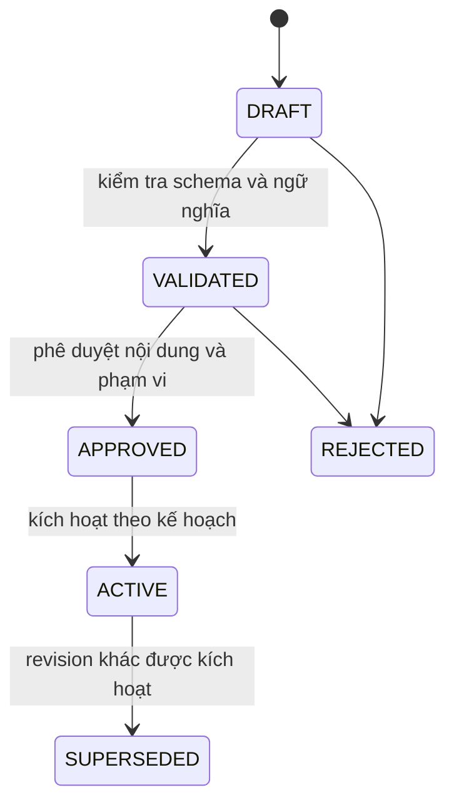

# Business rule configuration

Trong chương **Deployment Operations**, cấu hình quy tắc nghiệp vụ là một phần của hành vi có quyền lực: thay đổi hạn mức, ngưỡng phê duyệt, thời điểm cho phép hoặc phạm vi áp dụng có thể làm hệ thống chấp nhận những thao tác trước đây bị từ chối.

Vì vậy, thay một giá trị cấu hình có thể tạo tác động bảo mật tương đương thay code. Mục tiêu không chỉ là đọc được YAML mà còn là bảo đảm **đúng quy tắc, đúng phạm vi, đúng phiên bản và đúng thời điểm được áp dụng vào một thay đổi nghiệp vụ**.

Bài học dùng ví dụ cấu hình yêu cầu hoàn tiền. Các hạn mức và khoảng thời gian bên dưới là số liệu minh họa do hệ thống giả định lựa chọn, không phải chuẩn bắt buộc cho sản phẩm thực tế.

## 1. Phân biệt invariant và tham số được phép cấu hình

Một lỗi phổ biến là đưa mọi điều kiện vào feature flag để “linh hoạt vận hành”:

```yaml
security:
  check-owner: false
  enforce-tenant: false
  validate-workflow: false
```

Nếu các field này được dùng để bỏ qua kiểm tra tương ứng, người có quyền sửa cấu hình có thể vô hiệu hóa ranh giới nghiệp vụ mà không sửa code.

Phải quyết định điều gì là bất biến nền tảng và điều gì là tham số của chính sách:

| Quy tắc | Cách quản lý phù hợp |
|---|---|
| Không thao tác lên đối tượng ngoài tenant được phép | Invariant/quyền bắt buộc, không có cờ bỏ qua thông thường |
| Không tự nhận danh tính hoặc role từ request | Ranh giới xác thực bắt buộc |
| Không hoàn vượt số tiền đã thu sau khi trừ phần đã hoàn và dành trước | Invariant dữ liệu và cơ chế đồng thời |
| Không chuyển thẳng từ trạng thái chưa đủ điều kiện sang hoàn tất | State machine bắt buộc |
| Hạn mức cho một yêu cầu trong phạm vi đã được duyệt | Tham số cấu hình có giới hạn |
| Từ số tiền nào phải qua phê duyệt bổ sung | Tham số chính sách với ý nghĩa biên rõ ràng |
| Có tạm dừng tiếp nhận yêu cầu mới không | Điều khiển vận hành được phân quyền và audit |
| Tenant nào thuộc một đợt triển khai chính sách | Cấu hình rollout có phạm vi xác định |

Một giá trị cấu hình hợp lệ không thay thế quyền theo đối tượng. Người gửi yêu cầu dưới hạn mức vẫn phải có quyền hành động trên payment cụ thể.

OWASP khuyến nghị từ chối theo mặc định và xác minh quyền trên mọi yêu cầu. Thay đổi cấu hình không được trở thành đường tránh những kiểm tra này. [Nguồn: Authorization Cheat Sheet](https://cheatsheetseries.owasp.org/cheatsheets/Authorization_Cheat_Sheet.html).

## 2. Mô hình đe dọa của cấu hình nghiệp vụ

Một lỗi cấu hình không nhất thiết đến từ kẻ tấn công bên ngoài. Người vận hành có thể nhập sai đơn vị, pipeline có thể triển khai nhầm môi trường, hoặc instance giữ cache cũ tiếp tục cho phép một hành động.

| Tình huống | Hậu quả nghiệp vụ |
|---|---|
| Tăng hạn mức do nhập thừa số 0 | Một yêu cầu vượt phạm vi được phê duyệt vẫn được nhận |
| Ngưỡng approval cao hơn mọi số tiền được phép | Toàn bộ yêu cầu hợp lệ đều tránh bước approval trong mô hình đó |
| Đọc thiếu cấu hình rồi hiểu là “không giới hạn” | Sự cố cấu hình làm mở quyền |
| Tenant A dùng cache key không chứa tenant | Tenant A nhận quy tắc của tenant B |
| Một command đọc từng field ở các thời điểm khác nhau | Dùng một tổ hợp quy tắc chưa từng được phê duyệt |
| Người sửa bản nháp tự kích hoạt | Mất nguyên tắc tách người đề xuất và người duyệt |
| Pod cũ bỏ qua field mới | Quy tắc mới chỉ được thực thi ở một phần hệ thống |
| Rollback ghi đè nội dung revision cũ | Không thể xác định lịch sử đã áp dụng gì |
| Retry bị đánh giá như một yêu cầu mới | Tạo tác động lặp hoặc thay đổi hợp đồng đã chấp nhận |

Đối tượng cần bảo vệ gồm dữ liệu cấu hình, quyền thay đổi, quy trình phát hành, bản được tải vào runtime và bằng chứng về quyết định đã được thực hiện.

## 3. Định nghĩa hợp đồng cho từng tham số

Đừng chỉ ghi “max amount”. Hợp đồng phải nói rõ kiểu dữ liệu, đơn vị, phạm vi, giá trị biên và hành vi khi thiếu.

Ví dụ cho `RefundRequest`:

| Field | Ý nghĩa |
|---|---|
| `currency` | Đồng tiền của chính sách; ví dụ này chỉ hỗ trợ `VND` |
| `max-per-request-minor` | Số tiền tối đa của một yêu cầu mới, tính theo đơn vị nguyên đã thống nhất |
| `approval-required-from-minor` | Số tiền từ ngưỡng này trở lên phải vào luồng approval |
| `accepting-new-requests` | Có cho tiếp nhận yêu cầu mới không |
| `revision` | Định danh bất biến của nội dung quy tắc |
| `max-snapshot-age` | Khoảng thời gian tối đa từ lần xác nhận bản đang hoạt động gần nhất |

Trong ví dụ, số tiền VND được lưu theo đơn vị đồng nguyên. Tên `minor` không có nghĩa luôn nhân 100; khi mở rộng sang đồng tiền khác phải có quy ước đơn vị riêng, không đổi currency mà giữ nguyên ý nghĩa của số.

Cần chốt rõ:

- `amount > max` bị từ chối; `amount == max` vẫn được xét theo các điều kiện khác.
- `amount >= approvalThreshold` cần approval.
- Giá trị thiếu, null hoặc âm không được hiểu là vô hạn.
- Currency của payment phải khớp currency của policy.
- Tắt tiếp nhận không có nghĩa được bỏ qua đối soát các tác vụ đã tạo.
- Chính sách thời gian dựa trên đồng hồ server/nguồn thời gian đã định nghĩa, không theo timestamp do client tự gửi.

Nếu có cửa sổ theo ngày hoặc thời điểm hiệu lực, phải chỉ rõ timezone và cách xử lý giao dịch sát ranh giới. Lưu thời điểm tuyệt đối có offset/UTC giúp tránh nhầm giờ hiển thị với thời điểm thực thi.

## 4. Cấu hình có kiểu dữ liệu trong Spring Boot

Ví dụ cấu hình tĩnh được đọc khi ứng dụng khởi động:

```yaml
business:
  refund:
    revision: "refund-v12"
    currency: "VND"
    max-per-request-minor: 5000000
    approval-required-from-minor: 1000000
    accepting-new-requests: true
    max-snapshot-age: 30s
```

Đây là ví dụ nội dung cấu hình của ứng dụng, không phải yêu cầu thay đổi file cấu hình nào trong môi trường đang chạy.

Dùng một nhóm thuộc tính có kiểu dữ liệu thay vì rải nhiều chuỗi `@Value` không có hợp đồng chung. Spring Boot hỗ trợ bind cấu hình ngoài vào `@ConfigurationProperties`; record có thể dùng constructor binding. [Nguồn: Externalized Configuration](https://docs.spring.io/spring-boot/reference/features/external-config.html).

### Kiểm tra từng field và quan hệ giữa các field

Ví dụ Java 17 trở lên, Spring Boot với Jakarta Validation. Mỗi public type được đặt trong file tương ứng khi triển khai.

```java
import jakarta.validation.constraints.AssertTrue;
import jakarta.validation.constraints.NotBlank;
import jakarta.validation.constraints.NotNull;
import jakarta.validation.constraints.Pattern;
import jakarta.validation.constraints.Positive;
import java.time.Duration;
import org.springframework.boot.context.properties.ConfigurationProperties;
import org.springframework.validation.annotation.Validated;

@ConfigurationProperties(
        prefix = "business.refund",
        ignoreUnknownFields = false)
@Validated
public record RefundRuleProperties(
        @NotBlank String revision,
        @NotBlank @Pattern(regexp = "VND") String currency,
        @NotNull @Positive Long maxPerRequestMinor,
        @NotNull @Positive Long approvalRequiredFromMinor,
        @NotNull Boolean acceptingNewRequests,
        @NotNull Duration maxSnapshotAge) {

    private static final long HARD_MAX_PER_REQUEST = 50_000_000L;
    private static final Duration HARD_MAX_SNAPSHOT_AGE =
            Duration.ofSeconds(60);

    @AssertTrue(message = "Refund thresholds are outside the allowed envelope")
    public boolean isThresholdEnvelopeValid() {
        return maxPerRequestMinor != null
                && approvalRequiredFromMinor != null
                && maxPerRequestMinor > 0
                && approvalRequiredFromMinor > 0
                && approvalRequiredFromMinor <= maxPerRequestMinor
                && maxPerRequestMinor <= HARD_MAX_PER_REQUEST;
    }

    @AssertTrue(message = "Snapshot age must be positive and at most 60 seconds")
    public boolean isSnapshotAgeValid() {
        return maxSnapshotAge != null
                && !maxSnapshotAge.isNegative()
                && !maxSnapshotAge.isZero()
                && maxSnapshotAge.compareTo(HARD_MAX_SNAPSHOT_AGE) <= 0;
    }
}
```

Các giới hạn 50.000.000 và 60 giây là “hàng rào” được chọn cho ví dụ. Chúng được quản lý theo quy trình thay đổi code/chính sách nền tảng, không mở rộng tự do từ cùng một bản cấu hình mà chúng đang kiểm soát.

Điều kiện `approvalThreshold <= maxPerRequest` là quyết định của mô hình này để phát hiện việc vô tình làm approval không bao giờ xảy ra. Sản phẩm có mô hình khác cần định nghĩa điều kiện phù hợp, không chép một bất đẳng thức mà không hiểu ý nghĩa nghiệp vụ.

Đăng ký kiểu cấu hình:

```java
import org.springframework.boot.context.properties.EnableConfigurationProperties;
import org.springframework.context.annotation.Configuration;

@Configuration
@EnableConfigurationProperties(RefundRuleProperties.class)
public class RefundRuleConfiguration {
}
```

Cần có implementation Jakarta Validation trên classpath. Spring Boot thực hiện validation cho configuration properties có `@Validated`; việc cấu hình validation là điều kiện triển khai, không phải annotation tự chứa một validator. [Nguồn: Spring Boot — ConfigurationProperties Validation](https://docs.spring.io/spring-boot/reference/features/external-config.html#features.external-config.typesafe-configuration-properties.validation).

`ignoreUnknownFields = false` giúp phát hiện tên field lạ trong phạm vi binding thay vì im lặng bỏ qua. Nó không kiểm tra mọi khóa ở mọi phần của một file YAML. [Nguồn: ConfigurationProperties API](https://docs.spring.io/spring-boot/api/java/org/springframework/boot/context/properties/ConfigurationProperties.html).

**Lưu ý về ranh giới validation:** tự `new RefundRuleProperties(...)` trong Java không tự chạy Bean Validation. Cấu hình tải động phải gọi validator hoặc đi qua một quy trình tương đương trước khi được dùng. Không đánh đồng “đã parse thành record” với “đã hợp lệ”.

### Cấu hình tĩnh không tự trở thành cấu hình động

Việc có một file YAML bên ngoài JAR không bảo đảm ứng dụng đang chạy sẽ tự đọc lại khi file đổi. Nếu cần thay đổi runtime, phải có cơ chế tải, xác minh, validation và kích hoạt rõ ràng.

Với cấu hình chỉ đọc khi khởi động, rollout nhiều instance có thể tạo thời gian chạy lẫn revision cũ và mới. Cần chấp nhận rõ mô hình đó hoặc dùng một cơ chế đồng bộ mạnh hơn cho quy tắc nhạy cảm.

## 5. Tách việc đánh giá quy tắc khỏi việc ghi nghiệp vụ

Một evaluator thuần có thể trả quyết định định tuyến:

```java
public record RefundRuleDecision(
        Route route,
        String reason,
        String revision) {

    public enum Route {
        DENY,
        REQUIRE_APPROVAL,
        ACCEPT
    }
}
```

```java
public class RefundRuleEvaluator {

    public RefundRuleDecision evaluateNewRequest(
            RefundRuleProperties rules,
            String paymentCurrency,
            long amountMinor) {

        if (!Boolean.TRUE.equals(rules.acceptingNewRequests())) {
            return new RefundRuleDecision(
                    RefundRuleDecision.Route.DENY,
                    "NEW_REQUESTS_PAUSED", rules.revision());
        }
        if (!rules.currency().equals(paymentCurrency)) {
            return new RefundRuleDecision(
                    RefundRuleDecision.Route.DENY,
                    "CURRENCY_MISMATCH", rules.revision());
        }
        if (amountMinor <= 0 || amountMinor > rules.maxPerRequestMinor()) {
            return new RefundRuleDecision(
                    RefundRuleDecision.Route.DENY,
                    "AMOUNT_OUTSIDE_POLICY", rules.revision());
        }
        if (amountMinor >= rules.approvalRequiredFromMinor()) {
            return new RefundRuleDecision(
                    RefundRuleDecision.Route.REQUIRE_APPROVAL,
                    "APPROVAL_REQUIRED", rules.revision());
        }
        return new RefundRuleDecision(
                RefundRuleDecision.Route.ACCEPT,
                "WITHIN_POLICY", rules.revision());
    }
}
```

Evaluator giả định `rules` đã qua validation. Nó chỉ trả lời chính sách tiếp nhận mới; nó không xác thực actor, không tải payment và không kiểm tra tổng hạn mức đã bị các yêu cầu khác tiêu dùng.

Handler cần biến `REQUIRE_APPROVAL` thành trạng thái chờ approval thật sự. Nếu chỉ trả thêm field `requiresApproval: true` nhưng vẫn gọi provider hoàn tiền, cấu hình không bảo vệ được bước nghiệp vụ.

Ví dụ thứ tự ở mức khái niệm:

```text
1. Xác thực actor; kiểm tra quyền hành động.
2. Tải đối tượng trong đúng tenant; kiểm tra quyền đối tượng.
3. Tìm kết quả idempotency đã có và xử lý replay theo hợp đồng.
4. Với thực thi mới: chọn snapshot quy tắc hợp lệ.
5. Bảo vệ dữ liệu hạn mức bằng transaction/khóa hoặc cơ chế tương đương.
6. Đánh giá chính sách và invariant trên dữ liệu hiện hành.
7. Ghi trạng thái hợp lệ, revision/epoch, audit và outbox.
8. Commit rồi mới công bố đã tiếp nhận thành công.
```

Thứ tự khóa cụ thể cần được thiết kế nhất quán giữa các đường ghi. Dãy bước này không thay thế một thiết kế transaction thực tế.

## 6. Kiểm soát nguồn cấu hình và cách override

Một giá trị có thể xuất hiện trong file đóng gói, file ngoài, profile, biến môi trường hoặc đối số chạy ứng dụng. Nếu chỉ review file trong Git, bạn chưa chắc đã review giá trị cuối cùng runtime đang dùng.

Spring Boot có thứ tự ưu tiên property source; nguồn có ưu tiên cao hơn có thể ghi đè nguồn trước đó. Cần kiểm tra các nguồn thực sự được bật trong môi trường triển khai. [Nguồn: Externalized Configuration — PropertySource order](https://docs.spring.io/spring-boot/reference/features/external-config.html).

Biện pháp thực tế:

- Chỉ định nguồn có thẩm quyền cho nhóm business rules.
- Giới hạn ai được sửa biến môi trường, startup arguments và cấu hình deployment.
- Xác minh môi trường, tenant scope và revision trước kích hoạt.
- Hiển thị thông tin nguồn và cấu hình hiệu lực đã được lọc bí mật cho người có quyền vận hành.
- Phát hiện drift giữa cấu hình được duyệt và cấu hình runtime đang dùng.

Không cho client chọn một “config profile” có quyền rộng hơn qua header, query parameter hoặc cookie mà thiếu chính sách server.

### Override theo tenant không phải lúc nào cũng là ghi đè tự do

Nếu tenant chỉ được phép siết chính sách, có thể định nghĩa phép gộp:

| Tham số | Ví dụ phép gộp để tenant chỉ siết |
|---|---|
| Hạn mức tối đa | Lấy giá trị nhỏ hơn giữa nền tảng và tenant |
| Ngưỡng bắt đầu cần approval | Ngưỡng thấp hơn làm nhiều yêu cầu phải approval hơn |
| Cho tiếp nhận yêu cầu mới | Cả nền tảng và tenant đều phải cho phép |
| Tập đối tượng được phép | Giao của các tập được phép |
| Currency | Phải khớp, không đổi ý nghĩa số tiền qua override |

Không có quy tắc “luôn lấy min” cho mọi tham số. Ví dụ số bước xác minh tối thiểu càng lớn có thể càng chặt; tập bị cấm thường cần phép hợp.

Sau khi gộp phải validate cấu hình hiệu lực. Hai fragment hợp lệ riêng lẻ vẫn có thể tạo tổ hợp không hợp lệ, chẳng hạn cap sau gộp thấp hơn ngưỡng approval.

Không thêm fallback “nếu không có tenant config thì dùng tenant khác gần nhất”. Phải có policy mặc định được phê duyệt hoặc từ chối đúng phạm vi.

## 7. Quản lý revision, schema và epoch riêng biệt

Nhiều hệ thống dùng một field `version` cho mọi việc rồi không biết nó đại diện cho gì.

| Định danh | Mục đích |
|---|---|
| `schemaVersion` | Cấu trúc và ý nghĩa field mà ứng dụng hiểu |
| `ruleRevision` | Nội dung quy tắc bất biến đã được duyệt |
| `activationEpoch` | Thứ tự các lần kích hoạt cho một phạm vi |
| Application build | Phiên bản code triển khai evaluator/handler |
| Data version | Phiên bản dữ liệu nghiệp vụ phục vụ kiểm soát đồng thời |

Hai lần kích hoạt có thể dùng cùng nội dung nhưng có epoch khác nhau, ví dụ rollback về nội dung đã dùng trước đó.

Nguyên tắc quản lý:

- Một revision đã phát hành không được sửa nội dung tại chỗ.
- Kích hoạt mới tăng epoch; không tái sử dụng epoch cũ cho một trạng thái mới.
- Lưu checksum của nội dung theo cách chuẩn hóa để phát hiện sai lệch.
- Checksum không chứng minh người phát hành được phép; vẫn cần nguồn tin cậy, quyền ghi và cơ chế xác thực toàn vẹn thích hợp.
- Ghi revision, epoch và phiên bản evaluator vào bằng chứng quyết định khi cần tái hiện.
- Giữ lịch sử đủ để giải thích những nghiệp vụ đã commit.

Nếu schema mới thêm field bắt buộc như `requireSecondApprover`, một instance không hiểu field đó phải bị ngăn xử lý phạm vi tương ứng. Bỏ qua field lạ trong một deployment có phiên bản lẫn nhau có thể làm quy tắc mới chỉ được thực thi ở một phần hệ thống.

## 8. Vòng đời thay đổi cấu hình



Một bản nháp bị sửa sau approval phải được đánh giá lại theo quy trình; không giữ approval cho một nội dung khác.

Tách các quyền như:

- `business-rule:read`: xem cấu hình trong phạm vi được cấp.
- `business-rule:propose`: tạo đề xuất.
- `business-rule:approve`: phê duyệt thay đổi.
- `business-rule:activate`: triển khai bản đã duyệt.
- `business-rule:pause`: tạm dừng hành vi mới trong phạm vi cho phép.

Tên quyền là ví dụ. Hệ thống cần chọn mô hình phù hợp nhưng không nên suy ra “được sửa dữ liệu” đồng nghĩa “được tăng quyền nghiệp vụ của mình”.

Với thay đổi nhạy cảm, có thể bắt buộc người đề xuất khác người duyệt. Bản kích hoạt cần gắn với nội dung, môi trường, tenant scope và điều kiện rollout đã duyệt.

Lệnh kích hoạt cũng là một command nghiệp vụ: kiểm tra quyền theo đối tượng, expected epoch để tránh mất cập nhật, idempotency để chống lặp và audit trước/sau theo ranh giới commit đã định nghĩa.

## 9. Snapshot bất biến cho một lần xử lý

Nếu handler đọc `maxAmount` từ revision 12, sau đó đọc `approvalThreshold` từ revision 13, nó có thể tạo một quyết định không khớp bất kỳ policy đã phát hành nào.

Cách phù hợp là lấy một snapshot bất biến rồi dùng xuyên suốt một lần đánh giá:

```text
Command
   → chọn snapshot (scope, revision, epoch, nội dung)
   → quyền + dữ liệu hiện hành + đánh giá
   → ghi quyết định kèm revision/epoch
```

Cache key tối thiểu cần phản ánh các chiều phân biệt policy, chẳng hạn tenant, loại nghiệp vụ, currency và cohort rollout nếu có. Không dùng chỉ tên `refund-rules` cho toàn bộ tenant.

### Ví dụ cache trong một JVM

Đoạn code sau minh họa cache dành cho một tenant trong mô hình VND của bài. Nó chưa cung cấp đồng bộ nhiều instance hoặc bảo đảm cắt chuyển chính sách toàn hệ thống.

```java
import java.time.Instant;
import java.util.Objects;
import java.util.UUID;

public record RefundRuleSnapshot(
        UUID tenantId,
        long activationEpoch,
        RefundRuleProperties rules,
        Instant verifiedAt) {

    public RefundRuleSnapshot {
        Objects.requireNonNull(tenantId, "tenantId");
        Objects.requireNonNull(rules, "rules");
        Objects.requireNonNull(verifiedAt, "verifiedAt");
        if (activationEpoch <= 0) {
            throw new IllegalArgumentException("Invalid activation epoch");
        }
    }
}
```

```java
import jakarta.validation.ConstraintViolationException;
import jakarta.validation.Validator;
import java.time.Clock;
import java.time.Duration;
import java.util.Objects;
import java.util.UUID;
import java.util.concurrent.atomic.AtomicReference;

public class LocalRefundRuleCache {

    private final UUID tenantId;
    private final Validator validator;
    private final Clock clock;
    private final AtomicReference<RefundRuleSnapshot> current =
            new AtomicReference<>();

    public LocalRefundRuleCache(
            UUID tenantId, Validator validator, Clock clock) {
        this.tenantId = Objects.requireNonNull(tenantId);
        this.validator = Objects.requireNonNull(validator);
        this.clock = Objects.requireNonNull(clock);
    }

    public void installVerified(RefundRuleSnapshot candidate) {
        if (!tenantId.equals(candidate.tenantId())) {
            throw new IllegalArgumentException("Wrong tenant");
        }

        var violations = validator.validate(candidate.rules());
        if (!violations.isEmpty()) {
            throw new ConstraintViolationException(violations);
        }

        current.updateAndGet(existing -> {
            if (existing == null) {
                return candidate;
            }
            if (candidate.activationEpoch() < existing.activationEpoch()) {
                return existing;
            }
            if (candidate.activationEpoch() == existing.activationEpoch()) {
                if (!candidate.rules().equals(existing.rules())) {
                    throw new IllegalStateException(
                            "Different content for the same activation epoch");
                }
                if (candidate.verifiedAt().isBefore(existing.verifiedAt())) {
                    return existing;
                }
            }
            return candidate;
        });
    }

    public RefundRuleSnapshot requireCurrent(UUID authenticatedTenantId) {
        if (!tenantId.equals(authenticatedTenantId)) {
            throw new IllegalArgumentException("Wrong tenant");
        }

        RefundRuleSnapshot snapshot = current.get();
        if (snapshot == null) {
            throw new IllegalStateException("Rules are unavailable");
        }

        Duration age = Duration.between(
                snapshot.verifiedAt(), clock.instant());

        if (age.isNegative()
                || age.compareTo(snapshot.rules().maxSnapshotAge()) > 0) {
            throw new IllegalStateException("Rules are stale");
        }

        return snapshot;
    }
}
```

`AtomicReference` hỗ trợ thay tham chiếu nguyên tử. Trong ví dụ, reader nhận một snapshot trọn vẹn thay vì thấy nhiều field đang cập nhật dở; nó không biến cache này thành cơ chế đồng thuận phân tán. [Nguồn: Java — AtomicReference](https://docs.oracle.com/en/java/javase/21/docs/api/java.base/java/util/concurrent/atomic/AtomicReference.html).

Hợp đồng quan trọng của `installVerified`:

- Chỉ adapter tin cậy được gọi sau khi xác minh nguồn, scope, bản đang active và nội dung tương ứng.
- `verifiedAt` là thời điểm hệ thống xác nhận snapshot vẫn đúng bản active, không phải timestamp tự khai trong payload.
- Tải lại cùng một cache cũ không được tự gia hạn `verifiedAt`.
- Timestamp ở tương lai, sai clock hoặc snapshot quá cũ không được tự biến thành quyền cho phép.
- So sánh epoch chỉ có ý nghĩa trong cùng scope và cùng nguồn thẩm quyền.

Việc đọc lại timestamp từ một bản cache khác không chứng minh nguồn có thẩm quyền chưa kích hoạt epoch mới. Khi yêu cầu kiểm soát nghiêm ngặt hơn cache có giới hạn thời gian, cần cơ chế ở mục tiếp theo.

## 10. Snapshot nhất quán khác với cắt chuyển chính sách nghiêm ngặt

Có hai hợp đồng thường bị nhầm:

| Hợp đồng | Bảo đảm |
|---|---|
| Nhất quán trong một command | Command dùng cùng một snapshot từ đầu đến cuối |
| Cắt chuyển có đồng bộ với ghi | Sau ranh giới kích hoạt đã định nghĩa, không có ghi mới dùng epoch cũ theo giao thức |

Một command có thể chụp snapshot 12, rồi revision 13 được kích hoạt, sau đó command vẫn commit theo 12. Việc không trộn field đã được bảo đảm nhưng việc ngừng dùng 12 chưa được bảo đảm.

### Khi chấp nhận độ trễ có giới hạn

Với một số quy tắc, doanh nghiệp có thể chấp nhận instance dùng bản cũ thêm một khoảng thời gian đã phê duyệt. Khi đó phải định nghĩa:

- Độ trễ tối đa và cách đo.
- Loại thay đổi được áp dụng theo mô hình này.
- Cách xử lý snapshot hết hạn hoặc không biết trạng thái.
- Chuyện gì xảy ra với command đang chạy.
- Dữ liệu audit thể hiện revision nào thực sự đã dùng.

TTL 30 giây không đáp ứng yêu cầu thu hồi tức thời. Nó chỉ đặt một giới hạn dự kiến khi đồng hồ, cơ chế xác nhận và đường ghi đều tuân thủ hợp đồng.

### Khi cần đồng bộ với transaction ghi

Một phương án dùng database chung là có bản ghi active binding theo scope:

```sql
SELECT activation_epoch, rule_revision
FROM active_business_rule
WHERE tenant_id = :tenant_id
  AND operation = 'REFUND_REQUEST'
  AND currency = 'VND'
FOR SHARE;
```

Handler chạy truy vấn trong transaction ghi, giữ khóa đến cuối transaction, tải nội dung bất biến đúng revision rồi đánh giá và ghi quyết định.

Lệnh kích hoạt cập nhật cùng bản ghi và cần khóa xung đột, chẳng hạn:

```sql
UPDATE active_business_rule
SET activation_epoch = activation_epoch + 1,
    rule_revision = :new_revision
WHERE tenant_id = :tenant_id
  AND operation = 'REFUND_REQUEST'
  AND currency = 'VND'
  AND activation_epoch = :expected_epoch;
```

Phải kiểm tra số hàng cập nhật. Kết quả 0 có thể là expected epoch không còn đúng; không báo kích hoạt thành công giả.

Với PostgreSQL, `FOR SHARE` giữ khóa hàng có xung đột với cập nhật tương ứng, tạo cơ sở cho giao thức đồng bộ này. Không tự thay bằng loại khóa yếu hơn rồi giả định bảo đảm không đổi. [Nguồn: PostgreSQL — Explicit Locking](https://www.postgresql.org/docs/current/explicit-locking.html).

Ý nghĩa cắt chuyển được định nghĩa theo thứ tự transaction của giao thức: kích hoạt phải chờ những command đang giữ khóa cũ; các lần thực thi mới sau ranh giới đó phải đọc binding mới hoặc xử lý xung đột theo isolation. Không dùng thời gian bấm nút trên UI làm bằng chứng duy nhất.

Cơ chế chỉ đúng khi:

- Mọi đường ghi liên quan đều tuân thủ cùng giao thức.
- Bản active binding đã tồn tại và revision trỏ tới nội dung hợp lệ, bất biến.
- Thứ tự khóa policy và dữ liệu nghiệp vụ được thống nhất để hạn chế deadlock.
- Không có bước kiểm tra epoch tách khỏi phần commit rồi mở lại khoảng đua.
- Timeout, deadlock và isolation được xử lý tại ranh giới transaction phù hợp.

Các mức isolation có hành vi khác nhau; với xung đột, có thể cần retry toàn transaction thay vì tiếp tục với dữ liệu đã đọc trước đó. [Nguồn: PostgreSQL — Transaction Isolation](https://www.postgresql.org/docs/current/transaction-iso.html).

Đây là một phương án thiết kế, không phải yêu cầu mọi ứng dụng phải khóa policy cho mọi request. Nếu chọn fencing token hoặc conditional write thay khóa, phải chứng minh token/epoch được kiểm tra nguyên tử cùng tác động ghi.

## 11. Mất nguồn cấu hình và last known good

“Fail closed” cần được cụ thể hóa theo hành động. Không đồng nghĩa tắt toàn bộ ứng dụng khi dịch vụ cấu hình có sự cố.

| Trạng thái | Hành vi có thể chọn cho yêu cầu mới nhạy cảm |
|---|---|
| Khởi động chưa từng có policy hợp lệ | Không sẵn sàng nhận hành vi đó hoặc từ chối có kiểm soát |
| Candidate sai schema/ngữ nghĩa | Không kích hoạt; giữ bản đang active nếu còn được phép dùng |
| Nguồn tạm lỗi, snapshot đã xác nhận còn trong cửa sổ cho phép | Dùng last known good theo hợp đồng đã duyệt |
| Snapshot quá hạn hoặc không xác minh được scope | Tạm dừng nhận mới; không fallback sang bỏ kiểm tra |
| Nhận epoch cũ hoặc nội dung khác cho cùng epoch | Không thay bản hợp lệ bằng dữ liệu đó; báo lỗi/drift |
| Tiền tệ/tenant không có policy hợp lệ | Từ chối đúng phạm vi hoặc dùng mặc định đã được quy định rõ |

Last known good phải là bản đã qua validation, đúng scope và có provenance phù hợp. Một file từng parse thành công không tự đủ điều kiện.

Không gia hạn vô hạn một snapshot chỉ vì dịch vụ chưa lấy lại được cấu hình. Ngược lại, việc revision được tạo từ lâu không nhất thiết làm nó hết hạn nếu hệ thống vẫn xác nhận đó là bản active; cần phân biệt tuổi nội dung với tuổi lần xác minh.

Nếu tạm dừng nhận yêu cầu hoàn tiền mới, các bước đối soát, ghi nhận kết quả provider và bảo vệ reservation đang tồn tại vẫn cần vận hành theo chính sách riêng. Dừng sai những tác vụ này có thể làm dữ liệu bị treo.

## 12. Rule thay đổi trong khi nghiệp vụ đang diễn ra

Không có một đáp án chung rằng mọi giao dịch đều phải dùng “bản mới nhất”.

Ví dụ: yêu cầu đã được tiếp nhận theo revision 12, đã dành hạn mức và đang chờ approval; revision 13 giảm cap.

Các lựa chọn:

| Chính sách | Điều cần định nghĩa |
|---|---|
| Giữ điều kiện đã chấp nhận | Lưu revision và bằng chứng lúc tiếp nhận; vẫn kiểm tra quyền hiện hành ở bước sau |
| Đánh giá lại trước bước nhạy cảm | Có thể chuyển về chờ xét lại hoặc từ chối theo workflow rõ ràng |
| Áp dụng thay đổi khẩn cấp | Có giao thức dừng/thu hồi tác vụ chưa thực thi và xử lý tác động đã xảy ra |

Không đổi ngầm một yêu cầu đang chờ thành được duyệt chỉ vì ngưỡng approval mới tăng. Cũng không xóa reservation chỉ vì cap mới thấp hơn số tiền đã tiếp nhận.

Phải phân biệt:

- **Điều kiện được chốt:** số tiền, currency, nội dung cần phê duyệt và revision áp dụng.
- **Điều kiện cần kiểm tra lại:** quyền hiện hành, trạng thái đối tượng, kết quả provider hoặc quy tắc khẩn cấp theo hợp đồng.
- **Tác động đã commit:** không tự hoàn tác khi thay cấu hình.

### Idempotency khi policy thay đổi

Cùng key và payload của một lệnh đã hoàn tất không nên âm thầm trở thành một giao dịch mới chỉ vì policy đã đổi. Vẫn kiểm tra quyền truy cập kết quả hiện tại, rồi trả biên nhận gốc theo hợp đồng replay.

Biên nhận gốc cần chứa hoặc tham chiếu tới revision đã dùng. Muốn biết trạng thái hiện tại, dùng query có hợp đồng riêng.

Nếu lần trước chưa có hiệu ứng nào commit, một lần thực thi mới có thể dùng policy hiện hành. Cách lưu lỗi/từ chối và thời hạn key cũng phải được quy định để xác định điều này.

Không nhét revision mới vào khóa dedup một cách tự động làm cùng một ý định retry biến thành một thao tác được phép thực thi lại.

## 13. Triển khai thay đổi cấu hình có kiểm soát

Một pipeline có thể đi theo trình tự:

1. Kiểm tra schema, kiểu dữ liệu, field lạ và trường bắt buộc.
2. Kiểm tra điều kiện giữa các field và hàng rào bảo mật.
3. Chạy test biên cùng tình huống lạm dụng.
4. Kiểm tra tương thích với các build ứng dụng đang phục vụ.
5. Phê duyệt nội dung, scope, thời điểm và phương án rollback.
6. Kích hoạt theo chiến lược đã chọn.
7. Quan sát quyết định thực tế và xác minh trạng thái rollout.
8. Chỉ kết luận thành công khi phạm vi mục tiêu đã đáp ứng tiêu chí.

### Shadow evaluation

Có thể chạy policy candidate trên dữ liệu đại diện và so sánh với policy hiện hành:

```text
Policy active    → quyết định có hiệu lực
Policy candidate → chỉ ghi khác biệt, không ghi nghiệp vụ/không gọi provider
```

Shadow giúp tìm nhóm yêu cầu chuyển từ cần approval sang được nhận trực tiếp, hoặc nhóm bị từ chối mới. Nó không chứng minh race condition, rollback hoặc quyền kích hoạt đã đúng.

Dữ liệu replay/shadow cần được bảo vệ và giảm thiểu. Candidate không được phát tác động ngoài dù evaluator bị gọi từ cùng request.

### Canary và phạm vi rollout

Với thay đổi phù hợp để canary, gán cohort ổn định theo tenant hoặc khóa nghiệp vụ có chủ đích. Không bốc ngẫu nhiên policy mỗi request khiến retry qua load balancer có thể gặp bản dễ hơn.

Cần ghi cohort và revision đã dùng. Nếu áp dụng theo tenant, nhớ rằng canary nhỏ theo số tenant có thể vẫn bao gồm tenant có lưu lượng rất lớn.

Thay đổi nhằm đóng một lỗ hổng hoặc thu hồi quyền khẩn cấp có thể không phù hợp với việc duy trì policy dễ dãi ở nhóm ngoài canary. Chọn hợp đồng cắt chuyển theo mục tiêu bảo mật, không mặc định dùng một chiến lược cho mọi loại thay đổi.

Một số nền tảng như AWS AppConfig hỗ trợ validation, triển khai cấu hình theo giai đoạn và giám sát/rollback. Dùng dịch vụ như vậy vẫn cần định nghĩa invariant và quyết định áp dụng ở application. [Nguồn: AWS — What is AWS AppConfig?](https://docs.aws.amazon.com/appconfig/latest/userguide/what-is-appconfig.html).

## 14. Rollback không phải xóa lịch sử hoặc hoàn tác nghiệp vụ

Nếu revision 13 gây sai hành vi, có thể kích hoạt lại nội dung revision 12 bằng một epoch mới:

```text
epoch 41 → revision 12
epoch 42 → revision 13
epoch 43 → revision 12
```

Không giảm epoch về 41 hoặc thay nội dung revision 13 thành revision 12. Epoch tăng giúp phân biệt rollback hợp lệ với bản cũ bị phát lại.

Trước rollback, kiểm tra:

- Code hiện tại còn hiểu schema của revision đích không.
- Revision đích có khôi phục một lỗ hổng vừa được sửa không.
- Những yêu cầu đã commit theo revision lỗi cần đối soát hoặc xử lý bù thế nào.
- Command đang chạy, idempotency và reservation được xử lý theo hợp đồng nào.
- Nguồn active và các instance đã hội tụ theo bảo đảm rollout chưa.

Rollback cấu hình chỉ thay quyết định trong tương lai theo ranh giới đã định nghĩa. Nó không lấy lại một khoản tiền provider đã hoàn hoặc tự phục hồi một trạng thái đã bị ghi sai.

Với dịch vụ quản lý cấu hình, cơ chế rollback còn có điều kiện vận hành riêng. Không coi việc có nút rollback là bằng chứng ứng dụng đã ngừng dùng bản lỗi; phải kiểm tra revision/epoch ở runtime và dữ liệu quyết định. AWS AppConfig phân biệt rollback trong triển khai và revert cấu hình đã triển khai; cần theo tài liệu dịch vụ khi sử dụng. [Nguồn: AWS — Reverting a configuration](https://docs.aws.amazon.com/appconfig/latest/userguide/appconfig-deploying-reverting.html).

## 15. Kiểm thử cấu hình như một đầu vào có quyền lực

### Ví dụ kiểm tra ngưỡng approval bất hợp lệ

Đoạn test minh họa dùng JUnit Jupiter và implementation Jakarta Validation trên classpath:

```java
import static org.junit.jupiter.api.Assertions.assertFalse;

import jakarta.validation.Validation;
import jakarta.validation.ValidatorFactory;
import java.time.Duration;
import org.junit.jupiter.api.Test;

class RefundRulePropertiesTest {

    @Test
    void rejectsApprovalThresholdAboveMaximumRequestAmount() {
        RefundRuleProperties candidate = new RefundRuleProperties(
                "refund-invalid",
                "VND",
                5_000_000L,
                6_000_000L,
                true,
                Duration.ofSeconds(30));

        try (ValidatorFactory factory =
                     Validation.buildDefaultValidatorFactory()) {
            assertFalse(
                    factory.getValidator().validate(candidate).isEmpty());
        }
    }
}
```

Test này chứng minh constraint ngữ nghĩa được thực thi khi gọi validator; nó không chứng minh binding, activation API hoặc rollout phân tán.

### Ma trận kiểm thử triển khai

| Tình huống | Kỳ vọng |
|---|---|
| Thiếu cap, currency hoặc cờ tiếp nhận | Không đưa cấu hình chưa đủ điều kiện vào hoạt động |
| Sai kiểu, số âm, duration bằng 0 | Bị từ chối validation |
| Cap vượt hàng rào nền tảng | Bị từ chối dù người nhập có quyền đề xuất |
| Threshold đúng bằng cap | Chấp nhận nếu mô hình cho phép; tại cap phải cần approval |
| Amount dưới, bằng và trên threshold | Quyết định đúng ranh giới đã công bố |
| Sai currency hoặc tenant | Không dùng policy của scope khác |
| Candidate có field không được hỗ trợ | Không im lặng bỏ qua điều kiện bảo mật mới |
| Bản nháp đổi sau approval | Approval cũ không hợp thức hóa nội dung mới |
| Hai người kích hoạt cùng expected epoch | Chỉ thay đổi hợp lệ thắng; bên còn lại nhận xung đột |
| Nhận lại epoch cũ | Không thay bản mới bằng bản cũ |
| Cùng epoch, nội dung khác | Phát hiện vi phạm toàn vẹn/giao thức |
| Cấu hình đổi giữa lúc handler chạy | Không trộn field; xử lý theo hợp đồng cutover |
| Command cạnh tranh với activation | Đúng thứ tự commit/fencing đã thiết kế |
| Nguồn cấu hình mất kết nối | Chỉ dùng bản cũ trong cửa sổ được phép |
| Cache được đọc lại nhiều lần | Không tự làm mới thời điểm xác minh nguồn active |
| Restart khi không có bản hợp lệ | Không nhận mới bằng fallback mở quyền |
| Policy đổi sau lần đầu đã commit | Replay không tạo tác động mới |
| Rollback về nội dung cũ | Epoch tăng và giữ nguyên lịch sử |
| Pod cũ chưa hiểu schema mới | Không tiếp tục nhận phạm vi cần quy tắc mới |

Test integration cần gọi startup/binding thật và activation API với cấu hình quyền thật, không chỉ tự tạo record rồi khẳng định Spring đã validate.

Test cắt chuyển cần các transaction độc lập để tạo tranh chấp activation/ghi. Sau khi kết thúc, đọc dữ liệu đã commit và audit epoch để xác nhận giao thức, thay vì chỉ nhìn giá trị config trên dashboard.

## 16. Quan sát vận hành và xử lý sự cố

Bằng chứng quyết định nên đủ để liên hệ:

```text
tenant / operation / currency
command hoặc request ID
rule revision / activation epoch / evaluator build
decision / reason
thời điểm và nguồn xác minh snapshot
kết quả commit hoặc trạng thái xử lý
```

Không dùng tất cả ID trên làm label metric. Tenant, request ID hoặc revision thay đổi liên tục có thể làm số chuỗi thời gian tăng mạnh; chi tiết nên ở audit/log có quyền truy cập phù hợp, metric dùng các chiều hữu hạn theo thiết kế.

Các tín hiệu đáng theo dõi:

- Số lần candidate không qua validation và activation bị xung đột.
- Tỷ lệ quyết định accept, deny, require approval theo reason.
- Số instance/phạm vi chưa nhận epoch mục tiêu.
- Snapshot quá hạn, sai scope hoặc không xác minh được.
- Khác biệt shadow giữa bản active và candidate.
- Hành vi nghiệp vụ bất thường sau thay đổi, như tỷ lệ bỏ bước approval.
- Yêu cầu đang chờ hoặc cần đối soát sau pause/rollback.

Không log toàn bộ biến môi trường hoặc mọi cấu hình để tìm nguồn override. Secret và credential cần được quản lý riêng; chỉ hiển thị thông tin đã được lọc cho người có quyền.

### Runbook khi nghi cấu hình làm mở đường lạm dụng

1. Xác định phạm vi ảnh hưởng: tenant, hành vi, currency, epoch và khoảng thời gian.
2. Dừng tiếp nhận hành vi mới trong phạm vi cần thiết bằng cơ chế được cấp quyền; nếu cần hiệu lực nghiêm ngặt, dùng đúng giao thức cutover/fencing.
3. Giữ các tác vụ đối soát cần thiết để không làm mất dấu hiệu ứng bên ngoài.
4. Kích hoạt policy an toàn đã được kiểm tra tương thích, ghi audit epoch mới.
5. Xác minh runtime và dữ liệu quyết định đã commit; tìm các trường hợp được chấp nhận sai.
6. Thực hiện xử lý bù/đối soát theo nghiệp vụ, giữ lịch sử và bổ sung test cho nguyên nhân thực tế.

Một config pause nằm trong cùng cache cũ cũng có độ trễ phân phối. Không khẳng định đã dừng toàn bộ hệ thống chỉ vì control plane báo cập nhật thành công.

## 17. Checklist trước khi vận hành business rule configuration

- Tách invariant bắt buộc khỏi tham số được phép thay đổi.
- Định nghĩa kiểu, đơn vị, scope, giá trị biên và hành vi khi thiếu.
- Validate cả dữ liệu đầu vào lẫn cấu hình hiệu lực sau override.
- Có quyền đề xuất, phê duyệt và kích hoạt phù hợp mức tác động.
- Quản lý revision bất biến, epoch kích hoạt và tương thích schema.
- Mỗi lần đánh giá dùng snapshot nhất quán, có bằng chứng nguồn và độ mới.
- Chọn rõ mô hình độ trễ có giới hạn hoặc cutover đồng bộ với ghi.
- Định nghĩa hành vi cho request đang chạy, replay và tác vụ đã tiếp nhận.
- Có rollout, rollback, quan sát runtime và test tình huống lạm dụng.
- Không dùng sự cố cấu hình làm lý do bỏ kiểm tra quyền hoặc invariant.

Cấu hình quy tắc nghiệp vụ chỉ an toàn khi thay đổi được kiểm soát từ lúc đề xuất đến lúc quyết định được commit. Một file đúng cú pháp là điểm bắt đầu; hợp đồng áp dụng và bằng chứng thực thi mới giúp vận hành bảo vệ được logic nghiệp vụ.
