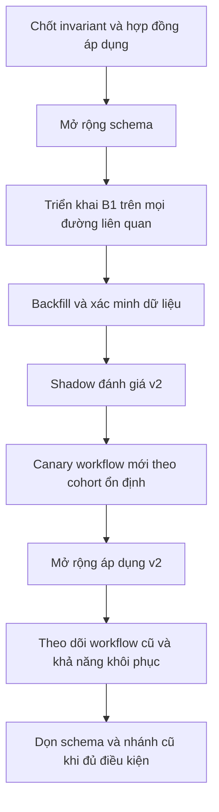

# Rule rollout sequencing

## 1. Triển khai quy tắc cũng là một bài toán bảo mật

**Rule rollout sequencing** là thiết kế thứ tự đưa một thay đổi quy tắc nghiệp vụ vào vận hành: chuẩn bị dữ liệu và khả năng tương thích, triển khai mã, quan sát, kích hoạt có kiểm soát, rồi mới loại bỏ phần cũ. Thứ tự này phải giữ các invariant trong cả giai đoạn nhiều phiên bản cùng tồn tại, không chỉ ở trạng thái cuối cùng.

Một quy tắc mới có thể đúng trong unit test nhưng vẫn tạo đường lạm dụng nếu:

- Request đầu đi vào instance mới, request sau đi vào instance cũ và bỏ qua bước vừa được bổ sung.
- Consumer cũ tiếp tục thanh toán sau khi API đã yêu cầu thêm phê duyệt.
- Feature flag bị đọc khác nhau giữa các bước của cùng workflow.
- Rollback làm mất metadata hoặc diễn giải sai trạng thái mà phiên bản mới đã ghi.
- Retry dưới policy mới thực hiện lại tác dụng đã commit dưới policy cũ.

Các nguyên tắc như giữ state machine phía server, kiểm tra giá trị và quyền từ nguồn đáng tin cậy, kiểm soát race condition vẫn phải tồn tại trong khi rollout. [OWASP Business Logic Security Cheat Sheet](https://cheatsheetseries.owasp.org/cheatsheets/Business_Logic_Security_Cheat_Sheet.html).

Mục tiêu của bài là biết lập kế hoạch có điều kiện chuyển pha, phát hiện khoảng trống giữa các phiên bản và chọn cách dừng/khôi phục mà không tự mở lại hành vi nguy hiểm.

## 2. Ví dụ xuyên suốt: từ một người duyệt sang hai người duyệt

Giả sử một hệ thống đơn mua hàng có hai phiên bản chính sách:

| Thuộc tính | `approval-v1` | `approval-v2` |
|---|---|---|
| Đơn dưới 100.000.000 VND | Một người duyệt | Một người duyệt |
| Đơn từ 100.000.000 VND trở lên | Một người duyệt | Hai người duyệt khác nhau |
| Người tạo tự duyệt | Cấm | Cấm |
| Duyệt khác tenant hoặc thiếu quyền trên đơn | Cấm | Cấm |
| Thanh toán trước khi đủ phê duyệt | Cấm theo policy được áp dụng | Cấm theo policy được áp dụng |

Đây là ví dụ thay đổi chính sách có kế hoạch. Giả định `v1` là chính sách đang được chấp thuận, không phải một lỗ hổng đã xác định cần đóng ngay. Trường hợp sửa lỗ hổng khẩn cấp có trình tự khác ở phần sau.

Hệ thống đã có bảng `approval_workflow` và sổ `approval_vote`. Workflow bắt đầu khi server chấp nhận lệnh gửi duyệt cho một phiên bản nội dung đơn. Phiếu duyệt gắn với `tenant_id`, `order_id` và `content_revision`; sửa nội dung ảnh hưởng quyết định cần tạo revision mới và xử lý lại việc phê duyệt theo hợp đồng.

Trong kế hoạch minh họa:

- Workflow đang dở được gắn rõ `approval-v1` sau khi xác minh nguồn gốc.
- Workflow mới được chọn `v1` hoặc `v2` tại lúc gửi duyệt, rồi lưu lựa chọn đó.
- Mỗi lệnh tiếp theo đọc policy đã gắn; không chọn lại bằng tỷ lệ rollout của request hiện tại.
- Quyền theo tenant, trạng thái tài khoản và những chặn bảo mật đang có hiệu lực được kiểm tra theo chính sách hiện hành. Việc giữ phiên bản workflow không đóng băng mọi quyền của người dùng.

Cho phép workflow cũ tiếp tục theo `v1` là một quyết định nghiệp vụ cần được thống nhất và ghi lại. Nếu quy tắc mới phải áp dụng ngay cho mọi đơn chưa thanh toán, kế hoạch phải bổ sung migration hoặc chặn các workflow cũ tương ứng, thay vì tự mặc định chúng được miễn.

## 3. Phân biệt các phiên bản trước khi lập kế hoạch

Không dùng một số phiên bản duy nhất để đại diện cho mọi thứ:

| Loại phiên bản | Ý nghĩa | Ví dụ |
|---|---|---|
| Build ứng dụng | Mã đang chạy trên một instance | `B0`, `B1` |
| Schema | Cấu trúc lưu trữ mà mã cần hiểu | Schema mở rộng có metadata policy |
| Policy | Tập quy tắc có định danh bất biến | `approval-v1`, `approval-v2` |
| Revision tham số | Bộ ngưỡng và cấu hình thuộc policy | `v2-r1`: ngưỡng 100 triệu VND |
| Revision rollout | Cấu hình chọn cohort và chế độ kích hoạt | `R41`, `R42` |
| Content revision | Phiên bản nội dung đơn mà người dùng duyệt | `order-123/content-7` |
| Revision trạng thái | Dùng để phát hiện cập nhật cạnh tranh | Version của aggregate |

Thay đổi phần trăm canary không làm thay đổi định nghĩa `approval-v2`. Thay đổi ngưỡng từ 100 triệu sang 50 triệu phải có định danh/revision tham số mới và quy tắc áp dụng rõ ràng, không âm thầm sửa ý nghĩa dữ liệu cũ.

Metadata hữu ích trên một workflow:

```json
{
  "workflowId": "wf-123",
  "tenantId": "tenant-a",
  "orderId": "order-123",
  "contentRevision": 7,
  "policyId": "approval-v2",
  "policyRevision": "v2-r1",
  "requiredApprovals": 2,
  "assignmentRevision": 42,
  "stateVersion": 11
}
```

Các giá trị này được server quyết định và lưu; client không được tự gửi `requiredApprovals = 1` để hạ yêu cầu. Registry policy cần giữ được nội dung tương ứng, không chỉ một tên đã bị dùng lại cho nhiều ý nghĩa.

## 4. Chuẩn bị khả năng tương thích trước khi kích hoạt

Một mô hình triển khai phù hợp ví dụ:

| Build | Khả năng đọc/thực thi | Chọn policy cho workflow mới |
|---|---|---|
| `B0` cũ | Chỉ hiểu đầy đủ `v1` | `v1` |
| `B1` tương thích | Hiểu và thực thi `v1`, `v2`, metadata và trạng thái mới | Ban đầu vẫn `v1`; có cơ chế kích hoạt `v2` |
| Build dọn dẹp sau này | Có thể bỏ nhánh cũ khi đủ điều kiện | Theo policy đang vận hành |

`B1` phải thực thi đúng `v2` nếu gặp workflow đã gắn `v2`, kể cả khi cấu hình hiện tại ngừng chọn `v2` cho workflow mới. Tắt việc cấp policy mới không được biến một đơn đang chờ người duyệt thứ hai thành đơn đã đủ điều kiện.

Cách chia “chuẩn bị trước, kích hoạt sau” tương tự kỹ thuật triển khai hai pha cho thay đổi tương thích: đưa khả năng hiểu dữ liệu mới tới toàn bộ thành phần trước khi bắt đầu ghi dữ liệu đó. Khả năng rollback sau kích hoạt cũng phụ thuộc phiên bản đích có hiểu dữ liệu đã tạo hay không. [AWS Builders’ Library về rollback safety](https://builder.aws.com/content/3F04j2yRAAMBuPSPs50xwXZqg01/ensuring-rollback-safety-during-deployments).

Trình tự tổng quát của ví dụ:



Một số bước quan sát hoặc chuẩn bị có thể chạy song song, nhưng các điều kiện phụ thuộc không được bỏ qua: không tạo workflow `v2` khi còn thành phần có thể ghi hoặc xử lý nó theo cách chỉ hiểu `v1`.

## 5. Pha chuẩn bị: tìm đủ mọi đường tác động

Lập danh sách những thành phần có thể thay đổi đơn, ghi phiếu duyệt, chuyển trạng thái hoặc tạo thanh toán:

- API công khai, API nội bộ và API quản trị.
- Consumer, scheduler, batch, import và tác vụ retry.
- Worker theo region, môi trường dự phòng và phiên bản có thể được autoscaling khởi tạo lại.
- Script vận hành có quyền cập nhật trực tiếp.
- Consumer của event mới, tác vụ đọc dữ liệu từ replica hoặc từ snapshot.

Với mỗi thành phần, ghi khả năng đọc, ghi và xử lý từng policy/trạng thái. Một reader chỉ làm báo cáo có thể có yêu cầu khác một consumer chuyển tiền; một reader lỗi cũng cần được đánh giá vì có thể khiến khâu đối soát hoặc giám sát mất dữ liệu.

Chốt các hợp đồng trước rollout:

1. Mốc nào xác định policy của workflow: tạo đơn, gửi duyệt hay thực hiện từng lệnh?
2. Workflow cũ được tiếp tục, chuyển đổi hay tạm chặn?
3. Phiếu duyệt cũ có đủ dữ liệu actor, tenant và revision để được công nhận không?
4. Thay đổi giá/nội dung sau khi duyệt xử lý thế nào?
5. Khi cấu hình không tải được, thao tác nào phải dừng?
6. Sau khi có dữ liệu `v2`, build thấp nhất có thể khôi phục là gì?

Không chỉ chốt “deploy xong sẽ bật flag”. Cần định nghĩa bằng chứng cho thấy các đường tác động đã sẵn sàng, người chịu trách nhiệm kiểm tra và hành động khi một điều kiện chưa đạt.

## 6. Mở rộng schema, backfill và siết ràng buộc

Áp dụng cách mở rộng trước, thu hẹp sau. Ví dụ dưới dùng cú pháp PostgreSQL 17 và chỉ minh họa thứ tự, không phải migration có thể chạy nguyên xi cho mọi hệ thống.

### 6.1. Thêm khả năng lưu metadata mà chưa buộc mã cũ phải ghi

```sql
ALTER TABLE approval_workflow
    ADD COLUMN policy_id varchar(32),
    ADD COLUMN policy_revision varchar(64),
    ADD COLUMN required_approvals smallint,
    ADD COLUMN assignment_revision bigint;
```

Ở pha này, cột có thể rỗng để `B0` còn hoạt động trong quá trình thay thế. Chưa bật việc tạo workflow `v2`. `B1` nhận diện dữ liệu legacy theo hợp đồng chuyển tiếp, ghi metadata đầy đủ cho workflow mới và không xóa các trường mới khi cập nhật dữ liệu.

Giá trị mặc định `v1` không được trở thành đường hạ chính sách vĩnh viễn. Sau khi kích hoạt `v2`, một workflow thiếu metadata cần được coi là trường hợp lỗi hoặc được xử lý theo một quy trình legacy đã xác minh; không tự đoán nó thuộc `v1`.

### 6.2. Backfill sau khi đã kiểm soát các writer

Khi mọi writer liên quan đã là `B1` và vẫn chỉ tạo workflow `v1`, phân loại dữ liệu legacy và cập nhật theo lô. Ví dụ:

```sql
-- Chỉ áp dụng cho tập legacy đã xác minh thuộc v1.
-- :from_id và :to_id là ranh giới lô do công cụ migration quản lý.
UPDATE approval_workflow
SET policy_id = 'approval-v1',
    policy_revision = 'v1-r1',
    required_approvals = 1,
    assignment_revision = 0
WHERE workflow_id >= :from_id
  AND workflow_id < :to_id
  AND policy_id IS NULL;
```

Không dùng truy vấn này để quy mọi bản ghi lạ thành hợp lệ. Cần kiểm tra dữ liệu bị thiếu một phần, trạng thái không rõ nguồn gốc, phiếu duyệt thiếu actor hoặc tenant sai. Backfill metadata không được tự tạo thêm một phiếu duyệt hay phát lại một khoản thanh toán.

Công việc migration phải chạy lại được, có checkpoint, ghi số lượng đã sửa, giới hạn tải và phát hiện cập nhật cạnh tranh. Không ghi đè một workflow đã được gắn policy hợp lệ bởi đường xử lý khác.

### 6.3. Thêm ràng buộc khi các writer đã đáp ứng

Sau khi dữ liệu đã được đối soát và writer không còn tạo metadata rỗng, có thể thêm một phần ràng buộc:

```sql
ALTER TABLE approval_workflow
ADD CONSTRAINT approval_policy_metadata_present
CHECK (
    policy_id IS NOT NULL
    AND policy_revision IS NOT NULL
    AND required_approvals IS NOT NULL
    AND assignment_revision IS NOT NULL
    AND required_approvals BETWEEN 1 AND 2
) NOT VALID;

ALTER TABLE approval_workflow
VALIDATE CONSTRAINT approval_policy_metadata_present;
```

Trong PostgreSQL 17, `NOT VALID` cho `CHECK`/foreign key bỏ qua lần quét dữ liệu cũ khi thêm, nhưng vẫn áp dụng với insert/update tiếp theo; `VALIDATE CONSTRAINT` kiểm tra dữ liệu đã tồn tại. Vì vậy, không dùng `NOT VALID` với kỳ vọng writer cũ được bỏ qua constraint. Các lệnh vẫn có yêu cầu khóa và cần kế hoạch vận hành. [Tài liệu PostgreSQL 17: ALTER TABLE](https://www.postgresql.org/docs/17/sql-altertable.html).

Constraint trên chỉ kiểm tra metadata hiện diện và miền giá trị tối thiểu. Nó không chứng minh đơn đủ hai người duyệt, actor khác người tạo hay ngưỡng tiền được tính đúng. Các invariant đó cần mô hình miền, giao dịch và dữ liệu phiếu duyệt phù hợp. Ràng buộc chống trùng phiếu nên xét khóa như `(tenant_id, order_id, content_revision, approver_id)` theo hợp đồng của hệ thống.

## 7. Triển khai build tương thích trên toàn bộ phạm vi

Trong rolling update, phiên bản cũ và mới có thể cùng phục vụ. Kubernetes Deployment thay thế Pod dần dần; các tham số như `maxSurge` và `maxUnavailable` điều khiển quá trình thay thế, không chứng minh tính tương thích của quy tắc nghiệp vụ. [Tài liệu Kubernetes Deployment](https://kubernetes.io/docs/concepts/workloads/controllers/deployment/).

Điều kiện trước khi kích hoạt `v2` cần bao gồm:

- Toàn bộ API, consumer và job có thể xử lý workflow liên quan đã chạy build hiểu `v2`.
- Không còn lệnh đang chạy ở writer cũ có thể commit một chuyển trạng thái theo `v1` sau thời điểm kích hoạt.
- Consumer hiểu event và trạng thái mới trước khi producer bắt đầu phát chúng.
- Template autoscaling, cấu hình khôi phục và image dự phòng không tự đưa `B0` quay lại.
- Các đường script/import được cập nhật, chặn hoặc loại khỏi quyền ghi trong cửa sổ chuyển đổi.

Trạng thái “đủ replica khỏe” hoặc một dashboard có 100% API instance mới chưa bao gồm consumer bị bỏ quên. Cần đối chiếu inventory theo vai trò và khả năng, đồng thời quan sát version từ chính các tiến trình đang làm việc.

Nếu không thể nâng mọi thành phần cùng lúc, có thể cô lập tập tài nguyên/cohort để chỉ các thành phần tương thích xử lý. Sự cô lập phải bao gồm cả API, queue routing, job và đường ghi dữ liệu. Sticky session ở load balancer đơn lẻ không tạo ra bảo đảm này.

Một cấu hình `minimumWriterCapability = approval-v2` chỉ có tác dụng khi đường ghi thực sự cưỡng chế nó. `B0` không biết đọc cấu hình đó thì không thể bị chặn chỉ nhờ thêm một field. Phải loại bỏ/quây phạm vi writer cũ, hoặc có rào chắn đáng tin cậy ở điểm ghi mà writer cũ không vượt qua được.

## 8. Shadow: quan sát quyết định mới mà không tạo tác dụng phụ

Ở chế độ shadow, policy đang áp dụng vẫn quyết định hành vi thật; policy ứng viên chỉ đánh giá trên dữ kiện phù hợp và ghi kết quả quan sát. Đây là công cụ chuẩn bị cho thay đổi có kế hoạch, không phải cách cho phép một lỗ hổng đã biết tiếp tục hoạt động.

Trong ví dụ, sau phiếu duyệt đầu tiên của đơn 150 triệu VND:

```text
Policy thực thi v1: APPROVED
Policy shadow v2: AWAITING_SECOND_APPROVAL
Phân loại khác biệt: dự kiến do tăng yêu cầu phê duyệt
Tác dụng thật: chỉ theo policy đã gắn trên workflow
```

Không thể chỉ so sánh `allowed=true/false`. Policy mới có thể chấp nhận việc ghi một phiếu duyệt nhưng chưa cho phép hoàn tất workflow. Cần so sánh outcome, trạng thái tiếp theo, lý do và tác dụng nghiệp vụ dự kiến.

Shadow an toàn cần:

- Đánh giá trên snapshot bất biến hoặc bản sao phù hợp; evaluator ứng viên không sửa aggregate đang được thực thi.
- Không gửi thanh toán, ghi phiếu duyệt thật, tiêu hao hạn mức hay phát event nghiệp vụ.
- Ghi rõ policy thực thi, policy ứng viên, revision dữ kiện và thời điểm quan sát.
- Phân biệt “không đánh giá được” với “ứng viên cho phép”.
- Kiểm soát chi phí CPU/I/O và dữ liệu nhạy cảm trong bản ghi so sánh.

Ma trận phân tích:

| Quy tắc hiện hành | Quy tắc ứng viên | Cách điều tra |
|---|---|---|
| Cho hoàn tất | Yêu cầu thêm bước | Có thể là thay đổi thắt chặt đúng dự kiến |
| Từ chối | Cho hoàn tất | Kiểm tra kỹ khả năng nới quyền hoặc mất invariant |
| Cùng cho phép nhưng khác số tiền/đối tượng | Khác tác dụng | Có thể là lỗi tính giá, scope hoặc ánh xạ dữ kiện |
| Đánh giá được | Lỗi/không đủ dữ kiện | Chưa đủ điều kiện kích hoạt |

Một snapshot chỉ có một người duyệt không dự đoán đầy đủ khả năng người dùng thực hiện bước thứ hai. Shadow cần kết hợp kiểm thử luồng mới và canary để đánh giá tác động thực tế tới quy trình.

## 9. Canary theo cohort ổn định và gắn policy với workflow

Canary nên chọn một đơn vị phù hợp với invariant. Với quy trình nhiều người tham gia trong cùng tổ chức, tenant thường phù hợp hơn việc chọn ngẫu nhiên theo từng request. Nếu chọn mỗi request độc lập, cùng một đơn có thể bị yêu cầu hai người duyệt ở lần này nhưng chỉ một người ở lần sau.

Một cấu hình minh họa, không thuộc schema của công cụ feature flag cụ thể:

```json
{
  "rolloutRevision": 42,
  "requiredWriterCapability": "approval-v2",
  "newWorkflowAssignment": {
    "mode": "CANARY",
    "unit": "TENANT",
    "candidatePolicy": "approval-v2",
    "candidatePolicyRevision": "v2-r1",
    "tenantCohort": ["tenant-pilot-a", "tenant-pilot-b"]
  },
  "onAssignmentFailure": "SUSPEND_NEW_WORKFLOW",
  "suspendSensitiveWrites": false
}
```

Evaluation context trong OpenFeature có thể cung cấp targeting key và thuộc tính phục vụ chọn đối tượng. Tuy nhiên, thuật toán phân nhóm, độ ổn định và cách phân phối cấu hình phụ thuộc provider/thiết kế thực tế, cần được xác minh. [Đặc tả Evaluation Context của OpenFeature](https://openfeature.dev/specification/sections/evaluation-context/).

Trong hệ thống ví dụ:

1. Server xác định tenant từ danh tính và quan hệ thành viên hợp lệ.
2. Khi bắt đầu workflow, server chọn policy theo cohort được quản lý.
3. Policy, revision tham số và revision rollout được ghi cùng workflow.
4. Những lệnh sau chỉ dùng lựa chọn đã lưu, cộng các chặn bảo mật hiện hành có liên quan.

Không tin `X-Canary: false`, `policyVersion: v1` hoặc tenant tùy ý do client gửi. Dữ kiện targeting cũng là một ranh giới tin cậy. Việc sửa rollout không được là quyền của người dùng đang bị kiểm soát bởi quy tắc đó.

Khi tăng cohort, chỉ workflow mới bắt đầu sau thời điểm lựa chọn phù hợp mới nhận policy mới theo hợp đồng. Workflow đã gắn `v1` không tự chuyển sang `v2` chỉ vì tenant vừa được thêm vào cohort. Nếu cần chuyển workflow đang dở, đó là một migration nghiệp vụ riêng.

Tỷ lệ canary có thể đi qua các mức nhỏ rồi mở rộng, nhưng không có một bộ phần trăm mặc định nào chứng minh an toàn. Chọn cohort có đủ loại đơn, ngưỡng tiền, nhóm người duyệt và kênh tích hợp; một cohort không phát sinh đơn giá trị cao sẽ không cung cấp bằng chứng cho bước người duyệt thứ hai.

## 10. Thực hiện lệnh với một quyết định nhất quán

Không đọc flag nhiều lần trong cùng lệnh rồi kết hợp các kết quả có thể khác nhau. Việc gắn policy cho workflow mới và việc ghi phiếu duyệt cần có ranh giới dữ liệu rõ ràng.

Mã giả cho lệnh duyệt một workflow đã tồn tại:

```text
BEGIN TRANSACTION
  xác lập actor và tenant đáng tin cậy
  kiểm tra quyền truy cập đối tượng
  nạp/khóa workflow đúng tenant và content revision
  đọc policyId và policyRevision đã lưu
  kiểm tra writer có khả năng thực thi policy đó
  kiểm tra các chặn bảo mật hiện hành áp dụng cho thao tác
  giải quyết idempotency trong đúng scope
  tải dữ kiện thẩm quyền và phiếu duyệt cần thiết
  kiểm tra trạng thái, không tự duyệt và không trùng người duyệt
  ghi phiếu duyệt gắn với content revision
  tính trạng thái tiếp theo theo policy đã gắn
  nếu đủ điều kiện: ghi chuyển trạng thái và outbox tương ứng
  lưu kết quả lệnh/idempotency trong ranh giới nhất quán
COMMIT
```

Đây là mô tả các yêu cầu, không áp đặt một thứ tự giành khóa duy nhất cho mọi implementation. Khi khóa cả bản ghi idempotency, workflow và phiếu duyệt, cần chọn một thứ tự khóa thống nhất giữa các đường gọi để giảm deadlock.

Các bảo đảm quan trọng:

- Hai request đồng thời phải được điều phối bằng version, khóa hoặc cập nhật có điều kiện phù hợp.
- Hai người duyệt phải là hai actor khác nhau thực sự được phép duyệt, không chỉ hai request hoặc hai session.
- Nếu một người có nhiều tài khoản, khóa phân biệt người duyệt cần theo danh tính nghiệp vụ phù hợp; hai username chưa chắc là hai người độc lập.
- Một phiếu duyệt cho content revision cũ không được tự tính sang nội dung đã thay đổi.
- Trạng thái hoàn tất và outbox không được commit tách rời khi hợp đồng yêu cầu tính nguyên tử.
- Consumer thanh toán phải xác nhận đúng workflow/revision và các điều kiện bắt buộc; không chỉ tin một trường `approved=true` không có ngữ cảnh.

### 10.1. Retry qua thời điểm rollout

Nếu lệnh đã commit dưới `v1` nhưng response bị mất, client có thể retry sau khi `v2` được kích hoạt. Bản ghi idempotency phải giúp nhận diện kết quả cũ của cùng lệnh, không tạo một tác vụ mới chỉ vì cấu hình đã đổi.

Không tự thay namespace idempotency từ `approve:v1:key` sang `approve:v2:key` khi rollout nếu việc đó làm mất khả năng nhận diện cùng một tác vụ. Fingerprint cần chứa tài nguyên, hành động và nội dung có ý nghĩa; scope cần ngăn lộ kết quả giữa tenant/actor theo hợp đồng. Quyền đọc kết quả cũ vẫn phải được kiểm tra.

Nếu thay đổi nghiệp vụ đòi hỏi người dùng thực hiện một hành động mới, ví dụ người thứ hai xác nhận revision mới, hãy biểu diễn nó thành lệnh mới có danh tính rõ ràng thay vì tái diễn giải một retry cũ.

### 10.2. Message cũ tới sau khi kích hoạt

Queue có thể giữ message được phát trước rollout. Event cần mang đủ định danh workflow, revision nội dung, phiên bản hợp đồng và tham chiếu policy để consumer xử lý đúng. Không phải mọi event đều cần nhúng toàn bộ policy, nhưng nơi xử lý phải giải quyết được ý nghĩa của nó.

Consumer không hiểu phiên bản phải dừng/quarantine theo cơ chế có giám sát, không âm thầm coi đó là `v1` và tiếp tục thanh toán. Message bị xử lý lại cũng phải có cơ chế chống trùng; đổi build hoặc policy không đặt lại lịch sử tác dụng phụ đã thực hiện.

## 11. Phân phối cấu hình và mốc hiệu lực

Feature flag thường có cache và thời gian lan truyền. Một node vừa thấy `R42` trong khi node khác còn dùng `R41` là trạng thái phải được tính đến, không phải ngoại lệ có thể bỏ qua.

Phân biệt hai hợp đồng:

| Hợp đồng | Điều cần bảo đảm |
|---|---|
| Rollout dần cho workflow mới | Lựa chọn có thể khác giữa các thời điểm, nhưng được ghi rõ và giữ ổn định cho từng workflow |
| Từ một mốc hiệu lực, mọi workflow mới phải dùng quy tắc mới | Cần điểm quyết định có thẩm quyền và cơ chế ngăn writer dùng revision cũ tạo workflow sau mốc đó |

Một SDK có TTL không tự tạo ra mốc hiệu lực tuyệt đối. Nếu yêu cầu mốc chặt chẽ, có thể dùng bản ghi điều khiển ở điểm ghi có thẩm quyền, gắn revision vào transaction và tuần tự hóa thay đổi activation với các transaction gắn policy. Chẳng hạn, trong một database, writer và thao tác activation cùng tham gia giao thức khóa trên bản ghi điều khiển; thời điểm commit activation trở thành ranh giới theo thiết kế đó.

Giao thức này cần được hiện thực và kiểm thử đúng isolation, thứ tự khóa và mọi đường ghi. Một replica cấu hình đọc trễ, writer không tham gia hoặc nhiều database/region độc lập có thể phá vỡ bảo đảm. Hệ thống nhiều vùng cần xác định rõ điểm điều phối hoặc cơ chế cô lập tương ứng.

Khi provider cấu hình hoặc registry policy lỗi:

- Workflow đã gắn policy dùng định nghĩa đã biết và còn được phép áp dụng theo hợp đồng; nếu không giải quyết được thì dừng thao tác nhạy cảm.
- Workflow mới không được tự rơi về `v1` chỉ vì default flag là `false` nếu `v1` không còn được phép cấp.
- Có thể dùng cấu hình tốt gần nhất trong thời hạn đã quy định, hoặc tạm ngừng cấp workflow mới; lựa chọn phải phù hợp mức độ nhạy cảm.
- Revision không được hiểu cần tạo cảnh báo và đường xử lý rõ ràng.

Giữ phiên bản workflow khác với giữ một lỗ hổng. Nếu có một mức bảo vệ tối thiểu mới áp dụng bắt buộc, workflow cũ phải được kiểm tra với mức đó. Nếu không đáp ứng, chặn hoặc chuyển đổi có kiểm soát; không đổi nhãn policy rồi coi như đã đáp ứng.

Kill switch cũng cần có ý nghĩa chính xác. `suspendSensitiveWrites` có thể tạm dừng phê duyệt/thanh toán nhưng vẫn cho phép đọc và điều tra. Một switch mang nghĩa “tắt validator mới” có thể mở lại hành vi bị cấm, nên không được coi đương nhiên là cách khôi phục an toàn.

## 12. Quan sát theo policy và dùng gate có ý nghĩa

Quan sát cả độ ổn định kỹ thuật lẫn tính đúng nghiệp vụ:

| Nhóm chỉ số | Ví dụ | Điều giúp nhận ra |
|---|---|---|
| Độ phủ phiên bản | Build/capability theo API, consumer, job, region | Thành phần chưa chuẩn bị hoặc bản cũ quay lại |
| Gắn policy | Workflow mới theo policy và rollout revision | Cohort áp dụng sai hoặc cấu hình cũ vẫn cấp workflow |
| Chuyển trạng thái | Số workflow đang chờ người thứ hai, hoàn tất, hết hạn | Luồng mới mắc kẹt hoặc bị bỏ qua bước |
| Invariant | Tự duyệt, khác tenant, thiếu số người duyệt, trùng tác dụng tài chính | Sự cố bảo mật logic thực tế |
| Shadow | Khác biệt outcome theo loại quyết định | Thay đổi dự kiến và khác biệt chưa giải thích |
| Độ ổn định | Lỗi, độ trễ, timeout khóa, xung đột version | Sức chịu tải của cơ chế mới |
| Queue/outbox | Backlog, phiên bản không hỗ trợ, retry, duplicate | Producer/consumer lệch khả năng xử lý |
| Chất lượng dữ liệu | Metadata thiếu, phiếu không đúng revision | Lỗi migration hoặc đường ghi bị bỏ sót |

Không chỉ so tỷ lệ `403` trước và sau. Tăng số yêu cầu bị từ chối có thể là tác dụng mong muốn của chính sách mới; cũng có thể là lỗi gán tenant hoặc thiếu quyền cho người duyệt thứ hai. Cần phân loại reason code và đối chiếu mẫu nghiệp vụ hợp lệ.

Ví dụ gate trước khi mở rộng cohort:

- Không có vi phạm invariant đã xác nhận trong tập quan sát.
- Đã có đủ workflow thực sự đi qua các bước mới, không chỉ có request gửi duyệt.
- Mọi khác biệt shadow quan trọng được giải thích hoặc xử lý.
- Độ trễ, lỗi và backlog nằm trong giới hạn vận hành đã đặt cho dịch vụ.
- Không có writer ngoài capability tối thiểu đang hoạt động trong phạm vi.
- Dữ liệu đối soát không có workflow được đánh dấu `APPROVED` mà thiếu điều kiện của policy/revision tương ứng.

Một sự kiện khác tenant hoặc thanh toán trùng đã được xác nhận có thể là điều kiện dừng ngay, dù tỷ lệ tổng rất nhỏ. Ngược lại, “không thấy lỗi” khi chưa có lưu lượng phù hợp không phải bằng chứng đã an toàn.

Bản ghi quyết định nên có correlation ID, định danh đối tượng/revision, tham chiếu actor, policy/revision tham số, rollout revision, build, outcome và reason code. Không ghi token, cookie, payload nhạy cảm hoặc idempotency key thô nếu không cần. Tránh đưa từng `orderId`/`tenantId` vào label metric có cardinality không kiểm soát; dùng log/trace có phân quyền để điều tra chi tiết.

Đối soát nên dựa vào dữ liệu bền vững và hiểu policy của từng workflow. Truy vấn “mọi đơn phải có hai phiếu” sẽ báo sai nếu kế hoạch hợp lệ vẫn có workflow `v1` hoặc đơn `v2` dưới ngưỡng chỉ cần một phiếu.

## 13. Rollback phải xét cả dữ liệu và mức bảo vệ

Cần chuẩn bị ít nhất ba hành động khác nhau:

1. **Dừng mở rộng:** giữ cohort hiện tại và điều tra.
2. **Dừng cấp workflow mới hoặc dừng ghi nhạy cảm:** giới hạn tác động khi chưa thể tiếp tục an toàn.
3. **Đổi build/cấu hình sang phương án đã xác minh:** vẫn hiểu dữ liệu hiện có và giữ các điều kiện bắt buộc.

Không gộp cả ba thành “tắt flag là xong”. Những workflow `v2` đã tồn tại tiếp tục cần bộ thực thi `v2`, trừ khi có migration nghiệp vụ được thiết kế rõ.

| Trạng thái hệ thống | Phương án cần xét | Điều không được giả định |
|---|---|---|
| Chỉ mở rộng schema, chưa có ràng buộc chặn mã cũ và chưa có dữ liệu mới | Có thể quay lại `B0` nếu đã kiểm thử tương thích | Schema thêm cột luôn vô hại với mọi ORM/serializer |
| Metadata mới đã thành bắt buộc | Giữ build có khả năng ghi metadata, thường là `B1` hoặc bản tương thích | `B0` còn ghi được chỉ vì chưa bật `v2` |
| Đã có workflow/trạng thái `v2` | Khôi phục về build hiểu và giữ đúng `v2`; có thể dừng cấp thêm | Bản cũ có thể bỏ qua trường lạ mà vẫn xử lý an toàn |
| `v2` đã là yêu cầu bắt buộc | Tạm dừng hoặc dùng bản sửa tương thích đáp ứng yêu cầu | Được tự cấp lại `v1` để giảm lỗi |
| Đã phát thanh toán hoặc tác dụng ngoài | Đối soát và quy trình sửa/hoàn tác nghiệp vụ | Rollback code hoặc database tự thu hồi tiền đã gửi |
| Đã loại bỏ schema/nhánh cũ | Roll-forward hoặc bản rollback được kiểm thử riêng | Image cũ vẫn là đích khôi phục hợp lệ |

Một đơn 150 triệu đang có một phiếu dưới `v2` phải tiếp tục chờ, kể cả khi dừng canary. Đổi `policy_id` sang `v1`, gán `required_approvals = 1` hoặc ánh xạ `AWAITING_SECOND_APPROVAL` thành `APPROVED` chỉ để giải phóng backlog là thay đổi nghiệp vụ, có thể phá invariant.

Phương án khôi phục cần ghi rõ build đích, schema cần giữ, policy phải hỗ trợ, cách xử lý transaction đang chạy, message đã phát và dữ liệu đã commit. Sau khi thực hiện phải đối soát, không chỉ nhìn việc Pod đã chạy khỏe.

Tránh phục hồi toàn bộ database về snapshot cũ như một bước mặc định của rollback ứng dụng: có thể làm mất giao dịch hợp lệ và lệch với hệ thống ngoài. Việc sửa dữ liệu cần phạm vi, bằng chứng và quy trình phù hợp với tác động thực tế.

## 14. Trình tự khác khi vá lỗ hổng logic đã biết

Canary/shadow kéo dài chỉ hợp lý khi phần chưa chuyển vẫn được phép vận hành theo quy tắc cũ. Nếu đã xác nhận kẻ tấn công có thể tự duyệt hoặc thanh toán vượt quyền, việc giữ đa số traffic ở đường cũ tiếp tục để mở lỗ hổng.

Một trình tự xử lý khẩn cấp có thể là:

1. Chặn hoặc tạm dừng đúng thao tác nhạy cảm ở điểm có hiệu lực trên mọi đường liên quan.
2. Xác định request, workflow, queue và tác dụng ngoài có thể đã bị ảnh hưởng.
3. Đưa kiểm tra bắt buộc tới tất cả writer/consumer cần thiết; ngăn bản cũ quay lại.
4. Xử lý workflow đang dở theo điều kiện mới: chặn, yêu cầu bổ sung bước hoặc chuyển đổi có kiểm soát.
5. Kiểm thử đường tấn công và đường nghiệp vụ hợp lệ trước khi mở lại trong phạm vi phù hợp.
6. Đối soát sau mở lại và tiếp tục điều tra tác động đã xảy ra.

Nếu hệ thống chưa có kill switch đáng tin cậy, có thể cần biện pháp cô lập khác như ngừng consumer hoặc giới hạn quyền ghi của thành phần liên quan theo kế hoạch vận hành. Thêm một flag mà writer cũ không đọc không tạo ra biện pháp ngăn chặn.

Mức bảo vệ bắt buộc của bản vá phải tiếp tục tồn tại nếu phải rollback một phần triển khai. Một bản build trước đó chứa đường vượt quyền không trở thành đích rollback an toàn chỉ vì ít lỗi kỹ thuật hơn.

## 15. Kiểm thử sự chuyển tiếp, không chỉ kiểm thử hai trạng thái cuối

Môi trường kiểm thử cần tái hiện việc nhiều phiên bản hoặc nhiều revision cấu hình cùng tồn tại. Hai lần kiểm thử “toàn `B0`” và “toàn `B1`” không phát hiện hết lỗi ở giữa.

| Tình huống | Bằng chứng cần có |
|---|---|
| `B0` và `B1` cùng chạy trước kích hoạt | `B1` vẫn ghi theo hợp đồng chuyển tiếp, dữ liệu không bị mất trường |
| Cố kích hoạt khi còn writer không hiểu `v2` | Gate từ chối hoặc phạm vi bị cô lập thực sự |
| Node mới nhận cấu hình cũ | Không hạ policy của workflow đã gắn `v2` |
| Flag đổi giữa hai bước | Workflow giữ đúng policy/revision đã ghi |
| Request gửi tenant hoặc policy giả | Server vẫn dùng scope và nguồn quyết định đáng tin cậy |
| Người tạo duyệt ở bất kỳ cohort nào | Luôn bị chặn theo invariant chung |
| Hai phiếu từ cùng actor/session khác nhau | Không được tính là hai người duyệt độc lập |
| Hai người duyệt đồng thời | Một chuyển trạng thái hoàn tất, số phiếu/outbox đúng |
| Retry qua thời điểm đổi rollout revision | Nhận diện cùng lệnh, không phát tác dụng trùng |
| Sửa giá hoặc content revision | Phiếu cũ không tự hợp lệ cho nội dung mới |
| Message cũ đến muộn hoặc redelivery | Theo policy/contract đúng và chống trùng |
| Registry hoặc provider cấu hình mất kết nối | Hành vi dừng/fallback đúng hợp đồng, không tự hạ quy tắc |
| Backfill chạy lại hoặc lỗi giữa lô | Không ghi đè metadata hợp lệ, không tạo phiếu/tác dụng giả |
| Outbox lỗi sau khi cập nhật trạng thái | Không commit trạng thái hoàn tất riêng lẻ |
| Rollback khi có workflow chờ người thứ hai | Không tự hoàn tất; build đích tiếp tục hiểu workflow |
| Autoscaling/khôi phục đưa image cũ trở lại | Không nhận được quyền xử lý ghi ngoài capability được phép |
| Writer cũ đang có transaction trước cutover | Xử lý theo hợp đồng hiệu lực và cơ chế drain/gate đã chọn |

Một phép thử hữu ích là đi qua toàn bộ chuỗi nâng cấp và khôi phục có dữ liệu thực nghiệm ở từng pha: tạo workflow `v1`, triển khai `B1`, tạo workflow `v2`, dừng cấp mới, khôi phục build đích và tiếp tục xử lý cả hai loại. Kiểm tra dữ liệu bền vững, phiếu duyệt, trạng thái, outbox và tác dụng ngoài, không chỉ HTTP status.

Shadow evaluator cũng cần kiểm thử tính không gây tác dụng phụ: không sửa đối tượng, không ghi phiếu thật và không gọi bên thanh toán. Nếu dùng bản sao, phải bảo đảm các collection/entity lồng bên trong không còn dùng chung tham chiếu khả biến.

## 16. Runbook mẫu và tiêu chí kết thúc rollout

Một runbook cho ví dụ có thể đi theo các mốc sau. Các mốc là điều kiện, không phải thời lượng cố định:

| Mốc | Hành động | Điều kiện để chuyển tiếp |
|---|---|---|
| M0 | Chốt quy tắc, scope, workflow cũ và phương án dừng | Có invariant, hợp đồng policy và inventory các đường tác động |
| M1 | Mở rộng schema, triển khai `B1` với cấp mới vẫn là `v1` | Tương thích trong mixed-version đã được kiểm chứng |
| M2 | Loại bỏ writer cũ, drain lệnh liên quan, hoàn tất backfill | Độ phủ capability đầy đủ, dữ liệu đối soát đạt yêu cầu |
| M3 | Siết metadata cần thiết và chạy shadow | Không có khác biệt quan trọng chưa giải thích |
| M4 | Canary workflow mới trong cohort đã chọn | Đã đi qua luồng mới thực tế, invariant và giới hạn vận hành đạt yêu cầu |
| M5 | Mở rộng cohort, áp dụng mốc bắt buộc nếu có | Revision áp dụng đúng phạm vi và không có đường cấp policy cũ ngoài hợp đồng |
| M6 | Theo dõi workflow cũ, queue, retry và khả năng khôi phục | Hiểu rõ dữ liệu nào vẫn cần hỗ trợ cũ và chưa thu hẹp quá sớm |
| M7 | Dọn nhánh/schema/flag cũ theo kế hoạch riêng | Không còn dữ liệu hay đường phục hồi cần chúng, hoặc đã có cơ chế đọc lịch sử phù hợp |

Trước mỗi lần chuyển pha, ghi revision cấu hình, bằng chứng gate, người chịu trách nhiệm, phương án dừng và đích khôi phục đã xác minh. Thay đổi rollout cần được kiểm soát truy cập và có lịch sử; không để quyền sửa flag trở thành quyền âm thầm bỏ qua phê duyệt.

Không xóa `v1` chỉ vì không còn tạo workflow `v1` mới. Có thể còn workflow đang dở, message bị giữ lâu, thao tác retry, dữ liệu lịch sử cần đọc và quy trình đối soát. Ngược lại, giữ khả năng đọc lịch sử `v1` không có nghĩa tiếp tục cho phép thực hiện mọi lệnh ghi theo `v1` mãi mãi.

Các bài tập tự thực hành:

1. Vẽ ma trận tương thích giữa API, consumer thanh toán và schema khi thêm trạng thái chờ người duyệt thứ hai.
2. Thiết kế một mốc hiệu lực chặt cho policy mới; chỉ ra cách xử lý transaction đã bắt đầu và node còn cache cũ.
3. Mô tả rollback sau khi đã có 20 workflow `v2` mới nhận một phiếu, trong đó một workflow có request đang retry.
4. Chuyển ví dụ từ thay đổi có kế hoạch sang bản vá cấm tự duyệt; xác định bước nào phải chặn trước thay vì canary.
5. Thiết kế truy vấn đối soát phân biệt đúng đơn `v1`, đơn `v2` dưới ngưỡng và đơn `v2` từ ngưỡng trở lên.

Kết thúc rollout cần chứng minh được quy tắc nào áp dụng cho từng workflow, mọi đường ghi đều hiểu và thực thi đúng quy tắc đó, và phương án dừng/khôi phục không làm mất các invariant đã cam kết.
