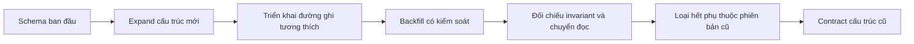

# Database migration safety

## 1. Mục tiêu và phạm vi

Database migration safety là việc thay đổi cấu trúc, dữ liệu và các ràng buộc của cơ sở dữ liệu mà vẫn duy trì những điều kiện nghiệp vụ phải luôn đúng. Trong chương Deployment Operations của module bảo mật logic nghiệp vụ (Business Logic Security), một migration chỉ được xem là an toàn khi việc triển khai không tạo ra cách bỏ qua phê duyệt, sửa giá trái phép, truy cập nhầm đối tượng hoặc thực hiện cùng một tác động nhiều lần.

Ví dụ, hệ thống đang chuyển từ cờ `approved` sang quy trình phê duyệt nhiều trạng thái. Nếu migration gán mặc định `APPROVED` cho dữ liệu chưa xác định, việc triển khai đã biến các yêu cầu chưa được duyệt thành hợp lệ. DDL có thể chạy thành công, ứng dụng có thể vẫn trả HTTP 200, nhưng quy tắc bảo mật đã bị phá vỡ.

Sau bài này, người học cần có khả năng:

- Xác định các business invariant cần bảo toàn trước, trong và sau migration.
- Thiết kế thay đổi theo expand–migrate–contract cho giai đoạn chạy nhiều phiên bản.
- Backfill dữ liệu có kiểm soát trước các yêu cầu đồng thời, retry và thay đổi quyền.
- Phân biệt rollback ứng dụng, sửa tiếp về phía trước và phục hồi dữ liệu.
- Đặt điều kiện dừng, tín hiệu giám sát và tình huống kiểm thử tấn công logic.

Các ví dụ SQL bên dưới dùng PostgreSQL và có mục đích minh họa. Trước khi áp dụng, cần đối chiếu cú pháp, phiên bản, cách khóa và đặc điểm bảng thực tế của hệ thống. Ví dụ không phải một migration hoàn chỉnh để chạy trực tiếp trên mọi cơ sở dữ liệu.

## 2. Migration thay đổi cả bề mặt tấn công

Migration có thể là thêm cột, chuyển kiểu dữ liệu, sửa constraint, thay cách định danh tenant, thay bảng lưu quyền hoặc chuyển nơi lưu idempotency key. Mỗi thay đổi đều có thể tác động tới cách hệ thống quyết định một hành động có hợp lệ hay không.

| Thay đổi | Invariant liên quan | Kịch bản lạm dụng cần chặn |
| --- | --- | --- |
| Chuyển biểu diễn giá | Số tiền thanh toán khớp báo giá đã được chấp nhận | Lợi dụng sai số làm tròn hoặc sai đơn vị để trả ít hơn |
| Thêm `tenant_id` | Người dùng chỉ thao tác được đối tượng thuộc phạm vi được cấp | Tận dụng dòng chưa có tenant để truy cập chéo tổ chức |
| Thay trạng thái phê duyệt | Chỉ yêu cầu đã được duyệt mới được thực thi | Dùng giá trị mặc định hoặc fallback để vượt bước duyệt |
| Chuyển bảng idempotency | Một thao tác chỉ gây một tác động nghiệp vụ | Gửi lại yêu cầu đúng lúc khóa đang được di chuyển |
| Bổ sung reservation tồn kho | Tổng lượng giữ chỗ không vượt khả dụng | Gửi nhiều yêu cầu đồng thời trong khoảng chưa có ràng buộc |
| Hợp nhất bảng quyền | Quyền theo đối tượng không bị mở rộng ngoài ý muốn | Khai thác ánh xạ vai trò thiếu phạm vi đối tượng |

Các request nguy hiểm thường trùng với những khoảng chuyển tiếp: một phần dữ liệu đã được chuyển, một phần chưa; bản ứng dụng cũ và mới cùng ghi; hoặc constraint chưa được bật đầy đủ. Đây là những trạng thái cần được thiết kế rõ, không thể coi là chi tiết tạm thời.

## 3. Viết invariant trước khi viết DDL

### 3.1. Bắt đầu từ điều kiện nghiệp vụ

Giả sử hệ thống xử lý yêu cầu hoàn tiền. Các invariant có thể là:

1. Yêu cầu hoàn tiền và khoản thanh toán gốc phải thuộc cùng tenant.
2. Tổng tiền đã hoàn và đang được giữ để hoàn không vượt quá số tiền được phép hoàn.
3. Chỉ yêu cầu ở trạng thái `APPROVED` mới có thể chuyển sang `EXECUTING`.
4. Người phê duyệt phải có quyền tại thời điểm phê duyệt; một yêu cầu rủi ro cao không được tự phê duyệt.
5. Cùng một idempotency key trong cùng phạm vi phải trả về cùng kết quả hoặc bị từ chối nếu payload khác.
6. Một yêu cầu đã thực thi không được quay lại trạng thái cho phép chi tiền lần nữa.

Với mỗi invariant, cần chỉ rõ thành phần bảo vệ nó. Constraint hỗ trợ điều kiện dữ liệu cục bộ; transaction hoặc khóa bảo vệ cập nhật cạnh tranh; kiểm tra quyền bảo vệ hành động; audit trail cung cấp bằng chứng. Không phải mọi quy tắc đều có thể biểu diễn bằng một `CHECK`.

Ví dụ, `CHECK (amount_minor > 0)` có thể chặn số tiền âm hoặc bằng không nếu kết hợp với `NOT NULL`. Nó không tự chứng minh rằng tổng tiền hoàn của nhiều dòng chưa vượt hạn mức, hoặc người phê duyệt có quyền.

### 3.2. Biến invariant thành điều kiện triển khai

| Invariant | Bằng chứng trước khi chuyển đọc | Điều kiện dừng hoặc chặn contract |
| --- | --- | --- |
| Không truy cập chéo tenant | Không còn dòng cần phục vụ bị thiếu tenant; ánh xạ có nguồn tin cậy | Bất kỳ yêu cầu truy cập chéo tenant nào được cho phép |
| Không bỏ qua phê duyệt | Mọi trạng thái mới đều có ánh xạ xác định và bằng chứng tương ứng | Dòng được đánh dấu đã duyệt nhưng không có bằng chứng hợp lệ |
| Không thực thi trùng | Không có khóa trùng trong phạm vi chuẩn; retry dùng chung cơ chế claim | Phát hiện một thao tác tạo hai tác động |
| Không sai số tiền | Từng giao dịch giữ đúng đơn vị, tiền tệ và quy tắc làm tròn | Xuất hiện chênh lệch không có quy tắc giải thích |
| Không mất cập nhật | Đường ghi cũ và mới cùng tuân thủ giao thức chuyển đổi | Backfill ghi đè giá trị mới hoặc dữ liệu hai biểu diễn lệch nhau |

Một số sai lệch về hiệu năng có thể dùng ngưỡng vận hành đã thống nhất. Các vi phạm như lộ dữ liệu chéo tenant hay chi tiền trùng không được che đi bằng tỷ lệ thành công tổng thể cao.

## 4. Mô hình an toàn: expand–migrate–contract

### 4.1. Expand: thêm khả năng mà vẫn giữ tương thích

Ở bước expand, thêm cấu trúc mới nhưng chưa xóa cấu trúc đang được sử dụng. Ứng dụng mới phải hiểu dữ liệu cũ và mới, đồng thời ứng dụng cũ vẫn phải hoạt động trong phạm vi đã cam kết.

Các thay đổi thường gặp:

- Thêm cột nullable khi chưa thể xác định giá trị an toàn cho toàn bộ dữ liệu cũ.
- Thêm bảng ánh xạ hoặc bảng lưu phiên bản chuyển đổi.
- Thêm index và constraint theo chiến lược phù hợp với lượng dữ liệu, loại khóa và phiên bản DB.
- Triển khai đường ghi có khả năng duy trì hai biểu diễn trong cùng transaction nếu chúng nằm trong cùng DB.

Nullable ở tầng lưu trữ không có nghĩa là được phép thực thi nghiệp vụ khi giá trị còn thiếu. Chẳng hạn, `tenant_id IS NULL` phải khiến truy cập bị từ chối hoặc đối tượng bị cách ly theo chính sách; không được hiểu là thuộc mọi tenant.

### 4.2. Migrate: chuyển dữ liệu và kiểm chứng

Chạy backfill theo lô, theo dõi tiến độ, xác minh từng nhóm invariant và đối chiếu dữ liệu. Trong thời gian này, mọi đường ghi đang hoạt động phải tuân thủ giao thức chuyển đổi; nếu không, dữ liệu có thể tiếp tục lệch sau mỗi lần backfill.

Sau khi dữ liệu đạt điều kiện, chuyển đường đọc sang biểu diễn mới theo từng phạm vi có kiểm soát. Có thể so sánh quyết định cũ và mới ở chế độ shadow trước khi cho quyết định mới điều khiển tác động thật. Shadow chỉ được đọc và ghi nhận chênh lệch, không được gửi lệnh thanh toán hay phát sinh side effect lần hai.

### 4.3. Contract: loại bỏ đường cũ sau khi hết phụ thuộc

Chỉ xóa cột, giá trị trạng thái hoặc đường ghi cũ khi:

- Không còn phiên bản ứng dụng, worker, consumer hay job định kỳ phụ thuộc chúng.
- Đã xử lý request đang chạy, tác vụ chờ và thông điệp cũ có thể được gửi lại.
- Dữ liệu và constraint mới đã được xác minh.
- Khoảng thời gian rollback ứng dụng theo kế hoạch đã kết thúc hoặc có phương án tương thích khác.
- Khóa chống trùng, lịch sử phê duyệt và bằng chứng audit vẫn được giữ theo chính sách.



Không gộp việc thêm cột, chuyển toàn bộ dữ liệu, chuyển ứng dụng và xóa cột cũ thành một lần thay đổi khó dừng. Từng bước phải có điều kiện vào, điều kiện hoàn thành và cách xử lý khi phát hiện sai lệch.

## 5. Tính tương thích giữa các phiên bản

### 5.1. Kiểm tra cả đường đọc và đường ghi

Một ứng dụng cũ có thể đọc được cột mới nhưng vẫn làm sai nghiệp vụ khi ghi. Ví dụ, nó cập nhật `approved = false` mà không cập nhật trạng thái mới, khiến hai biểu diễn mô tả hai quyết định khác nhau.

| Thành phần | Schema mở rộng | Dữ liệu đã backfill | Sau contract |
| --- | --- | --- | --- |
| API phiên bản cũ | Phải đọc và ghi an toàn qua giao thức tương thích | Không được làm lệch biểu diễn mới | Không còn được chạy nếu phụ thuộc cấu trúc đã xóa |
| API phiên bản chuyển tiếp | Hiểu giá trị chưa chuyển; duy trì biểu diễn cần thiết | Có thể chuyển đọc khi đủ điều kiện | Chỉ tiếp tục chạy nếu không phụ thuộc cấu trúc cũ |
| API phiên bản cuối | Chỉ triển khai khi schema tối thiểu đã sẵn sàng | Dùng biểu diễn mới | Hoạt động với schema đã thu gọn |
| Worker hoặc consumer cũ | Phải được kiểm kê và kiểm soát tương tự API | Không được thực thi lại thao tác đã hoàn thành | Dừng hoặc nâng cấp trước contract |

Tương thích không chỉ là việc câu SQL còn chạy. Nó bao gồm cách hiểu trạng thái, tenant, đơn vị tiền, phạm vi idempotency key và quyền cần có để chuyển trạng thái.

### 5.2. Tránh fallback mở quyền

Các fallback sau làm migration trở thành lỗ hổng logic:

```text
Không có tenant_id        -> bỏ điều kiện lọc tenant
Không hiểu trạng thái mới -> xem như đã được phê duyệt
Không có giá mới          -> dùng giá client gửi
Không thấy khóa ở kho mới -> thực hiện giao dịch ngay
```

Giá trị không xác định phải dẫn tới xử lý được định nghĩa trước: từ chối tác động nhạy cảm, giữ ở trạng thái chờ hoặc cách ly để đối soát. Nếu vẫn cần phục vụ một số thao tác đọc, chúng phải tuân thủ cùng phạm vi quyền và không suy rộng quyền từ dữ liệu thiếu.

Feature flag hỗ trợ chọn đường đọc hoặc chia giai đoạn triển khai. Nó không thay thế kiểm tra quyền, transaction hay constraint; tắt cờ cũng không thể tự sửa dữ liệu đã ghi sai.

## 6. Ví dụ: chuyển trạng thái phê duyệt mà không mở cửa bỏ qua bước duyệt

### 6.1. Thiết kế ánh xạ dựa trên bằng chứng

Giả sử bảng `refund_requests` có `approved` kiểu boolean. Thiết kế mới có các trạng thái `PENDING`, `APPROVED`, `REJECTED`, `EXECUTING`, `EXECUTED` và `REVIEW_REQUIRED`.

Không thể suy toàn bộ trạng thái mới từ một boolean:

- `approved = false` có thể là đang chờ hoặc đã bị từ chối.
- `approved = true` chưa cho biết yêu cầu đã được thực thi hay chưa.
- `NULL` không cung cấp bằng chứng phê duyệt.

Nếu bảng lịch sử xác nhận đã thực thi, trạng thái phải phản ánh kết quả đó. Nếu có phê duyệt hợp lệ nhưng chưa thực thi, có thể ánh xạ sang `APPROVED`. Dữ liệu thiếu bằng chứng phải vào `REVIEW_REQUIRED`, một trạng thái không được phép chi tiền. Không dùng tài khoản chạy migration làm người phê duyệt giả.

### 6.2. Thêm cột và giới hạn miền giá trị

```sql
-- PostgreSQL: ví dụ bước expand, chưa phải toàn bộ quy trình triển khai.
ALTER TABLE refund_requests
    ADD COLUMN approval_state text;

ALTER TABLE refund_requests
    ADD CONSTRAINT refund_approval_state_allowed
    CHECK (approval_state IN (
        'PENDING', 'APPROVED', 'REJECTED',
        'EXECUTING', 'EXECUTED', 'REVIEW_REQUIRED'
    )) NOT VALID;
```

Trong PostgreSQL, `NOT VALID` với loại constraint phù hợp cho phép trì hoãn kiểm tra toàn bộ dòng cũ, trong khi các lần insert hoặc update sau đó phải tuân thủ constraint. Việc thêm constraint vẫn cần khóa; đây không phải cam kết rằng thao tác không gây chờ.

`CHECK` trên không cấm `NULL`: biểu thức trả về unknown không bị coi là vi phạm. Nó cũng chỉ giới hạn tập giá trị, không bảo vệ thứ tự chuyển trạng thái và không xác minh người phê duyệt.

Khi dữ liệu đã được chuyển và mọi writer đều cung cấp trạng thái đúng:

```sql
ALTER TABLE refund_requests
    VALIDATE CONSTRAINT refund_approval_state_allowed;

ALTER TABLE refund_requests
    ADD CONSTRAINT refund_approval_state_present
    CHECK (approval_state IS NOT NULL) NOT VALID;

ALTER TABLE refund_requests
    VALIDATE CONSTRAINT refund_approval_state_present;
```

Chỉ thêm constraint yêu cầu có giá trị khi ứng dụng cũ đã được nâng cấp, đã dừng hoặc có lớp tương thích điền đúng giá trị. Nếu còn writer cũ ghi `NULL`, việc siết constraint sẽ làm các đường ghi đó lỗi. Việc chuyển tiếp sang `NOT NULL`, nếu cần, phải được đánh giá riêng về khóa và khả năng tối ưu của phiên bản DB đang dùng.

### 6.3. Giữ state machine trong transaction nghiệp vụ

Một cập nhật có điều kiện có thể hỗ trợ chuyển trạng thái nguyên tử:

```sql
UPDATE refund_requests
SET approval_state = 'EXECUTING',
    version = version + 1
WHERE id = :refund_id
  AND tenant_id = :tenant_id
  AND approval_state = 'APPROVED'
  AND version = :expected_version;
```

Đoạn SQL giả định đã có `tenant_id` và `version` với quy tắc sử dụng thống nhất. Các tham số phải được bind; `tenant_id` phải lấy từ ngữ cảnh đã xác thực và kiểm tra quyền, không tin trực tiếp vào trường client gửi.

Ứng dụng phải xác nhận đúng một dòng được cập nhật. Không có dòng nào được cập nhật là tín hiệu trạng thái hoặc phiên bản không còn phù hợp, hoặc đối tượng nằm ngoài phạm vi; không được tự chuyển sang lệnh cập nhật ít điều kiện hơn để “thử lại”.

Trong transaction đầy đủ, hệ thống còn phải kiểm tra hạn mức hoàn tiền, claim idempotency key và ghi bản ghi tác động cần thực hiện. Một câu `UPDATE` này chưa đủ để chống vượt hạn mức trên nhiều yêu cầu khác nhau.

Lệnh gọi nhà cung cấp thanh toán cần giao thức chịu retry riêng, chẳng hạn outbox kết hợp idempotency key ổn định phía nhà cung cấp và đối soát kết quả. Giữ transaction DB mở trong lúc gọi mạng không tạo ra tính nguyên tử giữa hai hệ thống.

## 7. Backfill an toàn trước cập nhật đồng thời

### 7.1. Những thuộc tính cần có

Backfill là một writer có khả năng ảnh hưởng hàng triệu đối tượng. Nó cần:

- Chạy theo lô đủ nhỏ, có giới hạn thời gian và có thể tạm dừng.
- Có checkpoint hoặc điều kiện chọn dòng cho phép chạy lại.
- Không ghi đè quyết định mới của ứng dụng.
- Có cách đưa dòng mâu thuẫn vào luồng đối soát.
- Ghi nhận số dòng đã chuyển, bỏ qua, thất bại và bị cách ly.

Không phân trang công việc dài bằng `OFFSET` khi dữ liệu có thể thay đổi. Có thể dùng keyset theo khóa ổn định hoặc hàng đợi công việc. Checkpoint chỉ chứng minh đã đi qua một khoảng khóa; nó không chứng minh mọi dòng trong khoảng đã được chuyển thành công. Cần quét lại các dòng chưa chuyển và đối chiếu sai lệch sau lượt chính.

### 7.2. Cập nhật có điều kiện

Ví dụ worker tính được trạng thái mới từ dữ liệu đã đọc ở phiên bản `observed_version`:

```sql
UPDATE refund_requests
SET approval_state = :derived_state,
    migration_version = :migration_version,
    version = version + 1
WHERE id = :refund_id
  AND tenant_id = :tenant_id
  AND approval_state IS NULL
  AND version = :observed_version;
```

Ví dụ giả định `migration_version` đã được thêm trong bước expand, mọi writer có liên quan đều tăng `version`, và quy tắc ánh xạ đã được xác định. Nếu cập nhật trả về 0 dòng, worker phải đọc lại và đánh giá lại hoặc đưa vào đối soát. Nó không được cưỡng chế ghi giá trị được suy ra từ ảnh chụp cũ.

Nếu nguồn suy ra trạng thái nằm ở bảng khác, chỉ kiểm tra phiên bản của `refund_requests` có thể chưa đủ. Giao thức phải bảo vệ cả bằng chứng liên quan bằng transaction, khóa phù hợp, phiên bản nguồn hoặc mốc chụp đã được kiểm soát. Nếu ứng dụng cũ không tăng `version`, optimistic locking theo cột này chưa bảo vệ được migration.

### 7.3. Dual-write không tự đồng nghĩa với nhất quán

Khi hai biểu diễn nằm trong cùng DB, cập nhật chúng trong cùng transaction và thống nhất một nguồn chân lý ở mỗi giai đoạn. Kiểm tra tất cả writer: API, batch job, consumer, công cụ hỗ trợ và luồng quản trị.

Nếu hai biểu diễn nằm ở hai hệ thống khác nhau, thao tác “ghi nơi A rồi ghi nơi B” có thể dừng ở giữa. Cần giao thức sao chép có khả năng retry, kiểm soát thứ tự, đối soát và điều kiện chặn sử dụng dữ liệu chưa đồng bộ. Không tuyên bố tính nguyên tử chỉ vì hai lệnh ghi được gọi liên tiếp trong cùng hàm.

Tránh trigger đồng bộ hai chiều và code ứng dụng cùng tự sửa giá trị khi chưa có quy tắc ưu tiên. Chúng có thể tạo vòng cập nhật, che lỗi nguồn hoặc khiến một trạng thái cũ ghi đè trạng thái mới.

## 8. Bảo toàn quyền theo đối tượng và ranh giới tenant

### 8.1. Tenant phải có nguồn xác định đáng tin cậy

Khi thêm `tenant_id`, không lấy tenant từ request gần nhất hoặc gán mọi dòng thiếu tenant cho tenant mặc định để hoàn tất backfill. Dùng quan hệ sở hữu đã được xác minh, chẳng hạn khoản thanh toán gốc, tài khoản hợp đồng hoặc ánh xạ tổ chức có lịch sử rõ ràng.

Nếu một dòng có nhiều nguồn mâu thuẫn, cách ly dòng đó và chặn tác động nhạy cảm cho tới khi có quyết định hợp lệ. Migration không được tự đoán quyền sở hữu để đạt tỷ lệ hoàn thành 100%.

### 8.2. Ràng buộc quan hệ theo tenant

Giả sử `payments` có khóa duy nhất `(tenant_id, id)`. Quan hệ từ yêu cầu hoàn tiền có thể được bảo vệ bằng khóa ngoại ghép:

```sql
ALTER TABLE refund_requests
    ADD CONSTRAINT refund_payment_same_tenant
    FOREIGN KEY (tenant_id, payment_id)
    REFERENCES payments (tenant_id, id)
    NOT VALID;
```

Trước khi chạy, khóa duy nhất ở bảng được tham chiếu phải tồn tại theo yêu cầu của DB. Với khóa ngoại ghép dùng cách xử lý NULL mặc định, thành phần NULL có thể làm việc kiểm tra quan hệ không bảo vệ được dòng như mong muốn. Vì vậy, phải xử lý NULL và bổ sung yêu cầu có giá trị cho các cột bắt buộc tại đúng giai đoạn.

Khóa ngoại ghép bảo vệ tính nhất quán tenant giữa hai bảng. Nó không chứng minh người dùng hiện tại có quyền hoàn tiền trên đối tượng đó. Tầng ứng dụng vẫn phải kiểm tra danh tính, quyền theo đối tượng, trạng thái và hạn mức; nếu có RLS thì cần kiểm chứng chính sách trong giai đoạn chuyển tiếp.

Tài khoản backfill có thể được cấp quyền rộng để chuyển dữ liệu. Quyền đó không được sử dụng để mô phỏng quyền của người dùng hoặc biến hành động sửa dữ liệu thành một lần phê duyệt nghiệp vụ.

## 9. Bảo toàn idempotency trong migration

### 9.1. Giữ nguyên ngữ nghĩa của khóa

Một khóa chống trùng thường cần phạm vi rõ ràng, chẳng hạn `(tenant_id, operation_type, idempotency_key)`. Bản ghi đi kèm có thể chứa fingerprint của payload, trạng thái xử lý, mã đối tượng nghiệp vụ và kết quả đã trả.

Khi migration thay bảng hoặc cách tính fingerprint, cần bảo toàn:

- Phạm vi khóa, quy tắc chuẩn hóa và định danh thao tác.
- Liên kết giữa khóa và payload gốc.
- Phân biệt đang xử lý, đã thành công và kết quả cần đối soát.
- Kết quả có thể trả lại khi retry.
- Thời hạn lưu khóa theo khoảng retry thực tế, khả năng replay và chính sách nghiệp vụ.

Giữ cùng chuỗi khóa nhưng đổi phạm vi từ theo tenant sang theo người dùng có thể cho phép cùng thao tác chạy lại qua một người dùng khác. Đổi cách chuẩn hóa payload cũng có thể khiến yêu cầu cũ bị hiểu như một tác vụ mới.

### 9.2. Tránh hai cơ chế claim độc lập

Tình huống nguy hiểm:

1. Phiên bản cũ kiểm tra và claim trong bảng cũ.
2. Phiên bản mới kiểm tra và claim trong bảng mới.
3. Cùng một request đến hai phiên bản khi dữ liệu chưa đồng bộ.
4. Cả hai đều thấy chưa có khóa và cùng thực thi.

Giải pháp phải có một điểm phân xử nguyên tử chung trong suốt giai đoạn chuyển đổi. Có thể giữ bảng cũ làm nơi claim cho cả hai phiên bản cho tới khi đủ điều kiện chuyển, hoặc nâng cấp mọi writer sang một giao thức chung trước khi đổi kho. Nếu chưa thể bảo đảm điều đó, cần dừng có kiểm soát nhóm tác động liên quan trong lúc chuyển.

Chỉ “đọc cả hai bảng” không giải quyết được race nếu hai phiên bản vẫn claim độc lập. Constraint duy nhất bảo vệ những writer cùng đi qua constraint đó; nó không phối hợp tự động giữa hai bảng hoặc hai DB.

Khi tạo unique index trên dữ liệu đã có, phải xử lý các bản ghi trùng theo ý nghĩa nghiệp vụ. Không xóa ngẫu nhiên một bản ghi khóa trùng vì nó có thể là bằng chứng của một lần chi tiền đã xảy ra.

## 10. Bảo toàn số tiền và các giới hạn tổng hợp

Migration tiền tệ cần xác định đơn vị nguồn và đích, loại tiền, độ chính xác và quy tắc làm tròn. Không mặc định mọi loại tiền đều có hai chữ số thập phân hoặc mọi số tiền đều có thể nhân 100 rồi ép kiểu.

Nếu chuyển từ số thập phân sang đơn vị nhỏ nhất dạng số nguyên:

- Suy ra số chữ số thập phân từ cấu hình tiền tệ được chấp nhận của hệ thống.
- Xác định cách xử lý giá trị nguồn không biểu diễn được chính xác ở đơn vị đích.
- Kiểm tra overflow, số âm, giá trị đặc biệt và NULL theo kiểu nguồn.
- Đối chiếu từng giao dịch, từng loại tiền và tổng liên quan; tổng toàn hệ thống có thể che các sai lệch bù trừ nhau.
- Giữ nguyên báo giá hoặc điều khoản đã được chấp nhận khi quy tắc nghiệp vụ yêu cầu; không tính lại từ giá sản phẩm hiện tại.

Với hạn mức tổng hợp, thêm `CHECK` trên một dòng không ngăn hai transaction cùng tiêu phần hạn mức còn lại. Hệ thống cần một cơ chế đồng bộ thích hợp, chẳng hạn khóa dòng ngân sách chung hoặc cập nhật có điều kiện trên số dư đã chuẩn hóa, và phải kiểm tra số dòng bị tác động. Nếu chọn isolation có thể gây lỗi serialization, luồng retry phải giữ cùng định danh thao tác và không phát sinh side effect lần hai.

Migration cần giữ cơ chế đó hoạt động xuyên suốt các phiên bản. Nếu writer mới dùng reservation nhưng writer cũ vẫn trừ trực tiếp, tổng hạn mức có thể bị sử dụng hai lần dù mỗi đường ghi riêng lẻ có vẻ hợp lệ.

## 11. An toàn vận hành: khóa, tải và quyền thực thi

### 11.1. Tránh để migration tạo ra chuỗi lỗi nghiệp vụ

DDL hoặc backfill giữ khóa lâu có thể làm request chờ, timeout và bị client gửi lại. Nếu cơ chế retry hoặc idempotency yếu, một vấn đề vận hành có thể biến thành giao dịch trùng.

Cần đặt giới hạn chờ khóa, thời gian chạy và kích thước lô phù hợp với ngân sách vận hành. Quan sát connection pool, thời gian transaction, deadlock, hàng đợi, WAL hoặc transaction log và replication lag. Không chọn một kích thước lô cố định cho mọi môi trường; điều chỉnh theo lượng dữ liệu, kiểu cập nhật và tải thực tế.

Ví dụ PostgreSQL cho một thao tác tạo index đồng thời:

```sql
-- Ví dụ chạy ngoài transaction block do công cụ migration mở sẵn.
SET lock_timeout = '3s';
SET statement_timeout = '15min';

CREATE UNIQUE INDEX CONCURRENTLY idempotency_scope_unique_idx
    ON idempotency_records
       (tenant_id, operation_type, idempotency_key);
```

Các thời gian trên chỉ minh họa. `CREATE INDEX CONCURRENTLY` không được chạy trong transaction block và vẫn có thể chờ hoặc thất bại. Khi lỗi, cần kiểm tra trạng thái index và xử lý theo runbook trước khi chạy lại; không coi việc có tên index là bằng chứng index hợp lệ.

Unique index trong ví dụ chỉ có ý nghĩa như mong muốn khi các trường phạm vi bắt buộc đã được kiểm soát NULL. Nếu dữ liệu trùng đang tồn tại hoặc writer còn tạo bản ghi không hợp lệ, việc tạo index có thể thất bại. Chỉ chuyển đường nghiệp vụ dựa vào index sau khi xác minh nó đã sẵn sàng và mọi writer sử dụng cùng phạm vi.

### 11.2. Quản lý tiến trình và quyền migration

- Dùng danh tính triển khai có quyền phù hợp với thay đổi, tách khỏi tài khoản phục vụ request thông thường.
- Ghi nhận phiên bản migration, checksum nội dung, người hoặc tiến trình thực thi và mốc bắt đầu/kết thúc.
- Có cơ chế điều phối để hai tiến trình không chạy cùng một migration ngoài ý muốn.
- Không sửa ngầm lịch sử migration đã áp dụng; tạo migration sửa tiếp khi cần.
- Thiết kế cách kiểm tra và tiếp tục sau khi tiến trình dừng giữa chừng.

Khóa điều phối migration chỉ ngăn các tiến trình migration chạy trùng. Nó không tự khóa các request nghiệp vụ và không thay thế giao thức bảo vệ concurrent writes.

Không tự động chạy migration dài hoặc phá vỡ tương thích mỗi khi một replica ứng dụng khởi động. Nếu framework có cơ chế migration lúc startup, cần kiểm soát rõ ai thực thi, cách khóa và tác động tới readiness của các replica.

### 11.3. Đọc từ replica khi vừa chuyển dữ liệu

Replication lag có thể khiến một request thấy trạng thái cũ sau khi primary đã chuyển. Không dùng việc “chưa thấy” bản ghi trên replica làm bằng chứng đủ để thực thi thanh toán, hoàn tiền hoặc claim idempotency key.

Các quyết định nhạy cảm cần dựa vào cơ chế nhất quán đã được thiết kế, thường là transaction trên nguồn ghi có thẩm quyền. Dashboard báo backfill hoàn tất trên primary cũng chưa chứng minh mọi replica hoặc cache đã sẵn sàng cho đường đọc mới.

## 12. Quan sát tính đúng đắn, không chỉ tình trạng dịch vụ

Theo dõi hai nhóm tín hiệu song song:

| Nhóm | Tín hiệu tiêu biểu | Ý nghĩa |
| --- | --- | --- |
| Sức khỏe vận hành | Thời gian chờ khóa, latency, lỗi DB, replication lag | Migration có làm hệ thống chậm hoặc mất khả dụng không |
| Tiến độ dữ liệu | Dòng chưa chuyển, lô thất bại, tốc độ backfill | Công việc có tiến triển và có thể hoàn thành không |
| Tính nhất quán | Hai biểu diễn lệch nhau, thiếu tenant, khóa trùng | Giao thức chuyển đổi có giữ cùng ý nghĩa không |
| Invariant nghiệp vụ | Hoàn tiền vượt hạn mức, chuyển trạng thái sai, tác động trùng | Có phát sinh vi phạm bảo mật logic hay không |
| Quyết định quyền | Chênh lệch cho phép/từ chối giữa logic cũ và mới | Có mở rộng hoặc thu hẹp quyền ngoài dự kiến không |

Audit của migration nên có mã migration, mã đối tượng, lý do ánh xạ, phiên bản nguồn và kết quả xử lý. Với dữ liệu nhạy cảm, ghi định danh hoặc thông tin tối thiểu cần thiết theo chính sách thay vì đưa toàn bộ payload vào log.

Backfill không nên kích hoạt email phê duyệt, webhook chi tiền hoặc sự kiện “đã duyệt” chỉ vì một cột thay đổi. Nếu hệ thống có CDC hoặc trigger, cần phân biệt cập nhật kỹ thuật với chuyển trạng thái nghiệp vụ, đồng thời bảo đảm phân biệt đó không trở thành cách để request thông thường vượt kiểm soát.

## 13. Kế hoạch dừng và phục hồi

### 13.1. Phân biệt ba quyết định

| Quyết định | Khi có thể phù hợp | Giới hạn cần hiểu |
| --- | --- | --- |
| Rollback ứng dụng | Schema còn tương thích; dữ liệu mới vẫn được bản cũ hiểu đúng | Không tự đảo dữ liệu và không thu hồi tác động bên ngoài |
| Roll-forward | Cần sửa mapping, bổ sung constraint hoặc khắc phục tương thích | Phải biết dòng nào bị ảnh hưởng và bảo vệ invariant khi sửa |
| Phục hồi dữ liệu | Dữ liệu bị mất hoặc hỏng ngoài khả năng sửa tại chỗ | Cần đối soát các giao dịch hợp lệ và side effect từ sau mốc phục hồi |

Down migration kiểu xóa cột mới không phải phương án phục hồi đầy đủ. Sau khi contract, bản ứng dụng cũ có thể không còn chạy được. Sau khi đã gửi tiền, khôi phục một backup DB cũng không làm nhà cung cấp tự thu hồi số tiền đó.

### 13.2. Runbook tối thiểu khi invariant bị vi phạm

1. Dừng backfill hoặc DDL đang gây ảnh hưởng bằng cách được chuẩn bị; xác định transaction đã commit hay chưa.
2. Chặn có mục tiêu tác động nhạy cảm bị ảnh hưởng, như thực thi hoàn tiền, trong khi giữ các chức năng an toàn nếu có thể.
3. Giữ audit, bản ghi idempotency và bằng chứng từ nhà cung cấp để tránh mất khả năng đối soát.
4. Xác định phạm vi đối tượng, tenant, phiên bản ứng dụng và khoảng thời gian có rủi ro.
5. Chọn rollback ứng dụng, roll-forward hoặc phục hồi dữ liệu theo trạng thái tương thích thực tế.
6. Đối soát với hệ thống bên ngoài và sửa dữ liệu bằng thao tác có dấu vết.
7. Chỉ mở lại tác động khi các invariant và cơ chế chống trùng đã được xác nhận.

Kế hoạch backup cần được kiểm chứng bằng khả năng phục hồi trong môi trường phù hợp. Có file backup hoặc thông báo sao lưu thành công chưa chứng minh rằng dữ liệu và lịch sử giao dịch có thể được khôi phục đúng theo mục tiêu vận hành.

## 14. Kiểm thử các khoảng chuyển tiếp và hành vi lạm dụng

Đây là các tình huống cần thiết kế cho migration; không chỉ kiểm tra trạng thái cuối cùng của schema. Dùng dữ liệu thử phù hợp, có dòng lịch sử bất thường và tải đồng thời đại diện cho môi trường vận hành.

| Tình huống | Hành động mô phỏng | Kết quả bắt buộc |
| --- | --- | --- |
| Dữ liệu chưa có tenant | Truy cập bằng tài khoản tenant khác | Không đọc được dữ liệu và không thực thi được thao tác |
| Boolean phê duyệt thiếu bằng chứng | Chạy ánh xạ rồi gửi yêu cầu thực thi | Không được tự nâng thành trạng thái có thể chi tiền |
| Hai phiên bản ứng dụng cùng tồn tại | Gửi retry cùng khóa tới hai phiên bản | Chỉ một tác động; retry nhận kết quả nhất quán |
| Backfill dùng ảnh chụp cũ | Ứng dụng sửa dòng trước khi worker ghi | Worker không ghi đè thay đổi mới; có xử lý xung đột |
| Thay quyền giữa chừng | Thu hồi quyền trước một bước phê duyệt mới | Bước mới tuân thủ quyền hiện tại và chính sách đã định |
| Lỗi giữa lô | Dừng tiến trình sau một số transaction đã commit | Chạy lại không làm sai mapping hoặc phát sinh side effect trùng |
| Giá trị tiền khó chuyển | Dữ liệu sát giới hạn, nhiều tiền tệ, phần lẻ đặc biệt | Không overflow hay làm tròn ngoài quy tắc đã chấp nhận |
| Thông điệp cũ được replay | Consumer nhận lại sự kiện sau chuyển kho khóa | Không thực thi lại giao dịch đã hoàn thành |
| Primary đã ghi, replica chậm | Retry trong thời gian replica chưa bắt kịp | Không lấy việc thiếu dữ liệu trên replica làm quyền thực thi mới |
| Rollback trước contract | Chạy bản ứng dụng đã chọn để phục hồi | Hiểu được dữ liệu đã chuyển và không mở quyền ngoài ý muốn |
| Writer cũ sau khi siết constraint | Thử đường ghi còn phụ thuộc cấu trúc cũ | Bị ngăn triển khai hoặc được xử lý tương thích có chủ đích |
| Unique index tạo thất bại | Dữ liệu trùng hoặc tiến trình bị ngắt | Không chuyển sang giả định rằng uniqueness đã được bảo vệ |

Cần phân biệt giữ hiệu lực của một phê duyệt cũ và quyền tạo một phê duyệt mới. Việc thu hồi quyền có làm mất hiệu lực phê duyệt trước đó hay không là chính sách nghiệp vụ cần được xác định; migration không được tự đặt ra chính sách mới bằng cách xóa hoặc viết lại lịch sử.

Với các transaction bảo vệ hạn mức, kiểm thử phải chạy nhiều request đồng thời trên cùng đối tượng giới hạn. Kiểm thử tuần tự không thể hiện được race làm cả hai request cùng sử dụng một phần ngân sách.

## 15. Ví dụ trình tự triển khai một thay đổi phê duyệt

Một kế hoạch cụ thể cho hệ thống hoàn tiền có thể gồm:

1. **Chuẩn bị:** thống nhất invariant, quy tắc ánh xạ, trạng thái cách ly, nguồn tenant, phạm vi khóa chống trùng và tiêu chí dừng.
2. **Expand:** thêm cấu trúc mới; đánh giá khóa và tải; giữ schema phục vụ được ứng dụng hiện tại.
3. **Nâng cấp writer:** triển khai phiên bản chuyển tiếp đến API, worker, job và consumer; xác minh mọi đường ghi duy trì dữ liệu cần thiết.
4. **Backfill:** chạy theo lô, xử lý xung đột, ghi nguồn ánh xạ; không phát sinh lệnh thanh toán hoặc phê duyệt giả.
5. **Đối chiếu:** kiểm tra thiếu tenant, trạng thái không có bằng chứng, số tiền và khóa trùng; chạy shadow cho quyết định đọc có thể so sánh an toàn.
6. **Chuyển đọc:** mở từng phạm vi phù hợp, theo dõi cả lỗi vận hành và vi phạm invariant; giữ khả năng chuyển lại nếu dữ liệu còn tương thích.
7. **Siết ràng buộc:** validate constraint, chặn giá trị thiếu và xác minh cơ chế uniqueness đã hoạt động; chỉ thực hiện khi writer tương thích.
8. **Kết thúc phụ thuộc cũ:** xử lý tác vụ chờ, thông điệp replay và phương án rollback; xác nhận không còn thành phần dùng cấu trúc cũ.
9. **Contract:** xóa phần cũ trong một thay đổi riêng có điều kiện rõ ràng; tiếp tục giữ lịch sử và khóa chống trùng theo chính sách.

Nếu không thể xây dựng giai đoạn tương thích an toàn, một khoảng dừng ghi có kiểm soát có thể là lựa chọn phù hợp. Khi đó phải chặn đầy đủ API, worker, job và consumer liên quan, xử lý transaction đang chạy, rồi xác minh trước khi mở lại. Chỉ ẩn nút trên giao diện không tạo ra khoảng dừng ghi đáng tin cậy.

## 16. Những sai lầm cần nhận diện

- **Gán mặc định có quyền:** dùng `APPROVED`, tenant chung hoặc vai trò quản trị để lấp dữ liệu thiếu.
- **Xem NULL là ngoại lệ cho phép:** bỏ điều kiện quyền hoặc điều kiện trạng thái khi backfill chưa xong.
- **Chỉ kiểm kê API:** bỏ sót job định kỳ, consumer và công cụ vận hành vẫn ghi theo schema cũ.
- **Tin backfill một lượt:** không phát hiện dữ liệu bị writer cũ làm lệch sau khi đã chuyển.
- **Tách kho chống trùng quá sớm:** mỗi phiên bản claim một nơi và cùng gây tác động.
- **Sửa lịch sử để đẹp dữ liệu:** tạo bằng chứng phê duyệt giả hoặc xóa khóa chứa dấu vết giao dịch.
- **Dùng dashboard xanh làm bằng chứng:** chỉ nhìn HTTP success và bỏ qua chi tiền trùng, sai tenant hoặc chênh lệch giá.
- **Coi rollback là xóa cột:** không tính đến dữ liệu mới, thông điệp chờ và tác động ở hệ thống bên ngoài.

Database migration safety trong bảo mật logic nghiệp vụ đòi hỏi chứng minh rằng mỗi giai đoạn triển khai đều giữ được quyền, trạng thái hợp lệ, giới hạn tài nguyên và tính chống trùng. Schema cuối cùng đúng chỉ là một phần của yêu cầu; đường đi từ dữ liệu cũ sang dữ liệu mới cũng phải bảo vệ được các quy tắc đó.
