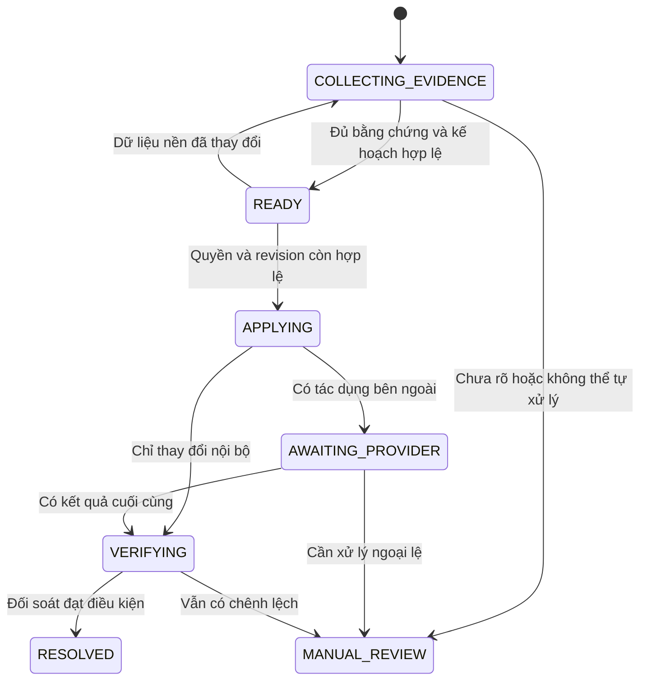

# Rollback after rule defect — Khôi phục sau lỗi quy tắc nghiệp vụ

## 1. Mục tiêu và tình huống điển hình

Trong chương **Deployment Operations**, rollback sau lỗi quy tắc nghiệp vụ là hoạt động đưa hệ thống về một trạng thái thực thi an toàn khi phiên bản mới cho phép hoặc từ chối sai hành động. Lỗi có thể nằm ở code, policy, feature flag, dữ liệu cấu hình hoặc sự tương tác giữa nhiều phiên bản đang chạy.

Với business logic security, mục tiêu không chỉ là giảm lỗi HTTP. Hệ thống cần ngừng tạo quyết định sai, giữ được dấu vết ảnh hưởng, khôi phục các bất biến và xử lý những tác dụng đã xảy ra mà không tạo thêm thao tác trái phép hoặc trùng lặp.

Sau bài học, người học có thể:

- Khoanh vùng và chặn hành động bị ảnh hưởng qua cả API, worker, batch và retry.
- Chọn rollback hoặc sửa tiến có căn cứ về tính tương thích và rủi ro bảo mật.
- Phân biệt khôi phục phần mềm, sửa dữ liệu và bù trừ tác dụng nghiệp vụ.
- Đối soát command, approval, reservation, ledger, outbox và kết quả dịch vụ ngoài.
- Bảo toàn identity, quyền theo đối tượng, workflow và idempotency trong quá trình phục hồi.
- Xác định bằng chứng đủ để mở lại luồng nghiệp vụ và kết thúc xử lý sự cố.

### Ví dụ xuyên suốt: hoàn tiền vượt số tiền đã thu

Một payment có số tiền đã thu là 1.000.000 đồng, đã hoàn thành công 600.000 đồng và đang giữ chỗ 200.000 đồng cho lệnh hoàn khác. Phiên bản mới chỉ kiểm tra từng lệnh hoàn không vượt 1.000.000 đồng, nên tiếp tục chấp nhận lệnh 300.000 đồng.

Bất biến cần bảo vệ là:

```text
tiền đã hoàn thành công
+ tiền đang giữ chỗ cho các lệnh chưa được giải quyết
+ số tiền xin hoàn mới
<= số tiền đã thu hợp lệ
```

Biểu thức Java minh họa với các giá trị cùng tiền tệ:

```java
boolean withinRemainingAmount = settledRefunds
    .add(activeReservations)
    .add(requestedRefund)
    .compareTo(capturedAmount) <= 0;
```

Đây chỉ là điều kiện số học. Giá trị phải được lấy từ nguồn có thẩm quyền, không âm và được đọc/ghi theo cơ chế chống cạnh tranh phù hợp. Reservation và khoản đã settled phải là hai tập không chồng lặp; một lệnh chuyển từ pending sang settled không được tính hai lần.

Rollback code có thể chặn lệnh mới dùng công thức sai. Nó chưa trả lại khoản đã hoàn qua nhà cung cấp, chưa xử lý reservation tồn đọng và chưa loại bỏ message cũ trong queue. Mọi số phiên bản, tên tài nguyên và mốc thời gian trong bài đều là ví dụ giả định.

## 2. Tách ba loại khôi phục

| Loại công việc | Đối tượng tác động | Kết quả cần đạt |
| --- | --- | --- |
| Khôi phục thực thi | Code, policy, flag, cấu hình, worker đang chạy | Quyết định mới tuân thủ quy tắc đúng |
| Đối soát và sửa dữ liệu | Command, approval, state, reservation, ledger, outbox | Dữ liệu phản ánh kết quả thực tế và các bất biến được phục hồi theo kế hoạch |
| Bù trừ tác dụng nghiệp vụ | Hoàn tiền, giữ chỗ, giao hàng hoặc tác dụng ở hệ thống khác | Xử lý hậu quả bằng hành động hợp lệ, có thể theo dõi và chống lặp |

Một transaction database chưa commit có thể rollback theo cơ chế transaction. Một business command đã commit và đã gọi hệ thống khác thường cần một quy trình sửa/bù trừ riêng.

Bù trừ phụ thuộc quy tắc nghiệp vụ và các thay đổi đồng thời; nó không nhất thiết là việc đặt toàn hệ thống về snapshot ban đầu. Bản thân quy trình bù trừ cũng có thể thất bại và cần khả năng tiếp tục/chống lặp. [Microsoft Azure Architecture Center — Compensating Transaction pattern](https://learn.microsoft.com/en-us/azure/architecture/patterns/compensating-transaction).

Không restore toàn database về trước release chỉ để xóa các lệnh sai nếu việc đó đồng thời xóa đơn hàng, thanh toán hoặc thay đổi hợp lệ của người dùng khác. Snapshot phục vụ điều tra và phương án khôi phục có phạm vi rõ; tính khả thi phải được đánh giá theo dữ liệu và tác dụng thực tế.

Lỗi quy tắc cũng có thể quá chặt, làm từ chối hàng loạt lệnh hợp lệ. Trong trường hợp đó, phục hồi availability vẫn phải giữ các điều kiện identity, tenant và bất biến. Không dùng cách bỏ toàn bộ authorization để đưa tỷ lệ thành công trở lại bình thường.

## 3. Chặn tác dụng mới trước khi thay phiên bản

### 3.1. Khoanh phạm vi nghiệp vụ bị ảnh hưởng

Xác định action, tenant, nhóm đối tượng, loại command và đường gọi thực sự chịu lỗi. Nếu lỗi chỉ ở thao tác hoàn tiền mới, có thể giữ các luồng đọc hoặc nghiệp vụ không liên quan hoạt động khi chúng vẫn an toàn.

Biện pháp containment phải nằm trên đường tạo tác dụng, không chỉ trên giao diện:

| Đường thực thi | Điều cần kiểm soát |
| --- | --- |
| API | Không tiếp nhận/thực thi thêm lệnh bị ảnh hưởng theo hợp đồng tạm dừng |
| Consumer | Không tiếp tục lấy hoặc thực thi command thuộc phạm vi bị chặn |
| Scheduler/batch/import | Không tạo một lối ghi dữ liệu vòng qua gate |
| Outbox publisher | Không phát tiếp sự kiện có thể gây tác dụng sai chưa được xử lý |
| Retry/DLQ replay | Không tái kích hoạt cùng lỗi bằng một đường phát lại khác |
| Admin/support tool | Không có nhánh cập nhật trạng thái hoặc bỏ quyền ngoài quy trình |

Không mặc định phải dừng mọi publisher. Có sự kiện cần tiếp tục để ghi nhận kết quả từ provider hoặc giải phóng công việc không liên quan. Cần phân loại event và tác dụng trước khi chặn, để không làm mất khả năng đối soát.

### 3.2. Gate, kill switch và lệnh đang chạy

Một kill switch có độ trễ lan truyền. Cần quan sát instance/worker nào đã nhận trạng thái mới, instance nào chưa xác nhận và command nào đã đi qua kiểm tra nhưng chưa hoàn tất.

Với thiết kế fencing bằng epoch, mỗi lần chuyển trạng thái vận hành có thể tăng một số thế hệ đơn điệu. Executor cũ không được tạo tác dụng mới khi không đáp ứng hợp đồng kiểm tra epoch. Tuy nhiên, một lần đọc epoch rồi gọi dịch vụ ngoài vẫn có khoảng trống cạnh tranh; cần cơ chế phối hợp phù hợp và theo dõi các lệnh đã vượt ranh giới gửi.

Phân biệt rõ:

- **Ngăn tiếp nhận:** không tạo thêm command mới.
- **Ngăn thực thi:** command đã tồn tại chưa được phép tạo tác dụng mới.
- **Xử lý in-flight:** xác định các giao dịch đã ghi/gửi và còn có thể hoàn tất.

Dừng ingress không dừng worker. Dừng lấy message không hủy request đã gửi provider. Hủy process sau timeout cũng không chứng minh request ở provider chưa thực hiện.

Gate phục hồi nên được quản lý độc lập với bộ cấu hình sẽ rollback. Không để rollback một flag snapshot vô tình mở lại action trước khi đủ bằng chứng. Nếu bản cũ không hiểu gate hiện tại, cần một hàng rào được bản đó tôn trọng hoặc một phương án triển khai khác.

## 4. Xác định phiên bản và cửa sổ ảnh hưởng thực tế

### 4.1. Một release không chỉ là image tag

Lưu hoặc truy được tổ hợp sau cho các quyết định/lệnh quan trọng:

```text
releaseId, imageDigest, buildId
policyVersion, policyBundleDigest
flagSnapshotVersion, configVersion
schemaCompatibilityVersion
instanceId, workerVersion, region
decisionId, commandId, tenantId, resourceId, resourceRevision
actorId / initiatedBy / executedBy
evaluatedAt, committedAt, sentAt, providerReference
operationGateEpoch
```

Không ghi credential, token hoặc dữ liệu nhạy cảm nguyên bản chỉ để bổ sung khả năng truy vết. Các version phải chỉ đúng artifact/snapshot đã được dùng, không chỉ là giá trị dashboard hiện tại.

Ví dụ một API đã về image an toàn nhưng còn nạp policy lỗi từ cache; hoặc API đã rollback nhưng consumer vẫn chạy release mới. Chỉ kiểm tra version của Deployment API không đủ để xác định quyết định nào còn bị ảnh hưởng.

### 4.2. Cửa sổ quyết định và cửa sổ tác dụng có thể khác nhau

| Mốc | Ý nghĩa |
| --- | --- |
| Thời điểm đầu tiên có thể kích hoạt lỗi | Có thể là canary, flag activation hoặc policy reload trước rollout chính |
| Thời điểm phát hiện | Khi có bằng chứng bất biến bị vi phạm hoặc quyết định sai |
| Thời điểm phát lệnh containment | Khi control plane bắt đầu yêu cầu chặn action |
| Thời điểm hàng rào thực sự có hiệu lực | Các đường thực thi đã xác nhận và in-flight được phân loại theo thiết kế |
| Thời điểm artifact an toàn phục vụ đầy đủ | Các executor cần thiết đã dùng tổ hợp phiên bản được chọn |
| Thời điểm tác dụng cũ được giải quyết | Queue/provider/retry liên quan đã được đối soát hoặc đưa vào danh sách xử lý có kiểm soát |

Command được đánh giá lúc 10:02 có thể được worker gửi lúc 10:20 dù API rollback lúc 10:10. Vì vậy, không lấy giờ rollback làm ranh giới cứng cho mọi tác dụng chịu lỗi.

Cần dựng timeline từ deployment, flag, policy, audit, command log, queue/outbox và hệ thống đích. Khi timestamp hoặc version thiếu, mở rộng tập ứng viên và đánh dấu mức bất định; không tự suy ra các lệnh đó an toàn.

## 5. Chọn rollback hay sửa tiến

### 5.1. Điều kiện của một mục tiêu rollback dùng được

Một bản từng chạy ổn không tự là mục tiêu an toàn trong trạng thái hiện tại. Cần xác định nó:

- Thực thi đúng quy tắc bị lỗi và giữ những kiểm soát bảo mật bắt buộc khác.
- Đọc được schema, trạng thái workflow và command/event đã được bản mới ghi.
- Tôn trọng gate/fencing và hiểu hợp đồng idempotency cần thiết.
- Có artifact, policy bundle và cấu hình tương ứng còn truy xuất được.
- Không ghi đè hoặc làm mất dữ liệu mà bản mới đã tạo hợp lệ.

| Tình huống | Phương án cần cân nhắc |
| --- | --- |
| Lỗi nằm trong code mới; bản cũ tương thích và còn an toàn | Rollback artifact cùng cấu hình liên quan |
| Code không đổi, policy/flag mới sai | Khôi phục policy/flag có version và xác nhận reload trên executor |
| Bản cũ không hiểu schema/event mới | Giữ containment, sửa tiến hoặc triển khai adapter tương thích |
| Rollback sẽ làm mất bản vá bảo mật cần thiết | Sửa tiến hoặc backport phần đúng vào artifact an toàn |
| Quy tắc đã đúng trở lại nhưng dữ liệu còn sai | Tiếp tục đối soát/sửa dữ liệu, không coi rollback là đã xử lý xong |

Không để lựa chọn trở thành cuộc chạy đua theo số phút deploy. Cần so thời gian tới trạng thái có thể chứng minh an toàn, bao gồm worker, policy, cache và dữ liệu bị ảnh hưởng.

### 5.2. Không gắn rollback ứng dụng với down migration phá dữ liệu

Migration kiểu mở rộng trước, thu hẹp sau giúp giữ khả năng chạy nhiều phiên bản. Nếu bản mới đã thay đổi cấu trúc hoặc ghi enum mới, phải kiểm tra khả năng đọc/ghi của bản cũ trước khi đưa nó vào phục vụ.

Không tự động drop cột, xóa trạng thái hoặc restore bảng chỉ vì muốn image cũ khởi động được. Nếu cần sửa dữ liệu/schema trong sự cố, đó là một công việc có phạm vi, kế hoạch đối soát và khả năng phục hồi riêng.

## 6. Đối soát theo đối tượng nghiệp vụ, không chỉ theo request lỗi

### 6.1. Dựng tập ứng viên và phân loại bằng chứng

Tập ứng viên gồm các quyết định có thể dùng quy tắc lỗi, command được tạo từ quyết định đó và các tác dụng phát sinh về sau. Bộ lọc thường kết hợp version, action, thời gian, tenant và quan hệ giữa các bản ghi. Chỉ lọc `HTTP 500` sẽ bỏ sót những thao tác sai đã trả `200` hoặc `202`.

Với mỗi payment trong ví dụ, cần gom cả các refund hợp lệ trước đó, reservation đang hoạt động và refund mới đáng nghi. Bất biến là thuộc tính của cả payment; xem từng refund độc lập sẽ lặp lại chính lỗi đã gây sự cố.

Một hồ sơ đối soát có thể chứa:

```text
incidentId, tenantId, paymentId, currency
originalCommandId, originalIdempotencyKey, requestFingerprint
decisionVersion, approvalReference, approvedResourceRevision
reservationId, reservationState
outboxEventId, deliveryAttemptIds
providerReference, providerOutcome, evidenceObservedAt
localState, expectedResourceRevision
classification, proposedAction, repairActionId, assignedOwner
```

Không coi một bản ghi log là toàn bộ sự thật. Ví dụ, log ghi “chuẩn bị gửi” không chứng minh provider đã nhận; trạng thái `FAILED` nội bộ cũng chưa chứng minh tiền chưa chuyển nếu lỗi xảy ra sau khi gửi request.

### 6.2. Phân biệt chưa gửi, đã hoàn tất và chưa biết kết quả

| Phân loại | Bằng chứng cần có | Hướng xử lý |
| --- | --- | --- |
| Chưa vượt ranh giới gửi và còn kiểm soát được | Command/outbox, trạng thái executor và hàng rào thực thi chứng minh không còn đường gửi ngoài kiểm soát | Đánh giá lại; hủy lệnh sai hoặc đưa về bước cần phê duyệt theo transition hợp lệ |
| Provider xác nhận thành công | Kết quả có thể liên kết chắc chắn với đúng lệnh, payment, số tiền và tiền tệ | Ghi nhận tác dụng thực tế; cân nhắc bù trừ theo nghiệp vụ |
| Provider xác nhận thất bại cuối cùng, không còn khả năng thực hiện | Kết quả cuối cùng theo hợp đồng của provider và đúng reference | Đóng lệnh thất bại; giải phóng reservation theo transaction phù hợp |
| Kết quả chưa xác định | Timeout, mất response, webhook chậm hoặc dữ liệu hai phía mâu thuẫn | Giữ nghĩa vụ đang chờ, cô lập phạm vi và tiếp tục đối soát |
| Lệnh không thuộc lỗi | Có đủ dữ liệu để kiểm tra quy tắc và phiên bản liên quan | Giữ nguyên kết quả hợp lệ, kèm bằng chứng loại khỏi tập ảnh hưởng |

`NOT_FOUND` ở một lần tra cứu không luôn tương đương với thất bại cuối cùng. Provider có thể chưa phản ánh request vừa nhận, hoặc hệ thống đang tra cứu sai reference. Chỉ giải phóng nghĩa vụ khi bằng chứng và hợp đồng tích hợp cho phép kết luận đó.

Trong bài này, `UNKNOWN` là trạng thái kết quả chưa xác định của command. Reservation tương ứng vẫn thuộc tập đang hoạt động cho tới khi có căn cứ chuyển trạng thái. Không dùng timeout để vừa giải phóng tiền khả dụng vừa để request cũ có thể hoàn tất ở provider.

### 6.3. Đo lại bất biến mà không nhân đôi dữ liệu

Ví dụ SQL dưới đây chỉ minh họa truy vấn đọc trên mô hình giả định. Số tiền dùng đơn vị nhỏ nhất của cùng một tiền tệ; `refund_ledger` phản ánh khoản hoàn đã được xác nhận và `refund_reservation` chỉ giữ nghĩa vụ chưa chuyển thành khoản đã hoàn. Tên bảng và trạng thái không phải yêu cầu cho mọi hệ thống.

```sql
WITH settled AS (
    SELECT tenant_id, payment_id, currency,
           SUM(amount_minor) AS settled_minor
    FROM refund_ledger
    WHERE entry_kind = 'REFUND_SETTLED'
    GROUP BY tenant_id, payment_id, currency
), reserved AS (
    SELECT tenant_id, payment_id, currency,
           SUM(amount_minor) AS reserved_minor
    FROM refund_reservation
    WHERE state = 'ACTIVE'
    GROUP BY tenant_id, payment_id, currency
)
SELECT p.tenant_id, p.id, p.currency, p.captured_minor,
       COALESCE(s.settled_minor, 0) AS settled_minor,
       COALESCE(r.reserved_minor, 0) AS reserved_minor
FROM payment p
LEFT JOIN settled s
  ON s.tenant_id = p.tenant_id
 AND s.payment_id = p.id
 AND s.currency = p.currency
LEFT JOIN reserved r
  ON r.tenant_id = p.tenant_id
 AND r.payment_id = p.id
 AND r.currency = p.currency
WHERE p.tenant_id = :tenant_id
  AND p.id = :payment_id;
```

Các tham số phải được bind. Hai tập được tổng hợp riêng trước khi join để tránh nhân số dòng refund với số dòng reservation. Không bỏ `tenant_id` hoặc cộng nhiều tiền tệ với nhau.

Kết quả là một phần bằng chứng, không phải thuật toán xác định toàn bộ ảnh hưởng. Nó chưa phát hiện được thiếu phê duyệt, sai chủ sở hữu, lệnh bị từ chối oan hoặc tác dụng ở provider chưa được ghi vào ledger. Nếu hệ thống có nhiều loại bút toán điều chỉnh, phải định nghĩa lại phép tổng hợp theo mô hình sổ cái thực tế.

Trong lúc đối soát, dùng nguồn dữ liệu và mức nhất quán thích hợp. Replica bị trễ có thể cho thấy reservation đã biến mất nhưng khoản settled chưa xuất hiện. Khi sửa dữ liệu, phải đọc lại điều kiện trên nguồn có thẩm quyền dưới cơ chế chống cạnh tranh; không dùng kết quả báo cáo cũ làm điều kiện ghi.

## 7. Sửa dữ liệu qua workflow phục hồi có kiểm soát

### 7.1. Hồ sơ phục hồi tách khỏi trạng thái giao dịch

Một hồ sơ phục hồi có thể đi qua các trạng thái sau:



Đây là workflow của **hồ sơ phục hồi**, không phải state machine của refund. Đóng hồ sơ không tự làm refund thành công, và trạng thái `MANUAL_REVIEW` không cho phép giải phóng reservation. Kết quả của hành động sửa phải được xác nhận riêng trước khi đánh dấu `RESOLVED`.

Kế hoạch nên cố định danh sách đối tượng, loại hành động, điều kiện trước khi chạy và thay đổi dự kiến. Một lần xem trước chỉ mô tả điều sẽ làm nếu các điều kiện vẫn đúng. Nếu revision, kết quả provider hoặc quyền đã thay đổi, kế hoạch phải được tính lại thay vì áp dụng mù theo danh sách cũ.

### 7.2. Quyền sửa không thay thế quyền của giao dịch gốc

Tool phục hồi phải có identity thực thi, quyền theo action và phạm vi đối tượng/tenant rõ ràng. Quyền vận hành deployment không mặc nhiên cho phép hoàn tiền, sửa giá hoặc phê duyệt thay người khác. Nguyên tắc đặc quyền tối thiểu và kiểm tra quyền trên từng yêu cầu được trình bày tại [OWASP — Authorization Cheat Sheet](https://cheatsheetseries.owasp.org/cheatsheets/Authorization_Cheat_Sheet.html).

Với command bị treo, cần phân biệt hai câu hỏi:

1. Quyết định trước đây có hợp lệ với dữ liệu và hợp đồng nghiệp vụ tại thời điểm đó không?
2. Command còn được phép tạo tác dụng ở thời điểm thực thi tiếp hay không?

Một số workflow yêu cầu kiểm tra lại quyền hiện tại; workflow khác dùng sự ủy quyền đã cam kết, có hạn dùng và phạm vi cố định. Thiết kế phải nói rõ điều kiện nào được giữ lại, điều kiện nào phải đánh giá lại và hành vi khi thiếu bằng chứng. Không mặc định mọi approval cũ đều còn hiệu lực, cũng không tự hủy mọi cam kết hợp lệ chỉ vì thay phiên bản.

Nếu số tiền, người nhận hoặc revision được phê duyệt đã bị thay đổi, không tái sử dụng approval để chạy payload khác. OWASP nêu yêu cầu kiểm soát thứ tự bước và kiểm tra authorization gắn với thời điểm thực thi giao dịch. [OWASP — Transaction Authorization Cheat Sheet](https://cheatsheetseries.owasp.org/cheatsheets/Transaction_Authorization_Cheat_Sheet.html).

Nếu lệnh đã hoàn tất dù thiếu phê duyệt, một approval tạo sau sự cố không biến hành động quá khứ thành hợp lệ. Nó chỉ có thể cho phép hành động xử lý tiếp theo theo chính sách. Giữ lịch sử quyết định gốc, identity khởi tạo, identity sửa và lý do phục hồi để có thể phân biệt hai việc này.

### 7.3. Chọn hành động theo tác dụng thực tế

| Trạng thái đã chứng minh | Hành động có thể phù hợp | Điều không được suy diễn |
| --- | --- | --- |
| Refund sai chưa gửi và còn chặn gửi được | Hủy qua transition hợp lệ, triệt tiêu khả năng gửi của outbox, giải phóng reservation trong cùng thay đổi nguyên tử phù hợp | Xóa row command là đã ngăn được bản message cũ |
| Refund hợp lệ bị từ chối bởi quy tắc quá chặt | Cho phép gửi lại hoặc tiếp tục theo hợp đồng idempotency, sau khi kiểm tra điều kiện cần thiết | Mọi request từng bị từ chối đều nên tự chạy lại |
| Provider đã hoàn tiền nhưng local còn pending | Ghi nhận kết quả đã xác nhận, chuyển reservation sang settled theo một transaction | Phải gọi hoàn tiền thêm lần nữa để local chuyển trạng thái |
| Refund đã thực hiện sai | Giữ sự thật đã xảy ra; tạo hồ sơ bù trừ/ngoại lệ được phép | Có thể tự thu lại tiền bằng một request ngược chiều |
| Chưa biết provider đã thực hiện hay chưa | Giữ cô lập và reservation, tra cứu/nhận kết quả rồi phân loại lại | Timeout hoặc restart worker chứng minh chưa có tác dụng |

Với ví dụ ban đầu, nếu lệnh 300.000 đồng chưa gửi và được hủy an toàn, tổng nghĩa vụ còn 800.000 đồng. Nếu lệnh đó đã hoàn tất trong khi 200.000 đồng kia vẫn đang chờ, tổng đã hoàn cộng giữ chỗ là 1.100.000 đồng. Hệ thống cần chặn refund mới trên payment đó và xử lý chênh lệch; không sửa `capturedAmount` lên 1.100.000 đồng để phép kiểm tra trở nên đúng.

Nếu 200.000 đồng còn lại cũng đã hoàn tất thì khoản đã hoàn thực tế là 1.100.000 đồng. Một bút toán tùy ý làm giảm báo cáo không thu hồi được tiền. Khoản bù trừ chỉ được ghi theo sự kiện và quy tắc hạch toán thực tế; có trường hợp cần giữ ngoại lệ cùng người chịu trách nhiệm cho tới khi giải quyết được hậu quả.

## 8. Transaction và idempotency cho chính công việc phục hồi

### 8.1. Giữ ba định danh khác nhau

| Định danh | Mục đích | Quy tắc khi chạy lại |
| --- | --- | --- |
| Idempotency key của yêu cầu gốc | Nhận diện cùng một ý định nghiệp vụ của client trong phạm vi hợp đồng | Giữ liên kết với command và fingerprint gốc; không xóa vì rollback |
| `repairActionId` | Nhận diện một hành động sửa cụ thể trên command/đối tượng | Ổn định qua các lần chạy lại cùng hành động; ràng buộc duy nhất ở nơi lưu bền |
| Key gửi provider | Chống tạo thêm tác dụng cho một thao tác bên ngoài theo hợp đồng provider | Retry cùng thao tác dùng cùng key; bù trừ là thao tác riêng có key riêng |

Một khóa duy nhất cho hành động sửa có thể là `(tenantId, incidentId, originalCommandId, repairKind)`, với các thành phần bắt buộc có giá trị. Phạm vi này chỉ phù hợp khi mỗi loại sửa được phép xảy ra một lần trong sự cố đó. Nếu nghiệp vụ cho phép nhiều phần bù trừ, cần định danh riêng từng phần và kiểm soát tổng số tiền, thay vì tạo key ngẫu nhiên mỗi lần retry.

Cùng key nhưng payload khác phải bị phát hiện bằng fingerprint ổn định của dữ liệu có ý nghĩa, gồm đối tượng, loại hành động, số tiền, tiền tệ và các điều kiện liên quan. Idempotency không cấp quyền: người không có quyền với đối tượng cũng không được đọc kết quả cũ chỉ bằng cách đoán key.

Khi rollback, không xóa bảng deduplication, đổi namespace key hoặc khôi phục snapshot làm mất command mới mà chưa có phương án bảo toàn chống lặp. Thời hạn lưu key của provider và của hệ thống nội bộ có thể khác nhau. Nếu key ngoài đã hết hiệu lực mà kết quả vẫn chưa rõ, tự động gửi lại có thể tạo tác dụng mới; cần đối soát theo reference hoặc chuyển xử lý ngoại lệ.

### 8.2. Một transaction nội bộ cho mỗi hành động sửa

Đoạn sau là mã giả theo phong cách Java, mô tả ranh giới transaction; không phải implementation có thể sao chép chạy ngay. Các hàm kiểm tra và khóa đại diện cho hợp đồng phải được hiện thực trong hệ thống cụ thể.

```java
RepairResult prepareRepair(RepairPlan plan, Operator operator) {
    return transaction.execute(() -> {
        authorization.requireRepairPermission(
            operator, plan.tenantId(), plan.paymentId(), plan.kind());

        Payment payment = payments.lockForUpdate(
            plan.tenantId(), plan.paymentId());

        RepairAction action = repairs.getOrCreateUnique(
            plan.repairActionId(), plan.actionScope(), plan.fingerprint());
        action.requireSameFingerprint(plan.fingerprint());

        if (action.isCompleted() || action.isAwaitingProvider()) {
            return action.currentResult();
        }

        plan.requireMatchingRevision(payment.revision());
        recoveryGate.requireAllowed(plan.actionScope(), plan.kind());
        evidence.requireSufficientAndCurrent(plan, payment);
        workflow.requireAllowedRepairTransition(plan, payment);
        invariants.requireAllowedResult(plan, payment);

        if (plan.requiresExternalEffect()) {
            outbox.insertUnique(action.id(), plan.externalCommand());
            action.markAwaitingProvider();
        } else {
            applyLocalRepair(plan, payment);
            action.markCompleted();
        }

        audit.appendRepair(operator, plan, action, payment.revision());
        repairs.save(action);
        return action.currentResult();
    });
}
```

Các giả định quan trọng của thiết kế minh họa:

- Lock nằm trên aggregate chịu bất biến; mọi đường ghi liên quan phải dùng cùng cơ chế phối hợp hoặc một cơ chế tương đương. Chỉ khóa row của từng refund không ngăn hai refund cùng vượt hạn mức payment.
- Ràng buộc duy nhất được database thực thi, không chỉ là `if (!exists)` trong bộ nhớ. `getOrCreateUnique` phải xử lý cạnh tranh đúng với cơ chế transaction của database, kể cả khi cần rollback rồi thử lại transaction.
- Ghi thay đổi nghiệp vụ, kết quả sửa, audit bền và outbox cần thiết phải cùng commit hoặc cùng không commit trong phạm vi transaction được mô tả.
- Hành động hủy lệnh chưa gửi phải phối hợp với executor đang gửi. Một database lock nội bộ không thu hồi được request đã ra mạng; nếu không chứng minh được điều kiện hủy thì chuyển sang nhánh chưa xác định.
- `requireAllowedResult` áp dụng điều kiện phù hợp với từng loại sửa. Ghi nhận đúng một refund đã xảy ra có thể làm lộ khoản vượt hạn mức; không được từ chối ghi nhận sự thật chỉ để giữ số liệu đẹp. Hành động đó phải giữ payment bị cô lập và tạo nghĩa vụ xử lý chênh lệch.

Không gọi provider bên trong transaction rồi giả định transaction database sẽ rollback được tiền đã gửi. Dispatcher xử lý outbox riêng, kiểm tra phạm vi phục hồi và điều kiện thực thi tương ứng, gửi bằng key ổn định, sau đó ghi nhận kết quả bằng cập nhật có điều kiện. Một gate có thể cho phép đối soát hoặc một loại bù trừ cụ thể trong khi vẫn chặn refund thông thường.

Trường hợp process chết sau khi provider thực hiện nhưng trước khi local ghi nhận phải quay về đối soát kết quả của cùng thao tác. Outbox hỗ trợ lưu bền ý định gửi; tự nó không bảo đảm tác dụng bên ngoài chỉ xảy ra một lần.

### 8.3. Sửa theo lô nhỏ và dừng khi giả định không còn đúng

Một đợt sửa nên có giới hạn số đối tượng và tổng giá trị, checkpoint bền, kết quả từng hành động và điều kiện dừng. Bắt đầu bằng tập nhỏ có bằng chứng rõ, đo lại bất biến và chênh lệch rồi mới mở rộng.

Nếu một payment đổi revision sau lần xem trước, dừng hoặc bỏ qua có ghi nhận để tính lại kế hoạch cho payment đó. Không cập nhật ép revision về giá trị cũ. Nếu tỷ lệ `UNKNOWN`, xung đột hoặc chênh lệch tăng, dừng lô thay vì thêm retry vô hạn.

Chỉ cập nhật trực tiếp dữ liệu khi có một kế hoạch sửa được định nghĩa rõ và vẫn bảo toàn các kiểm soát cần thiết. Câu lệnh kiểu `UPDATE ... SET status = 'SUCCESS'` trên toàn cửa sổ sự cố không thay thế được transition, quyền, ledger và tác dụng thật ở provider.

## 9. Runbook rollback và mở lại nghiệp vụ

Các bước dưới đây là runbook minh họa cho sự cố quy tắc hoàn tiền, không phải trình tự bắt buộc của một nền tảng cụ thể. Việc chặn tác dụng mới và thu thập bằng chứng ban đầu có thể tiến hành song song khi không cản trở nhau.

| Bước | Thao tác chính | Bằng chứng để chuyển bước |
| --- | --- | --- |
| 1. Ghi nhận sự cố | Xác định bất biến, action, phạm vi nghi ngờ và người điều phối | Có incident ID, mức ảnh hưởng ban đầu và đầu mối vận hành/nghiệp vụ |
| 2. Containment | Chặn đường tạo tác dụng sai, quản lý in-flight, giữ đường nhận kết quả cần thiết | Executor xác nhận gate; lệnh còn có thể hoàn tất được theo dõi riêng |
| 3. Chọn mục tiêu | Đánh giá code, policy, flag, schema, bảo mật và khả năng hiểu dữ liệu mới | Có tổ hợp artifact cụ thể và căn cứ chọn rollback hoặc sửa tiến |
| 4. Thực hiện thay phiên bản | Triển khai trong khi containment còn hiệu lực, xử lý cache và worker | Mỗi đường thực thi cần thiết dùng đúng tổ hợp được chọn |
| 5. Đối soát ảnh hưởng | Phân loại command, reservation, ledger, outbox và provider | Có tập ứng viên, trạng thái bằng chứng, kế hoạch xử lý và danh sách chưa rõ |
| 6. Phục hồi có kiểm soát | Chạy hành động sửa/bù trừ đã được phép theo từng lô | Có kết quả chống lặp, audit và phép kiểm tra sau sửa cho từng phạm vi |
| 7. Mở lại từng phạm vi | Cho phép một tập nhỏ đủ điều kiện, giữ cô lập phần chưa an toàn | Quan sát đúng quyết định nghiệp vụ và các ngưỡng dừng đã định |
| 8. Kết thúc và bàn giao | Đóng phần đã giải quyết, bàn giao ngoại lệ, cập nhật khả năng phòng ngừa | Phân biệt rõ đã phục hồi phục vụ với đã xử lý xong mọi hậu quả |

### 9.1. Điều kiện mở lại không chỉ là pod khỏe

Trước khi mở lại một phạm vi, cần trả lời được:

- Các executor, policy cache, flag và command handler có cùng hợp đồng an toàn không? Bản cũ còn sống có bị chặn tạo tác dụng không?
- Lệnh mới có kiểm tra đúng tenant, quyền đối tượng, approval, state transition, giá trị từ nguồn có thẩm quyền và bất biến dưới cạnh tranh không?
- Command cũ đã được hủy, đánh giá lại hoặc gắn điều kiện thực thi phù hợp chưa? Message cũ đến muộn có thể vượt gate không?
- Bảng idempotency, key provider và kết quả sửa có còn truy được qua ranh giới version không?
- Đối tượng còn `UNKNOWN` hoặc còn vi phạm có bị cô lập bền, có người xử lý và có đường nhận kết quả tiếp tục hoạt động không?
- Có thể dừng ngay tập đang mở khi phát hiện quyết định sai mới không?

Không bắt buộc mọi ngoại lệ toàn hệ thống phải kết thúc trước khi mở một phạm vi độc lập đã an toàn. Tuy nhiên, việc cô lập phải bao phủ các tài nguyên dùng chung: một tenant sạch vẫn có thể chịu tác động nếu dùng chung hạn mức, ví hoặc quota đang sai. Mở lại dựa trên ranh giới bất biến thực tế, không chỉ dựa trên nhãn tenant.

Không dùng lưu lượng thử để thực hiện giao dịch thật lên đối tượng đang nghi ngờ. Có thể bắt đầu bằng dữ liệu tổng hợp trong môi trường kiểm chứng, đánh giá không tạo tác dụng và sau đó mới dùng tập phục vụ được phép với giới hạn rõ. Kết quả đánh giá không tạo tác dụng chưa chứng minh đầy đủ hành vi dưới concurrency hoặc tác dụng ở provider.

### 9.2. Quan sát cả quyết định và tác dụng

| Tín hiệu | Điều cần biết | Phản ứng khi bất thường |
| --- | --- | --- |
| Vi phạm bất biến mới trên phạm vi đã mở | Có tiếp tục tạo nghĩa vụ vượt hạn mức hay không | Đóng gate của phạm vi và bảo toàn bằng chứng |
| Lệnh thực thi thiếu approval hoặc sai revision | Có nhánh bỏ qua state machine sau rollback hay không | Dừng executor/nhánh liên quan và phân loại lệnh đã vượt ranh giới |
| `UNKNOWN` và tuổi lệnh chưa đối soát | Hệ thống có tích lũy nghĩa vụ chưa biết kết quả hay không | Giới hạn thêm tác dụng, điều tra provider/đường ghi nhận |
| Chênh lệch ledger, reservation và provider | Số liệu nội bộ có phản ánh thực tế hay không | Giữ cô lập đối tượng, không tự xóa chênh lệch |
| Tác dụng lặp và xung đột fingerprint | Retry có biến thành hành động mới hay bị đổi payload không | Dừng nguồn phát lại, giữ key và command để điều tra |
| Từ chối lệnh hợp lệ theo nhóm action/tenant | Bản khôi phục có tiếp tục chặn sai hay không | Kiểm tra reason code và mẫu quyết định, không nới toàn bộ quyền |

Ngưỡng và khoảng quan sát phải được đặt theo nhịp nghiệp vụ, độ trễ queue/provider và rủi ro cụ thể. “Không có lỗi trong năm phút” không đủ nếu lệnh thường mất ba mươi phút mới đến worker. Theo dõi riêng vi phạm mới với chênh lệch lịch sử để không nhầm dữ liệu cũ thành lỗi mới hoặc ngược lại.

### 9.3. Bằng chứng hoàn tất sự cố

Hồ sơ hoàn tất cần nêu phiên bản khôi phục thực tế, thời điểm containment có hiệu lực, tập đối tượng đã xét, kết quả từng hành động sửa và kết quả đối soát cuối. Các hồ sơ còn mở phải có lý do, hạn chế đang áp dụng, người nhận xử lý và điều kiện gỡ hạn chế.

Phân biệt hai mốc: **khôi phục khả năng phục vụ an toàn** và **giải quyết toàn bộ hậu quả nghiệp vụ**. Một hệ thống có thể phục vụ lại các payment sạch trong khi một refund đã thực hiện sai vẫn cần xử lý ngoại lệ. Không báo “rollback thành công, dữ liệu đã phục hồi” nếu mới chứng minh được phần triển khai.

### 9.4. Ví dụ diễn tiến khi một lệnh có kết quả chưa xác định

Tiếp tục ví dụ payment 1.000.000 đồng: lệnh A đã hoàn 600.000 đồng, lệnh B giữ chỗ 200.000 đồng và lệnh C sai quy tắc giữ chỗ 300.000 đồng. Giả sử B và C đã được gửi; C bị timeout nên local chưa biết kết quả. Những mốc dưới đây minh họa cách ra quyết định, không phải cam kết về thời gian phục hồi.

| Mốc giả định | Bằng chứng vừa có | Quyết định và trạng thái cần giữ |
| --- | --- | --- |
| 10:03 — phát hiện lỗi | Tổng settled cộng reservation là 1.100.000 đồng; C dùng quy tắc lỗi | Cô lập payment, chặn refund mới và retry tạo tác dụng; giữ đường nhận kết quả của B, C |
| 10:07 — containment được xác nhận | Các executor liên quan đã xác nhận gate; B, C thuộc danh sách đã gửi | Giữ cả hai reservation; không suy từ timeout rằng C chưa hoàn tiền |
| 10:12 — hoàn tất thay phiên bản | API, worker và policy đã dùng tổ hợp an toàn, hiểu dữ liệu hiện có | Tiếp tục cô lập payment này dù các đối tượng độc lập đủ điều kiện có thể mở lại |
| 10:17 — provider xác nhận C thành công | Reference, số tiền, tiền tệ và payment khớp C | Trong transaction phù hợp, ghi settled 300.000 đồng và kết thúc reservation của C đúng một lần; tổng còn 900.000 đồng settled cộng 200.000 đồng reserved |
| 10:24 — provider xác nhận B thất bại cuối cùng | Có bằng chứng theo hợp đồng rằng B không còn có thể hoàn tất | Đóng B và giải phóng reservation 200.000 đồng theo transition hợp lệ; tổng nghĩa vụ còn 900.000 đồng |
| Sau đối soát — xét mở lại | Không còn kết quả chưa rõ; ledger, reservation và provider khớp; các điều kiện mở lại khác đạt | Có thể gỡ cô lập theo quy trình; phần dư số học là 100.000 đồng, còn phải qua quyền, approval và kiểm tra đồng thời khi dùng |

Nếu webhook thành công của C đến lặp sau 10:17, nó phải quy về cùng command và cùng tác dụng đã ghi nhận. Không cộng thêm 300.000 đồng vào ledger hoặc giải phóng reservation lần nữa. Nếu B chưa có kết quả cuối cùng ở 10:24, payment vẫn bị cô lập với tổng nghĩa vụ 1.100.000 đồng; không dùng kết quả mong đợi để mở lại sớm.

Trường hợp minh họa này phục hồi được bất biến hiện tại nhờ kết quả cuối cùng của B. Điều đó không biến quyết định chấp nhận C ban đầu thành đúng. Hồ sơ vẫn giữ quy tắc đã dùng, khoản chênh lệch từng tồn tại và tác dụng đã xảy ra; việc đóng hồ sơ còn cần đánh giá hậu quả thực tế và hoàn thành các điều kiện xử lý liên quan.

## 10. Những tình huống cần kiểm chứng trong diễn tập phục hồi

Các tình huống dưới đây là hướng dẫn thiết kế kiểm thử cho hệ thống được triển khai. Chúng không biểu thị rằng đã có một vòng QA hay diễn tập được chạy đối với bài học này.

| Tình huống | Kết quả nghiệp vụ cần quan sát |
| --- | --- |
| Gửi trực tiếp bước thực thi sau rollback, bỏ bước duyệt | Không có tác dụng nếu chưa đủ bằng chứng phê duyệt hợp lệ |
| Đổi số tiền, giá hoặc người nhận của command đã duyệt | Không dùng lại approval cho payload khác; transition về bước thích hợp theo hợp đồng |
| Đổi object ID sang payment của tenant khác trên tool sửa | Bị từ chối theo phạm vi đối tượng, không lộ kết quả cũ qua idempotency key |
| Hai refund cùng tranh phần dư cuối cùng | Tổng settled cộng reservation không vượt captured do lỗi cạnh tranh |
| Retry command từ trước rollback trên bản khôi phục | Cùng ý định giữ liên kết chống lặp và không tạo thêm tác dụng |
| Chạy lại lô sửa sau khi chết process | Mỗi `repairActionId` tiếp tục hoặc trả kết quả cũ theo trạng thái bền |
| Provider thành công rồi response bị mất | Không giải phóng reservation và gửi thao tác mới chỉ vì timeout |
| Webhook lặp hoặc đến sau khi đã đối soát | Cùng kết quả không ghi settled hai lần, không làm lùi trạng thái hợp lệ |
| Message từ bản lỗi đến sau khi mở lại | Executor vẫn kiểm tra điều kiện thực thi; không mặc định message cũ là đáng tin |
| API rollback nhưng worker hoặc policy cache còn bản lỗi | Hàng rào vận hành ngăn nhánh chưa an toàn tạo tác dụng |
| Dữ liệu có enum/cột mới trong khi bản cũ đang chạy | Từ chối triển khai hoặc xử lý tương thích rõ ràng, không đọc sai rồi ghi mất dữ liệu |
| Quy tắc lỗi từng từ chối nhầm yêu cầu hợp lệ | Yêu cầu được xử lý lại theo hợp đồng, không vô tình hồi sinh command bị hủy hợp lệ |
| Bù trừ không thực hiện được hoặc key provider đã hết hạn | Giữ ngoại lệ có thể theo dõi, không retry mù và không đánh dấu đã giải quyết |

Kiểm chứng cần đo số tác dụng, số tiền, quyền, trạng thái và audit sau các chuỗi sự kiện; chỉ kiểm tra HTTP status hoặc số pod sẵn sàng không chứng minh được business logic security. Nên chủ động sắp xếp lại thứ tự message, gây lỗi tại ranh giới commit/gửi/ghi nhận và chạy các nhánh đồng thời để thấy những khoảng trống mà happy path không bộc lộ.

## 11. Sai lầm thường gặp và nguyên tắc cần giữ

| Sai lầm | Hệ quả | Cách xử lý phù hợp hơn |
| --- | --- | --- |
| Rollback image là đóng sự cố | Bỏ sót policy, worker, command cũ và dữ liệu sai | Xác nhận toàn bộ đường quyết định và đường tạo tác dụng |
| Xóa idempotency record để client thử lại | Yêu cầu cũ có thể thành tác dụng mới | Giữ lịch sử; tách ý định mới và hành động sửa bằng hợp đồng rõ |
| Đánh dấu mọi pending thành failed | Giải phóng nghĩa vụ dù provider còn có thể thực hiện | Đối soát từng kết quả và giữ trạng thái chưa xác định khi cần |
| Replay toàn bộ DLQ bằng tài khoản admin | Bỏ qua quyền đối tượng và hồi sinh lệnh không còn hợp lệ | Replay theo tập được phân loại, quyền hẹp và điều kiện thực thi |
| Sửa giá hoặc hạn mức gốc cho khớp số liệu sai | Che vi phạm và làm mất nguồn sự thật | Giữ dữ liệu có thẩm quyền, ghi nhận chênh lệch và hành động sửa có dấu vết |
| Chỉ khóa từng command khi sửa | Hai command khác nhau vẫn tranh cùng hạn mức | Phối hợp trên aggregate chịu bất biến và kiểm tra lại trong transaction |
| Mở gate trước rồi mới xử lý queue | Message cũ tiếp tục tạo tác dụng bằng dữ liệu lỗi | Phân loại backlog và xác lập điều kiện thực thi trước khi mở |

Rollback sau lỗi quy tắc nghiệp vụ cần đưa quyết định mới về trạng thái an toàn, giữ đúng sự thật về tác dụng đã xảy ra và phục hồi theo từng đối tượng với quyền, transaction và idempotency rõ ràng. Phiên bản đã khôi phục, dữ liệu đã đối soát và hậu quả đã giải quyết là ba kết quả cần được chứng minh riêng.
