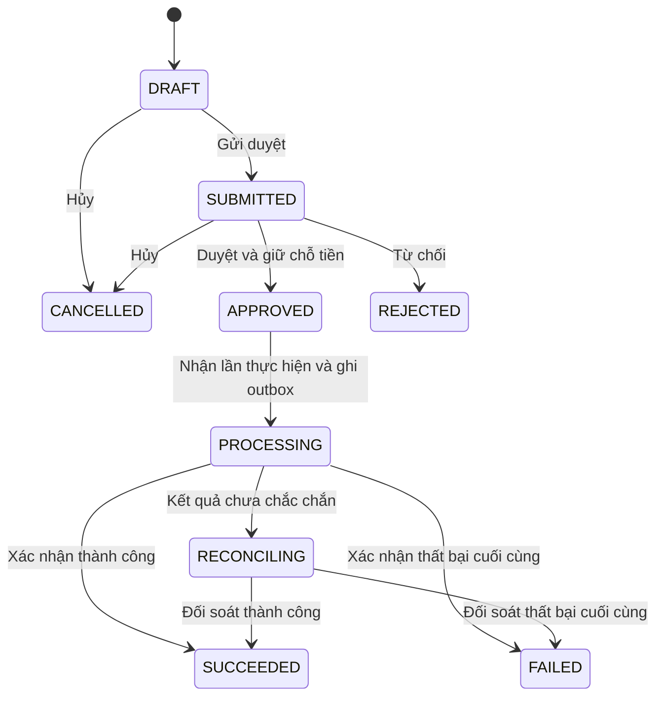

# New workflow security checklist

## 1. Mục đích và cách sử dụng

Checklist này dùng khi thiết kế hoặc bổ sung một quy trình nghiệp vụ có nhiều bước, như phê duyệt hoàn tiền, đặt chỗ, cấp hạn mức, đổi gói dịch vụ hoặc sử dụng ưu đãi. Trong chương **Security Checklists**, mục tiêu là phát hiện những đường thực hiện hợp lệ về cú pháp nhưng sai quy tắc: bỏ bước duyệt, sửa giá, dùng đối tượng của người khác, chiếm tài nguyên quá mức hoặc gửi lặp một lệnh có tác động.

Một workflow an toàn cần trả lời được: **ai được làm gì, trên đối tượng nào, từ trạng thái nào, với dữ liệu nào và bằng chứng gì cho thấy cập nhật vẫn đúng khi có retry hoặc cạnh tranh?** Việc API yêu cầu đăng nhập và giao diện chỉ hiện nút ở đúng bước chưa trả lời đủ những câu hỏi đó.

Khi áp dụng checklist, ghi cho mỗi mục: phạm vi, kết quả, bằng chứng, người phụ trách và phần chưa giải quyết. Có thể dùng các kết quả sau:

| Kết quả | Ý nghĩa |
|---|---|
| `PASS` | Có bằng chứng kiểm tra đúng kiểm soát trong phạm vi đã nêu |
| `FAIL` | Đã quan sát đường đi vi phạm hoặc biết kiểm soát còn thiếu |
| `UNKNOWN` | Chưa đủ thông tin hoặc chưa chạy được kiểm tra cần thiết |
| `N/A` | Không áp dụng, có giải thích dựa trên mô hình workflow |

`UNKNOWN` không được đổi thành `PASS` chỉ vì chưa thấy sự cố. `N/A` không dùng để bỏ một mục khó kiểm tra. Ví dụ, một workflow hoàn toàn nội bộ có thể không có webhook; một workflow có job nền vẫn phải kiểm tra quyền và idempotency của đường gọi đó.

Các mã trong bài là mã nội bộ của checklist minh họa, không phải số điều khoản của một tiêu chuẩn. Đây là tài liệu hướng dẫn xây dựng và đánh giá workflow; các ô chưa đánh dấu không phải kết quả kiểm tra của một hệ thống cụ thể. [OWASP Business Logic Security](https://cheatsheetseries.owasp.org/cheatsheets/Business_Logic_Security_Cheat_Sheet.html) là nguồn tham khảo về bất biến, giá trị do máy chủ quyết định, workflow rõ trạng thái và kiểm thử hành vi lạm dụng.

## 2. Chốt phạm vi, tác nhân và bất biến trước khi kiểm tra

### 2.1. Hồ sơ workflow tối thiểu

| Mã | Nội dung cần xác định | Bằng chứng tối thiểu |
|---|---|---|
| SCOPE-01 | Mục đích, giá trị hoặc tài nguyên mà workflow cấp phát | Mô tả một kết quả thành công và hậu quả khi bị lạm dụng |
| SCOPE-02 | Mọi điểm vào có thể đọc hoặc thay đổi workflow | Danh sách API, batch, job, consumer, callback, công cụ quản trị và đường tích hợp liên quan |
| SCOPE-03 | Tác nhân và phạm vi danh tính | Người dùng, người duyệt, worker, đối tác; nguồn tenant và quyền của từng loại |
| SCOPE-04 | Nguồn sự thật của dữ liệu quan trọng | Bảng nguồn cho giá, tiền, quyền, trạng thái, quota, thời hạn và bằng chứng phê duyệt |
| SCOPE-05 | Ranh giới transaction và tác động ngoài | Sơ đồ đọc/ghi, gửi message, gọi nhà cung cấp và nơi dữ liệu được commit |
| SCOPE-06 | Bất biến và chủ thể chịu trách nhiệm giải thích chúng | Danh sách có thể chuyển thành điều kiện và kiểm tra, thay vì chỉ ghi “đúng nghiệp vụ” |

Không chỉ thống kê các màn hình người dùng nhìn thấy. Một endpoint cũ, nút quản trị hoặc consumer ghi trực tiếp trạng thái có thể trở thành đường bỏ qua kiểm soát của API mới.

### 2.2. Ví dụ xuyên suốt: phê duyệt hoàn tiền

Giả sử mỗi yêu cầu hoàn tiền thuộc một tenant và một giao dịch gốc. Người tạo gửi yêu cầu, người có quyền khác phê duyệt, worker thực hiện với nhà cung cấp. Một bộ bất biến minh họa:

```text
actor được quyền thao tác trên đúng tenant và refund
người duyệt khác người tạo
số tiền hoàn > 0 và đúng loại tiền của giao dịch gốc
nội dung thực hiện khớp nội dung đã được duyệt
refundedAmount + reservedAmount <= refundableAmount
mỗi lần thực hiện có định danh ổn định, không tạo khoản hoàn trùng
chỉ cạnh trạng thái được định nghĩa mới được thực hiện
```

`refundableAmount` là giá trị được máy chủ xác định theo quy tắc của hệ thống; không mặc định bằng tổng tiền client gửi. Nếu có nhiều khoản thu, phí hoặc điều chỉnh, phải định nghĩa rõ mẫu số và cách tính.

Một mô hình trạng thái mẫu:



Đây là mô hình của ví dụ. `PROCESSING` nghĩa là hệ thống đã lưu ý định thực hiện, có thể chưa gửi mạng; `FAILED` chỉ dùng khi bằng chứng bên ngoài cho phép kết luận không còn khả năng thành công muộn. Các trạng thái `SUCCEEDED`, `FAILED`, `REJECTED`, `CANCELLED` không có cạnh đi tiếp trong mô hình này. Nếu cần mở lại, sửa sai hoặc bù trừ, phải thiết kế lệnh riêng có điều kiện và quyền rõ ràng.

## 3. Checklist dữ liệu đầu vào, giá và giá trị do máy chủ quyết định

| Mã | Câu hỏi kiểm tra | Bằng chứng để đánh dấu đạt |
|---|---|---|
| DATA-01 | Actor, tenant và thuộc tính quyền có được lấy từ nguồn đã xác thực? | Thay header/body tương ứng không đổi được phạm vi thao tác trái quyền |
| DATA-02 | Giá, phí, giảm giá, quota hoặc số tiền tối đa có được tra/tính lại ở máy chủ? | Gửi giá trị giả, giá trị cũ và trường dẫn xuất không thay đổi được số tiền/quyền thực tế |
| DATA-03 | DTO có danh sách trường được phép sửa, tách khỏi entity lưu trữ? | Chèn `approvedBy`, `state`, `isAdmin`, `tenantId` hoặc trường nhạy cảm không được gán ngoài ý muốn |
| DATA-04 | Các điều kiện số học và tổ hợp dữ liệu có hợp lệ về nghiệp vụ? | Ca số âm, 0, giá trị cực lớn, tràn số, loại tiền khác, tổng không khớp và quy tắc làm tròn được xử lý rõ |
| DATA-05 | Các ID liên quan có được kiểm tra quan hệ với nhau? | Refund thuộc payment, payment thuộc tenant; không ghép tùy ý hai ID hợp lệ nhưng không liên quan |
| DATA-06 | Dữ liệu thay đổi sau lúc hiển thị có được xử lý? | Khi giá, hạn mức hoặc trạng thái nguồn đổi, lệnh được tính lại, yêu cầu xác nhận lại hoặc từ chối theo hợp đồng |
| DATA-07 | Có giới hạn kích thước và số phần tử trước khi xử lý? | Batch, danh sách người nhận và trường văn bản không dẫn tới ghi/giữ chỗ vô hạn hoặc tiêu thụ tài nguyên không kiểm soát |

Không chỉ thử giá trị sai định dạng. Một số tiền `1` vẫn là số nguyên hợp lệ nhưng sai nếu yêu cầu đã được duyệt cho một nội dung khác; một `paymentId` tồn tại vẫn sai nếu thuộc tenant khác.

Đối với tiền, phải quy định đơn vị, miền giá trị, loại tiền và cách làm tròn. Không mặc định mọi currency đều có hai chữ số thập phân. Với số nguyên theo đơn vị nhỏ nhất, kiểm tra tràn số; với số thập phân, kiểm soát scale và phép tính phù hợp. Các quy tắc này phải cùng được dùng ở xác nhận, lưu trữ và thực hiện.

Ví dụ lệnh duyệt nên chỉ mang ý định và điều kiện cạnh tranh cần thiết:

```json
{
  "refundId": "refund-123",
  "expectedVersion": 7
}
```

Số tiền sẽ thực hiện, tenant, người duyệt và trạng thái đích được máy chủ lấy hoặc suy ra từ dữ liệu đã kiểm tra. Payload nhỏ không tự chứng minh an toàn; bằng chứng vẫn là các trường thêm vào hoặc sửa lại không vượt qua được kiểm soát.

## 4. Checklist state machine và phê duyệt

| Mã | Câu hỏi kiểm tra | Bằng chứng để đánh dấu đạt |
|---|---|---|
| FLOW-01 | Có bảng cạnh nguồn/lệnh/đích và guard cho từng cạnh? | Mọi cặp trạng thái/lệnh không khai báo đều bị từ chối ở máy chủ |
| FLOW-02 | Có thể gọi trực tiếp bước cuối mà bỏ bước bắt buộc không? | Gọi endpoint thực hiện khi còn nháp/chưa duyệt không tạo ý định hoặc tác động ngoài |
| FLOW-03 | Có kiểm soát đảo thứ tự, lặp bước và dùng phiên bản cũ? | Trace lệnh sai thứ tự hoặc stale version không ghi đè kết quả đã có |
| FLOW-04 | Quy tắc người tạo/người duyệt và số người duyệt có rõ? | Tự duyệt bị chặn; khi cần nhiều người, chỉ danh tính đủ điều kiện và phân biệt theo policy mới được tính |
| FLOW-05 | Phê duyệt có gắn với nội dung và phiên bản cụ thể? | Sửa số tiền, bên nhận hoặc dữ liệu quan trọng làm mất hiệu lực duyệt hoặc buộc tạo bản sửa đổi có quy trình riêng |
| FLOW-06 | Hạn phê duyệt, challenge và điều kiện hết hạn có được kiểm tra ở điểm thực thi? | Ca hết hạn, dùng lại token hoặc chuyển challenge sang giao dịch khác bị từ chối theo thiết kế |
| FLOW-07 | Hủy, từ chối và kết thúc có ngữ nghĩa rõ ràng? | Không hủy một tác động đã gửi như thể chưa xảy ra; không mở lại trạng thái kết thúc bằng cập nhật tùy ý |
| FLOW-08 | Callback, timer hoặc công cụ quản trị có dùng cùng hợp đồng chuyển đổi? | Không có đường ghi trực tiếp trạng thái làm bỏ guard của dịch vụ chính |

Ví dụ, đếm hai bản ghi phê duyệt chưa chắc là có hai người duyệt hợp lệ. Cần chống một actor gửi lại cùng quyết định, kiểm tra phạm vi ủy quyền và định nghĩa rõ yêu cầu “hai người” là hai tài khoản hay hai chủ thể độc lập theo policy. Nếu danh tính hoặc thẩm quyền thay đổi trong thời gian chờ, phải biết điều kiện hiệu lực được xác nhận lại lúc nào.

Khi một thay đổi quan trọng xảy ra sau duyệt, không giữ nguyên `APPROVED` chỉ vì cột trạng thái chưa đổi. Có thể khóa nội dung từ lúc gửi duyệt hoặc gắn phê duyệt với `contentRevision`; cả đường chỉnh sửa lẫn đường thực hiện đều phải thực thi quy tắc đó.

[OWASP Transaction Authorization](https://cheatsheetseries.owasp.org/cheatsheets/Transaction_Authorization_Cheat_Sheet.html) mô tả việc ngăn bỏ bước, bảo vệ dữ liệu giao dịch và kiểm tra ủy quyền tại điểm thực thi. Các cơ chế như OTP/challenge nếu được dùng còn phải gắn đúng thao tác và nội dung; chỉ kiểm tra người dùng vừa xác thực không chứng minh họ đã chấp thuận giao dịch hiện tại.

## 5. Checklist quyền theo đối tượng và mọi điểm vào

| Mã | Câu hỏi kiểm tra | Bằng chứng để đánh dấu đạt |
|---|---|---|
| AUTH-01 | Mỗi lệnh kiểm tra quyền trên đúng đối tượng, thay vì chỉ kiểm tra đăng nhập/role? | Cùng role nhưng khác chủ sở hữu hoặc phạm vi phụ trách vẫn bị chặn |
| AUTH-02 | Tenant có được giới hạn trong truy vấn và liên kết dữ liệu? | Đổi resource ID, nested ID và tenant không đọc/sửa được dữ liệu ngoài phạm vi |
| AUTH-03 | Quyền xem kết quả, lịch sử, file xuất và trạng thái job có được kiểm tra riêng? | ID job, correlation ID hoặc idempotency key không trở thành cách đọc kết quả của người khác |
| AUTH-04 | Có bảo vệ chức năng nhạy cảm tại tầng dịch vụ hoặc ranh giới thực sự được mọi đường gọi dùng? | Gọi API phụ, batch, consumer hoặc công cụ quản trị không vượt kiểm soát của đường chính |
| AUTH-05 | Worker và integration có danh tính, quyền và phạm vi rõ? | Message không thể tự khai vai trò đặc quyền; payload được đối chiếu với dữ liệu máy chủ |
| AUTH-06 | Quy tắc thu hồi quyền, cache policy và công việc chờ có được xác định? | Ca mất quyền trước khi thực hiện cho kết quả theo policy đã mô tả, không dựa vào quyền lúc mở màn hình |
| AUTH-07 | Kết quả từ chối có tránh lộ thông tin không cần thiết? | Lỗi, thời gian, batch result hoặc endpoint tra cứu không tiết lộ dữ liệu nhạy cảm ngoài hợp đồng |

Một UUID khó đoán không phải kiểm soát quyền. Kẻ lạm dụng có thể lấy ID từ log, lịch sử, URL chia sẻ hoặc một API đọc hợp lệ. [OWASP API1:2023 — Broken Object Level Authorization](https://api-security.owasp.org/editions/2023/en/0xa1-broken-object-level-authorization/) tập trung vào việc kiểm tra actor có được thực hiện hành động trên đối tượng mà ID tham chiếu hay không.

Trong ứng dụng Java/Spring, bằng chứng cần đi qua bean/proxy và đường gọi thật nếu đang dựa vào method security. Một unit test tạo service bằng `new` có thể chỉ kiểm tra phần thân, chưa kiểm tra cơ chế bảo vệ được gắn bằng framework. Đồng thời cần xác minh job nền hoặc lời gọi nội bộ có đi qua ranh giới đó không.

## 6. Checklist transaction, bất biến và cạnh tranh cập nhật

| Mã | Câu hỏi kiểm tra | Bằng chứng để đánh dấu đạt |
|---|---|---|
| TX-01 | Kiểm tra và cập nhật quan trọng có nằm trong thao tác nguyên tử phù hợp? | Hai lệnh đồng thời không cùng vượt qua một điều kiện chỉ được phép tiêu thụ một lần |
| TX-02 | Trạng thái nguồn và version có được kiểm tra khi ghi? | Cập nhật có điều kiện hoặc optimistic locking chặn lost update; ứng dụng kiểm tra số dòng tác động/kết quả xung đột |
| TX-03 | Có bảo vệ tài nguyên dùng chung giữa nhiều đối tượng? | Nhiều refund cùng payment, nhiều booking cùng quota hoặc nhiều lần dùng cùng ưu đãi không vượt tổng |
| TX-04 | Các dữ liệu phải nhất quán có cùng commit/rollback? | State, khoản giữ chỗ, lịch sử thành công, outbox và kết quả idempotency không tồn tại lệch nhau khi gây lỗi giữa các bước |
| TX-05 | Isolation, thứ tự khóa và cách retry đã rõ? | Test bằng cơ sở dữ liệu mục tiêu, connection riêng; có xử lý deadlock/serialization failure và không lặp tác động ngoài |
| TX-06 | Ràng buộc lưu trữ có hỗ trợ bất biến quan trọng? | `NOT NULL`, quan hệ, unique key và giới hạn giá trị được kiểm tra bằng ca dữ liệu vi phạm |
| TX-07 | Batch định nghĩa all-or-nothing hay kết quả từng phần? | Quyền, quota, idempotency và rollback đúng phạm vi đã công bố; không báo thành công chung khi có phần sai |

Một số câu hỏi không thể trả lời chỉ bằng việc nhìn thấy `@Transactional`. Cần biết transaction thực sự bao bọc bước nào, nơi phát sinh tác động ngoài và dữ liệu nào có thể đổi sau khi kiểm tra. Tăng isolation cũng không cho phép bỏ kiểm tra lỗi hoặc thử lại tùy ý.

Với PostgreSQL, `READ COMMITTED` không bảo đảm mọi chuỗi đọc-rồi-ghi có kết quả như chạy tuần tự. `UPDATE` trên dòng mục tiêu có hành vi đánh giá lại điều kiện khi gặp cập nhật đồng thời, nhưng điều đó không tự bảo vệ một bất biến tổng hợp giữa các dòng khác nhau. Tham khảo [PostgreSQL Transaction Isolation](https://www.postgresql.org/docs/18/transaction-iso.html).

Ví dụ: payment cho hoàn tối đa 1.000.000 đồng, hai refund khác nhau cùng yêu cầu 700.000 đồng. Khóa/version riêng từng refund có thể đều hợp lệ nhưng tổng vẫn vượt giới hạn. Bằng chứng TX-03 phải kiểm tra tài nguyên chung, chẳng hạn dòng hạn mức payment được cập nhật có điều kiện, khóa phù hợp hoặc cơ chế tương đương đã được chứng minh.

Không dùng một `CHECK` phụ thuộc ngầm vào các dòng khác rồi coi tổng đã được bảo vệ. [PostgreSQL Constraints](https://www.postgresql.org/docs/18/ddl-constraints.html) nêu giới hạn của `CHECK` đối với dữ liệu ngoài dòng đang kiểm tra. Khi dùng bộ đếm tổng, mọi đường tăng/giảm phải đồng bộ với các transition liên quan và có cách phát hiện lệch dữ liệu.

Một luồng **mã giả** có thể dùng làm bản đồ đối chiếu trách nhiệm:

```text
authenticate and derive trusted context

begin transaction
    load scoped resources with a consistent concurrency protocol
    check object access and permission to read a stored command result
    inspect or claim idempotency key atomically
    if this command already committed:
        return its result according to current access policy

    check source state, version, approval and unchanged approved content
    check amount/currency and reserve shared budget atomically
    apply conditional transition; require the expected update outcome
    write committed-success history and any outbox intent
    store command result
commit
```

Đây không phải mã triển khai hoàn chỉnh. Nếu một bước không đạt, các thay đổi thuộc transaction phải rollback. Thứ tự khóa và cách nhận key cần thống nhất giữa các đường ghi; không giữ khóa qua lời gọi chậm ra nhà cung cấp.

## 7. Checklist idempotency, replay và kết quả lệnh

| Mã | Câu hỏi kiểm tra | Bằng chứng để đánh dấu đạt |
|---|---|---|
| IDEM-01 | Những lệnh có tác động đã được liệt kê và có định danh ổn định? | Tạo, duyệt, thực hiện, hủy, callback và worker được phân biệt theo tác động thực tế |
| IDEM-02 | Phạm vi idempotency key có tránh va chạm và lộ kết quả? | Key gắn với tenant/tác nhân/tài nguyên/operation theo hợp đồng; kiểm tra quyền khi trả lại kết quả |
| IDEM-03 | Cùng key nhưng payload khác có bị phát hiện? | Fingerprint chuẩn hóa của dữ liệu có ý nghĩa không khớp thì từ chối, không âm thầm dùng kết quả cũ |
| IDEM-04 | Hai request cùng key đến đồng thời có được xử lý nguyên tử? | Unique constraint hoặc cơ chế tương đương chỉ cho một tác động có hiệu lực; kết quả chờ/xung đột/replay rõ ràng |
| IDEM-05 | Kết quả idempotency có nhất quán với commit nghiệp vụ? | Mất response sau commit vẫn trả lại được kết quả mà không thực hiện lại |
| IDEM-06 | Hết hạn key hoặc đổi key có làm vượt bất biến không? | State machine và khóa nghiệp vụ vẫn chặn cùng tài nguyên bị tiêu thụ sai; không dựa hoàn toàn vào cache key |
| IDEM-07 | Retry ra hệ thống ngoài có giữ nguyên định danh lần thực hiện? | Worker khởi động lại hoặc rollout đổi vẫn nhận diện cùng execution, không tạo key mới theo thời gian/số lần thử |

Idempotency không có nghĩa mọi request giống nhau đều trả HTTP 200. Hợp đồng phải nói rõ lệnh đang chạy, payload khác hoặc lỗi chưa có kết quả sẽ được phản hồi thế nào. Key cũng không cấp quyền; người biết key của người khác không được đọc kết quả chứa dữ liệu nhạy cảm.

Phân biệt ba định danh: **command key** để nhận diện lệnh lặp, **execution ID** để nhận diện lần tác động nghiệp vụ và **event ID** để nhận diện một thông báo. Khử trùng event ID không bảo đảm hai thông báo khác ID không cùng mô tả một tác động. Ngược lại, một actor đổi command key cũng không được tạo thêm lần hoàn khi state và hạn mức không cho phép.

Khi kiểm tra retry, đừng chặn mọi request vì trạng thái đã đổi rồi kết luận đã hoàn thành idempotency. Request đầu có thể đã commit nhưng response mất; cần trả lại kết quả lệnh cũ theo quyền hiện tại mà không đánh giá nó như một lệnh mới.

## 8. Checklist tích hợp ngoài, callback và phục hồi

| Mã | Câu hỏi kiểm tra | Bằng chứng để đánh dấu đạt |
|---|---|---|
| EXT-01 | Có phân biệt commit nội bộ với thành công ở hệ thống ngoài? | Trạng thái/response không tuyên bố tiền đã hoàn chỉ vì đã ghi outbox hoặc gửi request |
| EXT-02 | Nguy cơ lệch giữa ghi dữ liệu và gửi message đã được xử lý? | Outbox hoặc giao thức tương đương giữ được ý định khi tiến trình dừng sau commit; consumer chịu được gửi trùng |
| EXT-03 | Timeout có được coi là kết quả chưa chắc chắn khi cần? | Không tự giải phóng hạn mức và tạo lần thực hiện mới nếu tác động ngoài có thể đã xảy ra |
| EXT-04 | Callback có xác thực nguồn và chống replay theo giao thức? | Chữ ký/token, thời gian và nội dung được kiểm tra theo hợp đồng nhà cung cấp, không tin chỉ vì gọi đúng URL |
| EXT-05 | Callback có khớp tài khoản, giao dịch, số tiền và loại tiền? | Một event thật nhưng thuộc merchant/refund khác không thay đổi đối tượng hiện tại |
| EXT-06 | Callback trùng, sai thứ tự và mâu thuẫn có được xử lý? | Không lặp ghi tiền, không đưa state kết thúc về trước; mâu thuẫn được đưa vào đối soát |
| EXT-07 | Có cách khôi phục công việc đang dở và kết quả chưa biết? | Định danh, trạng thái, khoản giữ chỗ và quy trình tra cứu đủ để tiếp tục sau crash |
| EXT-08 | Thao tác phục hồi/bù trừ có quyền và audit riêng? | Không sửa cột state tùy ý hoặc replay toàn bộ hàng đợi để làm dashboard hết lỗi |

Một failure injection có giá trị là để nhà cung cấp giả lập đã ghi tác động rồi làm mất response, sau đó khởi động lại worker. Hệ thống phải nhận diện lần thực hiện cũ, tra cứu hoặc retry theo giao thức an toàn; không được coi dữ liệu cục bộ chưa cập nhật là bằng chứng bên ngoài chưa thực hiện.

Webhook hợp lệ cũng chưa chắc được giao đúng một lần hay đúng thứ tự. [Stripe Webhooks](https://docs.stripe.com/webhooks) là một ví dụ tài liệu nhà cung cấp mô tả xác minh chữ ký và xử lý sự kiện trùng/sai thứ tự. Với nhà cung cấp khác, phải kiểm tra hợp đồng thực tế; không suy diễn cùng ngữ nghĩa hoặc cùng cách xác nhận thất bại cuối cùng.

Việc ghi `FAILED` cần phù hợp định nghĩa nghiệp vụ. Nếu kết quả còn có thể thành công muộn, giữ trạng thái chưa chắc chắn như `RECONCILING` và tiếp tục giữ khoản tiền liên quan theo policy. Lịch xử lý tồn đọng và quyền phục hồi là một phần của thiết kế workflow mới, không chỉ là việc vận hành bổ sung sau này.

## 9. Checklist lạm dụng quy trình hợp lệ và giới hạn tài nguyên

Một người có quyền có thể lặp lại một quy trình hoàn toàn đúng thứ tự để gây thiệt hại: giữ chỗ rồi bỏ, tạo nhiều yêu cầu nhỏ để tránh ngưỡng duyệt, dùng ưu đãi qua nhiều tài khoản hoặc làm ngập bước phê duyệt thủ công. Đây không nhất thiết là lỗi authentication hoặc một transition sai.

[OWASP API6:2023 — Unrestricted Access to Sensitive Business Flows](https://api-security.owasp.org/editions/2023/en/0xa6-unrestricted-access-to-sensitive-business-flows/) nhấn mạnh rủi ro khi các luồng nghiệp vụ nhạy cảm được tự động hóa hoặc sử dụng quá mức mà thiếu kiểm soát theo đặc thù nghiệp vụ.

| Mã | Câu hỏi kiểm tra | Bằng chứng để đánh dấu đạt |
|---|---|---|
| ABUSE-01 | Có xác định lợi ích attacker nhận được dù đi đúng workflow? | Danh sách giá trị được cấp, nguồn lực bị giữ và cách có thể tích lũy thiệt hại |
| ABUSE-02 | Quota và giới hạn tần suất có đúng chủ thể? | Giới hạn theo tài khoản/tenant/tài nguyên hoặc phạm vi phù hợp, không chỉ theo IP dễ đổi hoặc IP dùng chung |
| ABUSE-03 | Có phát hiện chia nhỏ giao dịch để vượt ngưỡng? | Tổng hợp theo cửa sổ/phạm vi nghiệp vụ có cơ sở, được bảo vệ cạnh tranh khi dùng làm giới hạn cứng |
| ABUSE-04 | Giữ chỗ và quy trình dở dang có giới hạn vòng đời? | Hết hạn/hủy giải phóng đúng tài nguyên; không giải phóng tiền còn chưa biết tác động ngoài |
| ABUSE-05 | Hạn mức và tác vụ tốn kém có hoạt động trên nhiều instance? | Không vượt quota bằng cách đổi node hoặc gọi nhiều entry point song song |
| ABUSE-06 | Cơ chế chặn có thể bị dùng để gây hại người khác không? | Không khóa tài khoản/tài nguyên tùy ý chỉ từ dữ liệu attacker khai; có đường xử lý và phục hồi phù hợp |

Rate limit hỗ trợ kiểm soát lạm dụng, không thay thế quyền trên đối tượng, state machine hoặc bất biến tiền. Một request duy nhất vẫn có thể trái quyền; ngược lại, hàng nghìn request có quyền vẫn có thể tạo rủi ro nghiệp vụ cần kiểm soát riêng.

## 10. Checklist dấu vết, phát hiện sai lệch và thao tác vận hành

Kiểm soát ngăn vi phạm và bằng chứng giải thích một quyết định là hai nhu cầu liên quan. Khi một refund bị xử lý hai lần hoặc một khoản giữ chỗ không được giải phóng, đội vận hành phải nối được actor, lệnh, phiên bản đã duyệt, lần thực hiện và kết quả bên ngoài. Một dòng log chỉ ghi “request thành công” không đủ cho việc đó.

| Mã | Câu hỏi kiểm tra | Bằng chứng để đánh dấu đạt |
|---|---|---|
| OBS-01 | Có truy vết được từng quyết định và chuyển trạng thái quan trọng? | Bản ghi có tenant, resource ID, loại lệnh, actor hoặc worker, state trước/sau, revision và kết quả phù hợp |
| OBS-02 | Có phân biệt ý định, từ chối, commit và tác động ngoài? | Không ghi “đã hoàn tiền” trước xác nhận; trace thất bại không bị hiểu thành lịch sử nghiệp vụ đã commit |
| OBS-03 | Có nối được command, execution và event qua các thành phần? | Tra từ một refund tìm được outbox, các lần gửi, callback và kết quả đối soát của đúng execution |
| OBS-04 | Dữ liệu audit và công cụ tra cứu có được bảo vệ? | Quyền đọc/sửa/xóa, thời hạn lưu và trách nhiệm quản lý được xác định; token, secret và dữ liệu nhạy cảm không cần thiết không bị đưa vào log |
| OBS-05 | Có phát hiện tình trạng vi phạm hoặc bị kẹt có ý nghĩa nghiệp vụ? | Có chỉ báo về vượt tổng tiền, approval không khớp revision, quá hạn xử lý, khoản giữ chỗ mồ côi và kết quả mâu thuẫn |
| OBS-06 | Người vận hành có lệnh phục hồi an toàn và có người chịu trách nhiệm? | Runbook chỉ rõ điều kiện, quyền, bằng chứng cần kiểm tra và cách tiếp tục đúng execution; thao tác có audit |

Các trường cụ thể phụ thuộc hệ thống. Nếu idempotency key hoặc correlation ID chứa thông tin nhạy cảm, dùng định danh tra cứu nội bộ hoặc biểu diễn đã xử lý phù hợp. Không lưu toàn bộ request chỉ để có “đủ bằng chứng”; danh sách trường được lưu cần phục vụ đúng mục đích điều tra và chính sách dữ liệu.

Lịch sử chuyển trạng thái đã commit nên nhất quán với dữ liệu nghiệp vụ, chẳng hạn được ghi trong cùng transaction hoặc có ý định ghi bền vững cùng commit. Log về yêu cầu bị từ chối là một loại bằng chứng khác: có thể được lưu dù transaction nghiệp vụ rollback, nhưng phải ghi rõ kết quả từ chối. Nếu thiếu nơi ghi audit, workflow cần hành vi đã định nghĩa; với thao tác đòi hỏi audit bắt buộc, không được âm thầm tiếp tục như đã có đủ dấu vết.

Một cảnh báo hữu ích cần có ngữ cảnh và hành động tiếp theo. Ví dụ: “execution đang `RECONCILING` quá thời hạn đối soát nội bộ” đi kèm định danh và đường tra cứu phù hợp hữu ích hơn tổng số lỗi HTTP. Thời hạn phải dựa vào đặc tính giao dịch và hợp đồng nhà cung cấp; không có một ngưỡng chung đúng cho mọi workflow. Chính endpoint đọc metric, audit hoặc trạng thái đối soát cũng cần giới hạn quyền.

## 11. Checklist kiểm thử tình huống tấn công logic

### 11.1. Chuyển từng bất biến thành kết quả quan sát được

Mỗi test cần nêu trạng thái ban đầu, actor, dữ liệu gửi, thao tác chen ngang hoặc lỗi được tạo ra, và bất biến cần còn đúng sau cùng. Kết quả phải bao gồm dữ liệu bền vững và tác động bên ngoài có liên quan. Chỉ kiểm tra response `403` hay `409` chưa chứng minh không có outbox hoặc khoản giữ chỗ được tạo trước khi trả lỗi.

| Mã | Tình huống kiểm tra | Kết quả cần chứng minh |
|---|---|---|
| TEST-01 | Gọi trực tiếp lệnh thực hiện khi refund ở `DRAFT` hoặc `SUBMITTED` | Không chuyển sang xử lý, không phát ý định hoàn tiền và không gọi nhà cung cấp |
| TEST-02 | Đổi refund ID, payment ID hoặc tenant sang đối tượng ngoài quyền | Không đọc/ghi dữ liệu ngoài phạm vi, không trả kết quả idempotency chứa dữ liệu của đối tượng đó |
| TEST-03 | Người tạo tự duyệt, hoặc một actor gửi nhiều lần quyết định của mình | Không đạt điều kiện phân tách nhiệm vụ/số người duyệt bằng cách lặp request |
| TEST-04 | Sửa số tiền, loại tiền, bên nhận hoặc revision sau phê duyệt | Nội dung cũ không được dùng để cấp quyền thực hiện cho nội dung mới |
| TEST-05 | Thêm trường đặc quyền hoặc trường dẫn xuất vào payload | Không gán trái phép state, giá, tenant, người duyệt hay quyền; dữ liệu máy chủ vẫn quyết định kết quả |
| TEST-06 | Hai lệnh duyệt cho hai refund cùng tranh hạn mức payment | Tổng đã hoàn cộng tổng giữ chỗ không vượt giới hạn và không xuất hiện approval thiếu khoản giữ chỗ |
| TEST-07 | Hai request đồng thời cùng key và cùng nội dung | Có tối đa một tác động nghiệp vụ; kết quả trùng tuân theo hợp đồng chờ/xung đột/replay |
| TEST-08 | Dùng lại key với nội dung khác, hoặc đổi key để lặp tác động | Payload khác không bị nhận như lệnh cũ; key mới vẫn chịu bất biến, quyền và state machine |
| TEST-09 | Mất response sau commit rồi gửi lại đúng lệnh | Trả/tra được kết quả đã lưu theo quyền hiện tại, không tạo lần thực hiện hoặc khoản giữ chỗ mới |
| TEST-10 | Dừng tiến trình giữa các bước và khởi động lại worker | Không mất ý định đã commit, không tạo execution mới cho cùng ý định và không lặp tác động ngoài |
| TEST-11 | Callback thật nhưng trùng, sai thứ tự, sai merchant hoặc sai số tiền | Chỉ kết quả khớp và được phép mới thay đổi workflow; bất thường không gây ghi nhận tiền sai |
| TEST-12 | Thu hồi quyền, hết hạn phê duyệt hoặc đổi policy khi lệnh đang chờ | Quyết định tại điểm thực thi đúng policy đã nêu; không dùng cache hoặc snapshot quyền sai ngữ nghĩa |
| TEST-13 | Gọi cùng chức năng qua API cũ, batch, job và công cụ quản trị | Mỗi điểm vào đều giữ các bất biến tương ứng, bao gồm quyền và kiểm soát cạnh tranh |
| TEST-14 | Chia nhỏ yêu cầu hoặc giữ nhiều workflow chưa kết thúc | Giới hạn tích lũy và vòng đời giữ chỗ vẫn đúng; không vượt ngưỡng bằng cách đổi node/đường gọi |

Đối với test bị từ chối, có thể vẫn có log bảo mật hoặc audit nỗ lực thao tác theo thiết kế. Điều cần chứng minh là không có **thay đổi nghiệp vụ trái phép** và không có tác động ngoài ngoài hợp đồng, thay vì yêu cầu tuyệt đối không được ghi bất kỳ bản ghi nào.

### 11.2. Ví dụ kiểm thử cạnh tranh trên khoản tiền dùng chung

Chuẩn bị một payment thuộc tenant T có `refundableAmount = 1.000.000`, `refundedAmount = 0`, `reservedAmount = 0`. Tạo R1 và R2, mỗi refund 700.000, cùng loại tiền và đều ở `SUBMITTED`. Actor duyệt phải có quyền trên cả hai và khác người tạo. Hai lệnh dùng hai command key riêng để kiểm tra bất biến tiền, tránh vô tình chỉ kiểm tra khử trùng một lệnh.

```text
connection A: chuẩn bị duyệt R1, amount = 700.000
connection B: chuẩn bị duyệt R2, amount = 700.000

đồng bộ để hai lệnh tranh cùng tài nguyên payment
thực hiện và đợi cả hai lệnh kết thúc theo hợp đồng retry

kỳ vọng khi không có thay đổi nào khác:
    chỉ một refund được APPROVED và giữ 700.000
    refund còn lại không được duyệt vì phần tiền còn lại chỉ là 300.000
    refundedAmount + reservedAmount = 700.000 <= 1.000.000
    không có lịch sử duyệt đã commit thiếu khoản giữ chỗ tương ứng
```

Cơ chế cụ thể có thể là cập nhật có điều kiện, khóa hoặc isolation phù hợp. Với `SERIALIZABLE`, một lần chạy có thể gặp lỗi tuần tự hóa; ứng dụng phải xử lý lỗi đó đúng hợp đồng, và lần thử lại vẫn không được vượt hạn mức. Không chỉ bắt exception rồi tính test là đạt mà bỏ qua trạng thái sau cùng.

Hai tác vụ được khởi động gần nhau chưa chắc đã tạo cạnh tranh tại điểm cần kiểm tra. Cần điều phối thời điểm bằng barrier hoặc điểm chặn kiểm thử được kiểm soát, dùng transaction/connection riêng và cơ sở dữ liệu mục tiêu. Tránh dùng thời gian ngủ cố định làm bằng chứng duy nhất. Nếu toàn bộ test bị bao trong một transaction chung hoặc repository giả không có cơ chế cạnh tranh thật, kết quả không chứng minh được bất biến khi triển khai.

### 11.3. Ví dụ mất kết quả khi tác động ngoài đã xảy ra

Tiếp tục với refund đã duyệt và có khoản giữ chỗ. Lệnh thực hiện tạo execution E1 và outbox trong transaction nội bộ. Nhà cung cấp giả lập nhận E1, hoàn tiền thành công nhưng làm mất response; sau đó worker bị dừng.

Kết quả cần quan sát qua toàn bộ lần khôi phục:

1. Sau timeout, hệ thống không kết luận “chưa hoàn tiền” chỉ từ lỗi mạng và không giải phóng khoản giữ chỗ khi kết quả còn chưa biết.
2. Worker chạy lại nhận ra E1; tra cứu hoặc gửi lại theo hợp đồng nhà cung cấp với định danh ổn định. Nếu phía ngoài không hỗ trợ retry an toàn, chuyển sang đối soát thay vì tự tạo lần hoàn khác.
3. Khi có bằng chứng thành công phù hợp, chuyển sang `SUCCEEDED`, giảm khoản giữ chỗ và tăng khoản đã hoàn trong cùng cập nhật nhất quán của dữ liệu nội bộ.
4. Callback thành công gửi lại không tăng `refundedAmount` lần nữa. Callback mâu thuẫn đến sau không tùy ý đảo kết quả; nó tạo nhu cầu điều tra/đối soát theo policy.

Với trường hợp xác nhận thất bại cuối cùng, test riêng điều kiện chuyển `FAILED` và giải phóng khoản giữ chỗ đúng một lần. “Không nhận được callback” không tự cung cấp bằng chứng thất bại cuối cùng.

### 11.4. Phân tầng bằng chứng kiểm thử

| Tầng | Phù hợp để chứng minh | Giới hạn cần ghi lại |
|---|---|---|
| Kiểm thử domain thuần | Guard, phép tính tiền, trạng thái và revision được phép | Chưa chứng minh proxy bảo mật, commit, khóa hay tranh chấp trên DB |
| Kiểm thử tích hợp ứng dụng và DB | Quyền trên đường gọi thật, constraint, transaction, idempotency và cạnh tranh | Chưa đủ để suy ra ngữ nghĩa bên nhà cung cấp |
| Kiểm thử tích hợp ngoài và lỗi | Hành vi khi timeout, retry, callback, dừng tiến trình và đối soát | Hệ thống giả lập phải phản ánh những trường hợp trong hợp đồng thực tế |

Không dùng tỷ lệ code coverage làm bằng chứng thay thế cho TEST-01 đến TEST-14. Một service có thể chạy qua mọi dòng nhưng chưa từng được thử bằng actor khác tenant, hai connection cạnh tranh hoặc response mất sau commit. Các test quan trọng nên gắn mã bất biến/checklist vào tên hoặc dữ liệu kiểm thử để có thể tìm lại khi workflow thay đổi.

## 12. Mẫu hồ sơ áp dụng cho một workflow mới

Checklist là một công cụ tạo quyết định có căn cứ. Để dùng trong công việc, gom thông tin của **một workflow và một phiên bản cụ thể** vào hồ sơ ngắn; không đánh dấu chung cho toàn bộ sản phẩm nếu chỉ mới kiểm tra một đường đi.

```text
Workflow / phiên bản:
Mục đích và tài nguyên có thể bị lạm dụng:
Owner nghiệp vụ / kỹ thuật / vận hành:
Actor, tenant và điểm vào thuộc phạm vi:
State machine và bảng guard:
Bất biến cần giữ:
Nguồn giá trị đáng tin và cách gắn approval với nội dung:
Tài nguyên dùng chung / giao thức cạnh tranh:
Command key / execution ID / event ID:
Ranh giới commit / outbox / hệ thống ngoài:
Chính sách timeout / đối soát / bù trừ:
Phiên bản ứng dụng, schema và cấu hình dùng làm bằng chứng:
Các giới hạn hoặc điểm chưa có bằng chứng:
```

Mỗi dòng bằng chứng có thể dùng cấu trúc sau:

| Mã | Tình huống/phạm vi | Kết quả | Bằng chứng | Owner và hành động tiếp theo |
|---|---|---|---|---|
| TX-03 / TEST-06 | Hai refund cùng tranh hạn mức một payment | `UNKNOWN` | Chưa chạy; cần trace hai connection, state và tổng tiền sau commit | Người phụ trách DB; bổ sung test cạnh tranh |
| FLOW-05 / TEST-04 | Sửa nội dung quan trọng sau duyệt | `UNKNOWN` | Chưa đối chiếu đường chỉnh sửa và đường thực hiện | Người phụ trách domain; chỉ rõ revision/guard |
| EXT-03 / TEST-10 | Mất response sau khi phía ngoài đã thực hiện | `UNKNOWN` | Chưa có trace khôi phục E1 và đối soát | Người phụ trách tích hợp; chuẩn bị failure injection |

Các dòng trên là **ví dụ về kế hoạch thu thập bằng chứng**, không phải kết quả kiểm tra của hệ thống hiện tại. Trong hồ sơ thật, ghi đường dẫn tới test, trace đã loại dữ liệu nhạy cảm, kết quả truy vấn hoặc bản mô tả thiết kế theo phạm vi cần chứng minh. Với mục đòi hỏi hành vi khi chạy, chỉ dẫn tới một đoạn code chưa thay cho bằng chứng chạy thử.

Nếu dùng `N/A`, giải thích bằng mô hình. Ví dụ: “Không có lời gọi nhà cung cấp, callback hoặc message ngoài; mọi tác động nằm trong một DB transaction” có thể làm một số mục EXT không áp dụng, nhưng không loại bỏ TX, AUTH hay IDEM. Nếu sau đó thêm worker gửi message, phải mở lại các mục liên quan.

### 12.1. Cách đi qua checklist trong quá trình phát triển

1. **Trước khi viết endpoint:** chốt tác nhân, bất biến, state machine, quyền và các điểm vào. Một mũi tên “duyệt xong thì thực hiện” cần được diễn đạt thành guard và dữ liệu mà guard tin cậy.
2. **Khi thiết kế lưu trữ và tích hợp:** xác định chỗ giữ bất biến dưới cạnh tranh, phạm vi idempotency và cách phân biệt chưa gửi/đã gửi/chưa biết kết quả. Dùng TX, IDEM và EXT để phát hiện khoảng trống giữa commit và tác động ngoài.
3. **Khi có bản triển khai:** thu thập bằng chứng DATA, FLOW, AUTH và các ca TEST tương ứng trên đúng đường gọi. Thực hiện các ca cạnh tranh và mất kết quả theo hợp đồng đã thiết kế.
4. **Trước khi đưa vào sử dụng:** xác định người xử lý công việc bị kẹt, khả năng tra cứu/audit và điều kiện dừng hoặc phục hồi. Các mục ảnh hưởng bất biến cốt lõi còn `FAIL` hoặc `UNKNOWN` cần được xử lý rõ trong quy trình quyết định của nhóm.
5. **Khi thay đổi workflow:** mở lại các dòng bị ảnh hưởng bởi trạng thái mới, đường gọi mới, schema, policy, nhà cung cấp, cấu hình retry hoặc thời hạn giữ key. Bằng chứng của phiên bản trước không tự áp dụng cho phiên bản mới.

Một flag bật/tắt tính năng có thể hỗ trợ kiểm soát triển khai nhưng không tự xử lý công việc đang dở. Cần biết khi tắt tạo yêu cầu mới thì callback, worker và đối soát cho execution đã gửi tiếp tục như thế nào. Tương tự, quay lại phiên bản ứng dụng cũ phải xét khả năng phiên bản đó đọc đúng state hoặc schema mới, tránh tạo đường bỏ guard trong giai đoạn chuyển tiếp.

### 12.2. Ma trận áp dụng theo từng lệnh

Một workflow có nhiều lệnh với quyền và tác dụng khác nhau. Dùng ma trận để nối mô hình trạng thái với các mã checklist, rồi thu thập bằng chứng cho từng hàng. Bảng sau áp dụng cho mô hình refund trong bài; nó mô tả yêu cầu thiết kế, chưa đánh dấu kết quả của bất kỳ hệ thống nào.

| Lệnh hoặc đường xử lý | Điều kiện quyền, trạng thái và dữ liệu | Thay đổi hoặc tác dụng phải kiểm soát | Các mục cần đối chiếu |
|---|---|---|---|
| Gửi duyệt | Có quyền trên refund và payment cùng tenant; refund đang `DRAFT`; nội dung được kiểm tra và có revision xác định | Chuyển `SUBMITTED` cùng nội dung gửi duyệt; client không tự đặt người duyệt hoặc trạng thái đích | DATA-03, DATA-05, FLOW-01, FLOW-05, AUTH-01 |
| Duyệt | Actor đủ quyền, khác người tạo; refund đang `SUBMITTED`; revision còn khớp; số tiền và tiền tệ lấy từ nguồn có thẩm quyền | Ghi quyết định duyệt và giữ chỗ trên hạn mức payment trong transaction phù hợp; hai refund không cùng tiêu thụ phần tiền cuối | FLOW-04, FLOW-05, TX-01, TX-03, TEST-06 |
| Thực hiện | Chủ thể được phép thực hiện; refund đang `APPROVED`; nội dung và bằng chứng duyệt đáp ứng hợp đồng tại điểm thực thi | Nhận execution ID ổn định, chuyển `PROCESSING`, ghi outbox cùng commit; gửi ra ngoài theo giao thức retry của execution đó | AUTH-04, FLOW-06, TX-04, IDEM-05, IDEM-07, EXT-02 |
| Hủy trước duyệt | Actor có quyền hủy đúng đối tượng; trạng thái còn `DRAFT` hoặc `SUBMITTED` theo mô hình đã chọn | Chuyển `CANCELLED` có điều kiện để tranh chấp với lệnh duyệt không tạo hai kết quả mâu thuẫn; không dùng lệnh này cho execution đã gửi | FLOW-07, AUTH-01, TX-02, IDEM-06, TEST-13 |
| Ghi nhận kết quả provider | Nguồn kết quả được xác thực; merchant, refund, execution, số tiền và tiền tệ khớp; transition phù hợp trạng thái hiện tại | Khi có kết quả cuối cùng, cập nhật state, khoản giữ chỗ và khoản đã hoàn nhất quán; event lặp không ghi tiền lần nữa; mâu thuẫn được đối soát | EXT-04, EXT-05, EXT-06, TX-04, OBS-03, TEST-11 |

Với mỗi hàng, thêm ít nhất một đường bị từ chối và một tình huống lặp hoặc cạnh tranh phù hợp. Chẳng hạn, test lệnh hủy tranh với lệnh duyệt phải quan sát trạng thái, quyết định duyệt và khoản giữ chỗ sau commit: nếu hủy thắng thì không có approval có hiệu lực hay khoản giữ chỗ mới; nếu duyệt thắng thì lệnh hủy không còn đáp ứng trạng thái nguồn. Kết quả replay của chính command đã hoàn tất được xử lý theo hợp đồng idempotency, sau kiểm tra quyền đọc kết quả.

Phạm vi bằng chứng cũng phải ghi rõ đường gọi. Việc lệnh duyệt qua API giữ bất biến không chứng minh một job quản trị gọi cùng nghiệp vụ cũng giữ bất biến; cần chỉ ra ranh giới kiểm soát chung hoặc bổ sung bằng chứng cho đường đó. Khi thêm một lệnh hoặc trạng thái, cập nhật ma trận cùng các mục checklist và ca kiểm thử liên quan.

## 13. Những kết luận dễ nhầm khi dùng checklist

| Kết luận vội | Vì sao bằng chứng chưa đủ | Điều cần kiểm tra thêm |
|---|---|---|
| “Đã đăng nhập và có role duyệt” | Role chưa cho biết quyền trên refund, tenant và nội dung cụ thể | AUTH-01, AUTH-02, FLOW-04 và FLOW-05 |
| “Nút thực hiện chỉ xuất hiện sau duyệt” | Client không quyết định được các lệnh được phép ở máy chủ | FLOW-01, FLOW-02 và mọi điểm vào |
| “Service đã có transaction” | Bất biến tổng tiền có thể nằm ngoài dòng được khóa; tác động ngoài không rollback cùng DB | TX-03, TX-05, EXT-01 và EXT-03 |
| “Key đã lưu trong cache” | Cache có thể hết hạn, hai request có thể cùng nhận key, actor có thể dùng key khác | IDEM-04, IDEM-05, IDEM-06 và bất biến nghiệp vụ |
| “Nhà cung cấp trả timeout nên cho thử lại từ đầu” | Timeout không xác nhận tác động đã xảy ra hay chưa | Execution ID ổn định, trạng thái chưa chắc chắn và đối soát |
| “Tất cả test đều xanh” | Bộ test có thể chỉ bao gồm đường thành công hoặc dùng DB giả không tạo tranh chấp thật | Phạm vi TEST-01 đến TEST-14 và giới hạn của từng tầng bằng chứng |

Kết quả cần có sau khi áp dụng checklist là một mô hình workflow có thể giải thích và kiểm chứng: mỗi lệnh được chấp nhận có actor hợp lệ, đối tượng đúng phạm vi, nội dung được tin cậy, cạnh trạng thái hợp lệ và cập nhật giữ bất biến. Khi lệnh bị lặp, chạy đồng thời hoặc mất kết quả giữa các hệ thống, định danh, transaction và quy trình phục hồi vẫn phải giúp xác định đúng một tác động nghiệp vụ được phép.
