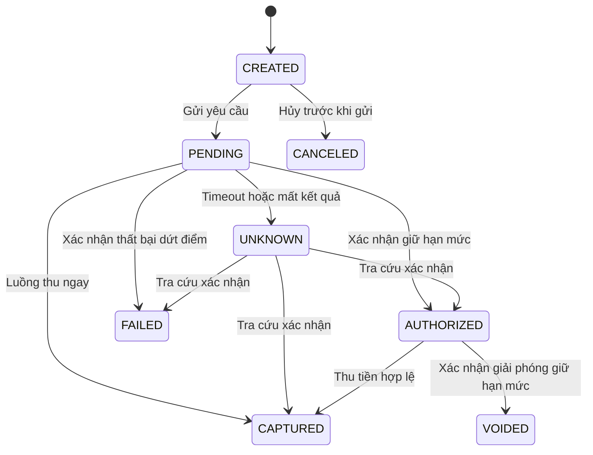

# Checklist bảo mật cho luồng thanh toán mới

## 1. Mục tiêu và cách sử dụng

Một luồng thanh toán có thể dùng HTTPS, xác minh chữ ký callback và không có lỗi injection nhưng vẫn bị lạm dụng: khách sửa giá trước khi trả tiền, dùng lại một giao dịch cho hai đơn, gọi thẳng bước xác nhận, thanh toán đơn của người khác hoặc nhận hoàn tiền hai lần. Những lỗi này xuất hiện khi hệ thống chấp nhận một thao tác hợp lệ về cú pháp nhưng sai quy tắc nghiệp vụ.

Trong chương **Security Checklists**, bài **New payment security checklist** cung cấp danh sách kiểm tra khi xây dựng một luồng thanh toán mới hoặc tích hợp thêm phương thức thanh toán. Phạm vi thuộc bảo mật logic nghiệp vụ: xác định business invariants, mô hình hóa trạng thái, kiểm tra quyền theo đối tượng, giữ tính nhất quán bằng transaction, thiết kế idempotency và kiểm thử các đường đi mà người tấn công có thể khai thác.

Checklist cần áp dụng cho toàn bộ chuỗi:

```text
Đăng nhập / xác định người mua
  → chọn đơn và phương thức thanh toán
  → chốt số tiền, tiền tệ và điều kiện áp dụng
  → tạo lần thanh toán
  → xác thực / phê duyệt nếu cần
  → nhận kết quả từ cổng thanh toán
  → ghi nhận tiền và xác nhận đơn
  → giao hàng / cung cấp dịch vụ
  → hủy, hoàn tiền và đối soát
```

Không phải hệ thống nào cũng có đầy đủ các bước trên. Ví dụ, luồng thu tiền ngay có thể không tách authorization và capture. Khi bỏ một bước, cần ghi rõ điều kiện khiến bước đó không áp dụng; không âm thầm xem một quy tắc chưa được triển khai là đã đạt.

Mỗi mục nên có một trong ba kết quả: **đạt**, **chưa đạt**, hoặc **không áp dụng kèm lý do**. Bằng chứng tốt là vị trí kiểm tra ở phía máy chủ, ràng buộc dữ liệu, kết quả kiểm thử hoặc bản ghi đối soát đã khử dữ liệu nhạy cảm. Một dấu tích dựa trên việc giao diện đang ẩn nút chưa chứng minh được quy tắc nghiệp vụ.

## 2. Chốt mô hình nghiệp vụ trước khi kiểm tra API

### 2.1. Phân biệt các đối tượng

| Đối tượng | Ý nghĩa | Điều cần tránh |
|---|---|---|
| Đơn hàng, `Order` | Cam kết mua hàng với phiên bản giá và nội dung cụ thể | Cho phép sửa đơn sau khi tạo yêu cầu trả tiền mà không kiểm tra lại |
| Lần thanh toán, `PaymentAttempt` | Một lần thử thanh toán cho một đơn, có thể đang chờ hoặc thất bại | Ghi đè lịch sử lần trước hoặc coi mọi lần thử là khoản tiền mới |
| Khoản thanh toán, `Payment` | Đối tượng nội bộ quản lý vòng đời thu tiền | Gộp các trạng thái khác nhau thành một cờ `paid` |
| Giao dịch của nhà cung cấp | Bằng chứng bên ngoài về authorization, capture, refund hoặc kết quả khác | Chấp nhận mã giao dịch từ client làm bằng chứng đã thu tiền |
| Yêu cầu hoàn tiền, `Refund` | Thao tác trả lại tiền gắn với khoản thu và phạm vi cụ thể | Coi hoàn tiền là sửa số tiền thanh toán về thấp hơn |
| Bút toán / bản ghi tài chính | Lịch sử bất biến của các sự kiện tiền tệ đã ghi nhận | Chỉ lưu số dư cuối cùng rồi mất dấu nguyên nhân thay đổi |

Một đơn có thể có nhiều lần thử, nhưng số tiền được áp dụng cho đơn vẫn phải tuân theo chính sách đã định. Với đơn chỉ cho phép thanh toán một lần, việc có hai lần thử thành công ở nhà cung cấp là một ngoại lệ tài chính cần xử lý, không phải lý do để giao hàng hai lần.

### 2.2. Trả lời các câu hỏi nền tảng

- [ ] Ai được tạo thanh toán: khách mua, người được ủy quyền, nhân viên hay hệ thống tự động?
- [ ] Thanh toán cho đối tượng nào: đơn hàng, hóa đơn, kỳ thuê bao hay khoản đặt cọc?
- [ ] Một đơn có được trả nhiều phần, trả vượt hoặc thanh toán bằng nhiều phương thức không?
- [ ] Khi nào tiền được xem là đã thu: sau authorization, capture hay một kết quả khác được hợp đồng tích hợp định nghĩa?
- [ ] Khi nào được giao hàng hoặc kích hoạt quyền sử dụng? Tình trạng thanh toán nào đáp ứng điều kiện đó?
- [ ] Có bước duyệt thủ công, hạn mức, xác thực tăng cường hoặc chính sách phân tách người tạo và người duyệt không?
- [ ] Khi nào hết hạn báo giá, hết hạn thanh toán hoặc phải tính lại giá?
- [ ] Đơn đã hủy nhưng sau đó nhận tiền sẽ được xử lý thế nào?
- [ ] Ai chịu trách nhiệm xử lý trạng thái chưa rõ kết quả, khoản thu trùng và sai lệch đối soát?

Không triển khai quy tắc quan trọng chỉ bằng một giả định như “người dùng luôn đi từ màn hình giỏ hàng”. Người gọi có thể bỏ qua màn hình và gửi trực tiếp request cuối cùng.

## 3. Các business invariants bắt buộc phải diễn đạt được

Invariant là điều kiện phải đúng xuyên suốt các thao tác, kể cả khi request đến đồng thời, bị gửi lại hoặc tiến trình dừng giữa chừng. Invariant nên có phạm vi rõ: theo đơn hàng, lần thanh toán, tài khoản nhà cung cấp hoặc tenant.

| Mã | Quy tắc cần giữ | Ví dụ vi phạm |
|---|---|---|
| P1 | Số tiền thu được tính từ dữ liệu máy chủ đã chốt, dùng đúng đơn vị và tiền tệ | Client đổi `amount` từ 500.000 thành 5.000 |
| P2 | Người thao tác có quyền đối với đúng đơn, khoản thanh toán và tenant | Người mua A tạo thanh toán cho đơn của B |
| P3 | Chỉ thực hiện chuyển trạng thái đã được phép và đủ điều kiện | Gọi capture khi chưa có authorization hợp lệ |
| P4 | Một kết quả bên ngoài chỉ được ghi nhận một lần trong đúng phạm vi | Dùng lại một capture cho hai đơn |
| P5 | Tổng số tiền đã thu và đang được dành cho các lệnh thu tuân theo hạn mức của đơn | Hai worker cùng thu toàn bộ số tiền còn lại |
| P6 | Tổng hoàn đã thành công cộng các khoản hoàn đang được dành không vượt phần được hoàn | Hai yêu cầu hoàn đồng thời cùng vượt qua kiểm tra số dư |
| P7 | Thao tác có cùng định danh nghiệp vụ và cùng nội dung không tạo thêm tác dụng phụ | Retry tạo thêm một lần thu hoặc một phiếu giao hàng |
| P8 | Đơn được hoàn tất nghĩa vụ theo đúng chính sách và tối đa số lần cho phép | Hai callback cùng kích hoạt hai lần nạp quyền sử dụng |
| P9 | Kết quả xác thực / phê duyệt còn hiệu lực và gắn với phiên bản giao dịch được thực hiện | Duyệt số tiền nhỏ rồi đổi sang số tiền lớn |
| P10 | Ngoại lệ có thể được phát hiện, truy vết và giải quyết bằng thao tác có kiểm soát | Timeout bị coi là thất bại rồi thu lại dù lần đầu đã thành công |

Với mô hình thu tiền một lần, không cho trả vượt, có thể diễn đạt một phần quy tắc như sau:

```text
0 ≤ captured_amount ≤ payable_amount
0 ≤ refunded_amount ≤ captured_amount
refunded_amount + reserved_refund_amount ≤ refundable_limit

Nếu không cho thu vượt:
captured_amount + reserved_capture_amount ≤ payable_amount

Fulfillment chỉ bắt đầu nếu điều kiện thanh toán của đơn đã thỏa mãn.
Một provider capture chỉ được áp dụng một lần trong phạm vi định danh của nó.
```

Các công thức phải đi cùng định nghĩa. `captured_amount` là tổng các khoản thu thành công đã xác nhận; `reserved_capture_amount` bao gồm các lệnh có khả năng thành công mà chưa kết luận được; `refundable_limit` phụ thuộc khoản đã thu và các điều chỉnh của nghiệp vụ. Nếu có thanh toán một phần, nhiều tiền tệ hoặc chargeback, phải mở rộng mô hình thay vì áp dụng nguyên xi các công thức của luồng đơn giản.

## 4. Checklist nguồn giá, số tiền và điều kiện thanh toán

### 4.1. Không để client quyết định số tiền phải trả

- [ ] API nhận định danh đơn hoặc báo giá; giá sản phẩm, thuế, phí, giảm giá và số tiền cuối cùng được lấy hoặc tính lại ở máy chủ.
- [ ] Nếu client gửi số tiền để hỗ trợ hiển thị, máy chủ so sánh với giá trị chuẩn và từ chối sai lệch; không lấy giá trị client làm giá chuẩn.
- [ ] `currency`, tài khoản nhận tiền, merchant, người thụ hưởng và các trường quyết định dòng tiền được suy ra từ cấu hình và dữ liệu được phép.
- [ ] Không cho phép mass assignment vào `paid`, `approved`, `capturedAmount`, `ownerId`, `merchantId` hoặc trạng thái nội bộ.
- [ ] Đơn phải tồn tại, thuộc phạm vi được phép, chưa hủy, chưa hết hạn và chưa được thanh toán đủ trước khi tạo nghĩa vụ thu mới.
- [ ] Chính sách tiền bằng không được định nghĩa riêng; đơn miễn phí không tạo bằng chứng giả rằng cổng thanh toán đã thu tiền.

Ví dụ request phù hợp cho một mô hình đơn giản:

```http
POST /orders/ord-123/payment-attempts
Idempotency-Key: <gia-tri-ngau-nhien-cho-mot-thao-tac>
Content-Type: application/json

{
  "paymentMethodToken": "pm-token",
  "expectedOrderVersion": 7
}
```

Máy chủ tự tìm người dùng hiện tại, kiểm tra quyền trên `ord-123`, chốt giá phiên bản 7 và chọn merchant phù hợp. Request trên chỉ minh họa dữ liệu nghiệp vụ; cơ chế xác thực và bảo vệ request phải được triển khai theo mô hình ứng dụng.

### 4.2. Quy tắc số học phải nhất quán

- [ ] Lưu số tiền bằng số nguyên theo đơn vị nhỏ nhất được quy định hoặc kiểu thập phân chính xác; tránh số thực nhị phân cho phép tính tiền.
- [ ] Đơn vị và quy tắc làm tròn được quy định cho từng tiền tệ / phương thức. Không giả định mọi tiền tệ đều có hai chữ số thập phân.
- [ ] Kiểm tra số âm, vượt giới hạn, tràn số, quá nhiều chữ số thập phân và biểu diễn không hợp lệ trước khi chuyển đổi sang định dạng nhà cung cấp.
- [ ] Tổng tiền ở cấp dòng hàng, cấp đơn và request gửi cổng thanh toán tuân theo cùng chính sách làm tròn.
- [ ] Phí do cổng thanh toán khấu trừ được phân biệt với số tiền khách đã trả; không dùng khoản tiền về ròng để suy ra rằng khách trả thiếu.
- [ ] Nếu có đổi ngoại tệ, lưu tiền tệ gốc, tiền tệ thanh toán, tỷ giá / phiên bản báo giá và thời hạn áp dụng theo quy tắc nghiệp vụ.

### 4.3. Gắn thanh toán với đúng phiên bản đơn

- [ ] Lưu snapshot hoặc phiên bản bất biến của đơn, số tiền, tiền tệ và điều kiện thanh toán khi tạo lần thanh toán.
- [ ] Mọi thay đổi có ảnh hưởng đến tiền sau khi chốt đơn đều phải bị chặn hoặc tạo phiên bản / lần thanh toán mới theo chính sách.
- [ ] Callback thành công của phiên bản cũ không tự động thanh toán một đơn đã đổi sang số tiền khác.
- [ ] Mã giảm giá được kiểm tra điều kiện, hạn mức và số lần dùng ở phía máy chủ; việc giữ / tiêu thụ / trả lại lượt dùng có xử lý cạnh tranh và thất bại.
- [ ] Địa chỉ giao hàng, thuế, phương thức vận chuyển và nội dung giỏ hàng không thể thay đổi sau lần tính giá cuối mà không kiểm tra lại.

Ví dụ: đơn phiên bản 7 có giá 500.000 VND; người dùng thêm hàng làm đơn thành phiên bản 8 có giá 700.000 VND. Kết quả thu 500.000 VND phải được đối chiếu với nghĩa vụ ban đầu. Hệ thống có thể chặn sửa đơn, tạo khoản cần trả thêm hoặc chuyển ngoại lệ; không được đánh dấu toàn bộ đơn phiên bản 8 là đã thanh toán đủ một cách mặc định.

## 5. Checklist quyền theo đối tượng và phê duyệt

### 5.1. Kiểm tra quyền ở từng điểm vào

- [ ] Mỗi API tạo, đọc kết quả, hủy, capture và hoàn tiền đều xác minh quyền theo đối tượng, không chỉ kiểm tra đã đăng nhập.
- [ ] Quan hệ giữa các ID được kiểm tra: payment thuộc order nào, refund thuộc payment nào, order thuộc tài khoản và tenant nào.
- [ ] Không chỉ kiểm tra `orderId` trên URL rồi cập nhật một `paymentId` trong body mà chưa xác minh quan hệ.
- [ ] Truy vấn có phạm vi tenant / người sở hữu phù hợp; biết một ID hoặc dùng ID khó đoán không thay thế kiểm tra quyền.
- [ ] Người trả tiền khác người sở hữu đơn chỉ được hỗ trợ qua cơ chế ủy quyền hoặc liên kết thanh toán đã định nghĩa, có giới hạn phạm vi và thời hạn.
- [ ] Token phương thức thanh toán được dùng trong đúng phạm vi khách hàng / merchant theo mô hình tích hợp; không tùy ý gắn token của người khác.
- [ ] Luồng quản trị và tác vụ nền cũng kiểm tra quyền, tenant và trạng thái nghiệp vụ; quyền quản trị không mặc nhiên cho phép sửa lịch sử tài chính.
- [ ] Callback xác thực danh tính nguồn gửi theo hợp đồng nhà cung cấp; callback không có quyền chọn tùy ý đối tượng nội bộ để cập nhật.

Một truy vấn như sau có thể giúp đưa phạm vi quyền vào điểm đọc dữ liệu:

```sql
SELECT id, owner_id, tenant_id, state, version, payable_minor, currency
FROM orders
WHERE id = :order_id
  AND tenant_id = :authorized_tenant_id
  AND owner_id = :authenticated_customer_id;
```

Đây chỉ là ví dụ cho luồng khách tự trả đơn của mình. Nhân viên thu hộ, ủy quyền doanh nghiệp hoặc đơn dùng chung cần chính sách riêng. Các giá trị phạm vi phải đến từ ngữ cảnh xác thực và quyết định phân quyền, không tin trực tiếp `tenantId` hoặc `ownerId` do client gửi.

### 5.2. Phê duyệt phải ràng buộc với nội dung được duyệt

- [ ] Điều kiện yêu cầu phê duyệt được xác định ở máy chủ: hạn mức, loại giao dịch hoặc vai trò thao tác.
- [ ] Kết quả duyệt gắn với số tiền, tiền tệ, người thụ hưởng, đối tượng, phiên bản và thời hạn có hiệu lực.
- [ ] Thay đổi trường quan trọng làm mất hiệu lực phê duyệt cũ hoặc bắt đầu một vòng duyệt mới.
- [ ] Nếu chính sách yêu cầu hai người, người tạo không thể tự duyệt qua API khác hoặc tài khoản kỹ thuật không được phép.
- [ ] Việc thực hiện và đánh dấu tiêu thụ phê duyệt được bảo vệ khỏi dùng lại đồng thời.
- [ ] Bước xác thực tăng cường không thể bị bỏ qua bằng cách gọi endpoint cuối hoặc gửi `approved=true`.

Một mã xác thực đã dùng cho khoản 1.000.000 VND không phải giấy phép chung để thực hiện mọi khoản thanh toán tiếp theo. Hệ thống phải xác minh nó được tạo cho đúng giao dịch và vẫn đủ điều kiện sử dụng.

## 6. Checklist state machine và thứ tự thao tác

### 6.1. Tách trạng thái khi chúng có ý nghĩa khác nhau

Ví dụ mô hình rút gọn cho một lần thanh toán có authorization và capture:



Sơ đồ là ví dụ, không phải danh mục trạng thái bắt buộc cho mọi cổng thanh toán. `UNKNOWN` thể hiện tri thức của hệ thống nội bộ về kết quả thao tác; nó có thể được mô hình hóa bằng trạng thái của operation thay vì trạng thái của payment. Refund và chargeback thường cần các đối tượng / vòng đời riêng để không mất lịch sử khoản thu gốc.

- [ ] Có danh sách chuyển trạng thái hợp lệ, điều kiện trước và tác dụng phụ cho mỗi loại thao tác.
- [ ] Authorization không được nhầm với capture; một khoản giữ hạn mức chưa mặc nhiên chứng minh đã thu tiền.
- [ ] Timeout hoặc mất kết nối tạo trạng thái chưa rõ kết quả, không tự suy ra thất bại.
- [ ] Callback đến muộn không làm trạng thái tài chính lùi từ đã thu về đang chờ hoặc thất bại.
- [ ] Sự kiện thất bại của một lần thử không ghi đè kết quả thành công của lần thử khác cho cùng đơn.
- [ ] Việc hủy ở giao diện được phân biệt với việc nhà cung cấp đã xác nhận void, cancel hoặc refund.
- [ ] Thao tác hết hạn được kiểm tra ở máy chủ; giờ trên trình duyệt không quyết định tính hợp lệ.
- [ ] Các đường vào HTTP, webhook, job retry, tác vụ quản trị và đối soát áp dụng cùng các quy tắc chuyển trạng thái.
- [ ] Có chính sách cho callback thành công sau khi đơn đã hủy hoặc hàng đã hết; không tự giao lại chỉ vì nhận được tiền.

### 6.2. Kiểm tra điều kiện và ghi thay đổi như một thao tác nguyên tử

Mẫu dễ lỗi:

```text
Nếu đơn chưa trả tiền:
    gọi nhà cung cấp
    đặt đơn thành đã trả tiền
```

Hai request có thể cùng đọc “chưa trả tiền” và cùng gọi thu tiền. Kiểm tra ở đầu hàm không giữ invariant nếu thao tác cập nhật diễn ra sau đó mà không có cơ chế cạnh tranh.

Một kỹ thuật ở phạm vi cơ sở dữ liệu là cập nhật có điều kiện và kiểm tra số dòng bị tác động:

```sql
UPDATE payment_operations
SET state = 'SUBMITTING', version = version + 1
WHERE id = :operation_id
  AND state = 'READY'
  AND version = :expected_version;
```

Chỉ tiến trình thực sự chuyển được một dòng mới được đi tiếp theo giao thức thực hiện. Điều này chưa đủ giải quyết tình huống tiến trình dừng sau khi gọi nhà cung cấp. Vẫn cần định danh operation ổn định, idempotency tại nhà cung cấp nếu có và quy trình khôi phục kết quả.

## 7. Checklist transaction, cạnh tranh và giới hạn thu tiền

### 7.1. Chọn điểm bảo vệ invariant

- [ ] Xác định tài nguyên cần khóa hoặc kiểm tra phiên bản: order, payment aggregate, khoản còn được thu hoặc khoản còn được hoàn.
- [ ] Dùng transaction, khóa hàng, optimistic locking hoặc ràng buộc tương đương để bảo vệ kiểm tra và cập nhật liên quan.
- [ ] Cơ chế bảo vệ hoạt động khi có nhiều instance; khóa trong bộ nhớ của một tiến trình không đủ cho toàn hệ thống.
- [ ] Kiểm tra mức cô lập và hiện tượng cạnh tranh theo invariant cụ thể; không cho rằng chỉ cần có `@Transactional` là mọi race condition biến mất.
- [ ] Đặt unique constraint cho định danh cần duy nhất, với phạm vi đúng theo hợp đồng nhà cung cấp và mô hình tenant.
- [ ] Không xóa ràng buộc dữ liệu để vượt qua lỗi duplicate; lỗi đó có thể đang chặn xử lý trùng thật sự.
- [ ] Khi retry transaction do deadlock hoặc xung đột phiên bản, không tự động lặp lại lời gọi thu tiền như một thao tác mới.

Ví dụ ràng buộc có thể cần:

| Dữ liệu | Phạm vi duy nhất cần xem xét |
|---|---|
| Idempotency nội bộ | Principal / tenant, loại thao tác, key |
| Sự kiện callback đã nhận | Nhà cung cấp, môi trường, tài khoản nhận sự kiện, event ID theo đặc tả |
| Giao dịch capture đã ghi nhận | Nhà cung cấp, môi trường, merchant account, capture ID theo đặc tả |
| Yêu cầu giao hàng từ thanh toán | Đơn và loại nghĩa vụ cần thực hiện |

Không mặc định event ID hoặc transaction ID luôn duy nhất trên mọi tài khoản và môi trường. Phạm vi constraint phải phù hợp với đảm bảo thực tế của nguồn cấp định danh.

### 7.2. Cơ sở dữ liệu và cổng thanh toán không cùng một transaction

Luồng điển hình cần xử lý các lần ghi ở hai hệ thống:

```text
Transaction A:
  kiểm tra quyền, trạng thái và phiên bản đơn
  dành hạn mức / số tiền cho operation nếu mô hình cần
  tạo PaymentAttempt + operation ID + payload đã chốt
  ghi outbox command
COMMIT

Worker:
  nhận command
  gửi nhà cung cấp với cùng định danh idempotency của operation
  nếu chưa rõ kết quả: tra cứu hoặc khôi phục theo hợp đồng tích hợp

Transaction B:
  xác nhận kết quả với đủ ràng buộc
  ghi giao dịch tài chính nếu chưa ghi
  cập nhật trạng thái và phần tiền đã dành
  ghi outbox event cho bước tiếp theo
COMMIT
```

Đây là một cách tổ chức phổ biến, không phải yêu cầu bắt buộc cho mọi kiến trúc. Nếu request HTTP gọi trực tiếp nhà cung cấp, hệ thống vẫn phải xử lý được các điểm dừng tương đương.

- [ ] Operation và thông tin cần khôi phục đã được lưu bền vững trước khi gọi nhà cung cấp.
- [ ] Không giữ khóa cơ sở dữ liệu suốt cuộc gọi mạng dài như giải pháp duy nhất để tránh trùng.
- [ ] Dừng trước khi gọi, dừng sau khi thu tiền nhưng trước khi lưu kết quả, và dừng sau khi commit đều có đường khôi phục.
- [ ] Chỉ giải phóng phần tiền đã dành khi kết quả cho phép; timeout chưa đủ chứng minh không còn nghĩa vụ có thể thành công.
- [ ] Nếu ghi trạng thái và phát event cần đồng bộ, dùng cơ chế như transactional outbox để tránh commit một phần.
- [ ] Consumer của outbox chấp nhận khả năng nhận lặp và tự bảo vệ tác dụng phụ.
- [ ] Quy trình bù trừ thể hiện bằng void / refund / điều chỉnh có lịch sử; rollback transaction nội bộ không đảo ngược khoản tiền đã thu ở hệ thống ngoài.

## 8. Checklist idempotency và xử lý request gửi lại

Idempotency nghĩa là lặp lại cùng một thao tác đã định danh không tạo thêm tác dụng phụ nghiệp vụ. Nó không đồng nghĩa bỏ qua mọi request giống nhau về hình thức, và không tự cung cấp quyền truy cập.

### 8.1. Hợp đồng của key

- [ ] Mỗi thao tác có key ổn định khi retry; không tạo key mới chỉ vì HTTP timeout.
- [ ] Key có phạm vi theo principal / tenant và loại thao tác; cùng chuỗi key ở tài khoản khác không được trả lộ dữ liệu của tài khoản đầu.
- [ ] Mỗi lần trả kết quả cũ vẫn kiểm tra quyền truy cập phù hợp với đối tượng và ngữ cảnh hiện tại.
- [ ] Máy chủ lưu dấu vân tay của nội dung nghiệp vụ đã chuẩn hóa: order, phiên bản, amount, currency, phương thức và các trường ảnh hưởng kết quả.
- [ ] Cùng key nhưng khác nội dung bị từ chối rõ ràng; không trả một thành công cũ làm người gọi hiểu rằng nội dung mới đã được thực hiện.
- [ ] Cùng key và cùng nội dung trả cùng operation / kết quả đã lưu, hoặc trạng thái đang xử lý có thể tra cứu.
- [ ] Ràng buộc duy nhất và transaction bảo vệ việc hai request đồng thời cùng tạo bản ghi cho một key.
- [ ] Bản ghi có trạng thái đang xử lý, thành công, thất bại xác định và chưa rõ kết quả; có cách phục hồi bản ghi bị kẹt.
- [ ] Thời hạn lưu key và thời hạn idempotency của nhà cung cấp được hiểu rõ; không coi key đã hết hạn là bảo đảm chống thu trùng vĩnh viễn.
- [ ] Có một định danh nghiệp vụ bền vững để kiểm soát trùng sau khi cache hoặc bản ghi key hết hạn.

### 8.2. Cần hai lớp chống trùng

| Lớp | Ngăn điều gì | Chưa tự ngăn được điều gì |
|---|---|---|
| Idempotency của request | Người gọi gửi lại cùng thao tác với cùng key | Hai key khác nhau cùng trả đủ cho một đơn |
| Invariant theo đơn / nghĩa vụ thanh toán | Nhiều operation cạnh tranh vượt số tiền được phép | Mất kết quả sau cuộc gọi bên ngoài nếu không có đường khôi phục |
| Idempotency hoặc định danh ổn định tại nhà cung cấp | Lặp lại một lệnh bên ngoài trong phạm vi được hỗ trợ | Giao hàng trùng hoặc áp dụng sai đơn trong hệ thống nội bộ |
| Deduplication ở consumer | Event lặp gây tác dụng phụ lặp | Một event hợp lệ nhưng sai quyền hoặc sai quy tắc nghiệp vụ |

Ví dụ, hai tab trình duyệt tạo hai key khác nhau cho cùng đơn. Lớp idempotency theo key thấy hai thao tác khác nhau. Luồng vẫn cần chặn lần thu vượt nghĩa vụ hoặc áp dụng chính sách xử lý nhiều khoản thu ngoài dự kiến.

### 8.3. Thử lại khi chưa rõ kết quả

- [ ] Nếu cổng thanh toán hỗ trợ idempotency, gửi lại đúng operation và đúng payload theo hợp đồng của họ.
- [ ] Nếu cổng không hỗ trợ, có mã tham chiếu tra cứu và giao thức khôi phục đủ tin cậy; không khẳng định thao tác an toàn để lặp chỉ vì chưa thấy response.
- [ ] Khi chưa thể kết luận, giữ operation ở trạng thái chờ xử lý và thông báo đúng tình trạng cho người dùng.
- [ ] Chỉ mở một lần thử mới khi quy tắc xử lý lần cũ đã cho phép; không chuyển mọi timeout thành nút “trả tiền lại” ngay lập tức.
- [ ] Giới hạn tần suất và số operation đang mở để tránh tạo hàng loạt giữ hạn mức, tiêu thụ mã giảm giá hoặc gây nghẽn nghiệp vụ.

Không hứa hẹn “exactly once” trên toàn bộ luồng chỉ từ việc bật một tùy chọn idempotency. Mục tiêu thực tế là chấp nhận khả năng gửi / nhận lặp, giữ invariant và đối soát được những khoảng chưa chắc chắn.

## 9. Checklist redirect, webhook và bằng chứng thanh toán

### 9.1. Redirect về trình duyệt không phải bằng chứng đã thu tiền

- [ ] Không đánh dấu đã thanh toán dựa riêng vào query string như `success=true`, mã trạng thái từ client hoặc việc người dùng quay lại trang thành công.
- [ ] Trang kết quả đọc trạng thái đã xác nhận từ máy chủ; nếu chưa có kết quả thì hiển thị đang chờ.
- [ ] Giá trị liên kết phiên / đơn trong redirect được kiểm tra, có phạm vi và không cho phép chuyển hướng tùy ý.
- [ ] Người dùng đóng tab sau khi trả tiền không ngăn hệ thống ghi nhận kết quả qua kênh máy chủ hoặc đối soát.

### 9.2. Xác thực webhook và đối chiếu ngữ nghĩa

- [ ] Xác minh nguồn gửi bằng cơ chế được nhà cung cấp quy định, ví dụ chữ ký trên đúng payload theo định dạng họ yêu cầu.
- [ ] Kiểm tra timestamp / cửa sổ chấp nhận nếu giao thức có hỗ trợ; cơ chế chống replay không thay thế xử lý sự kiện lặp.
- [ ] Phân biệt khóa, tài khoản merchant và môi trường thử nghiệm / thật; không cho sự kiện thử nghiệm thanh toán đơn thật.
- [ ] Chỉ xử lý loại sự kiện được hỗ trợ, với schema và ý nghĩa trạng thái đã được xác định.
- [ ] Đối chiếu transaction với PaymentAttempt nội bộ qua dữ liệu ánh xạ do máy chủ đã lưu.
- [ ] So sánh merchant, môi trường, amount, currency và định danh giao dịch; chữ ký hợp lệ chưa chứng minh event thuộc đúng đơn.
- [ ] Không chỉ tin một trường `orderId` trong metadata của event nếu chưa xác minh quan hệ đã thiết lập lúc tạo thanh toán.
- [ ] Ghi nhận event bằng cơ chế bền vững trước khi xác nhận đã tiếp nhận theo hợp đồng retry; nếu chưa lưu được, phản hồi theo cách cho phép khôi phục.
- [ ] Duplicate event không tạo thêm bút toán, email có tác dụng nghiệp vụ, đơn giao hàng hay quyền sử dụng.
- [ ] Hai event ID khác nhau nói về cùng một capture cũng không được ghi nhận khoản thu hai lần.
- [ ] Sự kiện đảo thứ tự được xử lý theo chuyển trạng thái và tra cứu cần thiết; không ghi đè mù quáng bằng event đến cuối.
- [ ] Sự kiện không ánh xạ được, sai số tiền hoặc mâu thuẫn được giữ làm ngoại lệ để điều tra; không cố gắn vào một đơn gần giống.

Ví dụ có chữ ký hợp lệ nhưng vẫn phải từ chối áp dụng cho đơn:

```text
Đơn nội bộ: ord-123, merchant-A, 500000 VND
Event:     capture-789, merchant-B, 500000 VND

Kết quả mong đợi:
  Không đánh dấu ord-123 là đã trả tiền.
  Lưu sự kiện ngoại lệ theo phạm vi phù hợp để kiểm tra.
```

Đối với dữ liệu ngoài chưa đủ độ tin cậy hoặc thiếu thông tin, luồng có thể tra cứu qua API máy chủ của nhà cung cấp trước khi kết luận. Cách xác minh cụ thể phải theo hợp đồng tích hợp; không tự giả định rằng mọi webhook đều đầy đủ hoặc luôn đến đúng thứ tự.

### 9.3. Một khoản thu được xác nhận qua nhiều đường

Chống lặp theo event ID chỉ kiểm soát một loại đầu vào. Một khoản thu có thể được biết đến qua webhook, tác vụ tra cứu trạng thái và đối soát, với định danh thông điệp khác nhau. Checklist cần nối tất cả các đường này với cùng danh tính giao dịch tài chính và cùng quy tắc ghi nhận.

Xét mô hình minh họa chỉ thu đủ một lần: đơn `ord-123`, phiên bản 7, cần trả `500000 VND`; operation `pay-op-42` đã được chấp nhận nhưng chưa có kết quả nội bộ. Snapshot của operation đã ràng buộc đơn, phiên bản, merchant, môi trường và số tiền. Nhà cung cấp xác nhận một capture `capture-789` cho đúng operation đó.

| Đầu vào có thể đến đồng thời | Danh tính vận chuyển | Danh tính khoản thu phải được đối chiếu |
|---|---|---|
| Webhook thành công đầu tiên | `evt-1` | Nhà cung cấp, môi trường, merchant account, `capture-789` |
| Nhà cung cấp gửi lại webhook | Vẫn là `evt-1` | Vẫn cùng khoản thu, không phải khoản thu mới |
| Tác vụ polling qua API máy chủ | Một lượt tra cứu, có thể không có event ID | Cùng capture sau khi xác minh kết quả tra cứu |
| Webhook khác mô tả cùng capture | `evt-2` | Cùng khoản thu dù event ID khác |
| Lô đối soát đến sau | ID lô và dòng dữ liệu của lô | Cùng capture sau khi xác minh và ánh xạ |

Trong ví dụ này, xử lý đủ các đầu vào vẫn chỉ được ghi nhận một khoản thu `500000 VND` cho operation và một nghĩa vụ giao hàng của đơn. Số bản ghi tiếp nhận sự kiện có thể nhiều hơn một; số bản ghi đó không phải số lần thu tiền.

Một giao thức ghi nhận có thể được mô tả bằng pseudocode sau. Cơ chế khóa, unique constraint và retry cần được chọn theo database và mô hình của ứng dụng:

```text
Với mỗi kết quả từ một nguồn được phép:
  xác minh nguồn và ánh xạ tới operation bằng dữ liệu server đã lưu
  đối chiếu merchant, môi trường, amount, currency và snapshot giao dịch
  nếu thiếu bằng chứng hoặc mâu thuẫn: giữ ngoại lệ, chưa áp dụng cho đơn

Trong transaction áp dụng kết quả:
  bảo vệ operation và tài nguyên tiền theo cơ chế cạnh tranh đã chọn
  nếu capture này đã được áp dụng cho đúng operation:
    kiểm tra các thuộc tính vẫn khớp; không cộng tiền hoặc phát nghĩa vụ lại
  nếu capture đã thuộc operation khác hoặc có dữ liệu mâu thuẫn:
    không gắn lại; trả kết quả ngoại lệ để ghi nhận bền vững theo thiết kế
  nếu đây là lần áp dụng đầu tiên và đủ điều kiện:
    ghi nhận danh tính capture duy nhất trong phạm vi hợp đồng
    ghi bút toán / khoản thu và cập nhật captured, reserved theo quy tắc
    cập nhật trạng thái phù hợp với điều kiện thanh toán của đơn
    ghi ý định thực hiện nghĩa vụ tiếp theo bằng outbox
  ghi trạng thái xử lý của inbox nếu inbox tham gia transaction này
COMMIT
```

Nếu hai tiến trình cùng định ghi capture đầu tiên, một tiến trình có thể gặp xung đột unique constraint hoặc phiên bản. Đường xử lý phải đọc lại kết quả đã commit theo giao thức database, xác minh cùng operation và cùng nội dung, rồi kết thúc mà không áp dụng tác dụng phụ lần nữa. Không bắt mọi lỗi duplicate rồi tự coi là thành công; duplicate có thể chỉ ra một capture đang bị gắn sang đơn khác.

- [ ] Phân biệt **đã tiếp nhận event** với **đã áp dụng khoản thu**. Event được lưu rồi worker dừng trước khi áp dụng vẫn phải được xử lý tiếp; bỏ qua ngay vì đã thấy event ID sẽ làm mất kết quả.
- [ ] Webhook, polling và đối soát đều đi qua ranh giới ghi nhận có bảo vệ cạnh tranh. Không có nhánh đối soát sửa thẳng `paid=true` hoặc cộng tiền riêng.
- [ ] Khi kiểm tra số lần áp dụng, quan sát cả khoản thu, bút toán, phần tiền đã dành, state và ý định giao hàng. Một dòng capture duy nhất chưa chứng minh các bảng khác không bị cập nhật hai lần.
- [ ] Callback đến trước response của worker vẫn được xử lý theo cùng operation; response đến sau không tạo lần ghi nhận mới hoặc ghi lùi trạng thái.
- [ ] Consumer thực hiện nghĩa vụ giao hàng vẫn chống lặp theo khóa nghiệp vụ của nó, kể cả khi outbox được phát lại.

Để biến mục này thành bằng chứng kiểm thử, cho hai đường xác nhận dừng ngay trước bước tranh chấp ghi nhận capture, rồi giải phóng cùng lúc; sau đó gửi lại event và chạy đối soát. Kết quả cần kiểm tra là dữ liệu đã commit và tác dụng phụ cuối cùng. Đây là kịch bản thiết kế cho môi trường thử nghiệm được phép, không phải yêu cầu tạo khoản thu thật để đánh dấu checklist.

## 10. Checklist hoàn tiền, hủy và giao hàng

### 10.1. Hoàn tiền là một nghiệp vụ riêng

- [ ] Quyền hoàn tiền được kiểm tra riêng, gồm giới hạn số tiền và phạm vi đơn / tenant.
- [ ] Số tiền được hoàn tính từ khoản thu hợp lệ và các lần hoàn trước, không từ một trường có thể sửa trên giao diện.
- [ ] Kiểm tra tiền tệ, trạng thái capture và hạn mức có thể hoàn theo hợp đồng nhà cung cấp.
- [ ] Tạo refund operation riêng có idempotency; retry cùng refund không sinh khoản hoàn mới.
- [ ] Hai refund đồng thời phải cùng chịu một cơ chế giữ hạn mức và cập nhật nguyên tử.
- [ ] Refund timeout được xem là chưa rõ kết quả; phần tiền đang được dành không bị giải phóng tùy tiện.
- [ ] Người thụ hưởng hoàn tiền được suy ra từ khoản thanh toán gốc hoặc đi qua quy trình ngoại lệ có phê duyệt, không nhận tùy ý tài khoản đích từ client.
- [ ] Ghi lịch sử lý do, người yêu cầu, người duyệt và kết quả; không xóa khoản thu gốc để thể hiện hoàn tiền.
- [ ] Có chính sách cho hoàn một phần, phí, ưu đãi và trường hợp đã giao một phần hàng.

Ví dụ cạnh tranh: đã thu 1.000.000 VND, đã hoàn 200.000 VND. Hai request hoàn 600.000 VND không thể cùng thành công chỉ vì cả hai đều đọc số có thể hoàn là 800.000 VND. Việc dành hạn mức cho lần hoàn thứ nhất phải ảnh hưởng ngay đến kiểm tra của lần thứ hai trong cùng cơ chế nhất quán.

### 10.2. Hủy đơn không đồng nghĩa tiền đã được trả lại

- [ ] Phân biệt hủy đơn, hủy authorization, hủy operation chưa gửi và hoàn tiền sau capture.
- [ ] Nếu hủy cạnh tranh với capture, kết quả cuối xác định có tiền đã thu hay không và có cần refund không.
- [ ] Đơn đã hủy nhận capture đến muộn được đưa vào quy trình xử lý tiền; không bị bỏ qua vì “đơn không còn hoạt động”.
- [ ] Mọi ngoại lệ cần thao tác thủ công đều có trạng thái, người chịu trách nhiệm và nhật ký hành động.

### 10.3. Tác dụng phụ sau thanh toán phải chống lặp

- [ ] Giao hàng / cấp dịch vụ dựa trên điều kiện nghiệp vụ đã xác nhận, không dựa vào request từ trang thành công.
- [ ] Ghi trạng thái thanh toán và ý định phát tác vụ tiếp theo nhất quán, ví dụ cùng transaction với outbox.
- [ ] Consumer chống lặp theo nghĩa vụ của đơn; redelivery không tạo hai lệnh giao hàng hoặc hai lượt cộng số dư.
- [ ] Nếu giao hàng gồm nhiều dòng hoặc nhiều đợt, khóa nghiệp vụ phản ánh đúng phần nghĩa vụ được thực hiện thay vì chặn mọi lần xử lý sau lần đầu.
- [ ] Thất bại gửi email không làm hệ thống thu tiền lại; lỗi của từng tác dụng phụ có cơ chế retry riêng.
- [ ] Refund hoặc dispute không xóa lịch sử giao hàng; việc thu hồi quyền / xử lý hậu quả có chính sách riêng.

## 11. Checklist quan sát, đối soát và can thiệp thủ công

### 11.1. Nhật ký đủ để nối các bước

- [ ] Liên kết được `orderId`, phiên bản đơn, `paymentAttemptId`, operation ID, merchant, transaction ID, event ID và refund ID.
- [ ] Ghi trạng thái trước / sau, số tiền, tiền tệ, loại thao tác, thời điểm và chủ thể thực hiện với quyền truy cập thích hợp.
- [ ] Dữ liệu log được tối thiểu hóa; không ghi thông tin xác thực, dữ liệu thẻ nhạy cảm hoặc toàn bộ payload thanh toán một cách vô điều kiện.
- [ ] Có chỉ số cho operation chưa rõ kết quả, webhook không khớp, lỗi chữ ký, retry kéo dài, khoản thu trùng và chuyển trạng thái bị từ chối.
- [ ] Có ngưỡng phát hiện sự gia tăng bất thường của lần thử, refund, yêu cầu duyệt hoặc thay đổi số tiền.

### 11.2. Đối soát là đường khôi phục nghiệp vụ

- [ ] Có tác vụ so sánh dữ liệu nội bộ với kết quả giao dịch đáng tin cậy từ nhà cung cấp, theo chu kỳ phù hợp.
- [ ] Phát hiện được tiền đã thu ở ngoài nhưng nội bộ chưa ghi nhận, nội bộ ghi đã thu nhưng không có giao dịch tương ứng và khoản tiền không gắn được đơn.
- [ ] Phân biệt khoản khách đã trả, phí và thời điểm quyết toán để tránh kết luận sai khi so sánh số liệu.
- [ ] Các thay đổi từ đối soát dùng cùng invariant và cơ chế chống trùng như webhook.
- [ ] Việc đánh dấu “đã xử lý” chỉ diễn ra sau khi có kết quả bền vững, không sau khi mới gửi yêu cầu ra ngoài.
- [ ] Có quy trình khóa / hạn chế tạo operation mới khi tồn đọng trạng thái chưa rõ gây nguy cơ thu trùng.
- [ ] Thao tác thủ công không cho sửa thẳng cờ `paid`; mọi điều chỉnh có lý do, quyền hạn, bằng chứng và lịch sử.

Một dashboard hiển thị số lỗi HTTP bằng không vẫn có thể che giấu tiền thu thiếu hoặc giao hàng trùng. Chỉ số vận hành cần phản ánh trạng thái và bất biến nghiệp vụ, không chỉ sức khỏe kỹ thuật của API.

## 12. Bộ tình huống kiểm thử tấn công logic

Các kịch bản sau dùng tài khoản và dữ liệu thử nghiệm được phép. Mục tiêu là quan sát trạng thái bền vững, số lần gọi nhà cung cấp, số bút toán và số tác dụng phụ; chỉ kiểm tra mã HTTP là chưa đủ. Đây là nội dung thiết kế kiểm thử cho luồng thanh toán, không phải kết luận rằng một triển khai cụ thể đã vượt qua kiểm thử.

| Nhóm | Cách thử | Kết quả cần quan sát |
|---|---|---|
| Sửa giá | Thêm hoặc đổi `amount`, phí, thuế, giảm giá trong request | Máy chủ dùng giá chuẩn hoặc từ chối; không thu theo giá tự khai |
| Sửa tiền tệ | Đổi `currency` nhưng giữ cùng số nguyên | Không chấp nhận thanh toán khác tiền tệ cho nghĩa vụ cũ |
| Số học | Gửi số âm, cực lớn, thập phân sai quy tắc, giá trị làm tròn sát biên | Không tạo operation sai số tiền; không tràn số |
| Sai quyền | Tài khoản A dùng `orderId` hoặc `paymentId` của B | Không đọc hoặc thay đổi đối tượng ngoài quyền |
| Sai tenant | Giữ payment ID nhưng thay tenant / merchant | Không vượt ranh giới dữ liệu và tài khoản nhận tiền |
| Ghép ID | URL chứa đơn A, body chứa payment của đơn B | Từ chối quan hệ không hợp lệ |
| Bỏ bước | Gọi capture hoặc confirm khi chưa đủ điều kiện | Không có chuyển trạng thái hoặc tác dụng phụ ngoài phép |
| Đổi sau duyệt | Duyệt khoản nhỏ rồi sửa số tiền / người thụ hưởng | Phê duyệt cũ không còn dùng được cho nội dung mới |
| Sửa đơn sau chốt | Đổi giỏ hàng sau khi tạo lần thanh toán | Phiên bản cũ không tự thanh toán đủ cho phiên bản mới |
| Dùng lại key | Gửi cùng key và cùng payload nhiều lần | Cùng operation; không thêm khoản thu |
| Xung đột key | Gửi cùng key nhưng đổi đơn hoặc số tiền | Từ chối xung đột; không thực hiện nội dung mới |
| Hai tab | Hai key khác nhau cùng thanh toán một đơn | Không vượt nghĩa vụ; xử lý được operation đang mở |
| Đồng thời | Gửi nhiều request cùng key tại một thời điểm | Chỉ một operation thắng; các request khác nhận kết quả nhất quán |
| Timeout | Nhà cung cấp thu thành công nhưng làm mất response | Không mở khoản thu mới chỉ vì timeout; khôi phục được kết quả |
| Dừng tiến trình | Dừng worker sau khi cổng đã xử lý, trước khi lưu DB | Retry / đối soát không gây thu hoặc ghi nhận trùng |
| Redirect giả | Tự mở URL thành công có `success=true` | Không đánh dấu đã thu tiền |
| Webhook giả | Gửi sai chữ ký hoặc sửa payload sau khi ký | Không áp dụng kết quả |
| Webhook đúng nhưng sai đối tượng | Sự kiện hợp lệ của merchant, môi trường hoặc đơn khác | Không thanh toán nhầm đơn |
| Webhook lặp | Gửi cùng event nhiều lần | Một kết quả tài chính, tối đa tác dụng phụ được phép |
| Khác event, cùng capture | Hai event ID cùng tham chiếu một capture | Không cộng tiền hai lần |
| Đảo thứ tự | Gửi pending / failed đến sau captured | Không làm mất khoản thu đã xác nhận |
| Nhiều lần thử | Lần thử cũ thất bại sau khi lần mới thành công | Đơn vẫn phản ánh khoản thanh toán thành công |
| Hủy cạnh tranh | Hủy đơn khi capture đang xử lý | Kết quả tiền được xử lý theo chính sách, không rơi vào trạng thái bị bỏ quên |
| Hoàn đồng thời | Hai refund cùng vượt phần có thể hoàn nếu cộng lại | Không vượt hạn mức hoàn |
| Refund timeout | Hoàn đã thành công bên ngoài nhưng nội bộ mất response | Không hoàn lại lần hai; giữ được khả năng khôi phục |
| Lặp tác vụ sau thu | Gửi lại event thanh toán cho consumer giao hàng | Không giao hàng / cấp quyền trùng |
| Đối soát lặp | Chạy lại cùng lô kết quả từ nhà cung cấp | Không tạo thêm bút toán hoặc tác dụng phụ |
| Key hết hạn | Gửi lại operation cũ sau khi hết thời gian lưu key | Invariant và định danh nghiệp vụ vẫn ngăn thu trùng ngoài phép |

### 12.1. Ví dụ kiểm thử đồng thời có điểm đồng bộ

Một vòng lặp gửi request lần lượt thường không làm lộ race condition. Nên đặt hai luồng tại cùng một điểm trước thao tác tranh chấp:

```text
Chuẩn bị:
  Đơn cần trả 500000 VND, chưa có khoản thu.
  Hai request hợp lệ, hai idempotency key khác nhau.

Thực hiện:
  1. Giữ cả hai luồng ngay trước bước dành số tiền cần thu.
  2. Cho cả hai tiếp tục cùng thời điểm.
  3. Cho worker và callback hoàn tất theo nhiều thứ tự.

Xác minh:
  Không có tổng captured + reserved vượt giới hạn của đơn.
  Mỗi operation bên ngoài có định danh ổn định.
  Chỉ có số lần giao hàng đúng với nghĩa vụ của đơn.
  Operation thua không bị kẹt mà không có trạng thái giải thích được.
```

Đối với hệ thống đang mở rộng nhiều instance, kiểm thử cần đi qua các instance hoặc worker khác nhau. Một khóa trong bộ nhớ có thể làm bài kiểm thử trên một tiến trình vượt qua nhưng không bảo vệ triển khai thực tế.

### 12.2. Ví dụ kiểm thử mất kết quả sau khi thu tiền

```text
1. Lưu operation pay-op-42 và gửi lệnh thu với định danh ổn định.
2. Nhà cung cấp ghi nhận thành công.
3. Giả lập mất response và dừng worker trước transaction lưu kết quả.
4. Khởi động lại, chạy retry và cho webhook đến lặp.
5. Chạy đối soát thêm một lần.

Kết quả cần đạt:
  - Khoản thu bên ngoài không bị nhân đôi bởi retry.
  - Nội bộ ghi nhận đúng một capture cho pay-op-42.
  - Trạng thái cuối khớp kết quả bên ngoài.
  - Đơn chỉ phát sinh đúng nghĩa vụ giao hàng / cấp dịch vụ được phép.
```

Nếu mô phỏng nhà cung cấp bằng stub, stub cần thể hiện tình huống “đã xử lý nhưng response bị mất”. Một stub cứ timeout là chưa thu tiền sẽ bỏ qua chính đường lỗi quan trọng nhất.

## 13. Các lỗi thiết kế thường gặp và cách sửa

| Cách làm dễ gây lỗi | Vì sao không đủ | Hướng sửa |
|---|---|---|
| Vô hiệu hóa nút trả tiền sau lần bấm đầu | Có thể gọi API trực tiếp hoặc dùng tab khác | Idempotency ở máy chủ và invariant theo đơn |
| Nhận tổng tiền từ client vì frontend đã tính | Người dùng có thể sửa request | Tính / chốt giá ở máy chủ và kiểm tra phiên bản |
| Chỉ kiểm tra vai trò `CUSTOMER` | Mọi khách đều có vai trò đó | Kiểm tra quyền trên đúng order, payment và tenant |
| Dùng `paid=true` làm toàn bộ mô hình | Không biểu diễn được authorized, unknown, refund | Vòng đời rõ ràng và lịch sử giao dịch |
| Bao lời gọi cổng thanh toán bằng transaction DB | Rollback DB không hoàn tác khoản thu ngoài hệ thống | Operation bền vững, idempotency và khôi phục kết quả |
| Timeout thì đánh dấu failed rồi tạo lần mới | Lần trước có thể đã thu thành công | Trạng thái chưa rõ, tra cứu và quy tắc retry |
| Chỉ deduplicate theo event ID | Nhiều event có thể mô tả cùng một capture | Ràng buộc thêm theo giao dịch tài chính |
| Callback có chữ ký là cập nhật đơn ngay | Event có thể đúng nguồn nhưng sai amount / merchant / đơn | Đối chiếu đầy đủ với dữ liệu đã chốt |
| Hoàn tiền bằng đọc số dư rồi gọi cổng | Hai luồng cùng vượt kiểm tra | Dành hạn mức nguyên tử và refund operation riêng |
| Gửi email / giao hàng trước khi commit | Transaction có thể rollback nhưng tác vụ đã chạy | Ghi ý định bền vững và consumer chống lặp |
| Nhân viên sửa trực tiếp cờ đã trả tiền | Mất bằng chứng và phá đối soát | Thao tác điều chỉnh có quyền, lý do và lịch sử |

## 14. Checklist rút gọn trước khi cho luồng nhận thanh toán

Danh sách dưới đây là cổng kiểm tra triển khai. Chỉ đánh dấu đạt khi có bằng chứng cụ thể trong hệ thống được kiểm tra.

- [ ] **Quy tắc tiền:** nguồn giá, đơn vị, tiền tệ, làm tròn, giới hạn thu / hoàn và phiên bản đơn được định nghĩa.
- [ ] **Quyền:** mọi điểm vào kiểm tra người thao tác, đối tượng, tenant và quan hệ giữa các ID.
- [ ] **Thứ tự:** state machine chặn bỏ bước, dùng lại phê duyệt và chuyển trạng thái trái phép.
- [ ] **Cạnh tranh:** hai request hoặc hai worker không thể cùng vượt invariant về tiền và nghĩa vụ.
- [ ] **Idempotency:** cùng thao tác có định danh ổn định xuyên qua API, worker và nhà cung cấp trong phạm vi hỗ trợ.
- [ ] **Bất định:** timeout, mất response và dừng tiến trình có đường khôi phục không tạo khoản thu mới tùy tiện.
- [ ] **Bằng chứng:** redirect không tự xác nhận thanh toán; webhook được xác thực và đối chiếu đúng giao dịch.
- [ ] **Chống lặp:** request, event, capture, refund và tác dụng phụ đều có cơ chế phù hợp với phạm vi nghiệp vụ.
- [ ] **Ngoại lệ:** tiền đến sau hủy, thu trùng, sai số tiền và refund chưa rõ kết quả có trạng thái và người xử lý.
- [ ] **Đối soát:** có thể tìm và sửa sai lệch qua thao tác có kiểm soát, giữ nguyên lịch sử tài chính.
- [ ] **Kiểm thử:** đã có các tình huống sửa request, sai quyền, bỏ bước, đồng thời, lặp và mất kết quả với xác minh tác dụng phụ.

Một luồng thanh toán an toàn về logic cần giữ được cùng những quy tắc khi request được gửi đúng một lần, khi người dùng cố tình thay đổi thứ tự, và khi mạng hoặc tiến trình gặp lỗi. Checklist có giá trị khi mỗi quy tắc được nối với một điểm thực thi ở máy chủ, một cơ chế nhất quán dữ liệu và một tình huống có thể kiểm chứng.
