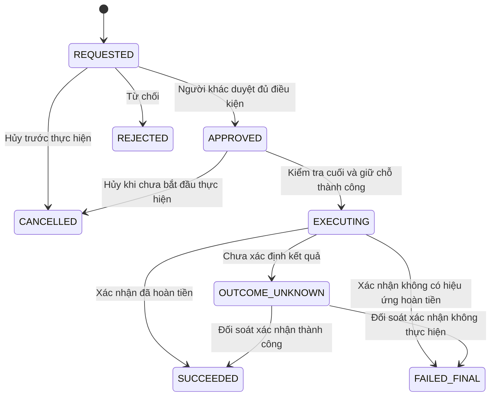

# Checklist bảo mật khi bổ sung thao tác quản trị mới

## 1. Mục tiêu và cách sử dụng

Một thao tác quản trị mới có thể là hoàn tiền ngoại lệ, thay đổi hạn mức, mở khóa tài khoản, cấp vai trò, duyệt đơn bị giữ hoặc chạy lại một tác vụ thất bại. Những thao tác này thường có quyền tác động lớn hơn chức năng thông thường. Nếu chỉ kiểm tra người gọi có vai trò `ADMIN`, hệ thống vẫn có thể cho phép sửa nhầm đối tượng, bỏ qua phê duyệt, thực hiện một yêu cầu nhiều lần hoặc phá vỡ giới hạn tài chính.

Bài học này thuộc nhóm **Security Checklists**, trong phạm vi bảo vệ logic nghiệp vụ của ứng dụng. Mục tiêu là biến một nút quản trị thành một lệnh có điều kiện rõ ràng: ai được yêu cầu, được tác động lên đối tượng nào, trong trạng thái nào, với hậu quả gì và bằng chứng nào để truy vết.

Checklist áp dụng cho cả giao diện, API, công cụ nội bộ, tác vụ nền và thao tác hàng loạt. Người thực hiện đánh dấu từng mục sau khi có bằng chứng tương ứng. Mục không áp dụng cần có lý do gắn với thiết kế; ví dụ, thao tác không gọi dịch vụ ngoài thì không cần quy trình đối soát kết quả từ nhà cung cấp.

Không phải thao tác nào cũng cần hai người duyệt hoặc xác thực bổ sung. Các điều kiện đó phải được xác định theo hậu quả của hành động. Tuy nhiên, mọi thao tác làm thay đổi nghiệp vụ đều cần quyền phù hợp, bất biến được bảo vệ, quy tắc chuyển trạng thái và cách xử lý lỗi hoặc lặp lại.

### Ví dụ xuyên suốt

Giả sử hệ thống bổ sung lệnh `REQUEST_EXCEPTIONAL_REFUND`: nhân viên vận hành đề nghị hoàn tiền cho đơn hàng đang bị giữ để kiểm tra gian lận. Chính sách minh họa của hệ thống này là:

- Chỉ thao tác trong tenant và khu vực được phân công.
- Mọi khoản hoàn ngoại lệ đều cần một người có quyền duyệt độc lập với người đề nghị.
- Khoản hoàn từ **5.000.000 VND trở lên** cần người duyệt thuộc nhóm quản lý tài chính và xác thực bổ sung còn hiệu lực, gắn với chính yêu cầu duyệt đó.
- Tổng tiền đã hoàn cộng tiền đã giữ chỗ để hoàn không được vượt số tiền thực thu.
- Tiền chỉ được hoàn về giao dịch thanh toán gốc; yêu cầu này không cho phép nhập tài khoản nhận tiền mới.
- Kết quả chưa xác định từ cổng thanh toán phải được đối soát trước khi giải phóng tiền giữ chỗ hoặc tạo lần hoàn thay thế.

Các ngưỡng, nhóm quyền và điều kiện trên chỉ là giả định để học cách thiết kế checklist, không phải quy định chung cho mọi sản phẩm.

## 2. Mô tả chính xác hành động trước khi viết endpoint

Một yêu cầu như “thêm chức năng sửa đơn cho admin” quá rộng để kiểm tra bảo mật. Hãy tách thành các lệnh có ý nghĩa nghiệp vụ: thay đổi địa chỉ trước khi giao, hủy đơn chưa thu tiền, đề nghị hoàn tiền hoặc phê duyệt ngoại lệ. Mỗi lệnh có điều kiện và hậu quả riêng.

| Thông tin cần xác định | Ví dụ với hoàn tiền ngoại lệ | Bằng chứng cần có |
|---|---|---|
| Tên lệnh | `REQUEST_EXCEPTIONAL_REFUND` | Hợp đồng API hoặc mô tả lệnh |
| Đối tượng chịu tác động | Đơn hàng và giao dịch thanh toán gốc | Quan hệ đối tượng, tenant, khu vực |
| Dữ liệu được đề nghị | Số tiền, mã lý do, mã hồ sơ xử lý | Danh sách trường cho phép |
| Dữ liệu do server quyết định | Người đề nghị, trạng thái, người duyệt, thời điểm | Quy tắc tạo dữ liệu đáng tin cậy |
| Điều kiện trước | Đã thu tiền, còn số dư được hoàn, loại đơn được hỗ trợ | Bất biến và bảng trạng thái |
| Hậu quả | Giữ chỗ số tiền, gọi cổng thanh toán, cập nhật sổ theo dõi | Sơ đồ transaction và tác dụng phụ |
| Khả năng đảo ngược | Không thể coi hoàn tiền đã thành công là chưa từng xảy ra | Quy trình điều chỉnh hoặc xử lý tiếp |
| Chủ sở hữu nghiệp vụ | Nhóm tài chính phụ trách chính sách hoàn tiền | Người chịu trách nhiệm quyết định ngoại lệ |

### Checklist định nghĩa hành động

- [ ] Tên lệnh mô tả một ý định nghiệp vụ cụ thể, không cung cấp quyền sửa tùy ý một bản ghi.
- [ ] Xác định tài sản cần bảo vệ: tiền, quyền truy cập, trạng thái đơn, dữ liệu khách hàng hoặc năng lực phục vụ.
- [ ] Liệt kê mọi đường vào có thể kích hoạt cùng hành động: API mới, API cũ, tác vụ nền, import, công cụ hỗ trợ và thao tác hàng loạt.
- [ ] Xác định hành động nào hoàn tất trong một transaction nội bộ và hành động nào cần chờ hệ thống ngoài.
- [ ] Xác định ai sở hữu chính sách và ai được giải quyết tình huống chưa có quy tắc.
- [ ] Có ví dụ được phép và ví dụ bị từ chối cho cùng một người dùng trên các đối tượng khác nhau.

## 3. Viết bất biến nghiệp vụ thành điều kiện có thể kiểm tra

**Business invariant** là điều kiện phải luôn đúng đối với dữ liệu nghiệp vụ, kể cả khi có lỗi, yêu cầu đồng thời hoặc thao tác quản trị. Quyền quản trị có thể cho phép đi theo một luồng ngoại lệ đã thiết kế, nhưng không mặc nhiên cho phép bỏ mọi bất biến.

Với hoàn tiền, ký hiệu:

```text
C = số tiền thực thu của giao dịch gốc
R = tổng tiền đã hoàn thành công
H = tổng tiền đang giữ chỗ cho các lần hoàn chưa có kết quả cuối
A = số tiền của lần hoàn mới

Điều kiện hiện tại: 0 <= R, 0 <= H, R + H <= C
Điều kiện nhận lần hoàn mới: A > 0 và R + H + A <= C
```

Tất cả đại lượng phải cùng tiền tệ và cùng quy ước đơn vị. Với tiền tệ có phần lẻ, có thể dùng số nguyên theo đơn vị nhỏ nhất hoặc kiểu thập phân với quy tắc làm tròn được xác định; không dùng số dấu phẩy động nhị phân để so sánh hạn mức tiền. Trong ví dụ VND, các số tiền nguyên được biểu diễn bằng đồng.

Khi giữ chỗ thành công, tăng `H` thêm `A`. Khi xác nhận hoàn tiền thành công, giảm `H` và tăng `R` cùng một lượng `A` trong một transaction. Khi có kết quả thất bại cuối cùng chứng minh tiền chưa được hoàn, giảm `H`. Timeout mạng không đủ để kết luận thất bại cuối cùng.

| Bất biến | Cách bị phá vỡ | Nơi cần bảo vệ |
|---|---|---|
| Không hoàn vượt số tiền thực thu | Hai quản trị viên cùng đọc số dư cũ | Transaction và cơ chế kiểm soát đồng thời trên dữ liệu tiền |
| Không tác động sang tenant khác | Thay `orderId` hoặc `tenantId` trong request | Truy vấn có phạm vi và kiểm tra quyền trên đối tượng |
| Người đề nghị không tự duyệt | Gọi trực tiếp endpoint duyệt | Chính sách duyệt tại service |
| Phê duyệt chỉ có hiệu lực cho nội dung đã xem | Duyệt xong rồi sửa số tiền | Dữ liệu yêu cầu bất biến và ràng buộc với phê duyệt |
| Một yêu cầu chỉ tạo một hiệu ứng hoàn tiền | Gửi lại, hàng đợi giao lặp, worker khởi động lại | Định danh nghiệp vụ, ràng buộc duy nhất và idempotency |
| Không giải phóng giữ chỗ khi kết quả còn mơ hồ | Timeout bị coi là không thực hiện | State machine và quy trình đối soát |

### Checklist bất biến

- [ ] Có công thức hoặc điều kiện cụ thể cho giới hạn tiền, số lượng, hạn mức và quan hệ giữa các trạng thái.
- [ ] Phân biệt bất biến không được phá vỡ với điều kiện có thể được miễn bằng một quyền ngoại lệ được mô tả rõ.
- [ ] Server tính lại dữ liệu quan trọng từ nguồn tin cậy; không nhận giá, tổng tiền, vai trò hiệu lực hoặc cờ `approved` từ client như sự thật.
- [ ] Các luồng thường và luồng quản trị dùng cùng cơ chế bảo vệ tài nguyên chung.
- [ ] Ràng buộc có thể biểu diễn trong cơ sở dữ liệu được bổ sung như một lớp bảo vệ, bên cạnh kiểm tra nghiệp vụ.
- [ ] Xác định cách xử lý dữ liệu cũ không thỏa bất biến, thay vì âm thầm tiếp tục tác động lên nó.

Một `CHECK` chỉ nhìn vào một hàng không tự bảo vệ được tổng tiền trải trên nhiều hàng. Nếu tiền hoàn lưu ở nhiều bản ghi, cần thiết kế điểm phối hợp như hàng số dư của giao dịch gốc, giao thức khóa thống nhất hoặc cơ chế kiểm soát đồng thời tương đương.

## 4. Phân quyền theo hành động và đối tượng

Đăng nhập thành công cho biết danh tính người gọi. Quyền thực hiện còn phụ thuộc hành động, đối tượng, tenant, khu vực và điều kiện hiện tại. Nguyên tắc từ chối mặc định và kiểm tra quyền trên mọi yêu cầu, bao gồm đối tượng cụ thể, được trình bày trong [OWASP Authorization Cheat Sheet](https://cheatsheetseries.owasp.org/cheatsheets/Authorization_Cheat_Sheet.html).

### Ma trận quyền minh họa

| Chủ thể | Đề nghị hoàn ngoại lệ | Duyệt yêu cầu của người khác | Thực hiện giao dịch bên ngoài | Xem lịch sử |
|---|---|---|---|---|
| Nhân viên hỗ trợ | Không | Không | Không | Trong phạm vi hồ sơ được cấp |
| Nhân viên vận hành hoàn tiền | Có, trong phạm vi được giao | Không | Không | Trong phạm vi được giao |
| Người duyệt tài chính | Theo quyền riêng được cấp | Có, trong hạn mức và phạm vi | Không trực tiếp | Trong phạm vi được giao |
| Quản lý tài chính | Theo quyền riêng được cấp | Có, bao gồm ngưỡng cao khi đủ điều kiện | Không trực tiếp | Trong phạm vi được giao |
| Worker hoàn tiền | Không nhận đề nghị tùy ý | Không | Chỉ yêu cầu đã đủ điều kiện | Chỉ dữ liệu cần cho xử lý |

Việc một người đồng thời có quyền đề nghị và duyệt không cho phép họ duyệt yêu cầu do chính mình tạo. Nếu chính sách yêu cầu hai người độc lập, cần dùng định danh con người phù hợp với tổ chức; so sánh hai tài khoản khác nhau chưa chứng minh đó là hai người khác nhau.

### Checklist quyền

- [ ] Có quyền riêng cho các lệnh nhạy cảm như đề nghị, duyệt, hủy, cấp vai trò và thực hiện ngoại lệ.
- [ ] Kiểm tra phạm vi đối tượng sau khi tải dữ liệu đáng tin cậy, không chỉ kiểm tra quyền truy cập URL.
- [ ] Tenant được suy ra từ ngữ cảnh xác thực hoặc được đối chiếu với quyền thành viên; không tin `tenantId` trong body hoặc header tùy ý.
- [ ] Truy vấn, cache, lịch sử và endpoint đọc trạng thái đều tuân thủ cùng phạm vi bảo mật.
- [ ] Người đề nghị không được tự duyệt nếu chính sách yêu cầu độc lập.
- [ ] Kiểm tra người duyệt có hạn mức tương ứng với số tiền và loại hành động.
- [ ] Quy tắc khi tài khoản bị khóa hoặc quyền bị thu hồi trong thời gian chờ được xác định rõ.
- [ ] Nếu có giả lập người dùng, lưu cả danh tính thực và danh tính được đại diện; không tự biến danh tính được giả lập thành quyền quản trị.
- [ ] Service account và worker chỉ có quyền cần cho nhiệm vụ, không mang quyền `SUPER_ADMIN` tổng quát.

Trong ví dụ, trước khi bắt đầu thực hiện, hệ thống kiểm tra lại quyền còn hiệu lực của người đề nghị và người duyệt, cùng chính sách hiện tại. Nếu không còn đủ điều kiện, yêu cầu không được chuyển sang `EXECUTING`. Khi đã bắt đầu gọi cổng thanh toán, việc thu hồi quyền không thể tự đảo ngược tác động bên ngoài; hệ thống vẫn phải theo dõi và đối soát kết quả.

Đối với chức năng cấp quyền, cần có bất biến riêng: người cấp không thể cấp vượt phạm vi được ủy quyền, tự nâng quyền ngoài chính sách hoặc thay đổi người duyệt để tự phê duyệt hành động đang chờ.

## 5. Ràng buộc phê duyệt với đúng nội dung và trạng thái

Một bản ghi “đã duyệt” thiếu liên kết với nội dung được duyệt có thể bị dùng lại cho hành động khác. Các nguyên tắc thực thi ở server, kiểm soát thứ tự bước, bảo vệ dữ liệu sau khi duyệt và kiểm tra lần cuối trước thực hiện được mô tả trong [OWASP Transaction Authorization Cheat Sheet](https://cheatsheetseries.owasp.org/cheatsheets/Transaction_Authorization_Cheat_Sheet.html).

Với thiết kế minh họa, nội dung yêu cầu đã tạo không được sửa trực tiếp. Muốn thay số tiền hoặc đối tượng phải hủy yêu cầu khi còn được phép và tạo yêu cầu mới. Cách này giúp người duyệt luôn nhìn thấy đúng dữ liệu sẽ được thực hiện.

### Dữ liệu cần gắn với phê duyệt

```text
action_request_id
action_type
tenant_id
target_order_id
original_payment_id
amount + currency
reason_code + case_reference
requester_identity
relevant_business_version
policy_version
approver_identity + approved_at + approval_expires_at
```

`relevant_business_version` biểu diễn phiên bản dữ liệu có ảnh hưởng đến quyết định, chẳng hạn số tiền thực thu, giao dịch nguồn hoặc trạng thái bị giữ. Nó không nhất thiết là phiên bản tăng khi sửa mọi trường hiển thị. Dù phiên bản còn khớp, lúc thực hiện vẫn phải kiểm tra số dư và quyền hiện tại.

Nếu dùng digest để nhận diện nội dung, server phải tạo từ biểu diễn chuẩn hóa có quy tắc rõ ràng. Digest không thay thế xác thực, quyền hoặc lưu nội dung gốc. Một giá trị băm do client gửi không phải bằng chứng rằng dữ liệu đã được người có quyền duyệt.

### State machine minh họa



`EXECUTING` bao gồm giai đoạn đã ghi ý định thực hiện và đang chờ worker xử lý. Sơ đồ cố ý không có đường từ `REQUESTED` thẳng đến `SUCCEEDED`, hoặc từ `OUTCOME_UNKNOWN` sang một lần hoàn độc lập mới.

Một lần truyền lại đến nhà cung cấp, nếu được giao thức của họ hỗ trợ, vẫn thuộc cùng yêu cầu và dùng cùng định danh chống trùng. Nó không phải một lần hoàn nghiệp vụ mới. Nếu worker dừng ở `EXECUTING` quá lâu, tác vụ giám sát phải đưa yêu cầu vào quy trình kiểm tra kết quả, thay vì mặc định giải phóng giữ chỗ.

### Checklist phê duyệt và trạng thái

- [ ] Các trạng thái và chuyển tiếp hợp lệ được định nghĩa ở phía server.
- [ ] Mỗi chuyển tiếp có điều kiện về chủ thể, dữ liệu, thời hạn và tác dụng phụ.
- [ ] Client gửi lệnh như `approve` hoặc `cancel`, không gửi trạng thái cuối tùy ý để server ghi nhận.
- [ ] Phê duyệt gắn với đúng yêu cầu, hành động, đối tượng, số tiền và tiền tệ.
- [ ] Thay đổi dữ liệu quan trọng buộc tạo yêu cầu mới hoặc làm mất hiệu lực phê duyệt theo quy tắc đã công bố.
- [ ] Thời hạn phê duyệt và xác thực bổ sung được kiểm tra tại thời điểm sử dụng, theo thời gian server.
- [ ] Hủy và bắt đầu thực hiện được phân xử bằng khóa hoặc cập nhật có điều kiện; không thể cùng thắng.
- [ ] Yêu cầu đã thành công, bị hủy hoặc bị từ chối không được đưa về trạng thái chờ bằng API cập nhật tổng quát.
- [ ] Yêu cầu hết hạn hoặc không còn thỏa chính sách có kết quả xử lý rõ; không treo vô hạn mà không có người theo dõi.

## 6. Giới hạn dữ liệu đầu vào và thiết kế giao diện xác nhận

Một endpoint nhận trực tiếp thực thể cơ sở dữ liệu làm body dễ cho phép người gọi chèn các trường như `approvedBy`, `tenantId`, `status` hoặc `refundCompleted`. Đây là vấn đề cho phép cập nhật quá nhiều trường, kể cả khi người gọi có quyền truy cập chức năng.

Ví dụ hợp đồng tạo đề nghị:

```http
POST /admin/orders/order-123/exceptional-refund-requests
Idempotency-Key: refund-case-742-attempt-1
Content-Type: application/json

{
  "amountVnd": 6000000,
  "reasonCode": "VERIFIED_CUSTOMER_CLAIM",
  "caseReference": "CASE-742"
}
```

Server tự xác định danh tính người đề nghị, tenant được phép, giao dịch thanh toán gốc và chính sách cần duyệt. Trường `amountVnd` chỉ là đề nghị; server vẫn đối chiếu với số tiền có thể hoàn và các hạn mức. Body không có quyền đặt giá trị `APPROVED` hoặc chọn người duyệt giả.

### Checklist đầu vào và giao diện

- [ ] DTO hoặc schema chỉ cho phép các trường nghiệp vụ được thiết kế; trường nhạy cảm ngoài hợp đồng bị từ chối theo chính sách API.
- [ ] Kiểm tra số âm, số không, tràn số, độ dài, tiền tệ và quy tắc làm tròn trước khi tính toán.
- [ ] Lý do và mã hồ sơ có cấu trúc đủ để truy vết; một chuỗi lý do tự do không cấp thêm quyền.
- [ ] Màn hình xác nhận hiển thị dữ liệu canonical từ server: đối tượng, tenant, số tiền, tiền tệ và hậu quả.
- [ ] Người duyệt xem lại nội dung yêu cầu đã lưu, không duyệt dựa trên một bản tóm tắt tùy ý do client gửi.
- [ ] API dùng phương thức phù hợp cho thay đổi trạng thái; mở một liên kết `GET` không thực hiện hành động quản trị.
- [ ] Với phiên dùng cookie được trình duyệt tự gửi, có biện pháp chống CSRF phù hợp; hộp thoại xác nhận không thay thế biện pháp này.
- [ ] Nội dung lý do được hiển thị an toàn, tránh biến ghi chú do người dùng nhập thành mã thực thi trong màn hình quản trị.
- [ ] Giao diện phân biệt “đã tiếp nhận”, “đã được duyệt”, “đang thực hiện” và “đã thành công”.
- [ ] Thông báo lỗi không tiết lộ đối tượng ngoài phạm vi hoặc gợi ý thông tin nhạy cảm không cần thiết.

Vô hiệu hóa nút sau khi bấm có ích cho trải nghiệm người dùng. Server vẫn phải chịu được gọi API trực tiếp, nhiều tab và nhiều phiên làm việc.

## 7. Bảo vệ transaction và xử lý cạnh tranh

Giả sử đơn đã thu 10.000.000 VND, chưa hoàn khoản nào. Hai yêu cầu hoàn 6.000.000 VND cùng đọc số dư 10.000.000 VND. Nếu mỗi yêu cầu kiểm tra ở ngoài transaction rồi tự ghi, cả hai có thể được chấp nhận và tổng tiền hoàn thành 12.000.000 VND.

Điều kiện đủ tiền phải được kiểm tra cùng thao tác giữ chỗ, tại điểm mọi luồng hoàn tiền đều tuân thủ.

### Phác thảo thao tác giữ chỗ trong cơ sở dữ liệu

Đoạn SQL sau chỉ minh họa một phần giao thức, giả sử hệ thống duy trì số tiền tổng hợp trên hàng giao dịch thanh toán. Các tham số được truyền qua cơ chế bind của thư viện truy cập dữ liệu.

```sql
UPDATE payment_balances
SET refund_reserved_vnd = refund_reserved_vnd + :amount,
    version = version + 1
WHERE tenant_id = :trusted_tenant_id
  AND payment_id = :verified_payment_id
  AND currency = 'VND'
  AND :amount > 0
  AND refunded_vnd + refund_reserved_vnd + :amount <= captured_vnd;
```

Trong cùng transaction, server phải khóa hoặc cập nhật có điều kiện bản ghi yêu cầu để bảo đảm nó đang ở `APPROVED`, kiểm tra phê duyệt còn hiệu lực, kiểm tra lại quyền và điều kiện nghiệp vụ, rồi mới giữ chỗ. Nếu câu lệnh giữ chỗ không tác động đúng một hàng, không được tiếp tục ghi tác vụ hoàn tiền.

Transaction cũng ghi bản ghi hiệu ứng nội bộ có định danh duy nhất theo `action_request_id`, chuyển trạng thái sang `EXECUTING` và ghi sự kiện outbox. Khi một bước không thành công, toàn bộ thay đổi của transaction phải rollback. Với nhiều tài nguyên, các luồng cần tuân thủ cùng thứ tự khóa để giảm nguy cơ deadlock.

Không chỉ thêm `@Transactional` rồi giả định mọi vấn đề đồng thời đã biến mất. Cần xác định dữ liệu nào bị khóa, cập nhật nào có điều kiện, mức cô lập được sử dụng và cách xử lý xung đột. Nếu dùng optimistic locking, bản ghi cũ phải bị từ chối cập nhật; lần thử lại phải đọc và đánh giá lại điều kiện nghiệp vụ.

### Checklist transaction

- [ ] Kiểm tra điều kiện có thể thay đổi và cập nhật tài nguyên diễn ra trong giao thức đồng thời thống nhất.
- [ ] Kiểm tra số hàng cập nhật hoặc phiên bản kỳ vọng; kết quả bằng không không bị coi là thành công.
- [ ] Có ràng buộc duy nhất phù hợp cho một hiệu ứng nội bộ trên một yêu cầu.
- [ ] Những đường xử lý khác như hoàn tự động, công cụ hỗ trợ và job đối soát cũng bảo vệ cùng bất biến.
- [ ] Xung đột hoặc deadlock được xử lý có giới hạn; thử lại phải giữ nguyên ý định và đánh giá lại dữ liệu mới.
- [ ] Không thực hiện cuộc gọi mạng kéo dài trong khi giữ transaction cơ sở dữ liệu để chờ kết quả bên ngoài.
- [ ] Có cách xác nhận request đang chờ sau khi client bị mất kết nối đúng lúc server commit.

Một phiên bản đơn hàng còn khớp không tự bảo đảm số dư thanh toán còn đủ. Nếu hai tài nguyên độc lập cùng ảnh hưởng đến quyết định, phải bảo vệ cả hai hoặc dùng điểm phối hợp chung.

## 8. Chống gửi trùng và quản lý kết quả từ hệ thống ngoài

**Idempotency** giúp cùng một ý định được gửi lại mà không tạo thêm hiệu ứng nghiệp vụ. Nó không tự phát hiện hai yêu cầu khác định danh nhưng cùng muốn lạm dụng một đối tượng.

### Tách hai lớp chống trùng

| Lớp | Định danh minh họa | Trường hợp cần xử lý |
|---|---|---|
| Nhận lệnh từ quản trị viên | Tenant + người đề nghị + loại lệnh + idempotency key | Bấm hai lần, timeout khi tạo yêu cầu |
| Thực hiện yêu cầu đã lưu | `action_request_id` và mã hiệu ứng tương ứng | Worker giao lặp, khởi động lại, timeout từ cổng thanh toán |

Ở lớp nhận lệnh, server lưu fingerprint của nội dung đã chuẩn hóa cùng phạm vi key. Cùng key, cùng nội dung thì tham chiếu về yêu cầu cũ. Cùng key nhưng khác số tiền hoặc đối tượng phải bị từ chối xung đột, thay vì âm thầm thực hiện nội dung mới.

Trước khi trả lại kết quả cũ, vẫn phải xác thực và kiểm tra quyền đọc yêu cầu hiện tại. Idempotency key không phải bí mật cấp quyền truy cập. Cần quy định thời gian lưu key và bảo đảm việc hết hạn key không làm mất ràng buộc chống thực hiện lại của một yêu cầu đã có.

Nếu người dùng thay key, lớp chống trùng theo key không còn ngăn tạo yêu cầu mới. Bất biến số dư, hạn mức tổng, chính sách đối với hồ sơ nghiệp vụ và kiểm tra dấu hiệu lạm dụng phải tiếp tục có hiệu lực. Nếu mỗi hồ sơ chỉ được có một yêu cầu còn hoạt động, quy tắc đó cần được thực thi rõ ràng, kể cả khi hai lệnh tạo đến đồng thời.

### Giao thức với cổng thanh toán

1. Transaction nội bộ xác nhận điều kiện, giữ chỗ, ghi `EXECUTING` và outbox rồi commit.
2. Worker lấy sự kiện đã commit và gọi cổng thanh toán bằng định danh ổn định của yêu cầu.
3. Khi có kết quả đáng tin cậy, transaction khác ghi nhận hiệu ứng một lần và điều chỉnh `R`, `H` tương ứng.
4. Khi timeout hoặc worker dừng sau lúc gọi, hệ thống giữ trạng thái cần xác minh; kiểm tra trạng thái tại nhà cung cấp hoặc đối soát theo giao thức đã thiết kế.
5. Chỉ giải phóng giữ chỗ khi có kết luận cuối cùng rằng không có hiệu ứng hoàn tiền, không còn lần gọi đang xử lý có thể hoàn tất muộn.

Outbox giúp ý định đã commit có thể được chuyển tiếp, nhưng không tự làm API bên ngoài trở thành “thực hiện đúng một lần”. Nếu nhà cung cấp hỗ trợ idempotency, phải hiểu phạm vi key, thời gian hiệu lực và cách xử lý yêu cầu đang xử lý. Nếu không có cơ chế phù hợp, không tự gửi lại mù quáng sau timeout; chuyển sang truy vấn kết quả hoặc xử lý đối soát.

Webhook cũng có thể được giao nhiều lần hoặc đến sai thứ tự. Hệ thống cần xác thực nguồn, đối chiếu mã giao dịch và nội dung với yêu cầu đã lưu, rồi ghi kết quả qua cùng cơ chế chống trùng. Không cho một thông báo cũ làm trạng thái `SUCCEEDED` quay lại `EXECUTING`.

### Checklist idempotency và tác dụng phụ

- [ ] Key có phạm vi rõ, có fingerprint nội dung và được giành quyền xử lý bằng cơ chế nguyên tử.
- [ ] Cùng key khác nội dung bị từ chối, không sửa yêu cầu đã tạo.
- [ ] Một yêu cầu đang xử lý được trả về đúng trạng thái, không bị diễn giải thành thất bại để client tạo lệnh mới.
- [ ] Hiệu ứng nội bộ có ràng buộc chống lặp tồn tại đủ lâu theo vòng đời nghiệp vụ.
- [ ] Mỗi lần truyền lại đến hệ thống ngoài dùng cùng định danh nghiệp vụ khi giao thức cho phép.
- [ ] Có trạng thái kết quả chưa xác định, thời hạn theo dõi và người chịu trách nhiệm đối soát.
- [ ] Callback lặp hoặc sai thứ tự không ghi tiền hai lần hay đảo ngược trạng thái cuối.
- [ ] Thông báo, email và sự kiện phát ra sau xử lý cũng có chiến lược chống trùng phù hợp.

## 9. Thao tác hàng loạt, giới hạn tác động và ngoại lệ khẩn cấp

Thao tác hàng loạt không đơn giản là gọi một hàm quản trị trong vòng lặp. Một bộ lọc như “tất cả đơn đang chờ” có thể khớp các đối tượng khác nhau giữa lúc xem trước, duyệt và chạy.

### Checklist hàng loạt

- [ ] Xác định danh sách đối tượng hoặc snapshot có thể kiểm chứng khi phê duyệt, kèm giới hạn số lượng và tổng giá trị.
- [ ] Nếu tập đối tượng được tính lại lúc chạy, chính sách nêu rõ phạm vi đó và chặn việc vượt phạm vi đã duyệt.
- [ ] Kiểm tra quyền và điều kiện cho từng đối tượng; có quyền chạy batch không đồng nghĩa có quyền với mọi hàng.
- [ ] Định nghĩa rõ toàn bộ thành công hoặc từng phần thành công; báo cáo không che giấu các hàng bị từ chối.
- [ ] Nếu xử lý từng phần, mỗi phần có định danh, kết quả và khả năng thử lại riêng mà không lặp phần đã thành công.
- [ ] Giới hạn tổng tác động theo người, tenant, loại lệnh và cửa sổ thời gian phù hợp.
- [ ] Nếu hạn mức tổng là điều kiện cứng, việc tiêu thụ hạn mức được kiểm soát đồng thời, không chỉ thống kê sau khi thực hiện.
- [ ] Có khả năng tạm dừng nhận hoặc thực hiện thêm công việc mà vẫn theo dõi được các phần đã khởi chạy.

Ngưỡng duyệt theo từng yêu cầu có thể bị lách bằng cách chia nhỏ. Trong ví dụ, người đề nghị có thể tạo nhiều khoản dưới 5.000.000 VND để tránh người duyệt cấp quản lý. Chính sách phải xác định trường hợp cần cộng dồn theo đơn, hồ sơ hoặc người thụ hưởng, cùng thời gian cộng dồn phù hợp. Mọi khoản vẫn cần người duyệt độc lập theo giả định ban đầu.

### Checklist truy cập khẩn cấp

- [ ] Nếu có cơ chế khẩn cấp, nêu rõ điều kiện kích hoạt, quyền được cấp, phạm vi, thời hạn và người chịu trách nhiệm.
- [ ] Quyền khẩn cấp chỉ miễn những điều kiện đã liệt kê; các bất biến như không hoàn vượt số tiền thực thu vẫn được bảo vệ.
- [ ] Kích hoạt và sử dụng quyền khẩn cấp tạo dấu vết riêng, có thông báo đến đầu mối chịu trách nhiệm theo quy trình tổ chức.
- [ ] Có bước xem xét sau sử dụng và thu hồi quyền khi hết hạn.

Nếu sản phẩm chưa thiết kế chế độ khẩn cấp, không thêm cờ `force=true` để ngầm bỏ mọi kiểm tra.

## 10. Audit, quan sát và phục hồi

Nhật ký cần trả lời: ai đề nghị, ai duyệt, hành động nào, trên đối tượng nào, theo chính sách nào, đã có hiệu ứng gì và vì sao bị từ chối. Dòng log “admin updated order” không đủ để tái dựng một lần hoàn ngoại lệ.

### Dữ liệu audit tối thiểu theo ngữ cảnh

| Nhóm | Ví dụ |
|---|---|
| Danh tính | Người đề nghị, người duyệt, service thực hiện, danh tính đại diện nếu có |
| Phạm vi | Tenant, đối tượng, giao dịch gốc, loại hành động |
| Quyết định | Trạng thái trước/sau, mã lý do, phiên bản chính sách, điều kiện bị từ chối |
| Tương quan | Request ID, action request ID, effect ID, mã giao dịch nhà cung cấp |
| Thời gian | Thời điểm đề nghị, duyệt, bắt đầu, xác nhận kết quả |
| Tác động | Số tiền và tiền tệ, thay đổi quyền hoặc thay đổi trạng thái liên quan |

### Checklist audit và phục hồi

- [ ] Audit thành công được ghi nhất quán với thay đổi trạng thái, hoặc có cơ chế chuyển tiếp bền vững đã thiết kế.
- [ ] Lần bị từ chối do sai quyền, sai trạng thái hoặc cố sửa nội dung đã duyệt cũng có dấu vết cần thiết.
- [ ] Không ghi token, mật khẩu, mã xác thực một lần hoặc toàn bộ dữ liệu thanh toán nhạy cảm vào log.
- [ ] Người có quyền thao tác nghiệp vụ không tự xóa hoặc sửa lịch sử audit của chính mình.
- [ ] Có chỉ số và cảnh báo cho tự duyệt bị chặn, vượt hạn mức, gọi chéo tenant, yêu cầu lặp và trạng thái chưa xác định kéo dài.
- [ ] Quy trình tạm dừng hành động phân biệt ngừng nhận yêu cầu mới với xử lý nốt và đối soát công việc đang thực hiện.
- [ ] Có người phụ trách, cách tra cứu kết quả và hướng xử lý khi nhà cung cấp trả kết quả mâu thuẫn.
- [ ] Biện pháp bù trừ là lệnh nghiệp vụ mới có quyền và audit; không xóa lịch sử hoặc sửa trạng thái để giả lập rằng hiệu ứng chưa xảy ra.

Rollback một bản triển khai không hoàn tác khoản tiền đã hoàn, email đã gửi hay quyền đã được cấp ở hệ thống khác. Khả năng phục hồi phải được mô tả theo hậu quả nghiệp vụ thực tế.

## 11. Ma trận tình huống tấn công logic cần kiểm thử

Bảng sau là kế hoạch kiểm thử cho chức năng được thiết kế, không phải kết quả kiểm thử của một hệ thống cụ thể. Cần kiểm tra cả phản hồi API và dữ liệu bền vững, số lần gọi dịch vụ ngoài, số tiền giữ chỗ cùng lịch sử audit.

| Tình huống | Cách tạo tình huống | Kết quả cần quan sát |
|---|---|---|
| Không có quyền chức năng | Tài khoản hỗ trợ gọi trực tiếp API đề nghị | Bị từ chối; không tạo yêu cầu hay tác dụng phụ |
| Truy cập chéo tenant | Người hợp lệ thay ID bằng đơn của tenant khác | Không đọc hoặc sửa được đơn, không lộ dữ liệu nhạy cảm |
| Truy cập ngoài khu vực | Cùng tenant nhưng khác phạm vi được giao | Bị từ chối theo chính sách đối tượng |
| Chèn trường đặc quyền | Gửi thêm `approvedBy`, `status`, `tenantId` | Không thể ghi trường do server quản lý |
| Bỏ qua phê duyệt | Gọi thực hiện khi yêu cầu còn `REQUESTED` | Không giữ chỗ, không tạo tác vụ thanh toán |
| Tự phê duyệt | Người đề nghị gọi API duyệt bằng phiên của mình | Bị từ chối dù có cả hai nhóm quyền |
| Lách ngưỡng duyệt | Thử số tiền 4.999.999, 5.000.000 và 5.000.001 VND | Áp dụng đúng ranh giới từ 5.000.000 VND trở lên |
| Sửa sau phê duyệt | Thay số tiền, đơn hoặc giao dịch gốc | Không dùng được phê duyệt cũ cho nội dung khác |
| Phê duyệt hết hạn | Thực hiện sau thời hạn trên server | Không bắt đầu hiệu ứng; phản hồi trạng thái rõ ràng |
| Thu hồi quyền khi đang chờ | Khóa tài khoản hoặc bỏ quyền trước khi bắt đầu | Không chuyển sang `EXECUTING` theo chính sách ví dụ |
| Hai yêu cầu cạnh tranh số dư | Đồng thời hoàn hai khoản 6.000.000 trên số dư 10.000.000 VND | Tối đa một khoản được giữ chỗ; bất biến vẫn đúng |
| Hủy cạnh tranh với thực hiện | Đồng bộ hai luồng cùng tác động một yêu cầu | Chỉ một chuyển tiếp thắng; không hủy rồi vẫn thực hiện |
| Gửi trùng cùng key | Gửi nhiều request giống nhau đồng thời | Một yêu cầu logic, không tạo nhiều hiệu ứng |
| Dùng lại key cho nội dung khác | Giữ key nhưng đổi số tiền hoặc đối tượng | Từ chối xung đột; yêu cầu cũ không bị sửa |
| Đổi key để lặp nghiệp vụ | Tạo yêu cầu khác key cho cùng hồ sơ | Quy tắc hồ sơ, hạn mức và phê duyệt vẫn có hiệu lực |
| Mất phản hồi sau commit | Server commit rồi ngắt kết nối với client | Gửi lại hoặc tra cứu trả đúng yêu cầu đã tồn tại |
| Timeout sau khi nhà cung cấp xử lý | Nhà cung cấp đã hoàn tiền nhưng phản hồi bị mất | Không hoàn lại mù quáng; giữ chỗ và đối soát |
| Worker dừng giữa các bước | Dừng sau commit outbox hoặc sau cuộc gọi ngoài | Khôi phục được tiến độ mà không nhân đôi hiệu ứng |
| Callback trùng hoặc đến muộn | Gửi cùng sự kiện nhiều lần, đảo thứ tự | Ghi tiền một lần; trạng thái cuối không lùi sai |
| Chia nhỏ để né cấp duyệt | Nhiều yêu cầu dưới ngưỡng cho cùng phạm vi cộng dồn | Áp dụng đúng chính sách cộng dồn đã xác định |
| Batch chứa đối tượng ngoài quyền | Trộn ID hợp lệ với ID không được phép | Đúng quy tắc toàn bộ/từng phần; không tác động trái quyền |
| Tắt chức năng khi đang chạy | Ngừng thực hiện mới lúc có khoản chưa rõ kết quả | Công việc đang chạy vẫn được theo dõi và đối soát |

Đối với kiểm thử cạnh tranh, dùng cơ chế đồng bộ để ép các luồng đến cùng điểm tranh chấp. Hai lệnh gọi tuần tự không chứng minh được khả năng chống race condition. Các tình huống transaction và ràng buộc duy nhất cần kiểm tra với cơ sở dữ liệu có hành vi tương ứng môi trường vận hành; mock trả về “thành công” không chứng minh được tính nguyên tử.

Ví dụ thuộc tính cần xác nhận sau một nhóm yêu cầu đồng thời:

```text
refunded_vnd >= 0
refund_reserved_vnd >= 0
refunded_vnd + refund_reserved_vnd <= captured_vnd

Với mỗi action_request_id:
  số hiệu ứng hoàn tiền nghiệp vụ được ghi nhận <= 1

Với mỗi lần hoàn đã được xác nhận thành công:
  có đúng nội dung đề nghị, phê duyệt hợp lệ tại lúc bắt đầu
  và mã kết quả đối chiếu được với giao dịch gốc
```

Các lệnh hoàn hợp lệ khác nhau vẫn có thể tạo nhiều hiệu ứng cho cùng đơn nếu chính sách cho phép hoàn từng phần. Vì vậy, ràng buộc “mỗi đơn chỉ có một lần hoàn” không phải cách thay thế chung cho bất biến tổng tiền.

## 12. Mẫu checklist dùng cho một đề xuất thay đổi

Có thể đưa mẫu sau vào mô tả thay đổi hoặc hồ sơ thiết kế. Mỗi ô đánh dấu cần dẫn đến bằng chứng cụ thể như ma trận quyền, hợp đồng API, sơ đồ trạng thái, ràng buộc dữ liệu hoặc kết quả kiểm thử của tính năng tương ứng.

```text
Tên hành động:
Chủ sở hữu nghiệp vụ:
Đối tượng và phạm vi tác động:
Hậu quả lớn nhất có thể xảy ra:

[ ] Hành động có mục tiêu cụ thể và trường đầu vào cho phép rõ ràng.
[ ] Bất biến và điều kiện ngoại lệ được mô tả riêng.
[ ] Kiểm tra quyền theo hành động, tenant và đối tượng tại server.
[ ] Người đề nghị/người duyệt/người thực hiện được phân định.
[ ] Điều kiện cần duyệt độc lập hoặc xác thực bổ sung đã xác định.
[ ] Phê duyệt gắn với nội dung, phiên bản liên quan và thời hạn.
[ ] State machine chặn bỏ bước, gọi sai thứ tự và sửa trạng thái tùy ý.
[ ] Transaction và kiểm soát đồng thời bảo vệ tài nguyên dùng chung.
[ ] Retry, idempotency và ràng buộc chống lặp được thiết kế đầy đủ.
[ ] Hiệu ứng ngoài hệ thống có xử lý timeout và kết quả chưa xác định.
[ ] Batch và hạn mức cộng dồn có quy tắc nếu áp dụng.
[ ] Có audit, dấu hiệu cảnh báo và người xử lý sự cố.
[ ] Có cách tạm dừng và phục hồi theo hậu quả nghiệp vụ.
[ ] Các tình huống tấn công logic liên quan có bằng chứng kiểm thử.

Mục không áp dụng và lý do:
Rủi ro còn lại, người chịu trách nhiệm và hướng xử lý:
Liên kết bằng chứng:
```

Một checklist có giá trị khi người đọc truy được từ mỗi điều kiện bảo mật đến chỗ thực thi và tình huống kiểm thử. Với thao tác hoàn tiền ngoại lệ, chuỗi bằng chứng quan trọng là: quyền đúng đối tượng, nội dung được duyệt không đổi, điều kiện cuối còn hiệu lực, số tiền được giữ chỗ nguyên tử, hiệu ứng được chống lặp và kết quả có thể đối soát.
