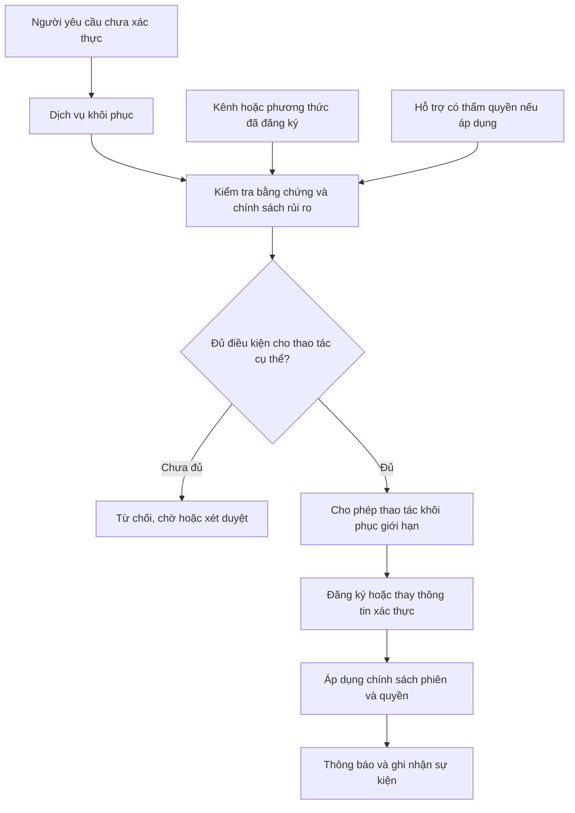

# Mục đích và ranh giới của khôi phục tài khoản

## 1. Khôi phục khả năng truy cập cũng là một quyết định cấp quyền

Một người dùng mất điện thoại chứa ứng dụng MFA và passkey. Họ vẫn nhớ mật khẩu, nhưng không thể hoàn tất đăng nhập. Nếu hệ thống chỉ gửi một liên kết qua email rồi cho phép tắt toàn bộ MFA, luồng khôi phục đã tạo ra một con đường truy cập có thể yếu hơn cơ chế đăng nhập mà nó thay thế.

Ngược lại, nếu hệ thống luôn yêu cầu chính thiết bị vừa mất, người dùng hợp lệ có thể bị khóa khỏi tài khoản vĩnh viễn. Bài toán khôi phục nằm giữa hai yêu cầu: giúp chủ tài khoản lấy lại quyền truy cập và ngăn người khác lợi dụng cùng quy trình để chiếm tài khoản.

**Account recovery, hay khôi phục tài khoản, là quy trình tái thiết lập khả năng xác thực cho một tài khoản hiện có khi người dùng không còn hoàn thành được cách xác thực thông thường.** Tùy tình huống, quy trình có thể khôi phục một thông tin xác thực, thay thế yếu tố đã mất hoặc xác minh lại quyền kiểm soát tài khoản trước khi cho đăng ký phương thức mới.

Bài học này thuộc chương **Recovery Foundations**, trong phạm vi thiết kế luồng khôi phục tài khoản an toàn. Trọng tâm là xác định hệ thống đang khôi phục điều gì, dựa vào bằng chứng nào và được phép cấp lại những quyền nào. Các chi tiết triển khai token, xác minh danh tính và chống lạm dụng cần tiếp tục được thiết kế dựa trên các ranh giới đó.

Sau bài học, bạn cần có khả năng:

- Phân biệt khôi phục tài khoản với đăng nhập dự phòng, đặt lại mật khẩu, mở khóa tài khoản và khôi phục dữ liệu.
- Nhận diện tài sản, bằng chứng và bên có quyền quyết định trong một quy trình khôi phục.
- Xác định tác động khi mất mật khẩu, MFA, passkey hoặc thiết bị xác thực.
- Mô tả điều kiện hoàn tất, giới hạn phiên và giới hạn quyền sau khôi phục.
- Nhận ra khi nào một yêu cầu cần bị từ chối, trì hoãn hoặc chuyển sang xét duyệt.

## 2. Khôi phục điều gì và không khôi phục điều gì?

### 2.1. Tài khoản, danh tính và thông tin xác thực là các khái niệm khác nhau

Một **tài khoản** là bản ghi mà hệ thống dùng để gắn dữ liệu, quyền và lịch sử hoạt động. Một **thông tin xác thực** như mật khẩu hoặc khóa của passkey giúp chứng minh quyền truy cập. Một **yếu tố xác thực** là loại bằng chứng như điều người dùng biết, thứ họ sở hữu hoặc đặc điểm sinh trắc học.

Thiết bị là nơi có thể lưu hoặc sử dụng nhiều thông tin xác thực. Vì vậy, mất một thiết bị có thể đồng thời làm mất nhiều đường truy cập. Mật khẩu, email và ứng dụng OTP cùng nằm trên một điện thoại không tạo ra ba đường dự phòng độc lập khi điện thoại đó bị mất hoặc bị chiếm quyền.

**Danh tính ngoài đời** và **quyền kiểm soát tài khoản** cũng không đồng nhất. Biết tên, ngày sinh, địa chỉ hoặc có một giấy tờ mang tên người dùng chưa tự động chứng minh quyền sở hữu một tài khoản cụ thể. Nếu dịch vụ không thiết lập liên kết đáng tin cậy giữa danh tính đã xác minh và tài khoản từ trước, việc xem giấy tờ tại thời điểm khôi phục có thể không giải quyết được khoảng trống này.

Trong một dịch vụ cho phép dùng biệt danh, bắt người dùng cung cấp giấy tờ tùy thân có thể vừa thu thập dữ liệu không cần thiết, vừa không tạo được bằng chứng liên kết tài khoản đủ tốt. Cần chọn bằng chứng phù hợp với mô hình tài khoản và rủi ro của dịch vụ.

### 2.2. Các quy trình dễ bị nhầm lẫn

| Quy trình | Tình huống điển hình | Điều phải làm rõ |
| --- | --- | --- |
| Đăng nhập bằng phương thức thay thế | Mất điện thoại nhưng còn khóa bảo mật đã đăng ký | Có thể vẫn là xác thực bình thường theo chính sách, chưa cần khôi phục |
| Đổi mật khẩu | Người dùng đang truy cập và muốn thay mật khẩu | Thao tác nhạy cảm cần xác thực lại theo chính sách; không mặc nhiên là quên mật khẩu |
| Đặt lại mật khẩu | Người dùng quên mật khẩu và dùng bằng chứng được chấp nhận để đặt mật khẩu mới | Chỉ xử lý mật khẩu; không tự động gỡ MFA hoặc thay email |
| Khôi phục MFA | Mất khả năng sử dụng yếu tố MFA đã đăng ký | Cần chứng minh quyền kiểm soát bằng đường khác đủ tin cậy trước khi thay yếu tố |
| Khôi phục quyền truy cập bằng passkey | Không còn sử dụng được passkey khả dụng | Trước hết xác định còn passkey khác hoặc khả năng khôi phục qua nhà cung cấp đồng bộ hay không |
| Mở khóa tài khoản | Tài khoản bị khóa do thử đăng nhập sai hoặc kiểm soát rủi ro | Gỡ khóa không đồng nghĩa cấp lại thông tin xác thực hoặc bỏ qua lý do khóa |
| Xử lý tài khoản bị chiếm đoạt | Kẻ tấn công có thể đã thay email, yếu tố và phiên | Cần xử lý tranh chấp quyền kiểm soát và dấu vết xâm nhập, không chỉ đặt lại mật khẩu |
| Khôi phục dữ liệu | Khôi phục tệp đã xóa hoặc bản sao lưu | Là bài toán dữ liệu; không thay thế việc chứng minh quyền truy cập tài khoản |
| Khôi phục quyền nghiệp vụ | Xin lại vai trò quản trị hoặc quyền phê duyệt | Thuộc phân quyền và quản trị; lấy lại cách đăng nhập không tự cấp thêm vai trò |

Một sản phẩm có thể đặt nhiều thao tác trên cùng màn hình “Không thể đăng nhập”. Tuy nhiên, phía máy chủ vẫn phải phân biệt rõ mỗi loại yêu cầu và quyền mà nó được phép tạo ra.

Ví dụ, yêu cầu được phê duyệt để đặt lại mật khẩu không đủ để đổi địa chỉ email khôi phục. Hai thao tác tác động đến hai tài sản khác nhau và cần được kiểm soát riêng.

## 3. Mục tiêu an toàn của luồng khôi phục

### 3.1. Khả dụng: chủ tài khoản có một đường quay lại thực tế

Một hệ thống chỉ an toàn trên giấy nếu người dùng hợp lệ thường xuyên không thể hoàn tất quy trình. Thiết kế cần tính đến các sự kiện thực tế: thay điện thoại, mất SIM, hỏng khóa bảo mật, quên mật khẩu hoặc không truy cập được email cũ.

Khả dụng được chuẩn bị từ trước bằng các phương thức dự phòng phù hợp: thêm một khóa khác, thiết lập kênh khôi phục đã xác minh, lưu mã dự phòng an toàn hoặc thiết lập người quản trị có thẩm quyền trong tổ chức. Nếu mọi phương thức đều phụ thuộc vào cùng thiết bị, sự cố của thiết bị có thể làm mất toàn bộ phương án dự phòng.

Không có đủ bằng chứng thì hệ thống có thể không khôi phục được tài khoản. Đây là giới hạn cần được xác định rõ và truyền đạt từ trước, đặc biệt với tài khoản ẩn danh hoặc tài khoản sử dụng khóa mà dịch vụ không giữ khả năng khôi phục.

### 3.2. Tính toàn vẹn: chỉ đúng chủ thể mới lấy lại quyền kiểm soát

Kẻ tấn công có thể khởi tạo một yêu cầu giống hệt người dùng thật. Việc biết email, tên tài khoản hoặc kể một câu chuyện thuyết phục không đủ làm căn cứ để cấp quyền.

Quy trình cần xác định cụ thể:

- Bằng chứng nào được chấp nhận cho loại tài khoản và thao tác đang yêu cầu.
- Bằng chứng đó đã được gắn với tài khoản như thế nào.
- Bằng chứng có còn đáng tin khi thiết bị, email hoặc số điện thoại bị nghi chiếm quyền không.
- Quyền nào được cấp sau khi kiểm tra thành công và quyền nào vẫn cần kiểm tra bổ sung.

Số lượng bước không tự quyết định độ tin cậy. Ba câu hỏi dựa trên dữ liệu công khai có thể yếu hơn một phương thức dự phòng đã được đăng ký và bảo vệ đúng cách.

### 3.3. Tính bí mật: không biến khôi phục thành công cụ dò dữ liệu

Luồng khôi phục có thể vô tình tiết lộ tài khoản tồn tại, địa chỉ email dự phòng, số điện thoại hoặc một phần trạng thái bảo mật. Cần thiết kế thông báo và dữ liệu hiển thị phù hợp với mức xác thực hiện tại.

Ví dụ, tại bước chưa xác thực, thông báo “Nếu thông tin phù hợp với tài khoản, chúng tôi sẽ gửi hướng dẫn” giúp tránh xác nhận trực tiếp sự tồn tại của tài khoản. Tuy nhiên, câu chữ giống nhau chưa đủ nếu khác biệt về thời gian phản hồi hoặc hành vi khác vẫn cho phép dò tìm. Chống dò tài khoản là yêu cầu của toàn bộ luồng, không chỉ của thông báo trên giao diện.

Token, mã dự phòng và liên kết khôi phục đều là dữ liệu nhạy cảm. Không đưa chúng vào nhật ký ứng dụng, công cụ phân tích hoặc nội dung hỗ trợ không cần thiết.

### 3.4. Chống lạm dụng và khả năng truy vết

Một người không cần chiếm được tài khoản vẫn có thể gây hại bằng cách gửi hàng loạt email khôi phục, khóa tài khoản nạn nhân hoặc làm quá tải bộ phận hỗ trợ. Kiểm soát tần suất phải xét nhiều tín hiệu như tài khoản đích, nguồn yêu cầu và hành vi tổng thể; chỉ giới hạn theo IP thường không đủ.

Hệ thống cần ghi nhận các sự kiện như tạo yêu cầu, xác minh bằng chứng, phê duyệt, thay yếu tố, thu hồi phiên và thất bại. Nhật ký cần đủ để điều tra nhưng không chứa bí mật có thể dùng lại. Dữ liệu vận hành phải tuân theo quyền truy cập và thời hạn lưu giữ đã xác định.

## 4. Các tình huống mất quyền truy cập cần được tách rõ

| Tình huống | Câu hỏi đầu tiên | Ranh giới cần giữ |
| --- | --- | --- |
| Quên mật khẩu, còn dùng được MFA | Có bằng chứng nào đủ để cho đặt mật khẩu mới? | Đặt lại mật khẩu không mặc nhiên bỏ yêu cầu MFA |
| Còn mật khẩu, mất ứng dụng OTP | Có yếu tố khác hoặc mã dự phòng phù hợp không? | Mật khẩu đúng không tự cho phép gỡ yếu tố thứ hai |
| Mất thiết bị có passkey | Còn passkey đã đăng ký trên thiết bị khác hoặc bản đồng bộ dùng được không? | Mất một thiết bị không đồng nghĩa mọi passkey đều mất |
| Chỉ có passkey gắn với thiết bị đã mất | Có phương thức dự phòng được thiết lập từ trước không? | Dịch vụ không thể tái tạo khóa riêng chỉ từ email hay tên người dùng |
| Mất cả điện thoại và quyền truy cập email | Còn đường xác minh nào độc lập với hai tài sản đã mất không? | Không yêu cầu bằng chứng cuối cùng lại phụ thuộc chính thiết bị hoặc email đó |
| Thiết bị bị đánh cắp, còn phiên đang hoạt động | Thiết bị và các phiên trên đó có thể bị sử dụng không? | Cần xét vô hiệu hóa thông tin xác thực và phiên liên quan, không chỉ thêm yếu tố mới |
| Email và MFA đã bị người khác thay đổi | Đây có phải sự cố chiếm đoạt tài khoản không? | Kênh vừa bị thay đổi có thể thuộc kẻ tấn công; không coi là bằng chứng mặc định đáng tin |

Với passkey đồng bộ, việc lấy lại quyền sử dụng passkey có thể phụ thuộc quy trình của nhà cung cấp đồng bộ. Với passkey gắn với thiết bị, có thể cần một thông tin xác thực đã đăng ký khác hoặc quy trình khôi phục của chính dịch vụ. Dịch vụ cần hiểu đúng mô hình đang hỗ trợ, thay vì hứa rằng mọi passkey đều khôi phục theo cùng một cách.

Mã dự phòng cũng cần được hiểu theo chính sách. Có hệ thống dùng mã dự phòng để thay một bước MFA, có hệ thống dành mã cho một quy trình khôi phục riêng. Sở hữu mã không tự động có nghĩa được bỏ qua tất cả bước xác thực còn lại.

## 5. Ranh giới tin cậy: ai chứng minh điều gì cho ai?

Một quy trình thường đi qua nhiều thành phần: trình duyệt chưa xác thực, dịch vụ khôi phục, kho tài khoản, nhà cung cấp email hoặc SMS, bộ phận hỗ trợ và hệ thống quản lý phiên. Không thành phần nào nên được trao quyền lớn hơn phần việc nó thực sự kiểm chứng.



Sơ đồ mô tả trách nhiệm, không quy định mọi sản phẩm phải có tất cả thành phần hoặc bước xét duyệt thủ công.

### 5.1. Trình duyệt chưa xác thực không quyết định quyền

Máy chủ phải tự kiểm tra tài khoản đích, mục đích yêu cầu, thời hạn, trạng thái sử dụng và điều kiện chính sách. Trường ẩn trên biểu mẫu hoặc tham số do trình duyệt gửi không phải căn cứ để đổi tài khoản đích hay nâng quyền thao tác.

Nếu một token chỉ cho đặt lại mật khẩu của tài khoản A, sửa tham số thành tài khoản B phải không có tác dụng. Cũng không được dùng token ấy để gọi chức năng tắt MFA nếu mục đích đó chưa được cấp phép.

### 5.2. Kiểm soát một kênh chỉ chứng minh một phần

Nhận được mã qua email cho thấy người yêu cầu đang có khả năng nhận mã tại kênh đó, trong giới hạn độ tin cậy của kênh và quy trình gửi mã. Nó không chứng minh rằng mật khẩu, thiết bị và toàn bộ tài khoản đều đang an toàn.

Địa chỉ hoặc số điện thoại mới do người yêu cầu vừa nhập có thể là nơi liên hệ, nhưng chưa phải bằng chứng quyền kiểm soát tài khoản. Không cho phép thêm kênh mới rồi dùng chính kênh đó để hợp thức hóa yêu cầu thay thế yếu tố cũ.

Thông báo tới kênh cũ có ích để phát hiện thay đổi trái phép, nhưng “đã gửi thông báo” không đồng nghĩa người dùng đã xác nhận. Nếu có chức năng báo cáo hoặc ngăn thay đổi, chức năng đó cũng cần được giới hạn để tránh bị dùng gây khóa tài khoản.

### 5.3. Bộ phận hỗ trợ không phải cửa sau mặc định

Nhân viên hỗ trợ chỉ nên thực hiện hành động trong quy trình có quy tắc rõ ràng: bằng chứng được chấp nhận, quyền phê duyệt, trường hợp chuyển cấp và nhật ký quyết định. Với tài khoản có quyền cao, có thể cần kiểm soát bổ sung hoặc phê duyệt độc lập theo mô hình tổ chức.

Lịch sử mua hàng, ảnh chụp màn hình hoặc kiến thức về thông tin tài khoản có thể là dữ liệu hỗ trợ đánh giá, nhưng có thể bị lộ hoặc giả mạo. Không nên biến chúng thành bí mật dùng để xác thực chỉ vì nhân viên thấy quen thuộc.

### 5.4. Dịch vụ phụ thuộc có giới hạn trách nhiệm riêng

Nếu ứng dụng sử dụng đăng nhập liên kết qua một nhà cung cấp danh tính, việc khôi phục thông tin xác thực tại nhà cung cấp đó thường thuộc quy trình của họ. Ứng dụng vẫn chịu trách nhiệm về liên kết tài khoản, phiên cục bộ và quyền trong ứng dụng.

Không nên tự tạo một mật khẩu cục bộ mới chỉ để giúp người dùng vượt qua sự cố của nhà cung cấp mà chưa có thiết kế và chính sách cho đường truy cập này. Làm như vậy có thể âm thầm tạo thêm một cách đăng nhập nằm ngoài kiểm soát ban đầu.

## 6. Ranh giới quyền trong suốt vòng đời yêu cầu

### 6.1. Yêu cầu khôi phục chưa phải quyền khôi phục

Biết định danh tài khoản chỉ đủ để bắt đầu một quy trình nếu chính sách cho phép. Việc tạo yêu cầu không được tự động gỡ MFA, khóa mọi phiên hoặc sửa email, vì kẻ tấn công có thể khởi tạo yêu cầu thay nạn nhân.

Một mô hình trạng thái khái niệm có thể gồm:

```text
ĐÃ_YÊU_CẦU
    → ĐANG_XÁC_MINH
    → ĐƯỢC_PHÉP_THỰC_HIỆN
    → ĐÃ_HOÀN_TẤT

Các nhánh kết thúc khác: HẾT_HẠN, ĐÃ_HỦY, BỊ_TỪ_CHỐI.
```

Mỗi lần chuyển trạng thái cần có điều kiện do máy chủ kiểm tra. Việc người dùng đã mở trang nhập mật khẩu mới không có nghĩa yêu cầu đã đủ điều kiện hoàn tất.

### 6.2. Token khôi phục là một quyền có phạm vi hẹp

Token hoặc mã khôi phục cần được giới hạn theo tài khoản, mục đích và thời gian; không thể đoán được ở mức thực tế; và chỉ dùng một lần theo cơ chế của hệ thống. Nếu token chỉ nhằm đổi mật khẩu, token đó không phải phiên đăng nhập đầy đủ.

Đặc tính “dùng một lần” phải được thực thi tại nơi quyết định thay đổi trạng thái. Hai yêu cầu đồng thời không được cùng dùng một quyền để hoàn tất hai thao tác độc lập. Chi tiết lưu trữ và xử lý đồng thời thuộc phần triển khai, nhưng yêu cầu an toàn này cần có ngay trong đặc tả.

Quy trình nhiều bước cũng cần tránh trạng thái nửa chừng, chẳng hạn đã vô hiệu hóa yếu tố cũ nhưng chưa đăng ký được yếu tố mới. Cần xác định thời điểm chốt thay đổi và cách xử lý khi một bước thất bại.

### 6.3. Hoàn tất khôi phục chưa mặc nhiên cấp toàn bộ quyền

Một luồng có thể tạo phiên hạn chế để đăng ký phương thức mới, yêu cầu đăng nhập lại hoặc cấp phiên sau khi đáp ứng đủ điều kiện. Lựa chọn nào cũng phải được mô tả rõ và thực thi phía máy chủ.

Ví dụ, phiên khôi phục có thể chỉ được dùng để đăng ký MFA mới. Nó không được gọi API xuất dữ liệu, tạo khóa API hoặc chuyển quyền quản trị trước khi đủ điều kiện tương ứng. Ẩn nút trên giao diện không tạo ra ranh giới này; các API liên quan phải kiểm tra quyền.

Với thao tác có tác động lớn, chính sách có thể yêu cầu xác thực tăng cường, thời gian chờ hoặc xét duyệt. Không có một thời gian chờ cố định phù hợp cho mọi tài khoản. Cần xác định dựa trên rủi ro, giá trị tài sản và khả năng hỗ trợ người dùng.

### 6.4. Thay thông tin xác thực và xử lý phiên là hai việc riêng

Đổi mật khẩu không đảm bảo các phiên đã cấp đều hết hiệu lực. Thu hồi refresh token cũng không nhất thiết làm access token còn hạn lập tức mất hiệu lực. Kết quả phụ thuộc cơ chế xác minh và thu hồi thực tế của hệ thống.

Thiết kế cần quyết định rõ:

- Phiên nào được giữ và phiên nào cần thu hồi, đặc biệt trên thiết bị mất hoặc nghi bị chiếm quyền.
- Cookie ghi nhớ thiết bị, token dài hạn và thông tin xác thực liên quan được xử lý ra sao.
- Phiên đang thực hiện khôi phục có được chuyển thành phiên thường hay phải đăng nhập lại.
- Hệ thống mất bao lâu để thực thi việc thu hồi ở các thành phần khác nhau.

Không thông báo “mọi thiết bị đã đăng xuất” nếu cơ chế phía máy chủ vẫn cho phép một số token hoạt động. Lời hứa với người dùng phải phản ánh đúng phạm vi và độ trễ thực thi.

## 7. Đánh giá rủi ro mà không đánh đồng tín hiệu với bằng chứng

Đánh giá rủi ro giúp chọn yêu cầu nào có thể xử lý tự động, yêu cầu nào cần bước bổ sung và yêu cầu nào phải dừng. Nó không tự thay thế bằng chứng quyền kiểm soát tài khoản.

| Nhóm thông tin | Ví dụ | Cách sử dụng hợp lý |
| --- | --- | --- |
| Tài sản cần bảo vệ | Tài khoản cá nhân, tài khoản quản trị, quyền truy cập dữ liệu nhạy cảm | Xác định yêu cầu và quyền sau khôi phục tương ứng với tác động |
| Bằng chứng đã thiết lập | Khóa còn dùng được, mã dự phòng, kênh khôi phục đã xác minh | Kiểm tra theo chính sách đã định, xét khả năng bị lộ hoặc phụ thuộc chung |
| Tín hiệu ngữ cảnh | Thiết bị quen, mạng quen, thời điểm bất thường | Điều chỉnh kiểm tra hoặc chuyển xét duyệt; không xem IP quen là đủ chứng minh sở hữu |
| Thay đổi gần đây | Vừa đổi email, vừa thêm yếu tố, nhiều yêu cầu thất bại | Kiểm tra khả năng tài khoản hoặc kênh đang bị chiếm quyền |
| Tác động sau hoàn tất | Có thể tạo khóa API, đổi nơi nhận tiền, cấp quyền quản trị | Áp dụng giới hạn và kiểm tra bổ sung cho hành động nhạy cảm |

Việc thấy người yêu cầu dùng thiết bị mới không đủ để kết luận gian lận, vì mất thiết bị là tình huống khôi phục bình thường. Ngược lại, thiết bị quen cũng có thể đang nằm trong tay kẻ tấn công. Tín hiệu cần được diễn giải trong bối cảnh và có đường xử lý cho người dùng hợp lệ.

## 8. Ví dụ xuyên suốt: mất điện thoại chứa nhiều phương thức xác thực

### 8.1. Bối cảnh

Lan có tài khoản trên một ứng dụng làm việc. Tài khoản sử dụng mật khẩu và OTP. Điện thoại của Lan đồng thời chứa ứng dụng OTP, phiên email và một passkey đã đăng ký. Lan làm mất điện thoại nhưng vẫn nhớ mật khẩu. Trước đó, Lan đã lưu mã dự phòng ở một nơi tách biệt.

Yêu cầu nghiệp vụ là giúp Lan lấy lại khả năng đăng nhập, đồng thời hạn chế khả năng người đang giữ điện thoại tiếp tục truy cập. Chưa có đủ thông tin để khẳng định điện thoại đã bị mở khóa hay email đã bị chiếm quyền.

### 8.2. Cách xác định phạm vi xử lý

1. **Kiểm tra đường đăng nhập còn dùng được.** Nếu còn một khóa đã đăng ký khác, Lan có thể sử dụng theo chính sách đăng nhập. Nếu dùng mã dự phòng, hệ thống cần biết mã đó thay thế bước OTP hay cho phép một quy trình riêng.
2. **Xác minh theo đường đã được thiết lập.** Mật khẩu và mã dự phòng được kiểm tra theo chính sách. Việc Lan nhập một số điện thoại mới chỉ cho biết một điểm liên hệ mới, chưa đủ để nhận quyền khôi phục.
3. **Giới hạn quyền của bước khôi phục.** Khi đủ điều kiện, Lan được thay phương thức bị mất và đăng ký phương thức mới. Quyền đổi vai trò quản trị hoặc xuất toàn bộ dữ liệu không phát sinh chỉ vì thao tác này thành công.
4. **Xử lý tài sản có thể đã lộ.** Hệ thống cho phép nhận diện và vô hiệu hóa thông tin xác thực, phiên hoặc thiết bị liên quan trong phạm vi nó quản lý. Khóa màn hình, SIM và phiên email thuộc các hệ thống khác cần được xử lý qua các hệ thống đó.
5. **Chốt trạng thái và thông báo.** Mã dự phòng đã dùng không được tái sử dụng. Nếu chính sách yêu cầu cấp bộ mã mới thì bộ cũ phải được xử lý tương ứng. Hệ thống ghi nhận thay đổi, gửi thông báo phù hợp và nêu rõ những gì đã được thu hồi.

### 8.3. Nếu Lan không còn mã dự phòng

Không nên tự động hạ yêu cầu thành “nhớ mật khẩu là đủ tắt OTP”. Cần xét đường khôi phục khác đã được thiết kế cho loại tài khoản này, chẳng hạn quy trình quản trị tổ chức hoặc xác minh và xét duyệt phù hợp.

Nếu không có bằng chứng đủ tin cậy, kết quả có thể là không thể khôi phục. Nhân viên hỗ trợ không nên tự tạo ngoại lệ chỉ vì người yêu cầu đang rất gấp. Ngoại lệ, nếu sản phẩm hỗ trợ, phải là một quy trình được xác định với thẩm quyền và dấu vết quyết định rõ ràng.

### 8.4. Điều dịch vụ không thể bảo đảm thay người dùng

Ứng dụng có thể vô hiệu hóa passkey đã đăng ký trong phạm vi tài khoản của mình, nhưng không thể vì vậy tuyên bố đã xóa mọi bản khóa trên thiết bị hoặc nhà cung cấp đồng bộ. Tương tự, thu hồi phiên ứng dụng không đồng nghĩa thu hồi phiên email. Đây là các ranh giới trách nhiệm cần được giải thích rõ.

## 9. Những lỗi thiết kế làm mất ranh giới khôi phục

| Lỗi | Vì sao nguy hiểm | Nguyên tắc sửa |
| --- | --- | --- |
| Đặt lại mật khẩu đồng thời tắt MFA | Một kênh có thể trở thành đường bỏ qua mọi yếu tố | Tách mục đích và yêu cầu bằng chứng cho từng thay đổi |
| Cho đổi email trước rồi gửi mã vào email mới | Người yêu cầu tự tạo bằng chứng cho chính mình | Chứng minh quyền kiểm soát trước khi tin kênh mới |
| Dùng câu hỏi cá nhân công khai làm bằng chứng chính | Câu trả lời có thể bị tìm thấy hoặc đoán được | Chọn bằng chứng phù hợp thay vì dựa vào thông tin nhận dạng dễ lộ |
| Coi token khôi phục là access token đầy đủ | Người có liên kết nhận được quyền vượt phạm vi cần thiết | Giới hạn quyền theo tài khoản, mục đích, thời gian và trạng thái |
| Gỡ yếu tố cũ ngay khi ai đó gửi yêu cầu | Kẻ tấn công có thể gây mất quyền truy cập cho nạn nhân | Chỉ chốt thay đổi sau khi đủ điều kiện |
| Chỉ bảo vệ giao diện, bỏ qua API và công cụ hỗ trợ | Có đường thao tác cùng dữ liệu nhưng kiểm tra yếu hơn | Áp dụng chính sách nhất quán ở nơi thực thi thay đổi |
| Giữ nguyên mọi phiên sau sự cố mất thiết bị | Thiết bị hoặc phiên cũ vẫn có thể tiếp tục truy cập | Có chính sách thu hồi tương ứng với loại sự cố |
| Nhân viên hỗ trợ tự quyết gỡ MFA không có quy tắc | Lừa đảo xã hội có thể vượt toàn bộ kiểm soát kỹ thuật | Giới hạn quyền, quy trình hóa bằng chứng và ghi nhận quyết định |
| Thu thập càng nhiều dữ liệu cá nhân càng tốt | Tăng dữ liệu nhạy cảm nhưng chưa chắc tăng độ tin cậy | Chỉ thu thập dữ liệu cần thiết và có giá trị xác minh |

## 10. Cách viết đặc tả phạm vi cho một luồng khôi phục

Trước khi chọn giao diện hoặc thời hạn token, hãy mô tả luồng bằng những câu có thể kiểm chứng. Ví dụ dưới đây minh họa một chính sách giả định, không phải cấu hình mặc định cho mọi dịch vụ:

> Người dùng đã có mật khẩu hợp lệ và mã dự phòng chưa sử dụng được phép thay phương thức OTP bị mất. Quyền được cấp chỉ phục vụ đăng ký OTP mới. Quy trình kiểm tra và tiêu thụ mã theo cơ chế ngăn tái sử dụng, xử lý các phiên theo chính sách mất thiết bị và yêu cầu hoàn tất xác thực trước khi cấp quyền thông thường.

Một bản đặc tả nền tảng nên trả lời được các câu hỏi sau:

| Nội dung | Câu hỏi cần trả lời |
| --- | --- |
| Sự cố đầu vào | Người dùng mất gì và còn gì? Có nghi tài khoản bị chiếm quyền không? |
| Đối tượng | Tài khoản nào, thuộc tổ chức nào, có quyền hoặc dữ liệu nhạy cảm nào? |
| Bằng chứng | Chấp nhận bằng chứng nào? Nó đã được gắn với tài khoản ra sao? |
| Phụ thuộc | Có email, số điện thoại, thiết bị hoặc nhà cung cấp danh tính nào liên quan? |
| Quyền được cấp | Được thay mật khẩu, thay yếu tố, thêm passkey hay chỉ vào phiên hạn chế? |
| Điều kiện kết thúc | Khi nào thay đổi có hiệu lực? Khi nào yêu cầu hết hạn, bị hủy hoặc bị từ chối? |
| Phiên và thông tin xác thực cũ | Những gì bị thu hồi? Thời gian thực thi và phạm vi đến đâu? |
| Lạm dụng | Làm sao hạn chế dò tài khoản, gửi hàng loạt và gây khóa người dùng? |
| Truy vết | Ghi sự kiện nào, thông báo cho ai và tránh lưu bí mật bằng cách nào? |
| Giới hạn hỗ trợ | Khi thiếu bằng chứng, ai có quyền xử lý và khi nào không thể khôi phục? |

Chất lượng không chỉ được đo bằng tỷ lệ hoàn tất. Cần nhìn đồng thời vào người dùng hợp lệ bị từ chối, thời gian lấy lại quyền truy cập, tải hỗ trợ, hành vi lạm dụng và sự cố chiếm đoạt qua đường khôi phục. Tăng tỷ lệ thành công bằng cách bỏ kiểm tra quan trọng có thể làm kết quả vận hành đẹp hơn nhưng giảm an toàn thực tế.

## 11. Tự kiểm tra hiểu biết

### Tình huống 1: Liên kết đặt lại mật khẩu

Người dùng mở được liên kết đặt lại mật khẩu qua email. Tài khoản đang bật MFA. Hệ thống có nên tự động tắt MFA để người dùng vào được ngay không?

**Gợi ý trả lời:** Không suy ra quyền tắt MFA từ quyền đặt lại mật khẩu. Cần áp dụng chính sách MFA hoặc đi vào quy trình thay thế MFA với bằng chứng tương ứng. Nếu sản phẩm định dùng email làm bằng chứng cho phạm vi rộng hơn, chính sách phải xác định rõ tác động an toàn của lựa chọn đó.

### Tình huống 2: Mất điện thoại có passkey

Người dùng mất điện thoại nhưng còn một khóa bảo mật đã đăng ký với dịch vụ. Có nhất thiết phải mở yêu cầu khôi phục tài khoản không?

**Gợi ý trả lời:** Chưa chắc. Nếu khóa còn lại đáp ứng chính sách đăng nhập, người dùng có thể xác thực bằng phương thức đó. Sau đó, việc gỡ thông tin xác thực của thiết bị mất là một thao tác quản lý bảo mật cần được kiểm soát phù hợp.

### Tình huống 3: Hỗ trợ đã đặt lại mật khẩu

Nhân viên báo rằng tài khoản đã an toàn vì mật khẩu mới được tạo. Điện thoại bị mất vẫn giữ một phiên đăng nhập. Kết luận đó có đủ cơ sở không?

**Gợi ý trả lời:** Chưa đủ. Cần biết phiên, token và thông tin xác thực khác đã được xử lý thế nào. Thay mật khẩu chỉ chứng minh một thay đổi đã được thực hiện; mức an toàn sau sự cố phụ thuộc toàn bộ phạm vi kiểm soát còn lại.

### Tình huống 4: Người yêu cầu biết nhiều thông tin cá nhân

Người gọi cung cấp đúng họ tên, ngày sinh và địa chỉ thanh toán, rồi yêu cầu chuyển tài khoản sang một email mới. Các dữ liệu đó có đủ để thực hiện không?

**Gợi ý trả lời:** Không mặc nhiên đủ. Cần xác định chính sách bằng chứng, nguồn dữ liệu và cách liên kết người yêu cầu với tài khoản. Thông tin có thể bị lộ không nên được coi là bí mật xác thực. Email mới chưa xác minh quyền kiểm soát tài khoản chỉ là điểm liên hệ do người yêu cầu cung cấp.

## 12. Những nguyên tắc cần ghi nhớ

- Khôi phục là một đường cấp lại quyền truy cập và phải được xem như một phần của bề mặt xác thực.
- Mỗi yêu cầu cần chỉ rõ đang khôi phục khả năng nào, bằng chứng nào đủ và quyền nào được cấp.
- Mất thiết bị, mất một yếu tố và nghi tài khoản bị chiếm đoạt là các tình huống cần xử lý khác nhau.
- Kênh liên hệ, tín hiệu rủi ro và thông tin nhận dạng không tự động là bằng chứng sở hữu tài khoản.
- Token khôi phục cần có phạm vi hẹp; thay thông tin xác thực phải đi kèm quyết định rõ về phiên và quyền sau đó.
- Một kết quả an toàn có thể là từ chối hoặc chưa thể khôi phục khi thiếu bằng chứng đáng tin cậy.
