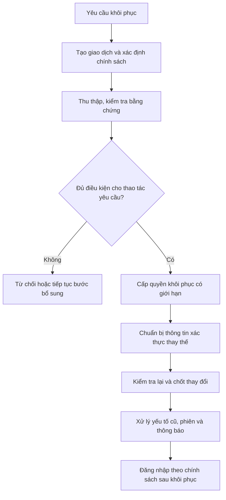

# Recovery versus authentication: khôi phục tài khoản khác xác thực như thế nào?

Một hệ thống đăng nhập có thể kiểm tra mật khẩu, MFA và passkey rất chặt chẽ nhưng vẫn bị chiếm đoạt tài khoản qua nút “Tôi không còn dùng thiết bị này”. Vì vậy, khi thiết kế khôi phục tài khoản, câu hỏi đầu tiên không phải là gửi mã bằng cách nào, mà là: **luồng này đang xác thực một thông tin xác thực còn hợp lệ, hay đang cho phép thay thế căn cứ dùng để xác thực?**

Bài học này phân biệt authentication với account recovery, chỉ ra mối liên hệ giữa hai cơ chế và cách đặt ranh giới quyền hạn khi người dùng mất mật khẩu, MFA, passkey hoặc thiết bị xác thực.

## 1. Hai mục đích khác nhau, có thể dùng chung một loại bằng chứng

**Authentication — xác thực** là quá trình kiểm tra chủ thể có đáp ứng chính sách xác thực hiện tại của tài khoản hay không. Chẳng hạn, hệ thống chấp nhận một passkey đã đăng ký hoặc yêu cầu mật khẩu kết hợp với một yếu tố MFA.

**Account recovery — khôi phục tài khoản** là quá trình lấy lại quyền truy cập hoặc thiết lập lại khả năng xác thực khi người dùng không thể hoàn thành con đường thông thường. Luồng này có thể cho phép đặt mật khẩu mới, thay thế yếu tố MFA, đăng ký lại passkey hoặc xử lý tình huống mất toàn bộ thiết bị.

Authentication hỏi:

> “Yêu cầu này có đưa ra bằng chứng được chính sách hiện tại chấp nhận để đăng nhập không?”

Recovery hỏi:

> “Trong tình huống thiếu bằng chứng thông thường, căn cứ nào đủ để cho phép khôi phục quyền truy cập hoặc thay đổi cách tài khoản được xác thực?”

Recovery vẫn phải kiểm tra bằng chứng. Nó không phải một khoảng trống được miễn xác thực. Điểm khác biệt nằm ở **vai trò của bằng chứng và quyền được cấp sau khi kiểm tra**, không đơn thuần ở việc giao diện có ô nhập mã hay không.

Ví dụ:

- Người dùng còn passkey hợp lệ và đăng nhập bằng passkey đó: đây là authentication.
- Người dùng không còn yếu tố đăng nhập cần thiết, sử dụng mã khôi phục đã được cấp trước để thay thế yếu tố bị mất: đây là một đường recovery.
- Một liên kết email có thể là cách đăng nhập chính của sản phẩm, hoặc chỉ cho phép đặt lại mật khẩu. Hai liên kết có thể trông giống nhau nhưng phục vụ hai chính sách khác nhau.

Tên nút “Đăng nhập”, “Quên mật khẩu” hay “Lấy lại tài khoản” không đủ để xác định bản chất bảo mật của luồng.

### Authentication cũng không đồng nghĩa với authorization

**Authorization — phân quyền** quyết định chủ thể được làm gì sau khi cung cấp bằng chứng.

Đăng nhập thành công không nhất thiết cho phép thay đổi mọi thông tin bảo mật. Để đổi email khôi phục, gỡ MFA hoặc thêm passkey, hệ thống có thể yêu cầu xác thực lại, bằng chứng mới hơn hoặc mức bảo đảm cao hơn.

Tương tự, xác minh thành công một liên kết khôi phục không tự động có nghĩa là được đọc toàn bộ dữ liệu hoặc thực hiện giao dịch. Quyền thay thế một mật khẩu cần được cấp một cách có chủ đích.

## 2. So sánh theo quyết định bảo mật

| Khía cạnh | Authentication thông thường | Account recovery |
| --- | --- | --- |
| Vấn đề cần giải quyết | Kiểm tra khả năng đăng nhập theo chính sách đang áp dụng | Xử lý việc người dùng thiếu phương tiện cần thiết để truy cập |
| Điểm xuất phát | Có thông tin xác thực phù hợp với một đường đăng nhập được hỗ trợ | Thiếu một phần hoặc toàn bộ thông tin xác thực của đường truy cập thông thường |
| Bằng chứng | Mật khẩu, passkey, yếu tố MFA hoặc cơ chế được cấu hình | Có thể dùng yếu tố còn lại, mã khôi phục, kênh đã đăng ký trước hoặc quy trình xác minh bổ sung |
| Quyết định chính | Chấp nhận hay từ chối yêu cầu xác thực | Cho phép khôi phục đến mức nào, được thay thế yếu tố nào |
| Kết quả điển hình | Một phiên có ngữ cảnh xác thực xác định | Quyền giới hạn cho một thao tác khôi phục, rồi cập nhật thông tin xác thực theo chính sách |
| Rủi ro nổi bật | Đánh cắp thông tin xác thực, vượt MFA, chiếm phiên | Thay thế thông tin xác thực của nạn nhân bằng thông tin do kẻ tấn công kiểm soát |
| Kiểm soát cần thiết | Kiểm tra yếu tố, chống thử sai, bảo vệ phiên | Kiểm tra bằng chứng thay thế, giới hạn quyền, chống lạm dụng, kiểm soát việc đổi yếu tố và phiên cũ |

Bảng này mô tả vai trò thiết kế, không khẳng định mọi sản phẩm phải triển khai một luồng recovery riêng biệt. Một cơ chế có thể hỗ trợ nhiều mục đích, nhưng phía máy chủ vẫn phải biết **đang quyết định điều gì**.

Ví dụ, một người quên mật khẩu nhưng còn passkey có thể đăng nhập bình thường. Nếu muốn đặt mật khẩu mới sau đó, họ đi qua chính sách thay đổi thông tin xác thực. Không nên mặc định rằng mọi trường hợp “quên mật khẩu” đều cần dùng một đường bằng chứng yếu hơn.

## 3. Hãy xét thứ người dùng còn kiểm soát

“Mất thiết bị” chưa mô tả đủ tình huống bảo mật. Thiết bị đó có thể chứa passkey, ứng dụng tạo mã MFA, ứng dụng email, một phiên đăng nhập hoặc tất cả những thứ này.

Cần tách ba câu hỏi:

1. Người dùng còn đường đăng nhập thông thường nào được chính sách chấp nhận?
2. Người dùng còn bằng chứng nào được đăng ký hoặc chấp thuận trước cho recovery?
3. Bằng chứng đó đủ cho quyền thay đổi nào?

| Tình huống | Điều cần xác định | Hướng xử lý có thể phù hợp |
| --- | --- | --- |
| Quên mật khẩu, còn passkey hợp lệ | Passkey có đáp ứng chính sách đăng nhập của tài khoản không? | Đăng nhập bằng passkey; áp dụng chính sách đổi mật khẩu nếu người dùng cần |
| Còn mật khẩu, mất ứng dụng MFA | Có yếu tố MFA khác hoặc mã khôi phục đã đăng ký không? | Dùng đường thay thế đã được chấp thuận; nếu không có thì bắt đầu recovery |
| Mất điện thoại chứa passkey | Có passkey trên thiết bị khác, bản đồng bộ còn truy cập được hoặc yếu tố hợp lệ khác không? | Xác định khả năng đăng nhập còn lại trước khi cho thay thế passkey |
| Còn phiên trên máy tính cũ | Phiên có đủ độ tin cậy và bằng chứng mới để cho phép đổi yếu tố không? | Có thể hỗ trợ một phần quy trình; không mặc định phiên cũ đủ quyền gỡ MFA |
| Mất mọi yếu tố, chỉ còn truy cập email | Email được dùng cho mục đích nào và có đủ cho mức rủi ro này không? | Áp dụng chính sách recovery tương ứng, bổ sung kiểm soát hoặc từ chối nếu không đủ căn cứ |
| Tài khoản bị khóa vì hành vi vi phạm | Việc khóa là do quên thông tin xác thực hay do quyết định quản trị? | Tách recovery khỏi quy trình xem xét mở khóa |

Việc khôi phục thành công một mật khẩu không tự động đảo ngược quyết định đình chỉ tài khoản, mở lại quyền quản trị hay khôi phục một quyền đã bị thu hồi.

### Mã khôi phục là một bí mật bảo mật

Một mã khôi phục được cấp trước có thể đóng vai trò thông tin xác thực thay thế trong thiết kế của sản phẩm. Cần bảo vệ nó tương xứng với quyền mà nó mở ra.

Nếu người dùng lưu mã trong cùng hộp thư đang dùng để nhận liên kết đặt lại mật khẩu, hai nguồn bằng chứng có thể cùng bị mất khi hộp thư bị chiếm đoạt. Không nên chỉ đếm “hai bước” rồi kết luận đó là hai lớp bảo vệ độc lập.

## 4. Bằng chứng về kênh liên lạc chưa phải bằng chứng đầy đủ về chủ tài khoản

Trong recovery, rất dễ chuyển từ một kết luận hẹp sang một quyết định quá rộng.

| Điều vừa kiểm tra | Kết luận có thể rút ra | Điều chưa được chứng minh |
| --- | --- | --- |
| Nhập đúng mã gửi đến email đã đăng ký | Chủ thể truy cập được kênh email ở thời điểm kiểm tra, trong giới hạn của cơ chế đó | Chủ thể là người dùng hợp pháp, hộp thư chưa bị chiếm đoạt, mọi yếu tố khác được phép gỡ |
| Nhập đúng mã SMS | Chủ thể nhận được mã qua số điện thoại tại thời điểm đó | Không có chuyển quyền số, chiếm SIM hoặc chuyển tiếp trái phép |
| Có cookie của một phiên đang tồn tại | Yêu cầu mang theo thông tin phiên mà máy chủ nhận diện | Người đang thao tác là chủ tài khoản hoặc vừa thực hiện xác thực mới |
| Biết ngày sinh, địa chỉ hoặc tên công ty | Chủ thể biết những dữ liệu đó | Chủ thể có quyền kiểm soát tài khoản |
| Có tài liệu danh tính phù hợp | Một phần yêu cầu kiểm tra danh tính có thể đã được đáp ứng | Người gửi tài liệu là chủ thể hợp lệ, tài liệu không bị đánh cắp, tài liệu gắn chắc với tài khoản này |
| Cung cấp mã khôi phục hợp lệ | Chủ thể sở hữu một bí mật recovery đã cấp trước | Bí mật đó chưa bị sao chép hoặc lấy từ một nơi lưu trữ bị xâm nhập |

Không phải các bằng chứng trên đều vô dụng. Vấn đề là phải ghi nhận đúng phạm vi kết luận và áp dụng đúng chính sách.

**Identity proofing — kiểm tra danh tính** cũng khác authentication. Kiểm tra giấy tờ hoặc thông tin hồ sơ có thể hỗ trợ xác minh danh tính, nhưng vẫn cần trả lời tài liệu đó liên quan như thế nào đến tài khoản đang yêu cầu khôi phục. Với một dịch vụ dùng biệt danh và chưa từng kiểm tra danh tính thật, một giấy tờ mang tên thật không tự tạo ra liên kết sở hữu tài khoản.

Tín hiệu thiết bị quen thuộc, vị trí hoặc lịch sử sử dụng có thể hỗ trợ đánh giá rủi ro. Chúng không nên âm thầm trở thành căn cứ duy nhất để bỏ qua một yếu tố xác thực đang thiếu.

## 5. Recovery tạo ra một đường truy cập khác đến cùng tài khoản

Giả sử chính sách đăng nhập của một tài khoản là:

```text
Đăng nhập thông thường:
    mật khẩu + yếu tố MFA đã đăng ký

Khôi phục được triển khai sai:
    liên kết email -> đặt mật khẩu mới -> gỡ MFA -> phiên đầy đủ
```

Kẻ tấn công kiểm soát hộp thư có thể bỏ qua yêu cầu MFA của đường đăng nhập thông thường bằng cách chọn recovery.

Vấn đề không nằm ở riêng liên kết email. Vấn đề là hệ thống đã cho một bằng chứng có phạm vi hẹp quyền **thay thế toàn bộ rào cản còn lại**.

Khi đánh giá bảo mật, cần đặt các đường bên cạnh nhau:

```text
Tài khoản
├── Đăng nhập bằng thông tin xác thực thông thường
├── Đăng nhập bằng một yếu tố thay thế đã được chấp thuận
├── Khôi phục bằng mã dự phòng hoặc kênh đã đăng ký
└── Khôi phục qua hỗ trợ, nếu sản phẩm có quy trình này
```

Kẻ tấn công có thể lựa chọn đường dễ vượt qua nhất. Một đường hỗ trợ thủ công có thể làm suy yếu MFA nếu nhân viên được phép gỡ yếu tố chỉ dựa vào dữ liệu dễ tìm.

Điều này không có nghĩa mọi recovery đều có thể đạt đúng mức bảo đảm của cách đăng nhập mạnh nhất. Khi mất mọi yếu tố mạnh, hệ thống phải thừa nhận phần thiếu hụt bằng chứng và quyết định mức rủi ro chấp nhận được.

Một số biện pháp có thể giảm khả năng hoặc tác động của việc lạm dụng:

- Giới hạn quyền trong và sau recovery.
- Yêu cầu nhiều căn cứ được lựa chọn theo chính sách, có xét sự phụ thuộc giữa chúng.
- Trì hoãn những thay đổi nhạy cảm trong các tình huống phù hợp.
- Thông báo qua kênh đã đăng ký trước và cung cấp cách báo cáo yêu cầu bất thường.
- Áp dụng xét duyệt hoặc chấp thuận bổ sung cho tài khoản có quyền cao.
- Từ chối recovery khi không có bằng chứng đủ tin cậy.

Một khoảng chờ không tự chứng minh danh tính. Thông báo cũng không cứu được tài khoản nếu mọi kênh thông báo đều do kẻ tấn công kiểm soát. Đây là các kiểm soát bổ trợ, cần được hiểu đúng tác dụng.

## 6. Thiết kế recovery như một giao dịch có trạng thái và quyền giới hạn

Một cách tổ chức an toàn là coi recovery như một giao dịch riêng. Giao dịch gắn với tài khoản, mục đích, bằng chứng đã kiểm tra và thao tác được phép.



Đây là mô hình logic để phân biệt trách nhiệm. Mỗi hệ thống có thể gộp hoặc tách các bước tùy chính sách, nhưng không được bỏ mất việc kiểm tra quyền ở phía máy chủ.

### 6.1. Xác định tài khoản không phải xác minh quyền sở hữu

Nhập một địa chỉ email hoặc tên đăng nhập giúp máy chủ tìm giao dịch cần xử lý. Nó không phải bằng chứng chủ thể có quyền thay đổi tài khoản.

Phản hồi công khai cần được thiết kế để hạn chế tiết lộ tài khoản có tồn tại hay không. Đồng thời, hệ thống phải kiểm soát yêu cầu gửi email, gửi mã và thử mã để tránh trở thành công cụ dò tài khoản hoặc quấy rối.

### 6.2. Tách ngữ cảnh recovery khỏi phiên đăng nhập đầy đủ

Ví dụ dưới đây là dữ liệu khái niệm do máy chủ quản lý, không phải một token để máy khách tự khai rồi được tin tưởng:

```json
{
  "contextType": "RECOVERY",
  "accountId": "account-742",
  "transactionId": "recovery-58",
  "verifiedEvidence": ["PRE_REGISTERED_RECOVERY_CODE"],
  "allowedActions": ["REPLACE_LOST_MFA_FACTOR"],
  "expiresAt": "<thoi-diem-het-han-do-may-chu-quy-dinh>",
  "state": "PROOF_ACCEPTED"
}
```

Ngữ cảnh này không chứa quyền đọc hồ sơ, đổi email hay thực hiện giao dịch. API phục vụ các hoạt động đó phải yêu cầu quyền thích hợp, thay vì chỉ kiểm tra rằng một cookie có tồn tại.

Máy chủ cần ràng buộc quyền recovery với:

- Đúng tài khoản và giao dịch.
- Đúng mục đích, chẳng hạn đặt lại mật khẩu hoặc thay thế yếu tố MFA.
- Thời hạn và trạng thái hiện tại.
- Bằng chứng đã kiểm tra cùng các điều kiện bổ sung.
- Thao tác được phép và điều kiện để chốt thao tác.

Trạng thái “đã kiểm tra email” không nên biến thành một cờ chung tên `authenticated = true` mà mọi API đều chấp nhận.

### 6.3. Token dùng một lần chỉ giải quyết một phần bài toán

Một token bí mật, khó đoán, có thời hạn và được dùng một lần có thể giúp chứng minh quyền truy cập một đường recovery. Nhưng nó không tự quyết định rằng người sở hữu token được phép gỡ MFA hay thay email.

Với token dạng bí mật ngẫu nhiên do máy chủ phát hành, thiết kế cần xét tối thiểu:

- Sinh bằng nguồn ngẫu nhiên phù hợp cho bảo mật.
- Ràng buộc với tài khoản, giao dịch và mục đích.
- Bảo vệ giá trị kiểm chứng ở nơi lưu trữ; tránh lưu bản rõ khi có thể dùng dạng kiểm chứng an toàn.
- Không đưa token vào log, thông báo phân tích hoặc dữ liệu có thể bị đọc bởi bên không liên quan.
- Kiểm tra hết hạn, bị hủy, đã dùng và điều kiện chính sách.
- Chống phát lại và xử lý yêu cầu đồng thời bằng cập nhật trạng thái nguyên tử.

Token hết hạn ngắn vẫn có thể bị kẻ tấn công sử dụng trước người dùng. Tính dùng một lần cũng chỉ giúp chống sử dụng lại; nó không chứng minh người dùng đầu tiên là chủ tài khoản hợp pháp.

Một thiết kế có thể tiêu thụ token khi đổi nó lấy một phiên recovery giới hạn. Thiết kế khác có thể kiểm tra và tiêu thụ token tại bước chốt. Dù chọn cách nào, không để token đã dùng hoặc giao dịch đã kết thúc tiếp tục cấp quyền.

### 6.4. Chốt thay đổi là một ranh giới bảo mật

Trước khi chốt, máy chủ cần kiểm tra lại quyền của giao dịch và trạng thái tài khoản. Không chỉ dựa vào việc một bước trước đó đã từng thành công.

Ví dụ, hai yêu cầu đồng thời cùng dùng một giao dịch thay MFA không được tạo ra hai kết quả thay thế độc lập. Cần một cơ chế bảo đảm giao dịch chỉ hoàn tất một lần và các cập nhật liên quan nhất quán.

Nếu có bước đăng ký yếu tố thay thế, có thể giữ yếu tố mới ở trạng thái chờ cho tới khi đủ điều kiện chốt. Cách này tránh vô hiệu hóa yếu tố cũ quá sớm trong một luồng còn dang dở. Khi yếu tố cũ đã bị xác định là bị xâm phạm, chính sách có thể cần thu hồi ngay và xử lý quyền truy cập theo nhánh sự cố tương ứng.

Không nên khóa tài khoản hay gỡ yếu tố chỉ vì có người biết email và gửi một yêu cầu recovery chưa được xác minh.

### 6.5. Quyết định về phiên phải được viết rõ

Sau khi đổi thông tin xác thực, cần xác định:

- Phiên nào được giữ, thu hồi hoặc yêu cầu xác thực lại?
- Refresh token, thiết bị được tin cậy và quyền ghi nhớ MFA được xử lý thế nào?
- Phiên recovery được kết thúc lúc nào?
- Nếu tạo phiên mới, phiên đó được cấp quyền gì và có hạn chế tạm thời nào?
- Những thông tin xác thực hoặc mã khôi phục cũ nào cần bị vô hiệu hóa?

Nếu đang xử lý nghi ngờ chiếm đoạt tài khoản, chỉ đổi mật khẩu mà để kẻ tấn công giữ một phiên hoạt động có thể không đạt mục tiêu khôi phục quyền kiểm soát.

Đồng thời, việc cập nhật dữ liệu mật khẩu không tự làm mọi phiên mất hiệu lực. Cơ chế kiểm tra và thu hồi phiên phải được hệ thống triển khai thực sự.

Một phiên được tạo nhờ recovery cần phản ánh bằng chứng thực tế đã kiểm tra. Không ghi nhận rằng người dùng vừa xác thực bằng MFA hoặc passkey nếu họ chỉ hoàn thành xác minh email.

## 7. Ba tình huống giúp phân biệt đúng luồng

### 7.1. Minh quên mật khẩu nhưng vẫn còn passkey

Minh có một passkey được hệ thống chấp nhận để đăng nhập. Anh dùng passkey và truy cập tài khoản thành công.

Đây là authentication bằng một thông tin xác thực còn hợp lệ. Việc Minh không nhớ mật khẩu không làm thao tác đăng nhập bằng passkey trở thành recovery.

Nếu Minh muốn đặt lại mật khẩu, máy chủ tiếp tục áp dụng chính sách thay đổi thông tin xác thực. Chẳng hạn, hệ thống có thể yêu cầu một lần xác thực đủ mới bằng passkey trước khi chốt thay đổi. Không nên đánh đồng một phiên tồn tại từ lâu với việc vừa xác thực lại.

Khi passkey là một đường đăng nhập đầy đủ đã được chấp thuận, không có lý do tự động chuyển Minh sang xác minh email chỉ vì anh chọn liên kết “Quên mật khẩu”.

### 7.2. Lan nhớ mật khẩu nhưng mất ứng dụng MFA

Lan nhập đúng mật khẩu nhưng không thể hoàn thành yếu tố MFA theo chính sách của tài khoản. Hệ thống chưa có đủ căn cứ để cấp một phiên thông thường.

Nếu Lan có mã khôi phục hợp lệ được cấp trước và chính sách cho phép dùng mã đó để thay thế yếu tố đã mất, hệ thống có thể mở một giao dịch recovery tương ứng.

Quyền được cấp phải cụ thể. “Thay thế yếu tố MFA bị mất” không tự bao gồm “đổi email khôi phục” hoặc “thêm một quản trị viên mới”.

Khi Lan đăng ký yếu tố mới, máy chủ cần xác minh việc đăng ký và chốt thay đổi theo chính sách. Sau đó phải xử lý yếu tố cũ, mã đã dùng và phiên liên quan. Bỏ qua MFA chỉ vì mật khẩu đúng sẽ biến cơ chế xử lý sự cố thành một cách vô hiệu hóa MFA.

Nếu hệ thống đã hỗ trợ một yếu tố MFA dự phòng còn hợp lệ, Lan có thể hoàn thành authentication thông thường bằng yếu tố đó. Cần xác định đường nào thực sự đang được sử dụng.

### 7.3. An mất điện thoại và không còn truy cập email cũ

An không còn passkey, MFA, mã khôi phục hay kênh liên lạc đã đăng ký. Anh đề nghị nhân viên hỗ trợ gửi liên kết đến một địa chỉ email mới vừa cung cấp.

Việc xác minh rằng An kiểm soát email mới chỉ chứng minh quyền kiểm soát địa chỉ mới. Nó không chứng minh quan hệ với tài khoản cũ. Nếu chấp nhận cách này, bất kỳ ai cũng có thể đưa ra một email do mình kiểm soát rồi xin chuyển tài khoản.

Nhân viên cần tuân theo một quy trình recovery được xác định trước, với bằng chứng phù hợp, quyền hạn giới hạn và nhật ký xử lý. Tài khoản tổ chức có thể có một cơ chế quản trị được ủy quyền riêng; cơ chế đó cũng cần căn cứ, phân quyền và kiểm soát lạm dụng.

Nếu không còn bằng chứng đủ tin cậy, kết quả có thể là không khôi phục được. Hứa rằng mọi tài khoản đều có thể lấy lại, bất kể mất những gì, sẽ tạo áp lực để hệ thống hoặc nhân viên chấp nhận một bằng chứng không đủ mạnh.

## 8. Ranh giới quyền nên thể hiện trong API và giao diện

Việc tách màn hình không đủ. Máy chủ phải kiểm tra đúng ngữ cảnh cho từng thao tác.

| Trạng thái của yêu cầu | Quyền hợp lý theo một thiết kế giới hạn | Quyền không tự phát sinh |
| --- | --- | --- |
| Chỉ vừa gửi yêu cầu recovery | Tiếp tục quy trình theo chính sách chống lạm dụng | Xem dữ liệu tài khoản, đổi mật khẩu, gỡ MFA |
| Đã kiểm tra một bằng chứng nhưng chưa đủ chính sách | Hoàn thành bước bổ sung được chỉ định | Đăng nhập đầy đủ hoặc thay thế yếu tố |
| Đủ điều kiện đặt lại mật khẩu | Đặt mật khẩu mới cho đúng tài khoản trong đúng giao dịch | Gỡ MFA, đổi email, nâng quyền |
| Đủ điều kiện thay yếu tố MFA bị mất | Đăng ký và xác nhận yếu tố thay thế trong phạm vi được cấp | Thêm yếu tố tùy ý hoặc thay đổi chủ sở hữu tài khoản |
| Đã hoàn tất recovery | Đăng nhập hoặc nhận phiên theo chính sách sau recovery | Mặc định có mọi quyền nhạy cảm mà không xét ngữ cảnh |

Đây là ví dụ ranh giới để xây dựng chính sách, không phải một bảng quyền áp dụng nguyên xi cho mọi sản phẩm.

Giao diện cũng cần phản ánh ranh giới đó. Sau bước xác minh email, thông báo “Email đã được xác minh cho yêu cầu đặt lại mật khẩu” chính xác hơn “Danh tính đã được xác minh hoàn toàn”.

Nếu tài khoản vẫn yêu cầu MFA sau khi đổi mật khẩu, cần cho người dùng biết bước tiếp theo. Ngược lại, nếu chính sách cho phép một loại bằng chứng thay thế MFA, điều đó phải được quyết định rõ và được triển khai nhất quán ở máy chủ.

## 9. Các sai lầm dễ gặp khi trộn authentication và recovery

### Dùng mọi loại token ở chung một nơi

Một API chấp nhận token đăng nhập, token xác minh email và token recovery như nhau có thể cho một token có mục đích hẹp mở ra quyền rộng.

Cần kiểm tra loại ngữ cảnh, mục đích, đối tượng và quyền cho thao tác cụ thể. Chữ ký hợp lệ hoặc giá trị bí mật đúng chưa đủ để quyết định quyền sử dụng token ở mọi API.

### Cho rằng nhiều bước luôn tạo ra nhiều yếu tố độc lập

Gửi mã email rồi hỏi dữ liệu cá nhân có thể làm luồng dài hơn mà không thêm nhiều khả năng phân biệt chủ tài khoản với kẻ tấn công.

Cần xem mỗi bước đóng góp bằng chứng gì, dữ liệu có dễ biết hay không và các bước có cùng phụ thuộc vào một tài khoản hoặc thiết bị đã bị chiếm đoạt không.

### Đặt lại mật khẩu đồng thời bỏ qua mọi yếu tố còn lại

Đây là một quyết định thay đổi chính sách xác thực, dù giao diện chỉ ghi “Đặt lại mật khẩu”. Nếu mục tiêu chỉ là thay mật khẩu, các yếu tố khác cần được xử lý theo chính sách riêng.

Không để tác dụng phụ của hàm đặt lại mật khẩu âm thầm xóa MFA hoặc thêm thiết bị tin cậy.

### Tin một kênh khôi phục vừa được thay đổi

Kẻ tấn công có thể tìm cách đổi email trước, rồi dùng chính email đó để đáp ứng recovery. Nếu việc đổi kênh chỉ cần một phiên yếu hoặc cũng dựa vào luồng đang khôi phục, bằng chứng sẽ bị vòng tròn.

Cần xác định lịch sử và điều kiện tin cậy của kênh dùng cho giao dịch. Việc đăng ký kênh recovery cũng là một thay đổi bảo mật cần được bảo vệ.

### Chuyển mọi trường hợp khó sang hỗ trợ thủ công không có chính sách

Nhân viên hỗ trợ trở thành một phần của hệ thống kiểm soát truy cập khi họ có thể thay đổi yếu tố đăng nhập.

Cần quy định bằng chứng, phạm vi quyền, điều kiện chuyển cấp và dấu vết kiểm tra. Không để mức độ thuyết phục của người gọi trở thành tiêu chuẩn quyết định quyền sở hữu.

### Chống tấn công bằng cách gây khóa tài khoản quá dễ

Nếu bất kỳ yêu cầu recovery nào cũng khóa tài khoản, kẻ tấn công có thể dùng luồng này để gây gián đoạn cho người khác.

Cần phân biệt giới hạn thử bằng chứng, giới hạn gửi thông báo và hành động làm thay đổi trạng thái tài khoản. Quyết định khóa hoặc thu hồi phải có căn cứ tương ứng với tác động.

## 10. Mẫu phân tích một đường recovery

Trước khi xây dựng màn hình hay chọn thời hạn token, hãy mô tả đường recovery bằng các câu trả lời cụ thể:

| Câu hỏi | Ví dụ trả lời cho trường hợp mất MFA |
| --- | --- |
| Người dùng còn gì? | Mật khẩu đúng và một mã khôi phục đã cấp trước |
| Người dùng mất gì? | Quyền truy cập ứng dụng MFA trên điện thoại cũ |
| Bằng chứng được chấp nhận có vai trò gì? | Đáp ứng chính sách cho phép thay thế yếu tố MFA bị mất |
| Quyền tạm thời là gì? | Chỉ đăng ký và xác nhận một yếu tố thay thế trong giao dịch này |
| Khi nào giao dịch hoàn tất? | Khi yếu tố mới được xác minh và thay đổi được chốt nhất quán |
| Điều gì bị thu hồi? | Mã đã dùng, quyền recovery của giao dịch và yếu tố cũ theo chính sách |
| Phiên được xử lý ra sao? | Áp dụng quyết định rõ ràng về thu hồi, xác thực lại hoặc tạo phiên mới |
| Kênh thông báo nào được dùng? | Các kênh đã đăng ký còn phù hợp; ghi nhận thất bại khi gửi |
| Khi không đủ bằng chứng thì sao? | Tiếp tục bước bổ sung được cho phép hoặc từ chối; không tự hạ điều kiện |
| Nhật ký cần giúp trả lời điều gì? | Ai yêu cầu, bằng chứng thuộc loại nào, quyền nào được cấp và yếu tố nào đã thay đổi |

Nhật ký không cần chứa mã khôi phục, token bí mật hay mật khẩu để trả lời những câu hỏi này. Có thể dùng định danh giao dịch, loại bằng chứng, thời điểm, kết quả kiểm tra và thao tác đã thực hiện.

Một thiết kế phân biệt rõ authentication với recovery sẽ giải thích được cả hai điều: **vì sao yêu cầu có đủ căn cứ để tiếp tục, và vì sao quyền được cấp chỉ dừng ở phạm vi đó**. Đây là cơ sở để vừa giúp người dùng lấy lại quyền truy cập, vừa hạn chế việc kẻ tấn công dùng chính cơ chế khôi phục để thay thế chủ tài khoản.