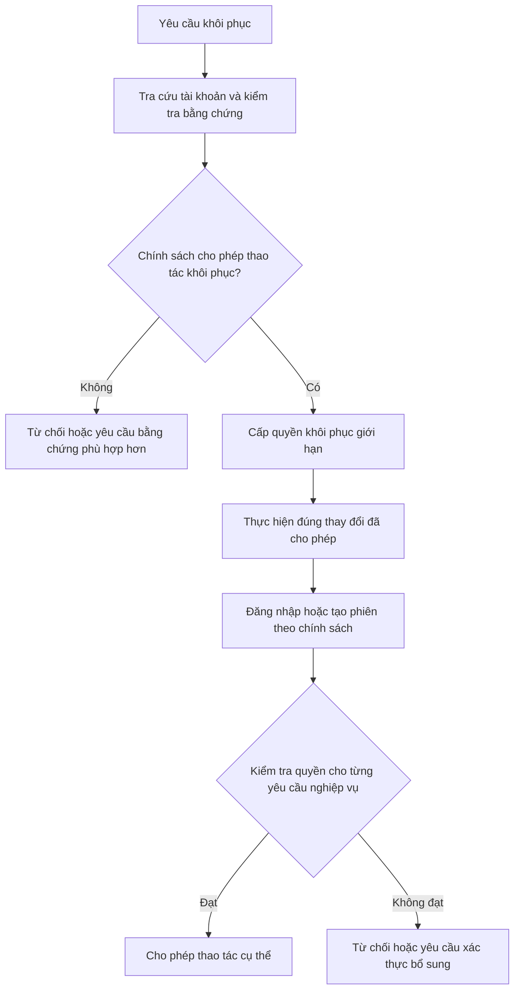

# Recovery versus authorization: Khôi phục tài khoản và ranh giới cấp quyền

Trong chương **Recovery Foundations**, một nguyên tắc nền tảng là: **quyền khôi phục một yếu tố xác thực không tự động trở thành quyền thực hiện mọi hành động của tài khoản**. Nếu hệ thống coi việc bấm liên kết đặt lại mật khẩu là đủ để chuyển tiền, thay người quản trị hoặc tắt mọi lớp bảo vệ, luồng khôi phục đã trở thành đường vòng để chiếm đoạt tài khoản.

Bài học thuộc phạm vi `SECURITY_AUTHENTICATION_ACCOUNT_RECOVERY`: thiết kế khôi phục an toàn khi người dùng mất mật khẩu, MFA, passkey hoặc thiết bị xác thực. Trọng tâm là phân biệt bằng chứng nhận được trong quá trình khôi phục với quyền mà hệ thống được phép cấp sau đó.

Sau bài này, bạn có thể:

- Phân biệt xác thực, cấp quyền và khôi phục tài khoản.
- Xác định đúng chủ thể, thao tác và phạm vi của một quyền khôi phục.
- Thiết kế token dùng một lần mà không biến token thành phiên đăng nhập toàn quyền.
- Kiểm soát session, MFA và hành động nhạy cảm sau khi khôi phục.
- Nhận diện các lỗi cấp quyền thường xuất hiện ở API khôi phục và công cụ hỗ trợ khách hàng.

## 1. Ba câu hỏi khác nhau của hệ thống

### Xác thực: Ai đang đưa ra yêu cầu?

**Authentication**, hay xác thực, kiểm tra người yêu cầu có chứng minh được quyền kiểm soát một danh tính hoặc yếu tố xác thực được chấp nhận hay không. Ví dụ: đăng nhập bằng mật khẩu, chứng minh sở hữu khóa riêng của passkey, hoặc cung cấp mã từ thiết bị MFA.

Kết quả xác thực gắn một chủ thể với ngữ cảnh cụ thể: yếu tố nào đã được dùng, thời điểm nào và các hạn chế nào đang áp dụng. Một cookie còn hiệu lực không có nghĩa là người sử dụng vừa hoàn tất MFA; cũng không có nghĩa là thiết bị hiện tại vẫn thuộc quyền kiểm soát của chủ tài khoản.

### Cấp quyền: Chủ thể này được làm gì trong ngữ cảnh hiện tại?

**Authorization**, hay cấp quyền, quyết định một yêu cầu cụ thể có được thực hiện hay không. Quyết định thường phụ thuộc vào chủ thể, tài nguyên, thao tác, quan hệ sở hữu, tenant, trạng thái tài khoản và ngữ cảnh xác thực.

Ví dụ, một người đã đăng nhập có thể được đọc hồ sơ của mình nhưng không được đọc hồ sơ của người khác. Người quản trị của tổ chức A không vì thế được quản trị tổ chức B. Một người có quyền chuyển tiền vẫn có thể phải xác thực lại trước một giao dịch nhạy cảm.

### Khôi phục: Có thể thiết lập lại cách truy cập tài khoản này không?

**Account recovery**, hay khôi phục tài khoản, xử lý trường hợp người dùng không còn dùng được một hoặc nhiều cách xác thực bình thường. Hệ thống cần đánh giá bằng chứng thay thế để quyết định có cho phép sửa chữa đường truy cập hay không.

Khôi phục thường dẫn tới các thao tác như đặt lại mật khẩu, thay một authenticator bị mất, đăng ký passkey mới hoặc thiết lập lại MFA. Mỗi thao tác có mức ảnh hưởng riêng, vì vậy cần một quyết định cấp quyền riêng trong miền khôi phục.

| Khái niệm | Câu hỏi cần trả lời | Ví dụ kết quả | Không được tự suy ra |
|---|---|---|---|
| Xác thực | Người yêu cầu chứng minh được điều gì? | Đã chứng minh sở hữu passkey đã đăng ký | Có quyền truy cập mọi tài nguyên |
| Cấp quyền | Có được thực hiện thao tác này trên tài nguyên này không? | Được sửa địa chỉ nhận hóa đơn của tài khoản mình | Được bỏ qua xác thực lại ở mọi thời điểm |
| Khôi phục | Có đủ bằng chứng để sửa chữa đường truy cập này không? | Được đặt lại mật khẩu cho một tài khoản xác định | Đã hoàn tất MFA hoặc được đổi vai trò |

Khôi phục không nằm ngoài hệ thống cấp quyền. Nó là một miền thao tác đặc biệt, có chính sách cấp quyền riêng vì người dùng có thể chưa đăng nhập được bằng cách thông thường.

## 2. Phân biệt người yêu cầu, tài khoản đích và bằng chứng

Trong một yêu cầu khôi phục, cần tách rõ các đối tượng sau:

- **Người yêu cầu:** bên gửi yêu cầu hiện tại; có thể chưa được xác thực hoặc có thể là kẻ tấn công.
- **Tài khoản đích:** tài khoản có phương thức xác thực cần khôi phục.
- **Bằng chứng:** dữ liệu giúp đánh giá yêu cầu, chẳng hạn token gửi tới kênh đã đăng ký, recovery code hoặc xác nhận qua quy trình hỗ trợ.
- **Quyền khôi phục:** quyền có giới hạn mà máy chủ cấp sau khi chấp nhận bằng chứng.
- **Quyền nghiệp vụ:** quyền đọc dữ liệu, quản trị, thanh toán hoặc thực hiện các chức năng khác của ứng dụng.

Một địa chỉ email do người yêu cầu nhập vào chỉ là thông tin dùng để tra cứu. Nó chưa phải bằng chứng về quyền kiểm soát tài khoản. Khi hệ thống gửi một liên kết tới địa chỉ đã đăng ký và liên kết được sử dụng, bằng chứng trực tiếp là bên sử dụng đang có token được chuyển qua kênh đó. Điều này không đủ để khẳng định tuyệt đối rằng họ là chủ tài khoản ngoài đời thực.

Sự khác biệt này quan trọng khi email đã bị chiếm quyền, hộp thư được chia sẻ, thư bị chuyển tiếp hoặc token bị rò rỉ. Hệ thống phải giới hạn kết luận theo đúng bằng chứng có được.

### Ví dụ: Người dùng bình thường và nhân viên hỗ trợ

Lan mất điện thoại và không dùng được MFA. Lan yêu cầu hỗ trợ khôi phục tài khoản. Nhân viên hỗ trợ là một chủ thể đã đăng nhập vào công cụ nội bộ; tài khoản của Lan là tài khoản đích.

Việc nhân viên được xem hồ sơ hỗ trợ không có nghĩa là họ được tắt MFA của Lan. Quyền xem hồ sơ, quyền thu thập bằng chứng và quyền phê duyệt thay authenticator phải được kiểm tra riêng. Với tài khoản có đặc quyền cao, quy trình có thể yêu cầu người phê duyệt thứ hai độc lập với người xử lý hồ sơ.

Nếu nhân viên gửi một token khôi phục cho Lan, token đó cũng không nên mang quyền truy cập công cụ nội bộ của nhân viên. Nó chỉ đại diện cho thao tác khôi phục đã được phê duyệt trên đúng tài khoản đích.

## 3. Hai quyết định cấp quyền phải được giữ riêng

Một mô hình khái niệm hữu ích là:

```text
Quyết định khôi phục = Chính sách khôi phục(
    tài khoản đích,
    thao tác cần khôi phục,
    bằng chứng đã kiểm tra,
    trạng thái tài khoản,
    ngữ cảnh và rủi ro
)

Quyết định nghiệp vụ = Chính sách nghiệp vụ(
    chủ thể của phiên hiện tại,
    thao tác và tài nguyên,
    quyền hiện có,
    tenant và quan hệ sở hữu,
    mức xác thực và hạn chế sau khôi phục
)
```

Đây là mô hình phân tách trách nhiệm, không phải công thức tính điểm dùng trực tiếp trong sản phẩm. Chính sách phải xác định bằng chứng nào phù hợp với từng thao tác và hậu quả của việc chấp nhận nhầm.

Một yêu cầu đặt lại mật khẩu có thể được chấp nhận, trong khi yêu cầu chuyển tiền vẫn bị từ chối do chưa đáp ứng MFA hoặc đang trong giai đoạn hạn chế sau khôi phục. Hai kết quả đó hoàn toàn nhất quán.



Không thể buộc mọi luồng khôi phục phải có phiên đăng nhập đầy đủ: điều đó sẽ tạo vòng lặp vì người dùng đang mất cách đăng nhập. Thay vào đó, endpoint khôi phục có bộ kiểm tra chuyên biệt cho bằng chứng và thao tác tương ứng. Ngoại lệ với yêu cầu đăng nhập thông thường không được trở thành ngoại lệ với mọi kiểm tra cấp quyền.

## 4. Quyền khôi phục là một năng lực có phạm vi hẹp

Sau khi chấp nhận bằng chứng, hệ thống có thể tạo một **recovery grant**, tức bản ghi quyền khôi phục có giới hạn. Đây là tên mô hình thiết kế, không phải yêu cầu phải dùng một định dạng token cụ thể.

Một grant nên mô tả rõ:

| Thuộc tính | Ý nghĩa |
|---|---|
| Tài khoản đích | Định danh nội bộ do máy chủ xác định và ràng buộc |
| Thao tác | Chẳng hạn `password.reset`, `mfa.replace` hoặc `passkey.enroll` |
| Mục đích và nơi sử dụng | Chỉ luồng hoặc endpoint khôi phục tương ứng được chấp nhận |
| Thời hạn | Thời điểm grant không còn hợp lệ, kiểm tra bằng thời gian phía máy chủ |
| Trạng thái dùng | Chưa dùng, đã dùng hoặc bị thu hồi |
| Ngữ cảnh ràng buộc | Hồ sơ khôi phục, tenant nếu cần và phiên bản trạng thái bảo mật |
| Cơ sở phê duyệt | Loại bằng chứng và quyết định chính sách, phục vụ kiểm tra và audit |

Token đưa cho người dùng có thể là một chuỗi ngẫu nhiên không chứa ý nghĩa nghiệp vụ. Máy chủ giữ bản ghi grant và chỉ lưu giá trị băm của token khi mô hình phù hợp. Token phải được tạo bằng bộ sinh ngẫu nhiên mật mã, có entropy đủ lớn, khó đoán, hết hạn và dùng một lần.

Dùng token có chữ ký không tự giải quyết yêu cầu dùng một lần. Nếu cần chống phát lại và thu hồi sớm, hệ thống vẫn cần cách quản lý trạng thái sử dụng hoặc cơ chế tương đương.

### Ràng buộc tài khoản và thao tác từ phía máy chủ

Giả sử API nhận yêu cầu:

```json
{
  "recoveryToken": "<opaque-secret>",
  "newPassword": "<new-password>"
}
```

Máy chủ tra cứu token để lấy tài khoản đích và xác nhận grant cho phép `password.reset`. Không được cho client thay tài khoản đích bằng cách thêm `userId`, đổi tenant hay gửi thêm `role` vào payload.

Nếu API vẫn có định danh tài khoản trên đường dẫn, định danh đó phải khớp với grant. Việc bỏ định danh khỏi payload giúp giảm một nguồn nhầm lẫn, nhưng không thay thế kiểm tra quyền phía máy chủ.

Một token đặt lại mật khẩu không hợp lệ cho endpoint tắt MFA, kể cả khi cả hai endpoint thuộc cùng dịch vụ. Việc dùng chung cơ chế đọc token không được làm mất kiểm tra mục đích.

### Những điều grant đặt lại mật khẩu không được tự cấp

- Vai trò quản trị, quyền của tenant khác hoặc quyền truy cập tài nguyên không thuộc tài khoản.
- Trạng thái “đã hoàn tất MFA”.
- Quyền đổi email khôi phục sang địa chỉ bất kỳ.
- Quyền thêm, xóa mọi authenticator hoặc tạo API key.
- Quyền mở lại tài khoản bị đình chỉ bởi quyết định quản trị.

Khóa tạm thời do nhập sai mật khẩu và đình chỉ bởi quản trị là hai trạng thái khác nhau. Luồng khôi phục có thể xử lý trạng thái thứ nhất theo chính sách, nhưng không được mặc nhiên xóa trạng thái thứ hai.

## 5. Bằng chứng phù hợp với thao tác nào?

Không có một loại bằng chứng khôi phục luôn đủ cho mọi tài khoản và mọi thay đổi. Cần xét quyền lực của tài khoản, yếu tố còn lại, sự độc lập giữa các kênh và khả năng kênh bằng chứng đã bị chiếm quyền.

| Bằng chứng hoặc tình huống | Điều có thể hỗ trợ đánh giá | Giới hạn cần nhận ra |
|---|---|---|
| Token qua email đã đăng ký | Quyền sở hữu token được gửi qua kênh email đó | Email có thể bị chiếm quyền; không mặc nhiên chứng minh MFA |
| Recovery code đã cấp trước | Quyền sở hữu một bí mật dự phòng | Mã có thể bị sao chép; phải dùng một lần và bảo vệ khi lưu |
| Passkey khác vẫn còn sử dụng được | Quyền kiểm soát một authenticator đã đăng ký | Phải xác minh đúng giao thức và chính sách; không bỏ qua cấp quyền cho thay đổi nhạy cảm |
| Phiên còn hoạt động | Có một session hợp lệ theo hệ thống | Session có thể bị đánh cắp hoặc đã xác thực từ lâu |
| Thông tin cá nhân như ngày sinh | Dữ liệu bổ sung cho hồ sơ | Có thể công khai hoặc bị rò rỉ; không nên là bằng chứng quyết định duy nhất |
| Hồ sơ hỗ trợ đã được thẩm tra | Kết quả của một quy trình xác minh cụ thể | Chất lượng phụ thuộc quy trình, người phê duyệt và khả năng chống giả mạo |

Hai bước dùng chung một điểm kiểm soát không nhất thiết tạo ra hai bằng chứng độc lập. Ví dụ, gửi hai liên kết vào cùng một hộp thư không làm mất rủi ro hộp thư đó đã bị chiếm quyền. Tương tự, yêu cầu trả lời câu hỏi cá nhân rồi gửi email không bảo đảm mức tin cậy tương đương với một authenticator còn an toàn.

### Mật khẩu, MFA, passkey và thiết bị có hậu quả khác nhau

Đặt lại mật khẩu thay một bí mật dùng để đăng nhập. Thay MFA có thể loại bỏ lớp bảo vệ đang ngăn người biết mật khẩu truy cập tài khoản. Đăng ký passkey mới có thể trao một phương tiện đăng nhập lâu dài cho người giữ khóa riêng mới.

Vì vậy, hệ thống không nên dùng một quyết định “đã xác minh email” để cho phép đồng thời cả ba thay đổi. Có thể cần bằng chứng mạnh hơn, kiểm tra bổ sung hoặc quy trình phê duyệt cho việc thay MFA và đăng ký passkey sau khi mất toàn bộ authenticator.

Khôi phục passkey thường có nghĩa là cho phép đăng ký passkey mới bằng quy trình của hệ thống, không phải suy ra hay tái tạo khóa riêng đã mất. Nếu một passkey khác còn hoạt động hoặc nhà cung cấp đã đồng bộ passkey tới thiết bị khác, người dùng có thể vẫn có đường đăng nhập; hệ thống cần kiểm tra khả năng đó trước khi áp dụng quy trình mất toàn bộ yếu tố.

Bỏ đánh dấu “thiết bị tin cậy” cũng không đồng nghĩa đã thu hồi mọi session trên thiết bị đó. Trạng thái thiết bị, credential và session có thể được quản lý bởi các cơ chế khác nhau.

## 6. Thiết kế vòng đời khôi phục với các ranh giới rõ ràng

Một luồng có thể dùng các trạng thái khái niệm sau:

```text
REQUESTED -> EVIDENCE_PENDING -> APPROVED -> APPLIED
                     |              |
                     v              v
                 REJECTED      EXPIRED / REVOKED
```

Trong một hệ thống đơn giản, không nhất thiết phải lưu tất cả trạng thái này thành bảng riêng. Điều cần giữ là ý nghĩa của từng bước và điều kiện chuyển trạng thái.

### Bước 1: Tiếp nhận yêu cầu mà không làm lộ tài khoản

Endpoint bắt đầu khôi phục thường chưa có người dùng đăng nhập. Cần chống dò tìm tài khoản bằng phản hồi phù hợp, chẳng hạn “Nếu có tài khoản phù hợp, hướng dẫn sẽ được gửi tới kênh đã đăng ký”.

Chỉ dùng cùng thông báo chưa đủ nếu mã HTTP, thời gian xử lý hoặc phản hồi phụ làm lộ khác biệt rõ ràng. Đồng thời cần giới hạn tần suất theo nhiều tín hiệu để giảm dò đoán và gửi thư quấy rối. Không nên cho phép một nguồn gửi yêu cầu tùy ý khóa vĩnh viễn tài khoản của nạn nhân.

Kênh nhận token phải được lấy từ cấu hình đã xác minh của tài khoản, không từ một địa chỉ mới mà người yêu cầu vừa gửi lên.

### Bước 2: Kiểm tra bằng chứng và cấp grant đúng phạm vi

Máy chủ kiểm tra bằng chứng, thời hạn, mục đích, trạng thái tài khoản và chính sách rủi ro. Việc thiếu bằng chứng có thể dẫn tới yêu cầu bước bổ sung hoặc chuyển sang quy trình hỗ trợ phù hợp; không nên được xử lý bằng cách hạ âm thầm yêu cầu xác minh.

Không đưa token bí mật vào log, telemetry hoặc nội dung audit. Liên kết qua trình duyệt cần được thiết kế để hạn chế rò rỉ qua referrer, tài nguyên bên thứ ba và lịch sử điều hướng. Chỉ phục vụ qua kết nối được bảo vệ.

### Bước 3: Áp dụng thay đổi và tiêu thụ quyền một cách nguyên tử

Khi thực hiện thay đổi, máy chủ phải kiểm tra lại grant và tiêu thụ grant trong cùng một giao dịch hoặc cơ chế bảo đảm tương đương. Hai yêu cầu đồng thời không được cùng dùng thành công một quyền khôi phục.

Một lần đọc token hợp lệ rồi cập nhật mật khẩu ở giao dịch khác có thể tạo khoảng đua: hai request cùng nhìn thấy trạng thái “chưa dùng”. Cờ `used` chỉ có ý nghĩa nếu việc kiểm tra và chuyển cờ được đồng bộ với thay đổi credential.

Với luồng đơn giản, một thiết kế thường dùng là chỉ đánh dấu token đã dùng khi thao tác đổi credential thành công. Nếu hệ thống đổi token thành một recovery session ở bước trước, việc đổi phải là một lần, và recovery session cũng phải giữ nguyên giới hạn về tài khoản, thao tác, thời hạn và số lần dùng.

Không dùng một request `GET` mở liên kết để trực tiếp đặt lại mật khẩu hoặc tắt MFA. Trình quét liên kết email có thể truy cập URL trước người dùng. Thao tác thay đổi trạng thái cần bước gửi yêu cầu có chủ đích và được bảo vệ phù hợp; nếu dựa vào cookie thì phải xét CSRF.

### Bước 4: Kiểm soát truy cập sau thay đổi

Sau khi áp dụng thành công, hệ thống vô hiệu hóa những quyền khôi phục không còn phù hợp, xử lý session cũ và gửi thông báo tới kênh đã thiết lập theo chính sách. Thông báo giúp phát hiện sự cố; nó không thay thế việc xác minh trước khi thay đổi.

Có thể yêu cầu đăng nhập lại hoặc thiết lập một phiên giới hạn tùy loại khôi phục. Nếu MFA vẫn được giữ, đăng nhập tiếp theo vẫn phải đáp ứng MFA. Không tự đánh dấu MFA đã hoàn tất chỉ vì mật khẩu vừa được đặt lại.

## 7. Ví dụ thiết kế API đặt lại mật khẩu

Ví dụ sau minh họa tài khoản có mật khẩu và MFA riêng. Chính sách cho phép dùng token email để đổi mật khẩu; thay MFA là luồng khác. Ví dụ không phải một thư viện triển khai hoàn chỉnh.

Bản ghi grant có thể gồm:

```text
RecoveryGrant:
  token_hash
  subject_id
  tenant_id
  operation = password.reset
  expires_at
  used_at
  revoked_at
  recovery_version_at_issue
```

Trong đó, `recovery_version_at_issue` ràng buộc token với trạng thái khôi phục của tài khoản lúc phát hành. Mỗi lần thay đổi bảo mật có liên quan, hệ thống tăng phiên bản để các grant cũ không còn dùng được theo chính sách đã chọn.

Pseudocode dưới đây dùng bản ghi phía máy chủ và khóa giao dịch:

```text
complete_password_reset(request):
    validate_request_shape_and_size(request)
    enforce_abuse_limits(request.context)
    validate_new_password_against_policy(request.new_password)

    token_hash = digest_high_entropy_token(request.recovery_token)
    new_password_hash = password_hasher.hash(request.new_password)

    transaction:
        grant = lock_grant_by_hash(token_hash)
        require grant exists
        require grant.operation == "password.reset"
        require grant.used_at is null
        require grant.revoked_at is null

        account = lock_account(grant.subject_id, grant.tenant_id)
        require account exists
        require account_policy_allows_password_recovery(account)
        require grant.recovery_version_at_issue == account.recovery_version
        require grant.expires_at > server_time_now()

        account.password_hash = new_password_hash
        account.recovery_version += 1
        account.session_version += 1
        grant.used_at = server_time_now()

        revoke_refresh_sessions_for(account.id, account.tenant_id)
        append_security_event_without_secrets(
            account.id, grant.id, "password_reset_completed"
        )
        enqueue_security_notification(account.id)
    commit

    return password_reset_completed_with_login_required
```

`digest_high_entropy_token` và `password_hasher` phục vụ hai loại bí mật khác nhau. Mật khẩu do con người chọn cần thuật toán băm mật khẩu phù hợp cùng tham số chi phí; không được thay bằng hàm băm nhanh chỉ vì ví dụ dùng hàm băm để tra cứu token ngẫu nhiên.

Khi triển khai, hệ thống cần thống nhất thứ tự khóa, xử lý xung đột giao dịch và giới hạn chi phí băm để tránh gây quá tải. Phản hồi lỗi cho token sai, hết hạn hoặc đã dùng nên được thiết kế sao cho không làm lộ thông tin nhạy cảm không cần thiết.

Những thuộc tính đáng chú ý của ví dụ:

1. Tài khoản đích và tenant lấy từ grant đã lưu, không lấy theo ý muốn của client.
2. Chỉ thao tác `password.reset` được chấp nhận.
3. Thời hạn và trạng thái dùng được kiểm tra khi áp dụng thay đổi, dưới cơ chế đồng bộ.
4. Đổi mật khẩu, tiêu thụ grant và cập nhật trạng thái bảo mật nằm trong một giao dịch.
5. Không ghi lại vai trò, không tắt MFA và không tạo phiên toàn quyền từ token khôi phục.
6. Thông báo được đưa vào hàng đợi bền vững cùng giao dịch; việc gửi thực tế có thể thực hiện sau commit để tránh mất sự kiện.

Biến `session_version` chỉ có tác dụng thu hồi nếu các thành phần chấp nhận session thực sự kiểm tra nó. Một access token tự chứa mà dịch vụ tài nguyên chỉ kiểm tra chữ ký và hạn dùng sẽ không tự mất hiệu lực vì phiên bản trong cơ sở dữ liệu vừa thay đổi.

Nếu session hoặc refresh token nằm ở hệ thống khác, giao dịch cục bộ không bao trùm được toàn bộ tác vụ thu hồi. Cần cơ chế phối hợp như sự kiện bền vững, kiểm tra phiên bản tại nơi cấp quyền và xử lý thất bại rõ ràng. Không tuyên bố đã thu hồi tức thời toàn hệ thống khi kiến trúc chưa bảo đảm điều đó.

## 8. Session sau khôi phục phải phản ánh đúng mức tin cậy

Khôi phục thành công làm thay đổi trạng thái bảo mật, nhưng không thể xóa bỏ mọi bất định về người đang thao tác. Hệ thống cần quyết định rõ session nào còn tồn tại và phiên mới được làm gì.

### Phân biệt các loại phiên

| Loại | Mục đích | Giới hạn cần có |
|---|---|---|
| Phiên khôi phục | Tiếp tục một hồ sơ hoặc thao tác khôi phục | Chỉ gọi được API khôi phục đã cho phép |
| Phiên sau khôi phục có hạn chế | Cho người dùng hoàn tất đăng nhập hoặc thiết lập lại bảo vệ | Chặn các hành động chưa đủ điều kiện; giữ thông tin nguồn gốc khôi phục |
| Phiên sử dụng bình thường | Truy cập chức năng theo chính sách hiện hành | Vẫn kiểm tra quyền, tenant, tài nguyên và yêu cầu xác thực lại |

Không chuyển recovery grant sang access token thông thường chỉ bằng cách đổi tên loại token. Nếu chọn tự động đăng nhập sau khôi phục, hệ thống vẫn phải có quyết định riêng về phiên được tạo, mức xác thực và phạm vi truy cập.

Một chính sách có thể cho phép xem trang thiết lập bảo mật sau khi xác minh thêm, nhưng tạm chặn đổi kênh khôi phục, xuất toàn bộ dữ liệu, tạo khóa truy cập hoặc thay người quản trị. Các hạn chế phải được thực thi ở máy chủ. Ẩn nút trên giao diện không ngăn client gọi API trực tiếp.

### Thu hồi cái gì và khi nào?

- **Grant và recovery code:** đánh dấu mã đã sử dụng; vô hiệu hóa grant liên quan khi trạng thái bảo mật làm chúng không còn đáng tin.
- **Refresh session:** thu hồi theo phạm vi chính sách đã chọn, đặc biệt khi nghi ngờ tài khoản bị chiếm quyền.
- **Access session:** kiểm tra cơ chế vô hiệu hóa thực tế, gồm session phía máy chủ hoặc token tự chứa.
- **Authenticator bị mất:** xử lý riêng trong luồng được phép thay hoặc thu hồi yếu tố đó.
- **Dấu tin cậy thiết bị:** rà soát khi thiết bị bị mất hoặc mức tin cậy thay đổi.

Không phải sản phẩm nào cũng chọn cùng một chính sách thu hồi. Điều bắt buộc về mặt thiết kế là xác định rõ phạm vi, thời điểm có hiệu lực và phần truy cập còn sót lại trong khoảng chuyển tiếp.

Một khoảng chờ trước hành động nhạy cảm có thể giảm khả năng kẻ tấn công thay đổi toàn bộ thiết lập ngay sau khi khôi phục. Tuy nhiên, thời gian trôi qua không phải bằng chứng xác thực. Nếu còn thiếu authenticator cần thiết, hết thời gian chờ không tự làm yêu cầu đó được đáp ứng.

## 9. Những lỗi biến khôi phục thành đường vượt quyền

| Lỗi thiết kế | Kịch bản hậu quả | Cách giữ ranh giới |
|---|---|---|
| Có token hợp lệ thì nhận `userId` tùy ý | Dùng token của mình để đổi mật khẩu người khác | Ràng buộc tài khoản bằng dữ liệu máy chủ và kiểm tra mọi định danh liên quan |
| Không kiểm tra mục đích token | Token đặt lại mật khẩu được dùng để xóa MFA | Kiểm tra thao tác và nơi sử dụng ở từng endpoint |
| Coi “đã xác minh email” là “đã MFA” | Người chiếm hộp thư vượt qua lớp MFA | Ghi đúng loại bằng chứng và yêu cầu yếu tố phù hợp |
| Dùng token nhiều lần hoặc có khoảng đua | Kẻ tấn công phát lại token sau chủ tài khoản | Tiêu thụ nguyên tử, hết hạn và vô hiệu hóa theo thay đổi trạng thái |
| Chỉ hạn chế ở giao diện | Gọi thẳng API để thực hiện hành động bị ẩn | Kiểm tra quyền và hạn chế ở máy chủ |
| Nhân viên hỗ trợ có nút tắt bảo vệ không kiểm soát | Lừa nhân viên hoặc lạm dụng quyền nội bộ | Tách quyền, ghi audit, phê duyệt độc lập khi cần |
| Bỏ qua tenant trong công cụ hỗ trợ | Khôi phục nhầm tài khoản cùng email ở tổ chức khác | Xác định tài khoản và tenant rõ ràng trong hồ sơ, grant và quyết định quyền |
| Vẫn tin session cũ sau sự cố | Kẻ đã lấy session tiếp tục truy cập | Thu hồi bằng cơ chế được thực thi tại các nơi chấp nhận session |

Một lỗi có thể mang dạng **confused deputy**: dịch vụ hoặc nhân viên có quyền cao bị người yêu cầu điều khiển để tác động lên tài khoản khác. Người yêu cầu chỉ có quyền bắt đầu một hồ sơ, nhưng hệ thống dùng đặc quyền nội bộ để thực hiện thao tác mà hồ sơ đó chưa được cho phép.

Cách phòng tránh là kiểm tra mối liên hệ giữa bằng chứng, hồ sơ, tài khoản đích và thao tác ngay trước khi thực hiện thay đổi. Việc endpoint chạy dưới tài khoản dịch vụ có quyền cập nhật mọi người dùng không phải lý do để bỏ qua ràng buộc này.

## 10. Tình huống thực tế: Mất điện thoại nhưng còn email

Mai dùng mật khẩu và ứng dụng MFA trên điện thoại cho tài khoản quản trị cửa hàng. Điện thoại bị mất, Mai vẫn truy cập được email đã đăng ký nhưng không còn phiên đăng nhập đủ tin cậy trên thiết bị khác.

Một thiết kế có vấn đề cho phép Mai bấm liên kết email, đặt lại mật khẩu, tự động tắt MFA rồi đăng nhập bằng vai trò quản trị hiện có. Kẻ chiếm hộp thư có thể thực hiện chính xác chuỗi thao tác đó. Rủi ro không nằm ở việc vai trò quản trị bị tăng lên; ngay cả việc lấy được toàn bộ quyền vốn có của Mai bằng bằng chứng yếu hơn cũng đã là sự thất bại của chính sách khôi phục.

Một thiết kế phân tách các quyết định sẽ xử lý như sau:

1. Kiểm tra xem Mai còn recovery code, passkey khác hoặc authenticator được chấp nhận nào không.
2. Nếu chính sách cho phép, email token chỉ cấp quyền đặt lại mật khẩu. Tài khoản vẫn còn yêu cầu MFA.
3. Khi Mai cần thay MFA, mở luồng riêng với bằng chứng và phê duyệt tương xứng với tài khoản quản trị. Không đánh dấu hoàn tất MFA dựa trên bước đặt lại mật khẩu.
4. Sau khi được phê duyệt, cấp quyền thay authenticator có thời hạn, dùng một lần và gắn với đúng tài khoản, tenant, hồ sơ.
5. Đăng ký yếu tố mới, xử lý yếu tố bị mất, thu hồi session theo chính sách và gửi thông báo bảo mật qua kênh phù hợp.
6. Chỉ cấp phiên sử dụng theo điều kiện đã đạt; hành động như đổi chủ cửa hàng hoặc tạo API key vẫn qua kiểm tra quyền và yêu cầu xác thực tương ứng.

Nếu Mai không còn bằng chứng đủ mạnh, hệ thống có thể chưa cho phép hoàn tất khôi phục và phải dùng quy trình xác minh bổ sung đã được thiết kế. “Người dùng cần truy cập gấp” không phải bằng chứng rằng người yêu cầu là chủ tài khoản.

Phân tích tình huống này cần nhìn cả hai phía: không làm luồng mất toàn bộ yếu tố dễ bị lợi dụng, đồng thời chuẩn bị trước recovery code, authenticator dự phòng và quy trình hỗ trợ để người dùng hợp lệ có đường khôi phục thực tế.

## 11. Tự kiểm tra thiết kế

Các câu hỏi sau giúp kiểm tra ranh giới giữa recovery và authorization:

1. Sau mỗi bước xác minh, hệ thống kết luận chính xác điều gì về người yêu cầu?
2. Quyền vừa cấp cho phép thao tác nào, trên tài khoản nào, trong tenant nào và đến thời điểm nào?
3. Client có thể đổi tài khoản đích, thao tác, vai trò hoặc kênh nhận mã bằng dữ liệu gửi lên không?
4. Token đặt lại mật khẩu có bị một endpoint khác chấp nhận không?
5. Hai request đồng thời dùng cùng token có thể cùng thành công không?
6. Khi mở liên kết email, trình quét liên kết có gây ra thay đổi bảo mật không?
7. Việc đặt lại mật khẩu có vô tình tắt MFA, đăng ký thêm passkey hoặc tạo session toàn quyền không?
8. Sau thay đổi, session cũ bị thu hồi thực tế ở đâu và phần nào có thể còn hiệu lực?
9. Nhân viên hỗ trợ được thu thập bằng chứng, phê duyệt và áp dụng những thao tác nào?
10. Tài khoản quản trị hoặc tài khoản có tác động lớn có chính sách khôi phục tương xứng không?

### Bài tập ngắn

**Đề bài:** Một API nhận `resetToken`, `targetUserId`, `newPassword`, `disableMfa` và `role`. Máy chủ chỉ kiểm tra token chưa hết hạn, sau đó cập nhật tất cả trường được gửi lên và trả access token.

**Phân tích gợi ý:**

- Chưa có ràng buộc chắc chắn giữa token và `targetUserId`, nên có nguy cơ tác động sai tài khoản.
- `disableMfa` là thao tác khác với đổi mật khẩu và cần quyền riêng.
- `role` là thuộc tính cấp quyền nghiệp vụ, không thuộc phạm vi đặt lại credential.
- Chỉ kiểm tra thời hạn chưa bảo đảm token dùng một lần, đúng mục đích hoặc chưa bị thu hồi.
- Access token trả về chưa phản ánh rõ các điều kiện xác thực và hạn chế còn thiếu.

**Hướng sửa:** Endpoint chỉ nhận dữ liệu cần cho việc đổi mật khẩu, tra tài khoản và thao tác từ grant phía máy chủ, kiểm tra đầy đủ rồi tiêu thụ grant nguyên tử cùng thay đổi. MFA, vai trò và phiên đăng nhập được xử lý bởi các quyết định riêng có chính sách rõ ràng.

## 12. Các nguyên tắc cần giữ

Khôi phục tài khoản là một quá trình cấp lại khả năng chứng minh danh tính dưới điều kiện bất thường. Bằng chứng khôi phục cần dẫn tới một quyền sửa chữa cụ thể, có thời hạn và được kiểm soát chặt.

Một thiết kế đúng ranh giới luôn trả lời được ba câu hỏi: **đã chứng minh điều gì, được sửa chữa điều gì và sau đó được truy cập điều gì**. Khi ba câu trả lời được lưu và kiểm tra riêng, hệ thống có thể hỗ trợ người mất mật khẩu, MFA, passkey hoặc thiết bị mà vẫn duy trì các kiểm soát cấp quyền cần thiết.
