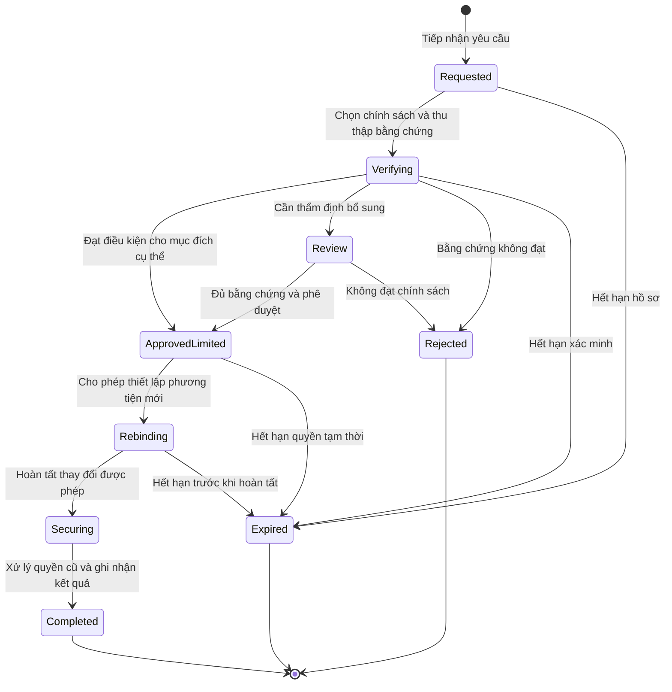

# Khôi phục tài khoản như một biện pháp kiểm soát bảo mật

## 1. Vì sao khôi phục tài khoản thuộc thiết kế bảo mật?

Một tài khoản có thể yêu cầu mật khẩu mạnh, MFA và passkey khi đăng nhập, nhưng vẫn bị chiếm đoạt nếu bộ phận hỗ trợ sẵn sàng xóa các yếu tố đó chỉ sau một cuộc gọi. Kẻ tấn công không cần vượt qua màn hình đăng nhập nếu có thể thuyết phục hệ thống thay phương tiện xác thực bằng phương tiện do chúng kiểm soát.

**Khôi phục tài khoản là quá trình quyết định ai được tái lập quyền kiểm soát một danh tính số khi đường xác thực dự kiến không còn sử dụng được.** Kết quả của quyết định này có thể là cho phép đặt mật khẩu mới, gắn thiết bị xác thực mới hoặc đăng ký passkey mới. Mỗi kết quả đều thay đổi nền tảng mà hệ thống dùng để tin một người dùng.

Trong phạm vi `SECURITY_AUTHENTICATION_ACCOUNT_RECOVERY`, luồng khôi phục cần xử lý việc mất mật khẩu, MFA, passkey hoặc thiết bị xác thực, đồng thời giảm nguy cơ chiếm đoạt tài khoản. Vì vậy, trang “Quên mật khẩu” chỉ là một điểm vào. Chính sách xác minh danh tính, token dùng một lần, chống lạm dụng, quy trình hỗ trợ và kiểm soát session đều thuộc cùng một biện pháp kiểm soát.

Sau bài này, người học có thể:

- Giải thích tác động bảo mật của việc thay phương tiện xác thực.
- Phân biệt bằng chứng sở hữu tài khoản với tín hiệu đánh giá rủi ro.
- Xác định điều kiện cho phép khôi phục và quyền được cấp ở từng giai đoạn.
- Liên kết khôi phục với thu hồi quyền truy cập cũ, thông báo và xử lý sự cố.
- Đánh giá một thiết kế dựa trên cả khả năng chống chiếm đoạt và khả năng phục hồi của người dùng hợp lệ.

## 2. Phân biệt các thao tác thường bị gộp chung

Không phải mọi yêu cầu “không đăng nhập được” đều cần xóa toàn bộ trạng thái bảo mật của tài khoản.

| Tình huống | Quyết định cần thực hiện | Phạm vi thay đổi hợp lý |
| --- | --- | --- |
| Quên mật khẩu nhưng vẫn sử dụng được phương tiện xác thực khác phù hợp | Có đủ điều kiện gắn mật khẩu mới không? | Thay mật khẩu; tiếp tục áp dụng MFA đang có |
| Mất điện thoại chứa ứng dụng MFA nhưng còn mật khẩu và phương án dự phòng | Có đủ bằng chứng để thay yếu tố đã mất không? | Thay yếu tố cụ thể theo chính sách; kiểm tra thiết bị cũ |
| Mất thiết bị chứa passkey | Còn passkey khác, khả năng đồng bộ được phép hoặc phương án dự phòng không? | Dùng đường còn hợp lệ hoặc khôi phục trước khi gắn passkey mới |
| Mất toàn bộ phương tiện xác thực | Có thể xác lập lại quan hệ giữa người yêu cầu và tài khoản không? | Luồng khôi phục với bằng chứng đã được chính sách chấp nhận |
| Nghi tài khoản đã bị chiếm đoạt | Ai là chủ thể hợp lệ và quyền nào của kẻ tấn công còn tồn tại? | Khôi phục kết hợp xử lý phiên, phương tiện xác thực và thay đổi trái phép |

NIST SP 800-63B-4 phân biệt khôi phục khi mất khả năng xác thực ở mức bảo đảm mong muốn với việc gắn phương tiện mới khi người dùng vẫn xác thực được bằng phương tiện khác. Phân biệt này giúp chọn đúng quy trình thay vì coi mọi lần quên mật khẩu là lý do hạ yêu cầu bảo mật. [Nguồn: NIST, Authenticator Event Management](https://pages.nist.gov/800-63-4/sp800-63b/events/#recovery).

Trong một sản phẩm cụ thể, cùng một giao diện có thể dẫn tới nhiều quy trình phía máy chủ. Giao diện thuận tiện không có nghĩa mọi tình huống đều nhận cùng một quyền khôi phục.

Ví dụ, liên kết đặt lại mật khẩu chỉ cấp quyền thay mật khẩu. Nó không tự động chứng minh người yêu cầu được xóa MFA, đổi email khôi phục hoặc tạo phiên quản trị.

## 3. Mục tiêu kiểm soát: khôi phục đúng người và giữ được quyền kiểm soát

### 3.1. Ba kết quả cần bảo vệ

**Tính bí mật:** người không có quyền không được đọc dữ liệu tài khoản qua việc lạm dụng khôi phục. Ngay cả thông tin tài khoản có tồn tại hay không cũng có thể nhạy cảm trong một số dịch vụ.

**Tính toàn vẹn:** chỉ yêu cầu đáp ứng chính sách mới được thay mật khẩu, gắn yếu tố xác thực hoặc sửa thông tin khôi phục. Một yêu cầu đã xác minh không được bị tráo sang tài khoản, mục đích hay thay đổi khác.

**Tính sẵn sàng:** người dùng hợp lệ có một đường phục hồi khả thi. Người ngoài không được dùng biểu mẫu khôi phục để liên tục khóa tài khoản, làm đầy hộp thư hoặc vô hiệu hóa phương tiện xác thực của nạn nhân.

Ba mục tiêu này cần được xem xét cùng nhau. Chấp nhận mọi yêu cầu sẽ tăng khả năng chiếm đoạt. Từ chối mọi yêu cầu làm người dùng mất dữ liệu và có thể đẩy họ sang các cách hỗ trợ ngoài quy trình.

### 3.2. Một luồng, nhiều lớp kiểm soát

| Lớp kiểm soát | Vai trò trong khôi phục | Ví dụ |
| --- | --- | --- |
| Phòng ngừa | Ngăn yêu cầu không đủ điều kiện trở thành thay đổi bảo mật | Kiểm tra bằng chứng, giới hạn mục đích token, phân quyền hỗ trợ |
| Phát hiện | Nhận ra lạm dụng hoặc thay đổi ngoài dự kiến | Cảnh báo hành vi bất thường, nhật ký quyết định, thông báo độc lập |
| Khắc phục | Chấm dứt quyền kiểm soát trái phép và tái lập trạng thái an toàn | Thu hồi phiên, vô hiệu hóa yếu tố bị lộ, xử lý đăng ký trái phép |

Không thể dùng một lớp để thay thế hoàn toàn lớp khác. Có nhật ký không làm một quyết định cấp quyền sai trở nên an toàn. Có xác minh tốt cũng chưa đủ nếu phiên của kẻ tấn công tiếp tục hoạt động sau khi chủ tài khoản khôi phục thành công.

## 4. Xác định đối thủ, bằng chứng và ranh giới tin cậy

### 4.1. Giả định đối thủ có thể biết nhiều thông tin

Một thiết kế thực tế cần tính đến người tấn công biết email đăng nhập, ngày sinh, tên công ty hoặc lịch sử giao dịch bị lộ. Đối thủ cũng có thể chiếm một hộp thư, kiểm soát số điện thoại, lấy được cookie phiên hoặc thao túng nhân viên hỗ trợ bằng một câu chuyện có vẻ khẩn cấp.

Thông tin cá nhân có thể giúp tìm đúng hồ sơ để xử lý, nhưng việc tìm đúng hồ sơ không đồng nghĩa chứng minh quyền sở hữu. Chức danh, tên người quản lý hay ảnh chụp màn hình tài khoản cũng có thể được thu thập hoặc làm giả.

### 4.2. Phân biệt bằng chứng với tín hiệu rủi ro

| Dữ kiện quan sát | Có thể hỗ trợ kết luận gì? | Giới hạn cần nhớ |
| --- | --- | --- |
| Sử dụng thành công phương tiện xác thực đã gắn trước đó | Người yêu cầu đang kiểm soát phương tiện ấy | Cần xét trạng thái bị lộ, thu hồi và mức xác thực thực sự đạt được |
| Mã khôi phục dự phòng hợp lệ, chưa dùng | Người yêu cầu giữ một bí mật được phát hành trước | Mã có thể bị đánh cắp hoặc nằm trên cùng thiết bị đã mất |
| Nhận mã tại địa chỉ khôi phục đã đăng ký | Người yêu cầu kiểm soát kênh nhận tại thời điểm đó | Không tự chứng minh các yếu tố độc lập khác; kênh có thể bị chiếm |
| Giấy tờ hoặc quy trình định danh lại | Có thể kiểm tra danh tính ngoài đời theo quy trình phù hợp | Phải liên kết được danh tính đó với tài khoản; bản chụp đơn lẻ chưa đủ |
| IP quen thuộc, ngôn ngữ quen thuộc, thiết bị có dấu hiệu quen thuộc | Có thêm ngữ cảnh để đánh giá rủi ro | Không phải bí mật; có thể thay đổi, bị sao chép hoặc dùng chung |
| Email mới được cung cấp ngay trong yêu cầu | Có một địa chỉ người yêu cầu muốn dùng | Chưa có quan hệ tin cậy với chủ tài khoản |

**Tín hiệu “ít bất thường” không tự tạo ra bằng chứng sở hữu.** Chẳng hạn, truy cập từ mạng văn phòng có thể làm giảm một loại nghi ngờ, nhưng người khác trong cùng mạng cũng có thể gửi yêu cầu.

Tương tự, hai bước không nhất thiết tạo hai nguồn bằng chứng độc lập. Nếu cả mã thứ nhất và liên kết thứ hai đều gửi vào cùng một hộp thư đã bị chiếm, đối thủ vẫn chỉ cần kiểm soát một nguồn. Việc lưu mã dự phòng trong chính hộp thư khôi phục cũng tạo chung điểm thất bại.

### 4.3. Ranh giới phải được bảo vệ phía máy chủ

Người gửi biểu mẫu được quyền đề nghị khôi phục; họ chưa có quyền thay thông tin bảo mật. Nhân viên hỗ trợ được quyền xử lý hồ sơ trong phạm vi được cấp; họ không mặc nhiên có quyền bỏ qua tiêu chuẩn bằng chứng. Dịch vụ gửi email chỉ thực hiện giao nhận; việc giao nhận thành công không phải quyết định cho phép cấp quyền.

Tất cả chuyển đổi này cần được thực thi trong backend. Ẩn nút “Xóa MFA” trên giao diện không có tác dụng nếu endpoint tương ứng vẫn chấp nhận recovery token chỉ dành cho đặt lại mật khẩu.

## 5. Đặt chính sách trước khi chọn màn hình hoặc token

### 5.1. Xem toàn bộ đường vào tài khoản

Giả sử một tài khoản có ba đường truy cập:

```text
Đường A: đăng nhập bằng passkey phù hợp với chính sách.
Đường B: khôi phục bằng phương án dự phòng đã thiết lập trước.
Đường C: gọi hỗ trợ để yêu cầu thay phương tiện xác thực.
```

Nếu đường C chỉ yêu cầu thông tin công khai, chất lượng của đường A không bù được lỗ hổng đó. Khi đánh giá, cần liệt kê cả website, ứng dụng di động, API cũ, công cụ nội bộ và quy trình hỗ trợ. Mỗi đường có khả năng trao cùng quyền kiểm soát đều phải nằm trong phạm vi chính sách.

Mục tiêu là giữ rủi ro của quyền được khôi phục trong giới hạn tổ chức chấp nhận. Điều này không có nghĩa bắt người dùng xuất trình đúng phương tiện vừa mất. Hệ thống cần một tổ hợp bằng chứng thay thế phù hợp với tác động của quyền sẽ được cấp.

### 5.2. Ma trận quyết định minh họa

Bảng dưới là ví dụ thiết kế cho một dịch vụ giả định, không phải cấu hình áp dụng mặc định cho mọi sản phẩm. Đội bảo mật cần xác định tổ hợp bằng chứng cụ thể, tính độc lập và mức bảo đảm trước khi triển khai.

| Tình huống | Hướng xử lý có thể được chính sách chấp nhận | Quyền chưa được tự động cấp |
| --- | --- | --- |
| Tài khoản chỉ dùng mật khẩu, email khôi phục còn an toàn | Cho phép đặt mật khẩu mới qua kênh đã xác minh, sau kiểm tra rủi ro | Quyền đặc biệt cao hơn quyền vốn có |
| Quên mật khẩu, MFA còn sử dụng được | Đặt lại mật khẩu và tiếp tục yêu cầu MFA theo quy trình đăng nhập | Tắt MFA hoặc coi xác minh email là đã hoàn thành MFA |
| Mất một yếu tố MFA, còn bằng chứng dự phòng phù hợp | Cho phép thay yếu tố đã mất sau khi đạt tổ hợp bằng chứng được phê duyệt | Bỏ qua mọi yêu cầu xác thực tiếp theo |
| Mất toàn bộ phương tiện, tài khoản có hồ sơ định danh liên kết từ trước | Chuyển quy trình định danh lại và thẩm định theo mức rủi ro | Nhận một giấy tờ rồi lập tức giao tài khoản |
| Mất toàn bộ phương tiện, không còn bằng chứng đủ mạnh để liên kết tài khoản | Từ chối cấp quyền và giải thích lựa chọn còn khả thi | Đổi email sang địa chỉ mới chỉ vì người yêu cầu kể đúng thông tin |
| Tài khoản quản trị có tác động lớn | Dùng bằng chứng mạnh, phê duyệt độc lập và phục hồi có giới hạn theo chính sách | Bỏ qua chính sách vì yêu cầu đến từ người có chức danh cao |

Không phải dịch vụ nào cũng có cơ sở để định danh lại. Với một tài khoản dùng bí danh chưa từng liên kết danh tính pháp lý, đưa ra căn cước của một người không tự chứng minh người đó là chủ tài khoản. Cần công bố khả năng khôi phục và khuyến khích thiết lập phương án dự phòng khi người dùng còn đăng nhập được.

### 5.3. Các điều kiện bất biến

Một chính sách có thể cụ thể hóa bằng các điều kiện luôn phải đúng:

1. Mỗi quyết định gắn với một tài khoản, một mục đích và một tập thay đổi được phép.
2. Bằng chứng phải còn hiệu lực tại lúc chấp thuận thay đổi; trạng thái đã thu hồi không được bỏ qua.
3. Email hoặc số điện thoại mới nhập không tự trở thành bằng chứng cho chính lần thay đổi đó.
4. Quyền của phiên khôi phục chỉ đủ để hoàn tất các bước đã được cho phép.
5. Mọi đường thay phương tiện xác thực, kể cả công cụ hỗ trợ, đều phải qua chính sách tương ứng.
6. Thành công phải đi kèm xử lý quyền truy cập cũ theo kịch bản rủi ro và ghi nhận được quyết định.

Các điều kiện này giúp người triển khai biết cần bảo vệ thuộc tính nào, thay vì chỉ sao chép một màn hình gửi mã.

## 6. Thiết kế vòng đời có quyền hạn rõ ràng

Một hồ sơ khôi phục nên có trạng thái riêng, tách khỏi trạng thái “đã đăng nhập” của tài khoản.



Sơ đồ chỉ biểu diễn luồng chính. Một triển khai còn cần xử lý hủy yêu cầu, bằng chứng bị thu hồi, xung đột và lỗi hệ thống. Không được đánh dấu hoàn tất nếu các điều kiện bảo mật cần thiết chưa được bảo đảm.

### 6.1. Tiếp nhận yêu cầu không đồng nghĩa thay đổi tài khoản

Yêu cầu chưa xác thực không được làm mất hiệu lực mật khẩu hiện tại, xóa MFA hoặc khóa đăng nhập của chủ tài khoản. Nếu chỉ cần biết email là có thể gây các thay đổi đó, biểu mẫu khôi phục trở thành công cụ từ chối dịch vụ.

Phản hồi công khai có thể dùng thông điệp chung như “Nếu thông tin phù hợp, hướng dẫn sẽ được gửi qua kênh đã đăng ký”. Cần xét cả mã phản hồi và khác biệt thời gian xử lý để hạn chế dò tài khoản. OWASP khuyến nghị phản hồi nhất quán và chống gửi yêu cầu tự động quá mức. [Nguồn: OWASP, Forgot Password](https://cheatsheetseries.owasp.org/cheatsheets/Forgot_Password_Cheat_Sheet.html#forgot-password-request).

### 6.2. Xác minh tạo ra một quyết định có phạm vi

Kết quả xác minh nên trả lời rõ:

```text
Tài khoản nào: tài khoản nội bộ đã được xác định.
Mục đích nào: thay mật khẩu, thay yếu tố cụ thể hoặc gắn passkey mới.
Bằng chứng nào: loại, thời điểm xác minh và phiên bản liên quan.
Quyền nào: tập thao tác được phép trong thời gian có hạn.
Điều kiện nào: cần phê duyệt, giới hạn sau khôi phục hoặc đăng nhập lại.
```

Ví dụ, kết quả `PASSWORD_RESET_ALLOWED` không được diễn giải thành `ALL_SECURITY_SETTINGS_ALLOWED`. Việc này đặc biệt quan trọng khi nhiều endpoint dùng chung một thư viện kiểm tra token.

### 6.3. Quyền tạm thời không phải phiên sử dụng thông thường

Phiên khôi phục có thể cho phép nhập mật khẩu mới hoặc đăng ký một phương tiện xác thực đã được phê duyệt. Nó chưa nên cho phép xem toàn bộ hồ sơ, xuất dữ liệu, chuyển tiền hoặc cấp khóa API.

Sau khi thay phương tiện xác thực, người dùng cần hoàn thành đăng nhập theo chính sách của tài khoản. Đặt lại mật khẩu không tự biến một lần kiểm soát hộp thư thành lần xác thực đầy đủ cho mọi quyền.

Trong sơ đồ, `Securing` là bước bảo đảm các quyền cũ đã được xử lý như yêu cầu. Nếu hạ tầng thu hồi phiên chưa đáp ứng điều kiện, luồng chưa được tuyên bố hoàn tất và mở toàn quyền chỉ để giao diện hiển thị thành công.

## 7. Token dùng một lần là công cụ thực thi, không phải toàn bộ chính sách

Token khôi phục thường là bí mật mà người giữ có thể sử dụng để thực hiện một thao tác được giới hạn. Vì vậy, chất lượng token cần được xem cùng kênh chuyển giao và quyền mà nó cấp.

Các thuộc tính nền tảng gồm sinh ngẫu nhiên bằng nguồn phù hợp cho mật mã, đủ khó đoán, có thời hạn, chỉ dùng một lần và lưu trữ an toàn. Đây là các nguyên tắc được OWASP nêu cho token đặt lại mật khẩu. [Nguồn: OWASP, Forgot Password](https://cheatsheetseries.owasp.org/cheatsheets/Forgot_Password_Cheat_Sheet.html#introduction).

Ở góc độ thiết kế kiểm soát, còn cần gắn token với tài khoản, mục đích và hồ sơ khôi phục đã được chấp thuận. Một token cho tài khoản A không được dùng với tham số tài khoản B; token cho đổi mật khẩu không được gọi API xóa MFA.

“Dùng một lần” cần được bảo đảm cả khi có hai yêu cầu đồng thời. Kiểm tra `chưa dùng` rồi cập nhật ở một bước tách rời có thể tạo cửa sổ để hai tiến trình cùng chấp nhận. Thiết kế cần một chuyển đổi nguyên tử hoặc cơ chế tương đương, đồng thời xác định rõ hành vi khi giao dịch lỗi và khi người dùng gửi lại yêu cầu.

Ví dụ, việc tiêu thụ quyền thay mật khẩu và cập nhật mật khẩu cần có kết quả nhất quán: không được thay hai lần từ cùng một quyền; cũng không nên báo thất bại giả khiến người dùng thử mã đã bị tiêu thụ mà không biết thay đổi trước đó đã thành công. Đây là yêu cầu về tính nhất quán của luồng, không phụ thuộc token được biểu diễn bằng chuỗi ngẫu nhiên hay định dạng có chữ ký.

Đối với OTP ngắn, giới hạn số lần thử và thời gian hiệu lực đặc biệt quan trọng. Băm một mã có không gian giá trị nhỏ không tự tạo khả năng chống dò ngoại tuyến mạnh. OWASP cũng phân biệt OTP gửi cho người dùng với bí mật seed của TOTP; hai loại này có vòng đời và cách lưu trữ khác nhau. [Nguồn: OWASP, Multifactor Authentication](https://cheatsheetseries.owasp.org/cheatsheets/Multifactor_Authentication_Cheat_Sheet.html#one-time-password-otp-handling-and-storage).

Trong phạm vi bài nền tảng, điều cần giữ là: token chứng minh quyền sử dụng một khả năng cụ thể. Nó không làm tăng độ tin cậy của một kênh vốn đã bị đối thủ kiểm soát và không thay thế quyết định về bằng chứng cần có.

## 8. Khôi phục phải xử lý quyền truy cập đã tồn tại

### 8.1. Phân biệt ba đối tượng

| Đối tượng | Chức năng | Vì sao cần xem lại khi khôi phục? |
| --- | --- | --- |
| Phương tiện xác thực | Chứng minh để bắt đầu hoặc nâng mức xác thực | Thiết bị đã mất hoặc phương tiện được thêm trái phép có thể tiếp tục dùng để đăng nhập |
| Session và refresh token | Duy trì truy cập sau lần xác thực trước | Kẻ tấn công có thể tiếp tục truy cập dù mật khẩu vừa được thay |
| Quyền và tích hợp được cấp | Cho phép các hành động hoặc truy cập qua ứng dụng khác | Khóa API, quyền ủy quyền hoặc vai trò được thêm trái phép có thể tạo đường truy cập khác |

Không được mặc định rằng đổi mật khẩu sẽ tự động thu hồi tất cả session hoặc xóa mọi quyền ủy quyền. Các hành vi đó phụ thuộc thiết kế của hệ thống.

Nếu access token được các dịch vụ chấp nhận chỉ dựa vào chữ ký và thời hạn, việc thu hồi refresh token mới ngăn phát hành token kế tiếp; access token đã cấp có thể còn dùng được. Hệ thống cần quyết định cơ chế kiểm tra trạng thái thu hồi, phiên bản bảo mật hoặc khoảng hiệu lực còn lại phù hợp. Phải biết rõ độ trễ thực tế trước khi cam kết “đã đăng xuất mọi thiết bị”.

### 8.2. Chọn hành động theo kịch bản

Với một lần quên mật khẩu thông thường, chính sách cần nêu rõ cách xử lý các phiên cũ và yêu cầu đăng nhập lại. Khi nghi bị chiếm đoạt, phải mở rộng phạm vi sang phương tiện xác thực, thông tin khôi phục và quyền truy cập bị thay đổi trái phép. Đổi một bí mật trong khi giữ nguyên đường truy cập của đối thủ không hoàn thành mục tiêu khôi phục.

Việc tạo hoặc nâng quyền phiên mới cũng phải tránh kế thừa một định danh phiên không đáng tin. OWASP hướng dẫn đổi session ID khi mức quyền thay đổi và xác thực lại sau sự kiện rủi ro. [Nguồn: OWASP, Session Management](https://cheatsheetseries.owasp.org/cheatsheets/Session_Management_Cheat_Sheet.html#renew-the-session-id-after-any-privilege-level-change).

Không nhất thiết xóa mọi phương tiện hợp lệ trong mọi tình huống. Nếu chỉ mất một khóa và còn khóa dự phòng an toàn, xóa khóa dự phòng có thể làm giảm khả năng phục hồi. Cần phân biệt phương tiện được xác định là mất, bị lộ, được thêm trái phép và vẫn hợp lệ.

### 8.3. Thông báo hỗ trợ phát hiện, không thay xác minh

Thông báo nên giúp chủ tài khoản nhận ra yêu cầu hoặc thay đổi không do mình thực hiện, biết thời điểm xảy ra và có đường báo cáo. Kênh thông báo cần được chọn theo trạng thái an toàn; địa chỉ vừa do người yêu cầu cung cấp không thể là nơi duy nhất nhận cảnh báo về việc đổi chính địa chỉ đó.

NIST yêu cầu thông báo khi xảy ra khôi phục và mô tả các phương thức như mã lưu sẵn, mã được gửi, liên hệ khôi phục hoặc định danh lại. Đây là các nhóm phương thức để xây dựng chính sách, không phải khẳng định rằng dùng riêng bất kỳ phương thức nào cũng đáp ứng mọi mức bảo đảm. [Nguồn: NIST, Account Recovery](https://pages.nist.gov/800-63-4/sp800-63b/events/#recovery).

Không nhận được phản đối không chứng minh yêu cầu hợp lệ. Chủ tài khoản có thể đang mất thiết bị, không nhận được thông báo hoặc không kịp đọc. Một thời gian chờ có thể tạo cơ hội phát hiện, nhưng không làm bằng chứng yếu tự trở thành bằng chứng mạnh.

## 9. Hỗ trợ thủ công, chống lạm dụng và khả năng vận hành

### 9.1. Nhân viên hỗ trợ phải làm việc trong cùng chính sách

Nếu công cụ quản trị có nút xóa MFA vô điều kiện, chính sách trên website sẽ không bao phủ được đường hỗ trợ. Công cụ cần phân quyền theo nhiệm vụ, bắt buộc lý do và hồ sơ bằng chứng, đồng thời giới hạn thao tác theo kết quả thẩm định.

Với thay đổi có tác động lớn, có thể yêu cầu hai người với vai trò độc lập phê duyệt. Tuy nhiên, hai chữ ký trên cùng một tập thông tin không đủ tin cậy vẫn có thể dẫn đến quyết định sai. Phê duyệt độc lập giúp kiểm soát thao tác và lạm quyền; nó không thay thế chất lượng bằng chứng.

Các tuyên bố như “tôi là quản trị viên”, “tôi cần xử lý ngay” hoặc “hãy gửi mã vào email mới này” không được tự tạo ngoại lệ. Nếu tổ chức có cơ chế truy cập khẩn cấp, cơ chế ấy phải được thiết kế với phạm vi, trách nhiệm và giám sát riêng từ trước.

### 9.2. Chống lạm dụng phải bảo vệ cả người dùng hợp lệ

Một chiến lược có thể kết hợp giới hạn theo hồ sơ khôi phục, tài khoản đích, nguồn gửi, kênh nhận và toàn hệ thống. Chỉ giới hạn theo IP dễ bỏ sót nguồn phân tán; giới hạn quá cứng theo tài khoản có thể bị dùng để chặn nạn nhân.

Cần phân biệt giới hạn gửi thông điệp, giới hạn thử bằng chứng và quyết định khóa tài khoản. Một người ngoài gửi quá nhiều yêu cầu không nên tự động làm mọi phương tiện xác thực hợp lệ của chủ tài khoản ngừng hoạt động.

Khi dịch vụ gửi mã bị lỗi, hệ thống có thể giữ hồ sơ ở trạng thái chưa hoàn tất và hướng dẫn thử lại. Không được vì lỗi nhà cung cấp mà chuyển sang cho phép hỗ trợ thay thông tin bằng bằng chứng yếu hơn. Lỗi của luồng khôi phục cũng không nên lan sang việc đăng nhập bình thường của người vẫn còn phương tiện hợp lệ.

### 9.3. Lưu dấu vết quyết định mà không làm lộ bí mật

Nhật ký nên ghi được mã hồ sơ, mã tài khoản nội bộ, trạng thái trước và sau, mục đích, loại bằng chứng, phiên bản chính sách, người phê duyệt và kết quả xử lý quyền cũ. Việc lưu dữ liệu phải có phạm vi truy cập và thời gian giữ phù hợp với nhu cầu vận hành.

Không đưa token nguyên vẹn, OTP, mật khẩu mới hoặc toàn bộ giấy tờ định danh vào log ứng dụng. Cũng cần kiểm soát URL, hệ thống phân tích và công cụ hỗ trợ để bí mật khôi phục không bị sao chép sang những nơi có nhiều người truy cập.

Nếu cần định danh lại, hãy xác định dữ liệu tối thiểu để liên kết đúng người với đúng tài khoản. Thu thập thêm giấy tờ mà không có khả năng xác minh chỉ làm tăng lượng dữ liệu nhạy cảm phải bảo vệ.

## 10. Ví dụ xuyên suốt: mất điện thoại của người có quyền duyệt chi

Giả sử Lan có tài khoản trong hệ thống nội bộ, đăng nhập bằng mật khẩu và MFA trên điện thoại. Tài khoản có quyền duyệt chi. Điện thoại bị mất, nhưng Lan còn phương án dự phòng đã thiết lập trước. Hệ thống có chính sách được phê duyệt cho việc thay yếu tố MFA bằng tổ hợp bằng chứng dự phòng phù hợp.

### 10.1. Cách xử lý tạo đường chiếm đoạt

Một thiết kế chỉ yêu cầu nhập email, nhận liên kết, đặt mật khẩu rồi tự xóa MFA sẽ khiến quyền duyệt chi phụ thuộc hoàn toàn vào hộp thư. Nếu đối thủ chiếm hộp thư, lớp MFA của tài khoản không còn bảo vệ được đường khôi phục này.

Nếu sau đó hệ thống giữ nguyên phiên cũ trên thiết bị mất, chủ tài khoản có thể thấy thông báo “khôi phục thành công” trong khi một đường truy cập nguy hiểm vẫn còn hoạt động.

### 10.2. Cách áp dụng biện pháp kiểm soát

1. **Phân loại đúng yêu cầu:** Lan mất yếu tố MFA, không phải yêu cầu mặc định xóa mọi yếu tố. Việc mở hồ sơ chưa thay đổi tài khoản.
2. **Áp dụng chính sách cho tài khoản có tác động lớn:** backend kiểm tra tổ hợp bằng chứng dự phòng, trạng thái hiệu lực và các dấu hiệu bất thường. Thông tin vừa thay gần đây cần được xem xét trong bối cảnh nguy cơ bị chiếm đoạt.
3. **Cấp khả năng có giới hạn:** nếu đạt điều kiện, Lan được thay yếu tố cụ thể. Phiên này chưa được duyệt chi hay tạo khóa API.
4. **Thiết lập phương tiện mới:** yếu tố mới được đăng ký và kiểm tra sử dụng thành công; yếu tố trên thiết bị mất được xử lý theo chính sách.
5. **Xử lý đường truy cập cũ:** thu hồi phiên và quyền liên quan theo kịch bản thiết bị mất, với bảo đảm thực thi tại các dịch vụ sử dụng chúng.
6. **Hoàn tất có điều kiện:** ghi nhận quyết định, phát thông báo qua các kênh phù hợp và yêu cầu đăng nhập theo chính sách. Thao tác duyệt chi vẫn chịu yêu cầu xác thực và phê duyệt nghiệp vụ riêng.

Nếu không còn bằng chứng dự phòng, hồ sơ phải đi sang quy trình thẩm định phù hợp. Chỉ việc biết tên quản lý hoặc nói đúng số nhân viên không đủ để bỏ qua bước đó.

Nếu công ty sử dụng nhà cung cấp danh tính tập trung, cần xác định nơi sở hữu phương tiện xác thực và thẩm quyền thay nó. Ứng dụng nghiệp vụ không nên tạo một mật khẩu cục bộ mới để vòng qua cơ chế khôi phục của nhà cung cấp danh tính.

### 10.3. Những giới hạn vẫn tồn tại

Luồng này không làm thiết bị của Lan tự trở nên an toàn. Nếu thiết bị dùng để khôi phục đang bị kiểm soát, bí mật mới cũng có thể bị lộ. Khôi phục cũng không tự đảo ngược giao dịch đã thực hiện trái phép; sự cố đó cần quy trình điều tra và xử lý nghiệp vụ.

Đối với passkey, cách phân loại vẫn giữ nguyên: xác định phương tiện còn sử dụng được, bằng chứng cho phép gắn phương tiện mới và trạng thái của thiết bị đã mất. Không hứa rằng mất thiết bị luôn đồng nghĩa mất passkey, hoặc rằng luôn có thể lấy lại passkey từ máy chủ ứng dụng. Khả năng đồng bộ và dự phòng phụ thuộc hệ sinh thái đã được người dùng thiết lập.

## 11. Đánh giá hiệu quả bằng tiêu chí quan sát được

Một thiết kế có thể được mô tả bằng các điều kiện chấp nhận sau:

| Điều kiện | Kết quả phải quan sát được |
| --- | --- |
| Người ngoài chỉ biết định danh tài khoản | Không thay được thông tin bảo mật hoặc làm mất hiệu lực phương tiện hợp lệ |
| Bằng chứng chưa đạt hoặc đã hết hiệu lực | Không được cấp quyền thiết lập phương tiện mới |
| Token hợp lệ nhưng sai tài khoản hoặc mục đích | Thao tác bị từ chối |
| Hai yêu cầu đồng thời dùng cùng quyền một lần | Không có hai lần thay đổi bảo mật được chấp nhận độc lập |
| Người dùng chỉ có phiên khôi phục giới hạn | Không sử dụng được API nghiệp vụ nhạy cảm |
| Khôi phục do nghi bị chiếm đoạt | Quyền truy cập cũ và thay đổi trái phép được xử lý trước khi kết luận đã kiểm soát lại tài khoản |
| Nhân viên hỗ trợ xử lý ngoại lệ | Có quyết định chính sách, phạm vi quyền và dấu vết phê duyệt tương ứng |
| Phụ thuộc gửi mã hoặc thu hồi phiên bị lỗi | Không tuyên bố hoàn tất khi điều kiện bảo mật chưa đạt; không tự hạ chuẩn xác minh |

Các tiêu chí này là đặc tả hành vi của bài học; chi tiết kiểm thử và triển khai thuộc các bước phát triển tiếp theo.

Về vận hành, có thể theo dõi tỷ lệ hoàn tất của người dùng hợp lệ, thời gian phục hồi theo mức rủi ro, tỷ lệ chuyển hỗ trợ, số yêu cầu bị lạm dụng và sự cố chiếm đoạt có liên quan đến khôi phục. Cần nêu rõ mẫu số và cách xác nhận sự cố: không thấy báo cáo chưa chứng minh rằng không có tấn công.

Không nên tối ưu riêng tỷ lệ hoàn tất hoặc tốc độ xử lý. Một luồng dễ bị lợi dụng cũng có thể hoàn tất rất nhanh. Ngược lại, thời gian xử lý kéo dài có thể phản ánh việc thu thập bằng chứng không khả thi thay vì mức an toàn cao hơn.

## 12. Những nguyên tắc cần giữ khi thiết kế

Khôi phục trao khả năng thay đổi điểm tựa tin cậy của tài khoản, nên phải được quản lý như một quyết định cấp quyền có tác động cao. Thiết kế cần trả lời được ai được khôi phục, dựa trên bằng chứng nào, được thay gì, quyền tồn tại bao lâu và những quyền cũ nào phải chấm dứt.

Một luồng vững chắc kết nối bốn phần: chính sách bằng chứng phù hợp với rủi ro, khả năng tạm thời có phạm vi hẹp, xử lý quyền truy cập còn tồn tại và cơ chế phát hiện thay đổi trái phép. Khi một phần bị bỏ trống, việc đặt lại mật khẩu thành công chưa đủ chứng minh rằng chủ tài khoản đã lấy lại quyền kiểm soát an toàn.
