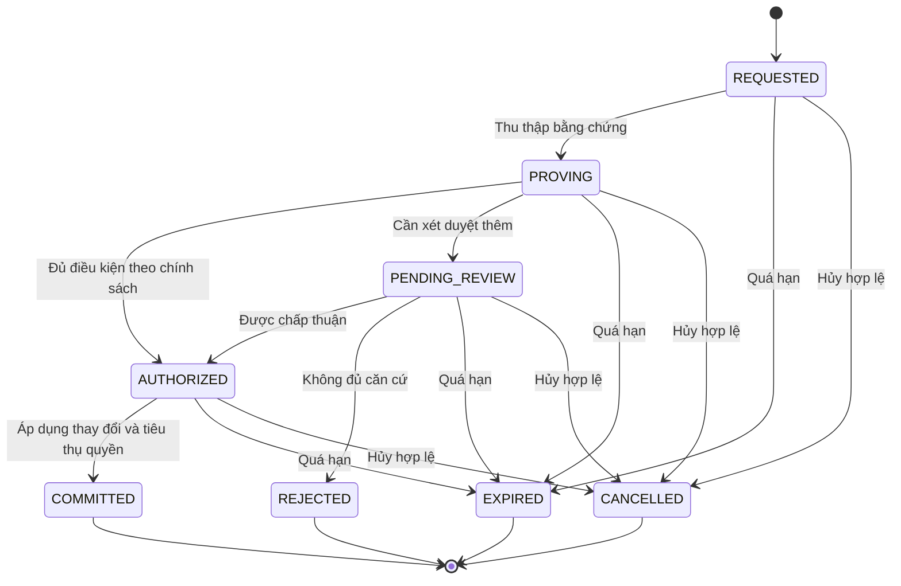

# Khôi phục tài khoản là một giao dịch rủi ro cao

Trong chương **Recovery Foundations** của module **SECURITY_AUTHENTICATION_ACCOUNT_RECOVERY**, bài học này xem khôi phục tài khoản như một giao dịch thay đổi quyền kiểm soát danh tính. Khi người dùng mất mật khẩu, MFA, passkey hoặc thiết bị xác thực, hệ thống phải tạo được đường trở lại tài khoản mà vẫn kiểm soát nguy cơ chiếm đoạt.

Một yêu cầu khôi phục thành công có thể thay mật khẩu, loại bỏ yếu tố xác thực, đăng ký passkey mới hoặc chuyển địa chỉ nhận mã khôi phục. Những thay đổi đó quyết định ai được đăng nhập trong tương lai. Vì vậy, gửi được email và kiểm tra được mã chỉ là một phần của luồng; bài toán chính là **căn cứ nào cho phép thực hiện thay đổi nào, trong phạm vi nào và vào thời điểm nào**.

## 1. Mục tiêu học tập

Sau bài học, bạn có thể:

- Giải thích vì sao khôi phục cần được đánh giá như một giao dịch nhạy cảm, ngay cả khi không có chuyển tiền hay thay đổi dữ liệu nghiệp vụ.
- Tách yêu cầu khôi phục, bằng chứng xác minh, quyết định cho phép và thay đổi cuối cùng thành các bước có ranh giới rõ ràng.
- Thiết kế một giao dịch có phạm vi, trạng thái, thời hạn, khả năng chống phát lại và quy tắc xử lý đồng thời.
- Chọn biện pháp kiểm soát phù hợp với tác động của thay đổi và độ tin cậy của bằng chứng.
- Xác định điều kiện hậu kiểm về yếu tố xác thực, phiên đăng nhập, thông báo và nhật ký.

## 2. Thứ được giao dịch là quyền kiểm soát tài khoản

Đăng nhập thường kiểm tra người dùng có đáp ứng chính sách xác thực hiện hành hay không. Khôi phục xuất hiện khi một phần của cơ chế đó không còn dùng được. Nếu hệ thống cho phép đi vòng qua yếu tố bị mất, nó đang quyết định một cách khác để cấp lại quyền truy cập.

Ví dụ, tài khoản dùng mật khẩu và ứng dụng TOTP. Chủ tài khoản quên mật khẩu nhưng vẫn giữ ứng dụng TOTP là một tình huống khác hẳn mất cả mật khẩu lẫn thiết bị TOTP. Một email đặt lại mật khẩu có thể hỗ trợ tình huống đầu mà không cần gỡ MFA. Dùng chính email đó để gỡ cả MFA trong tình huống thứ hai làm thay đổi đáng kể mức bảo vệ tài khoản.

Cần phân biệt ba câu hỏi:

| Câu hỏi | Ví dụ | Ý nghĩa thiết kế |
| --- | --- | --- |
| Người yêu cầu đang chứng minh điều gì? | Kiểm soát hộp thư đã đăng ký | Chỉ kết luận trong giới hạn của bằng chứng đó |
| Người yêu cầu muốn thay đổi điều gì? | Đặt lại mật khẩu; thay TOTP; đăng ký passkey | Mỗi loại thay đổi có phạm vi và tác động riêng |
| Sau thay đổi, họ có thể làm gì? | Đăng nhập; rút tiền; quản trị tổ chức | Tác động nghiệp vụ quyết định yêu cầu bảo vệ tiếp theo |

**Xác minh một kênh liên lạc không tự động chứng minh đầy đủ danh tính hoặc quyền thay toàn bộ yếu tố xác thực.** Hộp thư có thể đã bị chiếm đoạt, số điện thoại có thể bị chuyển quyền kiểm soát, còn thông tin hồ sơ có thể đã bị lộ.

Khôi phục cũng có hai loại thiệt hại cần cân bằng:

- **Chấp thuận sai:** kẻ tấn công trở thành người kiểm soát tài khoản.
- **Từ chối sai:** chủ tài khoản hợp lệ bị khóa ngoài, không truy cập được dữ liệu hoặc dịch vụ cần thiết.

Một thiết kế chỉ thêm thật nhiều bước có thể làm tăng từ chối sai mà vẫn dễ bị lừa qua hỗ trợ. Mục tiêu là tạo đường khôi phục có căn cứ, kiểm soát được và giải thích được.

## 3. Vì sao đây là giao dịch rủi ro cao?

### 3.1. Khôi phục có thể thay gốc tin cậy

Mật khẩu, khóa công khai của passkey, bí mật TOTP và các phương thức khôi phục đã đăng ký đều tham gia vào việc xác định ai được truy cập tài khoản. Thay một trong các thành phần đó có thể khiến người sở hữu yếu tố cũ mất quyền, trong khi người sở hữu yếu tố mới có quyền.

Khác với sửa giao diện hay cập nhật tùy chọn hiển thị, lỗi khôi phục có thể tạo quyền truy cập lâu dài. Kẻ tấn công thường muốn bổ sung yếu tố của mình, đổi kênh thông báo hoặc giữ lại một phiên đăng nhập ngay cả khi nạn nhân phát hiện sự việc.

### 3.2. Luồng bắt đầu trong điều kiện thiếu bằng chứng

Trong một giao dịch thông thường, ứng dụng có thể yêu cầu xác thực lại bằng yếu tố đang hoạt động. Trong khôi phục, chính yếu tố đó có thể đã mất. Hệ thống phải đánh giá bằng chứng thay thế mà không giả định rằng nó có chất lượng tương đương.

Các dấu hiệu như IP quen thuộc, thiết bị từng sử dụng và lịch sử hoạt động có ích cho đánh giá rủi ro, nhưng không phải bằng chứng tuyệt đối. IP có thể dùng chung hoặc thay đổi; cookie thiết bị có thể bị lấy cắp. Ngược lại, đổi máy hoặc đi công tác không đủ để kết luận người dùng là kẻ gian.

### 3.3. Kẻ tấn công có thể kiểm soát một phần hệ sinh thái

Đừng chỉ xét hai trạng thái “người dùng thật” và “người lạ không có gì”. Người tấn công có thể đã có mật khẩu bị lộ, quyền đọc email, phiên đăng nhập cũ, mã khôi phục bị sao chép hoặc thông tin đủ để gây áp lực với nhân viên hỗ trợ.

Do đó, một luồng hợp lý trong giả định hộp thư an toàn có thể thất bại khi hộp thư là thành phần bị xâm nhập. Đánh giá rủi ro phải xét loại tài sản có thể đã bị mất cùng nhau.

### 3.4. Hậu quả có thể xảy ra sau khi luồng kết thúc

Giao diện báo “đổi mật khẩu thành công” không chứng minh tài khoản đã an toàn. Refresh token cũ, phiên của thiết bị bị mất hoặc API credential độc lập có thể vẫn hoạt động nếu hệ thống không có chính sách xử lý chúng.

Phạm vi khôi phục vì thế bao gồm trạng thái truy cập sau thay đổi. Với credential phục vụ tích hợp, cần xem xét riêng quan hệ với sự cố và tác động khi thu hồi; không mặc định đổi mật khẩu sẽ tự xử lý mọi loại credential.

## 4. Mô hình đe dọa trước khi thiết kế các bước

Một bài tập hữu ích là xác định tài sản, khả năng của đối thủ, ranh giới tin cậy và điều kiện thành công của cuộc tấn công.

| Thành phần | Câu hỏi cần trả lời | Ví dụ trong khôi phục |
| --- | --- | --- |
| Tài sản | Quyền hoặc dữ liệu nào cần bảo vệ? | Quyền đăng ký yếu tố mới; dữ liệu cá nhân; tài khoản quản trị |
| Khả năng của đối thủ | Đối thủ đã có những gì? | Mật khẩu cũ, hộp thư, cookie phiên hoặc thông tin hồ sơ |
| Ranh giới tin cậy | Đầu vào nào chưa được tin cậy? | Trình duyệt, yêu cầu API, webhook hoặc ghi chú từ hỗ trợ |
| Mục tiêu tấn công | Điều gì khiến tài khoản bị chiếm? | Gỡ MFA rồi đăng ký passkey của đối thủ |
| Tác động vận hành | Hệ thống có thể bị lạm dụng ra sao? | Gửi email hàng loạt, khóa người dùng, làm quá tải hàng đợi hỗ trợ |

Đặc biệt, cần xét **hợp thành nhiều bước**. Nếu email cho phép đặt lại mật khẩu, mật khẩu mới lại cho phép đổi email, rồi email mới cho phép gỡ MFA, từng bước có thể trông hợp lệ nhưng cả chuỗi đã tạo đường chiếm tài khoản chỉ từ một hộp thư.

Hãy đánh giá toàn bộ quyền mà người yêu cầu có thể thu được qua chuỗi thao tác, thay vì chỉ xem màn hình hiện tại.

## 5. Tách bốn khái niệm thường bị gộp làm một

### 5.1. Yêu cầu khôi phục

Đây là lời khai: “Tôi muốn khôi phục tài khoản này”. Việc biết email hoặc tên tài khoản chỉ giúp định tuyến yêu cầu. Nó chưa cho phép thay đổi credential, thu hồi phiên của chủ tài khoản hoặc vô hiệu hóa một yêu cầu hợp lệ khác.

Khởi tạo yêu cầu cần rẻ về tác động lên tài khoản nhưng được kiểm soát về tài nguyên. Nếu chỉ cần nhập email là làm mất hiệu lực phiên đang hoạt động, đối thủ có thể dùng khôi phục như một cách gây gián đoạn dịch vụ.

### 5.2. Bằng chứng

Bằng chứng là những gì được kiểm tra để củng cố quyết định: sử dụng một mã khôi phục đã đăng ký, chứng minh quyền sở hữu một authenticator còn hoạt động, hoặc hoàn thành quy trình xác minh phù hợp với dịch vụ.

Bằng chứng phải có nguồn gốc, thời điểm và phạm vi. Một xác minh đã diễn ra từ lâu không nên được tái sử dụng vô hạn cho mọi thay đổi tương lai.

Hai bằng chứng cùng phụ thuộc vào một thành phần bị xâm nhập không tạo ra tính độc lập thực chất. Ví dụ, đường dẫn email và mã thứ hai cũng gửi vào cùng hộp thư không có ý nghĩa tương đương hai yếu tố độc lập.

### 5.3. Quyết định cho phép khôi phục

Hệ thống đối chiếu bằng chứng với hành động được yêu cầu, chính sách và bối cảnh rủi ro. Kết quả có thể là cho phép, yêu cầu bổ sung bằng chứng, chuyển sang xử lý thủ công, chờ theo chính sách hoặc từ chối.

Một điểm rủi ro thấp không tự tạo quyền thay yếu tố xác thực. Nếu yêu cầu thiếu bằng chứng bắt buộc, thiết bị quen thuộc không được dùng để bỏ qua điều kiện đó một cách tùy tiện.

### 5.4. Thay đổi có hiệu lực

Đây là lúc mật khẩu, yếu tố xác thực hoặc quyền truy cập thực sự thay đổi. Trước bước này cần kiểm tra lại các điều kiện có thể đã thay đổi: thời hạn, trạng thái yêu cầu, phạm vi được phép, phiên bản bảo mật của tài khoản và việc bằng chứng đã bị sử dụng hay thu hồi chưa.

Tách bốn khái niệm này giúp tránh lỗi “có token thì được làm mọi thứ” hoặc “hỗ trợ đã duyệt nên API không cần kiểm tra nữa”.

## 6. Một giao dịch khôi phục cần ràng buộc những gì?

Có thể hình dung mỗi yêu cầu được lưu thành một bản ghi phía máy chủ:

```text
RecoveryTransaction
  id                       # Định danh yêu cầu, không tự đóng vai trò bí mật
  account_id               # Tài khoản đích do máy chủ xác định
  action                   # Ví dụ: RESET_PASSWORD hoặc REPLACE_TOTP
  state                    # Trạng thái hiện tại
  created_at / expires_at  # Giới hạn thời gian
  verified_evidence        # Tham chiếu bằng chứng và thời điểm xác minh
  policy_version           # Chính sách dùng để xét duyệt
  authorization_expires_at # Thời hạn quyết định cho phép
  account_security_version # Mốc phát hiện thay đổi bảo mật cạnh tranh
  continuation_secret_hash # Bản kiểm tra bí mật tiếp tục, nếu có
  completed_at             # Thời điểm hoàn tất, nếu có
```

Đây là mô hình minh họa, không phải lược đồ bắt buộc. Điều quan trọng là các ràng buộc sau:

- **Đúng tài khoản:** thay `account_id` trong URL hoặc body không được chuyển quyền khôi phục sang tài khoản khác.
- **Đúng hành động:** quyền đặt lại mật khẩu không cho phép gỡ MFA, đổi email hoặc đăng ký thêm yếu tố ngoài phạm vi đã duyệt.
- **Đúng giao dịch:** bằng chứng và bí mật tiếp tục phải gắn với yêu cầu tương ứng, không chỉ kiểm tra rằng một token tồn tại đâu đó.
- **Đúng thời điểm:** giao dịch, bằng chứng và quyền cho phép đều còn hiệu lực theo chính sách; dùng thời gian phía máy chủ.
- **Đúng trạng thái:** yêu cầu đã hủy, hết hạn hoặc hoàn tất không được quay lại trạng thái có quyền thay đổi.
- **Đúng bối cảnh bảo mật:** thay đổi yếu tố, kênh liên lạc hoặc trạng thái tài khoản sau khi xét duyệt phải được phát hiện và xử lý.

Không cần ràng buộc cứng vào IP để đạt các mục tiêu này. Ràng buộc IP quá chặt có thể làm hỏng luồng trên mạng di động. Sử dụng IP như một tín hiệu và dựa vào bí mật phiên khôi phục được bảo vệ cùng trạng thái máy chủ để kiểm soát quyền tiếp tục.

Nếu hành động được duyệt là đăng ký một khóa cụ thể, yêu cầu hoàn tất phải tương ứng với dữ liệu đã được xác minh cho khóa đó. Không để khách hàng đổi sang một hành động hay đối tượng khác sau khi đã qua bước xét duyệt.

## 7. Vòng đời: giao dịch nghiệp vụ dài, commit dữ liệu ngắn

Một giao dịch khôi phục có thể kéo dài qua nhiều lần mở trình duyệt, trao đổi hỗ trợ hoặc khoảng chờ. Không giữ một transaction cơ sở dữ liệu mở trong suốt thời gian đó. Hãy lưu trạng thái nghiệp vụ và chỉ dùng transaction cơ sở dữ liệu ngắn tại các chuyển trạng thái cần tính nguyên tử.



Sơ đồ thể hiện các trạng thái chính. Trong triển khai, một yêu cầu cần thêm bằng chứng có thể tiếp tục ở `PROVING`; một quyết định hết hiệu lực do tài khoản thay đổi có thể bị hủy hoặc phải được xét duyệt lại theo chính sách rõ ràng.

### Các bất biến cần giữ

1. Trước `AUTHORIZED`, không có quyền thay credential mục tiêu.
2. `AUTHORIZED` chỉ cấp quyền thực hiện hành động cụ thể trong thời hạn cụ thể.
3. Chỉ một lần hoàn tất được tạo ra từ cùng quyền khôi phục.
4. Việc thay credential và đánh dấu giao dịch hoàn tất phải thống nhất với nhau.
5. Yêu cầu đã hoàn tất không thể được dùng để thay credential lần nữa.
6. Trạng thái phiên và thông tin cần phát hành sau commit phải có cách xử lý bền vững.

`AUTHORIZED` không nên đồng nghĩa với đăng nhập đầy đủ. Nếu cần cho trình duyệt tiếp tục, có thể cấp phiên khôi phục giới hạn chỉ cho các endpoint cần thiết. Phiên đó không được đọc dữ liệu tài khoản, đổi email, tạo API key hoặc bỏ qua MFA còn hiệu lực.

Khi luồng đặt lại mật khẩu không bao gồm thay MFA, người dùng vẫn phải đáp ứng chính sách đăng nhập sau khi mật khẩu được đổi. Nếu sản phẩm cho phép chuyển tiếp sau khôi phục, việc tạo phiên truy cập cần quyết định riêng về bằng chứng và mức quyền.

## 8. Token dùng một lần là quyền hạn có phạm vi

Đường dẫn hoặc mã khôi phục thường chứa bí mật mà người sở hữu có thể dùng để đi tiếp. Bảo vệ bí mật này như một credential ngắn hạn.

### 8.1. Thuộc tính cần có

- Sinh bằng nguồn ngẫu nhiên mật mã, có không gian giá trị đủ chống đoán trong mô hình đe dọa của hệ thống.
- Có thời hạn phía máy chủ; không chỉ đếm ngược bằng JavaScript trên giao diện.
- Liên kết với đúng tài khoản, giao dịch, mục đích và bước sử dụng.
- Có cơ chế sử dụng một lần và thu hồi, kể cả khi token có chữ ký hợp lệ.
- Không xuất hiện trong log, công cụ phân tích, lịch sử theo dõi hỗ trợ hoặc nội dung gửi cho bên thứ ba.

Với token ngẫu nhiên có độ khó đoán cao, lưu giá trị băm hoặc HMAC phục vụ đối chiếu giúp hạn chế lộ bí mật khi dữ liệu lưu trữ bị đọc. Với mã nhập tay có không gian nhỏ, một bản băm đơn thuần không loại bỏ nguy cơ dò ngoại tuyến; cần thiết kế bảo vệ lưu trữ phù hợp và giới hạn thử trực tuyến. Không suy ra rằng “đã băm” đồng nghĩa mọi loại mã đều được bảo vệ như nhau.

### 8.2. Phân biệt token xác minh với quyền hoàn tất

Một thiết kế có thể dùng token email để đổi lấy phiên khôi phục giới hạn, sau đó dùng phiên đó để gửi thay đổi cuối cùng. Khi đó có hai sự kiện riêng:

1. Tiêu thụ token email một lần để tạo quyền tiếp tục có phạm vi.
2. Tiêu thụ quyền tiếp tục một lần khi commit thay đổi.

Không tái sử dụng token email như một mật khẩu tạm thời cho mọi endpoint. Nếu dùng một token cho toàn bộ giao dịch, vẫn phải xác định chính xác thời điểm tiêu thụ và điều kiện hoàn tất.

Tránh làm thay đổi bảo mật hoặc tiêu thụ token chỉ bằng một yêu cầu `GET` mở liên kết. Trình quét an toàn email hoặc tính năng xem trước có thể truy cập liên kết trước người dùng. Trang đích có thể hiển thị bước tiếp theo; hành động có chủ đích dùng `POST`, kiểm tra trạng thái và cơ chế chống CSRF phù hợp với cách lưu phiên.

Trang nhận token cũng cần hạn chế rò rỉ qua URL: không nhúng tài nguyên theo dõi không cần thiết, kiểm soát referrer và làm sạch URL khi đã trao đổi token thành phiên giới hạn. Token không nên bị ghi vào log truy cập ngay từ lớp proxy.

### 8.3. Dùng một lần cần được bảo đảm khi có cạnh tranh

Mã giả sau không đủ an toàn:

```text
if token.used == false:
    change_password()
    token.used = true
```

Hai yêu cầu có thể cùng đọc `false`. Ngoài ra, lỗi giữa hai lệnh có thể khiến mật khẩu đã đổi nhưng token chưa được đánh dấu đã dùng.

Cần chuyển trạng thái có điều kiện hoặc khóa phù hợp trong transaction cơ sở dữ liệu. Nếu tiêu thụ token và ghi thay đổi nằm trong cùng transaction, lỗi ghi thay đổi phải rollback cả việc tiêu thụ. Nếu token được đổi lấy một quyền trung gian ở bước trước, quyền trung gian đó cũng phải được lưu bền vững và có vòng đời riêng.

## 9. Xét duyệt theo tác động và chất lượng bằng chứng

Không có một số lượng bước cố định phù hợp với mọi dịch vụ. Một diễn đàn và tài khoản có quyền quản trị hạ tầng có hậu quả chiếm đoạt khác nhau. Cùng một dịch vụ cũng có thể cần chính sách khác nhau cho đặt lại mật khẩu và thay toàn bộ yếu tố xác thực.

Bảng dưới đây minh họa cách đặt câu hỏi về chính sách, không phải cấu hình mặc định để sao chép vào sản phẩm:

| Yêu cầu | Bằng chứng hoặc tình huống | Hướng xử lý cần cân nhắc |
| --- | --- | --- |
| Quên mật khẩu, vẫn còn MFA | Kênh khôi phục hợp lệ; MFA còn hoạt động | Cho phép đặt lại mật khẩu trong phạm vi đó; tiếp tục yêu cầu MFA khi đăng nhập |
| Mất một passkey, còn authenticator khác | Có thể xác thực bằng phương thức còn lại | Xác thực phù hợp trước khi gỡ hoặc thay yếu tố bị mất |
| Mất toàn bộ yếu tố, chỉ còn email | Chỉ chứng minh được quyền truy cập hộp thư | Đánh giá có đủ căn cứ cho loại tài khoản này không; có thể cần đường xác minh khác |
| Thay yếu tố cho tài khoản đặc quyền | Thiệt hại tiềm tàng lớn | Cân nhắc bằng chứng mạnh hơn, xét duyệt tách nhiệm vụ và hạn chế sau khôi phục |
| Nhiều lần thử và dấu hiệu bất thường | Bằng chứng chưa đủ hoặc mâu thuẫn | Hạn chế tốc độ, thu thập thêm căn cứ hoặc chuyển sang xét duyệt |

### Điều kiện bắt buộc khác với tín hiệu rủi ro

Nên biểu diễn tách bạch:

```text
Được hoàn tất =
  bằng chứng bắt buộc đạt yêu cầu
  AND hành động nằm trong phạm vi được duyệt
  AND quyền còn hiệu lực
  AND trạng thái tài khoản cho phép
  AND các kiểm soát rủi ro đã được đáp ứng
```

IP quen thuộc hay thiết bị đã thấy có thể giảm nhu cầu kiểm tra bổ sung theo chính sách, nhưng không thay thế một bằng chứng bắt buộc chỉ vì điểm tổng hợp đẹp.

Khi dịch vụ đánh giá rủi ro không khả dụng, cần có hành vi dự phòng đã thiết kế trước. Không tự động bỏ qua điều kiện bảo vệ; có thể chuyển sang luồng giới hạn hoặc chờ xét duyệt nếu chính sách cho phép.

### Khoảng chờ có ích khi có mục đích rõ ràng

Khoảng chờ có thể tạo cơ hội gửi thông báo, phát hiện bất thường và can thiệp trước khi thay yếu tố nhạy cảm. Nó hữu ích hơn khi thông báo đến được một kênh còn đáng tin và có đường xử lý sự cố thật sự.

Chờ lâu không tự tạo thêm bằng chứng. Nếu đối thủ kiểm soát cả hộp thư và kênh liên lạc, việc đợi không giải quyết được vấn đề căn bản. Thời gian chờ phải gắn với tác động, khả năng phát hiện và nhu cầu phục hồi của người dùng, thay vì áp dụng tùy ý cho mọi yêu cầu.

Một phản đối hoặc yêu cầu hủy cũng là đầu vào cần đánh giá. Không mặc định bên bấm “không phải tôi” luôn là chủ tài khoản, đặc biệt khi phiên hoặc kênh đó có thể đã bị chiếm. Đường can thiệp không được trở thành cách khóa nạn nhân vô thời hạn chỉ bằng yêu cầu không xác thực.

## 10. Điểm commit phải chống thay đổi cạnh tranh

Giữa lúc xác minh và lúc hoàn tất có thể xảy ra nhiều sự kiện: chủ tài khoản đổi email, thay MFA, hủy yêu cầu hoặc hoàn tất một giao dịch khôi phục khác. Kiểm tra đúng ở đầu luồng không bảo đảm quyết định vẫn đúng ở cuối luồng.

Một cách xử lý là lưu phiên bản bảo mật của tài khoản lúc xét duyệt và kiểm tra lại khi commit. Mỗi thay đổi bảo mật có liên quan tăng phiên bản đó. Phiên bản bảo mật dùng để phát hiện quyết định cũ có thể không còn phù hợp; nó không nhất thiết là cùng trường dữ liệu dùng để vô hiệu hóa phiên.

Mã giả dưới đây minh họa đặt lại mật khẩu trong một hệ thống quản lý credential và trạng thái khôi phục cùng cơ sở dữ liệu:

```text
# Ngoài transaction: kiểm tra hình dạng đầu vào, chính sách mật khẩu,
# và tính password_hash bằng thuật toán lưu mật khẩu phù hợp.

begin database transaction
    lock account row
    lock recovery_transaction row
    # Mọi đường ghi liên quan phải theo cùng thứ tự khóa đã quy định.

    assert recovery.account_id == account.id
    assert recovery.state == AUTHORIZED
    assert recovery.action == RESET_PASSWORD
    assert server_now < recovery.expires_at
    assert server_now < recovery.authorization_expires_at
    assert continuation_secret_is_valid(recovery, supplied_secret)
    assert recovery.account_security_version == account.security_version
    assert current_policy_still_allows_this_change(recovery, account)

    account.password_hash = prepared_password_hash
    account.security_version += 1

    apply_session_policy_for_this_recovery(account)
    recovery.state = COMMITTED
    recovery.completed_at = server_now
    invalidate_other_recovery_permissions_for_account(account)

    append_audit_event_without_secrets()
    enqueue_notification_in_outbox()
commit database transaction

# Chỉ phản hồi thành công sau khi commit thành công.
# Worker gửi thông báo từ outbox và thử lại khi gặp lỗi tạm thời.
```

Các lệnh `assert` là điều kiện được kiểm tra và thực thi phía máy chủ, không phải hướng dẫn để tin vào giá trị trình duyệt gửi lên. Bí mật do trình duyệt cung cấp phải được đối chiếu bằng cơ chế bảo mật phù hợp; trường hành động có hiệu lực là trường máy chủ đã lưu.

Cần chú ý bốn điểm:

- **Hai giao dịch khác nhau cũng có thể cạnh tranh.** Chỉ khóa từng bản ghi khôi phục là chưa đủ. Phải tuần tự hóa thay đổi trên cùng tài khoản hoặc dùng cơ chế kiểm tra phiên bản có tính nguyên tử tương đương.
- **Không hủy yêu cầu hợp lệ chỉ vì xuất hiện yêu cầu mới chưa được chứng minh.** Nếu hệ thống vô hiệu hóa mọi token ngay lúc ai đó nhập email, đối thủ có thể liên tục ngăn chủ tài khoản hoàn tất. Chính sách thay thế yêu cầu phải xét mức tin cậy và chống lạm dụng.
- **Gửi email không nằm trong transaction dữ liệu.** Outbox lưu ý định gửi cùng commit, giúp gửi lại khi dịch vụ email lỗi. Gửi thông báo thất bại không nên khiến hệ thống khai báo rằng mật khẩu vẫn chưa đổi khi thực tế đã đổi.
- **Hệ thống phân tán cần thiết kế riêng.** Nếu credential nằm ở nhà cung cấp danh tính khác, một transaction cục bộ không làm cho cuộc gọi mạng trở thành nguyên tử. Cần trạng thái trung gian bền vững, thao tác có thể thử lại an toàn và đối soát kết quả trước khi báo hoàn tất.

Với yêu cầu lặp lại sau khi phản hồi bị mất, máy chủ có thể trả kết quả đã hoàn tất cho cùng ngữ cảnh được phép theo dõi giao dịch, nhưng không thực hiện thay đổi lần hai. Mã định danh idempotency không tự tạo quyền khôi phục và không thay thế bước xác thực quyền tiếp tục.

## 11. Session là một phần của kết quả khôi phục

Chính sách phiên cần trả lời: nếu thiết bị bị mất hoặc một phiên đã bị lấy cắp, đối tượng đó còn truy cập được sau khôi phục hay không?

| Trường hợp | Điều cần quyết định |
| --- | --- |
| Người dùng chỉ quên mật khẩu | Có thu hồi mọi phiên hay chọn phạm vi khác theo chính sách dịch vụ? |
| Thiết bị chứa authenticator bị mất | Phiên và credential nào trên thiết bị đó cần bị vô hiệu hóa? |
| Có dấu hiệu tài khoản bị chiếm | Cần thu hồi rộng đến đâu, gồm refresh token và quyền truy cập liên quan nào? |
| Người dùng còn một phương thức xác thực hợp lệ | Có thể dùng phương thức đó để phục hồi mà vẫn giữ yêu cầu xác thực thích hợp không? |

Đổi mật khẩu không tự vô hiệu hóa mọi access token đã phát hành. Với token tự chứa, cần xác định cách kiểm tra thu hồi hoặc phiên bản phiên, thời gian sống còn lại và nơi thực thi kiểm tra. Nếu hệ thống chỉ dựa vào token hết hạn, phải hiểu rõ khoảng thời gian quyền truy cập cũ vẫn còn hiệu lực.

Trong hệ thống nhiều dịch vụ, cần quy định độ trễ lan truyền trạng thái thu hồi. Với thao tác nhạy cảm, có thể cần kiểm tra trạng thái bảo mật mới nhất thay vì chỉ tin bộ nhớ đệm cũ. Không cam kết “đăng xuất tất cả ngay lập tức” nếu kiến trúc thực tế không bảo đảm điều đó.

Nếu dùng bộ đếm phiên hoặc mốc thu hồi, mọi điểm chấp nhận token có liên quan phải thực thi quy tắc đó. Tăng một trường trong cơ sở dữ liệu mà không có nơi kiểm tra không tạo ra việc thu hồi thực sự.

Sau khôi phục, quyền đổi yếu tố hoặc thực hiện thao tác nhạy cảm tiếp theo vẫn cần được xét theo mức bảo đảm hiện có. Một phiên khôi phục giới hạn không nên âm thầm trở thành phiên đủ quyền rút tiền hoặc quản trị tổ chức.

## 12. Chống lạm dụng mà không tạo cách khóa nạn nhân

Luồng khôi phục thường nhận yêu cầu từ người chưa đăng nhập. Nó cần bảo vệ cả thông tin tài khoản, tài nguyên hệ thống và khả năng phục hồi của chủ tài khoản.

### Tránh tiết lộ tài khoản tồn tại

Phản hồi khởi tạo có thể dùng thông điệp trung tính, chẳng hạn: “Nếu thông tin khớp với tài khoản đủ điều kiện, hệ thống sẽ gửi hướng dẫn tiếp theo”. Không trả danh sách yếu tố đã đăng ký cho một yêu cầu chưa được chứng minh.

Cần xem cả mã HTTP, hình dạng phản hồi, hành vi gửi lại và chênh lệch thời gian có thể quan sát. Thêm một khoảng ngủ cố định không tự giải quyết mọi kênh tiết lộ; xử lý bất đồng bộ và đường phản hồi nhất quán cần được thiết kế cùng nhau.

### Giới hạn nhiều nguồn tài nguyên

Áp dụng kiểm soát theo nhiều chiều phù hợp: tài khoản đích, nguồn yêu cầu, giao dịch, số lần thử mã và tổng lưu lượng dịch vụ. Chỉ giới hạn theo IP có thể bỏ sót tấn công phân tán và ảnh hưởng người dùng dùng chung mạng.

Tránh để nhiều lần nhập sai từ bên ngoài làm khóa vĩnh viễn tài khoản hoặc tự động thu hồi mọi phiên đang hoạt động. Có thể vô hiệu hóa một thử thách hoặc giao dịch bị lạm dụng, đồng thời giữ đường khôi phục khác có kiểm soát cho người dùng hợp lệ.

CAPTCHA, nếu dùng, là lớp giảm tự động hóa; nó không xác minh quyền sở hữu tài khoản. Tương tự, việc nhân viên hỗ trợ nhận được một cuộc gọi không phải bằng chứng đủ để thay yếu tố xác thực.

### Giữ cùng ranh giới khi xử lý thủ công

Nhân viên hỗ trợ cần có quy trình về loại bằng chứng được chấp nhận, phạm vi hành động, quyền xét duyệt và nhật ký. Nếu hỗ trợ có nút “bỏ qua toàn bộ” không bị ràng buộc, luồng tự động được bảo vệ tốt vẫn có thể bị vượt qua bằng thuyết phục xã hội.

Với trường hợp nhạy cảm, có thể tách người đánh giá bằng chứng và người phê duyệt thay đổi. Quyết định thủ công cũng phải được hệ thống gắn với giao dịch, hành động và thời hạn cụ thể, rồi kiểm tra lại ở điểm commit.

Không yêu cầu người dùng đưa mật khẩu, OTP đang sử dụng hoặc mã khôi phục vào cuộc trò chuyện hỗ trợ. Thu thập dữ liệu xác minh vừa đủ theo quy trình, hạn chế quyền truy cập và thời gian lưu dữ liệu nhạy cảm.

## 13. Thông báo và nhật ký giúp phát hiện, điều tra

Thông báo nên phân biệt các sự kiện: yêu cầu đã được khởi tạo, thay đổi nhạy cảm đang chờ, và thay đổi đã hoàn tất. Gửi thông báo đến kênh đã đăng ký trước thay đổi theo chính sách phù hợp; một địa chỉ mới do người yêu cầu vừa cung cấp không tự trở thành kênh cảnh báo đáng tin.

Nội dung nên giải thích loại sự kiện, thời điểm và đường xử lý khi người nhận không thực hiện yêu cầu. Không đưa token khôi phục vào thông báo cảnh báo hoặc sao chép bí mật sang nhiều kênh. Đường xử lý sự cố cần hoạt động được cả khi người dùng không thể đăng nhập.

Nhật ký phục vụ điều tra nên đủ để tái dựng quyết định mà không lưu bí mật:

```text
event_type: recovery.committed
transaction_id: rec_illustrative_42
account_ref: internal_account_reference
action: RESET_PASSWORD
policy_version: illustrative_policy_v3
evidence_refs: [verified_evidence_reference]
decision_reason_code: REQUIRED_EVIDENCE_SATISFIED
session_policy: REVOKE_EXISTING_SESSIONS
occurred_at: server_timestamp
```

Tên trường và giá trị trên chỉ minh họa. Không ghi token, OTP, mật khẩu mới, cookie phiên hoặc URL đầy đủ chứa bí mật. Thông tin thiết bị, mạng và dữ liệu xác minh cá nhân cũng cần quyền truy cập cùng thời hạn lưu phù hợp.

Các số liệu hữu ích gồm tỷ lệ hoàn tất, tỷ lệ hết hạn, thời gian chờ, số lần thử bị chặn và sự cố chiếm đoạt sau khôi phục. Tỷ lệ hoàn tất cao chưa đủ kết luận an toàn; tỷ lệ từ chối cao cũng chưa chứng minh kiểm soát tốt.

## 14. Ví dụ xuyên suốt: mất mật khẩu và thiết bị TOTP

Giả sử Mai có tài khoản quản lý thanh toán của một nhóm. Tài khoản dùng mật khẩu, ứng dụng TOTP và email đã xác minh. Mai mất điện thoại, không nhớ mật khẩu, nhưng còn truy cập email. Cùng lúc, kẻ tấn công có thể đã lấy được mật khẩu hộp thư của Mai.

### Luồng dễ bị chiếm đoạt

1. Người yêu cầu nhận liên kết qua email.
2. Liên kết cho phép đặt mật khẩu mới.
3. Sau khi đặt mật khẩu, hệ thống tạo phiên đăng nhập đầy đủ.
4. Phiên đó cho phép gỡ TOTP, đổi email và thêm passkey mà không yêu cầu thêm bằng chứng.
5. Phiên cũ và refresh token vẫn tồn tại.

Ở đây, hệ thống đã biến quyền truy cập email thành quyền thay toàn bộ cơ chế bảo vệ. Dù bước 1 dùng token hết hạn và dùng một lần đúng kỹ thuật, chuỗi quyền vẫn không phù hợp với tác động của tài khoản.

### Cách đánh giá theo giao dịch

Trước hết, máy chủ xác định hành động: đặt lại mật khẩu hay thay cả yếu tố TOTP. Liên kết email chỉ chứng minh quyền kiểm soát hộp thư trong phạm vi được quy định. Nếu được phép đặt lại mật khẩu từ bằng chứng đó, hoàn tất bước này vẫn không tự gỡ TOTP hoặc tạo phiên đủ quyền.

Để thay TOTP, dịch vụ đánh giá bằng chứng bổ sung theo chính sách của loại tài khoản. Nếu Mai còn mã khôi phục đã đăng ký, hệ thống có thể kiểm tra mã theo đường được thiết kế trước. Nếu không còn, cần đường xác minh khác được chấp thuận cho dịch vụ; không mặc định hỏi ngày sinh hay vài câu về hồ sơ là đủ.

Nếu chính sách yêu cầu xét duyệt và khoảng chờ, quyết định chỉ cho phép thay TOTP trong một giao dịch có thời hạn. Hệ thống gửi cảnh báo đến kênh phù hợp đã có trước đó, tạo đường xử lý sự cố và kiểm tra lại trạng thái tài khoản trước khi hoàn tất.

Khi ghi thay đổi, máy chủ áp dụng chính sách phiên phù hợp với tình huống mất thiết bị và nghi ngờ xâm nhập, tiêu thụ quyền khôi phục, vô hiệu hóa quyền khôi phục cũ liên quan và lưu sự kiện thông báo. Người dùng tiếp tục đăng nhập theo cơ chế mới được thiết lập hợp lệ.

Điểm quyết định không phải “email đã nhận được chưa”, mà là **bằng chứng hiện có có cho phép thay đổi này trên tài khoản này hay không**. Nếu chưa đủ căn cứ, hệ thống phải giữ trạng thái chưa hoàn tất và cung cấp đường xử lý rõ ràng, thay vì hạ yêu cầu chỉ để kết thúc luồng.

## 15. Những lỗi thiết kế cần nhận ra

| Lỗi | Vì sao nguy hiểm | Nguyên tắc sửa |
| --- | --- | --- |
| Đặt lại mật khẩu tự động gỡ MFA | Một kênh yếu có thể thay toàn bộ cơ chế bảo vệ | Tách phạm vi và điều kiện cho từng hành động |
| Tin `account_id` hoặc `action` từ client sau xác minh | Có thể chuyển quyền sang tài khoản hay thao tác khác | Dùng ràng buộc đã lưu ở máy chủ |
| Token có chữ ký nên không cần trạng thái | Chữ ký không tự ngăn dùng lại hoặc bảo đảm thu hồi | Có kiểm soát phát lại, thời hạn và trạng thái giao dịch |
| Đọc `used = false` rồi ghi ở hai thao tác rời | Hai yêu cầu có thể cùng hoàn tất | Dùng chuyển trạng thái nguyên tử cùng thay đổi credential |
| Chỉ kiểm tra điều kiện lúc mở liên kết | Quyết định có thể lỗi thời trước khi ghi thay đổi | Kiểm tra lại ở điểm commit |
| Yêu cầu mới luôn hủy mọi yêu cầu cũ | Đối thủ có thể ngăn nạn nhân phục hồi bằng cách gửi liên tục | Thiết kế thay thế yêu cầu cùng kiểm soát lạm dụng |
| Đổi mật khẩu nhưng bỏ qua phiên | Kẻ đang có phiên có thể tiếp tục truy cập | Có chính sách thu hồi được thực thi ở các điểm chấp nhận token |
| Thêm nhiều bước qua cùng hộp thư | Không tạo thêm bằng chứng độc lập | Đánh giá quan hệ phụ thuộc giữa các bằng chứng |
| Duyệt thủ công không có phạm vi và hạn dùng | Quyết định cũ có thể bị tái sử dụng hoặc mở rộng quyền | Ràng buộc phê duyệt với giao dịch và kiểm tra khi hoàn tất |

## 16. Bài tập tự kiểm tra

### Tình huống 1: email đủ để làm gì?

Một tài khoản đang dùng mật khẩu và passkey. Luồng “quên mật khẩu” gửi liên kết email, sau đó tự động xóa mọi passkey để người dùng “không bị kẹt”. Hãy xác định quyền nào đã được cấp vượt quá bằng chứng và tách lại các hành động.

**Gợi ý đối chiếu:** đặt lại mật khẩu và xóa passkey là hai thay đổi khác nhau. Nếu chính sách cho phép email hỗ trợ việc đặt mật khẩu mới, điều đó chưa chứng minh email đủ căn cứ để xóa các yếu tố khác. Luồng cần giữ phạm vi và có đường riêng cho mất yếu tố.

### Tình huống 2: hai yêu cầu hoàn tất cùng lúc

Hai tab gửi mật khẩu mới khác nhau từ cùng một giao dịch. Cả hai đều nhìn thấy token chưa dùng. Hãy chỉ ra điều kiện phải được kiểm tra cùng một thao tác nguyên tử và kết quả mong muốn.

**Gợi ý đối chiếu:** chỉ một lần chuyển từ có quyền hoàn tất sang đã hoàn tất được thành công. Việc thay mật khẩu, tiêu thụ quyền và cập nhật trạng thái bảo mật phải thống nhất. Yêu cầu còn lại không được ghi đè mật khẩu sau đó; phản hồi phải xử lý trường hợp đã hoàn tất mà không cấp thêm quyền.

### Tình huống 3: tài khoản thay đổi trong lúc chờ

Một yêu cầu thay TOTP đã được duyệt. Trước khi người yêu cầu hoàn tất, chủ tài khoản đổi kênh liên lạc và báo mất thiết bị qua đường hỗ trợ. Có nên chỉ dựa vào quyết định duyệt ban đầu không?

**Gợi ý đối chiếu:** không. Đây là thay đổi bối cảnh bảo mật cần được phát hiện bằng phiên bản hoặc cơ chế tương đương. Yêu cầu cũ cần bị hủy hoặc xét lại theo chính sách. Việc báo sự cố cũng cần được xác minh đúng quy trình, không tự động tin mọi cuộc gọi.

## 17. Các câu hỏi cần trả lời trước khi coi thiết kế là hoàn chỉnh

- Hành động nào được phép ở mỗi bước, và hành động nào cần bằng chứng riêng?
- Mỗi bằng chứng chứng minh điều gì, còn hiệu lực bao lâu và phụ thuộc vào kênh nào?
- Quyền khôi phục được gắn với tài khoản, giao dịch, hành động và trạng thái bằng cách nào?
- Hai yêu cầu đồng thời hoặc hai giao dịch khác nhau trên cùng tài khoản có thể tạo hai lần thay đổi không?
- Thay đổi bảo mật xảy ra trong thời gian chờ có làm quyết định cũ mất hiệu lực không?
- Sau khi hoàn tất, phiên, refresh token, credential liên quan và yêu cầu khôi phục cũ được xử lý thế nào?
- Nếu gửi thông báo hoặc gọi nhà cung cấp danh tính thất bại, hệ thống xác định kết quả thực tế và thử lại ra sao?
- Người dùng hợp lệ có đường tiếp tục khi mất yếu tố, trong khi đối thủ không thể dùng yêu cầu chưa xác minh để khóa họ không?

Một thiết kế khôi phục đáng tin cậy phải nối được bằng chứng với quyền thay đổi cụ thể, giữ các ràng buộc đến tận lúc commit và xử lý trạng thái truy cập sau đó. Token, màn hình xác nhận và email chỉ có ý nghĩa khi cùng thực thi được những ranh giới đó.
