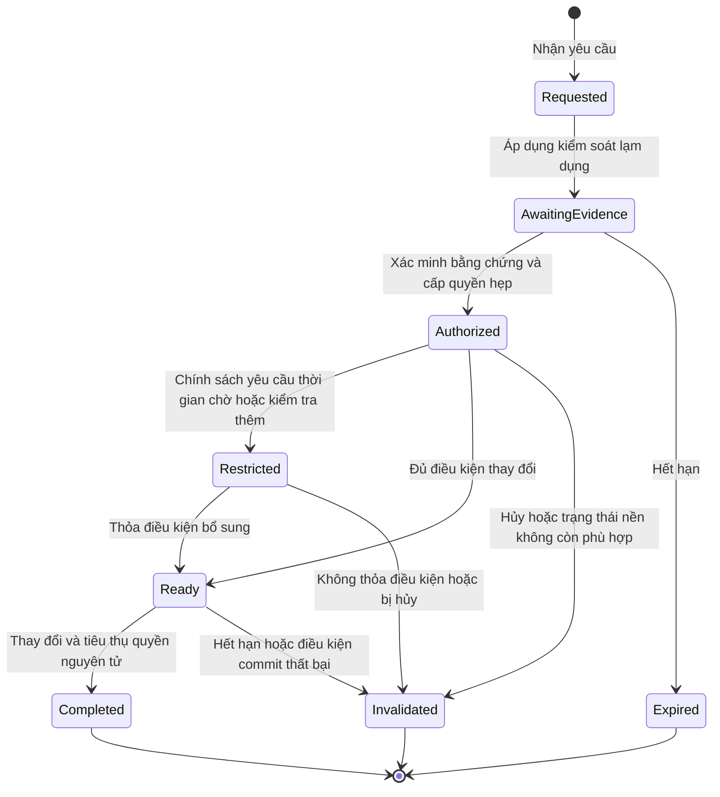

# Giả định và bảo đảm của luồng khôi phục tài khoản

Trong chương **Recovery Foundations**, bài học này trả lời một câu hỏi nền tảng: **khi hệ thống cho phép người dùng lấy lại tài khoản, điều gì phải đúng để quyết định đó an toàn, và hệ thống thực sự cam kết được điều gì?**

Khôi phục tài khoản là một cách thiết lập lại quyền truy cập khi người dùng mất mật khẩu, MFA, passkey hoặc thiết bị xác thực. Vì luồng này có thể thay đổi bằng chứng dùng để đăng nhập, nó cũng là mục tiêu trực tiếp của hành vi chiếm đoạt tài khoản. Một thiết kế tốt cần nêu rõ giả định về danh tính, kênh liên lạc, yếu tố xác thực và trạng thái hệ thống trước khi tuyên bố rằng một lần khôi phục là an toàn.

Mục tiêu của bài học là xây dựng một **hợp đồng bảo mật có điều kiện** cho recovery: bằng chứng nào được chấp nhận, hành động nào được cấp quyền, trạng thái nào phải bị vô hiệu hóa và những rủi ro nào vẫn còn sau khi quy trình hoàn tất.

## 1. Phân biệt giả định, bảo đảm và cơ chế

Ba khái niệm này thường bị trộn lẫn trong tài liệu thiết kế:

| Khái niệm | Câu hỏi cần trả lời | Ví dụ |
| --- | --- | --- |
| Giả định, hay assumption | Điều gì được xem là đúng để quyết định tin cậy còn hợp lệ? | Người đang kiểm soát hộp thư đã đăng ký là người được phép nhận liên kết đặt lại mật khẩu. |
| Bảo đảm, hay guarantee | Nếu các giả định đúng, hệ thống cam kết thuộc tính nào? | Một quyền đặt lại mật khẩu chỉ tạo được tối đa một thay đổi mật khẩu thành công trước hạn hết hiệu lực. |
| Cơ chế, hay mechanism | Thành phần nào thực thi hoặc hỗ trợ cam kết đó? | Token ngẫu nhiên, lưu giá trị băm, kiểm tra thời hạn và tiêu thụ token trong cùng giao dịch với cập nhật mật khẩu. |

“Có gửi email” là mô tả cơ chế. Nó chưa cho biết người nhận có phải chủ tài khoản hay không. “Có MFA” cũng chưa đủ: cần biết yếu tố nào còn hoạt động, yếu tố nào đã mất và recovery có cho phép bỏ qua yếu tố đó không.

Có thể diễn đạt hợp đồng như sau:

> Với các giả định A và trước tập hành vi tấn công T, các kiểm soát C phải duy trì những bất biến G trong phạm vi đã công bố.

Đây không phải công thức tính xác suất an toàn. Nó buộc người thiết kế ghi rõ điều kiện và giới hạn của lời cam kết.

Ví dụ, hệ thống có thể bảo đảm token không dùng lại được sau khi đã tiêu thụ. Hệ thống không thể từ đó suy ra rằng hộp thư nhận token chưa từng bị xâm nhập. Hai kết luận phụ thuộc vào những bằng chứng khác nhau.

## 2. Xác định chính xác thứ cần khôi phục

“Tôi không đăng nhập được” là triệu chứng, chưa phải loại yêu cầu đủ rõ để cấp quyền. Hãy phân biệt khả năng đã mất với thay đổi mà người dùng muốn thực hiện.

| Tình huống | Bằng chứng có thể còn | Kết quả cần xét riêng |
| --- | --- | --- |
| Quên mật khẩu | Hộp thư đã xác minh, passkey còn dùng được, MFA hoặc mã khôi phục | Đặt mật khẩu mới; quyết định riêng việc giữ hay chấm dứt các session. |
| Mất điện thoại chứa ứng dụng MFA | Mật khẩu, khóa bảo mật khác, mã dự phòng đã cấp từ trước | Gỡ hoặc thay yếu tố MFA bị mất; có thể cần bằng chứng mạnh hơn việc chỉ biết mật khẩu. |
| Mất thiết bị có passkey | Passkey khác, bản đồng bộ còn truy cập được, phương án dự phòng đã đăng ký | Đăng ký phương thức mới và xử lý credential của thiết bị mất khi nền tảng cho phép nhận diện phù hợp. |
| Mất cả mật khẩu và yếu tố bổ sung | Một kênh dự phòng độc lập hoặc bằng chứng được kiểm tra theo chính sách | Khôi phục có giới hạn, xác minh bổ sung hoặc từ chối nếu không còn cơ sở tin cậy. |
| Nghi tài khoản đã bị chiếm đoạt | Bằng chứng còn đáng tin nhưng thông tin liên lạc hay credential có thể đã bị sửa | Xử lý như sự cố bảo mật, xét cả thay đổi của kẻ tấn công và quyền truy cập đang tồn tại. |

Việc lấy lại quyền truy cập một passkey qua cơ chế đồng bộ của nhà cung cấp còn phụ thuộc vào mô hình tài khoản và bảo vệ của nhà cung cấp đó. Dịch vụ ứng dụng không nên mặc nhiên coi mọi passkey đều có thể khôi phục theo cùng một cách.

Một token có quyền `reset_password` không mặc nhiên có quyền `remove_mfa`, `change_email` hoặc `enroll_passkey`. Các hành động này thay đổi ranh giới tin cậy khác nhau và cần quyết định cấp quyền riêng.

## 3. Bắt đầu từ mô hình đe dọa

Trước khi chọn email, SMS, mã dự phòng hay quy trình hỗ trợ, hãy mô tả người tấn công có thể làm gì. Đối với một dịch vụ thông thường, các khả năng cần xét gồm:

- Biết email, số điện thoại, tên đăng nhập và thông tin cá nhân công khai của nạn nhân.
- Gửi nhiều yêu cầu recovery, thử mã, gửi yêu cầu đồng thời và quan sát khác biệt trong phản hồi.
- Có mật khẩu đã rò rỉ nhưng không có MFA; hoặc có quyền đọc hộp thư nhưng không có passkey.
- Có một session cũ, một liên kết recovery bị lộ hoặc một thiết bị mà người dùng vừa báo mất.
- Gây áp lực lên bộ phận hỗ trợ, đưa ra bằng chứng giả hoặc tìm cách đổi kênh nhận kết quả.

Cũng cần nêu những tình huống vượt ra ngoài khả năng bảo vệ của một luồng cụ thể. Nếu kẻ tấn công kiểm soát mọi kênh được dùng làm bằng chứng và mọi thiết bị đáng tin của người dùng, luồng tự phục vụ có thể không còn cách phân biệt hai bên.

Đây là giới hạn cần đưa vào chính sách, không phải lý do để âm thầm hạ tiêu chuẩn xác minh. Hệ thống có thể yêu cầu một bằng chứng độc lập khác, chuyển sang kiểm tra thủ công phù hợp hoặc từ chối khôi phục.

### 3.1. Đừng gộp các kiểu mất quyền truy cập thành một mức rủi ro

Người quên mật khẩu nhưng vẫn có passkey khác với người biết mật khẩu và muốn gỡ toàn bộ MFA. Người nhận được email recovery khác với người có quyền truy cập một session đủ mạnh vừa được xác thực lại.

Tương tự, tài khoản có quyền quản trị hoặc thực hiện giao dịch nhạy cảm có thể cần chính sách khác tài khoản chỉ lưu tùy chọn giao diện. Phải nối yêu cầu bằng chứng với **tác động của hành động sau recovery**, thay vì chỉ nhìn vào màn hình “quên mật khẩu”.

## 4. Lập sổ giả định trước khi viết lời cam kết

Một giả định có ích cần có phạm vi, người hoặc thành phần chịu trách nhiệm và cách xử lý khi nó không còn đúng.

| Giả định | Vì sao cần | Dấu hiệu bị phá vỡ | Cách thiết kế phản ứng |
| --- | --- | --- | --- |
| Kênh nhận bằng chứng đã được gắn với tài khoản bằng một quy trình đáng tin | Tránh gửi quyền khôi phục cho địa chỉ chưa được xác minh hoặc vừa bị thay trái phép | Email nhận kết quả vừa được đổi trong một session đáng ngờ | Kiểm tra lịch sử thay đổi, áp dụng chính sách riêng cho kênh mới và dùng bằng chứng độc lập khi cần. |
| Người dùng vẫn kiểm soát ít nhất một bằng chứng được chấp nhận | Tạo cơ sở để cấp lại quyền truy cập | Mất cả hộp thư, thiết bị và mã dự phòng | Dừng nhánh tự phục vụ; không thay bằng câu hỏi cá nhân dễ đoán. |
| Các bằng chứng được gọi là độc lập không cùng phụ thuộc vào một điểm lỗi | Tránh đếm hai lần cùng một nguồn tin cậy | Email và mã MFA đều truy cập được từ cùng thiết bị bị đánh cắp | Đánh giá sự phụ thuộc giữa các yếu tố, không chỉ đếm số bước. |
| Bí mật recovery đủ khó đoán và không bị rò qua ứng dụng | Ngăn người không có bằng chứng giả mạo quyền recovery | Token xuất hiện trong log, công cụ phân tích hoặc lịch sử chia sẻ URL | Hạn chế nơi bí mật xuất hiện, vô hiệu hóa bằng chứng lộ và xử lý như sự cố. |
| Trạng thái sử dụng một lần được cập nhật nhất quán | Duy trì bất biến khi có nhiều request hoặc nhiều máy chủ | Hai request cùng đổi credential bằng một grant | Tiêu thụ grant và thay đổi bảo mật bằng một chuyển trạng thái nguyên tử. |
| Đồng hồ và thời điểm kiểm tra hạn dùng phù hợp với thiết kế | Giới hạn cửa sổ sử dụng bằng chứng | Node chấp nhận token quá hạn hoặc giao dịch dùng kết quả kiểm tra cũ | Dùng nguồn thời gian nhất quán cho quyết định và kiểm tra hạn tại thời điểm chuyển trạng thái. |
| Đường hỗ trợ thủ công tuân thủ cùng mục tiêu bảo mật | Tránh tồn tại một cửa hậu ngoài luồng tự phục vụ | Nhân viên bỏ qua bằng chứng do người yêu cầu thúc giục | Giới hạn quyền, kiểm tra theo chính sách, ghi nhận quyết định và phân tách phê duyệt khi cần. |

Không nên chỉ ghi “email an toàn”. Một phát biểu cụ thể hơn là: “nhánh này chấp nhận quyền kiểm soát hộp thư đã xác minh làm bằng chứng cho việc đặt lại mật khẩu, đồng thời không cấp quyền gỡ MFA”. Khi đó, việc hộp thư bị chiếm đoạt là một rủi ro đã được nhận diện rõ.

### 4.1. Giả định về kênh phải bao gồm thời gian

Một địa chỉ email đã xác minh năm trước có thể đã bị bỏ hoặc chuyển chủ. Số điện thoại có thể thay người sử dụng. Một thiết bị từng đáng tin có thể vừa bị đánh cắp.

Vì vậy, “đã đăng ký” không đồng nghĩa “mãi mãi đáng tin”. Chính sách cần cân nhắc độ mới của thay đổi, tín hiệu xâm nhập và khả năng liên lạc của người dùng. Dữ liệu hành vi hoặc thiết bị có thể hỗ trợ quyết định rủi ro; chúng không tự động thay thế một bằng chứng xác thực đủ mạnh.

### 4.2. Kênh thông báo và kênh cấp quyền có vai trò khác nhau

Một thông báo “mật khẩu vừa được đổi” giúp phát hiện sự cố. Nó không chứng minh ai đã thực hiện thay đổi. Ngược lại, một liên kết trong email được dùng để cấp quyền đặt lại mật khẩu là bí mật bảo mật, cần được bảo vệ như một loại credential có phạm vi hẹp.

Tách hai vai trò này giúp tránh kết luận sai rằng thêm email thông báo đã làm tăng độ mạnh của bước xác minh danh tính.

## 5. Xây dựng bộ bảo đảm có thể kiểm tra

### 5.1. Chỉ cấp đúng quyền đã được xác minh

Sau khi bằng chứng được chấp nhận, hệ thống nên tạo một quyền recovery có phạm vi rõ ràng, thường gọi là **recovery grant**. Grant là kết quả cấp quyền trong luồng khôi phục; nó không nhất thiết là một token riêng gửi cho trình duyệt và không mặc nhiên là session đăng nhập đầy đủ.

Một grant cần gắn với:

- Tài khoản đích được xác định ở phía máy chủ.
- Loại hành động được phép, chẳng hạn chỉ đặt lại mật khẩu.
- Loại bằng chứng và chính sách đã dùng để cấp quyền.
- Thời điểm hết hạn, trạng thái đã dùng hoặc đã hủy.
- Phiên bản trạng thái bảo mật của tài khoản nếu thiết kế cần phát hiện thay đổi xảy ra sau khi grant được cấp.

Không lấy tài khoản đích từ một tham số do trình duyệt thay thế ở bước cuối rồi áp dụng grant của tài khoản khác. Cũng không dùng grant đặt lại mật khẩu như một session có quyền thay đổi mọi phương thức xác thực.

### 5.2. Một quyền sử dụng một lần chỉ tạo tối đa một kết quả thành công

“Dùng một lần” cần được định nghĩa bằng trạng thái máy chủ, không chỉ bằng việc giao diện ẩn nút sau khi bấm.

Ví dụ, hai request A và B cùng gửi một token hợp lệ:

1. Cả hai có thể đến máy chủ gần như đồng thời.
2. Nếu cả hai đều đọc `used = false` trước khi cập nhật, cả hai có thể được xử lý thành công trong một triển khai thiếu đồng bộ.
3. Do đó, kiểm tra điều kiện, thay đổi credential và đánh dấu grant đã dùng phải thuộc cùng một giao dịch hoặc cơ chế nguyên tử tương đương.

Bảo đảm phù hợp là **tối đa một chuyển trạng thái thành công**. Nó không có nghĩa luôn có đúng một kết quả trả về thành công cho người dùng: máy chủ có thể đã commit nhưng phản hồi bị mất trên mạng. Luồng cần xử lý việc thử lại mà không cho token đã dùng tạo thêm một thay đổi bảo mật.

### 5.3. Quyền phải có hạn và có điều kiện vô hiệu hóa

TTL ngắn làm giảm thời gian một bí mật bị lộ còn hữu ích, nhưng không thay thế tính ngẫu nhiên, phạm vi hẹp hoặc chống dùng lại. Người dùng hợp lệ cũng có thể cần thời gian nhận email và đổi thiết bị, nên thời hạn cần được chọn theo rủi ro và trải nghiệm thực tế.

Ngoài hết hạn, hãy chỉ rõ những sự kiện làm grant mất hiệu lực. Ví dụ:

- Người dùng hoàn tất một lần recovery làm thay đổi credential liên quan.
- Hệ thống xác nhận một sự cố và hủy các grant đang chờ.
- Một thay đổi bảo mật khiến bằng chứng hoặc trạng thái mà grant dựa vào không còn phù hợp.

Không phải mọi lần gửi lại email đều bắt buộc hủy mọi liên kết cũ. Đó là một lựa chọn chính sách cần xét cả an toàn và khả năng bị gây gián đoạn. Dù chọn chính sách nào, các grant phải bị ràng buộc bởi quy tắc rõ ràng khi một lần recovery đã hoàn tất.

### 5.4. Phản hồi công khai hạn chế lộ trạng thái tài khoản

Ở bước khởi tạo, có thể dùng một phản hồi như:

> Nếu thông tin phù hợp với một tài khoản đủ điều kiện, hệ thống sẽ gửi hướng dẫn khôi phục.

Bảo đảm không chỉ nằm ở câu chữ. Mã HTTP, kích thước phản hồi, độ trễ, hành vi giới hạn tần suất và các nhánh phụ cũng có thể làm lộ việc tài khoản có tồn tại hay không.

Nên phát biểu mục tiêu là giảm khả năng suy đoán tài khoản qua các kênh quan sát đã xét, sau đó kiểm tra thực tế. Không cam kết “không thể bị enumeration” chỉ vì hai trang hiển thị cùng một thông báo. Sau khi người dùng đã đưa ra bằng chứng hợp lệ, có thể cung cấp hướng dẫn cụ thể hơn trong phạm vi quyền vừa được chứng minh.

### 5.5. Kiểm soát quyền truy cập cũ sau recovery

Đổi mật khẩu không tự động làm mọi quyền truy cập cũ biến mất. Cần xem xét riêng session trình duyệt, refresh token, access token, thiết bị tin cậy, mã dự phòng, passkey và các credential khác của hệ thống.

Một cam kết có thể kiểm tra được là:

> Khi recovery do nghi bị chiếm đoạt hoàn tất, hệ thống thu hồi các session và refresh token thuộc phạm vi chính sách. Các dịch vụ chặn access token cũ trong khoảng trễ tối đa đã công bố, tùy cơ chế kiểm tra thu hồi hoặc thời gian sống còn lại của token.

Nếu access token được xác minh độc lập và không kiểm tra trạng thái thu hồi, việc thu hồi refresh token chỉ ngăn cấp token mới; access token đã phát hành có thể vẫn dùng được đến khi hết hạn. Muốn chặn sớm hơn phải có cơ chế thích hợp tại nơi thực thi quyền.

Khi người dùng chỉ quên mật khẩu và không có dấu hiệu xâm nhập, chính sách session có thể khác. Khi thiết bị bị mất hoặc nghi có kẻ tấn công đang đăng nhập, giữ nguyên mọi session thường không đáp ứng mục tiêu lấy lại quyền kiểm soát.

## 6. Phân biệt thuộc tính an toàn và khả năng hoàn tất

Một thiết kế recovery phải cân bằng hai nhóm mục tiêu:

| Nhóm | Ví dụ bảo đảm | Điều kiện hoặc giới hạn |
| --- | --- | --- |
| An toàn, hay safety | Người chỉ biết email không thể đổi mật khẩu. | Việc biết email không được coi là bằng chứng sở hữu; các đường hỗ trợ cũng phải tuân thủ. |
| An toàn | Grant đặt lại mật khẩu không gỡ được MFA. | Mọi API thực hiện thay đổi phải kiểm tra đúng phạm vi quyền. |
| An toàn | Grant đã dùng không tạo được thay đổi lần nữa. | Quyết định và cập nhật trạng thái phải nguyên tử trên toàn bộ điểm tiếp nhận. |
| Khả năng hoàn tất, hay liveness | Người có bằng chứng hợp lệ còn một đường khôi phục khả dụng. | Phụ thuộc hạ tầng, kênh chuyển phát và chính sách kiểm tra; không bảo đảm hoàn tất khi mọi thành phần đều gián đoạn. |
| Khả năng hoàn tất | Người lạ không dễ khóa đường recovery của nạn nhân bằng việc gửi yêu cầu. | Giới hạn tần suất cần xét cả hành vi gây từ chối dịch vụ đối với tài khoản đích. |

Không nên thu hồi session hoặc gỡ yếu tố xác thực chỉ vì ai đó gửi yêu cầu “quên mật khẩu”. Khởi tạo chưa chứng minh quyền sở hữu. Nếu hành động có tác động lớn xảy ra trước bước chứng minh, người ngoài có thể làm gián đoạn tài khoản của nạn nhân.

Ngược lại, nới lỏng xác minh chỉ để mọi yêu cầu đều hoàn tất sẽ làm mất mục tiêu bảo vệ tài khoản. Có những trường hợp kết quả đúng là chưa thể cấp lại quyền truy cập.

## 7. Trạng thái và ranh giới tin cậy của một luồng mẫu

Sơ đồ sau là một mô hình khái niệm; một hệ thống thực tế có thể có nhiều nhánh bằng chứng và kiểm tra rủi ro.



Các ranh giới quan trọng trong mô hình này:

- `Requested` chỉ thể hiện có người yêu cầu, chưa xác nhận danh tính.
- `Authorized` thể hiện đã có quyền cho một hành động xác định, chưa tương đương toàn bộ quyền của một session bình thường.
- `Restricted` và `Ready` không được bỏ qua kiểm tra hạn hoặc việc thu hồi grant ở bước commit.
- `Completed` chỉ được ghi khi trạng thái bảo mật cần thiết đã được cập nhật nhất quán theo hợp đồng.

Nếu một API riêng có thể đổi email hoặc gỡ MFA chỉ với định danh của yêu cầu, bất biến đã bị phá vỡ dù màn hình chính đi đúng các trạng thái trên.

### 7.1. Phân biệt thời gian chờ và bằng chứng danh tính

Thời gian chờ có thể tạo cơ hội để chủ tài khoản nhìn thấy cảnh báo, hủy yêu cầu đáng ngờ hoặc để nhóm hỗ trợ đánh giá rủi ro. Tự nó không chứng minh người yêu cầu là chủ tài khoản.

Vì vậy, không viết quy tắc “chờ đủ thời gian thì chắc chắn an toàn”. Nếu kẻ tấn công giữ được hộp thư đã chiếm đoạt trong suốt khoảng chờ, việc đợi không làm nguồn bằng chứng đó trở nên độc lập hay mạnh hơn.

## 8. Ví dụ: từ lời hứa chung chung đến hợp đồng cụ thể

Giả sử một dịch vụ có mật khẩu, TOTP và mã dự phòng được cấp khi thiết lập MFA. Dịch vụ cho phép sử dụng email đã xác minh để đặt lại mật khẩu.

Một phát biểu quá rộng là:

> Có email khôi phục nên người dùng luôn có thể lấy lại tài khoản an toàn.

Phát biểu này bỏ qua việc mất hộp thư, hộp thư bị chiếm đoạt, MFA và quyền truy cập cũ. Có thể thay bằng hợp đồng sau:

| Nhánh | Bằng chứng được chấp nhận | Quyền được cấp | Giới hạn bảo đảm |
| --- | --- | --- | --- |
| Quên mật khẩu | Liên kết hợp lệ gửi đến email đã xác minh theo chính sách hiện hành | Đặt mật khẩu mới một lần trong thời hạn của grant | Không cho phép gỡ TOTP; đăng nhập tiếp tục phải đáp ứng MFA đang có. |
| Mất TOTP nhưng còn mã dự phòng | Mật khẩu cùng một mã dự phòng chưa dùng, theo chính sách của dịch vụ | Cấp quyền thay TOTP và cập nhật bộ mã dự phòng | Mã dự phòng không được lưu cùng điểm lỗi với yếu tố đã mất nếu muốn có tính độc lập thực tế. |
| Mất cả TOTP và mã dự phòng | Bằng chứng bổ sung được chính sách cho phép, nếu có | Quyết định theo nhánh kiểm tra riêng | Email một mình không tự động trở thành bằng chứng đủ để gỡ MFA. |
| Nghi bị chiếm đoạt | Bằng chứng đủ cho nhánh xử lý sự cố và kết quả đánh giá rủi ro | Khôi phục kèm xử lý session, yếu tố và thay đổi đáng ngờ | Không chỉ đổi mật khẩu rồi coi mọi quyền cũ đã bị chặn. |

Chính sách trong bảng là ví dụ minh họa, không phải cấu hình dùng chung cho mọi sản phẩm. Điểm cần học là mỗi nhánh có đầu vào, phạm vi quyền và giới hạn rõ ràng.

### 8.1. Khi hộp thư bị chiếm đoạt

Nếu kẻ tấn công đọc được email reset, họ có thể đáp ứng giả định kiểm soát hộp thư của nhánh đầu tiên. Token đủ dài và chỉ dùng một lần vẫn không khắc phục được việc nguồn bằng chứng đã bị chiếm đoạt.

Nếu nhánh này chỉ đổi mật khẩu và vẫn giữ yêu cầu TOTP khi đăng nhập, nó chưa trực tiếp cấp cho kẻ tấn công quyền vượt TOTP. Tuy nhiên, kẻ tấn công vẫn có thể làm gián đoạn việc đăng nhập bằng mật khẩu của nạn nhân. Phải đánh giá cả rủi ro chiếm quyền và rủi ro gián đoạn, đồng thời bảo đảm mọi đường khác cũng thực thi yêu cầu MFA.

### 8.2. Khi người dùng mất toàn bộ bằng chứng

Việc cung cấp họ tên, ngày sinh hoặc thông tin dễ tìm không đủ để suy ra quyền sở hữu tài khoản. Một quy trình đối chiếu giấy tờ cũng cần xác định nó chứng minh mối liên hệ nào với tài khoản ban đầu, chất lượng kiểm tra ra sao và dữ liệu được xử lý thế nào.

Đối với tài khoản vốn không liên kết với danh tính ngoài đời, biết danh tính pháp lý của người yêu cầu chưa chắc chứng minh tài khoản đó thuộc về họ. Nếu không có bằng chứng đáng tin hoặc chính sách thay thế phù hợp, từ chối cấp lại quyền là giới hạn cần thừa nhận.

## 9. Diễn đạt bất biến trong thiết kế kỹ thuật

Có thể ghi một tập bất biến ngắn để mọi thành phần cùng thực thi:

```text
G1. Khởi tạo recovery không thay đổi credential hoặc quyền của tài khoản.
G2. Grant chỉ có hiệu lực với account_id và action đã được máy chủ ràng buộc.
G3. Grant hết hạn, đã dùng hoặc đã hủy không được commit thay đổi.
G4. Một grant tạo tối đa một chuyển trạng thái bảo mật thành công.
G5. Mọi đường đổi cùng một loại credential phải áp dụng cùng chính sách cấp quyền.
G6. Sau commit, quyền truy cập cũ bị xử lý đúng phạm vi và độ trễ đã công bố.
G7. Nhật ký đủ để điều tra nhưng không chứa bí mật có thể dùng để recovery.
```

Mã giả dưới đây minh họa vị trí của quyết định nguyên tử. Đây là mô hình giao dịch, chưa phải mã sản phẩm:

```text
completePasswordRecovery(rawToken, proposedPassword):
    validatePasswordPolicy(proposedPassword)
    newPasswordHash = hashPasswordWithApprovedPasswordHasher(proposedPassword)
    tokenDigest = digestHighEntropyToken(rawToken)

    begin transaction
        grant = lockGrantByDigest(tokenDigest)
        require grant exists

        account = lockAccount(grant.accountId)
        require grant.action == RESET_PASSWORD
        require grant.usedAt is null and grant.revokedAt is null
        require grant.expiresAt > trustedCurrentTime()
        require grant.securityVersion == account.securityVersion
        require recoveryPolicyStillAllows(grant, account)

        account.passwordHash = newPasswordHash
        account.securityVersion = account.securityVersion + 1
        grant.usedAt = trustedCurrentTime()

        invalidateOtherGrantsAccordingToPolicy(account)
        applyTransactionalSessionChanges(account, recoveryPolicy)
        appendAuditEventWithoutSecret(account, grant)
        enqueuePostCommitEffectsThroughTransactionalOutbox(account)
    commit transaction

    return recoveryCompletedWithoutFullLoginSession
```

Ở đây, token đại diện cho bằng chứng đã được xác minh hoặc grant được cấp theo nhánh chính sách. Việc phân tích rủi ro và xác minh bằng chứng phải được thiết kế trước đó; không thể chỉ thêm một chuỗi token rồi coi mọi giả định đã đúng.

Một vài điểm cần hiểu từ ví dụ:

- Phải chặn cạnh tranh ở trạng thái grant và tài khoản. Các giao dịch liên quan cần một thứ tự khóa thống nhất; cách dùng khóa hoặc cập nhật có điều kiện tùy hệ lưu trữ.
- Kiểm tra phiên bản bảo mật giúp phát hiện grant dựa trên trạng thái cũ. Mọi nơi thay đổi trạng thái liên quan phải tăng hoặc đối chiếu phiên bản đúng quy ước thì cơ chế này mới có ý nghĩa.
- Giá trị băm của mật khẩu và giá trị băm token có mục tiêu khác nhau. Token ngẫu nhiên có entropy cao có thể được đối chiếu qua digest phù hợp; mật khẩu và mã ngắn cần thiết kế lưu trữ, giới hạn thử và bảo vệ khác.
- Các tác động ở hệ thống ngoài giao dịch, như gửi thông báo hoặc cập nhật một dịch vụ session khác, cần cơ chế phát lại đáng tin cậy. Outbox hỗ trợ không làm mất sự kiện sau commit; nó không tự bảo đảm mọi dịch vụ đã áp dụng thu hồi ngay lập tức.
- Kết quả hoàn tất có thể đưa người dùng về bước đăng nhập bình thường hoặc một trạng thái bị hạn chế, tùy chính sách. Không tự cấp session đầy đủ nếu bằng chứng recovery chưa đủ cho mức quyền đó.

### 9.1. Hợp đồng phải đi đến nơi kiểm tra quyền

Nếu `securityVersion` đã tăng trong cơ sở dữ liệu nhưng API vẫn chấp nhận access token cũ mà không kiểm tra phiên bản hoặc thu hồi, việc tăng phiên bản chưa chặn được quyền truy cập tại API đó.

Do đó, mô tả bảo đảm phải nối đầy đủ từ dữ liệu nguồn đến điểm thực thi: nơi nào đọc phiên bản, cache được giữ bao lâu, hệ thống phản ứng thế nào khi không truy cập được nguồn trạng thái và khoảng trễ tối đa là bao nhiêu. Không tuyên bố thu hồi tức thì nếu kiến trúc không thực thi được điều đó.

## 10. Các cơ chế hỗ trợ và giới hạn của chúng

| Cơ chế | Thuộc tính được hỗ trợ | Điều cơ chế không tự chứng minh |
| --- | --- | --- |
| Token ngẫu nhiên đủ mạnh | Khó đoán quyền recovery qua thử ngẫu nhiên | Người nhận token là đúng chủ tài khoản. |
| Chỉ lưu digest của token | Giảm khả năng dùng trực tiếp dữ liệu token lưu trữ bị lộ | Token không thể rò qua email, URL, trình duyệt hoặc log. |
| TTL | Giới hạn thời gian bằng chứng còn hiệu lực | Token chưa bị sử dụng bởi kẻ tấn công trong thời hạn. |
| Tiêu thụ nguyên tử | Chống commit nhiều lần bằng cùng grant | Mọi bằng chứng cấp grant đều đáng tin. |
| Giới hạn tần suất và đánh giá rủi ro | Giảm thử mã, spam và lạm dụng tài nguyên | Không còn tấn công phân tán hoặc không gây khóa nhầm người dùng. |
| Thông báo thay đổi bảo mật | Hỗ trợ phát hiện và phản ứng | Người dùng đọc thông báo kịp hoặc có thể đảo ngược mọi hậu quả. |
| Thời gian chờ | Tạo cửa sổ quan sát, kiểm tra hoặc hủy theo chính sách | Danh tính đã được xác minh mạnh hơn chỉ vì thời gian trôi qua. |
| Kiểm tra thủ công | Đánh giá bằng chứng ngoài các nhánh tự động | Nhân viên miễn nhiễm với giả mạo hay bằng chứng thủ công luôn đủ mạnh. |

Đối với token trong URL, cần kiểm soát log, chuyển hướng, tài nguyên bên thứ ba và việc gửi URL làm referrer. Các công cụ quét liên kết của hệ thống thư cũng có thể mở URL tự động. Vì vậy, thao tác `GET` để mở trang không nên tự đổi credential hoặc hoàn tất tiêu thụ quyền recovery. Thay đổi cần một bước xác nhận có chủ đích và cơ chế bảo vệ request phù hợp; nếu dùng cookie để duy trì quyền, cần xét cả CSRF.

## 11. Chống lạm dụng mà không biến recovery thành công cụ khóa tài khoản

Khôi phục là một bề mặt có thể bị khai thác dù kẻ tấn công không lấy được tài khoản. Họ có thể gửi thư liên tục, làm cạn lượt thử của mã hợp lệ hoặc tạo hàng loạt yêu cầu hỗ trợ.

Khi xây hợp đồng, cần ghi rõ:

- Hạn mức được áp dụng theo những chiều nào, như nguồn gửi, tài khoản đích, bằng chứng và giới hạn toàn dịch vụ.
- Tình huống nào chỉ làm chậm hoặc chặn yêu cầu đáng ngờ, tình huống nào thực sự thay đổi trạng thái tài khoản.
- Khi nào người dùng được gửi lại, tiếp tục một yêu cầu còn hiệu lực hoặc chuyển sang bằng chứng khác.
- Phản hồi hạn mức có làm lộ tài khoản tồn tại hay không.
- Liệu một người lạ có thể vô hiệu hóa liên tục bằng chứng đang chờ của nạn nhân bằng cách xin token mới hay không.

Đối với mã ngắn, giới hạn thử và thời hạn là phần thiết yếu của thiết kế. Đối với token ngẫu nhiên dài, vẫn phải xét spam, lộ bí mật và lạm dụng hệ thống chuyển phát. Không thể chọn một biện pháp duy nhất rồi suy ra toàn bộ thuộc tính chống lạm dụng đã đạt.

## 12. Kiểm tra hợp đồng bằng các kịch bản cụ thể

Bộ kiểm tra sau giúp chuyển lời cam kết thành tiêu chí quan sát được. Đây là các tình huống cần xác minh trong quá trình triển khai; bài học không khẳng định một hệ thống cụ thể đã vượt qua chúng.

| Kịch bản | Kết quả cần quan sát | Bảo đảm liên quan |
| --- | --- | --- |
| Gửi yêu cầu cho tài khoản có và không tồn tại | Phản hồi công khai phù hợp với mục tiêu chống suy đoán đã công bố | Hạn chế enumeration. |
| Dùng grant của A và sửa account ID thành B | Không thay đổi được B; đích được ràng buộc phía máy chủ | Phạm vi tài khoản. |
| Dùng grant reset mật khẩu để gọi API gỡ MFA | Bị từ chối do sai quyền | Phạm vi hành động. |
| Gửi đồng thời hai yêu cầu hoàn tất với cùng grant | Tối đa một thay đổi được commit | Sử dụng một lần. |
| Token hết hạn ngay trước bước commit | Không commit dựa trên lần kiểm tra hạn cũ | Giới hạn thời gian. |
| Grant đã bị hủy hoặc phiên bản nền đã đổi | Không dùng lại được grant không còn phù hợp | Vô hiệu hóa theo trạng thái. |
| Máy chủ commit nhưng phản hồi bị mất | Thử lại không tạo thay đổi thứ hai; người dùng có đường tiếp tục phù hợp | An toàn khi thử lại. |
| Kẻ lạ chỉ gửi yêu cầu recovery | Không tự động gỡ MFA, đổi mật khẩu hoặc thu hồi session của nạn nhân | Không gây thay đổi trước xác minh. |
| Hoàn tất nhánh xử lý tài khoản bị chiếm đoạt | Session và token cũ bị chặn theo phạm vi, thời điểm đã cam kết | Thu hồi quyền cũ. |
| Công cụ thư mở URL trước người dùng | Chưa đổi credential và chưa tự hoàn tất recovery | Tách mở liên kết khỏi thay đổi bảo mật. |
| Thông báo hoặc dịch vụ session tạm lỗi sau commit | Sự kiện cần thiết không bị mất; khoảng trễ được theo dõi và xử lý | Nhất quán giữa các hệ thống. |
| Chuyển từ tự phục vụ sang hỗ trợ | Không có đường bỏ qua bằng chứng chỉ dựa vào lời kể hoặc thông tin công khai | Nhất quán chính sách. |

Nhật ký điều tra nên cho biết yêu cầu nào được tạo, nhánh chính sách nào được dùng, thay đổi nào thành công, grant nào bị từ chối và session nào đã được xử lý. Không ghi raw token, mã dự phòng, OTP hoặc dữ liệu bí mật khác. Nếu ghi nhận bằng chứng danh tính nhạy cảm, phải có mục đích, quyền truy cập và thời hạn lưu phù hợp.

## 13. Những phát biểu nên viết lại

| Phát biểu mơ hồ | Cách diễn đạt có thể đánh giá |
| --- | --- |
| “Recovery an toàn vì có email.” | “Quyền kiểm soát hộp thư đã xác minh được chấp nhận cho hành động X; các hành động Y và Z cần bằng chứng khác.” |
| “Token chỉ dùng một lần.” | “Tối đa một giao dịch thay đổi bảo mật được commit với grant này, kể cả khi request chạy đồng thời.” |
| “Đổi mật khẩu là đăng xuất mọi nơi.” | “Các loại session và token được liệt kê bị thu hồi; hiệu lực tại từng dịch vụ nằm trong giới hạn trễ đã xác định.” |
| “Có hai bước nên tương đương MFA.” | “Các bằng chứng được đánh giá về tính độc lập và mức kiểm soát; số màn hình không đại diện cho số yếu tố.” |
| “Hỗ trợ sẽ xác minh được mọi người.” | “Hỗ trợ chỉ cấp quyền khi thỏa các tiêu chí bằng chứng đã công bố nội bộ; thiếu bằng chứng có thể dẫn đến từ chối.” |
| “Chỉ cần chờ đủ lâu.” | “Thời gian chờ tạo cơ hội phát hiện và can thiệp, còn quyết định cấp quyền vẫn dựa vào bằng chứng hợp lệ.” |

## 14. Bài tập áp dụng

Một người dùng báo mất điện thoại. Trên điện thoại có ứng dụng TOTP, phiên đăng nhập email và passkey của dịch vụ. Người đó biết mật khẩu dịch vụ và đề nghị nhận liên kết qua email để gỡ MFA.

Hãy viết một hợp đồng ngắn cho tình huống này:

1. Liệt kê những bằng chứng nào còn có thể dùng và bằng chứng nào cùng phụ thuộc vào điện thoại đã mất.
2. Tách quyền đặt lại mật khẩu, gỡ TOTP và đăng ký passkey mới thành các quyết định riêng.
3. Nêu điều kiện để chấp nhận một bằng chứng độc lập, chẳng hạn mã dự phòng được lưu ở nơi khác theo chính sách.
4. Xác định session, credential hoặc grant cũ nào cần xử lý nếu có dấu hiệu thiết bị rơi vào tay người khác.
5. Nêu kết quả khi không còn đủ bằng chứng, thay vì giả định mọi yêu cầu đều phải thành công.

Một hướng phân tích phù hợp là không đếm email và TOTP trên cùng điện thoại như hai điểm tin cậy độc lập. Việc biết mật khẩu có giá trị theo chính sách, nhưng không tự suy ra quyền gỡ yếu tố bổ sung đã được thiết lập để bảo vệ trước việc mật khẩu bị lộ. Quyền sau recovery phải phản ánh chất lượng của bằng chứng thực sự còn lại.

## 15. Mẫu hợp đồng dùng khi thiết kế

Trước khi triển khai một nhánh recovery, có thể điền bản mô tả sau:

```text
Loại mất quyền truy cập:
Hành động cần cấp quyền:
Mức tác động của hành động:
Bằng chứng được chấp nhận và nguồn gốc đăng ký:
Các giả định về quyền kiểm soát, tính độc lập và độ mới của bằng chứng:
Hành vi tấn công nằm trong phạm vi xét:
Phạm vi tài khoản và hành động của grant:
Hạn dùng, quy tắc dùng một lần và điều kiện vô hiệu hóa:
Kiểm soát thử mã, gửi lại, spam và gây gián đoạn:
Quyền truy cập cũ cần xử lý và khoảng trễ tối đa:
Quyền được cấp ngay sau khi hoàn tất:
Thông báo, nhật ký và cách tiếp tục khi phản hồi bị mất:
Kết quả khi giả định không còn đúng hoặc bằng chứng không đủ:
Các kịch bản dùng để kiểm tra từng bảo đảm:
```

Bản hợp đồng chỉ hữu ích khi mỗi lời cam kết có một điều kiện rõ và được thực thi ở mọi đường có thể thay đổi tài khoản. Đó là nền móng để lựa chọn token, xác minh danh tính, chống lạm dụng và quản lý session mà không vô tình tạo ra một đường chiếm đoạt tài khoản qua cơ chế khôi phục.
