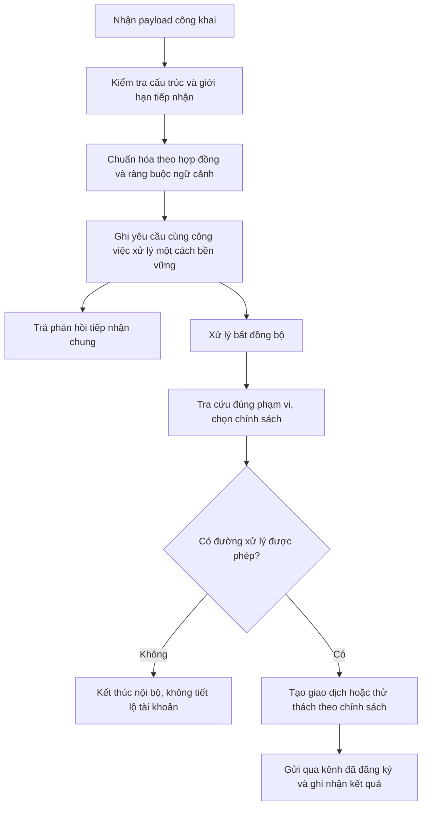

# Recovery request payload: dữ liệu yêu cầu khởi tạo khôi phục tài khoản

Payload khởi tạo khôi phục là dữ liệu mà ứng dụng gửi khi người dùng chọn “Quên mật khẩu”, “Mất MFA”, “Không còn passkey” hoặc một tình huống mất quyền truy cập khác. Đây là điểm tiếp nhận một yêu cầu, chưa phải bằng chứng người gửi sở hữu tài khoản.

Thiết kế payload cần giúp máy chủ xác định người dùng đang yêu cầu điều gì, đồng thời không tạo ra quyền thay đổi thông tin xác thực chỉ từ dữ liệu do người gọi tự khai. Một payload nhỏ nhưng có ranh giới rõ thường dễ bảo vệ hơn một biểu mẫu chứa nhiều cờ như `skipMfa`, `verified` hoặc địa chỉ tùy ý để nhận mã.

Bài học này tập trung vào hợp đồng của API khởi tạo trong luồng khôi phục mật khẩu, MFA, passkey hoặc thiết bị xác thực. Các ví dụ là một thiết kế minh họa; tên trường, giới hạn và cách chia endpoint cần được điều chỉnh theo sản phẩm.

## 1. Payload khởi tạo được phép quyết định điều gì?

Yêu cầu khởi tạo có thể cung cấp:

- Định danh người dùng muốn khôi phục.
- Mục đích khôi phục mà người dùng đang đề nghị.
- Ngôn ngữ giao diện hoặc lựa chọn điều hướng nằm trong danh sách được hỗ trợ.
- Thông tin kỹ thuật phục vụ gửi lại yêu cầu một cách an toàn, nếu API hỗ trợ.

Nó không tự quyết định:

- Người gửi là chủ tài khoản hợp pháp.
- Kênh nào được tin cậy để nhận token.
- Có thể bỏ qua MFA hoặc thay passkey hay không.
- Bằng chứng đã đủ để thay mật khẩu.
- Tài khoản phải bị khóa, session phải bị thu hồi hoặc yếu tố cũ phải bị xóa.

Có thể diễn đạt ranh giới này như sau:

```text
Payload khởi tạo
    -> đề nghị bắt đầu một quy trình

Bằng chứng được kiểm tra + chính sách phía máy chủ
    -> quyết định có cấp quyền khôi phục cụ thể hay không
```

Biết email của người khác là đủ để gửi một yêu cầu khởi tạo giả. Vì vậy, endpoint này phải được thiết kế với giả định người gọi có thể là kẻ tấn công và mọi trường do máy khách gửi đều có thể bị sửa.

## 2. Một hợp đồng API minh họa

Giả sử sản phẩm hỗ trợ khởi tạo recovery bằng địa chỉ email của tài khoản:

```http
POST /v1/account-recovery/requests
Content-Type: application/json
Idempotency-Key: c10d40e1-8cfe-4f47-866d-4c32d1706d10
```

```json
{
  "identifier": {
    "type": "EMAIL",
    "value": "lan@example.test"
  },
  "purpose": "MFA_RECOVERY",
  "locale": "vi-VN",
  "returnTo": "SIGN_IN"
}
```

Trong ví dụ này, body không chứa mật khẩu mới, mã OTP, token khôi phục hoặc email mới để nhận liên kết. Các dữ liệu đó thuộc những quyết định và giai đoạn khác.

| Trường | Bắt buộc trong ví dụ | Ý nghĩa | Ranh giới cần giữ |
| --- | --- | --- | --- |
| `identifier` | Có | Đối tượng chỉ cách tìm tài khoản được đề nghị khôi phục | Không phải bằng chứng sở hữu |
| `identifier.type` | Có | Loại định danh được endpoint chấp nhận | Chỉ nhận các giá trị đã hỗ trợ |
| `identifier.value` | Có | Giá trị người dùng nhập | Kiểm tra kiểu, độ dài và xử lý theo quy tắc định danh của hệ thống |
| `purpose` | Có | Mục đích người dùng yêu cầu | Không phải quyền đã được phê duyệt |
| `locale` | Không | Ngôn ngữ thông điệp hoặc giao diện | Không làm thay đổi chính sách bảo mật |
| `returnTo` | Không | Tên một điểm quay lại do máy chủ định nghĩa | Không phải URL tùy ý |
| Header `Idempotency-Key` | Không, nếu API cho phép bỏ qua | Giúp nhận diện việc truyền lại cùng một thao tác khởi tạo | Không xác thực người dùng, không cấp quyền xem tài khoản |

Một sản phẩm có thể tách endpoint theo mục đích và bỏ trường `purpose`. Sản phẩm khác có thể hỗ trợ tên đăng nhập hoặc một định danh khác. Điều quan trọng là hợp đồng phải cụ thể, thay vì nhận mọi chuỗi rồi tự suy đoán một cách khó kiểm soát.

### 2.1. Mục đích là yêu cầu của người dùng

Danh sách mục đích minh họa:

```text
PASSWORD_RESET
MFA_RECOVERY
PASSKEY_RECOVERY
DEVICE_LOSS_RECOVERY
```

`DEVICE_LOSS_RECOVERY` có thể cần hỏi thêm ở bước sau vì mất một thiết bị chưa cho biết những phương tiện nào còn sử dụng được. Nó không có nghĩa máy chủ được phép xóa mọi yếu tố của tài khoản.

Nếu tài khoản không có đường khôi phục phù hợp với mục đích được đề nghị, backend phải xử lý theo chính sách. Không tự chuyển sang một con đường yếu hơn chỉ để đáp ứng yêu cầu.

### 2.2. Kênh gửi phải do máy chủ lựa chọn theo cấu hình tin cậy

Nếu email đang nhập là định danh để tìm tài khoản, điều đó chưa có nghĩa mọi địa chỉ trong body đều được phép nhận token.

Máy chủ cần tra cứu tài khoản và các kênh recovery đã được gắn với tài khoản theo chính sách. Nếu địa chỉ đăng nhập đồng thời là kênh khôi phục hợp lệ, quan hệ đó đến từ dữ liệu và quy trình đăng ký phía máy chủ.

Các trường như `sendTo`, `newRecoveryEmail` hoặc `destinationPhone` không nên được thêm vào endpoint khởi tạo rồi dùng trực tiếp làm nơi nhận bí mật. Việc thiết lập một kênh mới cần quy trình chứng minh quan hệ với tài khoản; chỉ nhận được mã tại kênh mới không đủ.

## 3. Schema giúp giới hạn hình dạng, không thay thế chính sách

Schema dưới đây minh họa một hợp đồng đóng: trường không được định nghĩa sẽ bị từ chối. Giới hạn 320 ký tự là lựa chọn của ví dụ ứng dụng, không phải tuyên bố về mọi địa chỉ email hợp lệ hoặc mọi hệ thống email.

```json
{
  "type": "object",
  "additionalProperties": false,
  "required": ["identifier", "purpose"],
  "properties": {
    "identifier": {
      "type": "object",
      "additionalProperties": false,
      "required": ["type", "value"],
      "properties": {
        "type": {
          "type": "string",
          "enum": ["EMAIL"]
        },
        "value": {
          "type": "string",
          "minLength": 1,
          "maxLength": 320
        }
      }
    },
    "purpose": {
      "type": "string",
      "enum": [
        "PASSWORD_RESET",
        "MFA_RECOVERY",
        "PASSKEY_RECOVERY",
        "DEVICE_LOSS_RECOVERY"
      ]
    },
    "locale": {
      "type": "string",
      "enum": ["vi-VN", "en-US"]
    },
    "returnTo": {
      "type": "string",
      "enum": ["SIGN_IN", "RECOVERY_HELP"]
    }
  }
}
```

Schema này chưa kiểm tra đầy đủ cú pháp email, chưa chứng minh email có tồn tại và chưa xác định tài khoản có được khôi phục hay không. Đó là những lớp kiểm tra khác nhau.

### 3.1. Kiểm tra trước khi tra cứu tài khoản

Các quy tắc hình dạng nên được áp dụng độc lập với việc tài khoản có tồn tại:

- Chỉ nhận phương thức HTTP và kiểu nội dung đã công bố.
- Giới hạn kích thước body trước khi phân tích toàn bộ JSON; xét cả dữ liệu sau giải nén nếu có hỗ trợ nén.
- Từ chối JSON không hợp lệ, cấu trúc lồng quá sâu và kiểu dữ liệu không đúng.
- Có chính sách rõ với khóa JSON trùng tên để tránh các thành phần hiểu cùng một body theo hai cách.
- Kiểm tra trường bắt buộc, enum và độ dài chuỗi.
- Từ chối các trường ngoài hợp đồng khi sử dụng mô hình schema đóng.

`null`, chuỗi rỗng, mảng hoặc một object đặt ở vị trí `identifier.value` không được âm thầm ép thành một giá trị để tra cứu.

Ví dụ sau phải bị từ chối vì sai kiểu, thay vì được ghép vào một truy vấn:

```json
{
  "identifier": {
    "type": "EMAIL",
    "value": {"$ne": null}
  },
  "purpose": "PASSWORD_RESET"
}
```

Kiểm tra schema không thay thế truy vấn tham số hóa hoặc cách sử dụng API cơ sở dữ liệu an toàn. Hai lớp bảo vệ giải quyết các vấn đề liên quan nhưng khác nhau.

### 3.2. Không chuẩn hóa email bằng các quy tắc tùy tiện

Chuẩn hóa phải thống nhất với quy tắc định danh đã dùng khi tạo và cập nhật tài khoản.

Không tự xóa dấu chấm, bỏ phần sau dấu cộng hoặc chuyển mọi biến thể địa chỉ thành cùng một tài khoản chỉ vì một nhà cung cấp email có hành vi như vậy. Cũng không nên tự chuyển toàn bộ địa chỉ sang chữ thường nếu hệ thống chưa định nghĩa cách đối chiếu tương ứng.

Một giá trị không được hợp nhất sai sang tài khoản khác. Nếu sản phẩm cho phép một thao tác xử lý khoảng trắng hoặc Unicode, thao tác đó cần được quy định nhất quán tại các điểm đăng ký, đăng nhập và khôi phục.

Mục tiêu là có một biểu diễn định danh phù hợp với hệ thống, không phải đoán người dùng muốn nói đến tài khoản nào bằng các biến đổi quá rộng.

## 4. Những trường không nên nhận từ máy khách

Các cờ đặc quyền thường xuất hiện khi đội phát triển muốn dùng chung một DTO cho nhiều bước. Điều này dễ dẫn tới việc dữ liệu không tin cậy tác động trực tiếp đến trạng thái bảo mật.

| Trường nguy hiểm nếu được tin trực tiếp | Vì sao không phù hợp với payload khởi tạo |
| --- | --- |
| `verified: true` | Người gọi không thể tự chứng nhận bằng chứng của mình |
| `skipMfa: true` | Biến mô tả khó khăn thành quyền bỏ qua chính sách |
| `accountId` dùng thay cho tài khoản đã được máy chủ đối chiếu | Có thể làm các thành phần xử lý hai tài khoản khác nhau nếu không ràng buộc đúng |
| `role`, `isAdmin`, `assuranceLevel` | Thuộc quyết định quyền hạn và mức xác thực phía máy chủ |
| `token`, `otp`, `newPassword` | Thuộc bước kiểm tra hoặc chốt thay đổi, không cần cho yêu cầu khởi tạo trong hợp đồng này |
| `sendTo`, `newRecoveryEmail` | Có thể chuyển bí mật đến kênh do kẻ tấn công kiểm soát |
| `baseUrl`, `callbackUrl` tùy ý | Có thể làm liên kết hoặc điều hướng trỏ đến nơi không đáng tin cậy |
| `clientIp`, `trustedDevice: true` | Không phải bằng chứng về nguồn mạng hay độ tin cậy của thiết bị |
| `tokenTtl`, `maxAttempts` | Cho phép người gọi tự đặt thời hạn hoặc giới hạn bảo vệ |

Không phải mọi API đều cấm sử dụng định danh nội bộ. Vấn đề là không để hai trường định danh mâu thuẫn hoặc cho một mã tài khoản tự khai đóng vai trò chứng minh thẩm quyền. Với endpoint công khai trong ví dụ này, không cần nhận `accountId`.

Không đưa trực tiếp DTO khởi tạo vào một hàm cập nhật entity tài khoản. Hãy ánh xạ rõ các trường được sử dụng; trường không có trong hợp đồng không được trở thành thuộc tính có thể gán hàng loạt.

### 4.1. Không dùng trường mô tả sự cố như bằng chứng

Nếu giao diện hỏi “Bạn đã mất những gì?”, câu trả lời có thể giúp chọn hướng dẫn. Nhưng các giá trị như `lostMfa` hoặc `lostAllDevices` chỉ là lời khai của người gọi.

Chúng không chứng minh rằng yếu tố cũ đã mất, cũng không cho phép hạ yêu cầu recovery. Máy chủ vẫn phải xác định chính sách và bằng chứng cho hành động được đề nghị.

### 4.2. Không dùng địa chỉ do người gọi cung cấp để dựng liên kết bí mật

Liên kết recovery nên được dựng từ origin và đường dẫn đã cấu hình đáng tin cậy. Không lấy nguyên `Host`, header chuyển tiếp hoặc `baseUrl` tùy ý của yêu cầu để làm nơi chứa token trong thông điệp gửi cho người dùng.

Nếu có hệ thống proxy phía trước, chỉ tin thông tin chuyển tiếp từ proxy đã được cấu hình tin cậy. Một header mang tên `X-Forwarded-Host` không tự trở thành đáng tin cậy chỉ vì nó có mặt.

`returnTo` trong ví dụ là enum để máy chủ ánh xạ đến các điểm nội bộ được cho phép. Nó không được biến thành một URL tùy ý sau khi token đã được kiểm tra.

## 5. Ranh giới tenant và ngữ cảnh thực thi

Trong hệ thống nhiều tổ chức, cùng một địa chỉ email có thể liên quan đến nhiều tài khoản hoặc chính sách khác nhau.

Nếu API cần tenant, phải định nghĩa nguồn tenant rõ ràng: domain ứng dụng được ánh xạ tin cậy, ngữ cảnh tổ chức đã xác lập hoặc một định danh công khai được đối chiếu theo quy tắc cụ thể. Không để body tự khai `tenantId` rồi được xem như bằng chứng người gọi có quyền trong tenant đó.

Các điểm cần ràng buộc gồm:

- Tra cứu định danh trong đúng phạm vi tenant.
- Áp dụng chính sách recovery của đúng tenant và loại tài khoản.
- Gắn token, giao dịch và quyền về sau với cùng phạm vi đó.
- Không cho việc đổi đường dẫn, header hoặc một trường body làm chuyển giao dịch sang tổ chức khác.
- Không tiết lộ sự tồn tại của tài khoản qua phản hồi khác nhau giữa các nhánh tra cứu.

Một session đang có, nếu được phép dùng làm ngữ cảnh bổ sung, phải được kiểm tra phía máy chủ. Nó không biến mọi yêu cầu recovery gửi từ trình duyệt đó thành yêu cầu có đủ quyền. Có session và vừa xác thực lại bằng một phương tiện thích hợp là hai điều khác nhau.

## 6. Phản hồi công khai không được xác nhận tài khoản tồn tại

Một phản hồi minh họa cho yêu cầu hợp lệ về hình dạng:

```http
HTTP/1.1 202 Accepted
Cache-Control: no-store
Content-Type: application/json
```

```json
{
  "message": "Nếu thông tin phù hợp với một tài khoản có thể khôi phục, hướng dẫn sẽ được gửi qua kênh đã đăng ký.",
  "receiptId": "rcpt-opaque-example"
}
```

Trong hợp đồng này, `202` có nghĩa hệ thống đã tiếp nhận yêu cầu để xử lý, không có nghĩa đã tìm thấy tài khoản, đã gửi email hoặc đã cấp quyền recovery.

`receiptId` là mã tiếp nhận mờ dùng cho tương quan vận hành. Nó không phải token recovery và không tự cấp quyền xem tiến độ của một tài khoản. Nếu sản phẩm không cần mã tiếp nhận công khai, có thể bỏ trường này để giảm bề mặt xử lý.

Cần giữ phản hồi công khai phù hợp giữa các trường hợp:

- Định danh không khớp tài khoản nào.
- Tài khoản tồn tại nhưng không hỗ trợ mục đích được đề nghị.
- Yêu cầu đã được hợp nhất với một yêu cầu trước.
- Kênh hợp lệ đang chịu giới hạn gửi.
- Hệ thống đã tiếp nhận yêu cầu nhưng tác vụ gửi sẽ được quyết định ở bước xử lý sau.

Không trả lại email khôi phục bị che một phần, trạng thái MFA, số passkey hoặc loại tài khoản chỉ vì người gọi biết địa chỉ đăng nhập. Những thông tin đó vẫn có thể hỗ trợ dò tài khoản và lập kế hoạch tấn công.

### 6.1. Lỗi cú pháp khác lỗi liên quan đến tài khoản

| Tình huống | Phản hồi có thể dùng trong thiết kế này | Điều kiện để không tạo kênh dò |
| --- | --- | --- |
| JSON hỏng hoặc thiếu trường bắt buộc | Lỗi đầu vào, chẳng hạn `400` | Áp dụng cùng quy tắc trước khi xét tài khoản |
| Body vượt giới hạn | Từ chối theo hợp đồng, chẳng hạn `413` | Không phụ thuộc định danh có tồn tại |
| Kiểu nội dung không được hỗ trợ | Từ chối theo hợp đồng, chẳng hạn `415` | Kiểm tra ở lớp tiếp nhận |
| Nguồn gửi vượt giới hạn chung | Giới hạn yêu cầu, có thể là `429` | Tiêu chí công khai không được dựa riêng vào việc có tài khoản |
| Định danh hợp lệ nhưng không tìm thấy tài khoản | Phản hồi tiếp nhận chung | Không xác nhận kết quả tra cứu |
| Chính sách tài khoản không cho phép recovery đó | Phản hồi tiếp nhận chung | Không tiết lộ cấu hình tài khoản |
| Hệ thống tiếp nhận không thể lưu yêu cầu | Lỗi dịch vụ chung | Không chỉ bộc lộ trên nhánh tài khoản tồn tại |

Mã trạng thái cụ thể cần thống nhất với hợp đồng API. Không phải mọi lỗi đều phải được che thành thành công; điều cần tránh là biến kết quả tra cứu tài khoản hoặc cấu hình bảo mật thành một khác biệt mà người ngoài quan sát được.

### 6.2. Nội dung giống nhau chưa đủ

Thời gian phản hồi, kích thước body, header, bước xác minh bổ sung hoặc hành vi retry có thể làm lộ khác biệt giữa các nhánh.

Một hướng thiết kế là tiếp nhận yêu cầu theo đường xử lý chung và thực hiện tra cứu, chọn chính sách, gửi thông điệp ở phía bất đồng bộ. Cần đánh giá cả hành vi thực tế; chỉ thêm một khoảng chờ ngẫu nhiên không bảo đảm loại bỏ khác biệt có thể quan sát qua nhiều lần thử.

## 7. Chống lạm dụng và gửi lại yêu cầu

### 7.1. Giới hạn theo nhiều phạm vi

Endpoint công khai có thể bị dùng để gửi thư hàng loạt, quấy rối một tài khoản, dò định danh hoặc làm đầy hàng đợi.

Nên xét ngân sách theo nguồn gửi, định danh đích, tenant, phạm vi hệ thống và tài nguyên gửi. IP không đại diện chắc chắn cho một người: nhiều người có thể dùng chung một mạng, còn kẻ tấn công có thể thay đổi nguồn.

Giới hạn theo định danh có thể áp dụng với mọi định danh đã chuẩn hóa mà không cần xác nhận tài khoản tồn tại. Nếu giới hạn phụ thuộc dữ liệu tài khoản, kết quả đó không nên trở thành một phản hồi công khai khác biệt.

Một CAPTCHA hoặc bước chống bot có thể hỗ trợ quản lý lạm dụng, nhưng không chứng minh quyền sở hữu tài khoản. Hoàn thành bước đó không làm giảm yêu cầu bằng chứng ở giai đoạn recovery.

### 7.2. Idempotency không phải quyền xác thực

Người dùng có thể bấm hai lần hoặc ứng dụng có thể truyền lại vì mất phản hồi. Nếu hỗ trợ `Idempotency-Key`, máy chủ cần xác định:

- Phạm vi mà khóa có ý nghĩa, chẳng hạn ứng dụng và ngữ cảnh gửi đã được xác định.
- Thời gian lưu kết quả tiếp nhận.
- Cách ràng buộc khóa với nội dung yêu cầu đã chuẩn hóa, tenant và mục đích.
- Hành vi khi cùng khóa được gửi với nội dung khác.
- Cách tránh cho một khóa đoán được trở thành công cụ đọc yêu cầu của người khác.

Với cùng khóa và cùng thao tác trong phạm vi hợp lệ, có thể trả lại kết quả tiếp nhận trước đó thay vì tạo thêm thông báo. Nếu khóa bị dùng với nội dung khác, có thể trả lỗi hợp đồng theo quy tắc độc lập với sự tồn tại tài khoản.

Khóa do máy khách gửi là dữ liệu không tin cậy. Cần giới hạn kích thước và không đưa nguyên giá trị vào log không được bảo vệ. Hợp nhất yêu cầu vì idempotency cũng khác việc cấm người dùng bắt đầu một yêu cầu mới sau khi yêu cầu cũ hết hạn.

### 7.3. Không để khởi tạo trở thành công cụ vô hiệu hóa recovery

Một thiết kế cứ nhận yêu cầu mới là hủy token cũ có thể bị lạm dụng: kẻ tấn công gửi liên tục để liên kết của người dùng thật luôn mất hiệu lực.

Chính sách phát hành lại cần xét đồng thời giới hạn số bí mật còn hiệu lực, khả năng dùng lại, việc hợp nhất thông báo và nguy cơ gây gián đoạn. Không có quy tắc đơn giản rằng mọi lần khởi tạo đều phải tạo token mới hoặc đều phải hủy toàn bộ token trước.

Tương tự, chỉ gửi một yêu cầu chưa được xác minh không nên tự khóa tài khoản, xóa MFA, đăng xuất mọi thiết bị hoặc thay kênh khôi phục. Đó là các tác động bảo mật cần căn cứ và quyền phù hợp.

## 8. Tách payload công khai khỏi lệnh xử lý nội bộ

Một thiết kế minh họa có thể chia thành hai giai đoạn:



Việc dùng hàng đợi không tự bảo đảm an toàn. Cần bảo vệ dữ liệu trong hàng đợi, kiểm soát quyền của bên xử lý và có cơ chế phục hồi khi gửi hoặc ghi trạng thái bị lỗi.

Mã giả sau chỉ thể hiện thứ tự trách nhiệm, không phải mã triển khai hoàn chỉnh:

```text
initiateRecovery(httpRequest):
    enforceTransportAndBodyLimits(httpRequest)
    payload = parseStrictlyAndValidateShape(httpRequest.body)
    context = resolveTrustedApplicationContext(httpRequest)
    identifier = normalizeUsingAccountIdentifierRules(payload.identifier)

    enforceIntakeBudgets(context, identifier)
    intake = createOrReuseDurableIntake(
        context,
        identifier,
        payload.purpose,
        payload.locale,
        payload.returnTo,
        httpRequest.idempotencyKey
    )

    return genericAcceptedReceipt(intake.publicReceipt)
```

```text
processIntake(intake):
    account = findWithinTrustedScope(intake.scope, intake.identifier)
    if account is absent:
        finishWithoutAccountDisclosure(intake)
        return

    plan = chooseRecoveryPlanFromServerPolicy(account, intake.purpose)
    if plan is not allowed or delivery budget is exhausted:
        finishWithoutAccountDisclosure(intake)
        return

    transaction = createRecoveryTransaction(account, plan)
    dispatchThroughRegisteredChannel(transaction, plan)
    recordInternalOutcomeWithoutSecrets(transaction)
```

Thông tin tài khoản, kênh gửi, thời hạn token, số lần thử và quyền sau xác minh đến từ máy chủ. Chúng không được sao chép từ các trường đặc quyền do người gọi thêm vào body.

`createOrReuseDurableIntake` cần có hợp đồng nhất quán giữa việc lưu yêu cầu và lập lịch xử lý, chẳng hạn một cơ chế ghi công việc bền vững cùng giao dịch dữ liệu phù hợp. Nếu chưa tiếp nhận được một cách bền vững, không nên trả một kết quả khiến người gọi tin rằng yêu cầu đã được lưu.

Ngược lại, hệ thống đã nhận bền vững nhưng gửi thông điệp thất bại có thể cần retry nội bộ. Không thay đổi thông điệp công khai để tiết lộ rằng chỉ một địa chỉ cụ thể mới đi đến bước gửi.

## 9. Dữ liệu nhạy cảm, log và thời hạn lưu

Email hoặc tên đăng nhập là dữ liệu có thể nhận diện người dùng. Một body không chứa mật khẩu vẫn không nên được ghi nguyên vẹn vào mọi log ứng dụng, proxy hoặc công cụ phân tích.

Nên phân biệt các mục đích lưu:

| Nơi dùng dữ liệu | Dữ liệu cần thiết | Điểm cần bảo vệ |
| --- | --- | --- |
| Xử lý yêu cầu | Định danh và mục đích đủ để tra cứu đúng phạm vi | Quyền đọc, truyền, lưu và thời hạn tồn tại |
| Chống lạm dụng | Thông tin để tính ngân sách theo nguồn hoặc đích | Không biến dữ liệu giới hạn thành một kho định danh công khai |
| Truy vết vận hành | Mã tiếp nhận, thời điểm, loại sự kiện, kết quả nội bộ được kiểm soát | Không đưa bí mật hoặc chi tiết tài khoản vào log công khai |
| Phân tích sản phẩm | Số lượng, lỗi hình dạng, độ trễ, tỷ lệ gửi lại theo nhóm phù hợp | Giảm dữ liệu cá nhân và hạn chế khả năng liên kết không cần thiết |

Nếu cần một khóa đối chiếu định danh cho giới hạn hoặc số liệu, một phép băm thông thường không tự ẩn được email vì không gian địa chỉ có thể bị đoán. Có thể cân nhắc phép biến đổi có khóa trong mô hình phù hợp, bảo vệ khóa và quản lý thời hạn; kết quả vẫn cần được coi là dữ liệu có thể liên kết.

Không đưa email, OTP hoặc token bí mật vào URL công khai của yêu cầu khởi tạo. Các giá trị trong URL dễ xuất hiện ở nhiều lớp log và lịch sử hơn dự kiến. Token được gửi trong một liên kết recovery ở bước sau còn cần các biện pháp bảo vệ riêng cho luồng đó.

## 10. Ví dụ đối chiếu payload đúng và payload vượt quyền

### 10.1. Đề nghị đặt lại mật khẩu

```json
{
  "identifier": {
    "type": "EMAIL",
    "value": "minh@example.test"
  },
  "purpose": "PASSWORD_RESET"
}
```

Payload thể hiện một đề nghị. Máy chủ tự xác định tài khoản có phù hợp không, chọn chính sách và kênh gửi đã đăng ký. Không gỡ MFA chỉ vì mục đích là đặt lại mật khẩu.

### 10.2. Cố chuyển bí mật đến email mới

```json
{
  "identifier": {
    "type": "EMAIL",
    "value": "minh@example.test"
  },
  "purpose": "MFA_RECOVERY",
  "sendTo": "another-person@example.test",
  "skipMfa": true
}
```

Theo hợp đồng đóng của ví dụ, yêu cầu bị từ chối vì có trường ngoài schema. Quan trọng hơn, backend không được đọc lén các trường đó qua một đường xử lý khác rồi gửi token hoặc bỏ MFA.

Nếu sản phẩm có quy trình thay kênh khi mất mọi phương tiện, quy trình ấy phải được thiết kế và cấp quyền riêng. Không giải quyết tình huống khó bằng cách tin địa chỉ mới trong payload khởi tạo.

### 10.3. Cùng yêu cầu được gửi lại sau lỗi mạng

Ứng dụng gửi lại cùng body và cùng `Idempotency-Key` trong phạm vi còn hiệu lực. Máy chủ có thể trả lại kết quả tiếp nhận cũ. Người dùng không nên nhận nhiều thư chỉ vì ứng dụng truyền lại cùng một thao tác.

Nếu backend đã tiếp nhận nhưng client không nhận phản hồi, việc gửi lại không nên tạo tác động bảo mật mới ngoài hợp đồng. Nếu người dùng thực sự muốn phát hành lại hướng dẫn, đó cần được phân biệt với retry truyền tải.

### 10.4. Yêu cầu mất mọi thiết bị

Người gọi chọn `DEVICE_LOSS_RECOVERY`. Máy chủ có thể bắt đầu một đường hướng dẫn phù hợp, nhưng chưa biết người đó còn email, mã khôi phục, khóa bảo mật hoặc thiết bị khác hay không.

Không suy ra rằng mọi yếu tố đều được phép thay thế. Những bước sau phải thu thập và kiểm tra bằng chứng, rồi cấp quyền theo phạm vi được chấp thuận. Tài khoản chỉ nên thay đổi trạng thái bảo mật khi có quyết định đủ căn cứ.

## 11. Tiêu chí để đánh giá một hợp đồng payload

Một đặc tả khởi tạo đủ rõ cần trả lời được các câu hỏi sau:

| Câu hỏi | Kết quả thiết kế cần xác định |
| --- | --- |
| Endpoint nhận loại định danh nào? | Có allowlist, quy tắc đối chiếu và giới hạn rõ |
| Mục đích có phải quyền đã được cấp không? | Chỉ là đề nghị; backend quyết định chính sách |
| Ai chọn kênh và nơi gửi token? | Máy chủ dựa trên quan hệ tin cậy đã được thiết lập |
| Trường ngoài hợp đồng được xử lý ra sao? | Có quy tắc nhất quán, không gán hàng loạt vào tài khoản |
| Tenant và ngữ cảnh đến từ đâu? | Có nguồn và quy tắc ràng buộc đáng tin cậy |
| Người ngoài quan sát được điều gì? | Không xác nhận tài khoản hoặc cấu hình recovery qua body, mã lỗi hay hành vi đặc thù |
| Retry có tạo thêm tác động không? | Phân biệt truyền lại, yêu cầu mới và phát hành lại thông điệp |
| Yêu cầu giả có thể khóa tài khoản không? | Không có tác động nhạy cảm chỉ từ lời khai chưa được xác minh |
| Log, hàng đợi và số liệu lưu gì? | Dữ liệu tối thiểu, quyền truy cập phù hợp và thời hạn được xác định |
| Tiếp nhận thành công bảo đảm điều gì? | Đã nhận theo hợp đồng, chưa khẳng định gửi thành công hoặc sở hữu tài khoản |

Một payload khởi tạo tốt giúp máy chủ tiếp nhận đúng ý định mà vẫn giữ các quyết định quan trọng ở phía có thẩm quyền. Từ bước này đến lúc thay mật khẩu, MFA hoặc passkey phải còn một chuỗi kiểm tra bằng chứng, chính sách và trạng thái; không có trường do máy khách tự khai nào được phép thay thế chuỗi đó.