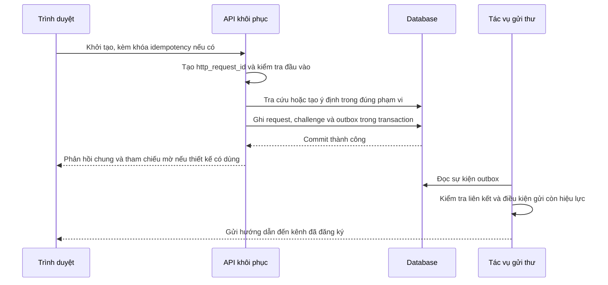

# Liên kết yêu cầu khôi phục tài khoản xuyên suốt luồng xử lý

Trong chương **Initiation Requests**, recovery request correlation là việc liên kết đúng các lần gọi API, thử thách xác minh và sự kiện thuộc cùng một yêu cầu khôi phục. Trong hệ thống **SECURITY_AUTHENTICATION_ACCOUNT_RECOVERY**, một lần người dùng bấm “Tôi không thể đăng nhập” có thể đi qua API, dịch vụ đánh giá rủi ro, hàng đợi, dịch vụ gửi thư và nhiều lần xác minh trên các thiết bị khác nhau.

Người dùng có thể mất mật khẩu, MFA, passkey hoặc thiết bị xác thực. Hệ thống cần biết bằng chứng nào thuộc yêu cầu nào, hành động nào đang được xin phép và tài khoản nào là đích. Nếu chỉ liên kết bằng email, IP hoặc thời điểm gần nhau, bằng chứng của một luồng có thể bị gán sang luồng khác. Nếu chỉ thêm một mã vào log, hệ thống có thể quan sát được hành trình nhưng vẫn xử lý sai quyền khôi phục.

Bài học này xây dựng hai lớp liên kết: lớp quan sát để điều tra và lớp nghiệp vụ để bảo vệ tính toàn vẹn của quá trình khôi phục. Hai lớp hỗ trợ nhau nhưng không thay thế cho nhau.

## 1. Một yêu cầu khôi phục không phải một HTTP request

Lan gửi yêu cầu khôi phục lúc 09:00. API đã ghi dữ liệu nhưng phản hồi bị mất vì mạng di động chập chờn. Ứng dụng gửi lại lúc 09:00:02. Dịch vụ gửi thư nhận cùng một sự kiện hai lần. Lan mở thư trên máy tính và nhập mã xác minh sau đó.

Trong hành trình đó có nhiều lần xử lý kỹ thuật, nhưng có thể chỉ có một ý định khôi phục ban đầu:

```text
Một ý định khôi phục
  ├─ HTTP lần đầu
  ├─ HTTP retry sau timeout
  ├─ Tác vụ gửi thư lần đầu
  ├─ Tác vụ gửi thư được giao lại
  ├─ HTTP mở trang xác minh
  └─ HTTP nộp bằng chứng
```

Nếu mỗi HTTP request tự tạo một phiên khôi phục độc lập, người dùng có thể nhận nhiều thư và nhiều token không cần thiết. Nếu mọi thao tác cùng email lại bị gộp thành một phiên duy nhất, một người khác có thể làm nhiễu hoặc thay đổi luồng của Lan.

Mô hình đúng cần phân biệt **lần thực thi kỹ thuật**, **ý định nghiệp vụ** và **bằng chứng bảo mật**.

## 2. Phân biệt các loại định danh

| Định danh | Đại diện cho điều gì? | Khi nào thay đổi? | Có thể dùng để cấp quyền không? |
|---|---|---|---|
| `http_request_id` | Một lần API tiếp nhận và xử lý request | Mỗi lần gọi, kể cả retry | Không |
| `trace_id` | Một đồ thị thực thi được hệ thống tracing theo dõi | Theo ranh giới trace; retry có thể tạo trace mới | Không |
| `recovery_request_id` | Một thực thể yêu cầu khôi phục phía server | Khi tạo yêu cầu nghiệp vụ mới | Không, chỉ biết ID chưa đủ |
| `challenge_id` | Một thử thách cụ thể trong yêu cầu | Khi phát hành thử thách mới | Không nếu chỉ là ID tra cứu |
| `event_id` | Một sự kiện được phát hành | Mỗi sự kiện mới; giao lại giữ cùng ID | Không |
| `idempotency_key` | Ý định thực hiện lại cùng một thao tác trong một phạm vi | Giữ nguyên khi retry thao tác đó | Không |
| Recovery token hoặc mã xác minh | Bí mật dùng để chứng minh quyền tiếp tục theo chính sách | Theo vòng đời challenge | Có giá trị như bằng chứng, trong đúng phạm vi |

Tên field là lựa chọn thiết kế minh họa của bài học. Các hệ thống có thể đặt tên khác nhưng cần giữ nguyên sự phân biệt về ý nghĩa.

`recovery_request_id` không phải recovery token. ID có thể xuất hiện trong log nội bộ; token phải được bảo vệ như thông tin bí mật. ID khó đoán giúp giảm dò tìm, nhưng vẫn cần kiểm tra quyền và trạng thái trên từng thao tác.

Tương tự, `trace_id` giúp nối các log của API với dịch vụ gửi thư. Nó không cho phép đổi mật khẩu hoặc bỏ qua MFA. Một trace còn có thể bị lấy mẫu, hết thời gian lưu hoặc bị chia ở ranh giới hàng đợi; vì vậy không dùng dữ liệu tracing làm sổ trạng thái khôi phục.

## 3. Các bất biến cần giữ

Một thiết kế correlation an toàn cần bảo đảm:

1. **Đích không đổi ngầm:** yêu cầu đã gắn với tài khoản nào thì các bước tiếp theo không tự đổi tài khoản dựa trên email mới từ client.
2. **Mục đích rõ ràng:** bằng chứng cho đặt lại mật khẩu không tự cấp quyền gỡ MFA hoặc đăng ký passkey mới.
3. **Bằng chứng có phạm vi:** challenge gắn với yêu cầu, tài khoản, tenant, mục đích và phiên bản cần thiết.
4. **Trạng thái được kiểm tra lại:** liên kết đúng không làm một token hết hạn, đã dùng hoặc bị thu hồi trở nên hợp lệ.
5. **Retry không nhân đôi tác dụng:** gửi lại cùng thao tác không được tạo thêm lần hoàn tất khôi phục hoặc tác dụng phụ ngoài ý định.
6. **Dữ liệu từ client không phải quan hệ tin cậy:** client có thể cung cấp ID để tra cứu, nhưng server quyết định quan hệ sở hữu và điều kiện tiếp tục.
7. **Khởi tạo chưa phải thay đổi bảo mật:** một yêu cầu chưa được chứng minh không tự đổi credential, hủy session đang hoạt động hoặc ghi đè kênh khôi phục.

Các bất biến này phải được thể hiện trong dữ liệu và thao tác chuyển trạng thái. Chỉ ghi chúng vào log không đủ để ngăn gán nhầm bằng chứng.

## 4. Thực thể yêu cầu và các quan hệ phía server

Một mô hình dữ liệu minh họa:

```text
RecoveryRequest
  id
  tenant_id
  account_id                  có thể rỗng trước khi định vị được đích
  purpose                     RESET_PASSWORD / RECOVER_MFA / ...
  status                      INITIATED / AWAITING_PROOF / ...
  created_at
  expires_at
  current_generation
  version                     phục vụ kiểm soát cập nhật đồng thời
  initiation_context_ref      tham chiếu ngữ cảnh; không phải bằng chứng danh tính

RecoveryChallenge
  id
  recovery_request_id
  tenant_id
  account_id
  purpose
  generation
  channel_record_id
  channel_verification_version
  token_digest
  expires_at
  consumed_at
  revoked_at

RecoveryEvent
  event_id
  recovery_request_id
  challenge_id                có thể rỗng với sự kiện không thuộc challenge
  event_type
  occurred_at
  causation_id                sự kiện hoặc lệnh trực tiếp tạo ra sự kiện này
```

`account_id` phải là định danh nội bộ ổn định. Không dùng email làm khóa liên kết duy nhất vì email có thể đổi, có nhiều dạng nhập hoặc được tái cấp cho người khác.

Trong thiết kế này, nếu cần tìm lại mục tiêu bằng một định danh khác sau khi yêu cầu đã được gắn tài khoản, hệ thống tạo yêu cầu mới hoặc một bước chuyển đích được kiểm soát riêng. Không cập nhật lặng lẽ `account_id` trên một yêu cầu đã có challenge.

Quan hệ database và logic ứng dụng cần bảo vệ ràng buộc challenge thuộc đúng request. Có thể dùng khóa ngoại ghép phù hợp để ngăn một challenge mang `tenant_id` hoặc `account_id` khác với thực thể cha. Dù có ràng buộc database, endpoint vẫn phải kiểm tra điều kiện nghiệp vụ như mục đích, hết hạn và phiên bản kênh xác minh.

`current_generation` mô tả thế hệ challenge hiện tại nếu sản phẩm dùng chính sách thay thử thách cũ khi gửi lại. Đây là lựa chọn chính sách, không phải yêu cầu phải hủy mọi token cũ trong mọi sản phẩm. Nếu dùng nó, tăng generation và thu hồi challenge cũ cần được thực hiện nhất quán để không có hai cách hiểu về challenge đang có hiệu lực.

## 5. Tạo liên kết từ thời điểm tiếp nhận

Tại ranh giới API, server tạo `http_request_id` mới cho lần xử lý hiện tại. Sau khi kiểm tra kích thước, cấu trúc đầu vào, giới hạn tần suất và ngữ cảnh thích hợp, server mới quyết định tạo hay dùng lại một `RecoveryRequest`.

Quy trình tổng quát:



Không nhận một `recovery_request_id` tùy ý từ client rồi ghi đè bản ghi đó như thể client sở hữu nó. Khi client muốn tiếp tục yêu cầu cũ, server phải tra cứu và kiểm tra các điều kiện tương ứng với thao tác đang được xin thực hiện.

Nếu client gửi header correlation để hỗ trợ điều tra, chỉ chấp nhận một định dạng và độ dài giới hạn. Có thể lưu nó như dữ liệu không tin cậy trong một field riêng; không thay thế ID nội bộ do server tạo, không nối trực tiếp nó vào tên file hoặc dòng log tự do.

Ngữ cảnh tenant lấy từ ranh giới tin cậy của ứng dụng. Một field `tenant_id` trong JSON không tự chứng minh request có quyền thao tác trên tenant đó.

## 6. Retry, idempotency và nhiều yêu cầu đồng thời

### 6.1. Retry cùng một ý định

Idempotency giúp server nhận ra request thứ hai là lần thử lại của cùng thao tác, thay vì một yêu cầu mới. Ví dụ:

```http
POST /recovery/requests
Content-Type: application/json
Idempotency-Key: <gia-tri-ngau-nhien-do-client-tao>

{
  "identifier": "lan@example.com",
  "purpose": "RESET_PASSWORD"
}
```

Header và endpoint trên là hợp đồng minh họa. Nếu hỗ trợ header này, cần công bố phạm vi, thời hạn lưu và hành vi khi request bị lặp.

Một bản ghi idempotency có thể gắn:

```text
trusted_scope + operation + idempotency_key
  -> payload_fingerprint
  -> recovery_request_id hoặc tham chiếu phản hồi công khai
  -> response_snapshot
  -> expires_at
```

Với luồng chưa đăng nhập, `trusted_scope` có thể dựa trên một ngữ cảnh khởi tạo mờ do server cấp và tenant đã xác định. Ngữ cảnh này giúp phân tách thao tác; nó không chứng minh chủ tài khoản. Cần thiết kế để người khác chọn cùng một khóa không thể đọc lại kết quả riêng tư của người dùng.

Cùng khóa, cùng phạm vi và cùng nội dung nghiệp vụ thì trả lại kết quả phù hợp của lần trước. Cùng khóa nhưng nội dung khác phải bị xử lý như xung đột theo hợp đồng, không tái sử dụng request của tài khoản hoặc mục đích cũ. Phản hồi xung đột cũng không được làm lộ việc định danh có tồn tại.

Fingerprint phải phản ánh toàn bộ nội dung ảnh hưởng ý nghĩa, gồm tenant, định danh đã xử lý theo chính sách và mục đích. Nếu chứa định danh dễ đoán, cần bảo vệ fingerprint bằng cơ chế có khóa phù hợp thay vì giả định một hash thường là dữ liệu vô danh.

Không gia hạn `expires_at`, đặt lại số lần nhập sai hoặc tự gửi thêm thư chỉ vì client retry cùng thao tác. Nếu request nghiệp vụ đã hết hạn, idempotency không được hồi sinh nó. Thao tác bắt đầu lại hoặc gửi lại thư cần hợp đồng riêng và tiếp tục chịu hạn mức.

### 6.2. Hai tab hoặc hai thiết bị

Hai yêu cầu cùng tài khoản chưa chắc là retry. Người dùng có thể mở hai tab; kẻ tấn công cũng có thể gửi một yêu cầu độc lập cùng thời điểm.

Không dùng các quy tắc sau để tự gộp:

- Cùng email thì chắc chắn cùng người.
- Cùng IP thì chắc chắn cùng thiết bị.
- Cùng user-agent thì chắc chắn cùng trình duyệt.
- Hai request cách nhau vài giây thì chắc chắn cùng một ý định.

Các tín hiệu này có thể hỗ trợ đánh giá lạm dụng, nhưng không đủ làm khóa sở hữu hoặc khóa idempotency.

Sản phẩm có thể giới hạn số yêu cầu hoặc challenge đồng thời trên một tài khoản. Tuy nhiên, không nên để bất kỳ người chưa xác thực nào gửi yêu cầu mới cũng vô hiệu hóa luồng hợp lệ của nạn nhân. Chính sách thay thế cần cân nhắc khả năng gây từ chối dịch vụ và thời điểm đã có bằng chứng đáng tin cậy.

### 6.3. Cập nhật đồng thời

Hai request có thể cùng vượt qua bước “chưa tồn tại” rồi cùng tạo bản ghi. Dùng unique constraint và transaction cho bản ghi idempotency trong đúng phạm vi; không chỉ kiểm tra ở tầng controller.

Khi chuyển trạng thái request, dùng khóa hàng hoặc cập nhật có điều kiện theo `version`. Nếu cập nhật không tác động bản ghi nào, phải đọc và xử lý trạng thái hiện tại; không giả định chuyển trạng thái đã thành công.

## 7. Truyền correlation qua hàng đợi và dịch vụ khác

Một envelope nội bộ có thể mang:

```json
{
  "event_id": "<id-su-kien>",
  "event_type": "RecoveryChallengeDispatchRequested",
  "recovery_request_id": "<id-yeu-cau>",
  "challenge_id": "<id-thu-thach>",
  "generation": 3,
  "causation_id": "<id-lenh-hoac-su-kien-truoc>",
  "schema_version": 1
}
```

Envelope không cần chứa email thô hoặc recovery token trong field correlation. Worker gửi thư lấy kênh giao đã xác minh từ dữ liệu tin cậy, kiểm tra challenge vẫn thuộc request và còn đủ điều kiện gửi.

Nếu cần chuyển bí mật để dựng thư, dùng payload được bảo vệ hoặc kho bí mật tạm thời với quyền truy cập và thời hạn phù hợp. Lưu `token_digest` trong bảng challenge không có nghĩa có thể khôi phục token từ digest để gửi lại. Cách vận chuyển token phải được thiết kế riêng, và payload bí mật không được đi vào log tracing thông thường.

Transactional outbox giúp ghi trạng thái nghiệp vụ và ý định phát sự kiện trong cùng transaction. Nó không tự bảo đảm dịch vụ email chỉ gửi đúng một lần. Hàng đợi hoặc worker có thể giao lại sau lỗi mạng; consumer cần ghi nhận `event_id`, kiểm soát cạnh tranh và phối hợp với khả năng chống lặp của nhà cung cấp nếu có.

Nếu worker đã gửi thư nhưng chết trước khi đánh dấu hoàn tất, việc gửi trùng vẫn có thể xảy ra khi nhà cung cấp không hỗ trợ cơ chế chống lặp phù hợp. Thiết kế phải giảm tác hại: không tạo thêm token khác khi giao lại cùng sự kiện, không gia hạn challenge và không cho phép hoàn tất nghiệp vụ nhiều lần.

Thư trùng và khôi phục hai lần là hai vấn đề khác nhau. Một hệ thống có thể chấp nhận khả năng nhận hai thư giống nhau trong tình huống lỗi, nhưng vẫn phải tiêu thụ bằng chứng và thực hiện hành động được phép đúng một lần theo trạng thái server.

Khi generation đã tăng hoặc kênh xác minh đã bị thay đổi, sự kiện cũ phải được nhận diện là lỗi thời. Kiểm tra trước khi gửi giúp giảm thư lỗi thời, nhưng token vẫn phải được kiểm tra lại khi dùng vì trạng thái có thể thay đổi ngay sau khi thư được gửi.

## 8. Kiểm tra liên kết khi nhận bằng chứng

Lỗi nguy hiểm thường xuất hiện ở bước ghép dữ liệu từ client:

```text
request = load(request_id_from_client)
challenge = load(challenge_id_from_client)
if verifyToken(challenge, supplied_token):
    request.status = VERIFIED
```

Đoạn xử lý này thiếu kiểm tra challenge thuộc request nào, tài khoản nào và phục vụ mục đích gì. Một token hợp lệ cho request A không được xác minh request B chỉ vì client gửi cả hai ID trong cùng HTTP request.

Một trình tự minh họa an toàn hơn:

```text
candidate = findChallengeByPresentedSecret(presented_secret)
if candidate is absent:
    rejectWithSafeResponse()

begin transaction
    request = lockRecoveryRequest(candidate.recovery_request_id)
    challenge = reloadChallenge(candidate.id)

    require request is active and not expired
    require request.id equals expected_request_reference, if supplied
    require challenge.recovery_request_id equals request.id
    require challenge.tenant_id equals request.tenant_id
    require challenge.account_id equals request.account_id
    require challenge.purpose equals request.purpose
    require challenge.generation is accepted by current policy
    require challenge is unconsumed, unrevoked and not expired
    require channel ownership and verification version are still valid
    verify presented_secret against challenge using the secret policy

    consume challenge atomically
    append evidence bound to this request and purpose
    advance only the state allowed by accumulated evidence
    append audit event
commit
```

Đây là pseudocode mô tả bất biến, không phải API hoặc mã hoàn chỉnh. Với mã ngắn, server thường cần tham chiếu challenge để chọn ngữ cảnh rồi kiểm tra digest và hạn mức thử; không thể giả định mã ngắn là một khóa tra cứu duy nhất toàn hệ thống. Với token ngẫu nhiên đủ mạnh, có thể thiết kế tra cứu bằng digest thích hợp. Cả hai cách đều phải giữ các kiểm tra liên kết và vòng đời.

Cần tránh khoảng trống giữa kiểm tra và cập nhật: việc tiêu thụ challenge, ghi bằng chứng và chuyển trạng thái phải phối hợp trong transaction hoặc một cơ chế tương đương. Nếu hai request nộp cùng token đồng thời, chỉ một lần được chấp nhận như lần sử dụng mới.

Trạng thái `AWAITING_PROOF` có thể chuyển sang trạng thái đã đủ bằng chứng cho một bước hạn chế. Không mặc định rằng một thử thách email đã đủ để hoàn tất mọi loại khôi phục. Thay MFA, thêm passkey hoặc thay kênh nhận thông báo có thể cần thêm xác minh và đánh giá rủi ro.

Việc đổi credential hoặc thu hồi session ở giai đoạn sau cũng cần lệnh và trạng thái có liên kết rõ với request đã được cho phép. Một sự kiện được giao lại không được tạo thêm session hoặc lặp lại hành động nhạy cảm ngoài chính sách.

## 9. Tham chiếu công khai, polling và chuyển thiết bị

Một phản hồi khởi tạo có thể dùng thông báo chung:

```json
{
  "message": "Nếu thông tin phù hợp, hướng dẫn sẽ được gửi qua kênh đã đăng ký.",
  "reference": "<tham-chieu-mo>"
}
```

Nếu có `reference`, không chỉ phát hành nó cho tài khoản tồn tại. Phải giữ hành vi công khai không phân biệt theo kết quả tra cứu, hoặc bỏ tham chiếu khỏi phản hồi. Tham chiếu mờ cũng không được giải mã ra email, số điện thoại hay ID tuần tự của tài khoản.

Endpoint polling theo reference không được trở thành công cụ dò tài khoản. Nếu người chưa có bằng chứng có thể hỏi “email đã được gửi chưa”, “tài khoản dùng MFA gì” hoặc “kênh khôi phục kết thúc bằng số nào”, thông báo khởi tạo chung sẽ mất tác dụng.

Giới hạn trạng thái công khai ở mức an toàn với người đang nắm ngữ cảnh hiện tại. Các thông tin chi tiết cần quyền hoặc bằng chứng riêng. ID khó đoán không thay thế điều kiện này.

Khôi phục có thể bắt đầu trên điện thoại nhưng liên kết email được mở trên máy tính. Không nhất thiết buộc cùng IP hoặc cùng cookie cho mọi bước, vì người dùng có thể đang mất chính thiết bị ban đầu. Thay vào đó, liên kết từ thư phải dẫn về đúng challenge và request bằng cơ chế bí mật được thiết kế cho việc tiếp tục trên thiết bị khác.

Nếu sản phẩm yêu cầu ràng buộc với trình duyệt khởi tạo cho một hành động cụ thể, phải mô tả và thực thi chính sách đó rõ ràng. Cookie khởi tạo có thể hỗ trợ ràng buộc ngữ cảnh hoặc chống lạm dụng; chỉ có cookie đó vẫn không chứng minh quyền khôi phục tài khoản.

Sau khi chứng minh đủ quyền tiếp tục, server có thể cấp một phiên khôi phục hạn chế, gắn với request và mục đích. Phiên này cần thời hạn, phạm vi thao tác và kiểm soát phù hợp; không tự trở thành session đăng nhập toàn quyền chỉ vì correlation thành công.

## 10. Log, audit và dữ liệu nhạy cảm

Một sự kiện audit có thể gồm:

```json
{
  "event_type": "RECOVERY_CHALLENGE_CONSUMED",
  "http_request_id": "<id-lan-goi>",
  "trace_id": "<id-trace-neu-co>",
  "recovery_request_id": "<id-yeu-cau>",
  "challenge_id": "<id-thu-thach>",
  "result": "ACCEPTED",
  "reason_code": "PROOF_BOUND_TO_REQUEST",
  "policy_version": "<phien-ban-chinh-sach>"
}
```

Dùng field có cấu trúc, mã lý do hữu hạn và quyền truy cập phù hợp. Các tham chiếu nội bộ có thể giúp liên kết dữ liệu với một người, nên vẫn cần giới hạn truy cập và thời gian lưu. Audit quan trọng phải có độ bền và cơ chế bảo vệ thích hợp; không phụ thuộc hoàn toàn vào log debug hoặc trace được lấy mẫu.

Không ghi token, OTP, mật khẩu mới, recovery code, cookie hay URL đầy đủ chứa bí mật vào log. Việc loại chúng khỏi field nghiệp vụ vẫn chưa đủ nếu reverse proxy, công cụ theo dõi lỗi hoặc tracing tự thu thập query string và request body. Cần xử lý tại các điểm thu thập đó.

Các field correlation do client gửi phải bị giới hạn để tránh chèn dòng log, tạo nhãn metric có số lượng giá trị quá lớn hoặc đẩy dữ liệu cá nhân vào hệ thống quan sát. Không dùng ID từng request làm nhãn metric tổng hợp; giữ chúng trong log hoặc trace được kiểm soát, còn metric dùng loại sự kiện và mã kết quả có tập giá trị hữu hạn.

Liên kết sự kiện theo `recovery_request_id` để dựng dòng thời gian, theo `causation_id` để biết tác nhân trực tiếp và theo `http_request_id` để tìm một lần gọi cụ thể. Nhiều request cùng tài khoản vẫn phải là các dòng thời gian riêng trừ khi có quan hệ được server xác nhận.

## 11. Tình huống thực tế: hai request, một token

Lan tạo request A để đặt lại mật khẩu. Một người khác đồng thời tạo request B với mục đích khôi phục MFA trên cùng tài khoản. Dịch vụ gửi thư phát challenge A1 cho request A.

Nếu hệ thống chỉ tìm “request mới nhất của tài khoản”, lúc Lan dùng A1 thì request B có thể đang là mới nhất. Gán kết quả xác minh sang B sẽ biến một bằng chứng đặt lại mật khẩu thành bằng chứng cho thay MFA.

Thiết kế đúng giữ các quan hệ:

```text
A1 -> request A -> tài khoản Lan -> RESET_PASSWORD
B  -> tài khoản Lan -> RECOVER_MFA
```

Khi token A1 được dùng, server đọc request A từ quan hệ đã lưu. Nếu client còn gửi ID của B, hệ thống phát hiện không khớp và không chuyển trạng thái B. Request B không được hưởng lợi từ việc Lan vừa chứng minh quyền nhận thư ở request A, trừ khi có một chính sách tái sử dụng bằng chứng rõ ràng, được đánh giá bảo mật và thực thi theo phạm vi cho phép.

Ngay cả khi cả A và B đều là `RESET_PASSWORD`, challenge vẫn không tự chuyển sang request khác. Cùng tài khoản và cùng mục đích là điều kiện cần trong nhiều thiết kế, chưa phải toàn bộ ràng buộc.

## 12. Những hành vi cần kiểm chứng khi triển khai

Các tình huống sau là đặc tả hành vi để kiểm chứng trong triển khai, không phải kết quả kiểm thử đã chạy cùng bài viết.

| Tình huống | Hành vi cần đạt |
|---|---|
| API timeout sau commit, client retry cùng khóa | Dùng lại cùng ý định theo hợp đồng; không tạo thêm challenge hoặc thư chỉ vì retry |
| Cùng khóa idempotency nhưng khác định danh hoặc mục đích | Phát hiện xung đột trong đúng phạm vi; không dùng lại request cũ |
| Hai người gửi cùng chuỗi khóa ở ngữ cảnh khác nhau | Không đọc hoặc thay đổi kết quả của nhau |
| Hai tab tạo hai ý định độc lập cùng email | Không tự gộp bằng email, IP hoặc thời gian gần nhau |
| Nộp token của request A cùng ID request B | Không ghi bằng chứng hoặc chuyển trạng thái B |
| Challenge đúng request nhưng sai purpose hoặc generation | Từ chối theo chính sách hiện hành |
| Hai lần nộp cùng token chạy đồng thời | Chỉ một lần tiêu thụ mới được chấp nhận |
| Sự kiện gửi thư bị giao lại | Nhận diện `event_id`; không tạo token mới hoặc gia hạn challenge |
| Email bị đổi hoặc challenge bị thu hồi sau khi xếp hàng | Tác vụ lỗi thời không được cấp quyền; khi dùng token phải kiểm tra lại |
| Client gửi correlation ID dài hoặc có ký tự điều khiển | Từ chối hoặc xử lý giới hạn; không chèn dữ liệu tự do vào log |
| Polling với reference của luồng chưa chứng minh | Không lộ sự tồn tại tài khoản, kênh hoặc trạng thái nhạy cảm |
| Trace không được lưu vì lấy mẫu | Trạng thái và audit khôi phục vẫn đủ để xử lý đúng |
| Request khởi tạo chưa có bằng chứng | Không tự đổi credential hoặc thu hồi session của nạn nhân |

Một hệ thống có correlation tốt phải trả lời được ba câu hỏi độc lập: **sự kiện này thuộc yêu cầu nào**, **bằng chứng này được phép dùng cho hành động nào**, và **trạng thái hiện tại còn cho phép hành động đó không**. Thiếu bất kỳ câu trả lời nào, việc có cùng một mã trong log vẫn chưa bảo đảm an toàn cho luồng khôi phục.
