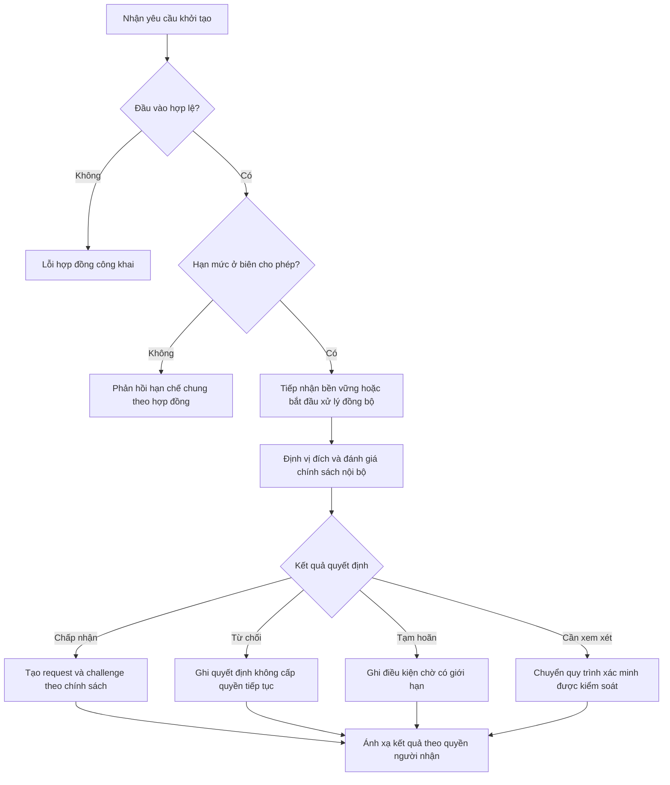

# Từ chối yêu cầu khôi phục tài khoản một cách an toàn

Trong chương **Initiation Requests**, **Recovery request rejection** là quyết định không cho một yêu cầu khởi tạo tiến vào luồng khôi phục theo điều kiện hiện tại. Quyết định đó có thể xuất phát từ đầu vào sai, hành vi lạm dụng, chính sách tài khoản, thiếu phương thức phù hợp hoặc việc hệ thống không thể xử lý an toàn.

Trong **SECURITY_AUTHENTICATION_ACCOUNT_RECOVERY**, người dùng có thể đang mất mật khẩu, MFA, passkey hoặc thiết bị xác thực. Từ chối quá dễ dãi tạo đường vòng để chiếm đoạt tài khoản; từ chối thiếu kiểm soát lại có thể làm chủ tài khoản bị khóa khỏi dịch vụ. Bài học này tập trung vào ranh giới khởi tạo: khi nào dừng yêu cầu, khi nào chờ thêm điều kiện, phải phản hồi thế nào và những tác dụng phụ nào tuyệt đối chưa được phép xảy ra.

Một quyết định đúng phải giữ đồng thời ba thuộc tính: **không cấp quyền vượt bằng chứng hiện có**, **không tiết lộ thông tin tài khoản cho người chưa có quyền**, và **không biến yêu cầu vô danh thành công cụ phá luồng khôi phục của nạn nhân**.

## 1. Từ chối khởi tạo có ý nghĩa gì?

Lan không thể đăng nhập vì mất điện thoại chứa ứng dụng MFA. Cô gửi yêu cầu khôi phục từ máy tính ở một mạng mới. Hệ thống thấy thiết bị chưa quen thuộc nhưng chưa có bằng chứng rằng đây là kẻ tấn công. Nếu chỉ dựa vào IP mới để từ chối vĩnh viễn, hệ thống sẽ cản đúng tình huống mà khôi phục tài khoản cần giải quyết.

Trong một tình huống khác, một chương trình tự động gửi hàng nghìn yêu cầu để dịch vụ liên tục gửi thư cho Lan. Nếu hệ thống cứ coi mọi lần gọi là một ý định hợp lệ và phát hành token mới, kẻ tấn công có thể gây spam, tạo tải và làm nhiễu các yêu cầu thật.

Vì vậy, từ chối không đơn thuần là trả một mã HTTP. Nó là một quyết định nghiệp vụ có phạm vi, lý do, hiệu lực thời gian và hậu quả được xác định rõ.

Cần phân biệt:

| Kết quả nội bộ | Ý nghĩa | Có tự cho phép đổi credential không? |
|---|---|---|
| `ACCEPTED` | Chấp nhận xử lý yêu cầu khởi tạo theo chính sách | Không; vẫn cần bằng chứng ở các bước tiếp theo |
| `REJECTED` | Yêu cầu này không được tiếp tục theo quyết định hiện tại | Không |
| `DEFERRED` | Tạm hoãn vì hạn mức hoặc điều kiện tạm thời | Không |
| `REVIEW_REQUIRED` | Cần quy trình xem xét hoặc xác minh bổ sung đã được thiết kế | Không |
| `UNAVAILABLE` | Hệ thống chưa thể đưa ra hoặc thực hiện quyết định an toàn | Không |

Các tên trạng thái trong bài là mô hình minh họa, không phải bộ trạng thái bắt buộc cho mọi sản phẩm. Một hệ thống có thể dùng tên khác, nhưng phải phân biệt việc từ chối nghiệp vụ với lỗi hạ tầng và việc cần thêm bằng chứng.

`ACCEPTED` cũng không có nghĩa là người gửi đã chứng minh được quyền sở hữu tài khoản. Khởi tạo thành công không tự tạo session đăng nhập, gỡ MFA hay đăng ký passkey mới.

## 2. Tách quyết định nội bộ khỏi phản hồi công khai

Người chưa đăng nhập có thể nhập email của bất kỳ ai. Nếu API trả “không có tài khoản”, “tài khoản đang bị khóa” hoặc “bạn chưa cấu hình MFA”, endpoint khôi phục trở thành công cụ dò tài khoản và trạng thái bảo mật.

Mô hình nên có hai lớp:

```text
Quyết định nội bộ
  outcome + reason_code + policy_version + thời điểm + phạm vi
                         |
                         v
Bộ ánh xạ theo quyền của người nhận
                         |
                         v
Phản hồi công khai an toàn hoặc hướng dẫn đã được phép
```

Ví dụ, các lý do nội bộ sau có thể cùng đi đến một thông báo công khai:

```text
ACCOUNT_NOT_FOUND
SELF_SERVICE_NOT_ALLOWED
NO_ELIGIBLE_RECOVERY_CHANNEL
ACCOUNT_POLICY_REQUIRES_REVIEW
IDENTIFIER_RECOVERY_THROTTLED
```

Thông báo có thể là:

> Nếu thông tin phù hợp và yêu cầu đủ điều kiện, hướng dẫn sẽ được gửi qua kênh đã đăng ký. Bạn có thể xem các cách khôi phục khác tại trang trợ giúp.

Thông báo này không hứa chắc đã gửi thư. Trang trợ giúp công khai cần áp dụng được cho mọi người, không suy ra tài khoản đang dùng yếu tố xác thực nào từ kết quả tra cứu.

Khi người dùng đã cung cấp bằng chứng và được cấp một phiên khôi phục có phạm vi hạn chế, giao diện có thể đưa thêm hướng dẫn trong phạm vi được phép. Việc được xem một thông báo chi tiết cần dựa trên quyền cụ thể, không chỉ dựa trên việc người đó biết email hoặc một ID yêu cầu.

Không coi “tất cả đều trả cùng một câu” là đủ. Mã HTTP, cấu trúc JSON, độ dài phản hồi, header, redirect, trạng thái polling và thời gian xử lý đều có thể làm lộ khác biệt.

## 3. Nhóm nguyên nhân và cách xử lý

### 3.1. Đầu vào không đáp ứng hợp đồng

Các trường hợp như body vượt kích thước, JSON sai cú pháp, thiếu trường bắt buộc hoặc mục đích khôi phục không được API hỗ trợ có thể bị từ chối trước khi tra cứu tài khoản.

Lỗi công khai phải nói về hợp đồng đầu vào, chẳng hạn “Yêu cầu thiếu trường bắt buộc”, thay vì “Email này không thuộc khách hàng của hệ thống”. Không đưa nguyên văn dữ liệu nhập vào thông báo lỗi hoặc log tự do.

Chuẩn hóa định danh cần theo chính sách đã xác định. Không tùy tiện biến đổi tên người dùng hoặc phần địa chỉ email theo một giả định chung rồi gộp hai tài khoản thành một. Sau khi tìm được tài khoản, dùng định danh nội bộ ổn định cho các quyết định phía server.

### 3.2. Yêu cầu bị đánh giá là lạm dụng

Tín hiệu có thể gồm tần suất gửi cao, số lượng định danh khác nhau, nguồn gửi tự động, tốc độ đổi mục đích hoặc mức tiêu thụ ngân sách gửi thông báo. Quyết định có thể là chặn ở biên, tạm hoãn, yêu cầu một bước chống tự động hóa hoặc chuyển sang xem xét theo chính sách.

CAPTCHA và cookie của trình duyệt chỉ hỗ trợ chống lạm dụng hoặc giữ ngữ cảnh. Chúng không chứng minh người gửi có quyền đặt lại mật khẩu hay gỡ MFA. Vượt qua CAPTCHA không được biến thành điều kiện duy nhất để khôi phục.

Không dựa hoàn toàn vào một IP vì nhiều người có thể dùng chung NAT; kẻ tấn công cũng có thể đổi IP. Dùng nhiều lớp hạn mức và tín hiệu, đồng thời kiểm soát chi phí của chính bộ đánh giá rủi ro.

### 3.3. Không có đường khôi phục phù hợp với mục đích

Một tài khoản có thể có email nhận thông báo nhưng chính sách không cho dùng email đó làm bằng chứng duy nhất để thay MFA. Người mất passkey cũng không mặc nhiên được chuyển sang một phương thức yếu hơn chỉ vì không còn thiết bị.

Khi không có đường tự phục vụ phù hợp, dừng yêu cầu hiện tại hoặc chuyển sang quy trình xác minh bổ sung đã được thiết kế. Quy trình hỗ trợ thủ công cần có tiêu chí, quyền hạn và audit; không phải ngoại lệ cho nhân viên bỏ qua mọi kiểm tra.

Thông tin “không có kênh phù hợp” là kết quả nội bộ nhạy cảm. Chưa có bằng chứng thì không trả danh sách yếu tố đang được tài khoản sử dụng, số điện thoại bị che một phần hay lý do chi tiết về chính sách riêng của tài khoản.

### 3.4. Chính sách hoặc tình trạng tài khoản không cho phép

Tài khoản thuộc tổ chức có thể phải đi qua nhà cung cấp danh tính của tổ chức. Một trường hợp đang bị điều tra chiếm đoạt có thể cần một đường xử lý chuyên biệt. Yêu cầu tự phục vụ không được tự ghi đè những chính sách đó.

Tuy nhiên, phải xác định rõ khóa nào thực sự cấm khôi phục. Một tài khoản bị giới hạn đăng nhập do nhập sai mật khẩu không nhất thiết phải bị cấm bắt đầu khôi phục; nếu gộp hai trạng thái đó, kẻ tấn công có thể gây khóa rồi chặn luôn lối vào hợp lệ của nạn nhân.

### 3.5. Hệ thống không thể xử lý an toàn

Nếu không thể đọc trạng thái challenge, kiểm tra hạn mức bắt buộc hoặc ghi quyết định bền vững, hệ thống không được mặc định cấp quyền tiếp tục. Có thể trả lỗi tạm thời, giữ yêu cầu để xử lý sau nếu đã có cơ chế tiếp nhận bền vững, hoặc dừng trước tác dụng phụ.

Đừng ghi `REJECTED` với nghĩa “người dùng không đủ điều kiện” chỉ vì database timeout. Lỗi hạ tầng cần được phân loại để retry và vận hành xử lý đúng, đồng thời không trở thành một cách phân biệt tài khoản tồn tại hay không.

## 4. Phạm vi từ chối phải được xác định rõ

Một quyết định từ chối có thể tác động đến một lần gọi HTTP, một yêu cầu nghiệp vụ, một lần phát hành challenge hoặc một khoảng thời gian hạn chế. Không nên ngầm mở rộng từ phạm vi nhỏ sang toàn bộ tài khoản.

Ví dụ: một nguồn gửi đã vượt hạn mức khởi tạo. Hành vi hợp lý là dừng hoặc hoãn lần khởi tạo mới theo chính sách. Hành vi nguy hiểm là khóa tài khoản nạn nhân, thu hồi tất cả session hoặc hủy mọi token khôi phục đang hợp lệ chỉ vì nguồn gửi vô danh tiếp tục gọi API.

Các bất biến tại ranh giới khởi tạo:

1. Không đổi mật khẩu, gỡ MFA, thêm passkey hoặc đổi kênh khôi phục khi chưa có bằng chứng đủ mạnh cho hành động tương ứng.
2. Không thu hồi session đang hoạt động chỉ do một yêu cầu khởi tạo chưa được chứng minh.
3. Không để từ chối request B làm mất hiệu lực request A một cách ngầm định.
4. Không ghi đè đích, tenant hoặc mục đích của một yêu cầu đã có chỉ dựa trên dữ liệu client gửi lại.
5. Không tự gia hạn token hoặc đặt lại số lần thử khi xử lý retry hay từ chối.
6. Không phát hành một đường khôi phục yếu hơn chỉ để vượt qua quyết định từ chối trước đó.

Việc thu hồi một challenge đang hoạt động vẫn có thể cần thiết khi phát hiện rủi ro cụ thể. Khi đó phải là một chuyển trạng thái được chính sách cho phép, có phạm vi và căn cứ riêng, thay vì tác dụng phụ mặc định của mọi lần gọi bị từ chối.

## 5. Thiết kế mã HTTP và nội dung phản hồi

Không có một mã HTTP duy nhất phù hợp cho mọi nguyên nhân. Hợp đồng cần phân biệt lỗi đầu vào công khai, lỗi hệ thống và kết quả nghiệp vụ có liên quan đến tài khoản.

| Tình huống | Cách biểu diễn có thể chọn | Điều kiện cần giữ |
|---|---|---|
| JSON không hợp lệ hoặc thiếu trường bắt buộc | `400` và lỗi đầu vào chung | Quyết định không dựa vào việc tài khoản tồn tại |
| Body quá lớn | `413` tại ranh giới API | Không tra cứu tài khoản trước khi chặn |
| Kiểu nội dung không hỗ trợ | `415` | Hợp đồng thống nhất cho mọi định danh |
| Nguồn gửi vượt hạn mức công khai | `429`, có thể kèm `Retry-After` | Áp dụng hạn mức đó nhất quán, không lộ bộ đếm riêng của tài khoản |
| Đã tiếp nhận hợp lệ để xử lý bất đồng bộ | `202` với thông báo chung | Có cơ chế tiếp nhận phù hợp; không khẳng định đã gửi thư |
| Kết thúc xử lý endpoint theo hợp đồng phản hồi chung | `200` với thông báo chung | Không đồng nghĩa việc khôi phục được chấp thuận |
| Hạ tầng không thể tiếp nhận hoặc xử lý tạm thời | `503` hoặc lỗi tạm thời theo hợp đồng | Không chỉ áp dụng nhánh lỗi cho tài khoản có thật |

Đây là các lựa chọn thiết kế minh họa. Chọn một hợp đồng nhất quán và kiểm tra toàn bộ các nhánh; không dùng bảng như một quy tắc ánh xạ cứng cho mọi sản phẩm.

Ví dụ phản hồi cho một yêu cầu khởi tạo đúng định dạng đã được tiếp nhận:

```http
HTTP/1.1 202 Accepted
Content-Type: application/json
Cache-Control: no-store

{
  "message": "Nếu thông tin phù hợp và yêu cầu đủ điều kiện, hướng dẫn sẽ được gửi qua kênh đã đăng ký."
}
```

Không trả `202` để che việc hệ thống hoàn toàn chưa tiếp nhận được công việc rồi ngầm làm mất yêu cầu. Nếu hợp đồng chỉ xác nhận endpoint đã xử lý mà không hứa xử lý tiếp, cần mô tả rõ ý nghĩa phản hồi tương ứng.

Một lỗi thường gặp là trả `429` chỉ khi bộ đếm của một tài khoản thật vượt ngưỡng, trong khi định danh không tồn tại luôn nhận `202`. Kẻ tấn công có thể gửi lặp để quan sát sự khác biệt. Với hạn mức dựa vào định danh, cần bảo vệ cả phản hồi và cách duy trì hạn mức cho đầu vào không khớp tài khoản. Có thể trì hoãn gửi nội bộ và vẫn giữ phản hồi chung, tùy kiến trúc và chính sách.

Thông báo retry công khai không nên tiết lộ chính xác thời điểm mở khóa hoặc trạng thái điều tra của một tài khoản. Hạn mức ở mức nguồn gửi và hạn mức theo tài khoản có mục đích khác nhau, cần được thiết kế riêng.

## 6. Quy trình quyết định ở ranh giới khởi tạo

Một luồng xử lý tổng quát:



Trong kiến trúc bất đồng bộ, API có thể trả thông báo chung sau khi đã tiếp nhận bền vững, còn worker đưa ra quyết định nội bộ sau đó. Trong kiến trúc đồng bộ, cần đặc biệt kiểm tra sự khác nhau về độ trễ giữa các nhánh tra cứu và gửi thông báo.

Thêm một khoảng chờ cố định hoặc ngẫu nhiên không tự giải quyết mọi rò rỉ thời gian: các nhánh lỗi, cache, retry và tải hệ thống vẫn có thể khác nhau. Nên giảm sự phụ thuộc của đường phản hồi công khai vào kết quả nhạy cảm, rồi đo hành vi thực tế trên nhiều trường hợp.

Nếu trả một mã tham chiếu, phải thiết kế cả trường hợp không tìm thấy tài khoản và trường hợp bị từ chối. Endpoint tra cứu theo tham chiếu không được tiết lộ “tài khoản này chưa đăng ký email khôi phục” hoặc “đã gửi tới số điện thoại ...” khi người hỏi chưa được phép biết.

## 7. Lưu quyết định và ngăn tác dụng phụ sau khi từ chối

Bản ghi quyết định nội bộ có thể gồm:

```text
RecoveryInitiationDecision
  decision_id
  recovery_request_id         có thể chưa có nếu dừng trước khi tạo request
  trusted_tenant_context
  requested_purpose
  outcome
  reason_code
  policy_version
  decided_at
  retry_condition             nếu kết quả cho phép thử lại
  evaluated_state_version     nếu cần kiểm soát cạnh tranh
```

Không nhất thiết tạo một thực thể tài khoản giả cho mọi định danh không tồn tại. Tuy vậy, cơ chế phản hồi và chống lạm dụng phải xử lý được cả trường hợp không có `account_id`, mà không gây rò rỉ hoặc cho phép đầu vào tùy ý làm phình dữ liệu vô hạn.

Khi đã có request, việc ghi quyết định và chuyển trạng thái cần được thực hiện có điều kiện. Nếu một luồng khác đã hoàn tất hoặc thay đổi trạng thái, không ghi đè bằng quyết định lấy từ dữ liệu cũ.

Có thể dùng transaction và phiên bản bản ghi theo mô hình minh họa:

```text
begin transaction
    request = loadAndLockRequest(request_id)
    require request is still eligible for initiation decision

    decision = evaluatePolicy(request, trusted_context)

    if decision is REJECTED:
        transition request to the permitted rejected state
        append structured audit decision
        do not create an active recovery grant
        do not enqueue challenge dispatch

    if decision is ACCEPTED:
        create challenge bound to request, account and purpose
        append dispatch intent to transactional outbox
        append structured audit decision
commit
```

Đây là pseudocode biểu diễn bất biến, không phải mã triển khai đầy đủ. Nếu hệ thống không dùng khóa hàng, có thể dùng cập nhật có điều kiện theo phiên bản hoặc một cơ chế tương đương.

Với hàng đợi, không chỉ dựa vào việc đã xóa một message để ngăn gửi thư. Consumer phải đọc lại trạng thái cần thiết trước khi xử lý tác dụng phụ. Một sự kiện cũ không được tái kích hoạt request đã bị từ chối, hết hạn hoặc bị thu hồi.

Kiểm tra trước khi gửi không loại bỏ mọi cuộc đua: trạng thái có thể thay đổi ngay sau khi thư đã gửi. Vì vậy, bước dùng token cũng phải kiểm tra request và challenge còn hiệu lực. Nhận được thư cũ không được trở thành quyền vượt quyết định mới.

Không gửi email từ bên trong một transaction database rồi giả định rollback sẽ thu hồi được thư đã gửi. Ý định gửi và dữ liệu nghiệp vụ cần phối hợp bền vững, chẳng hạn qua outbox; việc gửi thực tế vẫn cần chống lặp và kiểm tra trạng thái.

## 8. Retry, idempotency và quyết định lỗi thời

Người dùng có thể bấm gửi lại vì mất mạng. Retry của cùng một thao tác không nên tạo thêm token, thêm email hoặc nhiều quyết định mâu thuẫn.

Nếu hỗ trợ idempotency, khóa cần gắn với phạm vi đáng tin cậy, thao tác và dấu vân tay nội dung nghiệp vụ. Khóa do client cung cấp không phải bằng chứng sở hữu tài khoản. Cùng khóa với nội dung khác không được âm thầm dùng lại quyết định của mục đích hoặc tài khoản cũ.

Một kết quả từ chối đã ghi có thể được trả lại cho retry của chính thao tác đó theo thời hạn hợp đồng. Điều này không có nghĩa tài khoản bị cấm khôi phục vĩnh viễn. Khi điều kiện thay đổi, việc tạo ý định mới hoặc đánh giá lại phải có một đường xử lý rõ ràng và tiếp tục chịu hạn mức.

Không làm các việc sau khi nhận retry:

- Kéo dài thời hạn của một token đã có.
- Xóa số lần nhập sai để người gửi có thêm lượt đoán.
- Hồi sinh request đã bị từ chối hoặc đã hết hạn.
- Hủy request khác chỉ vì nó cùng email với request đang retry.
- Tự bỏ qua kiểm tra rủi ro vì lần gọi trước bị timeout.

Nếu phản hồi bị mất sau commit, client có thể retry và nhận lại kết quả an toàn từ quyết định đã lưu. Nếu transaction chưa commit, hệ thống phải xử lý như thao tác chưa hoàn tất theo cơ chế chống lặp, không suy luận từ việc email đã hoặc chưa xuất hiện trong hộp thư.

Các quyết định hoãn cần có điều kiện hết hạn hoặc đánh giá lại được kiểm soát. Một vòng lặp retry không giới hạn ở worker có thể gây tải kéo dài; dùng ngân sách retry và phân loại rõ lỗi tạm thời với từ chối nghiệp vụ.

## 9. Giữ một đường tiếp cận hợp lệ cho chủ tài khoản

Từ chối cần giúp người dùng hiểu bước tiếp theo ở mức được phép tiết lộ. Với người chưa có bằng chứng, có thể đưa hướng dẫn chung: kiểm tra thông tin nhập, chờ theo hạn mức công khai, dùng một phương thức khôi phục đã lưu hoặc truy cập kênh hỗ trợ chính thức.

Không hướng dẫn người dùng thử hàng loạt địa chỉ, số điện thoại hoặc tài khoản để suy ra đâu là định danh đúng. Không gợi ý gửi giấy tờ tùy ý qua email cho một nhân viên để vượt kiểm tra. Nếu có xác minh danh tính thủ công, cần chỉ rõ kênh tiếp nhận được bảo vệ, dữ liệu thật sự cần thiết và tiêu chí quyết định của quy trình đó.

Việc mở hồ sơ hỗ trợ không tự cho phép thay credential. Nhân viên hỗ trợ phải nhìn thấy đúng trạng thái và phạm vi quyền; lời khẳng định “tôi là chủ tài khoản”, một ảnh chụp màn hình hoặc kiến thức về thông tin công khai không tự trở thành bằng chứng đủ mạnh.

Chỉ gửi thông báo về sự kiện khôi phục đến kênh đã đăng ký phù hợp khi chính sách cho phép. Không dùng địa chỉ mới trong request làm nơi nhận thông báo bảo mật của tài khoản. Bản thân thông báo cũng cần hạn mức để tránh biến từ chối thành một cơ chế spam khác.

Một quyết định từ chối khởi tạo không tự buộc phải đăng xuất người dùng đang có session hợp lệ. Nếu hệ thống có lý do độc lập để bảo vệ session khi phát hiện chiếm đoạt, hành động đó thuộc chính sách xử lý rủi ro tương ứng và cần được ghi nhận riêng.

## 10. Audit và quan sát mà không làm lộ bí mật

Log cần trả lời được: quyết định nào đã được đưa ra, theo chính sách nào, với yêu cầu nào và có tác dụng phụ nào đã được phép hoặc bị ngăn lại.

Ví dụ một sự kiện có cấu trúc:

```json
{
  "event_type": "RECOVERY_INITIATION_DECIDED",
  "decision_id": "<tham-chieu-noi-bo>",
  "request_reference": "<tham-chieu-neu-co>",
  "outcome": "REJECTED",
  "reason_code": "SELF_SERVICE_NOT_ALLOWED",
  "policy_version": "<phien-ban-chinh-sach>",
  "actor_class": "UNAUTHENTICATED",
  "side_effect": "NO_RECOVERY_GRANT_CREATED"
}
```

Thông tin nội bộ này không phải body trả về cho người gửi vô danh. Audit cần phân quyền, thời hạn lưu và cơ chế bảo vệ tính toàn vẹn thích hợp.

Không ghi token, OTP, recovery code, mật khẩu, cookie hoặc URL có bí mật. Hạn chế ghi định danh thô. Nếu cần liên kết các lần gọi theo email hoặc số điện thoại dễ đoán, một hash không có khóa không tự làm dữ liệu trở nên vô danh; cần một cách bảo vệ phù hợp, chẳng hạn dấu vân tay có khóa và quản lý quyền truy cập.

Chỉ dùng `reason_code` có tập giá trị hữu hạn cho metric tổng hợp. Không gắn email, ID mỗi request hoặc chuỗi client nhập làm nhãn metric. Việc này vừa tránh đưa dữ liệu cá nhân vào hệ thống quan sát vừa tránh số lượng nhãn tăng không giới hạn.

Các chỉ số hữu ích gồm tỷ lệ chấp nhận, từ chối, tạm hoãn, lỗi hạ tầng, lượng thông báo thực sự phát ra và tỷ lệ người dùng hợp lệ phải đi qua hỗ trợ. Tỷ lệ từ chối cao không tự chứng minh hệ thống an toàn hơn; có thể phản ánh chính sách gây cản trở người dùng thật.

## 11. Tình huống: kẻ tấn công cố hủy yêu cầu của nạn nhân

Lan đã tạo request A và đang chờ hoàn thành bước xác minh. Một kẻ tấn công biết email của Lan, tạo liên tục request B, C và D từ nhiều nguồn. Sau khi vượt hạn mức, những request mới bị từ chối.

Thiết kế sai có quy tắc: “Khi một yêu cầu bị nghi ngờ, thu hồi toàn bộ token khôi phục và khóa tài khoản”. Kẻ tấn công không cần biết token A vẫn có thể phá quá trình khôi phục của Lan. Nếu mỗi lần bị chặn lại gửi thêm thư cảnh báo, Lan còn bị ngập hộp thư.

Thiết kế phù hợp hơn giữ ranh giới:

```text
Request A: trạng thái và challenge được quản lý theo chính sách của A
Request B/C/D: bị từ chối hoặc tạm hoãn trong phạm vi tương ứng
Ngân sách gửi: được bảo vệ theo nhiều lớp hạn mức
Session hiện có: chỉ thay đổi khi có căn cứ và chính sách riêng
```

Nếu tín hiệu mới đủ mạnh để cần thu hồi A, hệ thống thực hiện một quyết định thu hồi riêng có căn cứ và audit. Không lấy sự tồn tại của các request vô danh bị từ chối làm bằng chứng mặc định rằng A không hợp lệ.

Tình huống này cho thấy chống lạm dụng phải xét cả khả năng gửi quá nhiều yêu cầu và khả năng lạm dụng chính cơ chế từ chối để gây từ chối dịch vụ cho chủ tài khoản.

## 12. Các hành vi cần kiểm chứng khi triển khai

Bảng sau mô tả hành vi mong đợi; đây không phải kết quả kiểm thử đã chạy trong bài học.

| Tình huống | Hành vi cần đạt |
|---|---|
| Email đúng định dạng nhưng không có tài khoản | Phản hồi công khai không tiết lộ kết quả tra cứu |
| Tài khoản có thật nhưng không được tự phục vụ | Giữ thông tin chính sách nội bộ; đưa hướng dẫn theo quyền người nhận |
| Hai nhánh có tài khoản và không có tài khoản | So sánh mã, body, header, redirect, thời gian và polling để tìm rò rỉ |
| JSON sai hoặc body vượt giới hạn | Dừng ở biên theo hợp đồng, không cần truy vấn tài khoản |
| Nguồn gửi vượt hạn mức | Chặn hoặc hoãn trong phạm vi phù hợp; không khóa tài khoản nạn nhân |
| Hạn mức theo định danh bị vượt | Không dùng phản hồi khác biệt để lộ định danh có tồn tại |
| Một request hợp lệ đang chờ, request khác bị từ chối | Không tự hủy request hợp lệ hoặc challenge của nó |
| Client retry sau khi quyết định đã commit | Giữ ngữ nghĩa idempotency; không tạo thêm tác dụng phụ |
| Cùng khóa idempotency nhưng khác mục đích | Không dùng quyết định cũ để xử lý mục đích mới |
| Worker nhận sự kiện cũ của request đã bị thu hồi | Không phát hành quyền mới; khi dùng token vẫn kiểm tra trạng thái |
| Không thể ghi quyết định hoặc kiểm tra chính sách bắt buộc | Không cấp quyền theo mặc định; phân loại lỗi tạm thời đúng |
| Thiết bị hoặc IP khác với lịch sử | Đánh giá theo nhiều tín hiệu và đường khôi phục phù hợp, không suy ra chủ thể chỉ từ IP |
| Người dùng mất MFA nhưng còn email | Chỉ chấp nhận bằng chứng theo chính sách của hành động thay MFA |
| Người gửi hoàn thành CAPTCHA | Chỉ thay đổi đánh giá chống tự động hóa; chưa có quyền đổi credential |
| Yêu cầu bị từ chối rồi người dùng liên hệ hỗ trợ | Quy trình hỗ trợ giữ yêu cầu bằng chứng và audit riêng |
| Request vô danh bị từ chối | Mật khẩu, MFA, passkey, kênh khôi phục và session hiện có không tự bị đổi |

Khi thiết kế từ chối yêu cầu khôi phục, hãy xác định rõ **điều gì bị dừng**, **quyết định có hiệu lực trong phạm vi nào**, **người nhận được phép biết gì** và **điều kiện nào cho phép thử lại**. Các câu trả lời đó phải thể hiện trong trạng thái, phản hồi và tác dụng phụ của hệ thống, để cơ chế bảo vệ tài khoản không trở thành một đường chiếm đoạt hoặc gây gián đoạn khác.
