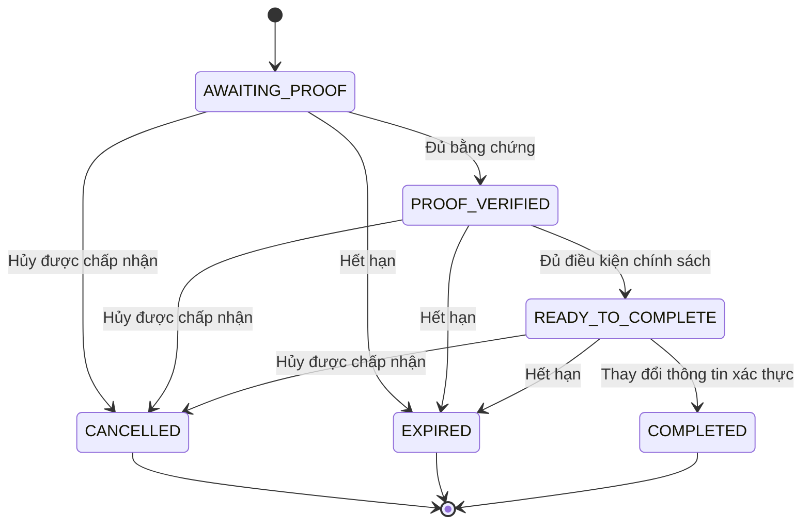

# Recovery request cancellation — Hủy yêu cầu khôi phục tài khoản

## 1. Hủy yêu cầu là một thao tác bảo mật

Người dùng có thể khởi tạo khôi phục rồi nhớ lại mật khẩu, tìm thấy thiết bị chứa passkey hoặc phát hiện mình đã chọn sai tài khoản. Họ cũng có thể nhận được thông báo về một yêu cầu mà mình không tạo. Trong những tình huống này, hệ thống cần một cách chấm dứt yêu cầu rõ ràng và có hiệu lực phía máy chủ.

**Recovery request cancellation** là việc chuyển một giao dịch khôi phục còn hiệu lực sang trạng thái đã hủy, khiến giao dịch và các quyền phát sinh từ nó không thể tiếp tục cấp quyền khôi phục. Đóng trình duyệt, xóa cookie hay bỏ qua email không thực hiện thay đổi này.

Trong module khôi phục tài khoản an toàn, yêu cầu có thể phục vụ đặt lại mật khẩu, xử lý mất MFA, đăng ký lại passkey hoặc thay thiết bị xác thực. Hủy phải chặn đúng giao dịch được chọn, đồng thời tránh biến một nút hủy thành công cụ khóa tài khoản hoặc thu hồi phiên của người khác.

Sau bài học, người học có thể xác định ai được hủy, hủy những gì, biểu diễn vòng đời giao dịch và xử lý cuộc đua giữa hủy với hoàn tất khôi phục.

## 2. Xác định đúng phạm vi của thao tác hủy

Cần phân biệt các hành động có thể xuất hiện trên cùng giao diện:

| Hành động | Tác động chính | Có làm yêu cầu hiện tại mất hiệu lực? |
| --- | --- | --- |
| Đóng trang hoặc chọn quay lại | Kết thúc tương tác trên thiết bị | Không, trừ khi có lệnh hủy được máy chủ chấp nhận |
| Hủy yêu cầu | Chấm dứt một giao dịch khôi phục còn hoạt động | Có |
| Để hết hạn | Chấm dứt hiệu lực theo thời gian của giao dịch | Có, theo quy tắc hết hạn |
| Gửi lại mã | Tạo hoặc thay thế challenge theo chính sách | Không đồng nghĩa hủy toàn bộ giao dịch |
| Báo cáo yêu cầu không phải của tôi | Tạo tín hiệu nghi ngờ hoặc hồ sơ sự cố | Tùy chính sách; có thể kèm hủy giao dịch cụ thể |
| Thu hồi phiên hoặc khóa bảo vệ tài khoản | Thay đổi trạng thái bảo mật của tài khoản | Là nghiệp vụ riêng, cần quyền và chính sách riêng |

Ví dụ, Lan tìm lại điện thoại có ứng dụng MFA và hủy yêu cầu đăng ký lại MFA. Kết quả mong đợi là yêu cầu đó không thể được dùng để thay MFA nữa. Phiên đăng nhập hợp lệ trên máy tính của Lan không tự bị đăng xuất chỉ vì hủy yêu cầu.

Nếu mật khẩu đã được đổi hoặc passkey mới đã được đăng ký thành công, yêu cầu đã hoàn tất. Một thao tác hủy đến sau không thể được mô tả là đã đảo ngược kết quả. Khi nghi ngờ bị chiếm đoạt tài khoản, cần chuyển sang quy trình ứng phó sự cố có kiểm soát, chẳng hạn xác thực lại, xem xét thay đổi và thu hồi thông tin xác thực hoặc phiên theo thẩm quyền phù hợp.

## 3. Mô hình trạng thái và các bất biến

Một mô hình minh họa cho giao dịch khôi phục:



Tên trạng thái có thể khác theo sản phẩm. Những bất biến quan trọng là:

1. Một giao dịch chỉ có một kết quả cuối có hiệu lực: hoàn tất, đã hủy hoặc hết hạn.
2. Giao dịch đã hủy không được mở lại bằng mã cũ, thao tác gửi lại hoặc một callback đến chậm.
3. Mọi bước có thể cấp quyền phải kiểm tra trạng thái hiện tại của giao dịch, không chỉ kiểm tra chữ ký hoặc thời hạn token.
4. Hủy và hoàn tất phải có thứ tự quyết định duy nhất khi chạy đồng thời.
5. Hủy một giao dịch không mặc nhiên hủy mọi giao dịch hoặc mọi phiên của cùng tài khoản.

Bằng chứng đã được xác minh trước khi hủy vẫn có thể được giữ trong lịch sử theo chính sách lưu giữ, nhưng không được tiếp tục đóng vai trò quyền thực thi cho giao dịch đã hủy. Nếu người dùng muốn bắt đầu lại, hệ thống tạo giao dịch mới và đánh giá lại bằng chứng theo chính sách; không tái kích hoạt giao dịch cũ.

## 4. Ai được quyền hủy?

Mã định danh công khai của yêu cầu chỉ giúp tìm bản ghi. Việc biết email, username hoặc `requestId` không phải bằng chứng có quyền hủy.

| Chủ thể hoặc bằng chứng | Phạm vi quyền có thể cấp | Điều kiện cần giữ |
| --- | --- | --- |
| Người đang đăng nhập vào tài khoản đích | Hủy giao dịch thuộc tài khoản đó | Kiểm tra quyền phía máy chủ; xác thực lại khi mức rủi ro yêu cầu |
| Người khởi tạo có bí mật của giao dịch | Hủy đúng giao dịch đã tạo | Bí mật khó đoán, thời hạn phù hợp, ràng buộc đúng giao dịch và chỉ có quyền hủy |
| Người nhận thông báo qua kênh đã đăng ký | Hủy giao dịch được thông báo nếu chính sách cho phép | Token hủy riêng; không suy ra quyền đặt lại mật khẩu hoặc thay MFA |
| Nhân viên hỗ trợ | Hủy trong phạm vi được phân quyền | Có lý do, lịch sử thao tác và kiểm tra hồ sơ phù hợp |
| Người chỉ biết định danh tài khoản | Không có quyền hủy tùy ý | Không cho dò hoặc phá giao dịch của người khác |

Một người mất toàn bộ yếu tố xác thực có thể chưa đăng nhập được. Nếu chỉ cho tài khoản đã đăng nhập hủy, họ có thể không hủy được chính yêu cầu đang làm dở. Một lựa chọn là cấp bí mật quản lý giao dịch ngay khi khởi tạo, lưu an toàn trong ngữ cảnh trình duyệt và giới hạn bí mật đó vào đúng yêu cầu. Đây là một năng lực có phạm vi hẹp, không phải phiên đăng nhập tài khoản.

Quyền hủy qua email cần được đánh giá theo rủi ro từ chối dịch vụ. Người kiểm soát hộp thư có thể liên tục hủy các lần khôi phục của chủ tài khoản. Nếu chính kênh email đang bị nghi xâm nhập, hệ thống cần đường xác minh hoặc hỗ trợ khác thay vì cho kênh đó quyền phủ quyết vô hạn. Không có một mức bằng chứng hủy duy nhất phù hợp với mọi mô hình tài khoản.

Khi người dùng đã xác thực, máy chủ lấy chủ thể từ ngữ cảnh xác thực đáng tin cậy và đối chiếu với tài khoản được lưu trong giao dịch. Không tin trường `accountId` do trình duyệt gửi để quyết định chủ sở hữu.

## 5. Token hủy phải tách khỏi token khôi phục

Một liên kết trong email có thể mang token cho phép hủy đúng yêu cầu. Token đó cần được thiết kế như một bí mật bearer: ai có nó có thể thực hiện đúng quyền được cấp trong thời gian hiệu lực.

Các thuộc tính cần xác định gồm:

- Gắn với giao dịch, phạm vi tài khoản hoặc tenant và mục đích `CANCEL_RECOVERY`.
- Khó đoán, có thời hạn và có thể bị vô hiệu hóa phía máy chủ.
- Không được chấp nhận tại endpoint xác minh OTP, đặt lại mật khẩu, bỏ MFA hoặc đăng ký passkey.
- Khi quyền hủy đã được sử dụng, việc gọi lại không tạo thêm tác động bảo mật; token không được tái sử dụng cho yêu cầu mới.
- Nếu lưu token ngẫu nhiên phía máy chủ, lưu dạng băm phù hợp thay vì bản rõ; không ghi token vào nhật ký.

Ví dụ dữ liệu phía máy chủ, không phải nội dung bắt buộc của URL:

```text
cancellationCapability:
    tokenDigest
    recoveryRequestId
    purpose = CANCEL_RECOVERY
    expiresAt
    consumedAt
    allowedAction = CANCEL_THIS_REQUEST
```

Một token khôi phục hợp lệ không tự trở thành token hủy. Nếu sản phẩm muốn một ngữ cảnh quản lý giao dịch có nhiều quyền, từng quyền phải được cấp và kiểm tra rõ ràng; không dùng chung một bộ kiểm tra chỉ xác nhận rằng token có chữ ký hợp lệ.

### Liên kết email không được tự hủy khi mở trang

Dịch vụ quét thư, phần mềm chống mã độc hoặc tính năng xem trước có thể truy cập liên kết trước người dùng. Vì vậy, `GET` đến trang xác nhận chỉ hiển thị nội dung phù hợp; thao tác hủy cần một hành động xác nhận làm thay đổi trạng thái, chẳng hạn `POST`.

Với luồng dùng cookie, cần cơ chế chống CSRF cho yêu cầu thay đổi trạng thái. Nếu dùng token hủy như năng lực chuyên biệt, phải ràng buộc đúng mục đích, kiểm soát việc token bị lộ và thiết kế bước xác nhận phù hợp; việc đổi phương thức sang `POST` tự nó chưa bảo đảm chống CSRF. Không dùng trang có mã phân tích bên thứ ba để làm lộ token qua URL, referrer hoặc log. Trang chứa bí mật cần chính sách cache và referrer phù hợp.

Bước xác nhận giảm rủi ro hủy do quét liên kết, nhưng không thay thế kiểm tra quyền phía máy chủ.

## 6. Hủy phải vô hiệu hóa toàn bộ quyền của giao dịch

Đặt `status = CANCELLED` trong một bảng chưa đủ nếu các endpoint khác vẫn chấp nhận token mà không đọc trạng thái đó. Hiệu lực hủy phải bao trùm các thành phần có thể tiếp tục giao dịch:

| Thành phần | Hành vi sau khi hủy |
| --- | --- |
| OTP hoặc liên kết xác minh của yêu cầu | Không được nâng trạng thái bằng chứng hoặc cấp quyền mới |
| Token đặt lại mật khẩu | Không được đổi mật khẩu |
| Quyền tạm để đăng ký lại MFA hoặc passkey | Không được thêm, bỏ hoặc thay phương thức xác thực |
| Phiên giới hạn dùng riêng cho khôi phục | Không còn quyền tiếp tục giao dịch đã hủy |
| Tác vụ gửi mã đang chờ | Cố gắng bỏ gửi; nếu thông điệp vẫn được giao thì bí mật trong đó cũng không cấp quyền |
| Callback từ nhà cung cấp xác minh | Không chuyển yêu cầu đã hủy về trạng thái hoạt động |
| Hồ sơ hỗ trợ liên quan | Phản ánh yêu cầu đã hủy; không tiếp tục phê duyệt bằng dữ liệu trạng thái cũ |

Có thể đánh dấu từng challenge đã bị thu hồi hoặc dùng trạng thái cha cùng phiên bản để làm mất hiệu lực các quyền con. Điều bắt buộc là mọi đường sử dụng quyền đều thực thi cùng bất biến. Token tự chứa còn hạn và có chữ ký đúng vẫn phải bị từ chối nếu giao dịch cha đã hủy; kiểm tra chữ ký đơn thuần không cung cấp khả năng thu hồi tức thời.

Nếu có nhiều yêu cầu cho một tài khoản, mặc định chỉ hủy yêu cầu đích. Một chức năng riêng như hủy mọi yêu cầu cần phạm vi quyền rõ ràng và chính sách về yêu cầu mới được tạo đồng thời. Không âm thầm mở rộng tác động từ một token hủy đơn lẻ sang toàn bộ tài khoản.

## 7. Giao dịch nguyên tử: xử lý hủy và hoàn tất đồng thời

Giả sử hai yêu cầu HTTP đến gần như cùng lúc:

```text
Luồng A: hủy giao dịch r-418
Luồng B: dùng token của r-418 để đăng ký passkey mới
```

Nếu A chỉ đổi trạng thái, còn B đã đọc trạng thái hoạt động từ trước và tiếp tục ghi passkey, hệ thống có thể vừa báo hủy thành công vừa cho phép hoàn tất. Đây là lỗi kiểm tra rồi sử dụng trên dữ liệu đã thay đổi.

Cần một điểm quyết định được tuần tự hóa cho mọi thao tác kết thúc giao dịch. Có thể dùng khóa bản ghi, cập nhật có điều kiện với phiên bản, hoặc cơ chế tương đương phù hợp với nơi lưu dữ liệu.

Mã giả sau giả định trạng thái yêu cầu, quyền con và thay đổi thông tin xác thực được phối hợp trong cùng phạm vi giao dịch lưu trữ:

```text
cancel(requestId, cancellationAuthority):
    begin transaction
    request = lockRecoveryRequest(requestId)
    verifyAuthorityForThisRequest(cancellationAuthority, request)

    if request.state == CANCELLED:
        commit
        return ALREADY_CANCELLED

    if request.state in [COMPLETED, EXPIRED]:
        commit
        return NO_CANCELLATION_APPLIED

    if request.expiresAt <= trustedServerTime():
        markExpired(request)
        commit
        return NO_CANCELLATION_APPLIED

    request.state = CANCELLED
    request.version = request.version + 1
    request.cancelledAt = trustedServerTime()
    invalidateRecoveryGrants(request)
    recordCancellationAuthorityUse(cancellationAuthority, request)
    appendAuditAndOutboxEvents(request)
    commit
    return CANCELLED
```

Hàm kiểm tra quyền phải xử lý đúng việc gọi lại: chỉ cho trả kết quả idempotent khi có thể xác nhận người gọi đang dùng đúng quyền đã áp dụng cho giao dịch đó. Không chấp nhận một token đã dùng cho giao dịch khác hoặc đã bị thu hồi vì lý do khác.

Đường hoàn tất cũng phải khóa hoặc cập nhật có điều kiện trên cùng bản ghi, kiểm tra trạng thái, thời hạn, bằng chứng và quyền thực thi hiện tại, rồi phối hợp việc tiêu thụ quyền với thay đổi thông tin xác thực. Chỉ đưa thao tác đổi trạng thái vào giao dịch mà để thay đổi mật khẩu ở bên ngoài vẫn có thể tạo khoảng đua.

Kết quả cần được định nghĩa rõ:

- Nếu hủy được ghi nhận trước, đường hoàn tất đọc trạng thái đã hủy và từ chối thay đổi thông tin xác thực.
- Nếu hoàn tất được ghi nhận trước, lệnh hủy không sửa kết quả sang đã hủy và không tuyên bố đã chặn một thay đổi xảy ra rồi.
- Nếu giao dịch lưu trữ bị rollback, hệ thống không thông báo hủy thành công dựa trên thay đổi chưa commit.

Khi thông tin xác thực nằm ở dịch vụ ngoài hoặc kho dữ liệu khác, một khóa trong cơ sở dữ liệu cục bộ không tự bảo đảm tính nguyên tử xuyên hệ thống. Cần giao thức phối hợp có kiểm soát phiên bản hoặc cơ chế chặn quyền thực thi ở nơi thực hiện thay đổi, cùng xử lý kết quả không rõ và đối soát. Nếu đang chờ xác nhận hiệu lực, giao diện phải biểu diễn đúng trạng thái đang xử lý; không hứa đã hủy hoàn toàn chỉ vì đã ghi một sự kiện vào hàng đợi.

## 8. Hàng đợi, callback và thao tác gửi lại

Hủy thường diễn ra khi email hoặc SMS đang trên đường gửi. Máy chủ không thể thu hồi một email đã rời hệ thống, nên cần tách hai bảo đảm:

1. **Dừng phát thông điệp khi còn kiểm soát được:** tác vụ nền kiểm tra lại giao dịch trước khi tạo hoặc gửi challenge, bỏ công việc thuộc yêu cầu đã hủy và không tạo công việc mới từ yêu cầu đó.
2. **Không cấp quyền qua thông điệp đến muộn:** mọi lần sử dụng mã hoặc liên kết đều kiểm tra hiệu lực giao dịch hiện tại.

Vẫn có khoảng đua giữa lần kiểm tra cuối của tác vụ gửi và việc thư thực sự rời hệ thống. Vì vậy, bảo đảm cốt lõi là liên kết đến muộn không thể hoàn tất khôi phục; không cam kết rằng sẽ không còn bất kỳ email nào xuất hiện sau khi hủy.

Sự kiện hủy và công việc thông báo có thể được ghi bằng outbox trong cùng giao dịch với trạng thái. Consumer xử lý lặp phải idempotent và không để sự kiện cũ ghi đè trạng thái mới. Outbox giúp tránh mất sự kiện khi tiến trình dừng, nhưng không thay thế kiểm tra trạng thái tại endpoint cấp quyền.

Callback xác minh danh tính, kết quả duyệt hỗ trợ và phản hồi từ thiết bị khác cũng có thể đến chậm. Chúng cần mang định danh giao dịch và dữ liệu phiên bản phù hợp; handler chỉ cập nhật nếu giao dịch vẫn ở trạng thái cho phép. Sau khi hủy, kết quả có thể được ghi nhận phục vụ lịch sử theo chính sách, nhưng không được tái tạo quyền khôi phục.

Nút gửi lại không được tạo challenge cho yêu cầu đã hủy. Nếu người dùng chọn bắt đầu lại, hệ thống tạo một yêu cầu mới qua luồng khởi tạo có hạn mức và đánh giá rủi ro. Gọi lại API khởi tạo bằng cùng khóa idempotency của yêu cầu cũ không được âm thầm làm sống lại yêu cầu đã hủy; giao diện cần phân biệt thử lại một thao tác với một ý định khởi tạo mới.

## 9. Phản hồi, chống dò tài khoản và chống lạm dụng

### Phản hồi phải phù hợp với bằng chứng của người gọi

Ở đầu vào công khai, không trả thông tin giúp người chỉ biết email xác định tài khoản tồn tại, có yêu cầu đang chạy hay dùng loại MFA nào. Một thông điệp có thể là: “Nếu yêu cầu tồn tại và bạn có quyền xử lý, trạng thái sẽ được cập nhật theo chính sách.” Cần xem xét đồng thời mã HTTP, nội dung và khác biệt thời gian, thay vì chỉ làm giống câu chữ.

Trong ngữ cảnh đã có quyền quản lý đúng giao dịch, phản hồi nên đủ chính xác để người dùng biết kết quả:

| Trạng thái thực tế | Cách diễn đạt minh họa |
| --- | --- |
| Hủy đã có hiệu lực | Yêu cầu này đã được hủy. Mã và liên kết của yêu cầu không còn dùng được. |
| Đã hủy từ trước | Yêu cầu này đã được hủy trước đó. |
| Đã hết hạn | Yêu cầu đã hết hạn và không thể tiếp tục. |
| Đã hoàn tất | Yêu cầu đã hoàn tất trước khi hủy. Nếu bạn không thực hiện thay đổi, hãy dùng quy trình bảo vệ tài khoản. |
| Chưa xác định được kết quả do lỗi kết nối | Chưa xác nhận được kết quả. Kiểm tra lại trạng thái hoặc thử lại thao tác an toàn. |

Một yêu cầu thử lại sau mất kết nối phải có tác động idempotent. Idempotent có nghĩa là không tạo thêm thay đổi mỗi lần gọi; không có nghĩa là mọi trạng thái đều được báo là hủy thành công.

### Hạn mức không được trở thành công cụ khóa nạn nhân

Cần giới hạn các lần đoán token, truy vấn và yêu cầu hủy theo những chiều phù hợp như nguồn truy cập, giao dịch và chủ thể đã được xác thực. Không cho người ngoài gửi nhiều yêu cầu sai rồi khóa vĩnh viễn khả năng hủy của chủ tài khoản.

Hủy cũng không tự xóa ngân sách chống lạm dụng đã dùng khi khởi tạo hoặc gửi mã. Nếu mỗi lần hủy đều đặt lại hạn mức, người tấn công có thể lặp chuỗi tạo yêu cầu, gửi thư, hủy để gây spam. Ngược lại, việc hủy một yêu cầu không nên tự khóa quyền đăng nhập hoặc bắt buộc chủ tài khoản trải qua khôi phục lần nữa.

Thông báo kết quả có thể gửi qua kênh đã đăng ký khi phù hợp, với nội dung và tần suất được kiểm soát. Không gửi đến địa chỉ tùy ý do người gọi thêm vào API hủy, và không đưa token khôi phục còn hiệu lực vào thông báo.

## 10. Ví dụ xuyên suốt: yêu cầu thay MFA được hủy

Lan mất điện thoại và tạo yêu cầu `r-418` để đăng ký lại MFA. Máy chủ cấp quyền quản lý giới hạn cho trình duyệt khởi tạo và gửi challenge qua kênh khôi phục đã đăng ký. Một tác vụ gửi email đang nằm trong hàng đợi.

Sau đó Lan tìm lại điện thoại:

1. Lan mở trang quản lý yêu cầu và chọn hủy. Máy chủ kiểm tra quyền giới hạn với đúng `r-418`.
2. Giao dịch hủy khóa trạng thái, xác nhận yêu cầu còn được phép hủy, chuyển sang `CANCELLED` và làm mất hiệu lực quyền khôi phục liên quan.
3. Máy chủ commit rồi mới thông báo kết quả hủy đã có hiệu lực.
4. Tác vụ gửi email bỏ gửi nếu còn có thể. Nếu email vẫn đến, liên kết trong email không được cấp quyền thay MFA.
5. Một callback xác minh đến sau không thể chuyển `r-418` về trạng thái đã xác minh hoặc hoàn tất.
6. Lan tiếp tục dùng phương thức MFA đã có. Việc hủy không tự xóa phương thức đó và không tự thu hồi mọi phiên đăng nhập hợp lệ.

Nếu kẻ tấn công chỉ biết `r-418`, endpoint vẫn từ chối quyền hủy. Nếu Lan chưa từng tạo yêu cầu, báo cáo “không phải tôi” có thể tạo thêm tín hiệu điều tra và đưa ra hướng dẫn bảo vệ tài khoản. Tín hiệu đó không tự cho người gửi quyền đổi mật khẩu, thay email hoặc tắt MFA.

Nếu passkey hoặc MFA mới đã được kẻ tấn công thêm trước khi lệnh hủy thắng cuộc đua, thông báo phải phản ánh yêu cầu đã hoàn tất. Khi đó cần quy trình ứng phó sự cố; đặt nhãn đã hủy lên bản ghi không làm thông tin xác thực vừa thêm biến mất.

## 11. Nhật ký và các tình huống cần kiểm chứng khi triển khai

Sự kiện hủy nên ghi nhận mã giao dịch, tài khoản nội bộ khi được phép, loại chủ thể thực hiện, loại bằng chứng cấp quyền, trạng thái trước và sau, phiên bản, thời điểm và kết quả. Không ghi OTP, token bearer, liên kết chứa bí mật hoặc dữ liệu xác minh danh tính không cần thiết. Quyền đọc nhật ký và thời hạn lưu phải theo chính sách của hệ thống.

Giữ bản ghi sự kiện giúp phân biệt người dùng tự dừng với hành vi phá rối. Xóa lịch sử để biểu diễn hủy sẽ làm mất bằng chứng cần cho điều tra, đối soát và xử lý callback đến muộn; hủy cũng không đồng nghĩa với một yêu cầu xóa dữ liệu cá nhân.

| Tình huống kiểm chứng | Kết quả cần giữ |
| --- | --- |
| Chỉ biết email hoặc mã yêu cầu | Không có quyền hủy hoặc dò chi tiết tài khoản |
| Chủ thể hợp lệ hủy yêu cầu của tài khoản hoặc tenant khác | Bị từ chối vì sai phạm vi |
| Mở liên kết bằng GET hoặc trình quét email | Không tự làm thay đổi trạng thái |
| Hủy hai lần hoặc thử lại sau mất kết nối | Không tạo tác động mới; trả kết quả phù hợp với quyền hiện có |
| Dùng token hủy ở endpoint đặt lại mật khẩu | Bị từ chối do sai mục đích |
| Dùng mã hoặc phiên khôi phục sau khi hủy | Không thể đổi mật khẩu, MFA hoặc passkey |
| Hủy chạy đồng thời với hoàn tất | Chỉ một kết quả cuối có hiệu lực; phản hồi đúng thứ tự đã commit |
| Hủy trong khi hàng đợi đang gửi mã | Mã đến muộn cũng không cấp quyền |
| Callback và nút gửi lại chạy sau hủy | Không mở lại giao dịch hoặc tạo quyền mới từ giao dịch đó |
| Có hai yêu cầu cùng tài khoản | Hủy yêu cầu này không vô tình hủy yêu cầu kia |
| Tạo, gửi, hủy rồi khởi tạo lại nhiều lần | Không đặt lại hạn mức để vượt chống lạm dụng |
| Lỗi lưu trữ hoặc mất kết nối tới dịch vụ ngoài | Không báo đã hủy hoàn toàn khi kết quả chưa được xác nhận |

Một luồng hủy đúng phải được thực thi tại nơi quyết định quyền khôi phục. Giao diện chỉ xác nhận được an toàn khi trạng thái phía máy chủ, quyền con, xử lý đồng thời và các công việc đến muộn đều tôn trọng quyết định chấm dứt của đúng giao dịch.
