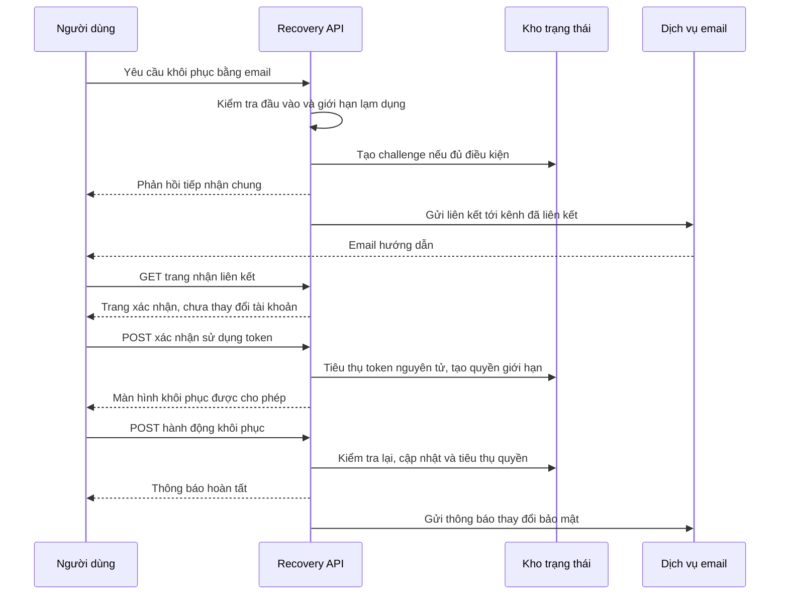

# Email link recovery flow — Luồng khôi phục tài khoản bằng liên kết email

## 1. Vai trò của liên kết email trong khôi phục tài khoản

**Email link recovery** là luồng gửi một liên kết chứa token bí mật tới địa chỉ email đã liên kết với tài khoản. Người nhận mở liên kết, chứng minh khả năng tiếp cận thông điệp và thực hiện bước khôi phục mà chính sách cho phép, chẳng hạn đặt lại mật khẩu.

Ví dụ, An quên mật khẩu nhưng vẫn đọc được email đã đăng ký. Hệ thống gửi liên kết có thời hạn. Sau khi An xác nhận sử dụng liên kết, máy chủ kiểm tra token và cho phép đặt mật khẩu mới trong một phiên khôi phục giới hạn.

Liên kết là một **bearer credential**: người có token có thể sử dụng quyền gắn với token đó, trừ khi hệ thống yêu cầu thêm bằng chứng. Nhấp được liên kết cho thấy khả năng tiếp cận token, không bảo đảm người thao tác là chủ tài khoản ban đầu. Token có thể bị chuyển tiếp, bị lộ hoặc nằm trong hộp thư đã bị xâm nhập.

Trong module `SECURITY_AUTHENTICATION_ACCOUNT_RECOVERY`, email là một phương tiện hỗ trợ người mất mật khẩu, MFA, passkey hoặc thiết bị xác thực. Mức quyền cấp sau xác minh phải tương ứng với hành động và rủi ro. Luồng đặt lại mật khẩu không được âm thầm trở thành đường gỡ MFA hoặc thay toàn bộ passkey.

Sau bài này, người học cần có thể mô tả một luồng hoàn chỉnh, xác định thời điểm tiêu thụ token, xử lý gửi lại và mở liên kết nhiều lần, đồng thời kiểm soát dữ liệu và phiên trước khi hoàn tất khôi phục.

### Phân biệt với các luồng gần giống

| Luồng | Bằng chứng đầu vào | Kết quả dự kiến |
|---|---|---|
| Khôi phục qua liên kết email | Token nhận qua email đã liên kết | Quyền thực hiện hành động khôi phục cụ thể |
| Đăng nhập bằng magic link | Token đăng nhập nhận qua email | Phiên đăng nhập theo chính sách đăng nhập |
| Xác minh email đăng ký | Token gửi tới địa chỉ cần xác minh | Ghi nhận quyền kiểm soát địa chỉ ở thời điểm xác minh |
| Khôi phục bằng mã OTP email | Mã được nhập vào luồng đang mở | Bằng chứng cho bước khôi phục đã xác định |

Các luồng có thể dùng chung thành phần gửi email nhưng phải tách mục đích và quyền. Token xác minh email đăng ký không được chấp nhận ở endpoint đặt lại mật khẩu.

## 2. Các thành phần và ranh giới tin cậy

Một thiết kế thường có các thành phần sau:

- **Giao diện khởi tạo:** nhận email hoặc định danh do người dùng nhập.
- **Recovery API:** kiểm tra yêu cầu, áp dụng chính sách và quản lý trạng thái khôi phục.
- **Kho tài khoản và challenge:** lưu quan hệ tài khoản, kênh liên hệ và trạng thái token.
- **Hàng đợi hoặc outbox:** điều phối gửi email, xử lý retry và lỗi giao nhận.
- **Dịch vụ gửi email:** chuyển thông điệp ra ngoài hệ thống.
- **Trang nhận liên kết:** tiếp nhận token và hướng dẫn người dùng xác nhận.
- **Thành phần thực hiện thay đổi:** đặt mật khẩu hoặc xử lý hành động đã được cấp quyền.
- **Kho phiên và audit:** thu hồi quyền liên quan và ghi lại sự kiện cần thiết.

Email đi qua hạ tầng ngoài quyền kiểm soát trực tiếp của ứng dụng. Liên kết có thể bị hệ thống chống mã độc mở trước, được ứng dụng thư xem trước hoặc bị viết lại qua dịch vụ kiểm tra URL. Không được giả định mọi HTTP request tới liên kết đều do chính người dùng chủ động gửi.

Ba ranh giới cần giữ rõ:

1. Biết email chỉ đủ để yêu cầu bắt đầu xử lý.
2. Có token hợp lệ chỉ cấp quyền đúng mục đích đã gắn với challenge.
3. Hoàn tất hành động nhạy cảm còn phải thỏa mãn trạng thái tài khoản, chính sách và bằng chứng bổ sung nếu có.

## 3. Tổng quan luồng từ yêu cầu tới hoàn tất



Sơ đồ thể hiện các bước logic. Việc gửi email nên được điều phối bất đồng bộ; phản hồi công khai không cần chờ email tới hộp thư. Việc tạo challenge và ghi nhận công việc gửi phải có cơ chế nhất quán để tránh tình trạng đã báo tiếp nhận nhưng công việc bị mất do tiến trình dừng.

Thiết kế trong bài dùng hai vật mang quyền khác nhau:

- **Email token:** dùng một lần để đổi lấy trạng thái khôi phục giới hạn.
- **Recovery grant:** quyền tạm thời ở máy chủ để hoàn thành đúng hành động khôi phục.

Cách tách này giúp loại token khỏi URL trước khi người dùng nhập mật khẩu mới. Nó cũng buộc hệ thống xác định rõ quyền của phiên khôi phục thay vì coi việc mở liên kết là đăng nhập đầy đủ.

## 4. Bước 1 — Tiếp nhận yêu cầu mà không tiết lộ tài khoản

### 4.1. Phản hồi chung cho đầu vào hợp lệ

```http
POST /recovery/email/requests
Content-Type: application/json

{"email":"an@example.test"}
```

```http
HTTP/1.1 202 Accepted
Cache-Control: no-store
Content-Type: application/json

{"message":"Nếu thông tin phù hợp, bạn sẽ nhận được email hướng dẫn khôi phục."}
```

Phản hồi không công khai tài khoản tồn tại, đang bị khóa, có bật MFA hay đã gửi thư thành công. Các nhánh này cần có bề mặt phản hồi tương tự, bao gồm mã trạng thái, trường dữ liệu, cookie, chuyển hướng và hành vi của endpoint gửi lại.

Có thể báo lỗi định dạng hoặc giới hạn độ dài dựa trên chính đầu vào. Không trả lỗi “Email chưa đăng ký” sau khi tra cứu. Cần kiểm soát cả khác biệt thời gian; chỉ thay nội dung thông báo chưa đủ chống dò tài khoản.

### 4.2. Tra cứu và chọn kênh ở máy chủ

Định danh phải được chuẩn hóa theo cùng chính sách với đăng ký và đăng nhập. Không tự bỏ dấu chấm hoặc phần `+tag` của mọi địa chỉ email vì quy tắc này không áp dụng đồng nhất cho mọi nhà cung cấp và có thể gây ánh xạ sai.

Máy chủ xác định tài khoản và kênh đủ điều kiện từ dữ liệu đã lưu. Không nhận một `accountId` rồi gửi liên kết tới `sendTo` tùy ý do người yêu cầu cung cấp. Người biết mã tài khoản không được phép tự chọn nơi nhận token của tài khoản đó.

Chỉ gửi hướng dẫn khi có quan hệ tài khoản và kênh đáp ứng chính sách. Không gửi thư tới mọi email được nhập để làm hai nhánh “giống nhau”; điều đó tạo spam và có thể khiến người nhận hiểu nhầm.

Giới hạn lạm dụng nên kết hợp nguồn yêu cầu, định danh được gửi, tài khoản khi đã xác định, kênh giao nhận và ngân sách toàn dịch vụ. Giới hạn theo tài khoản cần tránh biến thành cách khóa người thật khỏi khôi phục chỉ bằng việc liên tục gửi yêu cầu.

## 5. Bước 2 — Phát hành token và gửi liên kết

### 5.1. Thuộc tính của token

Email token cần khó đoán, có thời hạn, dùng một lần và gắn với đúng tài khoản, tenant nếu có, mục đích và challenge. Không dùng email, thời gian hiện tại, số tăng dần hoặc UUID chưa được đánh giá nguồn ngẫu nhiên làm bí mật khôi phục.

Ví dụ sinh token opaque bằng Java:

```java
SecureRandom random = new SecureRandom();
byte[] tokenBytes = new byte[32];
random.nextBytes(tokenBytes);
String token = Base64.getUrlEncoder()
        .withoutPadding()
        .encodeToString(tokenBytes);
```

Đoạn mã minh họa dùng `java.security.SecureRandom` và `java.util.Base64`. Với 32 byte ngẫu nhiên, token có 256 bit dữ liệu ngẫu nhiên; độ dài biểu diễn không đồng nghĩa với độ an toàn nếu nguồn sinh có thể dự đoán. Đoạn mã chỉ minh họa bước sinh, chưa bao gồm lưu trữ, phân quyền hoặc kiểm soát vòng đời.

Kho challenge thường lưu digest của token để kiểm tra thay vì lưu token bản rõ. Với token ngẫu nhiên có entropy cao như ví dụ, hash mật mã có thể dùng cho việc đối chiếu; không suy rộng cách này sang mã OTP ngắn hoặc email dễ đoán. HMAC là một lựa chọn khi mô hình quản lý khóa và rủi ro yêu cầu.

Một bản ghi khái niệm:

```text
EmailRecoveryChallenge
  challengeId
  accountId
  tenantId
  purpose                 // ví dụ PASSWORD_RESET
  tokenDigest
  contactId
  contactVersion
  recoverySecurityVersion
  createdAt
  expiresAt
  state                   // ACTIVE, CONSUMED, REVOKED
  consumedAt
```

`contactVersion` và `recoverySecurityVersion` minh họa việc ràng buộc challenge với trạng thái liên hệ và bảo mật khi phát hành. Khi email bị thay đổi hoặc có sự kiện cần vô hiệu hóa quyền cũ, hệ thống cập nhật phiên bản hoặc thu hồi challenge tương ứng.

Thời hạn là quyết định theo rủi ro và khả năng giao nhận. Chẳng hạn, một thiết kế có thể chọn 15 phút cho email token; đây là giá trị minh họa, không phải thời hạn đúng cho mọi hệ thống. Kiểm tra hết hạn bằng thời gian của máy chủ tại thời điểm sử dụng.

### 5.2. Xây dựng URL từ cấu hình tin cậy

```text
https://accounts.example.test/recovery/email/continue?token=<opaque-token>
```

Origin của liên kết phải lấy từ cấu hình tin cậy của môi trường hoặc ánh xạ tenant đã xác thực. Không nối URL trực tiếp từ `Host`, `X-Forwarded-Host` hoặc tham số do người yêu cầu tự gửi; cấu hình sai có thể đưa token tới tên miền do kẻ tấn công kiểm soát.

Chỉ dùng HTTPS. Không kèm email, mật khẩu hoặc mã tài khoản không cần thiết trong URL. Đích chuyển hướng sau khôi phục phải là đường dẫn do máy chủ cho phép; một `returnUrl` tùy ý có thể tạo open redirect và đưa người dùng tới trang lừa đảo.

### 5.3. Gửi thư và xử lý hàng đợi

Email nên nêu rõ tên dịch vụ, mục đích, thời hạn, hướng dẫn khi không yêu cầu khôi phục và liên kết hỗ trợ chính thức. Không chứa mật khẩu hiện tại, recovery code hoặc thông tin hồ sơ không liên quan.

Không bật tính năng theo dõi lượt nhấp của marketing cho liên kết mang token. Việc bọc URL có thể đưa bí mật qua thêm dịch vụ. Cũng không dùng tracking pixel làm điều kiện xác minh rằng chính người dùng đã đọc thư.

Nếu dùng outbox, công việc gửi và challenge cần được ghi nhất quán. Thành phần gửi vẫn cần tiếp cận token để tạo liên kết; lưu digest trong bảng challenge không loại bỏ nhu cầu này. Có thể dùng payload outbox được mã hóa, giới hạn quyền giải mã và thời hạn lưu rất ngắn, rồi xóa phần bí mật sau xử lý. Không sao chép token bản rõ vào log, trace hoặc dead-letter queue không được bảo vệ.

Retry giao nhận nên tiếp tục cùng công việc một cách có kiểm soát, không tạo vô hạn token mới mỗi lần nhà cung cấp timeout. Dịch vụ email có thể nhận thư dù phản hồi gửi bị mất, vì vậy cần chấp nhận khả năng giao lặp và thiết kế xử lý idempotent ở mức phù hợp.

## 6. Bước 3 — Mở liên kết mà chưa thay đổi tài khoản

### 6.1. GET chỉ tải trang an toàn

GET tới liên kết không được đặt mật khẩu, gỡ MFA, mở phiên đăng nhập đầy đủ hoặc tiêu thụ token dùng một lần. Trình quét bảo mật và tính năng xem trước có thể thực hiện GET trước người dùng.

Trang nhận liên kết có thể kiểm tra sơ bộ token để hiển thị hướng dẫn, nhưng chưa coi việc tải trang là bằng chứng đủ để thực hiện hành động. Trang cần có bước xác nhận rõ ràng, ví dụ nút “Tiếp tục khôi phục”, gửi POST tới máy chủ.

Tách GET và POST giúp tránh việc tải liên kết thông thường vô tình tiêu thụ token. Đây không phải bảo đảm mọi trình quét đều không thể gửi POST. Nếu cần mức bảo đảm cao hơn, phải có bằng chứng bổ sung hoặc ràng buộc tương tác phù hợp; một nút bấm đơn thuần không thay thế xác thực.

### 6.2. Giảm rò rỉ token trên trang nhận liên kết

Token trong query string có thể đi vào lịch sử trình duyệt, log của reverse proxy, hệ thống quan sát và referrer. Cần phối hợp các lớp bảo vệ:

- Không ghi query chứa token ở gateway, ứng dụng, APM và cảnh báo lỗi.
- Áp dụng `Cache-Control: no-store` và chính sách referrer phù hợp, chẳng hạn `Referrer-Policy: no-referrer`.
- Hạn chế tài nguyên bên thứ ba, analytics và session replay trên trang recovery.
- Không hiển thị token ra thông báo lỗi hoặc console trình duyệt.
- Sau khi đổi token thành quyền giới hạn, chuyển tới URL sạch không chứa token.

Nếu chọn truyền token qua URL fragment rồi gửi bằng JavaScript, token không đi trong HTTP request ban đầu nhưng vẫn có thể lộ qua mã phía trình duyệt, lịch sử hoặc công cụ quan sát. Lựa chọn đó cần thiết kế riêng, không tự động giải quyết mọi rủi ro.

## 7. Bước 4 — Đổi token thành quyền khôi phục giới hạn

Người dùng chủ động gửi POST xác nhận. Máy chủ kiểm tra token, trạng thái challenge, mục đích, thời hạn, tài khoản, tenant, phiên bản liên hệ và phiên bản bảo mật. Tài khoản phải còn đủ điều kiện thực hiện loại khôi phục đó.

Việc xác nhận cần chống CSRF và thay thế luồng ngoài ý muốn bằng thiết kế phù hợp, chẳng hạn trạng thái giao dịch phía máy chủ, token chống CSRF và kiểm tra nguồn yêu cầu. Nếu người dùng đang đăng nhập một tài khoản khác, giao diện phải tránh áp dụng ngầm kết quả khôi phục vào tài khoản của phiên hiện tại.

Không chỉ đọc `state=ACTIVE` rồi cập nhật ở một câu lệnh không có điều kiện. Hai request đồng thời có thể cùng vượt qua bước đọc. **Tiêu thụ email token và tạo recovery grant phải có tính nguyên tử.**

Mã giả cho giao dịch:

```text
BEGIN TRANSACTION
  account = lockAccountForRecovery(challenge.accountId)
  challenge = lockChallengeByDigest(digest(submittedToken))

  require challenge exists
  require challenge.state == ACTIVE
  require serverNow < challenge.expiresAt
  require challenge.purpose == requestedPurpose
  require challenge belongs to expected tenant
  require contact and security versions are still valid
  require account policy permits this recovery step

  mark challenge CONSUMED
  create one short-lived recovery grant bound to:
      accountId, tenantId, purpose, challengeId, securityVersion
COMMIT
```

Đây là mã giả mô tả các điều kiện cần giữ. Triển khai thực tế cần xác định thứ tự khóa nhất quán; việc tra cứu ban đầu lấy tài khoản không được thay cho kiểm tra lại challenge trong giao dịch. Có thể dùng cập nhật có điều kiện hoặc cơ chế đồng thời tương đương để bảo đảm chỉ một lần chuyển trạng thái thành công.

Trong thiết kế này, sau khi token đã được tiêu thụ, mở lại cùng liên kết không tạo thêm grant. Nếu phản hồi thành công bị mất, cần chính sách tiếp tục dựa trên grant đã được ràng buộc an toàn với trình duyệt hoặc hướng dẫn xin liên kết mới. Không tạo nhiều grant chỉ vì client retry.

Recovery grant có thể được tham chiếu bằng cookie `Secure`, `HttpOnly` với chính sách `SameSite` phù hợp và đường dẫn hẹp. Máy chủ vẫn phải kiểm tra quyền và chống CSRF cho hành động cuối; thuộc tính cookie không tự giải quyết mọi trường hợp tấn công.

Grant không được cấp quyền đọc toàn bộ hồ sơ, thay email, xóa mọi yếu tố hoặc gọi API thông thường. Ví dụ `purpose=PASSWORD_RESET` chỉ mở khả năng đặt lại mật khẩu theo chính sách. Nếu An mất cả MFA, luồng phải đánh giá điều kiện gỡ hoặc thay MFA riêng.

Ràng buộc cứng với IP hoặc yêu cầu luôn mở thư trên cùng thiết bị có thể làm hỏng trải nghiệm hợp lệ, vì người dùng thường yêu cầu trên máy tính và đọc thư trên điện thoại. Cần xác định rõ chính sách chuyển thiết bị, mức rủi ro và bằng chứng bổ sung; không coi địa chỉ IP là danh tính của người dùng.

## 8. Bước 5 — Thực hiện hành động và đóng quyền khôi phục

Khi người dùng gửi mật khẩu mới, máy chủ kiểm tra lại grant: chưa dùng, chưa hết hạn, đúng tài khoản, đúng mục đích và còn phù hợp trạng thái bảo mật hiện tại. Không tin tài khoản do trình duyệt gửi thay cho tài khoản đã ràng buộc trong grant.

Đối với đặt lại mật khẩu, quy trình logic gồm:

1. Kiểm tra đầu vào theo chính sách mật khẩu và tính giá trị băm mật khẩu bằng cơ chế phù hợp.
2. Trong giao dịch được bảo vệ đồng thời, kiểm tra lại grant và trạng thái tài khoản, cập nhật mật khẩu, tiêu thụ grant, vô hiệu các quyền khôi phục liên quan theo chính sách và ghi sự kiện bảo mật bền vững.
3. Điều phối thu hồi các phiên liên quan và gửi thông báo thay đổi qua cơ chế đáng tin cậy.
4. Trả kết quả hoàn tất, xóa trạng thái khôi phục phía trình duyệt và đưa người dùng tới bước đăng nhập theo chính sách.

Nếu kho phiên và dữ liệu tài khoản ở các hệ thống khác nhau, không giả định một giao dịch cơ sở dữ liệu có thể cập nhật tất cả nguyên tử. Có thể dùng phiên bản bảo mật được kiểm tra khi cấp hoặc sử dụng phiên, kết hợp sự kiện/outbox và retry cho thao tác thu hồi. Thiết kế cần nêu rõ khoảng trễ và cách bảo đảm phiên cũ không tiếp tục vượt qua kiểm tra.

Thu hồi refresh token không nhất thiết làm access token đã phát hành mất hiệu lực ngay nếu bên kiểm tra chỉ xác minh chữ ký và thời hạn. Chính sách thu hồi cần tính tới cách kiểm tra access token, thời gian sống và dữ liệu phiên bản hoặc danh sách thu hồi nếu sử dụng.

Không tự động đăng nhập đầy đủ chỉ vì đổi mật khẩu thành công. Nếu sản phẩm cho phép một cách tiếp tục khác, nó phải là quyết định có chủ ý, phù hợp mức xác minh đã đạt và yêu cầu MFA còn hiệu lực.

Đặt lại mật khẩu không mặc định xóa MFA, passkey hoặc mọi khóa truy cập. Các thao tác đó có mục đích và điều kiện riêng. Sau thành công, email thông báo không chứa mật khẩu mới hoặc token có thể tái sử dụng; nó cung cấp hướng dẫn xử lý nếu người nhận không thực hiện thay đổi.

Lỗi gửi thông báo sau cập nhật cần được retry và theo dõi. Không hoàn tác mật khẩu đã đổi chỉ vì nhà cung cấp email tạm lỗi, cũng không cho phép sử dụng lại grant đã tiêu thụ để thử cập nhật lần nữa.

## 9. Vòng đời, gửi lại và các trường hợp cạnh tranh

### 9.1. Phân biệt token và grant

| Đối tượng | Trạng thái sử dụng được | Sự kiện kết thúc quyền |
|---|---|---|
| Email challenge | `ACTIVE` và còn hạn, trạng thái liên quan còn hợp lệ | Đổi token thành grant thành công, thu hồi hoặc hết hạn |
| Recovery grant | `ACTIVE` và còn hạn, đúng mục đích và phiên bản bảo mật | Hoàn tất hành động, thu hồi hoặc hết hạn |
| Yêu cầu khôi phục | Có thể theo dõi tiến trình nội bộ | Hoàn tất, hủy hoặc hết thời gian cho phép |

Hết hạn có thể được suy ra từ `expiresAt` ngay cả khi tác vụ dọn dữ liệu chưa chạy. Không chờ một job nền đổi trạng thái sang `EXPIRED` mới từ chối token cũ.

### 9.2. Gửi lại không chỉ là gửi thêm email

Cần quyết định rõ gửi lại sẽ giao lại cùng challenge còn hiệu lực hay phát hành challenge mới. Cả hai đều cần giới hạn tần suất và số challenge còn dùng được. Không để thao tác gửi lại tự gia hạn vô hạn thời gian sống của token cũ.

Nếu chọn liên kết mới thay thế liên kết cũ, giao diện nên hướng dẫn người dùng dùng email mới nhất và cần tính tới trường hợp thư đến không đúng thứ tự. Nếu cho phép nhiều challenge trong giới hạn, khi khôi phục thành công phải vô hiệu các challenge và grant liên quan theo chính sách.

Không cho một yêu cầu chưa xác minh tùy ý vô hiệu hóa mọi grant mà người dùng thật đang sử dụng. Kẻ tấn công có thể liên tục yêu cầu gửi lại để làm gián đoạn khôi phục. Chính sách phát hành, thay thế và thu hồi cần phân biệt yêu cầu mới chưa xác minh với thay đổi bảo mật đã được xác nhận.

### 9.3. Các trường hợp cần xử lý rõ

| Tình huống | Hành vi phù hợp |
|---|---|
| Token sai, hết hạn, đã dùng hoặc bị thu hồi | Không cấp quyền; thông báo không chứa dữ liệu tài khoản và có hướng dẫn bắt đầu lại |
| Hai POST đổi cùng token diễn ra đồng thời | Chỉ một lần tiêu thụ và một grant được tạo |
| Hai POST hoàn tất với cùng grant | Chỉ một thay đổi được chấp nhận; retry không tạo quyền mới |
| Email đã thay đổi sau lúc phát hành | Challenge cũ bị từ chối theo quan hệ kênh hoặc phiên bản đã ràng buộc |
| Tài khoản bị chặn khôi phục trong lúc người dùng nhập mật khẩu | Kiểm tra lại trước khi cập nhật, không dựa vào quyết định cũ |
| Trình quét mở GET trước người dùng | Không đổi tài khoản và không tiêu thụ token |
| Email đến sau khi token hết hạn | Giải thích cách xin liên kết mới, không âm thầm bỏ kiểm tra thời hạn |
| Người dùng không còn truy cập email | Chuyển sang phương án xác minh khác; không cho nhập email mới để nhận token của tài khoản cũ |

## 10. Rủi ro chính và biện pháp kiểm soát

| Rủi ro | Vì sao có thể xảy ra | Kiểm soát trong luồng |
|---|---|---|
| Dò tài khoản | Phản hồi hoặc độ trễ khác nhau | Thông báo chung, kiểm tra các kênh phụ, giới hạn lạm dụng |
| Chiếm hộp thư | Kẻ tấn công nhận được liên kết hợp lệ | Quyền giới hạn, đánh giá rủi ro và bằng chứng bổ sung cho hành động cần mức bảo đảm cao |
| Đoán token | Bí mật ngắn hoặc sinh có thể dự đoán | CSPRNG, entropy phù hợp, thời hạn và giới hạn thử |
| Lộ token | URL, referrer, log, tracking hoặc chuyển tiếp thư | Giảm dữ liệu, kiểm soát trang nhận, lọc log và quản lý bên nhận dữ liệu |
| URL dẫn tới miền giả | Dùng header hoặc tham số không tin cậy để tạo link | Origin cấu hình tin cậy, ánh xạ tenant được kiểm soát |
| Dùng lại token | Chỉ kiểm tra mà không tiêu thụ nguyên tử | Chuyển trạng thái có điều kiện và cấp grant trong cùng giao dịch |
| Nhầm mục đích hoặc tài khoản | Endpoint chấp nhận token khác loại hoặc tin `accountId` từ client | Ràng buộc purpose, tenant, account và kiểm tra ở máy chủ |
| Hủy hoại trải nghiệm bằng gửi lại | Phát hành vô hạn hoặc vô hiệu hóa quyền đang dùng | Ngân sách gửi, chính sách thay thế rõ ràng và giới hạn tác động của yêu cầu chưa xác minh |
| Phiên cũ vẫn hoạt động sau khôi phục | Thu hồi không bao phủ cách kiểm tra token phiên | Thiết kế thu hồi refresh/access token và phiên bản bảo mật theo kiến trúc thực tế |

Mã hóa khi truyền, bảo vệ hộp thư và cấu hình gửi email giúp giảm rủi ro nhưng không thay thế các kiểm soát cấp quyền của ứng dụng. Thư đã được giao cũng không chứng minh chính người dùng đã đọc hoặc thực hiện hành động.

## 11. Ví dụ đánh giá một thiết kế chưa an toàn

Giả sử hệ thống đang có các hành vi:

```text
POST /forgot-password
  trả 404 nếu email không tồn tại
  tạo token = currentTimeMillis + accountId
  tạo URL từ Host của request

GET /reset?token=...
  đánh dấu token đã dùng
  tạo phiên đăng nhập đầy đủ
  cho phép đổi mật khẩu và tắt MFA
```

Thiết kế này có nhiều đường tấn công độc lập. Phản hồi `404` cho phép dò tài khoản; token có cấu trúc dự đoán được; URL từ header có thể bị điều hướng sai; GET có tác dụng bảo mật nên trình quét có thể tiêu thụ token; phiên đầy đủ và quyền tắt MFA vượt quá bằng chứng đang có.

Một cách sửa có cơ sở là dùng phản hồi tiếp nhận chung, token ngẫu nhiên gắn challenge và purpose, URL có origin tin cậy, GET chỉ tải trang, POST đổi token nguyên tử thành grant giới hạn và POST hoàn tất kiểm tra lại quyền. Quy trình tắt MFA cần đánh giá riêng. Kết quả hoàn tất phải bao gồm quản lý các phiên liên quan và thông báo thay đổi.

Các tình huống kiểm tra thiết kế nên bao gồm token sai/hết hạn/đã dùng, đồng thời hai request, email thay đổi giữa luồng, nhà cung cấp gửi thư timeout, thư bị giao lặp, mở trên thiết bị khác, CSRF và việc query chứa token xuất hiện trong hệ thống quan sát.

## 12. Bài tập áp dụng

An có tài khoản bật MFA, quên mật khẩu và mất điện thoại. An còn truy cập hộp thư, gửi yêu cầu trên máy tính rồi mở liên kết trên điện thoại mượn. Trình quét email đã mở GET trước đó; một email cũ khác vẫn đang nằm trong hộp thư.

Hãy mô tả cách hệ thống xử lý từng bước và trả lời:

1. GET của trình quét có được tiêu thụ token hay cấp phiên đầy đủ không?
2. POST xác nhận cần kiểm tra những ràng buộc nào và xử lý ra sao nếu hai request tới cùng lúc?
3. Grant đặt lại mật khẩu có cho phép gỡ MFA không? Nếu An mất MFA, bước tiếp theo cần dựa vào chính sách nào?
4. Cách gửi lại ảnh hưởng thế nào tới email cũ và grant người dùng đang thao tác?
5. Sau cập nhật mật khẩu, hệ thống làm gì với grant, token khôi phục khác, phiên đăng nhập và thông báo bảo mật?

Một phương án đầy đủ cần giữ riêng việc tiếp nhận yêu cầu, chứng minh khả năng dùng token và cấp quyền thực hiện hành động. Độ an toàn của email link recovery nằm ở toàn bộ chuỗi chuyển trạng thái và kiểm soát quyền, từ lúc nhận định danh tới lúc đóng mọi quyền khôi phục tạm thời.
