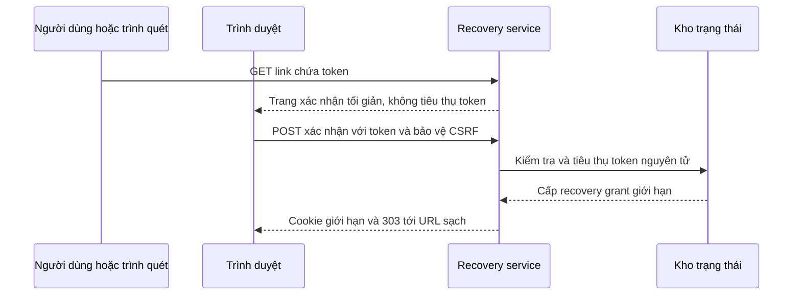

# Recovery link composition

## 1. Đường dẫn khôi phục là một phần của cơ chế cấp quyền

Recovery link là đường dẫn được gửi tới kênh email đã đăng ký để người dùng tiếp tục một quy trình khôi phục tài khoản. Nó có thể tham gia luồng quên mật khẩu, mất MFA, mất passkey hoặc mất thiết bị xác thực. Mức quyền được cấp sau khi dùng link phải phụ thuộc mục đích và mức rủi ro của từng luồng.

Một link khôi phục thường mang một bí mật theo mô hình bearer: ai có bí mật có thể trình nó với máy chủ để nhận quyền đã được quy định. Vì vậy, ghép URL không chỉ là thao tác định dạng chuỗi. Chọn sai domain, thêm một tham số chuyển hướng tùy ý hoặc để token đi qua hệ thống theo dõi có thể chuyển khả năng khôi phục sang người khác.

Ví dụ dưới đây chỉ minh họa hình dạng, không chứa token thật:

```text
https://accounts.example.test/account-recovery/email?token=<opaque-random-token>
```

Trong bài học này, link được dùng để chứng minh quyền tiếp cận một kênh email khôi phục. Nó chưa mặc nhiên cho phép xóa MFA, đăng ký passkey mới hay tạo session đăng nhập đầy đủ. Tài khoản có yêu cầu bảo đảm cao có thể cần thêm bằng chứng, thời gian chờ hoặc quy trình xét duyệt trước các hành động đó.

Sau bài học, người học có thể xác định các thành phần của link, phân biệt dữ liệu định tuyến với bằng chứng bí mật, xây link từ cấu hình tin cậy và thiết kế cách tiếp nhận link mà không làm mất hiệu lực chỉ vì một trình quét email mở nó.

## 2. Mỗi thành phần của URL cần có vai trò rõ ràng

| Thành phần | Ví dụ | Vai trò và ràng buộc |
| --- | --- | --- |
| Scheme | `https` | Bảo vệ kết nối tới máy chủ; không gửi link HTTP rồi trông chờ chuyển hướng. |
| Host | `accounts.example.test` | Domain do hệ thống kiểm soát và đã xác minh trong cấu hình. |
| Port | Mặc định của HTTPS | Chỉ cho phép port mà cấu hình triển khai chủ động hỗ trợ. |
| Path | `/account-recovery/email` | Endpoint chuyên dụng; không lấy đường dẫn tùy ý từ request khởi tạo. |
| Query chứa bí mật | `token=...` | Bằng chứng cần bảo vệ, không được ghi rõ vào log hoặc chia sẻ cho bên thứ ba. |
| Tham số hiển thị tùy chọn | `lang=vi` | Chỉ ảnh hưởng giao diện sau khi kiểm tra giá trị; không quyết định tài khoản hay quyền. |
| Fragment tùy chọn | Phần sau `#` | Không nằm trong HTTP request ban đầu của trình duyệt, nhưng vẫn nằm trong URL và email. |

Một cấu trúc tối giản thường dễ kiểm soát hơn một URL có nhiều dữ liệu sao chép từ hồ sơ tài khoản. Máy chủ có thể tra cứu mục đích, tenant, tài khoản và thời hạn bằng token thay vì đưa tất cả vào URL.

### 2.1. Dữ liệu không nên xuất hiện trong link

Không đưa mật khẩu cũ, OTP khác, access token, refresh token, session ID đăng nhập hoặc thông tin hồ sơ không cần thiết vào link. Cũng nên tránh email đầy đủ và số điện thoại vì chúng làm tăng dữ liệu cá nhân xuất hiện trong lịch sử trình duyệt, hệ thống email và log.

Không dùng các tham số như sau để cấp quyền:

```text
?accountId=123&purpose=REMOVE_MFA&expires=...&verified=true
```

Người gửi có thể sửa các giá trị trên. Nếu hệ thống cần dữ liệu tương tự, nguồn quyết định phải là bản ghi phía máy chủ hoặc dữ liệu được bảo vệ toàn vẹn và được xác minh đầy đủ. Một cờ `verified=true` trong URL không phải bằng chứng xác minh.

### 2.2. Mã tra cứu không đồng nghĩa bí mật

Có thể dùng một token opaque duy nhất, hoặc tách cấu trúc thành:

```text
https://accounts.example.test/account-recovery/email?selector=<id>&verifier=<secret>
```

`selector` là khóa tra cứu và phải được xem như có thể bị biết. `verifier` là bí mật phải đủ khó đoán và được so khớp với giá trị kiểm tra đã lưu. Biết selector không được phép lấy lại verifier, xem thông tin tài khoản hoặc chuyển trạng thái khôi phục.

Không cần tách selector nếu thiết kế dùng hash của token làm khóa tra cứu đã đáp ứng yêu cầu. Thêm thành phần chỉ có ích khi nó giải quyết một nhu cầu cụ thể về chỉ mục, lưu trữ hoặc vòng đời.

## 3. Chọn origin từ cấu hình tin cậy

**Origin dùng để phát hành link phải đến từ cấu hình hoặc registry tenant được kiểm soát, không lấy trực tiếp từ dữ liệu request do người dùng gửi.**

Một cách ghép nguy hiểm là:

```text
link = request.scheme + "://" + request.host
       + "/account-recovery/email?token=" + token
```

Trong một triển khai cấu hình sai, kẻ tấn công có thể tác động tới `Host`, `X-Forwarded-Host` hoặc một tham số `baseUrl`. Nếu email gửi cho nạn nhân chứa link trỏ về domain của kẻ tấn công, nạn nhân bấm vào sẽ gửi token tới nơi đó. Token có thể bị đánh cắp ngay cả khi đường dẫn trông giống trang khôi phục thật.

Thiết kế phù hợp hơn:

```text
trustedOrigin = configuredRecoveryOrigins[trustedTenantId]
link = buildUri(trustedOrigin, FIXED_RECOVERY_PATH, encodedToken)
```

`trustedTenantId` phải được xác định qua cơ chế ánh xạ tenant hợp lệ, không đơn giản lấy chuỗi `tenant` trong biểu mẫu rồi tra cứu bất kỳ cấu hình nào. Token sau đó vẫn phải được ràng buộc với tenant trong dữ liệu xác minh phía máy chủ.

### 3.1. Kiểm tra cấu hình khi khởi động hoặc đăng ký domain

Một origin phát hành link cần đáp ứng chính sách rõ ràng:

- Scheme là HTTPS và host khớp chính xác domain đã được phép.
- Không có userinfo như `trusted.example@other.example`.
- Không có query hoặc fragment gắn sẵn; path nền nếu có phải được cấu hình tường minh.
- Port nằm trong cấu hình được phép và không phụ thuộc request hiện tại.
- Domain tùy chỉnh của tenant đã được xác minh quyền kiểm soát, có TLS hợp lệ và được quản lý vòng đời.

Không kiểm tra domain bằng phép `contains`, `startsWith` hoặc một hậu tố thiếu ranh giới. Ví dụ, kiểm tra chuỗi có chứa `accounts.example.test` có thể chấp nhận cả một host khác được tạo để đánh lừa.

Dùng bộ phân tích URI và quy tắc chuẩn hóa thống nhất cho hostname, chữ hoa/thường, tên miền quốc tế, dấu chấm cuối host và port. Tốt nhất lưu origin chuẩn đã được phê duyệt thay vì chấp nhận nhiều dạng biểu diễn tại thời điểm gửi email.

### 3.2. Reverse proxy không tự biến header thành dữ liệu đáng tin

Ứng dụng sau proxy có thể cần biết scheme hoặc host bên ngoài, nhưng chỉ được tin forwarded header từ proxy đã xác thực và được cấu hình để xóa hoặc thay thế dữ liệu do client tự gửi. Với việc phát hành recovery link, một origin cấu hình riêng thường giúp giảm phụ thuộc vào chuỗi proxy.

Không trả link chứa token vào phản hồi khởi tạo chỉ để client tự gửi email. Token cần đi qua kênh khôi phục đã được xác định từ hồ sơ và chính sách, không qua một địa chỉ nhận tùy ý trong request.

## 4. Thiết kế phần bí mật của link

### 4.1. Token ngẫu nhiên, opaque và đủ dài

Một lựa chọn minh họa là tạo 32 byte từ bộ sinh số ngẫu nhiên an toàn rồi mã hóa Base64 URL-safe không padding. Giá trị thu được dài 43 ký tự và có 256 bit dữ liệu ngẫu nhiên trước mã hóa.

```text
raw bytes: 32 byte ngẫu nhiên an toàn
encoding: Base64url không padding
example shape: [A-Za-z0-9_-]{43}
```

Độ dài này là lựa chọn cho ví dụ, không phải lý do bỏ rate limit, hạn dùng hoặc kiểm tra trạng thái. Không thay bộ sinh ngẫu nhiên an toàn bằng timestamp, bộ đếm, ID tài khoản hay một hàm random thông thường.

Không dùng hash của email làm token: tập email có thể đoán được và cùng email có thể tạo cùng kết quả. Hash không tạo ra entropy mà đầu vào chưa có.

Token opaque không mang các claim có thể đọc trực tiếp. Điều này giúp tránh đưa dữ liệu hồ sơ vào URL và buộc bên xác minh dùng bản ghi có kiểm soát. Token có chữ ký như JWT là một thiết kế khác, cần kiểm tra chữ ký, thuật toán, issuer, audience, purpose, hạn dùng và cơ chế dùng một lần hoặc thu hồi. Chỉ ký dữ liệu không làm dữ liệu đó bí mật và không tự chống replay.

### 4.2. Lưu giá trị kiểm tra, không lưu token rõ nếu không cần

Bản ghi phía máy chủ có thể chứa:

```text
recovery_attempt_id
account_id
trusted_tenant_id
purpose
registered_channel_id
channel_version_at_issue
verifier_hash
issued_at
expires_at
consumed_at
revoked_at
policy_version
```

Với token ngẫu nhiên đủ mạnh, có thể lưu hash mật mã như SHA-256 để kiểm tra thay vì lưu token rõ. Một HMAC có khóa được quản lý riêng cũng là lựa chọn tùy mô hình đe dọa. Không lấy cách hash token entropy cao làm hướng dẫn hash mật khẩu do người dùng chọn; hai loại đầu vào có tính chất khác nhau.

Nếu cần token rõ để retry gửi email, payload gửi có thể được mã hóa trong kho outbox với quyền truy cập và thời hạn lưu tối thiểu. Bản ghi xác minh vẫn không cần giữ token rõ. Không sinh một token mới mỗi lần worker gửi lại cùng sự kiện vì như vậy có thể tạo nhiều bằng chứng ngoài dự kiến.

### 4.3. Mục đích và thời hạn phải được ràng buộc phía máy chủ

Khi nhận token, máy chủ kiểm tra token thuộc đúng tài khoản, tenant, kênh khôi phục, mục đích và trạng thái quy trình. Một token chứng minh khả năng nhận email không được tự chuyển thành token cho thao tác tắt MFA.

Nếu email khôi phục đã bị thay đổi hoặc tài khoản có biến cố an ninh sau khi phát hành, chính sách có thể yêu cầu thu hồi các token cũ hoặc so khớp phiên bản kênh. Tham số `email` do người mở link gửi lên không được ghi đè kênh đã gắn với token.

`expires_at` cần lấy từ nguồn thời gian phía máy chủ và được kiểm tra khi sử dụng. Giá trị `expires` trong URL, nếu hiển thị để hỗ trợ giao diện, không có quyền gia hạn bằng chứng. Không kéo dài hạn token chỉ vì người dùng mở trang hoặc tải lại nhiều lần.

Một lần dùng thành công phải được ghi nhận nguyên tử cùng việc cấp quyền giới hạn tương ứng, để hai request đồng thời không cùng nhận hai quyền độc lập từ một token dùng một lần.

## 5. Ghép link và mã hóa đúng ngữ cảnh

### 5.1. Tách URI encoding khỏi HTML escaping

Hai thao tác này phục vụ hai ranh giới khác nhau:

| Thao tác | Mục tiêu |
| --- | --- |
| Encode giá trị query | Ngăn dữ liệu trở thành dấu phân cách hoặc thay đổi cấu trúc URI. |
| Escape thuộc tính HTML | Ngăn dữ liệu thoát khỏi thuộc tính `href` hoặc tạo markup ngoài ý muốn. |

Ví dụ, một link có hai tham số trong email HTML cần biểu diễn dấu `&` thành `&amp;` ở mã HTML:

```html
<a href="https://accounts.example.test/account-recovery/email?token=TOKEN_PLACEHOLDER&amp;lang=vi">
  Tiếp tục khôi phục tài khoản
</a>
```

Trình duyệt hoặc email client sẽ hiểu lại dấu phân cách query. Bản plain text dùng dấu `&` thông thường. Không đưa `&amp;` vào chuỗi URL được lưu làm URL thật, rồi lại escape thêm một lần.

Dùng URI builder theo từng thành phần và template engine có escaping theo ngữ cảnh. Không nối các giá trị chưa kiểm tra như `returnUrl`, `email` hoặc tên hiển thị vào chuỗi HTML.

### 5.2. Ví dụ Java tối giản với origin và path cố định

```java
import java.net.URI;
import java.security.SecureRandom;
import java.util.Base64;

final class RecoveryLinkFactory {
    private static final SecureRandom RANDOM = new SecureRandom();
    private static final String TRUSTED_ORIGIN =
            "https://accounts.example.test";
    private static final String RECOVERY_PATH =
            "/account-recovery/email";

    static String newToken() {
        byte[] randomBytes = new byte[32];
        RANDOM.nextBytes(randomBytes);
        return Base64.getUrlEncoder()
                .withoutPadding()
                .encodeToString(randomBytes);
    }

    static URI buildLink(String token) {
        if (token == null || !token.matches("[A-Za-z0-9_-]{43}")) {
            throw new IllegalArgumentException("Invalid token format");
        }
        return URI.create(TRUSTED_ORIGIN + RECOVERY_PATH + "?token=" + token);
    }
}
```

Trong ví dụ này, phép nối chuỗi chỉ dùng origin và path cố định cùng alphabet token đã giới hạn, không chứa ký tự phân cách query. Nếu thêm dữ liệu tùy ý, phải dùng cơ chế encode từng thành phần; không suy rộng ví dụ thành cách nối URL với mọi input.

Đoạn mã chỉ minh họa sinh token và hình thành URL. Nó chưa lưu hash, chưa gắn purpose và account, chưa thực hiện giao dịch dùng một lần, gửi email, rate limit hay quản lý session. Trong hệ thống nhiều tenant, thay hằng origin bằng kết quả lấy từ registry tin cậy đã được kiểm tra.

Không ghi `token`, URI đầy đủ hoặc exception chứa URI đầy đủ vào log. Việc tạo một đối tượng URI không tự làm bí mật bên trong nó an toàn trước log hay debugger.

### 5.3. Parser ở đầu nhận phải nhất quán

Endpoint nên chấp nhận đúng một tham số token, giới hạn kích thước toàn bộ URL và từ chối query có token lặp hoặc cấu trúc nhập nhằng. Không để một tầng kiểm tra token đầu tiên còn tầng nghiệp vụ sử dụng token cuối cùng.

Giải mã theo hợp đồng một lần, kiểm tra định dạng rồi xác minh bí mật. Không decode lặp cho tới khi không còn ký tự `%`, không đổi chữ hoa/thường của token, không trim hoặc sửa token để đoán ý người gửi. Token là dữ liệu phân biệt chính xác từng byte.

## 6. Không để tham số chuyển hướng làm thất thoát token

Một mẫu nguy hiểm là:

```text
https://accounts.example.test/account-recovery/email
    ?token=<secret>&next=https://external.example.test/collect
```

Nếu trang chuyển token sang `next`, hoặc trang đích nhận URL nguồn qua một cơ chế rò rỉ khác, bí mật đã rời khỏi ranh giới khôi phục. Ngay cả khi token không bị chuyển trực tiếp, một open redirect trong email bảo mật vẫn có thể hỗ trợ lừa người dùng tới trang giả.

Cách đơn giản là dùng đích tiếp tục cố định. Nếu sản phẩm cần nhiều đích, lưu một mã đích do máy chủ kiểm soát như `RECOVERY_PASSWORD_FORM` hoặc `RECOVERY_REVIEW` trong bản ghi quy trình và ánh xạ sang route nội bộ đã định.

Không tin một URL tương đối chỉ vì nó không bắt đầu bằng `https:`. Dạng `//host`, backslash, ký tự được encode và cách chuẩn hóa của từng parser có thể gây hiểu khác nhau. Một danh sách mã đích thường dễ kiểm soát hơn việc cho client cung cấp URL tùy ý rồi cố sửa nó.

Đích sau khôi phục cũng không được tự tạo session đầy đủ hoặc bỏ qua MFA vì một tham số `autoLogin=true`. Quyền và hành vi phải được quyết định trong chuyển trạng thái phía máy chủ.

## 7. Mở link, trình quét email và quyền khôi phục giới hạn

Hệ thống email có thể mở link để kiểm tra mã độc, tạo preview hoặc đánh giá độ an toàn trước khi người dùng bấm. Một GET tiêu thụ token hoặc đổi trạng thái tài khoản ngay lập tức có thể làm người dùng mất link chỉ vì hoạt động tự động này.

Một luồng minh họa tách việc hiển thị khỏi việc nhận quyền:



Sơ đồ trình bày luồng của một trình duyệt thực hiện bước xác nhận. Một trình quét chỉ GET sẽ dừng ở trang hiển thị và không làm token mất hiệu lực.

### 7.1. GET không thực hiện thay đổi nhạy cảm

GET có thể kiểm tra cấu trúc URL và hiển thị một trang xác nhận tối giản. Nó không đổi mật khẩu, bỏ MFA, hoàn tất xác minh, đánh dấu token đã dùng, thu hồi token khác hoặc gửi lại email chỉ vì trang được mở.

Nếu trang tạo một ngữ cảnh trước xác minh để chống CSRF, ngữ cảnh đó chưa có quyền khôi phục. Không được xem cookie vừa tạo từ GET là bằng chứng rằng token đã được đổi thành quyền hợp lệ.

Trang có thể chứa một form POST tới endpoint cố định. Nếu token nằm trong hidden field, nó vẫn là bí mật đang có trong DOM: cần escape đúng ngữ cảnh, loại bỏ script không cần thiết và không gửi nội dung form vào telemetry. Hidden field không phải nơi bảo vệ dữ liệu khỏi JavaScript chạy cùng trang.

### 7.2. POST đổi token thành quyền hạn chế

Khi người dùng chủ động xác nhận, POST cần kiểm tra CSRF theo thiết kế của ứng dụng, bao gồm token chống CSRF gắn với ngữ cảnh trước xác minh và kiểm tra nguồn phù hợp. Một recovery token không thay thế toàn bộ bảo vệ CSRF và không chứng minh rằng một request đến từ giao diện đáng tin.

Máy chủ xác minh hash và các ràng buộc của token, kiểm tra chưa hết hạn, chưa thu hồi, chưa dùng. Việc đánh dấu dùng và tạo recovery grant phải nằm trong cùng một giao dịch hoặc một cơ chế nguyên tử tương đương. Nếu hai POST cạnh tranh, chỉ một chuyển trạng thái được cấp quyền.

Sau thành công, có thể cấp một cookie như sau trên recovery origin:

```http
Set-Cookie: __Host-recovery=<opaque-grant>; Path=/; Secure; HttpOnly; SameSite=Lax
Cache-Control: no-store
Referrer-Policy: no-referrer
Location: /account-recovery/continue
```

Ví dụ tương ứng với phản hồi `303 See Other`; các dòng trên chỉ minh họa header. Cookie dùng tiền tố `__Host-` không có thuộc tính `Domain`, cần `Path=/` và `Secure`. Thiết kế phải đặt thời hạn ngắn và kiểm tra hết hạn phía máy chủ. `SameSite` cần phù hợp luồng điều hướng thực tế và không thay thế biện pháp chống CSRF.

Recovery grant chỉ cho phép các bước được chỉ định và bị ràng buộc với quy trình, tenant và tài khoản từ bản ghi token. Nó không phải session đăng nhập thông thường. Khi chuyển từ ngữ cảnh chưa xác minh sang grant, cần tạo hoặc xoay định danh thích hợp để tránh mang theo một phiên đã bị cố định trước đó.

Việc một người bấm nút không phải bằng chứng chắc chắn đó là con người. Một số trình quét có thể thực thi script hoặc form. Không dùng JavaScript tự POST ngay khi trang tải; với hành động rủi ro cao, vẫn cần lớp xác minh bổ sung theo chính sách.

## 8. Giảm rò rỉ dọc theo đường đi của link

### 8.1. HTTPS không ngăn mọi nơi nhìn thấy URL

HTTPS bảo vệ truyền tải giữa các đầu kết nối tương ứng, nhưng email chứa link vẫn đi qua nhà cung cấp email, bộ lọc thư và thiết bị của người dùng. Trình duyệt, proxy kết thúc TLS, CDN, máy chủ và hệ thống giám sát có thể xử lý URL rõ trong phạm vi của họ.

Vì vậy, cần hạn chế tuổi thọ và quyền của token, đồng thời kiểm soát nơi URL được ghi nhận. Không gửi link thật cho công cụ rút gọn URL, dịch vụ preview hoặc nền tảng click tracking chỉ để đo tỷ lệ bấm.

### 8.2. Log, trace và công cụ phân tích

Cấu hình che hoặc loại bỏ query nhạy cảm tại mọi tầng có khả năng ghi request: ingress, reverse proxy, CDN, access log, APM, error tracker và hỗ trợ khách hàng. Chỉ che ở controller không giúp nếu proxy đã lưu URL trước đó. Token đặt trong path cũng có thể bị log; đổi vị trí không tự giải quyết rò rỉ.

Trang tiếp nhận link không nên tải analytics, quảng cáo, ảnh theo dõi hoặc script bên thứ ba. Không gửi `window.location`, form data hoặc nội dung trang chứa token vào sự kiện phân tích. Nhật ký nên dùng mã tương quan nội bộ không có quyền khôi phục.

### 8.3. Referrer, cache và tài nguyên trên trang

Dùng chính sách rõ ràng trên trang mang bí mật, ví dụ:

```http
Cache-Control: no-store
Referrer-Policy: no-referrer
Content-Security-Policy: default-src 'none'; form-action 'self'; base-uri 'none'; frame-ancestors 'none'
```

CSP trên phù hợp một trang HTML tối giản không cần script, style hoặc ảnh. Nếu thêm tài nguyên, phải bổ sung nguồn thật sự cần thiết. CSP giảm một số đường tấn công phía trình duyệt; nó không thay thế kiểm tra token, chống CSRF hoặc che log.

`Referrer-Policy: no-referrer` hạn chế trình duyệt chuyển URL nguồn sang các request tiếp theo. `no-store` yêu cầu bên tuân thủ không lưu phản hồi, nhưng không xóa URL đã nằm trong email, lịch sử hay log. Sau POST thành công, chuyển tới URL sạch để không tiếp tục mang token trong điều hướng bình thường.

### 8.4. Query và fragment có đánh đổi khác nhau

| Vị trí bí mật | Lợi ích | Rủi ro còn lại |
| --- | --- | --- |
| Query | Máy chủ nhận trực tiếp; có thể dùng trang HTML không cần JavaScript. | Token có thể tới log request, lịch sử và các nơi thu thập URL. |
| Fragment | Trình duyệt không gửi fragment trong HTTP request ban đầu. | Script trên trang đọc được; cần JavaScript để gửi bí mật tới máy chủ; email và lịch sử vẫn chứa nó. |

Fragment không làm link miễn nhiễm với nhà cung cấp email, tiện ích trình duyệt, XSS hoặc công cụ theo dõi toàn bộ URL. Nếu dùng fragment, cần trang nhận tối giản, cơ chế POST an toàn và loại bỏ bí mật khỏi thanh địa chỉ sau khi đã xử lý phù hợp. Không lưu token vào local storage chỉ để tiện điều hướng.

Việc sửa lịch sử bằng JavaScript cũng không xóa các bản sao đã bị ghi trước đó. Cần chọn một kiến trúc rồi kiểm soát toàn bộ đường đi, thay vì ghép nhiều mẹo độc lập và giả định chúng tạo thành bảo đảm hoàn chỉnh.

## 9. Nội dung email và hành vi khi link không dùng được

Email nên hiển thị rõ dịch vụ, mục đích khôi phục, domain đích quen thuộc và thời gian hiệu lực theo ngôn ngữ người nhận. Có thể cung cấp nút bấm cùng bản plain text để sao chép toàn bộ link. Nội dung hiển thị và `href` phải trỏ tới cùng đích đáng tin, tránh văn bản domain đúng nhưng URL thật khác.

Tránh URL shortener và tắt click tracking cho email khôi phục nếu công cụ gửi cho phép. Một hệ thống theo dõi tạo URL trung gian và nhận URL đích chứa token đã trở thành một phần của ranh giới bí mật. Nếu nhà cung cấp doanh nghiệp tự viết lại link để quét, cần đánh giá luồng thực tế; không suy ra link an toàn chỉ từ HTML trước khi gửi.

Email có thể hướng dẫn người không yêu cầu khôi phục bỏ qua và truy cập trang chính thức nếu cần trợ giúp. Không yêu cầu họ trả lời email kèm token hoặc gửi ảnh chụp toàn bộ link cho hỗ trợ. Một địa chỉ email bị chiếm quyền hoặc tự chuyển tiếp thư có thể làm mất tính bí mật của link; với tài khoản rủi ro cao, cần yếu tố xác minh độc lập hơn.

Khi link sai, hết hạn, đã dùng hoặc bị thu hồi, phản hồi công khai nên hạn chế tiết lộ thông tin tài khoản và hướng dẫn bắt đầu một yêu cầu mới qua luồng có kiểm soát. Không trả email đầy đủ hoặc tên tài khoản chỉ vì người gửi biết một selector.

Nếu người dùng mở link trên thiết bị khác, cần có chính sách rõ ràng: cho phép tiếp tục sau đánh giá rủi ro, yêu cầu thêm bằng chứng hoặc cung cấp đường hỗ trợ phù hợp. Không gắn cứng vào IP hoặc User-Agent như thể chúng là danh tính; người dùng mất thiết bị thường phải đổi môi trường truy cập.

Thành công ở bước email không tự gia hạn session cũ hoặc đăng nhập mọi thiết bị. Sau khi hoàn tất khôi phục, hệ thống áp dụng chính sách session, thu hồi bằng chứng còn lại và gửi thông báo an ninh qua kênh phù hợp.

## 10. Các bất biến và tình huống cần kiểm chứng khi triển khai

Một thiết kế recovery link cần giữ các bất biến sau:

1. Mọi link phát hành đều dùng origin và path đã được kiểm soát; input request không đổi được đích nhận bí mật.
2. Token không tiết lộ dữ liệu tài khoản, đủ khó đoán, có hạn dùng và chỉ phục vụ mục đích đã gắn phía máy chủ.
3. Sửa account, tenant, purpose, đích chuyển hướng hoặc thời hạn trong URL không tạo được quyền mới.
4. GET và hoạt động preview không tiêu thụ token hoặc thay đổi thông tin xác thực.
5. Chỉ một lần chuyển trạng thái nguyên tử được phép đổi token dùng một lần thành grant giới hạn.
6. Log, trace, email tracking và tài nguyên trang không nhận bí mật ngoài phạm vi đã được chấp nhận.
7. Grant khôi phục, session đăng nhập và quyền thay đổi yếu tố xác thực được kiểm soát riêng theo mức rủi ro.

Khi triển khai, các tình huống đáng kiểm chứng gồm:

| Tình huống | Kết quả mong đợi |
| --- | --- |
| Gửi Host hoặc forwarded host giả khi khởi tạo | Email vẫn dùng origin đã cấu hình hoặc request bị từ chối theo chính sách. |
| Đưa `next` tới domain ngoài hoặc dùng URL nhập nhằng | Không chuyển bí mật hoặc điều hướng ngoài danh sách đích đã định. |
| Trình quét GET link trước người dùng | Token chưa bị tiêu thụ; người dùng vẫn có thể thực hiện bước xác nhận hợp lệ. |
| Gửi hai POST dùng cùng token đồng thời | Chỉ một lần cấp grant được commit. |
| Thay đổi tenant, account hoặc purpose ở request | Quyền vẫn bị ràng buộc với bản ghi token; ngữ cảnh không khớp bị từ chối. |
| Gửi query có hai token hoặc token bị encode bất thường | Parser từ chối sự nhập nhằng; không có khác biệt giữa tầng kiểm tra và tầng sử dụng. |
| Token đã hết hạn, bị thu hồi hoặc thuộc phiên bản kênh cũ | Không cấp grant; trả hướng dẫn công khai phù hợp. |
| Tải trang qua CDN, proxy và công cụ giám sát | Không tìm thấy token rõ trong log hoặc sự kiện phân tích được lưu. |
| Bấm email HTML và sao chép bản plain text | Cả hai đi tới cùng origin, path và token hợp lệ; không lỗi do escape hai lần. |
| Dùng link email để yêu cầu bỏ MFA hoặc thêm passkey | Không bỏ qua các bằng chứng và chính sách riêng của thao tác nhạy cảm. |

Các tình huống này mô tả điều cần xác minh ở một hệ thống thực thi. Một URL nhìn gọn hoặc một đoạn code ghép link đúng cú pháp chưa chứng minh luồng khôi phục an toàn. Tính an toàn đến từ nguồn origin đáng tin, bí mật có quyền hạn rõ ràng, chuyển trạng thái nguyên tử và kiểm soát mọi nơi link đi qua.