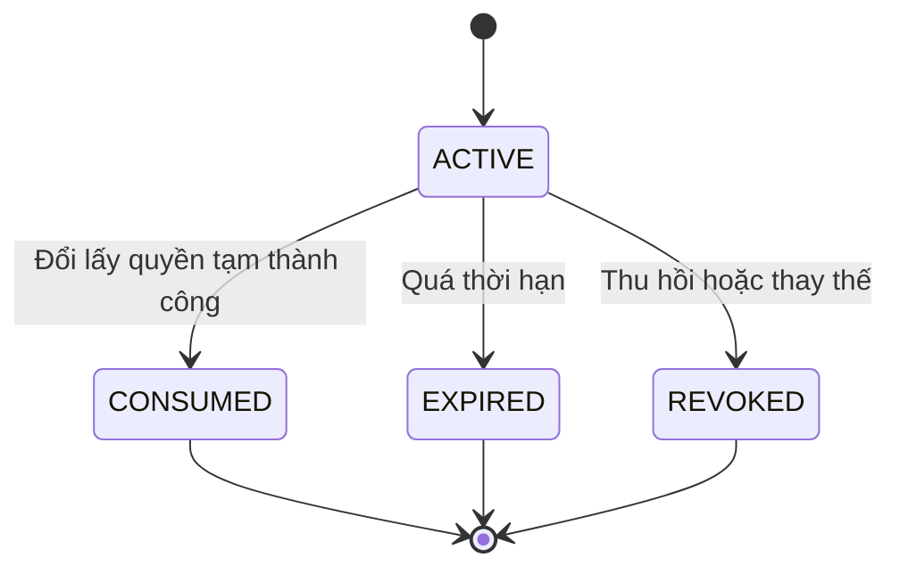

# Recovery link single use — Liên kết khôi phục chỉ dùng một lần

## 1. Dùng một lần là thuộc tính của quyền được cấp

Một email khôi phục thường chứa URL có token bí mật. Người nhận mở liên kết để chứng minh khả năng truy cập kênh email và tiếp tục quy trình khôi phục tài khoản. Nếu cùng token có thể tiếp tục cấp quyền sau lần sử dụng thành công, người giữ bản sao email hoặc URL có thể phát lại nó để chiếm quyền.

**Single use** có nghĩa là một token chỉ được chấp nhận cho tối đa một lần chuyển trạng thái có cấp quyền theo thiết kế. Hệ thống phải thực thi giới hạn này ở phía máy chủ, kể cả khi hai trình duyệt, hai máy chủ ứng dụng hoặc hai vùng triển khai cùng nhận token trong một thời điểm.

Bài học thuộc phần khôi phục bằng liên kết email của module khôi phục tài khoản an toàn. Liên kết có thể phục vụ đặt lại mật khẩu hoặc làm một bước bằng chứng trong quy trình xử lý mất MFA, passkey hay thiết bị. Xác minh email không tự cấp quyền bỏ mọi yếu tố xác thực; mục đích và mức quyền phải do chính sách khôi phục quyết định.

Cần phân biệt ba thuộc tính:

| Thuộc tính | Câu hỏi được giải quyết | Điều chưa được bảo đảm |
| --- | --- | --- |
| Khó đoán | Người ngoài có thể đoán được token không? | Token bị lộ vẫn có thể bị dùng |
| Có thời hạn | Token còn được chấp nhận đến khi nào? | Trong thời hạn vẫn có thể bị phát lại nếu không có trạng thái tiêu thụ |
| Chỉ dùng một lần | Token có thể cấp quyền bao nhiêu lần? | Người dùng đầu tiên chưa chắc là chủ tài khoản nếu token đã bị đánh cắp |

Mục tiêu là **tối đa một lần cấp quyền thành công**, không phải bảo đảm mọi người nhận email đều hoàn tất đúng một lần bất chấp lỗi mạng. Tính sẵn sàng và khôi phục sau lỗi cần thiết kế riêng, không được giải quyết bằng cách cho token đã dùng tiếp tục cấp quyền.

## 2. Xác định chính xác thời điểm tiêu thụ liên kết

Có hai cách thiết kế thường gặp:

| Mô hình | Thời điểm token email bị tiêu thụ | Hệ quả cần xử lý |
| --- | --- | --- |
| Tiêu thụ khi hoàn tất hành động | Cùng giao dịch đổi mật khẩu hoặc hoàn tất bước được cho phép | Trước đó có thể mở nhiều trang, nhưng chỉ một lần hoàn tất được chấp nhận |
| Đổi token lấy quyền khôi phục giới hạn | Cùng giao dịch tạo một quyền tạm sau khi người dùng xác nhận | Token email hết hiệu lực ngay; quyền tạm cũng phải có vòng đời và giới hạn sử dụng riêng |

Bài học dùng mô hình thứ hai để minh họa. Máy chủ nhận token qua một thao tác xác nhận rõ ràng, đánh dấu token đã dùng và tạo một quyền tạm chỉ cho phép tiếp tục đúng giao dịch. Nếu hệ thống chọn mô hình thứ nhất, điểm quyết định dùng một lần phải nằm ở thao tác cuối, không chỉ ở trang mở liên kết.

Ví dụ về các bước trong mô hình đổi quyền:

```text
GET trang nhận liên kết
    -> hiển thị bước tiếp tục, chưa tiêu thụ token
POST xác nhận dùng liên kết
    -> tiêu thụ token và tạo quyền khôi phục giới hạn
POST hoàn tất theo quyền được cấp
    -> tiêu thụ quyền giới hạn và thực hiện thay đổi được phép
```

Một yêu cầu `GET` có thể đến từ dịch vụ quét email, xem trước liên kết, trình duyệt tải trước hoặc người dùng tải lại trang. Không tiêu thụ token hay thay đổi thông tin xác thực chỉ vì URL được truy cập. Bước xác nhận bằng `POST` giảm nguy cơ tiêu thụ do quét liên kết thông thường; nó không chứng minh người bấm là chủ tài khoản và không thay thế cơ chế chống CSRF phù hợp.

Nếu trang tự động gửi `POST` khi vừa tải, lợi ích của bước xác nhận bị suy giảm. Giao diện nên yêu cầu hành động rõ ràng của người dùng trước khi chuyển quyền.

## 3. Trạng thái phía máy chủ và dữ liệu cần ràng buộc

Một bản ghi token có thể chứa:

```text
recoveryLink:
    linkId
    tokenDigest
    recoveryRequestId
    principalId
    realmId
    purpose
    issuedAt
    expiresAt
    consumedAt
    revokedAt
    recoveryGeneration
```

Đây là mô hình minh họa, không yêu cầu nhúng các trường đó vào URL. `principalId` là định danh tài khoản nội bộ ổn định; `recoveryRequestId` xác định giao dịch; `purpose` phân biệt bằng chứng email, đặt lại mật khẩu hoặc mục đích khác được chính sách cho phép.

`recoveryGeneration` đại diện cho thế hệ quyền của yêu cầu hoặc tài khoản theo thiết kế. Khi gửi liên kết thay thế, hủy yêu cầu hoặc xảy ra thay đổi bảo mật liên quan, hệ thống có thể thay thế hệ phiên bản để vô hiệu hóa quyền cũ. Cần xác định rõ phạm vi và những sự kiện làm thay đổi phiên bản, không dùng một số phiên bản mà các endpoint diễn giải khác nhau.

Trạng thái hiệu lực của liên kết có thể được hiểu như sau:



Một cột `status` riêng không phải bắt buộc nếu các trường thời gian và phiên bản biểu diễn đủ trạng thái. Dù cách lưu là gì, một liên kết chỉ được chấp nhận khi đồng thời thỏa các điều kiện cần thiết:

- Token khớp bản ghi và đúng mục đích, phạm vi tài khoản hoặc tenant.
- Chưa bị tiêu thụ, chưa bị thu hồi và chưa hết hạn theo thời gian máy chủ đáng tin cậy.
- Giao dịch cha vẫn cho phép bước đang thực hiện; tài khoản vẫn đủ điều kiện theo chính sách.
- Thế hệ quyền và các liên kết kênh liên quan vẫn hợp lệ.

Tác vụ dọn dữ liệu có thể chạy chậm. Việc chưa xóa một hàng hết hạn không có nghĩa token vẫn hợp lệ; endpoint phải tự kiểm tra thời hạn tại thời điểm cấp quyền.

## 4. Sinh token khó đoán và lưu bản đối chiếu

Token nên được tạo từ nguồn ngẫu nhiên mật mã và có đủ entropy. Không tạo token từ email, thời gian hiện tại, mã tài khoản tăng dần hoặc bộ sinh số ngẫu nhiên dành cho mô phỏng.

Ví dụ Java sau sinh 32 byte ngẫu nhiên, tương ứng 256 bit dữ liệu ngẫu nhiên, rồi mã hóa Base64 URL không padding. Đây là ví dụ tạo bí mật và bản băm, chưa phải một dịch vụ khôi phục hoàn chỉnh:

```java
import java.nio.charset.StandardCharsets;
import java.security.MessageDigest;
import java.security.NoSuchAlgorithmException;
import java.security.SecureRandom;
import java.util.Base64;

final class RecoveryTokens {
    private static final SecureRandom RANDOM = new SecureRandom();

    static String newToken() {
        byte[] randomBytes = new byte[32];
        RANDOM.nextBytes(randomBytes);
        return Base64.getUrlEncoder().withoutPadding()
                .encodeToString(randomBytes);
    }

    static String digest(String token) throws NoSuchAlgorithmException {
        byte[] hash = MessageDigest.getInstance("SHA-256")
                .digest(token.getBytes(StandardCharsets.UTF_8));
        return Base64.getUrlEncoder().withoutPadding()
                .encodeToString(hash);
    }
}
```

Máy chủ lưu bản băm để tra cứu và gửi token gốc qua kênh email đã đăng ký. Với bí mật ngẫu nhiên có entropy cao, cách băm nhanh này khác với việc bảo vệ mật khẩu do con người chọn. Không áp dụng ví dụ trực tiếp cho OTP ngắn hoặc mật khẩu; các loại bí mật đó có rủi ro đoán và chính sách bảo vệ khác.

Cần hạn chế độ dài và kiểm tra định dạng đầu vào trước khi xử lý. Token là chuỗi có phân biệt hoa thường; không tự chuyển chữ thường, cắt một phần hoặc chuẩn hóa theo quy tắc của email. Một giá trị mã hóa hợp lệ vẫn phải vượt qua kiểm tra trạng thái và quyền.

JWT hoặc token có chữ ký không tự có tính dùng một lần. Chữ ký xác nhận tính toàn vẹn, còn `exp` giới hạn thời gian. Ngay cả khi có `jti`, máy chủ vẫn cần trạng thái dùng chung hoặc cơ chế tương đương để quyết định mã đó đã được tiêu thụ hay chưa. Token ngẫu nhiên đối chiếu với trạng thái phía máy chủ thường giúp diễn đạt yêu cầu này trực tiếp hơn.

## 5. Tiêu thụ nguyên tử khi có nhiều yêu cầu đồng thời

Một lỗi phổ biến là đọc rồi ghi bằng hai thao tác độc lập:

```text
if token.consumedAt is null:
    createRecoveryGrant()
    token.consumedAt = now
```

Hai tiến trình có thể cùng đọc giá trị rỗng rồi cùng tạo quyền. Khóa trong bộ nhớ của một tiến trình không bảo vệ được cụm có nhiều instance, và thao tác vô hiệu hóa cache sau đó không sửa được quyền đã cấp.

Một cách tổ chức đúng là phối hợp kiểm tra, tiêu thụ và tạo quyền trong một giao dịch lưu trữ. Mã giả dưới đây giả định các bản ghi liên quan nằm trong phạm vi giao dịch đó:

```text
exchangeLink(rawToken, expectedRealm, expectedPurpose):
    digest = digestOfValidatedToken(rawToken)
    reference = findImmutableLinkReference(digest)
    if reference is absent:
        return UNUSABLE_LINK

    begin transaction
    request = lockRecoveryRequest(reference.requestId)
    link = lockRecoveryLink(reference.linkId)
    now = trustedServerTimeAfterLocks()

    require request permits this recovery step
    require link matches digest, realm, purpose and request
    require link.consumedAt is null
    require link.revokedAt is null
    require now < link.expiresAt
    require request and channel versions remain valid

    markLinkConsumed(link, now)
    grant = createLimitedGrantForThisRequest(request, link, now)
    recordVerifiedEmailEvidence(request, link)
    appendSecurityEventWithoutSecrets(request, link)
    commit

    return grant through a protected delivery mechanism
```

Tra cứu ban đầu chỉ giúp tìm bản ghi cần khóa; các điều kiện có ý nghĩa bảo mật phải được kiểm tra lại bên trong giao dịch. Nếu không có bản ghi, token sai hoặc điều kiện không đạt, không tạo quyền. Các đường hủy, gửi liên kết thay thế và hoàn tất cũng cần phối hợp cùng dữ liệu trạng thái theo thứ tự khóa thống nhất để tránh quyết định dựa trên phiên bản cũ.

Thay vì khóa liên kết, có thể dùng cập nhật có điều kiện và yêu cầu chính xác một hàng được cập nhật. Ví dụ SQL khái niệm cho phần tiêu thụ:

```sql
UPDATE recovery_link
SET consumed_at = :now
WHERE link_id = :link_id
  AND token_digest = :token_digest
  AND purpose = :purpose
  AND consumed_at IS NULL
  AND revoked_at IS NULL
  AND expires_at > :now
  AND recovery_generation = :expected_generation;
```

Câu lệnh này chỉ minh họa việc giành quyền tiêu thụ. Kiểm tra trạng thái yêu cầu cha, phạm vi tenant, phiên bản hiện tại và việc tạo quyền tạm vẫn phải được phối hợp trong cùng cơ chế nguyên tử. Chỉ tạo quyền nếu số hàng cập nhật là một. Nếu tạo quyền thất bại, giao dịch phải rollback cả dấu tiêu thụ; nếu cập nhật thành công nhưng cấp quyền ở thao tác độc lập sau commit, lỗi giữa hai bước sẽ khiến token mất hiệu lực mà chưa có quyền được tạo.

Đường quyết định phải dùng nguồn trạng thái có tính nhất quán đủ mạnh. Đọc replica trễ rồi cấp quyền ở mỗi máy chủ không bảo đảm dùng một lần. Trong mô hình nhiều vùng, cần một nơi quyết định duy nhất hoặc cơ chế đồng thuận, giao dịch tương đương cho việc giành quyền tiêu thụ. Khi không xác định được kết quả, không tiếp tục cấp quyền chỉ để tránh báo lỗi.

## 6. Quyền tạm sau khi đổi liên kết cũng cần dùng đúng một lần

Tiêu thụ token email rồi cấp một quyền tạm không giới hạn sẽ chỉ chuyển điểm phát lại sang một loại bí mật khác. Quyền tạm cần được ràng buộc với đúng tài khoản, giao dịch, mục đích, mức bằng chứng đã đạt và những thao tác còn được phép.

Ví dụ, quyền tạm có thể cho phép chọn mật khẩu mới nhưng chưa đủ để xóa MFA. Nếu đang khôi phục passkey, bằng chứng email có thể chỉ mở bước xác minh bổ sung. Không tự chuyển ngữ cảnh khôi phục thành phiên đăng nhập đầy đủ hoặc cấp quyền quản trị tài khoản.

Các kiểm soát cần có gồm:

- Thời hạn ngắn theo rủi ro và không kéo dài vô hạn khi người dùng tải lại trang.
- Trạng thái tiêu thụ hoặc trạng thái hoàn tất phía máy chủ để chỉ một hành động cuối được chấp nhận.
- Khả năng thu hồi khi yêu cầu bị hủy, kênh bị loại bỏ hoặc phiên bản bảo mật liên quan thay đổi.
- Cách chuyển quyền về trình duyệt an toàn, chẳng hạn cookie được bảo vệ phù hợp với ngữ cảnh, cùng kiểm soát CSRF cho các hành động dựa vào cookie.
- Kiểm tra lại chính sách và trạng thái giao dịch tại thao tác cuối, thay vì tin mọi quyết định đã được đưa ra khi mở email.

Một chính sách minh họa giới hạn thời hạn quyền tạm:

```text
grant.expiresAt = min(
    link.expiresAt,
    request.expiresAt,
    grant.issuedAt + configuredGrantLifetime
)
```

Sản phẩm có thể chọn quy tắc khác cho thời hạn bằng chứng và quyền thực thi, nhưng phải quy định rõ. Việc đổi liên kết lấy quyền tạm không nên tự tạo một thời gian khôi phục mới không liên quan đến giới hạn của giao dịch ban đầu.

Khi hoàn tất, việc đánh dấu quyền tạm đã dùng, đổi thông tin xác thực được phép và kết thúc giao dịch cần được phối hợp nguyên tử. Nếu thay đổi được thực hiện ở hệ thống bên ngoài, cần giao thức phối hợp và xử lý kết quả chưa xác định ở nơi thực thi thay đổi; một transaction cục bộ không tự bảo vệ toàn bộ thao tác xuyên dịch vụ.

Sau khi thành công, chính sách cần xử lý các quyền khôi phục cũ còn lại. Một lựa chọn là tăng thế hệ khôi phục của tài khoản để vô hiệu hóa các liên kết và quyền tạm đã phát trước đó. Việc phát liên kết mới, đổi thế hệ và hoàn tất phải được phối hợp để một thao tác đồng thời không phát lại quyền dựa trên phiên bản cũ. Các thay đổi phiên đăng nhập hiện hữu là quyết định riêng của chính sách sau khôi phục, cần được thực hiện có kiểm soát.

## 7. Mất phản hồi, rollback và yêu cầu thử lại

Tính dùng một lần thường bị phá ở những nhánh sửa lỗi trải nghiệm người dùng. Cần phân biệt các thời điểm thất bại:

| Tình huống | Trạng thái phía máy chủ | Cách xử lý phù hợp |
| --- | --- | --- |
| Dữ liệu gửi lên không hợp lệ trước khi trao đổi token | Chưa cấp quyền | Từ chối theo chính sách, không coi việc phân tích đầu vào là lần cấp quyền thành công |
| Giao dịch trao đổi token bị rollback | Chưa commit dấu tiêu thụ và quyền tạm | Có thể thử lại khi token vẫn còn hiệu lực |
| Đã commit nhưng phản hồi bị mất | Token đã dùng, quyền tạm có thể đã được tạo | Không phát một quyền mới chỉ vì client gửi lại token |
| Đã nhận quyền tạm nhưng mất ngữ cảnh trình duyệt | Token email vẫn đã dùng | Dùng luồng bắt đầu lại hoặc cơ chế khôi phục ngữ cảnh được xác thực riêng |
| Hoàn tất khôi phục đã commit nhưng phản hồi bị mất | Thông tin xác thực đã thay đổi | Không thực hiện lại thay đổi bằng token đã dùng; phản hồi theo cơ chế kiểm tra kết quả có quyền |

Nếu cần thử lại an toàn sau mất phản hồi, có thể thiết kế một khóa idempotency gắn với cùng thao tác và ngữ cảnh client được bảo vệ. Máy chủ lưu kết quả có giới hạn và kiểm tra quyền truy cập kết quả đó. Một chuỗi idempotency tùy ý do người gọi đặt không phải bằng chứng rằng họ là client đã giành quyền tiêu thụ trước đó.

Đặc biệt, không cho bất kỳ người giữ token đã dùng nào gọi lại để nhận quyền tạm được tạo ở lần đầu. Nếu làm vậy, token email vẫn là chìa khóa để lấy quyền sau khi bị tiêu thụ, và ý nghĩa dùng một lần đã bị mất.

Nếu không triển khai được cơ chế trả lại kết quả với ràng buộc đủ mạnh, lựa chọn đơn giản hơn là báo liên kết không còn dùng được và hướng dẫn tạo yêu cầu mới theo hạn mức. Sự bất tiện khi mất kết nối cần được cân nhắc, nhưng không được tự động giải quyết bằng cách xóa `consumedAt` hoặc mở lại bản ghi.

Một yêu cầu lặp có thể nhận cùng thông báo kết quả mà không gây tác động mới. Tính idempotent của phản hồi không đồng nghĩa với việc chấp nhận token lần thứ hai để cấp thêm quyền.

## 8. Gửi lại email và nhiều liên kết cùng tồn tại

**Mỗi token chỉ dùng một lần** và **chỉ một liên kết được phép còn hiệu lực** là hai chính sách khác nhau. Một hệ thống có thể bảo đảm thuộc tính thứ nhất nhưng vẫn giữ nhiều token đang hoạt động cho cùng tài khoản.

Khi người dùng yêu cầu gửi lại, cần chọn và mô tả rõ chính sách:

| Chính sách minh họa | Cách thực hiện | Điều phải cân nhắc |
| --- | --- | --- |
| Liên kết mới thay thế liên kết cũ của yêu cầu | Phát token mới và vô hiệu hóa thế hệ trước trong cùng thao tác được phối hợp | Email đến sai thứ tự có thể khiến người dùng mở nhầm liên kết cũ |
| Cho một số liên kết cùng hiệu lực | Mỗi token có trạng thái dùng một lần; giao dịch vẫn chỉ được hoàn tất một lần | Cần vô hiệu hóa quyền còn lại khi giao dịch kết thúc và kiểm soát số lượng |
| Gửi lại cùng thông điệp đang chờ | Giữ cùng token theo thiết kế lưu trữ và giao hàng đã chọn | Không được đặt lại thời hạn hoặc dấu tiêu thụ chỉ để gửi lại |

Không tạo lại token gốc từ một bản băm. Nếu chọn chỉ lưu bản băm, hệ thống không thể khôi phục bí mật để gửi lại theo cách đó; cần phát token mới hoặc dùng cơ chế lưu thông điệp bí mật có bảo vệ và thời hạn riêng. Dữ liệu chứa token trong hàng đợi hoặc nhà cung cấp email cũng là bí mật cần kiểm soát truy cập và thời gian lưu.

Với chính sách thay thế, việc phát mới không được làm sống lại token đã dùng hoặc kéo dài thời hạn của giao dịch vô hạn. Một tác vụ gửi chậm có thể vẫn giao email cũ sau email mới, nên máy chủ phải quyết định hiệu lực theo trạng thái hiện tại, không theo thời điểm người dùng đọc thư.

Nếu endpoint gửi lại có thể được gọi chỉ bằng email, kẻ tấn công có thể cố liên tục thay liên kết của nạn nhân. Cần kiểm soát tần suất, ngân sách theo tài khoản và ngữ cảnh giao dịch phù hợp; không xem mỗi lần gửi lại là một giao dịch độc lập được cấp lại toàn bộ hạn mức. Phản hồi công khai cũng cần tránh làm lộ tài khoản tồn tại hay thời điểm token đã được dùng.

## 9. Thu hồi, cache và tính nhất quán

Một liên kết còn chưa dùng vẫn có thể phải bị từ chối khi yêu cầu bị hủy, tài khoản bị đình chỉ hoặc kênh nhận thư đã bị thu hồi khỏi vai trò khôi phục. `consumedAt` rỗng chỉ là một điều kiện, không phải toàn bộ quyết định cấp quyền.

Các đường trao đổi token, gửi lại, hủy và hoàn tất cần cùng hiểu trạng thái cha và phiên bản bảo mật. Nếu việc thu hồi chỉ cập nhật cơ sở dữ liệu nhưng endpoint trao đổi tin cache cũ, token có thể tiếp tục được dùng ngoài chính sách.

Cache có thể hỗ trợ tìm bản ghi hoặc giảm tải ở những bước không quyết định quyền. Tại điểm tiêu thụ, cần đọc và cập nhật nguồn trạng thái có bảo đảm nhất quán thích hợp, hoặc một cơ chế nguyên tử tương đương. TTL ngắn của cache không thay thế bảo đảm dùng một lần.

Không dựa riêng vào một tập hợp đánh dấu token đã dùng trong bộ nhớ cục bộ. Tập hợp đó có thể mất khi tiến trình khởi động lại, không đồng bộ giữa instance hoặc bị xóa sớm hơn thời hạn chấp nhận token. Nếu dùng kho dùng chung chuyên biệt, phải giải quyết đồng thời độ bền, tính nguyên tử và việc phối hợp với quyền tạm hoặc thông tin xác thực ở kho khác.

Một thông báo thu hồi qua sự kiện có thể bị trễ. Đường cấp quyền phải có cơ chế kiểm tra đủ mới hoặc bảo đảm tương đương; không cấp quyền trước rồi hy vọng sự kiện sẽ sửa được kết quả sau đó.

## 10. Bảo vệ URL và trải nghiệm khi liên kết không dùng được

Tính dùng một lần giảm nguy cơ phát lại sau thành công, nhưng không ngăn người đánh cắp token giành lần dùng đầu tiên. Cần bảo vệ token trên toàn bộ đường đi:

- Dùng HTTPS và dựng URL khôi phục từ cấu hình miền tin cậy; không lấy tùy ý giá trị Host hoặc miền do client gửi để tạo thư.
- Che token trong log của proxy, máy chủ, công cụ theo dõi lỗi và hệ thống phân tích; che ở ứng dụng là chưa đủ nếu tầng trước đã ghi URL đầy đủ.
- Trang xử lý bí mật dùng chính sách cache phù hợp, ví dụ `Cache-Control: no-store`, và chính sách referrer phù hợp, ví dụ `Referrer-Policy: no-referrer`.
- Hạn chế tài nguyên bên thứ ba trên trang chứa token. Nếu chuyển sang URL sạch, giữ ngữ cảnh chờ trong cơ chế được bảo vệ; thao tác điều hướng đó không được tự cấp quyền khôi phục.
- Không gửi token đến địa chỉ email tùy ý ở bước cuối và không dùng email do client nhập lại để chọn tài khoản sẽ bị thay đổi.

Không nên gắn cứng token vào IP chỉ để đạt tính dùng một lần: người dùng có thể mở email trên thiết bị khác hoặc đổi mạng. Ràng buộc thiết bị hay ngữ cảnh trình duyệt là lựa chọn bổ sung theo mô hình rủi ro, cần cân bằng với khả năng khôi phục; nó không thay thế trạng thái tiêu thụ nguyên tử.

Khi liên kết đã dùng, hết hạn, bị thu hồi hoặc không hợp lệ, giao diện cần hướng dẫn bước tiếp theo mà không hiển thị dữ liệu tài khoản nhạy cảm. Một thông điệp có thể là: “Liên kết này không còn sử dụng được. Nếu bạn vẫn cần khôi phục, hãy bắt đầu yêu cầu mới.” Không đặt lại mật khẩu hoặc tự đăng nhập chỉ để giúp người dùng vượt qua lỗi liên kết.

Trong ngữ cảnh có quyền xem trạng thái của chính giao dịch, hệ thống có thể giải thích cụ thể hơn. Ở đầu vào công khai, cần tránh biến sự khác biệt giữa token sai, đã dùng và tài khoản không tồn tại thành kênh dò dữ liệu. Không trả token, bản băm token hoặc quyền tạm trong thông báo lỗi.

## 11. Ví dụ: cùng một email được mở trên hai thiết bị

Lan yêu cầu khôi phục mật khẩu cho tài khoản `p-216`. Hệ thống tạo giao dịch `r-563`, token `T` và gửi liên kết tới kênh email đủ điều kiện. Cả điện thoại và máy tính của Lan đều có bản sao email đó.

1. Hai thiết bị mở URL bằng `GET`. Cả hai có thể thấy trang xác nhận, nhưng token chưa bị tiêu thụ và chưa có quyền đặt lại mật khẩu.
2. Lan bấm tiếp tục trên cả hai thiết bị gần như cùng lúc. Hai yêu cầu trao đổi tới hai instance ứng dụng khác nhau.
3. Cơ chế nguyên tử chỉ cho một giao dịch tiêu thụ `T` và tạo quyền tạm `G`. Yêu cầu còn lại không nhận thêm quyền tạm từ `T`.
4. Thiết bị thắng dùng `G` để gửi mật khẩu mới. Máy chủ kiểm tra quyền, trạng thái và thời hạn, rồi phối hợp tiêu thụ `G` với đổi mật khẩu và kết thúc `r-563`.
5. Bản sao email được mở lại không cấp quyền. Nếu chính sách vô hiệu hóa các quyền khôi phục cũ sau thành công, các liên kết và quyền tạm thuộc thế hệ cũ cũng bị từ chối.

Nếu phản hồi ở bước 3 bị mất, token không tự quay về chưa dùng. Hệ thống chỉ khôi phục kết quả bằng cơ chế thử lại có ràng buộc đúng client nếu đã thiết kế cơ chế đó; nếu không, Lan cần bắt đầu lại theo hướng dẫn.

Nếu người đánh cắp email dùng `T` trước Lan, tính dùng một lần vẫn có thể được bảo đảm nhưng tài khoản vẫn gặp nguy hiểm. Đây là lý do cần đánh giá độ tin cậy của email, yêu cầu bằng chứng bổ sung cho hành động nhạy cảm như thay MFA và gửi thông báo bảo mật phù hợp sau thay đổi.

## 12. Các tình huống cần kiểm chứng khi triển khai

| Tình huống | Kết quả cần bảo đảm |
| --- | --- |
| Token mới đúng mục đích và còn hạn | Chỉ cấp quyền giới hạn được chính sách cho phép |
| Cùng token được trao đổi đồng thời trên nhiều instance | Tối đa một lần trao đổi cấp quyền thành công |
| Mở trang, tải lại hoặc trình quét email truy cập GET | Không tiêu thụ token và không thay thông tin xác thực |
| Dùng lại token sau khi đã đổi lấy quyền tạm | Không tạo quyền mới và không trả quyền cũ cho người chỉ giữ token |
| Token hết hạn nhưng tác vụ dọn dữ liệu chưa chạy | Bị từ chối tại điểm kiểm tra quyền |
| Token còn hạn nhưng giao dịch bị hủy hoặc thế hệ đã đổi | Bị từ chối theo trạng thái và phiên bản hiện tại |
| Tạo quyền tạm thất bại trước commit | Không để lại dấu tiêu thụ đã commit riêng lẻ |
| Phản hồi mất sau commit | Không mở lại token hoặc cấp quyền lần thứ hai |
| Gửi lại email và email cũ đến sau | Tuân theo chính sách thay thế hoặc nhiều liên kết đã công bố |
| Dùng token sai tenant hoặc sai mục đích | Không chuyển sang tài khoản hoặc quyền khác |
| Quyền tạm được dùng để hoàn tất đồng thời | Tối đa một thay đổi cuối được chấp nhận |
| Cache cũ, replica trễ hoặc khởi động lại máy chủ | Không làm mất lịch sử tiêu thụ hoặc cho phát lại |
| JWT còn chữ ký đúng sau khi đã dùng | Vẫn bị từ chối bởi cơ chế trạng thái dùng một lần |
| Log, thông báo lỗi và công cụ phân tích | Không để lộ bí mật giúp người khác giành lần dùng đầu tiên |

Một liên kết chỉ thực sự dùng một lần khi mọi đường cấp quyền cùng tôn trọng trạng thái tiêu thụ được quyết định nguyên tử. Cần theo dõi cả token email lẫn quyền tạm phát sinh, vì chặn phát lại ở một bước không đủ nếu bước kế tiếp vẫn cho phép tái sử dụng quyền khôi phục.
