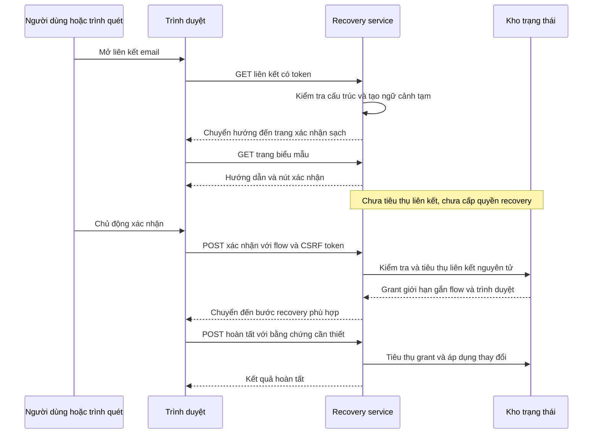

# Recovery link confirmation

Khi người dùng mở liên kết khôi phục trong email, máy chủ cần xác định điều gì đã được chứng minh và hành động nào được phép thực hiện tiếp theo. Một lượt tải URL chưa đủ để kết luận người dùng đã chủ động xác nhận: hệ thống quét email, công cụ xem trước liên kết và trình duyệt có thể tự mở trang trước họ.

Bài học thuộc chương **Email Link Recovery** của module `SECURITY_AUTHENTICATION_ACCOUNT_RECOVERY`. Trọng tâm là thiết kế bước xác nhận liên kết email khi người dùng mất mật khẩu, MFA, passkey hoặc thiết bị xác thực. Luồng cần bảo vệ token dùng một lần, chống phát lại, đánh giá rủi ro và kiểm soát quyền cùng session để giảm nguy cơ chiếm đoạt tài khoản.

Sau bài học, bạn có thể:

- Tách việc mở trang, xác nhận liên kết và hoàn tất recovery thành các bước có quyền khác nhau.
- Tránh tiêu thụ token chỉ vì trình quét hoặc cơ chế xem trước tải liên kết.
- Kiểm tra token và chuyển trạng thái nguyên tử, kể cả khi có hai request đồng thời.
- Cấp quyền recovery giới hạn, bảo vệ bước xác nhận khỏi CSRF và hạn chế rò rỉ token.
- Xử lý hết hạn, tải lại trang, mất phản hồi và mở liên kết trên thiết bị khác.

## 1. Xác nhận liên kết chứng minh điều gì?

Một liên kết recovery thường chứa bí mật ngẫu nhiên được gửi đến email đã xác minh của tài khoản. Người trình được bí mật có khả năng đã tiếp cận email, một bản chuyển tiếp hoặc một nơi khác đã làm lộ liên kết.

Đây là bằng chứng về khả năng tiếp cận bí mật của kênh email trong bối cảnh cụ thể. Nó không chứng minh tuyệt đối danh tính pháp lý, sự an toàn của hộp thư hoặc quyền bỏ qua mọi yếu tố xác thực khác.

Cần phân biệt ba bước:

| Bước | Người dùng hoặc phần mềm làm gì? | Máy chủ có thể cho phép gì? |
|---|---|---|
| Mở liên kết | Tải trang đích bằng GET | Hiển thị hướng dẫn và tạo ngữ cảnh biểu mẫu tạm thời |
| Xác nhận chủ động | Gửi POST từ biểu mẫu được bảo vệ | Kiểm tra token, tiêu thụ quyền từ liên kết và tạo quyền recovery giới hạn |
| Hoàn tất recovery | Gửi mật khẩu mới hoặc hoàn thành bằng chứng bổ sung | Áp dụng đúng thay đổi được cấp quyền và xử lý session theo chính sách |

Màn hình “Đã xác nhận liên kết” không được khiến người dùng hiểu rằng mật khẩu đã đổi hoặc MFA đã được khôi phục. Trạng thái giao diện phải phản ánh đúng bước nghiệp vụ.

Một email link đủ điều kiện cho luồng đặt lại mật khẩu của sản phẩm chưa chắc đủ để lấy lại MFA hoặc đăng ký passkey thay thế. Mức bảo đảm cần thiết được quyết định bởi mục đích recovery và rủi ro tài khoản.

## 2. Vì sao không tiêu thụ token bằng GET?

Hệ thống email có thể tải liên kết để phát hiện mã độc. Ứng dụng nhắn tin có thể lấy metadata để tạo bản xem trước. Người dùng có thể mở nhầm rồi đóng trang. Nếu GET đánh dấu token đã dùng, người dùng thật sẽ nhận thông báo hết hiệu lực dù chưa thao tác.

Ví dụ nguy hiểm:

```text
GET /recovery/link?token=...
    đánh dấu token đã dùng
    xóa MFA hoặc đăng nhập tài khoản
    chuyển hướng đến trang tiếp theo
```

Đổi GET thành một endpoint tên “confirm” không giải quyết được vấn đề nếu trang vẫn tự gửi POST ngay khi tải. Cần một thao tác xác nhận có chủ đích, chẳng hạn nút “Xác nhận và tiếp tục”, thay vì JavaScript tự submit khi trang mở.

Các yêu cầu tải trang như GET, HEAD hoặc prefetch không được:

- Đổi mật khẩu, thay email hoặc xóa yếu tố xác thực.
- Đánh dấu recovery đã hoàn tất.
- Tiêu thụ token recovery hay đặt token vào trạng thái dành riêng cho trình quét.
- Tạo session đăng nhập thông thường hoặc thu hồi session của nạn nhân.
- Gia hạn token hoặc đặt lại bộ đếm bảo mật.

Tạo cookie trình duyệt vô danh hay ngữ cảnh biểu mẫu tạm thời không đồng nghĩa với thay đổi trạng thái quyền của tài khoản. Việc tạo ngữ cảnh này vẫn cần giới hạn tài nguyên để không trở thành nguồn lạm dụng.

POST với nút xác nhận giúp phân tách hành vi tải trang thông thường khỏi hành động nghiệp vụ. Nó không chứng minh chắc chắn có con người: phần mềm tự động đủ khả năng vẫn có thể gửi POST. Với rủi ro cao, cần bằng chứng bổ sung và đánh giá rủi ro, không dựa hoàn toàn vào user agent, CAPTCHA hoặc giả định trình quét chỉ biết GET.

## 3. Một luồng xác nhận tham chiếu

Bài học sử dụng thiết kế: **POST xác nhận tiêu thụ liên kết và tạo một grant recovery được lưu phía máy chủ, ràng buộc với flow và trình duyệt**. Grant chỉ cấp quyền hạn chế để đi tiếp; nó không phải session đăng nhập thông thường.



Có thể thiết kế theo cách chỉ tiêu thụ email token khi người dùng gửi mật khẩu mới, thay vì có grant trung gian. Nếu chọn cách đó, vẫn phải bảo đảm GET không làm thay đổi quyền và bước cuối tiêu thụ token nguyên tử. Không trộn hai mô hình đến mức token bị đánh dấu đã dùng nhưng không còn cách tiếp tục hợp lệ.

## 4. Đưa token từ URL vào ngữ cảnh được kiểm soát

### 4.1. Trang vào ban đầu

Một liên kết minh họa có thể là:

```text
https://accounts.example.com/recovery/link?t=<opaque-token>
```

`opaque-token` là bí mật ngẫu nhiên khó đoán, không phải email, account ID hay chuỗi suy ra từ thời gian. Ví dụ, thiết kế có thể sinh 32 byte ngẫu nhiên mật mã rồi biểu diễn bằng Base64url. Lượng ngẫu nhiên và cách biểu diễn phải được xác định rõ trong triển khai.

Máy chủ kiểm tra giới hạn độ dài và bảng ký tự trước khi xử lý. Token là dữ liệu opaque: không đổi hoa thường, chuẩn hóa Unicode, bỏ ký tự hoặc thử sửa chuỗi gần giống để tìm token hợp lệ.

Trang vào có thể thực hiện các bước sau mà chưa tiêu thụ liên kết:

1. Nhận token qua HTTPS và phân tích nghiêm ngặt.
2. Tính digest dùng để tra cứu; không ghi token thô vào log.
3. Tạo một flow tạm gắn với bí mật cookie của trình duyệt và digest ứng viên.
4. Chuyển hướng đến trang xác nhận không còn token trong URL.

Ví dụ phản hồi chuyển hướng:

```http
HTTP/1.1 303 See Other
Location: /recovery/confirm?flow=<random-flow-handle>
Cache-Control: no-store
Referrer-Policy: no-referrer
Set-Cookie: __Host-recovery-browser=<random-secret>; Path=/; Secure; HttpOnly; SameSite=Lax
```

Cookie minh họa được máy chủ sinh, không có thuộc tính Domain và chỉ truyền qua HTTPS. Khi đã có cookie hợp lệ, hệ thống cần quản lý vòng đời phù hợp thay vì ghi đè vô điều kiện mỗi lần mở một tab.

Flow handle không được tự cấp quyền recovery. Máy chủ phải kiểm tra nó đi cùng browser binding đúng; người chỉ biết handle từ URL không được dùng nó để xác nhận hoặc tiếp tục.

### 4.2. Không khóa token cho trình duyệt đầu tiên chỉ bằng GET

Trình quét có thể tạo flow tạm của riêng nó. Flow đó chưa được quyền tiêu thụ token, và không được chiếm quyền sở hữu liên kết để chặn người dùng thật mở sau.

Một lần mở GET có thể ghi một ngữ cảnh biểu mẫu có hạn dùng ngắn, nhưng không được đặt cờ “token đã thuộc trình duyệt này” trong bản ghi liên kết. Việc ràng buộc grant với trình duyệt diễn ra khi POST xác nhận thành công.

Nếu người dùng mở cùng liên kết ở hai tab, mỗi tab cần có flow rõ ràng. Tránh một biến session duy nhất như `currentRecoveryAccount` bị tab mới ghi đè, khiến biểu mẫu ở tab cũ tác động nhầm tài khoản.

Trong mô hình này, máy chủ có thể giữ digest của token ứng viên trong flow thay cho token thô. API công khai không được chấp nhận digest thay cho token gốc. Phải hạn chế quyền truy cập kho flow vì trạng thái bên trong nó có vai trò trong quá trình cấp quyền.

### 4.3. URL sạch không xóa được mọi dấu vết

Chuyển hướng không xóa token đã đi qua CDN, load balancer, reverse proxy hoặc access log của request đầu tiên. Cấu hình che hoặc loại token phải bao phủ toàn bộ đường đi, kể cả tracing, báo lỗi và công cụ hỗ trợ khách hàng.

Các trang recovery nên tránh tài nguyên bên thứ ba, công cụ analytics và script không cần thiết. Dùng `Cache-Control: no-store`, `Referrer-Policy: no-referrer` và chính sách nội dung phù hợp. Không để service worker hoặc cơ chế cache của ứng dụng lưu bí mật recovery.

Nếu chọn URL fragment để giảm việc gửi token trong request ban đầu, cần một thiết kế client riêng: fragment không tự đến máy chủ, JavaScript phải xử lý và vẫn có nguy cơ XSS, lịch sử hoặc extension đọc token. Đây không phải cách tự động thay thế cho bảo vệ token và xác nhận chủ động.

## 5. Trang xác nhận và bảo vệ CSRF

Trang xác nhận cần mô tả hành động cụ thể, ví dụ:

> Xác nhận liên kết để tiếp tục đặt lại mật khẩu. Mật khẩu chưa được thay đổi ở bước này.

Nút xác nhận gửi POST với flow handle và CSRF token gắn với flow cùng browser binding. Không dùng email token làm CSRF token và không chỉ kiểm tra “request có cookie” rồi coi là đủ.

Một request minh họa:

```http
POST /recovery/confirm HTTP/1.1
Content-Type: application/x-www-form-urlencoded
Origin: https://accounts.example.com

flow=<flow-handle>&csrf=<csrf-token>&operation=<confirmation-operation-id>
```

Các kiểm tra liên quan gồm:

- Flow tồn tại, chưa hết hạn và thuộc đúng browser binding.
- CSRF token khớp ngữ cảnh biểu mẫu.
- Origin hoặc thông tin nguồn phù hợp với chính sách ứng dụng khi áp dụng được.
- Content type, phương thức và kích thước request đúng hợp đồng.
- Quota và tín hiệu rủi ro được đánh giá theo chính sách.

`SameSite` hỗ trợ giảm một số kiểu request chéo site nhưng không thay thế CSRF token. Origin cũng không phải bằng chứng sở hữu tài khoản và không nên được so với một Host header chưa được tin cậy. Origin chính thức phải đến từ cấu hình đã kiểm soát.

Không nhúng trang xác nhận trong iframe của bên khác. Có thể dùng chính sách như `frame-ancestors 'none'` để giảm clickjacking khi phù hợp với sản phẩm. Giao diện không được tự submit hoặc gắn thao tác xác nhận vào sự kiện tải trang.

Nếu người dùng đang đăng nhập tài khoản B nhưng liên kết thuộc tài khoản A, máy chủ không được lấy B từ session hiện có rồi áp dụng recovery vào B. Đích của luồng xuất phát từ bản ghi token đã xác thực. Cần làm rõ ngữ cảnh chuyển tài khoản phù hợp mà không tự thay session đăng nhập hiện tại.

## 6. Kiểm tra token và cấp grant nguyên tử

### 6.1. Những trường phải ràng buộc

Một bản ghi liên kết có thể gồm:

```text
RecoveryLink
  link_id
  token_digest
  account_id
  tenant_id
  purpose
  channel_id
  channel_version
  security_version
  expires_at
  state
  consumed_at

ConfirmationFlow
  flow_id
  browser_binding_digest
  candidate_link_digest
  csrf_digest
  confirmation_operation_id
  state
  resulting_grant_id
  expires_at

RecoveryGrant
  grant_id
  flow_id
  account_id
  tenant_id
  purpose
  proof_type
  permitted_actions
  required_additional_proofs
  security_version
  channel_version
  expires_at
  state
```

Các tên trường là mô hình khái niệm. `proof_type` ghi nhận bằng chứng email link; nó không được bị nâng thành mức xác thực mạnh hơn chỉ vì trang hiển thị thành công.

Khi xác nhận, máy chủ kiểm tra ít nhất:

1. Digest token ứng viên khớp một liên kết hợp lệ.
2. Liên kết chưa bị tiêu thụ, thu hồi hoặc hết hạn theo thời gian máy chủ.
3. Tenant và purpose đúng với endpoint và flow đang xử lý.
4. Tài khoản còn đủ điều kiện thực hiện loại recovery đó.
5. Kênh nhận và phiên bản kênh còn phù hợp với chính sách.
6. Phiên bản trạng thái bảo mật chưa thay đổi theo cách vô hiệu hóa liên kết.
7. Các yêu cầu rủi ro hoặc bằng chứng bổ sung được giữ nguyên.

Không tin `account_id`, email, purpose hay action do hidden field gửi lên để thay thế những giá trị đã ràng buộc với token.

### 6.2. Không dùng phép đọc rồi ghi tách rời

Cách làm `if token chưa dùng → cấp grant → đánh dấu đã dùng` có thể cho hai request cùng đi qua. Cần transaction, khóa hoặc cập nhật có điều kiện với ràng buộc duy nhất phù hợp.

Mã giả minh họa:

```text
confirmRecoveryLink(flowHandle, csrf, operationId, browserSecret):
    validateRequestAndApplyLimits()
    validateFlowBindingAndCsrf(flowHandle, browserSecret, csrf)

    begin transaction
        flow = lockFlow(flowHandle)
        recheckFlowBindingAndExpiry(flow, browserSecret)

        if flow.alreadyConfirmedFor(operationId):
            grant = loadGrantBoundToSameBrowserAndFlow(flow)
            requireGrantStillEligibleForContinuation(grant)
            commit
            return redirectToExistingRecoveryStep()

        link = loadCandidateLink(flow.candidateLinkDigest)
        lockAccountSecurityStateAndLinkInDefinedOrder(link)
        requireLinkEligible(link, serverNow())
        requirePurposeAndVersionsStillValid(link, flow)

        grant = createRestrictedServerSideGrant(
            accountId = link.accountId,
            purpose = link.purpose,
            flow = flow,
            expiry = allowedGrantDeadline(link)
        )

        consumeLinkWithConditionalUpdate(link)
        recordSuccessfulConfirmation(flow, operationId, grant.id)
    commit

    return redirectToRecoveryStep()
```

Mã giả thể hiện ranh giới quyền và lưu trữ, chưa phải triển khai hoàn chỉnh. Thứ tự khóa phải nhất quán với các endpoint đổi kênh, tăng phiên bản bảo mật và hoàn tất recovery để tránh deadlock hoặc kiểm tra trên trạng thái đã lỗi thời.

Tạo grant, tiêu thụ liên kết và ghi kết quả xác nhận phải thành công cùng nhau. Nếu cập nhật tiêu thụ không tác động đúng một bản ghi vì request khác đã thắng, transaction không được giữ lại một grant mới.

Nếu có hai trình duyệt cùng xác nhận một liên kết, chỉ một chuyển trạng thái được phép thắng. Trình duyệt còn lại không được đọc grant của trình duyệt đã thắng chỉ vì nó biết cùng token email.

## 7. Grant sau xác nhận phải có quyền hạn chế

Grant recovery có thể cho phép xem biểu mẫu đặt mật khẩu mới hoặc đi tiếp bước xác minh đã định nghĩa. Nó không nên truy cập hộp thư nội bộ, thay hồ sơ, tạo API key, thực hiện thanh toán hay mở toàn bộ ứng dụng như session đăng nhập thông thường.

Các giới hạn cần xác định:

| Thuộc tính | Yêu cầu |
|---|---|
| Đích | Một account ID và tenant cố định |
| Mục đích | Một loại recovery đã ràng buộc |
| Quyền | Chỉ những action cần thiết cho luồng đó |
| Thời gian | Hạn ngắn, có deadline tuyệt đối |
| Trình duyệt | Gắn flow và bí mật browser binding thích hợp |
| Bằng chứng | Ghi rõ đã có email proof và còn thiếu những gì |
| Phát lại | Không thể dùng grant đã tiêu thụ để thực hiện lại hành động |

Ví dụ, sản phẩm có thể đặt hạn email link là 15 phút và grant là tối đa 5 phút. Một lựa chọn là đặt deadline grant bằng giá trị nhỏ hơn giữa hạn còn lại của liên kết và thời điểm xác nhận cộng 5 phút. Các số này chỉ minh họa; cần lựa chọn theo rủi ro và trải nghiệm thực tế.

Refresh trang hoặc retry POST không được gia hạn deadline. Không sao chép query token vào URL của các bước sau và không trả token gốc trong JSON để frontend tự giữ lâu dài.

Trong thiết kế grant phía máy chủ, browser secret đã được cấp trước xác nhận cùng flow tương ứng cho phép tiếp tục đúng grant của flow đó. Browser secret phải do máy chủ sinh, khó đoán, không nhận giá trị tùy ý do client chọn. Flow ID đơn lẻ hoặc một cookie do người khác cố định trước không được đủ để có quyền.

Session đăng nhập thông thường có vòng đời riêng. Nếu sau này thực hiện đăng nhập, phải tạo hoặc xoay session theo chính sách chống session fixation; không nâng nguyên một flow recovery thành session có mọi quyền bằng cách đổi một cờ đơn giản.

## 8. Hoàn tất recovery và kiểm soát session

Bước xác nhận liên kết không nên đổi credential. Khi người dùng gửi hành động cuối, máy chủ cần kiểm tra lại grant còn hiệu lực, purpose khớp, trạng thái bảo mật chưa đổi và các bằng chứng bổ sung đã đủ.

Với đặt lại mật khẩu, quy trình có thể gồm:

1. Kiểm tra mật khẩu mới theo chính sách, tránh tiêu thụ quyền chỉ vì lỗi nhập liệu có thể sửa.
2. Thực hiện các công việc tốn tài nguyên phù hợp ngoài vùng khóa dài nếu có thể.
3. Trong transaction, kiểm tra lại grant và trạng thái tài khoản.
4. Áp dụng mật khẩu mới, tiêu thụ grant và tăng phiên bản bảo mật cần thiết một cách nhất quán.
5. Vô hiệu hóa các quyền recovery cũ theo chính sách.
6. Ghi ý định thông báo và xử lý session hoặc refresh token bằng cơ chế bền vững phù hợp.

Hai request hoàn tất đồng thời không được cùng thực hiện như hai quyền độc lập. Nếu kho session nằm ở hệ thống khác, cần quy trình nhất quán cho việc thu hồi hoặc kiểm tra phiên bản session; không giả định database transaction tự rollback được mọi lời gọi mạng bên ngoài.

Với MFA hoặc passkey, email proof có thể chỉ mở bước xác minh bổ sung, thời gian chờ hay xét duyệt. Không cho phép endpoint có purpose `PASSWORD_RESET` bị dùng để gọi hành động `REMOVE_MFA` hoặc `REGISTER_REPLACEMENT_PASSKEY` chỉ bằng cách đổi tham số.

Chỉ áp dụng kiểm soát session sau hành động đủ điều kiện theo chính sách. Việc ai đó mở hoặc xác nhận liên kết chưa hoàn tất không nên tự động làm mất mọi session của nạn nhân và trở thành cách gây gián đoạn.

## 9. Retry, hết hạn và thiết bị khác

### 9.1. Mất phản hồi sau POST xác nhận

Máy chủ có thể commit việc tiêu thụ liên kết và tạo grant, nhưng trình duyệt không nhận được redirect. Nếu chỉ trả “token đã dùng” cho lần retry, người dùng hợp lệ bị mắc kẹt giữa hai bước.

Trong mô hình này, flow lưu confirmation operation ID và grant kết quả. Lần retry từ đúng browser binding và đúng flow có thể tiếp tục grant còn hiệu lực mà không tiêu thụ token lần nữa. Grant nằm phía máy chủ nên không cần trả lại token email hoặc mở API lấy secret theo operation ID.

Điều kiện khôi phục kết quả phải chặt:

- Cùng browser binding và flow đã xác nhận.
- Cùng thao tác xác nhận được ghi nhận.
- Grant chưa hết hạn, chưa tiêu thụ hoặc bị thu hồi.
- Không đổi account ID, purpose hoặc các yêu cầu bằng chứng.

Nếu grant đã dùng để hoàn tất, không mở lại biểu mẫu có quyền chỉ vì POST cũ được gửi lại. Có thể hiển thị kết quả phù hợp trong ngữ cảnh được phép mà không tạo quyền mới.

### 9.2. Liên kết hết hạn hoặc đã dùng

Hiển thị hướng dẫn ngắn gọn như “Liên kết không còn khả dụng. Bạn có thể bắt đầu một yêu cầu khôi phục mới.” Không trả token, địa chỉ đầy đủ hoặc chi tiết nội bộ của tài khoản trong thông báo lỗi công khai.

Không âm thầm gia hạn liên kết khi trang được mở, và không tự gửi email mới vô hạn. Yêu cầu mới phải qua giới hạn chống lạm dụng và chính sách phát hành bình thường.

### 9.3. Mở email trên thiết bị khác

Email thường được mở trên một thiết bị khác nơi bắt đầu yêu cầu. Việc bắt buộc trùng IP hoặc luôn có cookie của bước khởi tạo có thể chặn người dùng hợp lệ.

Nếu sản phẩm cho phép tiếp tục khác thiết bị, liên kết chưa tiêu thụ có thể tạo flow tạm mới trên thiết bị mở email rồi xác nhận ở đó. Chỉ sau khi xác nhận thành công mới tạo grant ràng buộc với thiết bị hoặc trình duyệt đang tiếp tục.

Nếu một luồng rủi ro cao yêu cầu quay lại thiết bị ban đầu hoặc thêm bằng chứng, giao diện phải giải thích và cung cấp đường thay thế an toàn. Không sao chép grant sang thiết bị mới chỉ bằng việc nhập email hoặc biết flow ID.

Sau khi liên kết đã tiêu thụ trên thiết bị A, mở lại cùng liên kết trên thiết bị B không được tự lấy grant của A. Hệ thống cần một giao thức chuyển tiếp được thiết kế riêng hoặc một yêu cầu recovery mới phù hợp.

## 10. Các lỗi thiết kế thường gặp

| Lỗi | Hậu quả | Hướng sửa |
|---|---|---|
| GET tiêu thụ token | Trình quét dùng mất liên kết trước người dùng | Tách tải trang và POST xác nhận chủ động |
| Trang tự POST khi tải | Cơ chế xem trước có thể kích hoạt xác nhận | Yêu cầu thao tác rõ ràng và giữ kiểm tra rủi ro |
| GET khóa token cho browser đầu tiên | Trình quét chiếm ngữ cảnh và chặn người dùng | Flow tạm không chiếm quyền đối với token |
| Chỉ kiểm tra hạn dùng | Token đã dùng hoặc bị thu hồi vẫn được chấp nhận | Kiểm tra trạng thái và phiên bản cùng chuyển trạng thái nguyên tử |
| Cấp grant trước rồi mới ghi token đã dùng | Race condition tạo nhiều quyền | Gộp các thay đổi vào ranh giới nguyên tử |
| Link thuộc A nhưng dùng account ID từ session B | Recovery tác động sai tài khoản | Lấy đích từ bản ghi token đã xác thực |
| Xác nhận email tự tạo session toàn quyền | Email proof bị nâng quyền quá mức | Grant giới hạn theo purpose và action |
| Token nằm trong analytics, log hoặc redirect ngoài | Người khác có thể chiếm bí mật recovery | Loại token khỏi điểm ghi nhận và kiểm soát tài nguyên trang |
| Retry từ trình duyệt khác lấy lại grant | Người có link cũ chiếm bước tiếp theo | Chỉ tiếp tục kết quả trong browser binding và flow đúng |
| Xác nhận xong là cho bỏ MFA | Hạ mức bảo đảm của tài khoản | Giữ các yêu cầu xác minh bổ sung |

Đích chuyển hướng phải đến từ cấu hình hoặc tập giá trị được phép. Không ghép Host header hoặc nhận `returnUrl` tùy ý rồi gửi token hay grant sang domain khác. Tham số chuyển hướng của request không được thay đổi đích cấp quyền của recovery.

Một liên kết còn nguyên chữ ký hoặc token hợp lệ cũng có thể bị kẻ tấn công chuyển tiếp cho nạn nhân. Vì vậy, cần tránh tự đăng nhập hoặc tự liên kết tài khoản ngay khi xác nhận, và làm rõ mục đích hành động. Cách hiển thị ngữ cảnh tài khoản phải cân bằng giữa giúp nhận biết đúng đích và bảo vệ dữ liệu cá nhân.

## 11. Tình huống thực tế

Lan yêu cầu đặt lại mật khẩu. Trước khi Lan mở email, hệ thống quét của doanh nghiệp đã truy cập liên kết bằng GET.

Ở thiết kế an toàn, trình quét chỉ tạo một ngữ cảnh biểu mẫu của riêng nó. Liên kết vẫn ở trạng thái chưa tiêu thụ. Lan mở email trên điện thoại, thấy trang hướng dẫn và chủ động nhấn nút xác nhận.

POST của Lan kiểm tra flow, CSRF, token, purpose và phiên bản bảo mật. Máy chủ tiêu thụ liên kết và tạo grant chỉ cho phép tiếp tục đặt lại mật khẩu. Nếu phản hồi bị mất, cùng flow trên điện thoại có thể tiếp tục grant còn hợp lệ.

Lan gửi mật khẩu mới. Máy chủ kiểm tra lại grant, áp dụng thay đổi một lần, vô hiệu hóa quyền cũ cần thiết và xử lý session theo chính sách. Một lượt GET từ trình quét hoặc một POST xác nhận cũ đến muộn không đổi lại trạng thái tài khoản.

Nếu Lan đang lấy lại MFA thay vì mật khẩu, kết quả xác nhận email chỉ được đưa đến bước tiếp theo mà chính sách yêu cầu. Cùng một email link không tự trở thành quyền xóa mọi phương thức xác thực.

## 12. Tiêu chí kiểm tra thiết kế

| Tình huống | Kết quả mong đợi |
|---|---|
| Trình quét GET hoặc HEAD nhiều lần | Không tiêu thụ token và không cấp grant |
| Trình quét tạo flow trước người dùng | Không chiếm quyền xác nhận của người dùng thật |
| Trang được tải nhưng người dùng chưa nhấn nút | Không tự POST xác nhận |
| POST thiếu CSRF hoặc sai browser binding | Không tiêu thụ liên kết hoặc cấp quyền |
| Token sai định dạng, sai purpose hoặc sai tenant | Từ chối có kiểm soát, không thử sửa hoặc đổi đích |
| Hai trình duyệt POST cùng lúc | Chỉ một lần tiêu thụ liên kết thành công |
| Transaction lỗi sau bước tạo grant | Không để lại grant có quyền khi tiêu thụ liên kết chưa commit |
| POST thành công nhưng mất redirect | Đúng flow và browser có thể tiếp tục grant đã tạo |
| Retry bằng flow khác sau khi token đã dùng | Không lấy grant của flow đã thắng |
| Mở hai tab cho hai tài khoản | Mỗi flow giữ đúng account ID, không ghi đè ngữ cảnh của nhau |
| Tài khoản đổi kênh hoặc phiên bản bảo mật trước xác nhận | Kiểm tra lại và vô hiệu hóa theo chính sách |
| Grant hết hạn hoặc đã tiêu thụ | Không mở lại quyền bằng refresh hoặc POST cũ |
| Recovery MFA chỉ có email proof | Giữ nguyên bước xác minh bổ sung khi được yêu cầu |
| URL ban đầu đi qua proxy và tracing | Token được loại khỏi dữ liệu ghi nhận ở mọi lớp cần thiết |
| Redirect được client sửa sang domain khác | Không chuyển secret hoặc quyền ra ngoài đích được phép |
| Xác nhận liên kết nhưng chưa hoàn tất | Credential và session không bị thay đổi ngoài chính sách |

Quan sát vận hành nên phân biệt lượt mở trang, xác nhận hợp lệ, xác nhận bị chặn, grant được cấp và recovery hoàn tất. Ghi ID tương quan cùng mã lý do phù hợp; không ghi token gốc, cookie bí mật hoặc CSRF token vào log thông thường.

Bước xác nhận đạt mục tiêu khi quyền được cấp chỉ sau kiểm tra chủ động và chuyển trạng thái nguyên tử; trình quét không làm mất liên kết; grant chỉ cho phép đúng hành động recovery; và mọi thay đổi credential cùng session vẫn chờ các điều kiện bảo mật của bước hoàn tất.