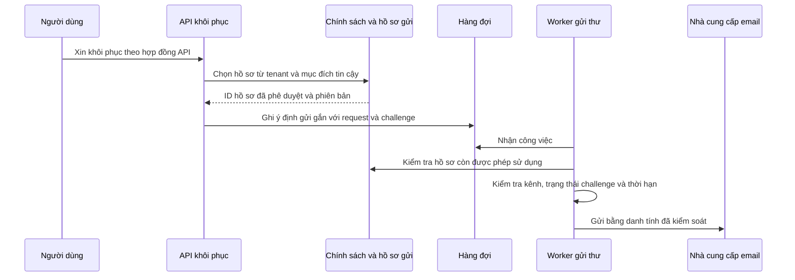

# Danh tính người gửi email khôi phục tài khoản

Trong chương **Email Delivery**, **Recovery email sender identity** là tập hợp những dấu hiệu và ràng buộc giúp xác định email khôi phục được gửi dưới danh tính nào, bởi hạ tầng nào và trong phạm vi ủy quyền nào. Đây là một phần của **SECURITY_AUTHENTICATION_ACCOUNT_RECOVERY**, phục vụ người dùng mất mật khẩu, MFA, passkey hoặc thiết bị xác thực.

Người nhận cần nhận biết được dịch vụ đang liên hệ với mình. Hệ thống nhận thư cần kiểm tra được việc sử dụng miền gửi. Ứng dụng khôi phục cần kiểm soát địa chỉ gửi, nơi nhận phản hồi và miền của liên kết. Ba nhu cầu này liên quan với nhau nhưng không đồng nhất: một tên hiển thị quen thuộc chưa chứng minh thư thật, còn một thư vượt qua xác thực miền chưa chứng minh người nhận có quyền đổi credential.

Bài học xây dựng một hồ sơ người gửi có kiểm soát, giải thích vai trò của các lớp xác thực email và chỉ ra cách giữ danh tính nhất quán từ cấu hình gửi đến đường khôi phục phía server.

## 1. Vì sao danh tính người gửi là ranh giới bảo mật?

Lan đang chờ email khôi phục của dịch vụ Học Mây. Cùng lúc đó, cô nhận một thư có tên hiển thị “Học Mây - Bảo mật”, logo giống sản phẩm và nút “Khôi phục ngay”. Nếu chỉ nhìn tên hiển thị, Lan có thể nhầm một email từ miền của kẻ tấn công với email thật.

Một lỗi khác nằm ở ứng dụng: API cho phép người gọi truyền `fromAddress` hoặc `replyTo`. Kẻ tấn công có thể dùng hạ tầng gửi hợp lệ của sản phẩm để tạo một thư có địa chỉ trả lời thuộc mình. Người nhận bấm Reply và gửi thông tin nhạy cảm cho một nơi không được dịch vụ kiểm soát.

Danh tính người gửi vì vậy phải được quản lý như cấu hình bảo mật. Nó không nên là dữ liệu tùy ý đi từ request khôi phục vào thư.

Cần giữ ba câu hỏi riêng biệt:

| Câu hỏi | Thành phần phải trả lời |
|---|---|
| Thư này sử dụng danh tính miền gửi có được xác thực phù hợp không? | Hạ tầng email và các cơ chế xác thực miền |
| Người nhận có đang đi tới đúng dịch vụ khôi phục không? | Miền URL, nội dung thư và ứng dụng đích |
| Người trình token có đủ bằng chứng cho hành động đang xin thực hiện không? | Chính sách và trạng thái khôi phục phía server |

Câu trả lời thuận lợi ở một hàng không tự quyết định hai hàng còn lại. Một hệ thống gửi thư bị lạm dụng vẫn có thể phát ra email có xác thực miền đúng; endpoint khôi phục vẫn phải kiểm tra token, thời hạn, sử dụng một lần, rủi ro và phạm vi hành động.

## 2. Các lớp định danh trong một email

Từ “người gửi” có thể chỉ nhiều thành phần khác nhau:

| Thành phần | Vai trò | Điểm cần kiểm soát |
|---|---|---|
| Tên hiển thị | Nhãn dễ đọc trong giao diện thư | Chọn từ hồ sơ sản phẩm, không dùng để chứng minh tính xác thực |
| Địa chỉ `From` | Danh tính tác giả thể hiện trong nội dung header | Dùng địa chỉ và miền đã được phê duyệt |
| SMTP `MAIL FROM` | Địa chỉ ở lớp phong bì SMTP, phục vụ xử lý thư trả lại | Cấu hình qua hạ tầng gửi và kiểm tra đường bounce |
| `Return-Path` | Dấu vết địa chỉ trả lại do hệ thống chuyển phát ghi ở phía nhận | Không giả định sửa một header trong template là cấu hình được phong bì SMTP |
| Miền ký DKIM `d=` | Miền nhận trách nhiệm bằng chữ ký cho thư | Kiểm soát miền ký và quyền sử dụng khóa |
| `Reply-To` | Địa chỉ ứng dụng thư thường chọn khi trả lời | Cố định theo chính sách hỗ trợ; không nhận từ client vô danh |
| Miền trong URL | Nơi trình duyệt đến khi mở liên kết | Phải thuộc đường khôi phục được kiểm soát; không được xác thực thay bởi `From` |

Một hồ sơ minh họa cho sản phẩm:

```text
Tên hiển thị:     Hoc May - Bao mat
From:            security@example.com
MAIL FROM:       b+<tham-chieu-mo>@bounce.example.com
Miền ký DKIM:    example.com
Reply-To:        help@example.com
Miền khôi phục:  accounts.example.com
```

Các địa chỉ và miền `example.com`, `example.net` trong bài chỉ dùng làm ví dụ, không phải cấu hình sản xuất. Phần tham chiếu trong địa chỉ bounce không được chứa token khôi phục, mật khẩu hoặc dữ liệu cá nhân không cần thiết.

Hồ sơ không buộc mọi thành phần phải là cùng một chuỗi địa chỉ. Mỗi thành phần có vai trò riêng; điều cần thiết là quan hệ giữa chúng được thiết kế, phê duyệt và kiểm chứng.

## 3. Chọn một danh tính ổn định, dễ nhận biết

Đối với email khôi phục, nên chọn một địa chỉ chức năng ổn định, chẳng hạn `security@example.com`, cùng tên hiển thị nhất quán với sản phẩm. Không dùng tài khoản cá nhân của nhân viên làm danh tính mặc định của quy trình bảo mật.

Địa chỉ gửi và nội dung thư nên khớp với các hướng dẫn được công bố trong ứng dụng hoặc trung tâm trợ giúp. Việc đổi liên tục tên miền và địa chỉ gửi khiến người dùng khó phân biệt thay đổi hợp lệ với email giả.

Có thể tách luồng email bảo mật khỏi luồng quảng cáo bằng hồ sơ gửi, quyền API, miền con hoặc luồng vận hành riêng. Sự tách biệt này cần được xem là một biện pháp giới hạn quyền và giảm ảnh hưởng chéo; chỉ tạo thêm một miền con không bảo đảm danh tiếng gửi thư được tách hoàn toàn.

Một địa chỉ không nhận phản hồi có thể phù hợp với một số sản phẩm, nhưng thư phải chỉ rõ đường hỗ trợ chính thức. Nếu dùng địa chỉ nhận phản hồi, hộp thư đó cần được vận hành và bảo vệ như một kênh có thể nhận dữ liệu nhạy cảm. Không tạo kỳ vọng người dùng trả lời email rồi để thư phản hồi rơi vào một hộp thư không ai quản lý.

Đặc biệt, nội dung không được hướng người dùng gửi mật khẩu, OTP, recovery code hoặc toàn bộ liên kết token cho nhân viên. Một địa chỉ hỗ trợ hợp lệ không biến việc thu thập các bí mật này qua thư thành một bước xác minh an toàn.

## 4. SPF, DKIM và DMARC bảo vệ những gì?

### 4.1. SPF: quyền gửi ở lớp SMTP

SPF cho phép miền công bố những máy chủ được phép gửi dưới danh tính `MAIL FROM` hoặc `HELO`. Nó không tự xác thực tên hiển thị hoặc địa chỉ `From` mà người dùng nhìn thấy. Vì vậy, một kết quả SPF đạt với miền của nhà cung cấp chưa đủ chứng minh danh tính tác giả của sản phẩm. Xem [RFC 7208 về SPF](https://www.rfc-editor.org/rfc/rfc7208.html).

Trong triển khai, nhóm vận hành cần xác nhận danh tính SMTP thực tế do nhà cung cấp sử dụng. Không chỉ nhìn một ô “SPF configured” trên dashboard rồi kết luận tất cả hồ sơ gửi đều đã đúng.

### 4.2. DKIM: chữ ký gắn với miền ký

DKIM dùng chữ ký và khóa công khai của miền ký để kiểm tra các phần thư được ký. Thẻ `d=` xác định miền ký, `s=` là selector dùng khi tra khóa. DKIM không mã hóa nội dung email và không tự chứng minh người nhận là chủ tài khoản. Xem [RFC 6376 về DKIM](https://www.rfc-editor.org/rfc/rfc6376.html).

Ứng dụng cần biết dịch vụ đang ký bằng miền nào, thay vì chỉ kiểm tra có một dòng `DKIM-Signature`. Nhà cung cấp có thể ký bằng miền của họ nếu hồ sơ miền riêng chưa được cấu hình đúng.

### 4.3. DMARC: kết quả xác thực phải gắn với miền tác giả

DMARC gắn miền trong `From` với danh tính SPF hoặc DKIM đã đạt. Để đạt DMARC, cần ít nhất một nhánh đạt và alignment phù hợp. Strict alignment yêu cầu miền giống nhau; relaxed alignment dựa trên cùng Organizational Domain theo cơ chế của chuẩn. Chủ miền công bố chính sách, nhưng bên nhận quyết định xử lý thư. Xem [RFC 9989 về DMARC](https://www.rfc-editor.org/rfc/rfc9989.html).

Không dùng phép so sánh hai nhãn cuối của tên miền để tự suy ra Organizational Domain. Bài học này dùng bộ kiểm tra email phù hợp tại hạ tầng nhận để quan sát kết quả, không tự viết một bộ triển khai DMARC trong dịch vụ khôi phục.

Những cơ chế trên không xác nhận một trang web trong nội dung thư là nơi khôi phục hợp lệ. Một miền giả có thể tự cấu hình xác thực cho thư của chính nó. Thiết kế vẫn cần quản lý miền thương hiệu và URL đích riêng.

## 5. Đưa danh tính người gửi vào một hồ sơ được phê duyệt

Một hồ sơ cấu hình minh họa:

```yaml
senderProfileId: recovery-primary
profileVersion: 3
tenantScope: public-product
fromDisplayName: Hoc May - Bao mat
fromAddress: security@example.com
replyToAddress: help@example.com
envelopeFromDomain: bounce.example.com
expectedDkimDomain: example.com
providerIdentityRef: recovery-domain-primary
recoveryOrigin: https://accounts.example.com
allowedTemplateIds:
  - password-recovery-vi
  - recovery-verification-vi
status: APPROVED
```

Đây là schema minh họa cho tư duy thiết kế, không phải tên field bắt buộc của một nhà cung cấp hay cấu trúc tệp phải bổ sung vào dự án. Không đặt khóa API, khóa DKIM riêng hoặc token khôi phục trong hồ sơ được xuất cho client.

Phê duyệt hồ sơ cần xác nhận ít nhất:

1. Tổ chức có quyền quản lý danh tính và miền được sử dụng.
2. Nhà cung cấp đã được cấu hình đúng cho hồ sơ đó.
3. Địa chỉ trả lời dẫn đến kênh hỗ trợ đã được quản lý.
4. Template được phép dùng với đúng mục đích khôi phục.
5. URL đích là origin được kiểm soát và có TLS phù hợp.
6. Quyền gửi được giới hạn cho dịch vụ và môi trường cần thiết.

Một hồ sơ “đã xác minh” ở nhà cung cấp chỉ là một phần của phê duyệt. Nó không tự cho phép mọi tenant hoặc mọi chức năng trong hệ thống sử dụng danh tính đó.

Nên phiên bản hóa hồ sơ để audit biết thư đã dùng cấu hình nào. Không cần sao chép bí mật vào audit để đạt mục tiêu này; dùng ID và phiên bản cùng quyền tra cứu phù hợp.

## 6. Luồng gửi phải chọn hồ sơ từ ngữ cảnh tin cậy

Client khởi tạo chỉ nên cung cấp những thông tin nghiệp vụ cần thiết, chẳng hạn định danh tài khoản và mục đích được API hỗ trợ. Server xác định tenant, tài khoản đích, kênh đã đăng ký, template và hồ sơ người gửi theo chính sách.



Không đưa nguyên các field như `From`, `Reply-To`, `Bcc`, `senderDomain` hoặc `recoveryBaseUrl` từ request công khai vào lệnh gửi. Khi một API quản trị cho phép sửa cấu hình, nó phải có quyền và kiểm tra riêng; đây không phải quyền của người đang xin khôi phục vô danh.

Pseudocode minh họa:

```text
context = resolveTrustedRecoveryContext(request)
profile = loadApprovedSenderProfile(
    context.tenant,
    context.purpose,
    environment
)

require profile is allowed for context
require template is approved for profile and purpose
require recipient is the eligible registered recovery channel
require challenge is active and unexpired
require profile.recovery_origin is an approved HTTPS origin

message = renderWithTypedMailLibrary(profile, template, challenge)
submitWithScopedProviderCredential(message)
```

Đây là mô hình bất biến, không phải mã đầy đủ. Tác vụ gửi vẫn cần cơ chế chống lặp, xử lý lỗi và kiểm tra trạng thái tương ứng. Một provider báo đã tiếp nhận thư không phải bằng chứng rằng người dùng đã đọc hoặc đã hoàn thành xác minh.

Nếu không tìm được hồ sơ phù hợp, dừng hoặc trì hoãn theo chính sách. Không âm thầm fallback sang địa chỉ cá nhân, miền thử nghiệm hoặc danh tính mặc định chưa được phê duyệt để “gửi cho được”.

## 7. Template phải hỗ trợ nhận biết và không tạo thói quen nguy hiểm

Ví dụ nội dung cho một yêu cầu đặt lại mật khẩu:

```text
From: Hoc May - Bao mat <security@example.com>
Reply-To: help@example.com
Subject: Huong dan khoi phuc tai khoan Hoc May

Bạn nhận được thư này vì có yêu cầu khôi phục tài khoản Học Mây.
Nếu chính bạn yêu cầu, hãy tiếp tục tại trang khôi phục chính thức.
Liên kết có thời hạn và chỉ dùng cho bước khôi phục được chỉ định.

Nếu bạn không yêu cầu, đừng chia sẻ liên kết hoặc mã cho bất kỳ ai.
Bạn có thể tự mở ứng dụng hoặc trang trợ giúp chính thức để kiểm tra.
Chúng tôi không yêu cầu bạn gửi mật khẩu, OTP hoặc recovery code
qua thư trả lời.
```

Đoạn trên là phần nội dung minh họa, không phải toàn bộ thư chuẩn MIME và không chứa token thật. Phiên bản HTML và văn bản thuần nên truyền đạt cùng mục đích, cùng đích điều hướng và cùng hướng dẫn bảo mật.

Không ghi “mật khẩu đã thay đổi” nếu đây mới là thư khởi tạo. Không ghi “MFA đã bị gỡ” khi server chưa thực hiện hành động đó. Sai khác giữa nội dung và trạng thái có thể khiến người dùng hoảng loạn, tìm hỗ trợ qua kênh giả hoặc hiểu sai điều gì đã được cho phép.

Logo, màu sắc và ngữ pháp giúp nhận biết sản phẩm nhưng có thể bị sao chép. Tránh dạy người dùng rằng chỉ cần thấy logo hay tên hiển thị là có thể tin thư. Hướng dẫn nên đưa ra một cách tiếp cận độc lập, chẳng hạn tự mở ứng dụng hoặc trang chính thức đã biết.

Không đưa thông tin bảo mật không cần thiết vào subject hoặc preview, vì chúng có thể hiển thị trên màn hình khóa. Không đặt token trong tên hiển thị, subject, địa chỉ Reply-To hoặc trường phân loại dùng cho công cụ phân tích.

## 8. Miền người gửi và miền liên kết là hai cấu hình cần bảo vệ

Giả sử email có `From: security@example.com`, nhưng nút khôi phục dẫn tới một URL do người khởi tạo truyền vào. Việc danh tính gửi đúng không cứu được người nhận khỏi liên kết độc hại đó.

Server nên dựng URL từ origin đã phê duyệt. Không lấy trực tiếp `Host`, `X-Forwarded-Host` hoặc một tham số URL tùy ý để dựng liên kết. Đây cũng là hướng dẫn trong [OWASP Forgot Password Cheat Sheet, phần URL Tokens](https://cheatsheetseries.owasp.org/cheatsheets/Forgot_Password_Cheat_Sheet.html#url-tokens).

Trong thiết kế minh họa, chỉ origin sau được phép cho một hồ sơ:

```text
https://accounts.example.com
```

Cần phân tích URL bằng thư viện phù hợp và kiểm tra scheme, host, port cùng các ràng buộc cần thiết. Không dùng phép kiểm tra chuỗi đơn giản như “URL chứa example.com”. Các chuỗi sau minh họa vì sao kiểm tra như vậy không đủ:

```text
https://accounts.example.com.attacker.example.net/recovery
https://accounts.example.com@attacker.example.net/recovery
```

Ở cả hai trường hợp, host thực tế không phải `accounts.example.com`. Không dùng token thật trong các ví dụ, log hoặc báo cáo lỗi.

Nếu nhà cung cấp có tính năng viết lại URL để theo dõi lượt bấm, cần đánh giá riêng với thư khôi phục. Token có thể đi qua một miền và một hệ thống lưu dữ liệu khác. Có thể tắt tracking cho luồng nhạy cảm hoặc chỉ sử dụng một đường đã được đánh giá; không giả định cấu hình dùng cho quảng cáo cũng phù hợp với email có bearer token.

Một tên miền bắt đầu giống thương hiệu, một chứng chỉ HTTPS hợp lệ hoặc một chữ ký email hợp lệ không chứng minh miền đích thuộc sản phẩm. Mỗi ranh giới cần kiểm tra đúng đối tượng của nó.

## 9. Bảo vệ quyền quản lý DNS, nhà cung cấp và hộp thư hỗ trợ

Danh tính người gửi có thể bị sử dụng trái phép nếu tài khoản quản lý DNS, khóa ký, quyền API gửi hoặc tài khoản quản trị nhà cung cấp bị chiếm. Phòng vệ phải bao gồm các điểm này, thay vì chỉ bảo vệ endpoint tạo token.

Các biện pháp thiết kế nên gồm:

- Cấp quyền API gửi tối thiểu theo dịch vụ và môi trường; hạn chế quyền sửa danh tính khi chỉ cần gửi thư.
- Quản lý bí mật trong kho phù hợp, không nhúng khóa vào template, frontend hoặc log.
- Bảo vệ tài khoản quản trị và DNS bằng kiểm soát truy cập, xác thực mạnh và audit thay đổi.
- Quản lý vòng đời khóa ký, selector, hồ sơ gửi và tài khoản nhà cung cấp theo quy trình có người chịu trách nhiệm.
- Cô lập quyền sửa template để một thành phần ít tin cậy không thể biến thư bảo mật thành thư lừa đảo.

Trong hệ thống nhiều tenant, mỗi hồ sơ phải gắn với phạm vi tenant được phép. Xác minh quyền dùng miền của tenant A không cho phép tenant B chọn địa chỉ đó. Tenant chưa có danh tính riêng được phê duyệt có thể dùng hồ sơ nền tảng theo chính sách, nhưng tên hiển thị không được tạo hiểu lầm về ai chịu trách nhiệm.

Môi trường thử nghiệm cần có biện pháp ngăn gửi ngoài ý muốn: danh sách người nhận kiểm soát, nhà cung cấp sandbox hoặc đường chặn tương đương. Không để một bản build thử dùng cấu hình production rồi gửi liên kết đến môi trường không đúng cho người dùng thật.

Hộp thư Reply-To cần được bảo vệ và phân quyền theo vai trò. Nếu nhân viên nhận một thư có liên kết khôi phục, không tự mở hoặc trình token thay cho người dùng; xử lý theo quy trình dữ liệu nhạy cảm của tổ chức.

## 10. Kiểm chứng trên email thực tế và xử lý thay đổi

Kiểm tra cấu hình là cần thiết nhưng chưa phản ánh chắc chắn thư được phát ra. Gửi thử có kiểm soát và quan sát email ở phía nhận để xác nhận tên hiển thị, địa chỉ From, đường trả lại, miền ký và đích URL thực tế.

Kết quả xác thực nên được lấy từ hệ thống nhận đáng tin cậy. Một dòng `Authentication-Results` nằm trong một đoạn header do người gửi tùy ý cung cấp không tự là bằng chứng. Khi phân tích, cần xác định phần kết quả do ranh giới nhận tin cậy ghi lại.

Nếu thư dùng From của sản phẩm nhưng chỉ có xác thực cho miền của nhà cung cấp, phải xem lại hồ sơ ký và cấu hình gửi. Không sửa phần tên hiển thị để che việc miền ký hoặc danh tính SMTP không như dự kiến.

Nên triển khai thay đổi danh tính theo các bước có thể kiểm chứng:

1. Kiểm kê hồ sơ và luồng nào đang dùng danh tính cũ.
2. Chuẩn bị cấu hình, quyền gửi và khóa cần thiết cho danh tính mới.
3. Kiểm chứng thư thực tế từ các đường gửi liên quan.
4. Đồng bộ nội dung trong ứng dụng và hướng dẫn hỗ trợ.
5. Chuyển lưu lượng có kiểm soát, quan sát lỗi và thư bị phân loại bất thường.
6. Thu hồi quyền không còn cần sau giai đoạn chuyển đổi theo kế hoạch.

Việc chọn chính sách chống giả mạo mạnh hơn cũng cần xét các luồng hợp lệ và dữ liệu vận hành. Không đổi chính sách DNS chung một cách mù quáng khi chưa biết hệ thống hỗ trợ, hóa đơn hoặc dịch vụ khác còn sử dụng miền đó.

Thay nhà cung cấp hoặc xoay khóa ký email không tự thu hồi token khôi phục đã phát hành. Nếu xảy ra sự cố lộ bí mật khôi phục, cần xử lý vòng đời challenge, quyền khôi phục và session bằng cơ chế riêng. Nếu sự cố chỉ ảnh hưởng danh tính gửi, cũng không tự khóa hàng loạt tài khoản người dùng mà không có căn cứ tương ứng.

## 11. Tình huống: thư thật dẫn người dùng sang kênh giả

Một ứng dụng cho client truyền `supportEmail` và `baseUrl` trong request khôi phục. Server dùng một tài khoản nhà cung cấp hợp lệ để gửi thư với `From: security@example.com`, nhưng gán Reply-To và liên kết từ hai field này.

Kẻ tấn công yêu cầu khôi phục cho Lan, chọn Reply-To thuộc mình và một trang giả làm URL đích. Email có thể trông đúng thương hiệu và được gửi qua hạ tầng thật. Sai sót nằm ở việc ứng dụng đã cho dữ liệu không tin cậy quyết định những phần còn lại của danh tính và hành trình.

Cách xử lý phù hợp là loại hai quyền cấu hình đó khỏi API công khai. Server chọn một hồ sơ đã phê duyệt theo tenant, mục đích và môi trường; hồ sơ đó quyết định From, Reply-To và recovery origin. Người nhận thư phải là kênh đủ điều kiện của tài khoản theo chính sách, không phải một địa chỉ mới tùy ý trong request.

Sự kiện audit ghi hồ sơ và template đã dùng để điều tra. Các field từ client bị bỏ qua hoặc bị từ chối theo hợp đồng. Dữ liệu đưa vào header được xây dựng bằng thư viện email có kiểu, không nối chuỗi thô; ký tự CR/LF không được phép tạo thêm header.

Khi Lan trình token, server vẫn xác minh đúng request, tài khoản và mục đích, kiểm tra hết hạn, thu hồi và sử dụng một lần. Thành công của bước gửi email không cho phép bỏ những điều kiện đó hoặc tự tạo một session đăng nhập toàn quyền.

## 12. Các hành vi cần kiểm chứng khi triển khai

Bảng này mô tả hành vi mong đợi, không phải kết quả kiểm thử đã chạy cùng bài học.

| Tình huống | Hành vi cần đạt |
|---|---|
| Client cung cấp From hoặc Reply-To tùy ý | Không thay đổi danh tính của hồ sơ đã phê duyệt |
| Client chèn CR/LF vào trường có thể đi vào header | Không tạo thêm header, người nhận hoặc nội dung không được phép |
| Tên hiển thị đúng nhưng địa chỉ thuộc miền khác | Không coi tên hiển thị là bằng chứng xác thực |
| Nhà cung cấp đổi danh tính ký mặc định | Phát hiện thư thực tế không khớp hồ sơ và xử lý cấu hình |
| Có SPF đạt nhưng cho một miền không gắn với From như yêu cầu | Không kết luận danh tính sản phẩm đã được xác thực chỉ từ SPF |
| Tenant B chọn hồ sơ của tenant A | Từ chối theo phạm vi hồ sơ |
| Hồ sơ gửi chưa được phê duyệt hoặc đã thu hồi | Không âm thầm gửi bằng danh tính thay thế ngoài chính sách |
| Template quảng cáo bật tracking được dùng cho thư chứa token | Chặn hoặc đánh giá cấu hình theo chính sách thư khôi phục |
| URL chứa tên thương hiệu nhưng host thực tế khác | Không vượt qua kiểm tra origin |
| Request sửa Host hoặc header chuyển tiếp | Không đổi origin khôi phục đã phê duyệt |
| Reply-To là hộp thư không được quản lý | Không coi hồ sơ đã sẵn sàng cho hỗ trợ người dùng |
| Môi trường thử nghiệm nhận danh sách người dùng thật | Không gửi ngoài phạm vi người nhận được phép |
| Provider báo tiếp nhận thư | Chưa coi là xác minh quyền sở hữu hoặc hoàn tất khôi phục |
| Đổi khóa ký email | Không giả định token khôi phục cũ đã bị thu hồi |
| Log ghi nhận một lần gửi | Chỉ lưu tham chiếu và phiên bản phù hợp; không lộ token, khóa API hoặc URL bí mật |
| Người dùng mất MFA nhận được email đúng danh tính | Vẫn áp dụng chính sách bằng chứng cho hành động khôi phục MFA |

Một hồ sơ người gửi tốt giúp người dùng nhận biết dịch vụ và giúp hạ tầng email kiểm tra việc sử dụng miền. Giá trị bảo mật của nó phụ thuộc vào quyền cấu hình, đường gửi thực tế, Reply-To, URL đích và chính sách khôi phục cùng được kiểm soát. Mọi quyền thay credential hoặc thay session vẫn phải được quyết định từ bằng chứng và trạng thái phía server.
