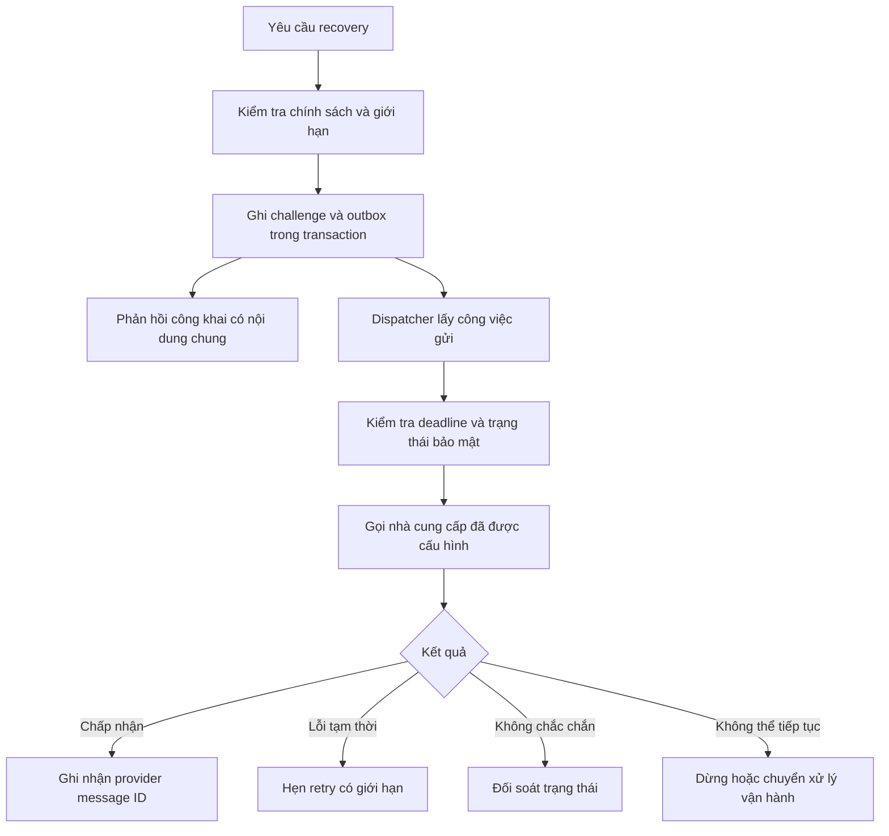

# Recovery email provider failure

Một yêu cầu khôi phục tài khoản có thể được ứng dụng tiếp nhận đúng nhưng email vẫn không đến người dùng. Nhà cung cấp gửi mail có thể ngừng hoạt động, giới hạn lưu lượng, từ chối cấu hình người gửi hoặc nhận thông điệp rồi mất kết nối trước khi trả kết quả. Nếu xử lý các tình huống này bằng cách phát token mới liên tục hoặc bỏ qua bước xác minh, một sự cố vận hành có thể trở thành sự cố chiếm đoạt tài khoản.

Bài học thuộc chương **Email Delivery** của module `SECURITY_AUTHENTICATION_ACCOUNT_RECOVERY`. Phạm vi là thiết kế luồng gửi email recovery khi nhà cung cấp gặp lỗi, cho các tình huống người dùng mất mật khẩu, MFA, passkey hoặc thiết bị xác thực. Mục tiêu là duy trì khả năng khôi phục có kiểm soát, bảo vệ token dùng một lần và giữ mức bảo đảm danh tính cùng chính sách session.

Sau bài học, bạn có thể:

- Phân biệt tiếp nhận yêu cầu, nhà cung cấp chấp nhận gửi, giao thư và hoàn tất recovery.
- Phân loại lỗi để quyết định retry, đối soát, dừng gửi hoặc chuyển nhà cung cấp.
- Thiết kế outbox, hàng đợi, thời hạn gửi và giới hạn tải phù hợp với vòng đời token.
- Xử lý kết quả không chắc chắn, webhook trùng hoặc đến muộn mà không cấp thêm quyền recovery.
- Thông báo sự cố và cung cấp đường thay thế mà không hạ yêu cầu xác minh.

## 1. Bốn kết quả không được nhập làm một

Một API trả thành công không có nghĩa người dùng đã nhận email. Cần phân biệt các mốc:

| Mốc | Điều đã biết | Điều chưa thể kết luận |
|---|---|---|
| Ứng dụng tiếp nhận | Ý định recovery đã được ghi bền vững hoặc xử lý theo chính sách | Có tài khoản phù hợp và email sẽ đến |
| Nhà cung cấp chấp nhận | Nhà cung cấp đã nhận yêu cầu gửi theo hợp đồng của họ | Thư đã đến máy chủ nhận hoặc vào inbox |
| Có sự kiện giao thư | Có bằng chứng giao đến hệ thống nhận theo ý nghĩa sự kiện của nhà cung cấp | Người dùng đã đọc hoặc là chủ hợp pháp của tài khoản |
| Recovery hoàn tất | Token, bằng chứng và hành động cuối đã được máy chủ chấp nhận | Mọi session ngoài hệ thống đã tự được xử lý nếu chưa có cơ chế tương ứng |

Sự kiện “delivered” thường liên quan đến việc hệ thống nhận chấp nhận thư, không phải bảo đảm vào inbox. Sự kiện “opened” có thể do tải ảnh tự động hoặc công cụ quét. Không dùng chúng để xác nhận danh tính, tiêu thụ token hay cấp quyền đổi mật khẩu.

Trạng thái giao thư và trạng thái bảo mật cần được lưu riêng. Một webhook bounce đến muộn không được tự đảo ngược việc đổi mật khẩu đã hoàn tất; một sự kiện delivered cũng không được mở lại token đã hết hạn.

## 2. Bất biến bảo mật khi nhà cung cấp gặp lỗi

Thiết kế cần giữ các điều kiện sau dù dịch vụ email đang chậm hoặc không hoạt động:

1. Đích gửi lấy từ kênh đã xác minh trong hồ sơ của đúng tài khoản.
2. Retry cùng một lệnh gửi không tự tạo token hoặc quyền recovery mới.
3. Hạn dùng token và bộ đếm thử không được đặt lại vì lỗi gửi.
4. Token đã dùng, bị thu hồi hoặc không còn phù hợp với phiên bản bảo mật phải bị từ chối khi sử dụng.
5. Chuyển nhà cung cấp không đổi tài khoản, mục đích, địa chỉ nhận hoặc yêu cầu xác minh.
6. Sự cố email không tự cho phép xóa MFA, thay passkey hoặc đổi email khôi phục.
7. Không thu hồi session của nạn nhân chỉ vì người khác khởi tạo recovery trong lúc hệ thống gửi lỗi.
8. Phản hồi công khai không tiết lộ email có thuộc tài khoản, bị bounce hay đang trong danh sách chặn gửi.

Độ sẵn sàng của email và mức bảo đảm danh tính là hai bài toán liên quan nhưng khác nhau. Khi chưa thể gửi hoặc xác minh an toàn, hệ thống có thể phải trì hoãn recovery; không được tạo quyền chỉ để làm luồng trông như đã thành công.

## 3. Phân loại lỗi trước khi quyết định retry

Không nên dùng một quy tắc duy nhất như “mọi lỗi đều thử lại ba lần”. Cần phân loại dựa trên giao thức, loại lỗi, phạm vi ảnh hưởng và bằng chứng nhà cung cấp đã nhận thông điệp hay chưa.

| Nhóm lỗi | Ví dụ | Xử lý chủ đạo |
|---|---|---|
| Lỗi tạm thời trước khi gửi | DNS, lỗi kết nối, dịch vụ tạm không khả dụng | Retry có giới hạn; đánh giá ảnh hưởng toàn nhà cung cấp |
| Giới hạn lưu lượng | HTTP 429 hoặc tín hiệu quota của nhà cung cấp | Giảm tải, tôn trọng thời gian chờ phù hợp và ngân sách gửi |
| Lỗi cấu hình hoặc quyền | Credential sai, sender chưa được chấp nhận, tài khoản gửi bị khóa | Dừng vòng retry vô ích và cảnh báo vận hành |
| Từ chối thông điệp | Payload không hợp lệ, template lỗi, địa chỉ bị từ chối rõ ràng | Phân tích nguyên nhân; không lặp nguyên request vô hạn |
| Kết quả không chắc chắn | Timeout sau khi đã gửi request, tiến trình chết sau lời gọi mạng | Đối soát hoặc retry theo hợp đồng idempotency |
| Bounce hoặc complaint bất đồng bộ | Hệ thống nhận từ chối sau khi nhà cung cấp đã chấp nhận | Cập nhật sức khỏe giao thư và áp dụng chính sách gửi |
| Sự cố bảo mật tại nhà cung cấp | Rò credential hoặc có khả năng lộ nội dung chứa token | Xử lý như sự cố bảo mật, không chỉ failover lưu lượng |

HTTP 4xx không đồng nghĩa tất cả đều không retry; 429 là ví dụ cần xử lý riêng. Trong SMTP, phản hồi 4xx thường là từ chối tạm thời và 5xx thường là từ chối vĩnh viễn cho giao dịch hiện tại, nhưng vẫn cần xem mã chi tiết và ngữ cảnh để phân biệt lỗi người nhận với lỗi cấu hình người gửi.

Một địa chỉ nhận bị từ chối không nên làm circuit breaker ngắt mọi email của nhà cung cấp. Ngược lại, hàng loạt lỗi xác thực sender không nên bị coi là lỗi riêng của từng người dùng rồi tiếp tục làm đầy hàng đợi.

Không ghi nguyên response của nhà cung cấp vào log nếu nó có thể chứa địa chỉ, nội dung mail hoặc liên kết recovery. Chuẩn hóa mã lỗi và giữ dữ liệu điều tra nhạy cảm trong phạm vi truy cập hạn chế.

## 4. Ghi bền vững ý định gửi và tách khỏi request người dùng

Gửi email trực tiếp trong HTTP request khiến thời gian phản hồi phụ thuộc nhà cung cấp và dễ tạo khác biệt có thể dùng để dò tài khoản. Một cách tổ chức là ghi challenge cùng ý định gửi trong database rồi chuyển công việc qua outbox và hàng đợi.



Một mô hình khái niệm:

```text
RecoveryChallenge
  challenge_id
  account_id
  purpose
  channel_id
  channel_version
  security_version
  token_digest
  expires_at
  state

RecoveryDelivery
  delivery_id
  challenge_id
  verified_destination_reference
  encrypted_payload_reference
  template_version
  send_deadline
  state
  next_attempt_at
  attempts_total
  version

ProviderAttempt
  attempt_id
  delivery_id
  provider_id
  provider_idempotency_key
  provider_message_id
  outcome
  error_class
  started_at
  finished_at
```

Các bản ghi outbox và challenge phải nhất quán trong ranh giới lưu trữ đã chọn. Không đánh dấu “đã gửi” chỉ vì đã thêm vào queue, và không giữ transaction database trong suốt lời gọi mạng đến nhà cung cấp.

Consumer nhận lại một sự kiện không được tạo challenge mới. Delivery ID ổn định giúp phân biệt một ý định gửi với nhiều lần thử chuyển ý định đó.

### 4.1. Giữ token để gửi lại mà không lưu tràn lan

Nếu chỉ lưu digest của token, hệ thống không thể khôi phục token gốc để retry cùng nội dung. Một lựa chọn là giữ payload gửi ở dạng mã hóa với hạn lưu ngắn, hoặc tham chiếu đến kho bí mật có quyền truy cập giới hạn.

Cần xác định ai được giải mã, thời điểm xóa payload và cách bảo vệ queue, dead-letter queue, backup cùng công cụ hỗ trợ. Token thô không nên xuất hiện trong thông báo lỗi, dashboard hay ticket vận hành.

Nhà cung cấp phải nhận nội dung cần thiết để gửi, nên ranh giới tin cậy bao gồm cả dữ liệu họ xử lý. Không coi việc mã hóa payload trong database của ứng dụng là đã loại bỏ rủi ro token tại nhà cung cấp.

## 5. Vòng đời token đặt giới hạn cho retry

Một email có thể đến rất muộn khi nhà cung cấp hoặc hệ thống nhận đang tồn đọng. Nếu token đã hết hạn, cố gửi bằng mọi giá vừa tốn tài nguyên vừa khiến người dùng bối rối.

Bài học dùng mô hình challenge được tạo với hạn cố định trước khi gửi. Các mốc quan trọng gồm:

```text
requested_at       thời điểm yêu cầu được tiếp nhận
issued_at          thời điểm challenge được phát hành
expires_at         hạn dùng tuyệt đối của challenge
send_deadline      thời điểm cuối hệ thống còn cho phép bắt đầu gửi
provider_accepted  thời điểm nhà cung cấp ghi nhận đã nhận lệnh
```

Một cách tính minh họa:

```text
send_deadline = min(
    expires_at - minimum_useful_remaining_lifetime,
    requested_at + maximum_queue_age
)
```

Ví dụ, token có hạn 15 phút và sản phẩm yêu cầu còn ít nhất 2 phút trước khi thử gửi. Nếu công việc nằm trong queue 14 phút, nó đã quá hạn gửi dù token chưa hết hạn. Các khoảng thời gian là ví dụ, không phải giá trị bắt buộc.

Trước mỗi lần gửi, kiểm tra:

- Challenge còn hoạt động, chưa dùng, chưa bị thu hồi và chưa hết hạn.
- Chưa qua `send_deadline` và còn đủ thời gian hữu ích.
- Kênh đã xác minh vẫn là kênh đủ điều kiện theo phiên bản hiện hành.
- Trạng thái tài khoản và phiên bản bảo mật không làm challenge mất hiệu lực.
- Lần gửi còn trong ngân sách, quota và chính sách retry.

Kiểm tra trước gửi không thể ngăn mọi thay đổi xảy ra ngay sau đó hoặc thu hồi một email đã rời hệ thống. Bước sử dụng token vẫn phải kiểm tra lại toàn bộ trạng thái bảo mật có liên quan.

Có thể chọn phát hành token sát lúc dispatch để tránh thời gian chờ làm giảm hạn dùng. Thiết kế đó cần deadline tuyệt đối cho ý định ban đầu và kiểm tra lại điều kiện phát hành; không được dùng queue làm cách trì hoãn vô hạn rồi tạo quyền recovery mới từ một yêu cầu quá cũ.

Không gia hạn token cũ hoặc phát token mới chỉ vì một delivery attempt thất bại. Nếu cần một yêu cầu recovery mới, nó phải qua chính sách khởi tạo bình thường.

## 6. Retry có giới hạn, backoff và kiểm soát tải

Retry đồng loạt có thể làm nhà cung cấp đang yếu tiếp tục quá tải. Cần timeout rõ, tổng số lần thử tối đa, deadline và backoff có jitter.

Một công thức minh họa cho full jitter:

```text
n = số lần retry đã thực hiện, bắt đầu từ 0
local_delay = random(0, min(cap, base * 2^n))
next_attempt_at = now + local_delay
```

Nếu nhà cung cấp đưa thời gian chờ có ý nghĩa theo hợp đồng, kết hợp nó với giới hạn cục bộ. Nếu lần thử kế tiếp vượt `send_deadline`, dừng thay vì bỏ qua deadline hoặc ép retry ngay.

Cần giới hạn trên nhiều phạm vi:

| Phạm vi | Mục đích |
|---|---|
| Nhà cung cấp và credential gửi | Không vượt quota hoặc khuếch đại outage |
| Tenant | Không để một nhóm người dùng chiếm toàn bộ năng lực gửi |
| Tài khoản và kênh | Giảm ngập hộp thư do request recovery lặp |
| Delivery | Giới hạn số lần thử của một ý định gửi |
| Toàn hệ thống | Bảo vệ queue, connection pool, worker và chi phí |

Phân biệt quota cho yêu cầu gửi mới của người dùng với ngân sách delivery attempt nội bộ. Retry vận chuyển không được tạo một quyền resend mới, nhưng vẫn phải bị giới hạn về số lời gọi thực tế và tài nguyên.

Đặt hàng đợi, pool worker hoặc hạn mức riêng cho email bảo mật nếu cần, tránh email quảng bá chiếm hết khả năng gửi recovery. Ưu tiên cũng cần công bằng giữa tenant; không cho request chưa xác thực tạo backlog vô hạn.

### 6.1. Circuit breaker

Circuit breaker giúp ngừng gọi một phụ thuộc đang lỗi trên diện rộng:

- Khi đóng, hệ thống gửi bình thường và ghi nhận tỷ lệ lỗi phù hợp.
- Khi mở, hệ thống ngừng hoặc chuyển lưu lượng theo chính sách, không gọi liên tục.
- Khi thử phục hồi, chỉ cho một lượng nhỏ công việc đủ điều kiện đi qua.

Phạm vi breaker cần theo đúng nguồn lỗi, chẳng hạn provider, vùng hoặc bộ credential. Không tính mọi bounce riêng lẻ thành outage toàn nhà cung cấp.

Breaker mở không đồng nghĩa được phép dùng bất kỳ dịch vụ gửi nào. Đích gửi, dữ liệu và nhà cung cấp thay thế vẫn phải nằm trong cấu hình được duyệt. Không dùng token recovery thật trong các phép thử tùy tiện gửi đến địa chỉ không thuộc kênh của người dùng.

## 7. Timeout sau khi gửi: trạng thái không chắc chắn

Đây là tình huống dễ gây gửi trùng nhất:

```text
1. Worker gửi request đến provider A.
2. Provider A chấp nhận và xếp email vào queue.
3. Kết nối đứt trước khi response về worker.
4. Worker chỉ thấy timeout.
```

Không được kết luận bước 4 có nghĩa email chưa được gửi. Có thể ghi kết quả `UNKNOWN` rồi đối soát bằng provider message ID, mã tham chiếu nội bộ hoặc API trạng thái nếu nhà cung cấp hỗ trợ.

Nếu dùng idempotency của nhà cung cấp, cần hiểu rõ phạm vi key, thời hạn giữ key và kết quả của retry cùng key. Không đổi key ngẫu nhiên ở mỗi lần retry rồi trông chờ cơ chế chống trùng hoạt động.

Phân biệt các ID:

| ID | Ý nghĩa |
|---|---|
| Delivery ID | Ý định gửi logic trong hệ thống của ứng dụng |
| Provider idempotency key | Chống thực hiện lại trong phạm vi nhà cung cấp cam kết |
| Provider message ID | Tham chiếu thông điệp đã được nhà cung cấp nhận |
| Header Message-ID của email | Định danh thư; tự nó không bảo đảm bên nhận sẽ loại thư trùng |

Một transaction trong database không thể bảo đảm email ngoài hệ thống được gửi đúng một lần. Nếu không có khả năng đối soát hoặc idempotency đủ mạnh, hệ thống phải chọn chính sách cho kết quả không chắc chắn: tiếp tục chờ, đối soát thủ công hoặc cho phép retry có kiểm soát với rủi ro trùng được chấp nhận.

Trong mọi lựa chọn, retry cùng ý định gửi giữ nguyên challenge hợp lệ. Không tạo token thứ hai chỉ để xử lý việc chưa biết token thứ nhất đã đi hay chưa.

### 7.1. Cạnh tranh giữa các worker

Claim công việc bằng thao tác nguyên tử, có lease hoặc version phù hợp. Không để hai worker cùng gửi chỉ vì cùng đọc trạng thái `READY`.

Khi lease hết hạn, worker cũ có thể vẫn đang chờ response mạng. Version hoặc điều kiện cập nhật ngăn nó ghi đè trạng thái mới, nhưng không thể thu hồi một lời gọi mạng đã gửi. Vì vậy, vẫn cần idempotency phía provider hoặc chính sách xử lý kết quả không chắc chắn.

Kết quả trả về muộn cần được ghi nhận để đối soát mà không làm sống lại delivery đã dừng hoặc challenge đã hết hiệu lực.

## 8. Chuyển nhà cung cấp mà không đổi quyền recovery

Failover hữu ích khi provider A lỗi và provider B đã sẵn sàng. Nó không đơn giản là thay URL API trong một nhánh catch exception.

Provider thay thế cần được chuẩn bị trước:

- Sender, domain và cấu hình xác thực email phù hợp đã được xác minh.
- Template và cách tạo liên kết giữ đúng origin chính thức của ứng dụng.
- Credential, quota, quyền truy cập và endpoint nằm trong cấu hình kiểm soát.
- Cách xử lý dữ liệu, token và sự kiện đáp ứng yêu cầu của hệ thống.
- Bộ chuyển đổi lỗi giữ được phân biệt tạm thời, vĩnh viễn và không chắc chắn.

Không nhận endpoint provider từ dữ liệu request hoặc webhook để gửi payload chứa token. Không đổi sang địa chỉ nhận mới chỉ vì provider B không gửi được đến địa chỉ cũ.

### 8.1. Quyết định theo trạng thái gửi

| Trạng thái ở provider A | Có nên chuyển ngay sang B? |
|---|---|
| Chắc chắn chưa nhận lệnh, lỗi tạm thời hoặc outage | Có thể, nếu chính sách và ngân sách cho phép |
| Đã chấp nhận gửi, chưa có delivery event | Không mặc định coi là lỗi; chờ hoặc đối soát theo chính sách |
| Không chắc đã nhận lệnh | Đánh giá khả năng trùng và đối soát trước khi chuyển |
| Từ chối do payload hoặc cấu hình chung bị sai | Sửa nguyên nhân; chuyển provider có thể chỉ lặp lại lỗi |
| Bounce rõ do địa chỉ không nhận thư | Không tự chuyển để né chặn gửi hoặc thay địa chỉ |
| Có nghi vấn lộ token hoặc credential | Chuyển sang quy trình sự cố bảo mật trước |

Idempotency key ở A thường không tự có tác dụng tại B. Khi failover, phải kiểm soát số provider attempt của cùng delivery trong hệ thống của mình. Nếu A đã nhận nhưng phản hồi bị mất, A và B đều có thể gửi.

Trong tình huống cho phép gửi trùng có kiểm soát, giữ cùng mục đích, địa chỉ đã xác minh và challenge còn hợp lệ giúp tránh tăng số token độc lập. Tuy nhiên, hai email giống nhau vẫn có thể gây nhầm lẫn và tăng chi phí; không coi đó là lý do để failover vô hạn.

Một lần resend do người dùng chủ động là một ý định khác, phải có khoảng nghỉ và quota riêng. Không vô hiệu hóa liên kết trước đó ở mỗi lần đổi provider để rồi người dùng chỉ nhận được các email đã lỗi thời.

### 8.2. Sự cố bảo mật khác sự cố sẵn sàng

Nếu provider A có khả năng đã lộ nội dung email hoặc credential gửi, chỉ chuyển lưu lượng sang B chưa xử lý bí mật đã lộ. Cần đánh giá phạm vi, dừng đường gửi không còn đáng tin, thu hồi hoặc xoay credential thích hợp và vô hiệu hóa challenge có nguy cơ theo chính sách sự cố.

Việc phát hành lại quyền recovery phải dựa trên trạng thái mới an toàn và điều kiện xác minh phù hợp. Không tiếp tục gửi cùng token có thể đã bị lộ sang provider khác rồi cho rằng nó đã an toàn trở lại.

## 9. Webhook, bounce và sự kiện đến muộn

Webhook giúp cập nhật trạng thái nhưng là đầu vào từ bên ngoài. Trước khi dùng một sự kiện, cần xác minh nguồn theo giao thức nhà cung cấp: chữ ký, dữ liệu được ký, timestamp hoặc cơ chế chống phát lại nếu giao thức có quy định.

Không chỉ tin một field `providerMessageId` trong JSON. Giới hạn kích thước request, dùng secret đúng phạm vi và không ghi payload nhạy cảm vào log thông thường.

Một quy trình tiếp nhận có thể là:

1. Kiểm tra tính hợp lệ và xác thực webhook.
2. Ghi bền vững sự kiện với khóa chống trùng, chẳng hạn cặp provider và event ID.
3. Phản hồi theo hợp đồng sau khi đã bảo đảm sự kiện không bị mất.
4. Xử lý bất đồng bộ và cập nhật các quan sát trạng thái theo quy tắc đã định nghĩa.

Sự kiện có thể bị giao lại hoặc đến không theo thứ tự. Lưu lịch sử và dựng trạng thái từ ý nghĩa từng loại sự kiện, không ghi đè một field bằng “event cuối cùng đến HTTP server”. Một delayed bounce có thể bổ sung thông tin sau sự kiện chấp nhận hoặc giao trước đó; không có quy tắc chung rằng mọi sự kiện delivered đều kết thúc vĩnh viễn mọi quan sát giao thư.

Tách tác động vận hành khỏi quyền tài khoản:

- Bounce có thể khiến hệ thống ngừng gửi thêm vào một kênh theo chính sách sức khỏe giao thư.
- Complaint có thể kích hoạt suppression và điều tra phù hợp.
- Không dùng những sự kiện đó làm bằng chứng để thay email, bỏ MFA hoặc khóa toàn bộ tài khoản tự động.
- Không xóa lịch sử xác minh danh tính chỉ vì một phản hồi giao thư đơn lẻ; sức khỏe gửi và bằng chứng xác minh có vai trò khác nhau.

Không gỡ suppression ở provider hoặc chuyển sang provider khác chỉ để né chính sách chặn gửi. Khi địa chỉ cần được sửa hoặc xác minh lại, phải có luồng được cấp quyền riêng.

## 10. Trải nghiệm người dùng và đường recovery thay thế

Với endpoint khởi tạo công khai, phản hồi nên tránh xác nhận tài khoản có tồn tại hoặc tình trạng giao thư riêng của email đó. Ví dụ:

> Nếu thông tin phù hợp với một tài khoản đủ điều kiện, hướng dẫn khôi phục sẽ được gửi qua kênh đã đăng ký. Việc gửi có thể chậm trong thời gian hệ thống xử lý sự cố.

Chỉ thêm thông báo chậm khi có căn cứ vận hành phù hợp và áp dụng nhất quán. Không hiển thị “email của bạn bị provider chặn” cho bất kỳ người chưa xác thực nào vừa nhập địa chỉ đó.

Nếu hệ thống không thể ghi nhận ý định cần lưu bền vững, cần phản hồi lỗi khả dụng hoặc chính sách giảm tải rõ ràng cho endpoint. Không báo rằng công việc đã được xếp hàng trong khi thực tế chỉ tồn tại trong bộ nhớ của process.

Có thể cung cấp hướng dẫn kiểm tra thư rác, chờ khoảng thời gian hợp lý và gửi lại theo quota. Không gắn tracking pixel như bằng chứng xác minh và không yêu cầu người dùng chuyển tiếp email có token vào ticket hỗ trợ.

Khi email không thể dùng, các đường thay thế chỉ đến từ chính sách đã thiết kế, chẳng hạn recovery code còn hiệu lực, yếu tố đã đăng ký hoặc quy trình xác minh và xét duyệt phù hợp. Không tự chuyển sang số điện thoại chưa xác minh hay giảm yêu cầu của recovery MFA xuống chỉ còn biết thông tin hồ sơ.

Bộ phận hỗ trợ không được đặt mật khẩu tạm hoặc gửi token đến địa chỉ người gọi vừa cung cấp chỉ vì họ nói provider đang lỗi. Sự cố vận hành không tạo thêm bằng chứng về chủ tài khoản.

## 11. Vận hành, phục hồi backlog và tình huống thực tế

Các chỉ số hữu ích gồm:

| Chỉ số | Điều cần nhận biết |
|---|---|
| Tuổi công việc lớn nhất trong queue | Yêu cầu có sắp mất tính hữu ích không |
| Tỷ lệ lỗi theo provider và nhóm lỗi | Outage, quota, cấu hình hay vấn đề riêng người nhận |
| Số kết quả UNKNOWN | Rủi ro gửi trùng và nhu cầu đối soát |
| Thời gian từ tiếp nhận đến provider chấp nhận | Chất lượng đường gửi nội bộ |
| Số delivery quá deadline hoặc bị dừng | Mức tác động thực tế tới recovery |
| Số failover và tổng attempt | Nguy cơ bão retry hoặc chi phí tăng |
| Tỷ lệ hoàn tất recovery | Kết quả nghiệp vụ, tách khỏi tỷ lệ gửi thư |

Không gắn email, token hoặc URL đầy đủ làm nhãn metric. Dùng ID tương quan và mã lỗi đã chuẩn hóa; giới hạn truy cập thông tin người nhận trong công cụ vận hành.

Một runbook phục hồi nên đi theo thứ tự: xác định phạm vi lỗi, giảm tải hoặc mở breaker phù hợp, kiểm tra cấu hình và credential, quyết định failover, rồi giải phóng backlog có giới hạn. Không phát lại toàn bộ dead-letter queue mà chưa kiểm tra deadline, phiên bản kênh và trạng thái challenge.

Khi provider hoạt động trở lại, tránh xả backlog cùng lúc. Loại công việc không còn hợp lệ, khống chế tốc độ theo quota và dành năng lực cho yêu cầu mới. Email đã hết giá trị không nên cạnh tranh tài nguyên với yêu cầu còn thời gian sử dụng.

### Tình huống minh họa

Lan yêu cầu đặt lại mật khẩu lúc 09:00. Challenge có hạn đến 09:15 và chỉ được bắt đầu gửi khi còn ít nhất 2 phút sử dụng. Provider A timeout sau khi request đã được gửi.

Hệ thống ghi kết quả UNKNOWN và đối soát bằng mã tham chiếu. Nếu phát hiện A đã chấp nhận, hệ thống không tự phát một token mới hoặc lập tức chuyển B chỉ vì chưa thấy webhook delivered.

Nếu xác định A chưa nhận và B đủ điều kiện, hệ thống có thể chuyển cùng ý định gửi sang B trong giới hạn cho phép. Địa chỉ nhận, purpose và token không đổi chỉ vì tuyến gửi thay đổi.

Đến 09:14, một công việc gửi còn tồn đọng đã vượt deadline hữu ích nên bị dừng. Hệ thống không gia hạn token đến 09:29. Lan có thể bắt đầu yêu cầu mới theo chính sách, trong khi các session hiện có không bị thu hồi chỉ bởi sự cố gửi.

Nếu Lan đã đổi mật khẩu thành công trước khi một email cũ được giao, bước dùng liên kết trong email cũ phải từ chối quyền đã hết hiệu lực. Trạng thái giao thư không đảo ngược kết quả bảo mật đã hoàn tất.

## 12. Tiêu chí kiểm tra thiết kế

| Tình huống | Kết quả mong đợi |
|---|---|
| Provider trả lỗi tạm thời trước khi nhận lệnh | Retry có backoff, quota và deadline |
| Provider trả 429 | Giảm tốc theo chính sách, không tạo bão retry |
| Credential sai hoặc sender lỗi diện rộng | Cảnh báo và dừng vòng thử vô ích |
| Timeout sau khi provider đã nhận | Ghi UNKNOWN, đối soát hoặc dùng idempotency đúng hợp đồng |
| Hai worker cùng nhận một delivery | Claim nguyên tử và kiểm soát cập nhật; không gửi tùy ý hai lần |
| Worker cũ trả kết quả sau khi lease hết hạn | Không ghi đè trạng thái mới hoặc làm sống lại công việc đã dừng |
| Provider A và B đều có khả năng đã nhận | Không tạo thêm challenge; ghi nhận và giới hạn rủi ro trùng |
| Email không có delivered event ngay | Không mặc định là thất bại cần failover |
| Công việc quá send deadline | Dừng gửi; không gia hạn hoặc tái phát hành token tự động |
| Kênh thay đổi trong khi queue đang chờ | Kiểm tra phiên bản và loại công việc không còn phù hợp |
| Webhook giả hoặc trùng | Không tác động trái phép; xử lý idempotent khi hợp lệ |
| Webhook đến sai thứ tự | Giữ lịch sử và cập nhật theo ngữ nghĩa sự kiện |
| Một người nhận bounce | Không ngắt mọi provider hoặc tự đổi kênh của tài khoản |
| Nhà cung cấp có dấu hiệu lộ token | Xử lý sự cố bảo mật thay vì chỉ đổi đường gửi |
| Khôi phục backlog sau outage | Bỏ công việc quá hạn và khống chế tốc độ |
| Email recovery không dùng được | Giữ yêu cầu xác minh, không bỏ MFA hoặc cấp session toàn quyền |

Thiết kế đạt mục tiêu khi lỗi gửi được xử lý như trạng thái vận hành có giới hạn và có thể đối soát; token vẫn giữ vòng đời cùng ràng buộc bảo mật; failover không đổi danh tính hay quyền được cấp; và người dùng chỉ hoàn tất recovery sau khi cung cấp bằng chứng phù hợp.