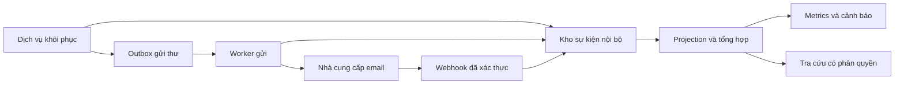

# Recovery email delivery telemetry

## 1. Telemetry cần trả lời đúng câu hỏi về giao thư

Recovery email delivery telemetry là dữ liệu quan sát việc tạo, xếp hàng, gửi và nhận phản hồi giao email khôi phục. Nó giúp đội vận hành biết người dùng đang chờ ở đâu, nhà cung cấp nào gặp sự cố, email có bị giao sau khi bằng chứng hết hạn hay không và hệ thống có đang bị lạm dụng để gửi thư hàng loạt hay không.

Trong khôi phục mật khẩu, MFA, passkey hoặc thiết bị xác thực, việc giao thư vừa ảnh hưởng khả năng sử dụng vừa liên quan an ninh. Một hàng đợi bị kẹt có thể khiến token hết hạn trước khi đến người dùng. Một dashboard chứa URL đầy đủ có thể trở thành nơi làm lộ chính token đó. Vì vậy, telemetry phải quan sát được hiệu ứng cần thiết mà không sao chép bí mật của quy trình khôi phục.

**Trạng thái gửi hoặc giao email không phải bằng chứng xác minh danh tính.** Nhà cung cấp báo đã giao, một pixel được tải hoặc có GET vào link đều chưa đủ để cho phép đổi mật khẩu, bỏ MFA, đăng ký passkey hay cấp session đăng nhập.

### Những câu hỏi cần trả lời

- Hệ thống đã tạo bao nhiêu thông báo hợp lệ và có bao nhiêu thông báo chưa được gửi?
- Độ trễ nằm ở hàng đợi nội bộ, lời gọi nhà cung cấp hay quá trình xử lý sau đó?
- Các chỉ số đang đếm thao tác nghiệp vụ, lần thử mạng hay callback của nhà cung cấp?
- Bao nhiêu kết quả chưa biết do thiếu tín hiệu, thay vì đã thành công hoặc thất bại?
- Dữ liệu quan sát có bị trùng, đến muộn, giả mạo hoặc làm lộ thông tin tài khoản không?

Bài học trình bày một mô hình độc lập nhà cung cấp. Tên sự kiện và metric là minh họa cho hợp đồng nội bộ, không phải tên API bắt buộc của một dịch vụ gửi thư cụ thể.

## 2. Phân biệt các đơn vị trước khi đếm

Một yêu cầu khôi phục có thể dẫn tới một thông báo, nhiều lần thử gửi và nhiều webhook. Nếu coi mọi bản ghi là một email, tỷ lệ thành công sẽ sai ngay khi xuất hiện retry.

| Đơn vị | Ý nghĩa | Quan hệ thường gặp |
| --- | --- | --- |
| Recovery attempt | Quy trình khôi phục cho một tài khoản và mục đích xác định. | Có thể có thông báo khởi tạo, resend và thông báo kết quả. |
| Logical notification | Một thông điệp nghiệp vụ cần được gửi. | Retry mạng của thông điệp này giữ nguyên định danh logic. |
| Delivery attempt | Một lần thực hiện lời gọi gửi tới nhà cung cấp. | Một notification có thể có nhiều attempt. |
| Provider message | Đối tượng thư mà nhà cung cấp ghi nhận. | Có thể có nhiều message nếu retry không được dedupe hoặc đổi nhà cung cấp. |
| Provider event | Một sự kiện như deferred, delivered hoặc bounce. | Một message có nhiều sự kiện; cùng sự kiện có thể được giao lại. |

Một hành động resend được chấp thuận có thể tạo notification mới, nhưng lần thử lại của cùng lệnh gửi không tự biến thành resend. Số lượng notification và số lượng attempt phải được báo cáo riêng.

Ví dụ, một notification có ba lần thử mạng và hai callback trùng vẫn chỉ đóng góp một đơn vị vào mẫu số của tỷ lệ giao thông điệp. Ba lần thử mạng có thể đóng góp ba đơn vị vào metric chi phí và lỗi gửi. Callback trùng chỉ đóng góp vào metric phát hiện giao lại, không tăng thêm số email được giao.

### 2.1. Định danh dùng để tương quan

Một chuỗi tương quan có thể là:

```text
recovery_attempt_id
  -> notification_id
      -> delivery_attempt_id
          -> provider_account + provider_message_id
              -> provider_event_id
```

Các ID phải có phạm vi rõ ràng. `provider_message_id` có thể chỉ duy nhất trong tài khoản của một nhà cung cấp. Không giả định nó duy nhất trên mọi môi trường, tenant và provider.

ID tương quan không được trao quyền khôi phục. Biết `notification_id` hoặc `provider_message_id` không được phép lấy token, xem địa chỉ email hoặc truy cập hồ sơ. Quan hệ với tài khoản được giữ trong kho nghiệp vụ có kiểm soát quyền; không cần đưa account ID vào mọi bản log hay metric.

## 3. Xây danh mục sự kiện với ngữ nghĩa chính xác

Một danh mục minh họa:

| Sự kiện | Điều đã được quan sát | Điều chưa thể kết luận |
| --- | --- | --- |
| `notification.created` | Một thông báo logic đã được ghi bền vững. | Nhà cung cấp đã nhận thư. |
| `notification.suppressed` | Chính sách nội bộ không cho gửi thông báo đó. | Địa chỉ không tồn tại hoặc tài khoản đã bị chiếm. |
| `notification.expired_before_dispatch` | Bằng chứng hết hạn trước khi được phép bắt đầu gửi. | Người dùng đã nhận thư hết hạn. |
| `dispatch.started` | Một lần gọi nhà cung cấp bắt đầu. | Lời gọi đã đến nơi hoặc được tiếp nhận. |
| `dispatch.accepted` | Nhà cung cấp xác nhận tiếp nhận theo hợp đồng của họ. | Thư đã vào hộp thư người nhận. |
| `dispatch.rejected` | Có kết quả từ chối xác định ở bước gửi. | Mọi retry sau đó đều sẽ thất bại. |
| `dispatch.unknown` | Không xác định được kết quả, ví dụ timeout sau khi đã truyền request. | Chưa gửi được thư; provider có thể đã nhận. |
| `delivery.deferred` | Nhà cung cấp báo việc giao đang bị trì hoãn. | Đã thất bại vĩnh viễn. |
| `delivery.reported_delivered` | Có tín hiệu giao thành công theo định nghĩa của nhà cung cấp. | Người dùng đã đọc hoặc thư nằm trong inbox thay vì thư rác. |
| `delivery.reported_bounce` | Có phản hồi không giao được theo phân loại đã ánh xạ. | Chủ tài khoản cố ý từ chối khôi phục. |
| `complaint.received` | Có phản hồi khiếu nại đã được xác thực nguồn. | Người nhận đã chứng minh danh tính hoặc yêu cầu thay đổi yếu tố xác thực. |

Với nhiều hệ thống, delivered phản ánh máy chủ nhận đã chấp nhận thư. Cần ghi lại ngữ nghĩa thực tế của từng adapter; không mặc định mọi nhà cung cấp dùng từ này giống nhau.

Phân loại bounce thành các nhóm có ý nghĩa vận hành như permanent, transient hoặc unclassified theo hợp đồng nguồn. Một lỗi ở tầng API gửi, một bounce sau khi provider tiếp nhận và một suppression nội bộ là ba tình huống khác nhau.

### 3.1. Không nén mọi thứ thành một trạng thái tăng dần

Một enum kiểu `NEW < SENT < DELIVERED < FAILED` dễ tạo lỗi. Callback có thể đến sai thứ tự; complaint có thể đến sau delivered; một phản hồi không giao được cũng có thể xuất hiện sau một tín hiệu tiếp nhận trước đó.

Nên lưu các sự kiện đã xác thực và tạo các góc nhìn dẫn xuất riêng:

- Lần đầu nhà cung cấp chấp nhận thông báo.
- Lần đầu có tín hiệu delivered.
- Có bounce hay complaint nào và thuộc phân loại nào.
- Lần cuối nhận tín hiệu, số attempt và độ tin cậy của kết quả hiện tại.

Một callback cũ không được làm mất sự kiện đã biết. Nếu hai sự kiện có vẻ mâu thuẫn, giữ nguồn và thời điểm để điều tra thay vì chọn bản đến sau rồi xóa lịch sử.

### 3.2. Tách trạng thái giao thư khỏi trạng thái khôi phục

Các sự kiện như `recovery.proof_accepted`, `recovery.completed` hoặc `session.revoked` thuộc chuyển trạng thái nghiệp vụ khác. Có thể tương quan chúng để tìm nơi người dùng gặp khó khăn, nhưng không suy ra chúng từ delivered hoặc click.

Webhook giao thư không được trực tiếp đánh dấu tài khoản đã xác minh, kéo dài token hay gỡ MFA. Mọi tác động như đưa kênh nhận vào suppression cũng cần chính sách có phạm vi, nguồn đã xác thực và audit phù hợp.

## 4. Thiết kế sự kiện chuẩn hóa không chứa bí mật

Một sự kiện minh họa:

```json
{
  "schemaVersion": 1,
  "eventId": "evt_example_07",
  "eventType": "delivery.reported_delivered",
  "source": "provider_webhook",
  "notificationId": "ntf_example_21",
  "deliveryAttemptId": "att_example_03",
  "provider": "mail_provider_a",
  "providerAccountRef": "mail_account_prod_1",
  "providerMessageId": "msg_example_44",
  "providerEventId": "pevt_example_08",
  "occurredAt": "2026-11-23T07:00:05Z",
  "receivedAt": "2026-11-23T07:00:08Z",
  "recordedAt": "2026-11-23T07:00:08Z",
  "reasonCategory": "none",
  "templateFamily": "recovery_initiation",
  "templateVersion": "v3",
  "region": "region_a"
}
```

Các giá trị chỉ minh họa cấu trúc. `deliveryAttemptId` có thể chưa xác định ở thời điểm callback tới; schema phải cho phép tình trạng chưa ghép được thay vì bịa một mapping.

Không đưa raw token, hash token, recovery URL, mã OTP, cookie, authorization header, body email hoặc toàn bộ payload nhà cung cấp vào sự kiện quan sát chung. Hash token vẫn có thể tạo quan hệ không cần thiết với kho xác minh và không phải mã tương quan phù hợp.

### 4.1. Ba mốc thời gian phục vụ ba câu hỏi

- `occurredAt`: thời điểm nguồn nói sự kiện đã xảy ra.
- `receivedAt`: thời điểm hệ thống mình nhận callback hoặc phản hồi.
- `recordedAt`: thời điểm bản ghi chuẩn hóa được lưu bền vững.

Chênh lệch giữa chúng giúp phân biệt chậm giao thư với chậm callback hoặc chậm xử lý telemetry. Thời gian do nhà cung cấp gửi cần kiểm tra định dạng và tính hợp lý; đồng hồ giữa các hệ thống có thể lệch.

Dùng UTC để lưu thời điểm, hiển thị múi giờ ở lớp trình bày. Với thời lượng đo trong cùng một tiến trình, đồng hồ đơn điệu giúp tránh tác động của việc chỉnh đồng hồ hệ thống. Với phép trừ thời điểm giữa nhiều máy, cần theo dõi đồng bộ thời gian và không biến giá trị âm bất thường thành một kết quả thành công giả.

Thời gian trong webhook không được dùng để gia hạn token. Hạn dùng và điều kiện cấp quyền vẫn do dịch vụ khôi phục quyết định.

### 4.2. Giảm dữ liệu cá nhân và khả năng liên kết

Đa số metric không cần địa chỉ email. Nếu điều tra lạm dụng cần tương quan theo người nhận, dùng cơ chế giả danh có khóa và phạm vi phù hợp trong kho hạn chế quyền, chẳng hạn HMAC có phân miền và tenant đã xác thực. Không dùng SHA-256 trực tiếp của email như thể đó là dữ liệu ẩn danh; email phổ biến có thể bị dò.

Dữ liệu đã giả danh vẫn có thể liên kết với một cá nhân khi kết hợp mapping hoặc thông tin khác. Cần giới hạn retention, quyền truy cập và mục đích sử dụng. Xoay khóa hoặc thay thuật toán phải xét ảnh hưởng tới việc tương quan dữ liệu trong khoảng điều tra còn hiệu lực.

## 5. Thu thập dữ liệu theo hiệu ứng bền vững



Sơ đồ tách việc giao email khỏi việc xuất dữ liệu giám sát. Một exporter gặp lỗi không được khiến worker gọi gửi lại một thư đã được nhà cung cấp chấp nhận.

### 5.1. Gắn sự kiện với transaction đã commit

Nếu `notification.created` được phát ra trước khi transaction tạo notification commit, telemetry có thể đếm một thư không tồn tại. Có thể ghi sự kiện vận hành tối thiểu cùng transaction và xuất nó bất đồng bộ bằng outbox.

Tương tự, một sự kiện `dispatch.accepted` nên phản ánh kết quả đã được lưu cùng mapping provider message. Không chỉ tăng counter rồi coi counter đó là nguồn chuẩn cho trạng thái nghiệp vụ.

Cần phân biệt audit bắt buộc với dữ liệu metric có thể tái tạo. Nếu hệ thống yêu cầu một chuyển trạng thái nhạy cảm phải có audit bền vững, đảm bảo điều kiện đó ở ranh giới nghiệp vụ. Việc dashboard hoặc hệ thống tracing tạm thời không khả dụng không có nghĩa được bỏ qua audit, và cũng không phải lý do tự gửi lại email.

### 5.2. Giữ riêng trường hợp kết quả gửi chưa biết

Một timeout có thể xảy ra sau khi provider nhận request. Ghi `dispatch.unknown`, giữ notification ID và khóa gửi ổn định nếu provider hỗ trợ idempotency. Đối soát theo khả năng được cung cấp, thay vì ghi ngay thất bại xác định rồi gửi bằng một định danh mới.

Nếu có failover sang provider khác, mỗi provider message vẫn cần mapping riêng. Một notification được cả hai provider giao chỉ được tính một lần trong tỷ lệ thành công theo notification, đồng thời cần có tín hiệu về khả năng gửi trùng và chi phí phát sinh.

Định danh dùng cho idempotency và telemetry hỗ trợ nhau nhưng không thay thế nhau. Một counter “đã gửi một lần” không tạo ra ràng buộc ngăn hai worker cùng thực hiện hiệu ứng.

## 6. Webhook: xác thực, chống trùng và xử lý đến muộn

Webhook là input từ ngoài hệ thống. Cần xác thực trước khi dùng nó làm dữ liệu tin cậy hoặc cho phép tác động tới chính sách gửi.

### 6.1. Trình tự tiếp nhận minh họa

```text
receive bounded raw request
verify transport and provider authentication contract
verify signature over the required raw bytes
apply timestamp/replay rules supported by that provider
parse and validate bounded schema
resolve trusted provider account and message mapping
normalize only allowlisted fields

BEGIN TRANSACTION
    insert normalized event using provider-scoped dedupe key
    if event was newly inserted:
        enqueue projection update
COMMIT

acknowledge durable acceptance
```

Cơ chế chữ ký, timestamp và xoay khóa phụ thuộc nhà cung cấp. Không tự sáng tác một công thức HMAC chung rồi cho rằng phù hợp mọi webhook. Nếu hợp đồng ký raw body, việc parse rồi serialize lại JSON trước khi xác minh có thể làm thay đổi dữ liệu được ký.

IP allowlist có thể là một lớp bổ sung nhưng không tự chứng minh tính toàn vẹn payload. Nếu webhook có nhiều tài khoản hoặc tenant, nguồn đã xác thực phải được ghép đúng tài khoản gửi; không tin một `tenantId` nằm trong body để chọn nơi cập nhật.

Raw body cần cho kiểm tra chữ ký có thể được giữ tạm trong bộ nhớ với giới hạn kích thước. Không để framework tự ghi raw body vào log. Nếu cần giữ payload gốc để điều tra, dùng kho riêng có mã hóa, quyền hạn chế và thời gian lưu rõ ràng; kho sự kiện thông thường chỉ giữ trường đã chuẩn hóa.

### 6.2. Dedupe theo sự kiện, không theo message đơn thuần

Khóa chống trùng có thể là:

```text
(provider, trusted_provider_account, provider_event_id)
```

Chỉ dedupe theo `provider_message_id` sẽ làm mất các sự kiện hợp lệ khác nhau của cùng message, chẳng hạn deferred rồi delivered. Việc provider giao lại cùng sự kiện cần được nhận diện bằng ràng buộc bền vững và cập nhật projection có tính lũy đẳng.

Nếu nhà cung cấp không có event ID ổn định, adapter cần một chiến lược fingerprint được định nghĩa rõ từ các trường ổn định. Không thể mặc định hash mọi raw request giải quyết được vấn đề: một lần giao lại có thể thay đổi trường metadata, trong khi hai sự kiện hợp lệ cũng có thể có dữ liệu gần giống nhau. Giới hạn của cơ chế dedupe phải được ghi nhận trong cách tính metric.

ACK chỉ nên được trả sau điểm tiếp nhận bền vững đã cam kết. Nếu ACK trước khi lưu rồi tiến trình chết, provider có thể không gửi lại. Nếu đã lưu nhưng phản hồi ACK bị mất, callback sẽ được giao lại và phải được xử lý an toàn.

### 6.3. Callback có thể đến trước mapping hoặc sai thứ tự

Một callback có thể tới trước khi worker lưu xong provider message ID. Giữ sự kiện đã xác thực trong vùng chờ ghép có giới hạn, dùng metadata tương quan không chứa bí mật nếu hợp đồng provider hỗ trợ, rồi đối soát khi mapping sẵn sàng.

Không gán message chưa biết cho một tài khoản dựa trên recipient do callback khai báo. Không tự gọi một URL bất kỳ trong payload để “lấy thêm chi tiết”; mọi lời gọi đối soát cần endpoint và thông tin xác thực đã cấu hình.

Đối với callback đến muộn, giữ cả thời điểm xảy ra và thời điểm nhận. Projection cập nhật theo ngữ nghĩa sự kiện, không chỉ theo thứ tự nhận. Unknown event type hoặc mapping không hợp lệ được ghi nhận với nhóm lỗi hữu hạn và được xử lý có giới hạn tài nguyên.

## 7. Chỉ số cần đo và cách chọn mẫu số

### 7.1. Bộ chỉ số cơ bản

| Nhóm | Metric minh họa | Đơn vị |
| --- | --- | --- |
| Nhu cầu hợp lệ | `recovery_email_notifications_created_total` | Notification logic đã tạo. |
| Chính sách | `recovery_email_notifications_suppressed_total` | Quyết định không gửi theo nhóm lý do. |
| Lần gửi | `recovery_email_dispatch_attempts_total` | Attempt, phân loại accepted/rejected/unknown. |
| Hàng đợi | `recovery_email_queue_wait_seconds` | Thời gian từ tạo tới attempt đầu. |
| Tồn đọng | `recovery_email_pending_notifications` | Notification chưa có kết quả dispatch phù hợp. |
| Công việc cũ nhất | `recovery_email_oldest_pending_age_seconds` | Tuổi của notification đang chờ lâu nhất. |
| Tín hiệu giao | `recovery_email_first_delivery_reports_total` | Notification lần đầu có báo cáo delivered. |
| Callback | `recovery_email_webhook_events_total` | Sự kiện mới, trùng, không xác thực hoặc chưa ghép. |
| Chậm callback | `recovery_email_webhook_lag_seconds` | Độ trễ theo mốc thời gian đã định. |
| Ngân sách token | `recovery_email_proof_remaining_at_dispatch_seconds` | Thời gian còn lại trước hết hạn khi bắt đầu gửi. |

Tên và kiểu metric cần tuân theo hệ thống giám sát thực tế. Counter đếm sự kiện, gauge biểu diễn trạng thái hiện tại và histogram mô tả phân bố thời lượng. Không biến số lượng message trong queue thành counter tăng mãi.

Metric dispatch theo attempt có thể có tỷ lệ lỗi cao trong khi phần lớn notification vẫn được gửi nhờ retry. Ngược lại, một tỷ lệ accepted theo attempt rất đẹp có thể che một nhóm notification kẹt mãi chưa từng được thử gửi. Cần xem đồng thời cả hai đơn vị.

### 7.2. Không chia số callback trong cùng cửa sổ cho số request mới

Một phép tính dễ sai là:

```text
callbacks delivered nhận trong 5 phút
------------------------------------
notifications tạo trong 5 phút đó
```

Tử số có thể thuộc email được tạo từ trước; mẫu số có thể chưa đủ thời gian để có callback. Tỷ lệ thậm chí có thể vượt 100% khi callback bị giao lại hoặc một backlog vừa được giải phóng.

Dùng cohort theo thời điểm tạo notification và một deadline được định nghĩa rõ:

```text
C = các notification hợp lệ được tạo trong khoảng [t0, t1)
D = thời hạn đánh giá tính từ lúc tạo
T = thời điểm tính báo cáo

chỉ đánh giá đầy đủ khi T >= t1 + D
hoặc chỉ lấy các phần tử đã đủ tuổi D
```

Ví dụ một SLI về handoff:

```text
handoff_within_D =
    số notification trong C có lần provider accepted đầu tiên trong D
    / tổng số notification trong C
```

Một SLI khác về tín hiệu giao:

```text
delivery_signal_within_D =
    số notification trong C có tín hiệu delivered hợp lệ trong D
    / tổng số notification trong C
```

Chỉ số thứ hai đo tín hiệu provider cung cấp, chưa phải tỷ lệ người dùng nhận vào inbox. Cần quy định sử dụng thời điểm occurrence đã kiểm tra hay thời điểm hệ thống nhận tín hiệu; hai lựa chọn trả lời hai câu hỏi khác nhau. Khi dùng occurrence time, phải công bố độ trễ dữ liệu và khả năng sửa báo cáo sau khi callback tới muộn.

Mẫu số không được âm thầm bỏ rejected, unknown hoặc thư hết hạn trong queue để tỷ lệ đẹp hơn. Nếu SLI chỉ đánh giá các thông báo đủ điều kiện gửi theo chính sách, cần công bố tiêu chí và báo riêng số bị loại cùng lý do. Suppression cần được ghi đúng tại nơi ra quyết định, không dùng để đổi tên lỗi hạ tầng sau đó.

### 7.3. Ví dụ số liệu có đơn vị rõ ràng

Giả sử một cohort minh họa có 1.000 notification đủ điều kiện, đã đủ tuổi để đánh giá:

- 990 notification được provider chấp nhận trong deadline handoff 30 giây.
- 5 notification được chấp nhận sau deadline đó.
- 5 notification chưa xác định kết quả handoff tại lúc đối soát.

SLI handoff trong 30 giây là `990 / 1000 = 99%`, không phải `990 / 995`. Những trường hợp chưa biết vẫn là một phần trải nghiệm cần giải thích.

Ở cùng cohort, một báo cáo khác ghi nhận 980 notification có tín hiệu delivered trong 120 giây, 10 có tín hiệu sau deadline, 4 có bounce vĩnh viễn và 6 chưa có kết quả giao xác định. Tỷ lệ tín hiệu delivered trong deadline là `980 / 1000 = 98%`.

Các con số 30 giây và 120 giây chỉ dùng để minh họa cách tính. Mục tiêu thật phải phù hợp hạn dùng bằng chứng, kiến trúc gửi và kỳ vọng sản phẩm. Các nhóm kết quả là ảnh chụp tại thời điểm đối soát; sự kiện muộn có thể bổ sung thông tin nhưng không được xóa lịch sử vi phạm deadline.

### 7.4. Độ trễ và độ phủ phải đi cùng nhau

P95 hoặc P99 chỉ tính trên những email có kết quả quan sát được sẽ bỏ qua nhóm mất hoàn toàn tín hiệu. Một P99 thấp không chứng minh tất cả người dùng đều nhận nhanh.

Báo cùng phân bố độ trễ với tỷ lệ unknown, số phần tử đủ tuổi, độ phủ callback và tuổi notification chưa có kết quả. Khi mẫu số bằng không, hiển thị không có dữ liệu thay vì tự trả 0% hoặc 100%. Với lưu lượng nhỏ, cảnh báo cần xét số mẫu để tránh diễn giải một tỷ lệ biến động mạnh như sự cố diện rộng.

## 8. Chọn labels, log và trace để không tạo kho dữ liệu nhạy cảm

### 8.1. Labels cần có số lượng giá trị hữu hạn

Có thể phân nhóm theo provider alias, region, môi trường, template family, nhóm outcome và reason category đã chuẩn hóa. Template version cũng cần quản lý số phiên bản còn theo dõi.

Không dùng email, token, URL, notification ID, trace ID, provider message ID hoặc nội dung lỗi tự do làm label metric. Chúng tạo cardinality lớn, tăng chi phí và có thể làm lộ dữ liệu. Tenant ID cũng không mặc nhiên là label tốt nếu hệ thống có rất nhiều tenant; có thể cần nhóm hữu hạn và kho phân tích có phân quyền cho chi tiết.

Không tự biến mã lỗi bất kỳ từ provider thành label mới. Adapter ánh xạ vào các nhóm hữu hạn, giữ phần chẩn đoán cần thiết ở kho hạn chế quyền và loại bỏ token hoặc recipient bị nhúng trong lỗi.

### 8.2. Log có cấu trúc và trace qua xử lý bất đồng bộ

Log có thể giữ event ID, notification ID, attempt ID, outcome và mã lý do chuẩn hóa. Các ID này vẫn cần kiểm soát truy cập vì chúng tạo liên kết tới hoạt động khôi phục.

Span name dùng tên thao tác hoặc route mẫu như `/account-recovery/email`, không dùng URL thực chứa query token. Không đưa token hoặc email vào trace baggage, attributes hoặc exception message. Với queue và webhook, dùng quan hệ tương quan phù hợp thay vì giả định mọi bước cùng một HTTP request đồng bộ.

Sampling có thể phù hợp với trace chi tiết, nhưng không lấy trace đã sampling làm mẫu số chính xác cho tỷ lệ thành công. Dữ liệu audit bắt buộc và tập sự kiện dùng tính SLI cần cơ chế độ phủ tương ứng; sự khác nhau giữa các nguồn phải được ghi rõ.

### 8.3. Dashboard công khai và bảng hỗ trợ có ranh giới khác nhau

Dashboard vận hành tổng hợp không cần hiển thị địa chỉ nhận hoặc body email. Nhân viên hỗ trợ có thể cần tra một mã tham chiếu sau khi có ngữ cảnh được phép, với phân quyền theo tenant và audit truy cập.

Không cung cấp endpoint chưa xác thực cho phép tra trạng thái giao theo email hoặc notification ID. Nó có thể trở thành công cụ dò tài khoản và hoạt động khôi phục. Phản hồi khởi tạo công khai vẫn giữ tính nhất quán dù nội bộ biết thư đã suppressed, bounced hoặc chưa gửi.

## 9. Cảnh báo phải chỉ ra lớp gặp sự cố

| Tín hiệu | Khả năng cần xem xét | Hành động điều tra ban đầu |
| --- | --- | --- |
| Tuổi queue tăng, dispatch ít | Worker, queue, khóa công việc hoặc giới hạn gửi. | Kiểm tra backlog, worker khỏe và quota nội bộ. |
| Dispatch rejected tăng theo provider | Thông tin xác thực, cấu hình sender, quota hoặc lỗi API. | Xem nhóm lỗi đã chuẩn hóa và thay đổi triển khai. |
| Dispatch unknown tăng | Timeout hoặc kết nối không ổn định. | Đối soát trạng thái trước khi retry hoặc failover gây gửi trùng. |
| Accepted ổn nhưng callback giảm | Webhook, adapter, mapping hoặc provider chậm phát sự kiện. | Kiểm tra sức khỏe luồng telemetry và lỗi xác thực callback. |
| Bounce tăng theo nhóm đích | Chất lượng kênh nhận, chính sách hệ thống nhận hoặc sự cố giao. | Xem phân loại bounce và phạm vi ảnh hưởng. |
| Số khóa/yêu cầu mới và thông báo tăng mạnh | Lạm dụng luồng khôi phục hoặc nhu cầu thật đột biến. | Kết hợp nguồn yêu cầu, quota và tín hiệu rủi ro. |
| Nhiều notification có ít thời gian token còn lại khi dispatch | Queue quá chậm hoặc cấu hình vòng đời không phù hợp. | Kiểm tra ngân sách thời gian và chính sách bỏ công việc hết hạn. |
| Webhook không hợp lệ tăng | Sai khóa, lỗi rollout hoặc input giả mạo. | Kiểm tra nguồn xác thực, xoay khóa và schema với quyền phù hợp. |

Ngưỡng và cửa sổ cảnh báo cần dựa trên lưu lượng, baseline, deadline và mức tác động. Có thể dùng nhiều cửa sổ để phân biệt một đợt chậm ngắn với việc tiêu hao ngân sách lỗi kéo dài. Một lỗi chữ ký ở lưu lượng nhỏ cũng có thể đáng điều tra, nhưng không nên để kẻ ngoài tùy ý tạo hàng loạt cảnh báo không có giới hạn.

Tách cảnh báo mất tín hiệu giám sát khỏi cảnh báo lỗi giao thư. Nếu webhook receiver ngừng hoạt động, dashboard không nên kết luận mọi thư đều thất bại vĩnh viễn hoặc đều thành công. Hiển thị kết quả chưa biết và mức độ cũ của dữ liệu.

Không tự giảm yêu cầu MFA, kéo dài token hoặc đổi địa chỉ nhận để cải thiện metric. Thay đổi provider khi được cho phép vẫn phải giữ chính sách chống lạm dụng, tương quan notification và quản lý khả năng gửi trùng.

## 10. Đối soát và xử lý sự cố

Một quy trình điều tra có thể đi theo các bước:

1. Chọn cohort và xác định lớp bị ảnh hưởng: chưa dispatch, bị từ chối, unknown hoặc thiếu callback.
2. So sánh kho nghiệp vụ, outbox và kho sự kiện để biết dữ liệu nào đã commit.
3. Kiểm tra mapping provider message và sự kiện chưa ghép; xác nhận callback đã được xác thực và dedupe.
4. Nếu cần, đối soát bằng API provider đã cấu hình với quyền tối thiểu, không lấy URL đối soát tùy ý từ payload.
5. Quyết định retry, giữ chờ, failover hoặc bỏ thông báo hết hạn theo chính sách, rồi audit quyết định đó.
6. Sau phục hồi, tính lại projection và SLI theo quy tắc xử lý dữ liệu đến muộn đã công bố.

Giữ một đường tái dựng projection từ sự kiện chuẩn hóa giúp sửa lỗi tính đếm mà không cần gửi lại email. Cập nhật metric hoặc sửa mapping không được tạo tác dụng phụ khôi phục mới.

Retention cần tách theo mục đích: metric tổng hợp có thể giữ lâu hơn log chi tiết; sự kiện có khả năng liên kết với người nhận cần giới hạn phù hợp; payload gốc nhạy cảm phải có nhu cầu điều tra rõ ràng. Bản sao lưu và dữ liệu xuất phục vụ sự cố cũng nằm trong phạm vi quản lý này.

Nếu hệ thống telemetry bị gián đoạn, cần theo dõi backlog xuất sự kiện, số bản ghi có thể mất và khả năng phát lại. Không tăng bộ nhớ đệm vô hạn hoặc log toàn bộ request để bù cho việc mất metric. Những cách đó có thể biến sự cố khả dụng thành sự cố rò rỉ dữ liệu.

## 11. Tình huống minh họa: một email, nhiều lần truyền

Giả sử notification N được tạo lúc 09:00:00 với token có hạn dùng riêng:

```text
09:00:01  Delivery attempt A1 bắt đầu.
09:00:03  A1 timeout; kết quả dispatch tạm thời là unknown.
09:00:04  Provider phát callback cho message M; mapping chưa được lưu xong.
09:00:05  Sự kiện đã xác thực được giữ chờ ghép và sau đó đối soát với N.
09:00:06  Hệ thống xác định provider đã chấp nhận message M.
09:00:08  Nhận sự kiện delivered D1 và lưu bền vững.
09:00:09  Provider giao lại D1; dedupe nhận diện bản trùng.
```

Kết quả báo cáo cần giữ rõ:

- Có một notification logic và một attempt gửi được minh họa.
- Attempt từng có kết quả chưa biết; sau đối soát đã biết provider tiếp nhận.
- Có một tín hiệu delivered mới cho N và một lần callback được giao lại.
- Không có bằng chứng từ các dữ liệu trên rằng người dùng đã mở thư, đổi mật khẩu hoặc hoàn tất khôi phục.

Nếu worker đã retry trước khi đối soát, attempt mới phải được ghi riêng. Có hay không message thứ hai phụ thuộc khả năng idempotency và kết quả thực tế của provider; telemetry không được tự gộp chúng thành một lời gọi chưa từng xảy ra.

Nếu D1 chỉ được nhận lúc 09:06 dù provider ghi occurrence lúc 09:00:08, hệ thống cần phân biệt độ trễ callback với độ trễ giao được báo cáo. Việc đổi mốc thời gian trên dashboard không được làm mất dấu khoảng thời gian đội vận hành đã không biết kết quả.

## 12. Những tình huống cần kiểm chứng khi triển khai

- Giao lại cùng webhook nhiều lần, cả song song; chỉ một sự kiện nghiệp vụ mới và một lần cập nhật first-delivery được tính.
- Gửi deferred, delivered, bounce hoặc complaint theo thứ tự khác nhau; lịch sử không bị ghi đè sai và các projection giữ đúng ngữ nghĩa.
- Làm callback đến trước mapping hoặc đến sau cửa sổ báo cáo; dữ liệu được chờ ghép, đối soát và điều chỉnh theo hợp đồng.
- Mô phỏng timeout sau khi provider đã nhận request; kết quả ban đầu là unknown, retry không dựa vào giả định chưa gửi.
- Tắt exporter metric hoặc tracing; việc khôi phục telemetry không làm gửi lại thư đã được tiếp nhận.
- Tắt webhook receiver; dashboard thể hiện mất độ phủ và dữ liệu cũ thay vì tự kết luận kết quả giao.
- Thử chữ ký sai, provider account không khớp, body quá lớn và event type lạ; không cập nhật nhầm tenant hoặc tạo label tùy ý.
- Đưa token giả vào URL, body và lỗi mô phỏng; kiểm tra nó không xuất hiện trong log, trace, metric hoặc thông báo cảnh báo.
- Tính cohort có retry, nhiều provider message, callback trùng và phần tử chưa đủ tuổi; tỷ lệ không vượt 100% do đếm sai đơn vị.
- Kiểm tra số mẫu bằng không, đồng hồ lệch và notification chưa có kết quả; báo cáo giữ rõ trạng thái thiếu dữ liệu.
- Thử truy cập chéo tenant và tra trạng thái khi chưa được xác thực; telemetry không trở thành kênh dò tài khoản hoặc cấp quyền khôi phục.

Đây là các tình huống cần xác minh ở một hệ thống thực thi, không phải kết quả thử nghiệm đã được thực hiện. Telemetry giao email có ích khi nó giữ đúng đơn vị đếm, thể hiện trung thực điều còn chưa biết và giúp xử lý sự cố mà không mở rộng quyền hoặc làm lộ bí mật của luồng khôi phục tài khoản.