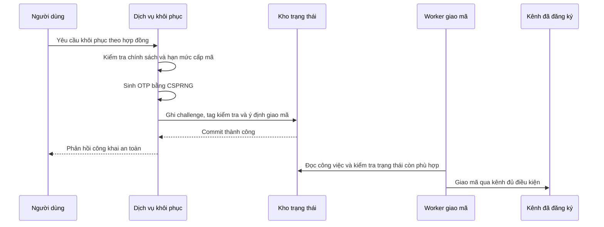

# Sinh mã dùng một lần cho khôi phục tài khoản

Trong chương **OTP Recovery**, **One time password generation** là việc tạo ra một bí mật ngắn để người dùng trình lại trong một bước xác minh. Trong **SECURITY_AUTHENTICATION_ACCOUNT_RECOVERY**, mã này có thể hỗ trợ khôi phục khi người dùng mất mật khẩu, MFA, passkey hoặc thiết bị xác thực, tùy theo phương thức và mức bằng chứng mà chính sách cho phép.

Một mã trông ngẫu nhiên chưa chắc khó đoán. Một mã sinh bằng nguồn ngẫu nhiên mật mã cũng chưa tự trở thành mã dùng một lần. Độ an toàn còn phụ thuộc vào độ dài, số lượt đoán, thời hạn, kênh giao, cách lưu và quan hệ giữa mã với đúng tài khoản, yêu cầu và hành động khôi phục.

Bài học tập trung vào mã khôi phục do server sinh rồi gửi qua một kênh đủ điều kiện. Các ví dụ số, thời hạn và giới hạn thử là lựa chọn minh họa, không phải tuyên bố tuân thủ một chuẩn hoặc cấu hình bắt buộc cho mọi sản phẩm.

## 1. Xác định đúng loại mã trước khi chọn thuật toán

Từ OTP thường được dùng cho nhiều cơ chế khác nhau:

| Cơ chế | Mã hình thành thế nào? | Bí mật hoặc trạng thái cần quản lý |
|---|---|---|
| Mã khôi phục cấp theo yêu cầu | Server lấy ngẫu nhiên một mã mới và giao qua kênh khôi phục | Giá trị kiểm tra, thời hạn, số lần thử và trạng thái challenge |
| HOTP | Tính từ khóa bí mật dùng chung và bộ đếm | Khóa dài hạn và đồng bộ bộ đếm |
| TOTP | Tính từ khóa bí mật dùng chung và bước thời gian | Khóa dài hạn, thời gian và quy tắc chấp nhận mã |
| Recovery code lưu sẵn | Sinh trước để người dùng lưu dùng khi mất phương thức xác thực | Danh sách mã đủ mạnh và trạng thái đã dùng của từng mã |

HOTP được mô tả trong [RFC 4226](https://www.rfc-editor.org/rfc/rfc4226.html); TOTP mở rộng mô hình đó bằng yếu tố thời gian trong [RFC 6238](https://www.rfc-editor.org/rfc/rfc6238.html). Không thể biến một mã ngẫu nhiên gửi qua email thành TOTP chỉ bằng cách đặt thời hạn ngắn.

Nếu người dùng đã mất ứng dụng TOTP, yêu cầu họ nhập mã từ chính ứng dụng đó không giải quyết được việc mất yếu tố xác thực. Đường khôi phục cần dùng một phương thức còn khả dụng và đã được chính sách cho phép.

Recovery code lưu dài hạn cũng không nên mặc nhiên có cùng cấu hình với mã ngắn gửi theo yêu cầu. Tuổi thọ, cách lưu và số cơ hội tấn công khác nhau dẫn đến yêu cầu thiết kế khác nhau.

Trong phần còn lại, “OTP” chỉ mã ngẫu nhiên ngắn do server cấp cho một challenge khôi phục, trừ khi có ghi rõ cơ chế khác.

## 2. Những thuộc tính bộ sinh và luồng sử dụng phải giữ

Một thiết kế cần bảo đảm:

1. **Khó dự đoán:** biết thời điểm, ID tài khoản hoặc các mã đã thấy không giúp suy ra mã tiếp theo.
2. **Phân bố phù hợp:** cách chuyển dữ liệu ngẫu nhiên thành chữ số không làm một nhóm giá trị xuất hiện nhiều hơn ngoài dự kiến.
3. **Phạm vi rõ ràng:** mã được kiểm tra trong đúng tenant, tài khoản, request, challenge và mục đích.
4. **Hiệu lực có giới hạn:** mã có hạn cuối, giới hạn thử và điều kiện thu hồi.
5. **Tiêu thụ một lần:** một challenge chỉ ghi nhận một lần sử dụng thành công mới.
6. **Không lộ ngoài kênh được phép:** mã không nằm trong phản hồi khởi tạo công khai, log hoặc dữ liệu phân tích.
7. **Không suy giảm khi lỗi:** không chuyển sang mã mặc định hoặc nguồn ngẫu nhiên yếu khi nguồn an toàn không hoạt động.

Hai thuộc tính đầu thuộc trực tiếp bộ sinh. Những thuộc tính còn lại thuộc vòng đời challenge. Tách hai phần giúp tránh kết luận sai rằng chỉ cần thay `Random` bằng `SecureRandom` là toàn bộ quy trình đã an toàn.

Trong thuật ngữ NIST, mã khôi phục được cấp, mã lưu sẵn và bộ xác thực OTP có các yêu cầu riêng. OTP nhập tay cũng không được coi là chống phishing chỉ vì có thời hạn và dùng một lần. Tham khảo [NIST SP 800-63B-4](https://pages.nist.gov/800-63-4/sp800-63b.html), phần về OTP, phishing resistance và account recovery.

## 3. Độ dài mã phải đi cùng ngân sách thử

Nếu mỗi ký tự được chọn đều từ một bảng có `A` ký tự và mã dài `d`, không gian mã có:

```text
N = A^d
entropy lý tưởng = log2(N) = d × log2(A)
```

Với mã chỉ gồm các chữ số ASCII từ `0` đến `9`, `A = 10`:

| Độ dài | Số giá trị có thể có | Entropy lý tưởng xấp xỉ |
|---|---:|---:|
| 6 chữ số | 1.000.000 | 19,93 bit |
| 8 chữ số | 100.000.000 | 26,58 bit |

Bảng tính cả mã bắt đầu bằng số 0. Một mã như `00421937` là một chuỗi tám ký tự; chuyển nó thành số nguyên rồi hiển thị lại sẽ làm mất định dạng.

Với một mã cố định được chọn đều và `q` lần đoán khác nhau, xác suất đoán trúng là `q/N`, khi `q <= N`. Ví dụ, năm lần thử với mã sáu chữ số cho xác suất `5/1.000.000 = 0,0005%`; với mã tám chữ số là `5/100.000.000 = 0,000005%`. Đây là phép tính cho mô hình đơn giản, không bao gồm rò rỉ mã, phishing hoặc kênh giao bị chiếm.

Các tỷ lệ nhỏ đó không cho phép bỏ qua quy mô hệ thống. Kẻ tấn công có thể nhắm nhiều tài khoản hoặc tạo nhiều challenge. Nếu mỗi lần gửi lại được thêm năm lượt mới mà không có ngân sách chung, số cơ hội thử thực tế tăng theo số lần cấp mã.

Nếu endpoint thử mã người dùng nhập với tất cả `m` challenge đang hoạt động, cửa sổ đoán có thể tăng tương ứng số mã được chấp nhận. Khi các xác suất nhỏ, có thể ước lượng cỡ `q × m/N`; đó là lý do cần giới hạn challenge và chọn đúng ngữ cảnh trước khi so sánh.

Không mặc định rằng thêm một chữ số giải quyết mọi vấn đề. Cần thiết kế đồng thời:

- Độ dài và bảng ký tự.
- Thời hạn của mã và tuổi tối đa của yêu cầu khôi phục.
- Số lần thử cho challenge và ngân sách tích lũy ở phạm vi phù hợp.
- Hạn mức cấp mã, gửi lại và chống tự động hóa.
- Số challenge được chấp nhận cùng lúc.
- Mức rủi ro của hành động sau xác minh.

## 4. Chọn nguồn ngẫu nhiên và tránh làm lệch phân bố

OTP là bí mật bảo mật, vì vậy cần một nguồn ngẫu nhiên mật mã, thường gọi là CSPRNG. Không sinh mã từ timestamp, số thứ tự, ID người dùng, đuôi số điện thoại, `Math.random()` hoặc một bộ sinh giả ngẫu nhiên dùng cho mô phỏng.

Trong Java, `SecureRandom` cung cấp bộ sinh ngẫu nhiên mật mã; `java.util.Random` không được thiết kế cho mục đích đó. Xem tài liệu [SecureRandom](https://docs.oracle.com/en/java/javase/25/docs/api/java.base/java/security/SecureRandom.html) và [Random](https://docs.oracle.com/en/java/javase/25/docs/api/java.base/java/util/Random.html).

Một sai sót khác là lấy byte ngẫu nhiên rồi chia dư mà không xét miền đầu vào. Với byte không dấu có 256 giá trị, phép `byteValue % 10` không chia đều: sáu chữ số nhận 26 giá trị đầu vào, bốn chữ số chỉ nhận 25.

Ví dụ toán học để tránh lệch là chỉ nhận byte trong `0..249`, bỏ các giá trị `250..255`, rồi lấy phần dư cho 10. Khi đó mỗi chữ số có đúng 25 tiền ảnh. Trong ứng dụng thông thường, nên dùng API lấy ngẫu nhiên có cận phù hợp thay vì tự viết thuật toán chuyển đổi này.

Không dùng `abs(randomInt) % bound` như một cách sửa nhanh: nó có thể gặp vấn đề biên của số nguyên và vẫn có phân bố không như mong muốn. Với mã số, lấy từng chữ số bằng một API có cận là cách dễ đọc và kiểm tra hơn.

Không tự seed bằng giờ hiện tại hoặc một hằng số. Bộ sinh với thuật toán đúng nhưng đầu vào seed dễ đoán vẫn không đạt mục tiêu. Quản lý nguồn entropy và provider phải thuộc cấu hình runtime được kiểm soát, không phải dữ liệu do người gọi API cung cấp.

Nếu không thể sinh bí mật an toàn, dừng hoặc báo lỗi tạm thời theo hợp đồng. Không fallback sang `000000`, timestamp hoặc một chuỗi ngẫu nhiên đã chuẩn bị sẵn cho production.

## 5. Ví dụ Java: sinh mã tám chữ số và giữ số 0 đầu

Đoạn mã dưới chỉ minh họa bộ sinh, chưa bao gồm lưu challenge, gửi, xác minh hay chống lạm dụng:

```java
import java.security.SecureRandom;

public final class RecoveryOtpGenerator {
    private static final int DIGITS = 8;
    private final SecureRandom random = new SecureRandom();

    public String generate() {
        char[] code = new char[DIGITS];
        for (int i = 0; i < code.length; i++) {
            code[i] = (char) ('0' + random.nextInt(10));
        }
        return new String(code);
    }
}
```

Đối tượng `random` trong đoạn này là `SecureRandom`; việc gọi phương thức có cận không có nghĩa đang dùng một đối tượng `Random` thông thường. Mỗi lần lấy giá trị trong `0..9` tạo đúng một chữ số, nên chuỗi luôn có tám ký tự, kể cả khi ký tự đầu là `0`.

Không ép người dùng nhập mã dưới dạng kiểu số trong API. Có thể nhận một chuỗi có độ dài và bảng ký tự đã công bố. Nếu giao diện cho nhập khoảng trắng để dễ đọc, cần xác định quy tắc chuẩn hóa thống nhất; không tùy tiện nhận mọi ký tự giống chữ số rồi tạo ra cách hiểu khác nhau giữa các tầng.

Bộ sinh có thể được quản lý như một thành phần sống theo vòng đời ứng dụng. Không cần tự tạo seed mới cho từng request. Khi có yêu cầu về provider hoặc môi trường mật mã, chọn và vận hành cấu hình tương ứng; việc dùng lớp này không tự là chứng nhận tuân thủ một tiêu chuẩn cụ thể.

Đoạn mã không in OTP ra console. Giá trị trả về phải được truyền tới đúng thành phần cần dùng và tránh xuất hiện trong `toString`, thông báo lỗi, trace hoặc log request/response. Việc dùng `String` cũng không cho phép chủ động xóa mọi bản sao trong bộ nhớ; cần giảm thời gian và phạm vi giữ bí mật theo thiết kế.

## 6. Không yêu cầu OTP duy nhất trên toàn hệ thống

Không gian mã ngắn là hữu hạn, nên hai challenge độc lập có thể tình cờ nhận cùng chuỗi OTP. Bộ sinh ngẫu nhiên mật mã không hứa “không bao giờ trùng”.

Điều cần giữ là một mã chỉ được kiểm tra trong đúng ngữ cảnh được server xác định. Không xây một bảng tra cứu toàn hệ thống có khóa duy nhất là sáu hoặc tám chữ số rồi dùng nó để tìm tài khoản.

Ví dụ:

```text
challenge A -> tài khoản Lan -> request A -> RESET_PASSWORD
challenge B -> tài khoản Minh -> request B -> RECOVER_MFA
```

Dù A và B có cùng chuỗi số, một lần xác minh A không được ghi bằng chứng cho B. `challenge_id` là tham chiếu chọn ngữ cảnh, không phải bí mật thay thế OTP; endpoint vẫn cần hạn mức và kiểm tra các quan hệ phía server.

Không giảm không gian mã một cách tùy tiện bằng cách loại mọi chuỗi có chữ số lặp hoặc mẫu “trông không ngẫu nhiên”. Một mã như `11111111` có thể xuất hiện trong một phân bố đều. Nếu sản phẩm áp dụng một chính sách loại trừ, phải tính lại không gian thực và cách lấy mẫu; không xem hình thức trực quan là phép đánh giá chất lượng nguồn ngẫu nhiên.

Khi thay challenge, chuỗi số mới cũng có xác suất trùng chuỗi trước. Quyền sử dụng thuộc về thực thể challenge và trạng thái của nó, không phải một lời hứa rằng người dùng luôn thấy số khác. Nếu chính sách cần tránh lặp giá trị trong cùng một cửa sổ, phải thiết kế riêng giới hạn đó và vẫn giữ cách sinh phù hợp.

## 7. Lưu giá trị kiểm tra gắn với ngữ cảnh

Một bản ghi challenge minh họa:

```text
RecoveryOtpChallenge
  challenge_id
  recovery_request_id
  tenant_id
  account_id
  purpose
  channel_record_id
  channel_verification_version
  generation
  verifier_tag
  verifier_key_version
  issued_at
  expires_at
  failed_attempts
  max_attempts
  consumed_at
  revoked_at
  policy_version
```

Không lưu OTP thô trong bảng challenge nếu chỉ cần đối chiếu. Tuy nhiên, hash không có khóa của một mã ngắn rất dễ bị thử hết không gian khi database bị lộ. Thêm salt riêng giúp phân tách bản ghi nhưng không làm không gian một triệu giá trị của mã sáu chữ số trở nên lớn hơn.

Một mô hình có thể dùng giá trị kiểm tra HMAC với khóa được quản lý ngoài database:

```text
verifier_tag = HMAC(
    verifier_key,
    encodeCanonical(
        format_version,
        tenant_id,
        account_id,
        recovery_request_id,
        challenge_id,
        purpose,
        generation,
        otp
    )
)
```

Đây là công thức thiết kế minh họa. `encodeCanonical` phải có định dạng không mơ hồ, chẳng hạn các trường có độ dài rõ ràng và phiên bản. Không ghép chuỗi tùy ý khiến hai bộ giá trị khác nhau tạo cùng thông điệp đầu vào.

Khóa HMAC cần được bảo vệ, phân quyền, phiên bản hóa và có kế hoạch xoay khóa. Nếu cả database và khóa đều bị lộ, lợi ích chống dò ngoại tuyến của cách tách khóa cũng bị mất. HMAC không thay thế giới hạn thử trực tuyến và không biến OTP ngắn thành một bí mật có entropy cao.

Khi xác minh, tính lại tag từ mã được trình trong đúng ngữ cảnh và đối chiếu bằng cách phù hợp cho dữ liệu bí mật. Không dùng OTP của challenge A với metadata do client sửa thành challenge B. Quan hệ tài khoản, tenant và mục đích vẫn cần được kiểm tra riêng, không chỉ dựa vào công thức HMAC.

## 8. Phát hành và giao mã mà không mở thêm đường lộ

Luồng minh họa:



Mã phải được giao tới kênh đã được thiết lập và đủ điều kiện theo chính sách. Một email hoặc số điện thoại mới xuất hiện trong request không tự trở thành kênh khôi phục của tài khoản.

Phản hồi khởi tạo công khai không trả OTP, tag kiểm tra hoặc một giá trị có thể dùng để suy ra OTP. Một endpoint khởi tạo không có quyền chỉ cần biết email mà lại trả mã xác minh sẽ phá toàn bộ ý nghĩa của kênh giao riêng.

Nếu dùng outbox hoặc hàng đợi, cần thiết kế cách worker nhận được bí mật để dựng thông báo. Không thể khôi phục OTP từ một tag HMAC đã lưu. Payload bí mật có thể được mã hóa hoặc tham chiếu qua kho tạm được bảo vệ, với quyền truy cập và thời gian giữ phù hợp. Việc bảo vệ tag kiểm tra trong database không đủ nếu OTP thô nằm lâu trong hàng đợi và log.

Ghi challenge và ý định giao mã cần phối hợp bền vững. Không gửi mã trước rồi hy vọng một transaction thất bại vẫn để lại trạng thái hợp lệ. Worker cũng phải nhận diện công việc lỗi thời để không giao một challenge đã bị thu hồi hoặc quá hạn như thể nó còn dùng được.

Một xác nhận giao thành công từ nhà cung cấp không chứng minh người dùng đã đọc mã hoặc kiểm soát kênh. Bằng chứng chỉ hình thành khi mã được trình và server chấp nhận theo trạng thái hiện tại.

## 9. Gửi lại không được tạo vô hạn cơ hội đoán

Phải phân biệt ba hành động:

| Hành động | Quy tắc cần thiết |
|---|---|
| Client retry cùng thao tác vì timeout | Dùng cơ chế chống lặp theo hợp đồng; không tự cấp thêm challenge |
| Hàng đợi giao lại cùng công việc | Không sinh mã mới chỉ vì message được xử lý lại |
| Người dùng chủ động yêu cầu mã mới | Áp dụng chính sách cấp mới, thay thế, hạn mức và ngân sách thử |

Sinh một mã mới không nên đặt lại ngân sách thất bại tích lũy ở các phạm vi bảo vệ cần thiết. Nếu mỗi challenge có tối đa năm lần thử nhưng người gửi được tạo vô hạn challenge, giới hạn năm lần không còn đạt mục đích ban đầu.

Có thể có hạn mức riêng cho nguồn gửi, tài khoản, request, challenge, thiết bị hoặc ngữ cảnh khác. Không chỉ dùng IP vì nhiều người có thể dùng chung mạng và kẻ tấn công có thể đổi nguồn. Cũng không khóa tài khoản nạn nhân vĩnh viễn chỉ vì một người vô danh nhập sai nhiều lần.

Chính sách gửi lại cần nêu rõ có thu hồi challenge trước hay không, còn bao nhiêu challenge được chấp nhận và hạn cuối của yêu cầu cha là gì. Không để một lần xin mã mới âm thầm kéo dài toàn bộ hành trình khôi phục vô hạn.

Nếu áp dụng “chỉ challenge mới nhất còn hiệu lực”, phải xét khả năng kẻ tấn công xin mã liên tục để hủy mã của người dùng thật. Thu hồi và thay thế cần có phạm vi, hạn mức và căn cứ phù hợp, không phải phản ứng ngầm theo mọi request cùng email.

Độ trễ kênh giao cũng cần được xử lý rõ: thư hoặc SMS đến chậm không tự làm mới `expires_at`. Hạn cuối do server kiểm soát; một mã đã hết hạn không sống lại chỉ vì người dùng vừa nhận được tin nhắn.

## 10. Tính dùng một lần được thực thi ở bước xác minh

Tên “one time password” không có nghĩa bộ sinh phải nhớ mọi mã từng tạo. Nó có nghĩa một bằng chứng trong phạm vi đã định chỉ được tiêu thụ thành công theo quy tắc một lần.

Trình tự minh họa cho việc xác minh:

```text
resolve challenge from a bounded, validated request context
apply endpoint abuse controls

begin transaction
    lock request and challenge in the defined order
    require correct tenant, account and purpose bindings
    require request and challenge are active and unexpired
    require challenge is unconsumed and unrevoked
    require verification budgets still allow an attempt

    expected_tag = computeVerifierTag(submitted_code, stored_context)

    if submitted code does not match:
        persist failed-attempt counters in their protected scopes
        commit failure accounting
        return safe failure

    atomically consume challenge
    persist scoped evidence or a restricted recovery grant
    append audit event without secret values
commit
```

Đây là pseudocode mô tả các bất biến, không phải mã hoàn chỉnh. Nếu dùng nhiều kho cho hạn mức và trạng thái, cần một cơ chế phối hợp không cho phép request đồng thời vượt ngân sách hoặc tiêu thụ hai lần.

Hai lần nộp đúng OTP đồng thời không được cùng tạo hai quyền khôi phục độc lập. Một response bị mất sau commit cũng không làm challenge trở lại chưa dùng; retry phải tuân theo hợp đồng của thao tác, không xác minh lại như một bằng chứng mới.

Với lần thử sai, việc tăng bộ đếm phải được lưu. Nếu framework ném exception rồi rollback cả bộ đếm, số lần thử thực tế có thể không bị giới hạn dù code có lệnh tăng biến.

Xác minh OTP thành công chỉ tạo bằng chứng hoặc quyền hạn chế mà chính sách cho phép. Không tự gỡ MFA, đăng ký passkey mới, đổi kênh nhận mã hoặc tạo session đăng nhập toàn quyền nếu những hành động đó còn cần thêm điều kiện. Việc thay credential và xử lý session cần được gắn với yêu cầu đã được cho phép ở giai đoạn thích hợp.

## 11. Tình huống: mất MFA nhưng vẫn nhận được mã email

Lan mất điện thoại chứa ứng dụng MFA nhưng còn truy cập email. Cô yêu cầu khôi phục và nhận một OTP do server sinh. Người khác biết email của Lan cũng liên tục xin mã và thử đoán.

Một thiết kế yếu có thể sinh mã bằng timestamp, lưu OTP thô và cho phép mỗi request mới bắt đầu lại năm lượt thử. Ngay cả khi sửa nguồn ngẫu nhiên, hai vấn đề lưu trữ và ngân sách vẫn còn.

Thiết kế phù hợp hơn có các ràng buộc:

```text
Sinh mã:          CSPRNG, độ dài theo chính sách
Đích giao:        kênh email đã đủ điều kiện của Lan
Phạm vi mã:       đúng request, challenge và mục đích khôi phục
Lưu kiểm tra:     cơ chế bảo vệ giá trị kiểm tra và khóa phù hợp
Cơ hội đoán:      bị giới hạn qua cả thử mã và cấp mã mới
Sau xác minh:     chỉ ghi bằng chứng được chính sách chấp nhận
```

Việc Lan nhận được mã email không tự chứng minh email đủ mạnh để thay MFA trong mọi sản phẩm. Hệ thống có thể yêu cầu thêm bằng chứng, xem xét rủi ro hoặc đi qua một quy trình khôi phục khác. Hai mã cùng gửi tới một hộp thư cũng không tự tạo thành hai yếu tố độc lập.

Với kênh điện thoại, cần xét các rủi ro như chuyển quyền số hoặc chiếm SIM; với email, cần xét hộp thư bị chiếm và chuyển tiếp thư. Bộ sinh chỉ giải quyết khả năng dự đoán mã, không kiểm soát thay cho những rủi ro của kênh giao.

Người dùng cần biết không cung cấp OTP cho người tự nhận là hỗ trợ và chỉ nhập mã tại ứng dụng hoặc miền chính thức. Một mã được sinh đúng vẫn có thể bị lừa lấy và chuyển tiếp trong thời gian còn hiệu lực.

## 12. Các hành vi cần kiểm chứng khi triển khai

Bảng sau là đặc tả hành vi để kiểm chứng, không phải kết quả kiểm thử đã chạy cùng bài học.

| Tình huống | Hành vi cần đạt |
|---|---|
| Sinh mã có chữ số đầu bằng 0 | Giữ đúng độ dài khi gửi, nhập và kiểm tra |
| Hai người dùng tình cờ có cùng chuỗi OTP | Không gán bằng chứng chéo giữa hai challenge |
| Client đổi challenge ID hoặc mục đích | Không dùng mã đúng của một phạm vi để cấp quyền phạm vi khác |
| Nhiều request đồng thời nộp cùng OTP đúng | Chỉ một lần tiêu thụ mới được chấp nhận |
| Nhiều request đồng thời thử sai | Bộ đếm và hạn mức không bị vượt do cuộc đua |
| Xin mã mới sau khi đã thử sai nhiều lần | Không tự xóa ngân sách bảo vệ tích lũy |
| Retry một thao tác khởi tạo sau timeout | Không nhân đôi challenge hoặc tác dụng phụ ngoài hợp đồng |
| Hàng đợi giao lại sự kiện gửi | Không tự đổi mã, gia hạn hoặc đặt lại lượt thử |
| Kênh giao bị chậm quá hạn | Không hồi sinh mã theo thời điểm nhận tin |
| Nguồn ngẫu nhiên an toàn lỗi | Không fallback sang nguồn yếu hoặc mã mặc định |
| Database bị đọc trái phép | Không có OTP thô hoặc khóa kiểm tra đặt cùng bản ghi theo thiết kế tách khóa |
| Log và công cụ theo dõi lỗi ghi nhận request | Không thu thập OTP, payload bí mật hoặc giá trị phục vụ dò mã |
| Một batch mã có vài giá trị lặp | Không kết luận nguồn ngẫu nhiên sai chỉ dựa trên việc có trùng |
| Bộ kiểm tra định dạng gặp chữ số hoặc khoảng trắng ngoài hợp đồng | Xử lý nhất quán, không tạo cách diễn giải khác nhau giữa các tầng |
| OTP đúng nhưng challenge đã dùng, thu hồi hoặc hết hạn | Từ chối |
| OTP đúng cho một bước email nhưng xin thay MFA | Chỉ tiếp tục nếu chính sách hành động và bằng chứng đều đạt |

Kiểm tra định dạng hoặc thống kê một mẫu đầu ra chỉ giúp phát hiện một số lỗi. Nó không chứng minh nguồn sinh có tính mật mã hoặc hệ thống đã tuân thủ tiêu chuẩn. Cần chọn đúng thành phần, cấu hình và quy trình vận hành trước khi đánh giá luồng đầy đủ.

Bộ sinh OTP tốt tạo bí mật khó đoán trong một không gian được hiểu rõ. Để bí mật đó thực sự bảo vệ khôi phục tài khoản, server còn phải giới hạn cơ hội đoán, giữ đúng phạm vi, bảo vệ kênh giao và thực thi tiêu thụ một lần bằng trạng thái đáng tin cậy.
